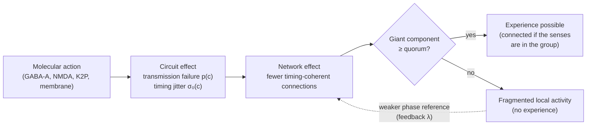

# Neuroscience: open questions, hypotheses and models

This repository collects hypotheses, formal models and reproducible simulations that address unresolved questions in neuroscience. Each entry states its claims explicitly, separates established findings from hypothesis, and lists the experimental results that would refute it.

> **Status.** The material here has not been peer reviewed. It is published to invite scrutiny, replication and criticism.

**Cite as:** Santos de Oliveira, G., & Gertrudes Ferreira, C. (2026). *The Distributed Perceptual Consensus Hypothesis of General Anaesthesia* (Version 1.0.0) [Preprint]. Zenodo. https://doi.org/10.5281/zenodo.23670829

## Contents

### The Distributed Perceptual Consensus hypothesis of general anaesthesia

General anaesthetics are chemically unrelated and act on many molecular targets, yet they bring patients to a similar end point: unresponsiveness that reverses when the drug wears off. The paper proposes that experience requires signals between brain areas to arrive within a short window of a shared rhythm, and the connections doing so to link a quorum, a minimum share of the network (the words are borrowed from distributed computing in their everyday sense only). Anaesthetics, whatever their molecular target, would increase transmission failure and timing variability until the timing-coherent connections no longer link a quorum.



The feedback loop in the diagram can make the transition bistable, so that consciousness returns at a lower concentration than the one at which it was lost. This hysteresis is measured experimentally and is known as neural inertia. The percolation model reproduces the measured hysteresis once its feedback is calibrated, up to a ceiling below the largest measured ratio, and on networks not used for the calibration slightly below its target; the phase-oscillator model does not show it.

- **Paper:** [`white_paper_anesthesia_consensus.md`](white_paper_anesthesia_consensus.md) ([PDF](white_paper_anesthesia_consensus.pdf); Brazilian Portuguese translation: [`.pt-BR.md`](white_paper_anesthesia_consensus.pt-BR.md), [PDF](white_paper_anesthesia_consensus.pt-BR.pdf))
- **Falsifiable predictions:** Section 8 of the paper
- **Simulations and results:** Appendices B and C of the paper, with the model revision history in Appendix D, and the [`simulator/`](simulator/) directory
- **Tests on open recordings:** Appendix E (pre-specifications, deviations and results, confirmatory and exploratory), and the [`analysis/open_data/`](analysis/open_data/) directory
- **Text moved out of the main paper, with every number:** Appendix F

## Repository layout

| Path | Contents |
|---|---|
| [`white_paper_anesthesia_consensus.md`](white_paper_anesthesia_consensus.md) | Hypothesis and theory paper, with results and code listings in Appendices B and C and the model revision history in Appendix D |
| [`white_paper_anesthesia_consensus.pt-BR.md`](white_paper_anesthesia_consensus.pt-BR.md), [`.pdf`](white_paper_anesthesia_consensus.pt-BR.pdf) | Brazilian Portuguese translation of the paper; the English text is authoritative; Appendices B onwards and the references are not translated |
| [`figures/`](figures/) | Figures of the paper, generated from the result files |
| [`explainer/`](explainer/) | Interactive explainer: open `explainer/index.html` in a browser to watch the percolation model break quorum on the *C. elegans* connectome. The browser model is a second implementation in JavaScript, also written with AI assistance, checked against the Python model by tests. Each figure says whether it is a live model, a schematic, data or a reported result; parameters and results are exported from the simulator by `simulator/explainer_export.py`, and every study report, current and superseded, can be opened in its results archive (`simulator/results_catalogue.py`). Tests: `node --test explainer/tests/explainer.test.js` |
| [`simulator/`](simulator/) | Models, studies and tests (below) |
| [`simulator/results/`](simulator/results/) | Every study's report: JSON with every measurement, and a Markdown summary, each recording machine, software, timestamps and source hashes |
| [`CITATION.cff`](CITATION.cff) | Citation metadata |
| [`LICENSE`](LICENSE), [`LICENSE-CC-BY-4.0`](LICENSE-CC-BY-4.0) | Apache 2.0 for code; CC BY 4.0 for the paper, figures and documentation |
| [`NOTICE.md`](NOTICE.md) | Third-party software and data, with licences and attributions |
| [`analysis/`](analysis/) | Pre-specifications committed before each run (C.12 to C.14, Appendix E and E.15), the data assessment of 20 October 2026 and the Zenodo deposit checklist |
| [`analysis/open_data/`](analysis/open_data/) | Code of the open-data tests (Appendix E): download with checksums, pipelines, group statistics and verdicts (`run.py`), the documented deviations (`deviations.py`, `exploratory_group.py`, `reseeded.py`), the round-3 reanalyses, and every result in `results/`. Tests: `.venv/bin/python -I analysis/open_data/run_tests.py` |
| [`tools/audit/`](tools/audit/) | `number_trace.py` traces every number in the main text to a printed report value; `reference_check.py` checks every reference against Crossref |

### Models

| File | Model |
|---|---|
| [`dpc_simulator.py`](simulator/dpc_simulator.py) | Percolation model of the hypothesis (Section 4); standard library only |
| [`glial_regulation.py`](simulator/glial_regulation.py) | Glial extensions of the percolation model: myelin, microglia and astrocytes (postulate P9); standard library only |
| [`phase_dynamics.py`](simulator/phase_dynamics.py) | Phase-oscillator (Kuramoto-Sakaguchi) model on empirical connectomes |
| [`excitatory_inhibitory.py`](simulator/excitatory_inhibitory.py) | Wilson-Cowan excitatory-inhibitory model, used to test the congestion account |
| [`plant_tissue.py`](simulator/plant_tissue.py) | FitzHugh-Nagumo excitable tissue, the cellular control |
| [`connectomes.py`](simulator/connectomes.py) | Loaders for the *C. elegans*, *Drosophila* and human connectomes, with integrity checks |
| [`reporting.py`](simulator/reporting.py), [`provenance.py`](simulator/provenance.py) | Shared report writing, progress and parallel runs; machine, software and source-hash records for every report |
| [`comparisons.py`](simulator/comparisons.py) | Comparisons of grid-derived values that treat rounding as equality, used by every verdict |
| [`public_labels.py`](simulator/public_labels.py) | The labels the paper uses for tests whose report identifiers clash with other names (Appendix C.9) |
| [`prespecified_runs.py`](simulator/prespecified_runs.py) | What every pre-specified study shares: fresh seeds, the pass rule, the run loop and the outcome table |
| [`calibration.py`](simulator/calibration.py) | Every parameter of the oscillator study, labelled measured, calibrated or free, with its source |

### Studies

| File | What it does |
|---|---|
| [`calibrate_feedback.py`](simulator/calibrate_feedback.py) | Calibrates the percolation model to published neural-inertia ratios |
| [`validation_study.py`](simulator/validation_study.py) | Tests the model's claims across network sizes from 302 to 1,000,000 nodes |
| [`glial_study.py`](simulator/glial_study.py) | Tests the glial predictions of postulate P9 across network sizes |
| [`percolation_thresholds.py`](simulator/percolation_thresholds.py) | Quorum thresholds of the three connectomes: formula against measurement |
| [`calibrate_phase_feedback.py`](simulator/calibrate_phase_feedback.py) | Attempted calibration of the oscillator model's feedback |
| [`sensitivity_study.py`](simulator/sensitivity_study.py) | Varies every free parameter one at a time |
| [`congestion_study.py`](simulator/congestion_study.py) | Tests the congestion account and graceful degradation; `--confirm` runs the confirmatory test on fresh seeds |
| [`species_study.py`](simulator/species_study.py) | Tests the pillars on the three connectomes and on plant tissue |
| [`convergence_study.py`](simulator/convergence_study.py) | Checks that the oscillator results do not depend on the integration time or step |
| [`prespecified_study.py`](simulator/prespecified_study.py) | Runs the tests fixed in advance in Appendix C.7 (K2, feedback faults; T1c, replication of T1b, reported as P1c and P1b) on fresh seeds |
| [`learned_timing_study.py`](simulator/learned_timing_study.py) | Pre-specified test of P4b in Appendix C.10 (L1 to L4: learned arrival times) |
| [`disconnection_study.py`](simulator/disconnection_study.py) | Pre-specified test K1c in Appendix C.11 (sensory disconnection with the broadcast floor removed) |
| [`diagnostics/`](simulator/diagnostics/) | Post hoc diagnostics, with no verdict, each explaining a result; their reports and a summary are in `simulator/results/diagnostics/` |
| [`explainer_export.py`](simulator/explainer_export.py) | Exports the parameters, predictions and test outcomes the explainer shows, from the latest reports |
| [`results_catalogue.py`](simulator/results_catalogue.py) | Lists every report, current and archived, for the explainer's results archive; reports are never changed or removed |
| [`figures.py`](simulator/figures.py), [`paper_appendices.py`](simulator/paper_appendices.py) | Build the figures and Appendices B to D from the latest reports |

## Reproducing the results

The percolation model and its studies need only Python 3.10 or later. Everything else needs Python 3.13 and the packages pinned in [`simulator/requirements.txt`](simulator/requirements.txt). The three connectome datasets are downloaded on first use into `data/raw/` and checked against pinned SHA-256 digests; the studies use them as downloaded and do not redistribute them; the explainer redistributes derived summaries under their licences (see `NOTICE.md`).

```sh
git clone <repository-url>
cd neuroscience
python3.13 -m venv .venv
.venv/bin/pip install -r simulator/requirements.txt
cd simulator

../.venv/bin/python -m unittest discover -s tests -t .   # tests
python3 validation_study.py --quick                       # short check, seconds
```

Appendix C.9 of the paper lists the commands that reproduce every simulation result in order, and Appendices E.11 and E.15 those of the open-data analyses. The percolation-model studies B.3, B.4 and B.7 ran on CPython 3.15.0, everything else on CPython 3.13.2. The order in which code, pre-specifications and results were committed can be checked in this repository's public Git history. The full set takes several hours on a ten-core laptop, mostly for the *Drosophila* connectome. Every study prints its progress, with the share completed and the estimated time remaining.

Each report records the start and end time, the machine model, processor, core count, memory, operating system, Python and package versions, Git commit and the SHA-256 hash of every simulator module that ran, together with every parameter. A study exits with a non-zero status when a pre-specified test fails; that is a result, recorded in the report, not an error.

Every random draw is seeded. A rerun with the same Python and package versions should reproduce the published numbers exactly on any hardware, apart from the timings. Other versions may draw different random sequences, so their results should agree statistically rather than exactly.

### Building the PDFs

The PDFs are built from the Markdown sources by [`tools/pdf/build.mjs`](tools/pdf/build.mjs), which needs Node.js and an installed Google Chrome. The body text is set in Source Serif 4 from `explainer/assets/fonts/`, so the PDFs embed openly licensed fonts.

```sh
cd tools/pdf
npm install
node build.mjs ../../white_paper_anesthesia_consensus.md ../../white_paper_anesthesia_consensus.pdf
node build.mjs ../../white_paper_anesthesia_consensus.pt-BR.md ../../white_paper_anesthesia_consensus.pt-BR.pdf
```

Adding `--draft "<text>"` prints the text as a banner and in every page footer, for internal review copies.

### Tests and coverage

The test suite checks the models against known analytical results (the percolation threshold of a random graph, the giant-component equation, the FitzHugh fixed point, the effect of Gaussian timing error on coupling), checks dataset integrity, builds every report from synthetic data, and checks that the code printed in the paper is identical to the source. Coverage is measured with [coverage.py](https://coverage.readthedocs.io/):

```sh
../.venv/bin/pip install coverage
../.venv/bin/python -m coverage run --source=. --omit="tests/*" -m unittest discover -s tests -t .
../.venv/bin/python -m coverage report
```

## Scope and limitations

The simulations show that the formal model is internally consistent and produces the behaviour the paper attributes to it. They cannot show that the brain works this way. That question can only be settled by the experiments proposed in Section 8 of the paper. Some parameters are taken from published physiology, one (the strength of reference feedback) is calibrated to published measurements of neural inertia, and the rest are free; the sensitivity analysis reports how the results depend on them. No experiment on humans or animals was performed for this work; Appendix E reanalyses three public, de-identified datasets of humans and macaques, which are not redistributed (`NOTICE.md`). The paper lists its limitations in Section 10.

## Authors

- Gabriel Santos de Oliveira, staff software engineer and independent researcher. ORCID: [0009-0003-9528-9731](https://orcid.org/0009-0003-9528-9731). Lattes CV: [lattes.cnpq.br/2102695116731989](https://lattes.cnpq.br/2102695116731989). BSc in Computer Science, Universidade Federal Rural do Rio de Janeiro (UFRRJ), Brazil, 2015–2021.
- Callina Gertrudes Ferreira, undergraduate student of psychology, Universidade Veiga de Almeida (UVA), Brazil, since February 2025. ORCID: [0009-0002-8512-213X](https://orcid.org/0009-0002-8512-213X). Lattes CV: [lattes.cnpq.br/2112739936897542](https://lattes.cnpq.br/2112739936897542).

Written with the help of AI tools: Claude Opus 5.5 (Anthropic), through Claude Code, for code, text and references, and Gemini in Google Search (AI Mode, Google; model version not disclosed by the service) for early exploration on 17 October 2026. The authors directed the work and take responsibility for it; see the paper's declarations.

## Citing this work

Use the **Cite this repository** button on GitHub or the metadata in [`CITATION.cff`](CITATION.cff). For example:

> Santos de Oliveira, G., & Gertrudes Ferreira, C. (2026). *The Distributed Perceptual Consensus Hypothesis of General Anaesthesia* (Version 1.0.0) [Preprint and software].

## Contributing

Critiques, replications and counter-evidence are welcome. Please open an issue that cites the specific section, claim or prediction concerned, and include references or data where possible. Reports of errors in citations, terminology or the code are particularly useful.

## Disclaimer

This repository contains theoretical research and computer simulations. It is not medical advice and must not be used to guide the clinical administration of anaesthesia or any other treatment.

## Licence

| Material | Licence |
|---|---|
| Source code (`simulator/` and any other code) | [Apache License 2.0](LICENSE) |
| Paper, figures, diagrams and other documentation | [Creative Commons Attribution 4.0 International (CC BY 4.0)](LICENSE-CC-BY-4.0) |
| Explainer text and study reports in `explainer/data/results/` | CC BY 4.0 |
| Third-party data and typefaces redistributed in `explainer/` | Their own licences (MIT, CC BY 4.0, SIL OFL 1.1), listed in [`NOTICE.md`](NOTICE.md) |
| Photographs of the authors (`explainer/assets/*.jpg`) | All rights reserved; published with consent; not covered by CC BY |

Third-party software and data used by this repository, with their licences and required attributions, are listed in [`NOTICE.md`](NOTICE.md).
