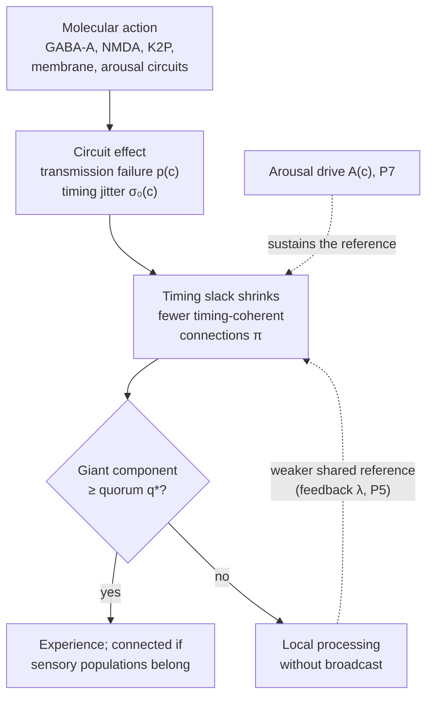
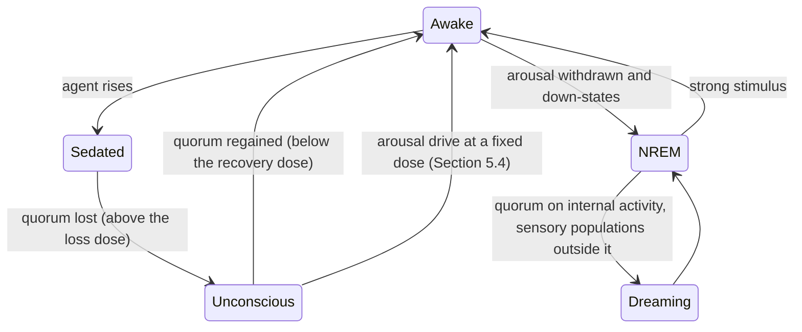

# The Distributed Perceptual Consensus Hypothesis of General Anaesthesia

**A timing-constrained network model of anaesthetic-induced unconsciousness**

| | |
|---|---|
| **Authors** | Gabriel Santos de Oliveira<sup>1</sup> ([ORCID 0009-0003-9528-9731](https://orcid.org/0009-0003-9528-9731); [Lattes CV](https://lattes.cnpq.br/2102695116731989)); Callina Gertrudes Ferreira<sup>1</sup> ([ORCID 0009-0002-8512-213X](https://orcid.org/0009-0002-8512-213X); [Lattes CV](https://lattes.cnpq.br/2112739936897542)) |
| **Affiliations** | <sup>1</sup> Independent researchers, Rio de Janeiro, Brazil. The work was not carried out at or funded by any institution |
| **Date** | [DATE OF DEPOSIT] |
| **Version** | 1.0.0 (first public release; includes the revisions of the third and fourth AI review rounds, 21 and 22 October 2026) |
| **Article type** | Hypothesis and theory paper (not peer reviewed) |
| **Licence** | Text and figures: [CC BY 4.0](LICENSE-CC-BY-4.0). Code: [Apache License 2.0](LICENSE) |
| **Keywords** | general anaesthesia; consciousness; thalamocortical system; percolation; distributed consensus; neural synchrony; neural inertia; perturbational complexity index |

---

## Abstract

We propose the **Distributed Perceptual Consensus (DPC) hypothesis**: experience requires that signals between brain areas arrive within a short window of a shared rhythm, and that the connections doing so span a quorum, a minimum share of the network. Chemically diverse anaesthetics would remove such connections by transmission failure, timing variability or both. Extending Zhou et al.'s (2015) percolation model, DPC predicts that the giant component of connections whose evoked inter-areal latency stays within the window collapses at loss of responsiveness, and that this latency's trial-to-trial variability, not its mean, rises first, a clause also expected from communication through coherence. Simulations on three connectomes show only that the mechanism can operate, when the timing window is not much narrower than the timing jitter (both 3 ms, unmeasured between areas). In a phase-oscillator model, transmission failure abolishes quorum, as the chosen maxima guarantee, but mostly only beyond the 62% failure measured in culture, except on the human connectome with both directions of a connection required on time. There, timing variability alone abolished quorum only under counting rules adopted after the pre-specified rule failed, at a free maximal timing error of 40 ms, and only because a signal a whole cycle or more late counts as lost, not as on time in a later cycle. Pre-specified open-data tests were inconclusive (macaque electrocorticography) or could not run (functional MRI); exploratorily, by a descriptive criterion, its coupling network stayed intact through loss of responsiveness but had little room to fall. Six proposed mechanisms failed.

---

## 1. Introduction and scope

### 1.1 The problem

180 years after the first public demonstration of ether anaesthesia, no consensus exists on how anaesthetics produce unconsciousness (Franks, 2008; Alkire et al., 2008; Hemmings et al., 2019). The agents are structurally unrelated (from the monatomic gas xenon to the alkylphenol propofol), act on many molecular targets and produce distinct electroencephalographic (EEG) signatures, yet converge on a similar behavioural endpoint. A satisfactory account must explain how *heterogeneous molecular causes* produce a *common systems-level effect*. The search for a single molecular mechanism did not succeed, because the molecular facts are genuinely diverse (Section 2.1). DPC therefore seeks unification one level up: many molecular routes converging on one form of network failure.

### 1.2 What this paper claims, and what it does not

This is a **hypothesis**, not a theorem: its value lies in whether its predictions survive experimental test. It concerns the conditions under which experience and reportable content are present, not what that content is or why it is accompanied by experience. Claims are marked **[E]** (established, with citation) or **[H]** (a novel or contested claim of this paper, stated so that it can be falsified); the two analogies kept from computing are marked **[A]** and carry no claim.

**One condition limits every simulation result.** Results hold only when the inter-areal timing window $W$ is not much narrower than the timing jitter $\sigma_b$ (reference $W = \sigma_b$ = 3 ms; with $W$ = 1 ms or $\sigma_b$ = 10 ms the awake model has no quorum), and neither has been measured between areas (Section 4.7).

**The postulates.** The core of the hypothesis is P1 to P5, P4c and P7 (Section 3.2). P6, P8 and P9 are auxiliary proposals on which the core does not depend (Section 3.3), and the claim that constant delays are harmless is an open question (Section 3.4).

| Postulate | In one line | Status in the models (Section 6) |
|---|---|---|
| P1 Integration cycles | Experience is generated in repeated cycles in which distributed populations converge on a shared state | Assumed, not tested |
| P2 Bounded-delay condition | A population contributes to a cycle only if its signals arrive within a window $W$ around a shared rhythm; a signal outside it is lost to that cycle, not counted in a later one (a rule asserted, not supported) | Implemented in the percolation model, and in the oscillator model by a readout added later |
| P3 Quorum | Any experience requires a giant component of timing-coherent connections containing at least a share $q^*$ of the populations; connected (reportable, responsive) consciousness further requires that sensory populations belong to it. When a connection between two populations counts is not yet specified | As for P2 |
| P4 Two failure modes | Anaesthetics remove timing-coherent connections by making transmission fail or by making the trial-to-trial timing of inter-areal signals variable relative to the shared rhythm, not single-neuron timing | Transmission failure abolishes quorum by construction; timing variability does so on both invertebrate connectomes under the pre-specified rule, and on the human connectome only under rules adopted after a failure |
| P4c Anaesthetic unconsciousness | Where an agent abolishes experience, not only responsiveness, the giant component lies below $q^*$; where experience persists without responsiveness, it stays above $q^*$ | Assumed: the models read the loss of quorum as the anaesthetic endpoint; not tested |
| P5 Reference feedback | The shared rhythm is sustained by the coherent group itself, so a smaller group weakens it | Produces inertia in the percolation model once calibrated; absent from the oscillator model |
| P7 Arousal | Wake-promoting arousal systems sustain part of the shared rhythm independently of cortical coherence | In the equations; recovery driven by arousal at a fixed concentration reproduced in the percolation model, a consistency check |
| P6 Default dynamics (auxiliary) | When quorum is lost, cortex falls into its own local, agent-specific dynamics | Not tested |
| P8 Graceful degradation (auxiliary) | As timing slack shrinks, the rhythm slows and activity turns into bursts | Its distinctive prediction failed |
| P9 Glial control (auxiliary) | Slower glial loops maintain the conditions for timing coherence | Consistency checks only; its one test could not have passed |

**What is new, and what is borrowed.** Communication through coherence (Fries, 2005, 2015), recurrent processing (Lamme and Roelfsema, 2000; Lamme, 2006), functional disconnection as the common end point of anaesthesia (Hudetz and Mashour, 2016), percolation models of anaesthesia and perception (Zhou et al., 2015; Arese Lucini et al., 2019) and feedback-driven hysteresis (Kim et al., 2018) all precede this paper (Section 2.3). P3 and P7 overlap with the global neuronal workspace (GNW): a global, all-or-none state of availability whose threshold an arousal input sets (Dehaene and Changeux, 2005; Mashour et al., 2020). The closest model is that of Zhou et al. (2015), in which anaesthesia lowers one transmission probability on a layered network, loss of consciousness appears as a percolation transition, and the EEG signatures of anaesthesia are reproduced, which this paper does not attempt. The paper contributes:

1. Timing variability between areas as a second route to the loss of usable connections, combined with transmission failure into one probability per connection; the two routes can be told apart only by measuring each.
2. The proposal [H] that what anaesthetics degrade is the *variability* of inter-areal timing relative to a shared rhythm, rather than its mean or the coherence of ongoing rhythms (predictions 3 and 8), and that through P3 this variability sets a network threshold (prediction 1, with its timing edge rule). The variability clause is shared with communication through coherence; the threshold is not.
3. An application of the standard generating-function estimate (Callaway et al., 2000) to a quorum threshold, rather than the onset, for each connectome's degree distribution; the estimate is known to be accurate on clustered networks whose mean shortest-path length is small (Melnik et al., 2011), and it is compared with measurement on the wiring of a nematode, an insect and a human.
4. The proposal [H] that arousal drive restores quorum at a fixed concentration by strengthening the shared rhythm (P7). Its prediction, that between the concentrations of recovery and loss the restoration outlasts the stimulus, is shared by any account with two stable states (Section 8).
5. A readout of a phase-oscillator model on the three connectomes that applies DPC's window and quorum, extending the giant component of synchronised links (Gómez-Gardeñes et al., 2007) to each connection's timing error.
6. Fifteen falsifiable predictions, an analysis protocol, pre-specified tests on open recordings and an open, tested simulator in which every parameter is labelled measured, calibrated, assumed or free.

### 1.3 Scope and definitions

General anaesthesia comprises unconsciousness, amnesia, analgesia and immobility. Brown et al. (2010) describe it as a reversible drug-induced coma rather than sleep: burst suppression, seen in deep anaesthesia and coma, does not occur in sleep. **This hypothesis addresses only unconsciousness.** Immobility, the basis of the minimum alveolar concentration (MAC) standard (Eger et al., 1965), does not depend on the forebrain (Rampil et al., 1993) and is mediated largely in the spinal cord (Antognini and Schwartz, 1993; Rampil, 1994). Memory and responsiveness can be impaired separately (Veselis et al., 1997).

We follow Sanders et al. (2012). *Responsiveness* is a behavioural response to a command or stimulus; its loss is loss of responsiveness (LOR) in humans and loss of righting reflex (LORR) in rodents. *Connected consciousness* is experience that includes awareness of the environment; *disconnected consciousness* is experience without it, as in dreaming; *unconsciousness* is the absence of any experience. P3 maps onto these distinctions directly: a giant component of timing-coherent connections below quorum means unconsciousness; above quorum but without the sensory populations, disconnected consciousness; above quorum and including them, connected consciousness. Unresponsiveness is therefore not equivalent to unconsciousness.

### 1.4 Terminology

Every term is used in one defined sense (Appendix A). The argument rests on six: *timing-coherent* connections, the *integration window*, *timing slack*, the *giant component*, *quorum* and *neural inertia*. A timing-coherent connection is also called *occupied*, the percolation term; the shared rhythm is also called the *phase reference*. "Percolation transition" in this paper means the loss of quorum, the concentration at which the giant component falls below $q^*$, not the percolation critical point (Section 4.2). LOR is used wherever the measurement is behavioural, and loss of consciousness only where the cited study used the term or had evidence beyond behaviour.

**Borrowed words.** *Consensus* and *quorum* are borrowed from distributed computing for their everyday sense: a minimum share of the parts that must take part for an outcome to count. No consensus-theoretic property is claimed or transferred: the populations agree on no value, there is no validity condition and no quorum intersection, and no impossibility result or tolerance bound (Fischer et al., 1985; Dwork et al., 1988; Lamport et al., 1982) applies to the brain. Those results motivated P2 and P4 and constrain nothing. Agreement in DPC means only that the populations are linked into one group by connections whose signals arrive in time; there is no vote and no voter. *Perceptual* in the hypothesis's name is historical: the hypothesis concerns any experience (P3), not perception alone.

---

## 2. Background

### 2.1 Molecular mechanisms [E]

The Meyer-Overton correlation of potency with lipid solubility (Meyer, 1899; Overton, 1901) motivated a century of lipid theories, but lipid solubility alone is insufficient: anaesthetics inhibit the lipid-free enzyme firefly luciferase at matching potencies (Franks and Lieb, 1984); optical isomers of isoflurane differ in their effects on ion channels (Franks and Lieb, 1991); some lipophilic compounds, the non-immobilisers, violate the correlation (Koblin et al., 1994); a point mutation (N265M) in the β3 subunit of the γ-aminobutyric acid type A (GABA-A) receptor strongly reduces the effects of propofol and etomidate in mice (Jurd et al., 2003); and xenon barely affects GABA-A receptors but inhibits N-methyl-D-aspartate (NMDA) receptors (Franks et al., 1998). Membrane-mediated routes remain plausible contributors (Cantor, 1997; Pavel et al., 2020). Anaesthetics act on multiple targets, chiefly GABA-A receptors, NMDA receptors and two-pore-domain potassium (K2P) channels, with agent-specific profiles (Rudolph and Antkowiak, 2004; Hemmings et al., 2019). P4 assigns each route a fault type [H] (Appendix F.1, with the agents, ion flows and sources): GABA-A receptor potentiation (Mihic et al., 1997; Jurd et al., 2003), K2P channel activation (Patel et al., 1999; Gruss et al., 2004; Heurteaux et al., 2004), presynaptic Na⁺ channel inhibition (Herold and Hemmings, 2012; Baumgart et al., 2015) and lipid-domain disruption (Pavel et al., 2020) would cause transmission failure; NMDA receptor block (Orser et al., 1997; Franks et al., 1998; Jevtović-Todorović et al., 1998; Dickinson et al., 2007) timing variability and transmission failure; inhibition of hyperpolarisation-activated cyclic-nucleotide-gated (HCN) channels (Chen et al., 2005; Ying et al., 2006; Chen et al., 2009) altered rhythm and timing; α2-adrenoceptor agonism by dexmedetomidine (Nelson et al., 2003) arousal suppression (P7); and mitochondrial complex I is a sensitivity factor (Kayser et al., 1999). Two unconfirmed proposals (microtubules and nuclear spin) are also in Appendix F.1. **Implication:** DPC requires only that agents increase transmission failure, timing variability or both at the circuit level.

### 2.2 Systems-level findings [E]

- **Thalamocortical involvement.** Volatile agents suppress thalamic and midbrain reticular activity in humans (Alkire et al., 2000); nicotine in the central medial thalamus reverses sevoflurane-induced LORR in rats (Alkire et al., 2007); thalamic stimulation restores arousal in anaesthetised macaques (Redinbaugh et al., 2020). Whether thalamus or cortex changes first is open (Velly et al., 2007; Fan et al., 2026).
- **Breakdown of cortical communication.** Propofol, sevoflurane and ketamine disrupt frontal-parietal feedback connectivity (U. Lee et al., 2013). At propofol-induced unconsciousness, spiking is confined to brief phase windows of a slow oscillation, asynchronous across cortex (Lewis et al., 2012; read as fragmented timing by Kordas, 2026). Under anaesthesia, functional connectivity in monkeys comes to mirror anatomy (Barttfeld et al., 2015; Uhrig et al., 2018). Reviews conclude that unresponsiveness accompanies frontoparietal disconnection (Hudetz and Mashour, 2016), reduced complexity and repertoire (Mashour and Hudetz, 2018) and reduced network efficiency (Lee and Mashour, 2018).
- **Agent-specific EEG signatures.** Propofol produces beta power in sedation, then coherent frontal alpha (8 to 12 Hz) with slow-delta (0.1 to 4 Hz) oscillations at LOR (Purdon et al., 2013, 2015; Ching et al., 2010); ketamine produces gamma power and no frontal alpha (Akeju et al., 2016). Anaesthetics also decouple the apical dendrites of mouse layer 5 pyramidal neurons from their somata (Suzuki and Larkum, 2020).
- **Loss of coordination, not of activity, across species.** Isoflurane leaves *Caenorhabditis elegans* head neurons active but collapses their correlations (Awal et al., 2020); in *Drosophila* it reduces stimulus-locked coherence in central brain regions (Cohen et al., 2016), impairs low-frequency feedback (Cohen et al., 2018) and fragments integrated activity (Leung et al., 2021). Human connectivity under anaesthesia becomes less individual (Luppi et al., 2025; a single study).
- **Complexity.** The perturbational complexity index (PCI) is high in wakefulness, low under propofol and xenon and high under ketamine, consistent with dream reports on emergence (Sarasso et al., 2015; Casali et al., 2013).
- **Neural inertia.** Consciousness returns at a lower concentration than it is lost, not fully explained by pharmacokinetics, in mice and *Drosophila* (Friedman et al., 2010; Joiner et al., 2013); the ratio of induction to emergence concentration is about 1.08 for isoflurane and 2.85 for halothane in mice (Friedman et al., 2010). Human ratios are about 1.07 and 1.11 for predicted (target-controlled infusion, TCI) propofol effect-site concentrations, whose authors found no consistent hysteresis or call the values similar (Warnaby et al., 2017; Iwakiri et al., 2005), and about 1.63 for measured serum propofol, whose authors caution that incomplete equilibration could explain it (Sepúlveda et al., 2018). A prospective study designed to test human neural inertia, in 36 volunteers, found none for propofol but found it for sevoflurane at most endpoints, for loss of responsiveness only with remifentanil (Kuizenga et al., 2018). Whether it exists in humans is therefore contested, and P5's account is conditional on it. Recovery passes through discrete metastable states (Hudson et al., 2014).
- **Glial cells.** Anaesthetics suppress astrocytic calcium signals (Thrane et al., 2012), manipulating astrocytes or microglia changes induction and emergence in region-dependent and partly confounded ways, and myelin sets conduction timing (Ford et al., 2015; Kato et al., 2020); details in Appendix F.2.

### 2.3 Prior models and the position of DPC

| Framework | Relationship to DPC |
|---|---|
| Communication through coherence (Fries, 2005, 2015): groups communicate when their windows for sending and receiving coincide, and their mutual influence depends on the phase relation of their rhythms (Womelsdorf et al., 2007) | P2 is this condition. DPC adds that anaesthetics make inter-areal timing variable, and asks how many connections must meet it for integration across the network |
| Perceptual cycles (VanRullen and Koch, 2003; VanRullen, 2016); recurrent processing (Lamme and Roelfsema, 2000; Lamme, 2006) | P1 adopts recurrent cycles; DPC adds a timing condition and a network-level quorum |
| Large-scale integration by phase synchronisation across frequency bands (Varela et al., 2001); thalamocortical binding by temporal coincidence (Llinás et al., 1998) | P1, P2 and P5 restate these; DPC adds a counting threshold (P3) and assigns anaesthetics to transmission failure and timing variability |
| Cognitive unbinding (Mashour, 2013) | DPC proposes a specific reason synthesis fails: a violated bounded-delay condition |
| Integrated information theory (Tononi et al., 2016) | DPC's order parameter is not Φ and does not approximate it |
| Global neuronal workspace (GNW; Dehaene and Changeux, 2011; Mashour et al., 2020) | DPC's quorum is a percolation operationalisation of global availability. GNW models already contain synaptic delays and all-or-none ignition (Dehaene et al., 2003; Dehaene and Changeux, 2005) and a vigilance input that sets the threshold of ignition (Dehaene and Changeux, 2005), and GNW has been applied to anaesthesia (Mashour et al., 2020). DPC differs in making the variability of inter-areal timing, not excitability, the controlled variable, and in deriving the threshold from the degree distribution |
| Bistability and OFF-periods (Sanchez-Vives et al., 2017; Pigorini et al., 2015; D'Andola et al., 2018; Rosanova et al., 2018) | After an input, bistable cortex falls into silent OFF-periods that interrupt causal interactions and lower perturbational complexity, in non-rapid-eye-movement (NREM) sleep, in vitro and in unresponsive wakefulness syndrome; responses to transcranial magnetic stimulation stay local in NREM sleep and under midazolam (Massimini et al., 2005; Ferrarelli et al., 2010). DPC's down-states and omission faults are an instance; DPC adds the timing route and a network threshold |
| Thalamocortical switch (Alkire et al., 2000); mean-field phase transitions (Steyn-Ross et al., 1999; Bojak and Liley, 2005); dendritic integration (Aru et al., 2020) | DPC assigns the thalamus a shared reference, not a switch; it treats the loss as a transition in a network of discrete connections without modelling the EEG; dendritic decoupling is a candidate cellular route to omission faults |

Quantitative models already contain elements of DPC and must be credited (details in Appendix F.2): percolation of the giant component when synapses are weakened in cultures (Breskin et al., 2006); k-core percolation of conscious and subliminal perception (Arese Lucini et al., 2019); one transmission probability on a thalamocortical network that reproduces EEG features of anaesthesia (Zhou et al., 2015), which already placed every agent on one transmission parameter; burst-suppression hysteresis from percolation on self-similar networks (Su et al., 2020); percolation of functional connectivity on the fly connectome (Tian and Sun, 2022); a recurrent network fitted to macaque electrocorticography under anaesthesia (Du and Huang, 2025); explosive synchronisation after anaesthetic-induced unconsciousness (Kim et al., 2016); hysteresis from adaptive feedback in connectome oscillators, linked to potency (Kim et al., 2018), to which P5 is closely related; hub-periphery phase relations and hub reconfiguration under anaesthesia (Moon et al., 2015; H. Lee et al., 2013); feedback through which a unit's links depend on the state of others, which makes percolation abrupt in interdependent networks (Buldyrev et al., 2010) and synchronisation explosive when links are controlled by a local order parameter (Zhang et al., 2015), the class to which P5 belongs; and metastable recovery states with noise-driven inertia (Hudson et al., 2014; Proekt and Hudson, 2018). What DPC claims as new is therefore narrower than a percolation or hysteresis model as such (Section 1.2).

---

## 3. The hypothesis

### 3.1 Motivation

In distributed computing, deterministic agreement is impossible in a fully asynchronous system if one process can crash (Fischer et al., 1985) and becomes achievable under *partial synchrony*, when delays are bounded (Dwork et al., 1988); a message that never arrives is an *omission* fault and one outside its agreed time a *timing* fault (Cristian, 1991). DPC borrows the synchronous round model as its one structural analogy [A]: in each round, messages that miss the round are dropped. Partial synchrony motivated the question but is not the model, since its bounds are unknown or hold only eventually (Appendix F.3). The brain repeatedly settles on one coherent state from signals that reach different areas at different times, and P2 proposes that it can do so only while inter-areal delays stay within a fixed window. Nothing else is transferred (Section 1.4); the engineered systems behind individual postulates are tabulated in Appendix F.3.

The timing problem is real at cortical scale: in human cortico-cortical pathways the median axonal delay is about 10 ms (Lemaréchal et al., 2022), and at 40 Hz a gamma cycle lasts 25 ms, so a typical delay is about 40% of a cycle. In that regime DPC proposes that timing is a first-order constraint on communication [H]. A constant delay can be absorbed by a matching phase offset (Fries, 2015); the proposal concerns its variability.

### 3.2 Postulates of the core [H]

**The central claim.** Experience requires *positive timing slack*: signals between populations must arrive within the window in which they can be combined, judged against a shared rhythm. Anaesthetics erode that slack by making transmission fail or arrival times vary, and when it turns negative on enough connections the populations are no longer linked into one group. The claim concerns timing margins, not a frequency: the hierarchy of brain rhythms is largely preserved across mammals that differ several-thousand-fold in brain volume, possibly through faster long-range axons in larger brains (Buzsáki et al., 2013), which would preserve timing margins [H].



*Figure A. Causal chain of the core hypothesis. Dashed arrows are feedback and modulating influences; the auxiliary proposals P8 and P9 (Section 3.3) would act on the same node C. Symbols are defined in Section 4 and Appendix A.2.*

- **P1 (Integration cycles).** Experience is generated in repeated integration cycles in which distributed populations converge on a shared state. It adopts discrete perceptual epochs (VanRullen and Koch, 2003) and recurrent processing between areas (Lamme and Roelfsema, 2000; Lamme, 2006); related accounts are listed in Appendix F.4. Several rhythms rather than one sample perception (VanRullen, 2016), so a single reference (P5) is a simplification. Anaesthesia disrupts recurrent more than feedforward processing in several studies, though not uniformly (Lee et al., 2009; Imas et al., 2005).
- **P2 (Bounded-delay condition).** A population contributes to a cycle only if its signals arrive within an integration window $W$ relative to the shared phase reference. A signal outside the window is lost to that cycle, and a signal arriving a whole cycle or more late counts as lost rather than as on time in a later cycle, because the content it carries belongs to the cycle in which it was sent [H, unsupported: no evidence that content is specific to a cycle is offered, and the timing-fault route depends on this rule entirely (Section 4.7)]. This is the condition of communication through coherence (Fries, 2005, 2015), stated as an all-or-none rule; the behavioural binding window for multisensory events, about 100 ms or more (Wallace and Stevenson, 2014), is a far wider psychophysical counterpart.
- **P3 (Quorum).** Any experience, connected or disconnected, requires that the timing-coherent connections link a giant component containing at least a share $q^*$ of the populations. Connected (reportable, responsive) consciousness further requires that the sensory populations belong to that component. P3 is a necessary condition, not a sufficient one (Section 7.9). DPC does not yet specify when a connection between two populations counts: when a signal in either direction arrives in time, with one timing per connection, or only when signals in both directions do. The human verdict on timing variability depends on that choice (Appendices C.12 to C.14), and it would be decided by measuring how many human cortical connections are reciprocal and whether the timing of their two directions varies independently. No rule adopted after the failure of Appendix C.12 is part of the hypothesis.
- **P4 (Two failure modes).** Anaesthetics reduce the share of connections that are timing-coherent in one or both of two ways: (a) by increasing the probability that transmission fails (omission faults, for example enhanced GABA-A inhibition and reduced glutamate release; Baumgart et al., 2015); (b) by increasing the trial-to-trial variability of inter-areal signal timing relative to the shared rhythm (timing faults). What becomes variable is the timing of signals *between* areas, which loses precision as the shared rhythm weakens (P5), not the spike timing of single neurons, which the few local measurements find preserved (brainstem auditory neurons under ketamine-xylazine, Jing et al., 2021; insular cortex, Koyanagi et al., 2021, and Kato et al., 2016). The molecular route is proposed to affect the network only through these two quantities and through the arousal share of the rhythm (P7). Assigning ketamine to timing faults is an assumption, not a finding: no study shows that ketamine increases inter-areal timing variability, xenon, also an NMDA antagonist, lowers cortical complexity as propofol does (Sarasso et al., 2015), and the established circuit effect of NMDA receptor inhibition in awake rats is disinhibition (Homayoun and Moghaddam, 2007). The agent's added jitter $\sigma_0(c)$ (Section 4.1) is a placeholder: no circuit mechanism is proposed for it.
- **P4c (Anaesthetic unconsciousness).** At any concentration at which an agent abolishes experience, not only responsiveness, the giant component lies below $q^*$. Where responsiveness is lost but experience persists, the component stays above $q^*$: with the sensory populations outside it in disconnected experience, such as the dreams reported after ketamine (Sarasso et al., 2015) and under dexmedetomidine (Radek et al., 2018), and with them inside it where commands are still followed covertly, as by one participant under propofol (Huang et al., 2018a).
- **P5 (Reference feedback).** The shared phase reference is sustained by the coherent thalamocortical core itself, so a smaller giant component produces a weaker reference and a larger effective timing error on every remaining connection.
- **P7 (Arousal).** Wake-promoting arousal systems sustain part of the shared reference independently of cortical coherence, and anaesthetics suppress them: isoflurane and sevoflurane reduce c-Fos expression in orexinergic neurons (Kelz et al., 2008), and isoflurane depolarises sleep-promoting neurons (Moore et al., 2012). In natural sleep the arousal drive is withdrawn, and during slow-oscillation down-states whole local populations fall silent (Vyazovskiy et al., 2009).

### 3.3 Auxiliary proposals (not part of the core)

The core does not depend on these proposals, and their failures leave it untouched.

- **P6 (Default dynamics).** When quorum is lost, cortex does not fall silent but into its intrinsic local dynamics, such as the slow oscillation (Steriade et al., 1993a), the cortex's default activity pattern (Sanchez-Vives et al., 2017), whose form is agent-specific. Untested in the models (limitation 30).
- **P8 (Graceful degradation).** As timing slack shrinks, the reference rhythm slows, so the same timing error costs a smaller phase error ($2\pi f\sigma$) at the cost of fewer cycles per second, and continuous activity gives way to synchronised bursts. The propofol sequence from beta to frontal alpha with slow oscillations (Purdon et al., 2013, 2015) and burst suppression, whose suppression periods lengthen with dose (Brown et al., 2010), are proposed as its stages; the dominant readings attribute frontal alpha to thalamic mechanisms that impede communication (Purdon et al., 2015; Ching et al., 2010; Vijayan et al., 2013) and burst suppression to reduced metabolism (Ching et al., 2012). Its distinctive prediction failed in the model (Section 6).
- **P9 (Glial control).** Slower glial loops maintain the conditions for timing coherence: oligodendrocytes may adjust conduction delays so that distant signals arrive together (Pajevic et al., 2014, 2023; Noori et al., 2020), astrocytes regulate cortical state over seconds to hours (Poskanzer and Yuste, 2016; Ingiosi et al., 2020), and microglia take part in a noradrenergic loop (Liu et al., 2019; Stowell et al., 2019; Ma et al., 2024) proposed as one biological source of P5's feedback. What P9 adds to established slow regulation (Turrigiano, 2008) is an action on timing coherence (Appendix F.4).

### 3.4 An open question: constant delays

Earlier drafts proposed (as "P4b") that a constant delay is harmless because the brain integrates inputs against learned expectations of when they arrive. The models contain no such anticipation, and in them constant timing errors are not harmless; a learned expectation of arrival phase, tested in advance, failed (Section 6). A receiver that sees only the arrival phase cannot tell a constant delay from the phase relation that coupling maintains, so how constant delays would be made harmless is open. Behavioural adaptation to delays (Fujisaki et al., 2004; Yamamoto and Kawabata, 2011; Beech et al., 2025, 2026) concerns delays far longer than the window. The variability claim, tested by predictions 3 and 8, is part of P4 and does not depend on this question.

---

## 4. Formal model [H]

### 4.1 Network and coherence

Let the brain be a graph $G = (V, E)$ of $N$ neural populations with degree distribution $P(k)$. At effect-site concentration $c$, expressed relative to the agent's half-maximal effective concentration (EC50), the concentration of half the maximal *circuit* effect, each connection transmits with probability $1 - p(c)$. Each agent acts through a Hill dose-response with coefficient $n$:

$$
h(c) = \frac{c^{n}}{1 + c^{n}}, \qquad p(c) = p_{\max}\,h(c), \qquad \sigma_0(c) = \sigma_{\max}\,h(c),
$$

where $p_{\max}$ and $\sigma_{\max}$ are the agent's maximal transmission failure and added jitter (Appendix C.1). The arrival-time error $\delta_e$ of a transmitted signal relative to the phase reference is Gaussian with zero mean and standard deviation $\sigma_{\text{eff}}$ (Section 4.3). A connection is **timing-coherent** if it transmits and $|\delta_e| \le W/2$, with probability

$$
\pi(c) = \bigl(1 - p(c)\bigr)\cdot \operatorname{erf}\!\left(\frac{W}{2\sqrt{2}\,\sigma_{\text{eff}}}\right).
$$

In the percolation model each undirected link of the graph has one failure draw and one timing draw. The DPC readout of the oscillator model at first gave each human link two (one per direction, either sufficing), which is how its pre-specified human result arose (Section 6).

### 4.2 Percolation and quorum thresholds

Treating coherence as bond percolation on a random graph with the given degree distribution, a giant component first appears at (Callaway et al., 2000)

$$
\pi_c = \frac{\langle k \rangle}{\langle k^2 \rangle - \langle k \rangle}.
$$

Quorum asks more than existence. With the generating functions $G_0(x) = \sum_k P(k)x^k$ and $G_1(x) = G_0'(x)/G_0'(1)$, the giant component at occupation $\pi$ is $S = 1 - G_0(u)$, where $u = 1 - \pi + \pi\,G_1(u)$ (Callaway et al., 2000), and the quorum threshold $\pi_q$ solves $S(\pi_q) = q^*$. On the three connectomes $\pi_q/\pi_c$ is 1.7 (*C. elegans*), 7.9 (*Drosophila*) and 1.5 (human) (Appendix B.5), so with $q^*$ = 0.5 the loss of quorum is not the percolation critical point. Without reference feedback it is a level crossing of a smooth $S(\pi)$, where no critical exponents are expected; with large feedback quorum is lost at the fold of the self-consistent solution (Section 4.3), a saddle-node point near which slowing would be expected but not percolation exponents. Hub-dominated networks have a large $\langle k^2\rangle$ and a low $\pi_c$, robust to random failure and vulnerable at hubs (Callaway et al., 2000; Albert et al., 2000). Of the three connectomes only *Drosophila* is strongly heavy-tailed: the coefficient of variation of the undirected degree, which follows from Appendix B.5 as $\sqrt{(1/\pi_c + 1)/\langle k\rangle - 1}$, is about 2.1 there, against 0.61 for *C. elegans* and 0.44 for the human connectome.

### 4.3 Reference feedback and hysteresis

P5 is modelled by letting the effective jitter grow as the giant component shrinks:

$$
\sigma_{\text{eff}} = \sqrt{\sigma_b^2 + \sigma_0(c)^2 + \sigma_{\text{ref}}^2}, \qquad \sigma_{\text{ref}} = \lambda\,\bigl(1 - S\bigr)\bigl(1 - A(c)\bigr), \qquad A(c) = A_0\,\bigl(1 - a\,h(c)\bigr),
$$

where $\sigma_b$ is the agent-independent baseline jitter, the three errors are independent, $\lambda \ge 0$ is the feedback strength, $A(c)$ the arousal share of the reference (P7), $A_0$ its awake value and $a$ the share of the agent's effect acting on arousal circuits. In natural sleep $A_0$ = 0 and down-states silence a share $d$ of whole populations at any moment (or, in an alternative account, make each connection fail with probability $d$). The steady state satisfies $S = F(\pi(c, S))$, with $F$ the giant-component function of the graph. For $\lambda$ = 0 the loss is continuous and has no hysteresis. For large enough $\lambda$ the equation has two stable solutions over a range of concentrations, so quorum is lost at $c_{\text{off}}$ and regained only at a lower $c_{\text{on}}$: **neural inertia emerges once $\lambda$ is large enough**. Because $\lambda$ is chosen to reproduce one measured inertia ratio, reproducing that ratio is a calibration, not a test.

### 4.4 Graded depth

Quorum is a threshold on $S$, but $S$ itself is continuous, consistent with graded sedation. Recordings disagree on how abrupt the transition is: functional connectivity measured with functional magnetic resonance imaging (fMRI) fell gradually during slow propofol induction, while subcortical-cortical connectivity recovered abruptly (Huang et al., 2021b), and several coupling measures persist or rise after LOR (Liang et al., 2025; Dong et al., 2023; Lv et al., 2016; Zhang et al., 2023; Appendix F.5). Coupling magnitude can rise with hypersynchrony (Section 7.8), so it does not test DPC, which predicts an abrupt change only in the giant component of timing-coherent connections (prediction 1).

### 4.5 Phase-oscillator model

In the phase-oscillator implementation (Appendix C) the phase $\theta_i$ of population $i$ evolves as

$$
\dot\theta_i = \omega_i + \frac{K}{s_i}\sum_j w_{ji}\,m_{ji}\,\sin\bigl(\theta_j - \theta_i - \alpha_{ji}\bigr) + \lambda_{\text{osc}}\bigl[R + A(c)(1 - R)\bigr]\sin(\psi - \theta_i) + \xi_i,
$$

with natural frequency $\omega_i$, coupling $K$, input strength $s_i$, weight $w_{ji}$, $m_{ji}$ = 0 for a failed connection and 1 otherwise, phase error $\alpha_{ji}$ (lag plus jitter), magnitude $R$ and phase $\psi$ of the mean rhythm, dimensionless reference strength $\lambda_{\text{osc}}$ and noise $\xi_i$. A node is a region on the human connectome and a neuron on the invertebrate ones, where the model tests the wiring, not the cells (limitation 17). Phase-oscillator networks on connectomes are an established phenomenological description of large-scale synchrony (Kuramoto, 1984; Brown et al., 2004; Cabral et al., 2011; Breakspear, 2017); spikes, synaptic kinetics, rhythm generation and neuromodulation are left out.

**Time scale.** Model time is dimensionless, its scale set by $K$; only timing errors and conduction delays, given in milliseconds, are converted to phase, as $2\pi f\sigma$ at the reference frequency $f$ = 40 Hz, within the gamma band (Fries, 2015). The model's timing results are therefore scale-free: its settling, fluctuation and correlation times cannot be compared with milliseconds, and only the ratio of a timing error to the cycle carries physical meaning. A Gaussian phase error of standard deviation $s$ reduces a connection's coupling on average by $e^{-s^2/2}$, the mean of $\cos\delta$ over the error. P8's slowing reference, numerical convergence and run settings are in Appendices F.5, C.1 and C.4.

### 4.6 Glial regulation (P9, auxiliary)

Each glial loop is a parameter held fixed during a sweep. Damaged myelin raises the baseline jitter, $\sigma_b(\mu) = \sigma_b(1 + \gamma(1 - \mu))$; the microglial loop weakens arousal as the giant component collapses, $A(c, S) = A(c)(1 - g(1 - S))$, with $g$ = 0 for microglial depletion; silencing astrocytes removes their share of down-states, $d \to d(1 - s_a)$. No measurement fixes $\gamma$, $g$ or $s_a$; they are tested at $\gamma$ = 1, $\mu \in$ {1, 0.75, 0.5}, $g \in$ {0, 0.25, 0.5} and $s_a$ = 0.5, and $\lambda$ was calibrated without the microglial loop, so the tests concern directions, not sizes (Appendix B.7).

### 4.7 Status of the model and its parameters

Every parameter is *measured* (a published measurement of the quantity), *calibrated* (fitted to one measurement, then held fixed), *assumed* (a published value of a related quantity, applied where it has not been measured) or *free* (unmeasured). The window $W$ = 3 ms and the baseline jitter $\sigma_b$ = 3 ms are **assumed**: $W$ lies within windows measured for coincident synaptic input (1 to 10 ms in rodent barrel cortex, Gabernet et al., 2005; under 2 ms in hippocampus, Pouille and Scanziani, 2001; several milliseconds in layer 5 dendrites, Larkum et al., 1999), and $\sigma_b$ is the firing precision of about 3 ms in the middle temporal area (MT) of macaques (Buracas et al., 1998; under 1 ms for single neurons in vitro, Mainen and Sejnowski, 1995); no study measures trial-to-trial latency variability between cortical areas. At the reference values about 38% of connections are timing-coherent while awake ($\operatorname{erf}(W/(2\sqrt2\,\sigma_b)) \approx 0.38$). Both are varied from 1 to 10 ms, and the results depend on them: with $W$ = 1 ms, $\sigma_b$ = 10 ms or a mean degree of 4, the awake network has no quorum in any seed, so every claim is undefined rather than refuted (Appendix B.6). $\lambda$ is calibrated, conduction velocity measured (Lemaréchal et al., 2022), and $q^*$, the agents' maximal effects, the Hill coefficient, the arousal level and the oscillator constants free. Among parameters the sensitivity analysis does not vary (Appendix C.1) are the maximal effects of the NMDA-antagonist-like agent (40 ms of added timing error, 20% transmission failure), the share $a$ and the reference frequencies. A third model, of excitatory and inhibitory populations (Wilson and Cowan, 1972), tests congestion (Section 5.1).

**How the oscillator model reads P2 and P3.** As first built it implemented neither: timing error weakened coupling smoothly, and quorum was read as global coherence of at least half its awake value, so its earlier results (Appendices C.3 to C.11) concern synchrony among oscillators. A readout added afterwards, its tests fixed before they were run (Appendix C.12), counts a connection in a sampled cycle when it transmits and its timing error relative to the shared rhythm lies within $W/2$, and asks whether the counting connections form a giant component of at least $q^*$. Whether timing variability can abolish quorum then depends on P2's rule that a late signal is lost. If timing is judged at the receiver with every error wrapped onto one cycle, the reading of communication through coherence, a signal arriving a whole cycle late counts as on time, so at least $Wf \approx$ 12% of transmitting connections count by chance however large the error, and timing variability abolishes quorum on no connectome. DPC counts a signal arriving a whole cycle or more late as lost rather than as on time in a later cycle, because the content it carries belongs to the cycle in which it was sent (P2); no evidence for that rule is offered, and the timing-fault route depends on it entirely.

---

## 5. Mapping to clinical and physiological observations

### 5.1 Induction: paradoxical excitation

Low concentrations of GABAergic agents can cause disinhibition and agitation with increased beta and gamma power [E] (Brown et al., 2010; Purdon et al., 2013), which a network model attributes to a switch of interneurons from synchrony to antisynchrony under low-dose propofol (McCarthy et al., 2008). DPC first proposed a complementary contribution [H], load concentrating on the surviving paths as $\pi$ falls, which predicts that the excitation scales with sensory and recurrent load (prediction 4). In an excitatory-inhibitory population model of the human connectome this did not appear (Section 6). What the models showed near the threshold is collective fluctuation of coherence and, at one of three couplings, a surge of synchrony just before collapse while hub activity falls. DPC's revised account [H] is that the excitation of induction reflects an unstable, over-synchronised remnant of the network (Section 7.8). It does not account for raised activity, the surge was not robust across couplings, and rising fluctuations are generic near thresholds; prediction 2 tests it.

### 5.2 Loss of consciousness

Below quorum the giant component no longer spans the network. The thalamic reticular nucleus (TRN), which gates thalamocortical transmission, is proposed to amplify this loss [H]; thalamocortical models show how propofol produces frontal alpha through thalamic circuits (Ching et al., 2010). Frontal slow-wave bicoherence changed in a discrete step at propofol-induced loss of consciousness while posterior alpha coupling declined smoothly (Tong et al., 2026), as a threshold, though not necessarily a percolation threshold, predicts. The loss is not purely passive: isoflurane depolarises sleep-promoting neurons of the ventrolateral preoptic nucleus (VLPO; Moore et al., 2012), sedation runs through the sleep pathway (Nelson et al., 2002, 2003), and a hypothalamic population activated by diverse anaesthetics deepens anaesthesia (Jiang-Xie et al., 2019), yet VLPO neurons are not required (Eikermann et al., 2011). P7 states this in testable form: action on arousal circuits accelerates the loss of quorum without being necessary for it. DPC makes no claim that this shutdown is protective.

### 5.3 Light anaesthesia and isolated local processing

Under propofol, temporal-lobe responses to speech persist while responses to ambiguous sentences are lost (Davis et al., 2007); after LOR, primary auditory cortex keeps responding while association cortices do not (Krom et al., 2020); and hippocampal neurons of anaesthetised patients still encode features of speech and show plasticity (Katlowitz et al., 2026). Under P3 [H], populations outside the giant component, or a component below quorum, still compute and learn, but their content is not part of any experience and is unavailable for report. Patients who move a hand on command under the isolated forearm technique (Tunstall, 1977; Sanders et al., 2012), 12 of 260 (4.6%) after intubation in one multicentre study (Sanders et al., 2017), are responsive and so, under P3, keep a giant component above quorum that includes sensory populations. Implicit memory without explicit recall during anaesthesia (Lubke et al., 1999; Merikle and Daneman, 1996; Deeprose et al., 2004) fits the same reading: local learning continues, but an episode can be stored only for a state that reached quorum. Memory and responsiveness are affected separately by different agents (Veselis et al., 1997), so loss of quorum is not claimed to be the only cause of amnesia (Appendix F.6).

### 5.4 Emergence and neural inertia

In the percolation model the low-$S$ branch persists until $c_{\text{on}}$ (Section 4.3), reproducing measured hysteresis once $\lambda$ is fitted: a calibration, not an explanation. Emergence is also active: methylphenidate (Solt et al., 2011), dopaminergic (Taylor et al., 2016) and prefrontal cholinergic (Pal et al., 2018) stimulation restore wake-like behaviour during continuous anaesthetic in rodents, and central thalamic stimulation restores arousal in anaesthetised macaques (Redinbaugh et al., 2020; Bastos et al., 2021), in an on-off manner and with signatures of conscious access (Tasserie et al., 2022). P7 accounts for this [H]: raising arousal lowers $\sigma_{\text{ref}} = \lambda(1 - S)(1 - A)$, so $S$ can rise above $q^*$ with $p(c)$ and $\sigma_0(c)$ unchanged. In the percolation model a pulse of arousal drive restores quorum at a fixed concentration in every seed at every network size, a consistency check of the equation rather than a test (Appendix C.14). Between $c_{\text{on}}$ and $c_{\text{off}}$, where the percolation model has two stable states, a brief arousing stimulus should restore quorum that outlasts it; above $c_{\text{off}}$ quorum should return only while the stimulus lasts (prediction 15). The phase model shows no robust inertia, so this rests on the percolation model alone. DPC proposes [H] that the metastable states of recovery (Hudson et al., 2014), with subcortical and limbic activation preceding frontal-parietal recovery (Långsjö et al., 2012), are giant components of intermediate size, and that this component, unlike mean inter-regional correlation, which stays below its pre-anaesthesia level for at least 1.5 hours after emergence in mice (Zhang et al., 2026), returns with responsiveness. Strong feedback can also trap small model networks unconscious with no agent present, a lead noticed after the results (Appendix F.6). Microglia are a candidate contributor (P9): genetic loss of their P2Y12 receptor speeds recovery (Cao et al., 2023).

### 5.5 Emergence delirium [H]

Emergence delirium, classified separately from postoperative delirium (Evered et al., 2018) and described mostly in children (Vlajkovic and Sindjelic, 2007), may partly reflect asynchronous recovery: limbic and subcortical components regaining coherence before frontal-parietal ones (Långsjö et al., 2012). As stated, this does not distinguish it from agitation driven by pain, and it is not tested.

### 5.6 Sleep and dreaming [H]



*Figure B. States distinguished by the hypothesis. Recovery from anaesthesia occurs at a lower dose than loss in the percolation model; above the loss dose only arousal drive restores quorum, and only while it lasts (prediction 15).*

Natural sleep abolishes consciousness without a drug and differs neurophysiologically from anaesthesia (Akeju and Brown, 2017). Under P7, NREM sleep combines withdrawal of arousal with down-states, in which whole local populations fall silent (Vyazovskiy et al., 2009). The model asks what share of populations must be silent at once for quorum to be lost, and compares it with the measured share of time in down-states: 0.095 in rat NREM sleep (Vyazovskiy et al., 2009) and an upper estimate of about 0.25 in humans (Cash et al., 2009; Nir et al., 2011); the derivation and the alternative account, in which down-states make single connections fail, are in Appendix F.6, and the results in Section 6. The comparison treats a share of time as a share of populations silent at once. Why sleep should pause integration, to free resources for maintenance, is a further hypothesis [H] supported only indirectly (Maquet et al., 1990; Tononi and Cirelli, 2014; Appendix F.6); it predicts faster return of responsiveness, with less hysteresis, from sleep than from anaesthesia at matched slow-wave depth (prediction 14).

Dreaming is disconnected consciousness: under P3 it requires a giant component above quorum on internally generated activity, with sensory input gated at the thalamus (McCormick and Bal, 1994; Steriade et al., 1993b) so that sensory populations are outside it (Nir and Tononi, 2010). Dreams are reported from rapid-eye-movement (REM) and NREM sleep, associated with local reductions of low-frequency activity in posterior cortex (Siclari et al., 2017). The same account applies to ketamine, after which volunteers report vivid dreams unconnected to their surroundings while cortical complexity stays wakefulness-like (Sarasso et al., 2015): the sensory pathways would be cut off from a surviving quorum. A second proposal placed ketamine's timing faults on feedback connections, since NMDA receptors carry feedback-dependent signals in macaque primary visual cortex (Self et al., 2012) and ketamine reduces frontal-to-parietal connectivity, though propofol and sevoflurane do too (U. Lee et al., 2013). In the model the sensory-pathway account held on *C. elegans* with its control; the feedback account failed, and neither explains the preserved complexity (Section 6).

---

## 6. Results

The simulations ask whether the models behave as the hypothesis says, not whether brains do. The percolation model runs on random networks of 302 to 1,000,000 nodes and on the connectome graphs; the phase-oscillator model on the *C. elegans*, *Drosophila* and human connectomes; an excitatory-inhibitory population model on the human connectome. A seed fixes the random draws (graph, frequencies, noise, failures); on the connectomes the wiring is fixed, so counts describe the model's own variability, not individuals. Every entry has one of four kinds, used in every appendix table: a **test** could have failed; a **construction check** could not have failed (or passed) at the chosen settings; a **consistency check** follows from the equations or from established percolation theory for the graphs used, though it can still fail in a single small network; a **post hoc analysis** was defined after the results it reads. Pass rules, and when each was fixed, are in Appendix A.6; test identifiers are indexed in Appendix A.5. The table keeps the results the argument rests on; every other result, with its counts, is in Appendix F.7. Rows that report the percolation model on random networks (neural inertia, prediction 15 and sleep) put their counts in the first count column, which in those rows does not mean *C. elegans*.

| Claim | Kind | Pre-specified? | Could it fail? | *C. elegans* | *Drosophila* | Human | Appendix |
|---|---|---|---|---|---|---|---|
| Transmission failure abolishes quorum (C1; T2a; T2a-D; T2a-1) | Construction check | Fixed before the reported run, after earlier runs (Appendix D); T2a-D, T2a-1 before their own runs | No at the chosen maxima (but 0 of 5 seeds with frequency spread 0.25) | 20/20 | 6/6 | 20/20 | B.4, B.6, C.3, C.12, C.13 |
| Failure needed exceeds the 62% inhibition of single-spike release measured in culture (Baumgart et al., 2015) | Post hoc comparison | No | Yes | Undirected 85 to 90% (all three); directed 72%; phase model 74 to 81% (one draw), 75 to 87% (C.12's rule), 43 to 75% (both directions), across the three | Directed 61% | Both directions 43% | B.5, C.12, C.13, F.9 |
| Timing variability abolishes quorum, coherence criterion (T2b) | Construction check | Yes | No: the error exceeds a cycle | 20/20 | 6/6 | 20/20 | C.3 |
| The same, DPC readout, either direction of a connection on time (T2b-D) | Test | Yes | Yes | 20/20, at 1.21 EC50 | 6/6, at 1.10 | **0/20, fails** under every condition (giant component 0.645 at 3 EC50) | C.12, C.13 |
| The same, one timing draw per connection (T2b-1); both directions (no verdict) | Test | Yes, after the T2b-D failure and a post hoc diagnostic | Yes, though largely predicted | 20/20, at 0.903; both directions 0.708 | 6/6, at 1.000; both 1.000 | 20/20, at 1.15; both directions 0.60 | C.13 |
| The either-direction human result across reciprocity and maximal timing error | Post hoc static estimate, no verdict | Yes, after C.13 | n/a | | | Quorum kept at the assumed 40 ms only above a reciprocal share of about 0.62, and even with every connection two-way only below a maximal timing error of about 49.5 ms | C.14 |
| The same, timed at the receiver with errors wrapped | Secondary reading | Yes | Yes | Never abolished, 0/20 | 0/6 | 0/20 | C.12 |
| Oscillators bring the loss forward relative to static percolation, for transmission failure (T0a-D) and for timing variability (T0b-D) | Test | Yes | Yes | T0a-D 20/20 (1.52 against 2.06 EC50); T0b-D 9/20, fails | 6/6 (1.40 against 1.90); 0/6, fails | 20/20 (1.82 against no loss); 0/20, fails | C.12 |
| The quorum threshold follows from the degree distribution: undirected, measured against the estimate (B.5); directed, estimate against measured (C.14) | Consistency check; directed estimate without verdict | No; directed estimate yes | Yes | Undirected 2.0% above the estimate (10 draws), within sampling error; directed estimate 0.91 of the measured threshold | 5.5% above, beyond it; 0.96 | 3.4% above, within it; 0.96 | B.5, C.14 |
| Fluctuations exceed those of independent phases (T1d) and slow at the threshold (T1e); the surge at the collapse fixed first (T1) failed | Test | Yes (T1: fixed before the reported run, after earlier runs (Appendix D)) | Yes, but the bars are low (limitation 33) | T1d 17/20; T1e 20/20; T1 7/20 | 6/6; 6/6; T1 0/6 | 16/20; 20/20; T1 5/20 | C.3, C.12 |
| Neural inertia, percolation model (C2, C3, calibration) | Consistency checks; calibration | Fixed before the reported run, after earlier runs (Appendix D); rerun on fresh seeds | No | Ratios 1.07 to 1.63 reproduced on the calibration networks; halothane's 2.85 not (ceiling 2.04 to 2.40); $c_{\text{off}} \approx$ 0.88, $c_{\text{on}} \approx$ 0.83 EC50 at 1,000,000 nodes. On fresh seeds the ratio calibrated to 1.08 is 1.071 at 10,000 nodes and 1.066 at 1,000,000, within the published range in 9 of 20 seeds there | | | B.3, B.4, C.14 |
| Arousal restores quorum at a fixed concentration, outlasting the pulse inside the window and not above it (P15a, P15b; prediction 15) | Consistency checks | Yes | No | 20/20 at every size; window 0.057 EC50 wide around 0.854 at 1,000,000 nodes | | | C.14 |
| Sleep loses quorum at the human share of down-states (O4, O5), not the rat share (O3) | Test | Fixed before the reported run, after earlier runs (Appendix D) | Yes | Threshold share 0.152; O3 0/20, O4, O5 20/20 at every size; between the two shares in 6 of the 11 non-reference settings with an awake quorum; on fresh seeds O4 19/20 at 302 nodes | | | B.4, B.6, C.14 |
| Ketamine-like faults on sensory pathways keep quorum but stop broadcast (K1; K1c; K1d; K1e control) | Test | K1c to K1e | Yes | K1 12/20; K1c 20/20; K1d 20/20; K1e 18/20 | K1 2/6 | K1 10/20; K1c to K1e not evaluable | C.3, C.11, C.12 |
| Mechanisms proposed earlier: learned arrival times make constant delays harmless (L1 to L4); congestion raises hub activity before collapse (W1 to W4); faults on feedback connections abolish quorum under ketamine (K2); local islands of coherence outlast global coherence (S1, S2); a slower reference protects more against timing faults (F3); inertia in the phase model (S3; I1, I2) | Test | Yes (S3: fixed before the reported run, after earlier runs (Appendix D)) | Yes | Every one failed: L1, L4 0/20 (L2 20/20 only because quorum was lost earlier); K2 1/20; S1, S2 0/20; F3 0/20; S3 2/20, I1 0/10, I2 0/20 | K2 0/6; S1, S2 0/6; F3 0/6; S3 0/6 | L1, L3, L4 0/20 (L2 20/20); W1 to W4 at most 1 of 10 seeds per setting, in both runs; S1, S2 0/20; F3 0/20; S3 5/20, I1 0/10, I2 0/20 | C.2, C.3, C.5 to C.7, C.10, C.12 |

**Open data.** Predictions 1, 2, 3 and 8 were tested, as pre-specified in Appendix E, on three public datasets: fMRI of 26 volunteers through stepped propofol infusion (the Michigan dataset; Huang et al., 2025, under Data citations), subdural electrocorticography (ECoG) of four macaques under ketamine-medetomidine, propofol, ketamine or medetomidine (Neurotycho; Yanagawa et al., 2013), and ECoG responses to single-pulse electrical stimulation in patients awake and under propofol (PRIOS; van Blooijs et al., 2024). The tests are labelled OD1 to OD5 here and H1 to H5a in E.1 to E.12:

| Test | Data | Confirmatory (committed code) | Exploratory (documented deviations) |
|---|---|---|---|
| OD1, the giant component collapses at a threshold (prediction 1) | Michigan fMRI | Not evaluable: the code rejected 19 of 26 subjects | By the descriptive cut-off fixed in E.5, the giant component stayed intact (25 analysable subjects, 24 with a window after LOR: median 0.95 of awake; at least 0.9 in 21 of 24), with the awake network close to fully connected, so the measure had little room to fall; steepness test inconclusive and unstable under reseeding (unadjusted p 0.10 → 0.048; sub-24 0.11 → 0.94); the outcome reproduced with one generator per subject (Dev8, Appendix E.15). In the study behind this dataset one participant followed commands covertly after LOR (Huang et al., 2018a), which DPC reads as quorum kept without responsiveness, so OD1 bears on prediction 1 only where unconsciousness is established |
| OD2a, OD2b, slowing before LOR (prediction 2) | Michigan fMRI; Neurotycho ECoG | OD2a not evaluable; OD2b inconclusive (median τ 0.06, p 0.45) | Both inconclusive. Post hoc, R2: OD2b's 95% interval over monkeys is −0.51 to 0.52 in the confirmatory set and −0.47 to 0.39 in the exploratory set, a lower bound on the uncertainty (Appendix E.15) |
| OD3, lag variability tracks LOR across agents (prediction 3, ongoing form) | Neurotycho ECoG | Inconclusive (95% interval −0.23 to 0.20) | Inconclusive (95% interval −0.21 to 0.23). Lag variability here is a monotone transform of the across-window phase-locking value (PLV), so this tests ongoing coupling, not evoked timing. Area under the receiver operating characteristic curve (AUC) 0.92 under ketamine, 0.64 ketamine-medetomidine, 0.47 propofol, 0.44 medetomidine (medetomidine, an α2 agonist, acts through arousal suppression, P7; whether DPC predicts quorum loss under it is not settled, and this reading was made after the results); propofol is predicted to abolish quorum, and its near-chance AUC counts against the ongoing form for GABAergic agents. Post hoc, R2: over monkeys −0.25 to 0.22 (confirmatory set) and −0.26 to 0.24 (exploratory), a lower bound on the uncertainty: two monkeys for three of four agents (Appendix E.15) |
| OD4, induction-emergence hysteresis | Michigan fMRI | Not evaluable | Inconclusive; not interpretable (Appendix E.14) |
| OD5, latency variability rises more than latency (prediction 8, secondary) | PRIOS ECoG | Reported without verdict | Reported without verdict (median log ratio 1.28: latency variability rose about 3.6-fold relative to latency; in the confirmatory set it rose more than latency in all five analysable patients, group median about 3.8-fold). The signal-to-noise ratio (SNR) was not lower under propofol (group median 3.54 against 3.10 awake), which argues against an amplitude artefact, but in simulation, at the data's SNR (about 3) and 10 trials, the latency estimator measured a true 2 ms jitter as at most 0.14 ms (white noise), and the small SNR rise alone produces log ratios of 0.15 to 1.43 at 2 to 4 ms of jitter, the observed 1.28 included. The SNR-matched comparison was uninformative by the rule fixed before the reanalysis, after E.14's results were known (Appendix E.15). The one observation consistent in direction with prediction 8, without verdict |


**Reading the table.** Three results carry the most weight. The human result for timing variability depends on how a connection inferred from diffusion magnetic resonance imaging (diffusion MRI), which records no direction, is counted, and so on the unmeasured reciprocity of human cortical connections (one-way connections are common in macaque cortex; Markov et al., 2014), on the free maximal timing error of 40 ms and on P2's rule that a late signal is lost; in a static estimate, the either-direction result holds at the assumed 40 ms only if more than about 62% of human connections are two-way, and even with every connection two-way only below a maximal timing error of about 49.5 ms (Appendix C.14). The fluctuation result survives a comparison with independent phases, but at a low bar and on global coherence, not on $S$. Inertia is a property of the percolation model only, and on networks not used for calibration its ratio falls slightly below the calibration target (Appendix C.14). Ketamine remains a gap for DPC's models. Stimulation evokes a slow wave and a low-complexity response under propofol and xenon, and a wakefulness-like, complex response under ketamine (Sarasso et al., 2015); the OFF-period account (Section 2.3) can read this as bistable cortex under the first two agents and not under ketamine, and DPC has no prediction that separates itself from that account. Detailed accounts are in Appendix F.7.

---
## 7. Principal objections and responses

### 7.1 Inhibition at the source

*Anaesthetics mainly potentiate inhibition; why a phase of increased high-frequency activity?* Interneuron antisynchrony (McCarthy et al., 2008) explains much of it and is compatible with DPC, whose own account failed in the model (Section 5.1).

### 7.2 Molecular heterogeneity

*Etomidate, xenon and ketamine act on different targets with different effects; how can one framework cover them?* DPC is mechanism-agnostic at the molecular level (P4): it proposes [H] that GABAergic agents act chiefly by transmission failure and ketamine chiefly by timing variability, and both reduce $\pi(c)$. Ketamine alters interval timing within one area (Waters et al., 2026, a preprint; Appendix F.8), which does not test inter-areal timing. Ketamine's preserved PCI and dream reports indicate disconnected consciousness (Sarasso et al., 2015), which the models explain only in part (Section 6).

### 7.3 Stereoselectivity and receptor specificity

Enantiomer-specific effects and knock-in resistance exclude lipid perturbation as the sole mechanism (Section 2.1); DPC needs no particular molecular mechanism.

### 7.4 Connected consciousness and preserved local processing

*If integration collapses, why does complex auditory processing persist?* Under P3, populations outside the giant component can keep processing their input; what fails is their inclusion in the component, and with it report. DPC predicts that a stimulated sensory area keeps following its input while propagation to the rest of the network fails, matching recordings in which primary auditory cortex keeps responding after LOR while association cortex does not (Krom et al., 2020); the claim concerns broadcast, not module integrity (limitation 10), and the sharpest change is predicted at the step from local to network-wide responses, not along a smooth gradient. DPC would be weakened by reportable content while the giant component is demonstrably below quorum, or by responsiveness while the sensory populations are demonstrably outside it.

### 7.5 Organisms without a cortex

*C. elegans* (302 neurons; White et al., 1986) and *Drosophila* are anaesthetised by the same agents. Molecular effects are conserved (Zalucki et al., 2015; Kayser et al., 1999), and in both the effect is a loss of coordination rather than of activity (Section 2.2). DPC claims only that where coordinated behaviour depends on timing-coherent communication, anaesthetics abolish it at a threshold set by the wiring; it draws no conclusion about invertebrate consciousness.

### 7.6 Immobility

Anaesthetic immobility is spinal and outside scope (Section 1.3).

### 7.7 Plants and single cells

Anaesthetics stop organ movement and block action potentials in plants (Yokawa et al., 2018) and affect single-celled organisms (Kelz and Mashour, 2019). These are conserved membrane effects, consistent with P4; they do not bear on the network postulates.

### 7.8 Hypersynchrony under anaesthesia

*Propofol produces strong, spatially coordinated frontal alpha (Cimenser et al., 2011; Purdon et al., 2013), and the slow oscillation is shared across cortex; a loss-of-coherence account seems to predict the opposite.* DPC distinguishes the shared rhythm from the timing of the content carried relative to it [A: in clock-data recovery the receiver extracts the clock from the data stream, yet a strong recovered clock does not rescue individual symbols that arrive outside the sampling window]. As propofol abolishes consciousness, frontal alpha becomes hypersynchronous while the later, spreading components of somatosensory responses disappear, more so on trials with stronger alpha (Supp et al., 2011), and spiking is confined to slow-oscillation windows not aligned between distant sites (Lewis et al., 2012); more such recordings are in Appendix F.8 (Bardon et al., 2025; Bharioke et al., 2022). The measure DPC requires is therefore stimulus-locked timing between populations, not the coherence of ongoing rhythms (prediction 1); the models do not generate the rhythms themselves (limitation 18).

### 7.9 Integration without differentiation

*Global NREM slow waves and absence seizures are widely synchronous states in which consciousness is lost or impaired, to a degree that varies between patients and episodes (Blumenfeld, 2005); does DPC predict consciousness whenever $S \ge q^*$?* No: P3 states a necessary condition, not a sufficient one. But DPC has no differentiation requirement, so it cannot by itself say why such states are unconscious. If a stimulus-locked giant component above quorum were found during absence seizures, the condition would be shown to be insufficient and a differentiation term would be needed; absence seizures therefore test whether DPC is complete, not P3, which a quorum during unconsciousness cannot refute. Nor do they test P4c, which concerns unconsciousness produced by an anaesthetic: P4c is refuted by a giant component above quorum at an anaesthetic concentration at which unconsciousness is established by more than unresponsiveness (prediction 1). A candidate measure of differentiated information sharing is weighted symbolic mutual information (wSMI), which increased with the state of consciousness across 181 recordings of vegetative, minimally conscious and conscious patients in a cross-sectional comparison (King et al., 2013); information exchange, which it measures, was among the most reliable EEG signatures of the conscious state in a systematic comparison (Sitt et al., 2014).

### 7.10 DPC re-describes existing accounts

*DPC is communication through coherence plus a Zhou-style percolation model plus functional disconnection.* At the network level, largely yes: predictions 1, 2 and 6 are shared with those accounts and would support DPC only weakly. What is not shared is that the trial-to-trial variability of evoked inter-areal latency, through P3, sets a network threshold, which prediction 1, with the timing edge rule, tests jointly with predictions 3 and 8.

---

## 8. Falsifiable predictions

| # | Prediction | Measurement | Result that would falsify DPC |
|---|---|---|---|
| 1 | LOR coincides with an abrupt collapse of the giant component of the evoked timing network, sharper than the change in local power; ongoing alpha coherence may rise at the same time (Section 7.8) | Transcranial magnetic stimulation with EEG (TMS-EEG; Massimini et al., 2005; Ferrarelli et al., 2010) or single-pulse electrical stimulation (Zelmann et al., 2023) during slow ramps. For each stimulation-recording pair, $\hat\pi$ is the share of trials with a detected response whose single-trial latency lies within $\pm W/2$ of the pair's awake median latency (secondary: of the target's reference-rhythm phase). An edge exists when $\hat\pi$ exceeds a cut-off chosen, separately for each subject, so that the awake network lies near its percolation threshold. $W$, fixed in advance in milliseconds, enters only through $\hat\pi$. A network needs many stimulation sites, not a star around one site. Prediction 1 adds the shape of the collapse against concentration | Gradual decline of the giant component with no threshold at LOR, or a giant component above $q^*$ at concentrations where unconsciousness is established by more than unresponsiveness (no experience reported on serial awakening, negative isolated-forearm and imagery tests) |
| 2 | Variance and autocorrelation of $S$ rise before LOR (critical slowing down, a generic early-warning signal; Scheffer et al., 2009) | $S(t)$ during slow induction | No rise under carefully controlled slow induction. Existing evidence leans against it: ECoG dynamics became more stable as consciousness was lost under propofol in humans (Alonso et al., 2014) and under ketamine-medetomidine and propofol in monkeys (Solovey et al., 2015); only mouse thalamocortical recordings under ketamine-xylazine showed diverging fluctuations and a hysteresis loop (Hwang et al., 2012) |
| 3 | Inter-areal lag *variability*, not mean lag, predicts LOR across agents; for GABAergic agents it arises through P5, so response failures are predicted to rise before or with latency variability, whereas for ketamine variability is predicted to lead | Across-trial lag distribution of evoked frontal-parietal responses | Mean lag or local power predicts LOR as well as or better than lag variability across propofol, sevoflurane and ketamine |
| 4 | Induction excitation scales with sensory and recurrent load | Induction surges with and without sensory deprivation, matched for concentration and arousal, muscle activity controlled | No difference between loads; the model's version failed |
| 5 | Neural inertia correlates with thalamocortical reference coupling ($\lambda$) | Thalamocortical phase locking with thalamic drive manipulated in animals | Thresholds change without a change in hysteresis |
| 6 | Disrupting hub connections lowers the concentration for LOR more than disrupting as many random connections | Focal inactivation of hub and non-hub regions | Equal shifts |
| 7 | Ketamine reduces coherence with external stimuli more than coherence among internally generated activity | Stimulus-locked against spontaneous phase locking under ketamine | Equal or greater loss of internal coherence while PCI stays high |
| 8 | Trial-to-trial variability of inter-areal response latency rises just below LOR, before mean latency changes, while single-neuron timing stays precise | Intracranial recordings at stepped effect-site concentrations in patients implanted for clinical reasons (Krom et al., 2020), with microelectrodes for single-unit timing: clinical ECoG alone cannot test the single-neuron clause | Latency variability unchanged until LOR, or rising only after mean latency. Evoked variability depends on depth (Kisley and Gerstein, 1999), and under propofol single-pulse responses become more variable (Zelmann et al., 2023) and slower (van Blooijs et al., 2024), but not measured across graded concentrations |
| 9 | At propofol alpha onset, long-range phase locking is better preserved in the alpha band than broadband, and alpha onset follows a rise in timing variability (P8) | Recordings during slow induction | No preservation, or onset unrelated to timing variability |
| 10 | The stimulus needed to wake a sleeper increases with the measured share and extent of down-states beyond what slow-wave power predicts (P7) | Intracranial or high-density EEG with graded arousing stimuli across NREM stages N1 to N3 (light to deep) | No relation once slow-wave power is accounted for; the relation with slow-wave power is known (Neckelmann and Ursin, 1993; Bastuji et al., 2021) |
| 11 | Damaged myelin lowers the concentration for LOR (P9) | LORR dose-response in demyelinated mice; white-matter integrity against propofol concentration at LOR in multiple sclerosis | No difference or reduced sensitivity; existing results conflict (Wang et al., 2024; Tot et al., 2024) |
| 12 | Microglial depletion narrows neural inertia (P9, P5) | Slow ramps in depleted and control mice | Inertia unchanged (genetic depletion did not hasten emergence; Cao et al., 2026) |
| 13 | Suppressing cortical astrocytic signalling lowers the arousal threshold in proportion to the fall in down-states (P9, P7), extending Bojarskaite et al. (2020) | Suppressed astrocytic calcium with graded arousal | Fewer down-states, unchanged threshold |
| 14 | At matched slow-wave depth, responsiveness returns faster and with less hysteresis from NREM sleep than from anaesthesia (P7) | Graded arousal in N3 against stepped propofol reduction in the same volunteers | Equal or slower return from sleep; the distinctive part is the smaller hysteresis |
| 15 | Between the concentrations of recovery and loss, a brief arousing stimulus restores responsiveness that outlasts it; above the loss concentration responsiveness returns only while the stimulus lasts (P5, P7) | Central thalamic or cholinergic stimulation in animals at steady-state concentrations, inside and outside the induction-emergence window in the same animal, comparing how long responsiveness persists after the stimulus | Responsiveness that never outlasts the stimulus inside the window, or that outlasts it equally outside it |

**Which predictions discriminate.** Threshold behaviour of a functional network (prediction 1) is also expected from Zhou et al. (2015) and from GNW ignition; rising variance before a transition (prediction 2) is generic (Scheffer et al., 2009); hub vulnerability (prediction 6) follows from percolation on any network with heterogeneous degrees and is strong only on heavy-tailed ones (Albert et al., 2000); C5 was run on preferential-attachment graphs, while the human connectome is only mildly heterogeneous (Section 4.2), so the predicted human effect is smaller. Prediction 15 is not specific to DPC either: any account with two stable states over a range of concentrations predicts it, such as noise-driven switching on a multi-well landscape (Proekt and Hudson, 2018) or adaptive feedback in oscillator networks (Kim et al., 2018); it separates bistable from monostable accounts. Its window follows from the inertia ratio: aiming at the midpoint, the concentration must stay within $(\rho-1)/(\rho+1)$ of its target, where $\rho = c_{\text{off}}/c_{\text{on}}$. In the percolation model calibrated to $\rho$ = 1.08, whose own ratio is about 1.07 at 1,000,000 nodes and 1.12 at 302 nodes, this is about 3% and about 6% (window 0.057 EC50 wide around 0.854 EC50 at 1,000,000 nodes; Appendix C.14), a restatement of the calibration rather than an independent result. An experiment should therefore use an agent and species with large measured inertia (halothane in mice, $\rho \approx$ 2.85, about ±48%) and set the concentration from that animal's own $c_{\text{on}}$ and $c_{\text{off}}$. Thalamic stimulation at a fixed concentration already restores arousal during the stimulation (Redinbaugh et al., 2020; Bastos et al., 2021), in an on-off manner (Tasserie et al., 2022), consistent with the second clause, but where those concentrations lay relative to the recovery and loss concentrations is unknown. Two predictions are specific to DPC, and only in part. That the trial-to-trial variability of evoked inter-areal latency, rather than mean latency, response amplitude or the coherence of ongoing rhythms, tracks loss of responsiveness (predictions 3 and 8) follows from P2 as communication through coherence would apply it (Fries, 2015; Womelsdorf et al., 2007); DPC's addition is that this variability, through P3, sets a network threshold.

A falsifying null result (predictions 1, 2, 4, 6, 10, 11, 12 and 14) will be claimed only through an equivalence test against a smallest effect size of interest fixed before data collection (two one-sided tests; Lakens et al., 2018). For prediction 1, threshold behaviour means that a sigmoid fits the giant component against concentration better than a straight line by the Bayesian information criterion; because thresholding a smoothly declining connectivity also yields a sigmoid, and percolation analysis of thresholded functional networks is established (Gallos et al., 2012), the giant component is computed at several thresholds alongside unthresholded connectivity, and threshold behaviour is claimed only if the collapse is sharper than thresholding alone produces. An intact giant component will likewise be claimed only by two one-sided tests showing that the ratio of $S$ after LOR to awake lies above a bound fixed in advance. Edge density must be fixed so that the awake network lies near its own percolation threshold; a network far above it has little room to fall, as in the fMRI test of Section 6.

---

## 9. Proposed analysis protocol

### 9.1 Perturbational complexity index

PCI (Casali et al., 2013), the normalised Lempel-Ziv complexity (Lempel and Ziv, 1976) of the cortical response to transcranial magnetic stimulation (formula in Appendix F.8), is estimated at stable plateaus, separately from the ramps that measure $S$. DPC predicts that PCI falls with $S$ across plateaus for GABAergic agents and stays relatively preserved under ketamine; it is supporting evidence, not a specific test.

### 9.2 DPC-specific measures

1. Estimate phase synchrony in bands defined in advance. The weighted phase lag index (wPLI), robust to volume conduction, discards the near-zero-lag coupling that P2 counts, so it is paired with a lag-sensitive measure on intracranial or source-reconstructed data (directed changes at propofol LOR: Chen et al., 2022), and its giant component is a lower bound.
2. Build a network per time window with surrogate-based thresholds; compute $S(t)$, its variance and lag-1 autocorrelation, and the distribution of inter-areal lag variability across trials.
3. Fit the model of Section 4 to $S$ against effect-site concentration, separately for induction and emergence, reporting the joint uncertainty of $\pi_c$, $q^*$ and $\lambda$, which may not be separately identifiable.
4. Compare agents and natural sleep (Akeju and Brown, 2017). Unresponsiveness under dexmedetomidine is usually rousable and mostly accompanied by dreaming (Radek et al., 2018), so DPC predicts [H] a giant component at or near quorum there, with sensory broadcast reduced.
5. Control opioids, which changed whether induction and recovery concentrations differed (Kuizenga et al., 2018), and surgical stimulation.
6. Pre-specify the hypotheses, bands and thresholds before analysis, ideally in a public registry. Appendix E does so, in the authors' repository, for what open recordings can test.

---

## 10. Limitations

Items keep the numbers used in the appendices; the full text of each, with its figures, is in Appendix F.9.

1. **Borrowed words.** Consensus and quorum are used in their everyday sense only (Section 1.4); the predictions are stated in neurophysiological terms.
2. **Parameters.** $W$ and $\sigma_b$ are assumed, not measured between areas; $\lambda$ is calibrated to one ratio (1.08) adopted after results at an earlier target (1.11) had been seen; human ratios are weak targets; the model cannot reach halothane's 2.85; on networks not used for calibration the calibrated $\lambda$ gives 1.071 rather than 1.08 at 10,000 nodes, and 1.066 at 1,000,000, just below the published range (Appendix C.14).
3. **Simplified topology.** Random-graph percolation ignores spatial embedding, modularity, direction and synaptic dynamics, and treats a fibre bundle as one all-or-none connection.
4. **Measurement confounds.** EEG phase synchrony is affected by volume conduction, reference choice and signal-to-noise ratio.
5. **Ketamine.** The sensory-pathway account holds on one connectome; the feedback account failed; neither explains preserved complexity; the human verdict for timing faults depends on the counting rule and, under the either-direction rule, on the unmeasured reciprocity of human connections and maximal timing error (Appendix C.14).
6. **Criticality.** Whether cortex operates near criticality is open (Beggs and Plenz, 2003; Tagliazucchi et al., 2016; Toker et al., 2022); two studies place the critical point between synchronised and desynchronised states rather than between quiescence and activity (di Santo et al., 2018; Fontenele et al., 2019), and anaesthetic unconsciousness is characterised by distance from avalanche criticality and the edge of chaos in resting EEG (Maschke et al., 2024). DPC requires only a threshold in the timing-coherent subgraph.
7. **Experience.** DPC addresses the conditions for experience and report, not why integration is accompanied by experience.
8. **Arousal as one number.** Without arousal the model can stay unconscious at zero concentration; with it, some small networks still do; the arousal level is free.
9. **Inertia depends on the model class.** It appears in the percolation model and not in the phase model.
10. **Local processing is narrower than module integrity.** What persisted in the models was stimulus-driven entrainment of the stimulated area, not spontaneous module coherence.
11. **Paradoxical excitation.** Congestion failed; the revised account rests on generic fluctuations and a surge seen at one coupling.
12. **Natural sleep.** Down-states are modelled two ways with different results; the share of populations silent at once has not been measured; REM sleep is not modelled.
13. **Constraining each agent.** DPC is falsifiable only if $p(c)$ and $\sigma_0(c)$ are measured independently for each agent.
14. **Fixed delays.** Constant delays are not harmless in the models, and how the brain would make them so is open (Section 3.4).
15. **One fly.** The *Drosophila* results rest on one female brain (Dorkenwald et al., 2024), 6 seeds and a coarser grid; a male connectome now exists (Berg et al., 2026).
16. **Glia as parameters.** Glial strengths are free, the evidence is from mice, and key findings carry confounds.
17. **Mammalian timing in every species.** All connectomes use a 40 Hz reference and 3 ms window and jitter; invertebrate results test the wiring, not millisecond integration (Goodman et al., 1998; Liu et al., 2018).
18. **The models do not generate their rhythms.** Neither produces alpha, slow oscillations or burst suppression, and the phase model's coherence mixes rhythm and content.
19. **One reference.** Perception is sampled by several rhythms (VanRullen, 2016).
20. **No thalamus in the human connectome** (Hagmann et al., 2008).
21. **Many tests, some added later,** without correction for multiple comparisons.
22. **Consistency and construction checks are not support.**
23. **Concentration is relative.** In the models the EC50 is the concentration of half-maximal circuit effect, not of LOR; quorum is lost at 0.88 to 1.8 EC50 depending on the network, so no single mapping to clinical concentrations follows. Predicted propofol effect-site concentrations at LOR in the Michigan dataset ranged from 0.8 to 3.0 µg/ml (Appendix E.2); published values differ with the pharmacokinetic model and ke0.
24. **No quantitative comparison with rival accounts.**
25. **Quorum loss is guaranteed by the chosen maxima** for transmission failure in every readout and for timing in the coherence readout.
26. **More transmission failure than measured.** The model mostly needs more failure than the one comparable measurement, and that comparison is not like-for-like.
27. **Rats should stay conscious in NREM sleep, in the model.**
28. **Seeds are realisations of one wiring diagram,** not independent brains.
29. **Results near calibration edges are fragile.** The validation at 10,000 nodes shared seeds with the calibration; repeated on disjoint seeds, C5 failed in 1 of 20 seeds at 302 nodes and the inertia ratio fell below its calibration target (Appendix C.14).
30. **P6 is not tested.**
31. **The broadcast measure has a floor** of chance locking.
32. **The oscillator model did not implement P2 and P3 as stated** until the readout of Appendix C.12.
33. **The fluctuation result concerns global coherence, not $S$,** and its bars are low.
34. **NREM sleep and dreaming conflict in the model,** which silences populations at random and cannot keep a posterior quorum while silencing elsewhere.
35. **Other causes of unconsciousness.** A future direction: syncope, in which abrupt circulatory arrest can abolish consciousness within roughly 7 s (Wieling et al., 2009), would under DPC be a route to omission faults, predicting the same kind of threshold.

---

## 11. Conclusion

**What is claimed.** Experience requires that signals between brain areas arrive within a short window of a shared rhythm, and that the connections doing so link a giant component containing at least a quorum of the populations; connected, responsive consciousness further requires that the sensory populations belong to it. Anaesthetics, whatever their molecular target, would remove such connections by transmission failure, by trial-to-trial timing variability between areas, or both, and by suppressing the arousal systems that sustain part of the rhythm. The shared rhythm is sustained by the coherent group itself. Where an anaesthetic abolishes experience, not only responsiveness, quorum is lost; where experience persists without responsiveness, quorum is kept (P4c). A signal arriving a whole cycle or more late counts as lost, a rule asserted rather than supported, and when a connection between two populations counts is not yet specified. The words consensus and quorum carry only their everyday sense. Three further proposals (default dynamics, graceful degradation and glial control) are auxiliary.

**What the models showed.** The simulations show that the mechanism can operate, not that brains use it, and only when the inter-areal timing window is not much narrower than the timing jitter (both set to 3 ms), neither measured between areas. Read with DPC's own window and quorum, transmission failure abolishes quorum on three real connectomes, which at the chosen doses it could not fail to do, and mostly only at more transmission failure than has been measured. Timing variability alone abolishes quorum on the two invertebrate connectomes; on the human connectome it did not under the counting rule fixed in advance, and did under two rules adopted after that failure, at the chosen maximal timing error of 40 ms, so the human verdict rests on the unmeasured reciprocity of human cortical connections (in a static estimate, quorum survives only if more than about 62% are two-way). It does so at all only because DPC counts a signal arriving a whole cycle or more late as lost rather than as on time in a later cycle, as P2 asserts without evidence; judged at the receiver with every error wrapped, it never does. Each connectome's quorum threshold is approximated by its degree distribution, within 2.0 to 5.5%, as expected for networks with short path lengths. Fluctuations at the threshold exceed those of independent phases, a low bar. Neural inertia appears in the percolation model only, once calibrated and below a ceiling; on networks not used for the calibration its ratio falls slightly below the calibrated target, to about the lowest measured ratio. Six proposed mechanisms did not survive: congestion as the source of induction excitation, the feedback-connection account of ketamine, local islands of coherence, the specific mechanism of graceful degradation, inertia in the phase model, and learned arrival times as the way constant delays are made harmless. Ketamine remains a gap for DPC's models; the OFF-period account can read the preserved complexity under ketamine as the absence of bistability (Sarasso et al., 2015; Section 6), and DPC has no prediction that separates itself from that account.

**What data showed.** Pre-specified confirmatory tests on open recordings were inconclusive (two macaque electrocorticography tests) or could not be run, because the committed code rejected the fMRI files. By a descriptive criterion fixed in advance, in an exploratory analysis whose network measure had little room to fall (the awake network lay far above its percolation threshold), the ongoing-coupling form of prediction 1 was not supported: the fMRI giant component kept a median 0.95 of its awake size through loss of responsiveness. In the study behind that dataset one participant followed commands covertly after LOR (Huang et al., 2018a), which DPC reads as quorum kept without responsiveness, so the result bears on prediction 1 only where unconsciousness is established. fMRI measures ongoing coupling, not the stimulus-locked network that prediction 1 names, and no open dataset could test that network or the evoked timing variability of predictions 3 and 8. In intracranial responses to single pulses, latency variability rose more than latency under propofol in all five analysable patients of the confirmatory set (group median about 3.8-fold), the one observation consistent in direction with prediction 8, reported without verdict: at the data's signal-to-noise ratio the latency estimator could not see a 2 ms jitter in simulation (Appendix E.15).

**What would refute the core.** If the giant component of the evoked timing network declines gradually through loss of responsiveness, or stays above quorum where unconsciousness is established by more than unresponsiveness (P4c), during a slow induction with edge density fixed so that the awake network lies near its threshold (prediction 1), or if trial-to-trial timing variability between areas does not rise before responsiveness is lost and before mean latency changes (predictions 3 and 8), DPC is wrong, whatever revisions its mechanisms have received. Measuring that network with TMS-EEG or single-pulse stimulation through a slow induction is the most urgent test.

---

## Appendix A. Terms, symbols, abbreviations, test index and pass rules

### A.1 Terms

| Term | Definition in this paper |
|---|---|
| Neural population | A group of neurons treated as one unit: a brain region in the human connectome, a single neuron in the *C. elegans* and *Drosophila* connectomes. It is a node of the network. The *C. elegans* network contains neurons only: 300 of the 302 in the complete hermaphrodite wiring diagram (Cook et al., 2019), because two (CANL and CANR) have no synapses in the OpenWorm edge list; muscles and other cells are left out. |
| Functional connection | A pathway by which one population influences another: a synapse or set of synapses between neurons, or a white-matter fibre bundle between regions. It is an edge of the network. A fibre bundle is not a single synapse: synaptic failure weakens a bundle rather than removing it (Section 10). |
| Transmission failure | A signal sent along a connection that does not produce its effect at the target, for example because transmitter is not released. Its probability is $p$. |
| Timing jitter | The trial-to-trial variability of a signal's arrival time, measured as a standard deviation $\sigma$ in milliseconds. A constant delay is not jitter. |
| Phase reference | A rhythm shared across populations against which arrival times are judged; P5 attributes it to the thalamocortical system. |
| Integration window | The interval $W$ around the phase reference within which an arriving signal can contribute to the current integration cycle; a signal outside it is lost to that cycle (P2). |
| Integration cycle | One repetition of the process by which populations converge on a shared state (P1), paced by the reference rhythm. |
| Occupied connection | The percolation term for a connection that is kept in the network. Here a connection is occupied when it transmits and its signal arrives within the integration window, which the paper also calls *timing-coherent*. The probability of this is the occupation probability $\pi$. This timing sense of "coherent" is distinct from *spectral coherence*, which the paper always names in full. |
| Timing slack | The room left in the integration window after timing error: positive when signals arrive within the window, negative when they fall outside it. |
| Giant component | The largest set of populations linked to one another by timing-coherent connections. Its share of all populations is $S$. |
| Quorum | The minimum share $q^*$ of populations that the giant component must contain for any experience; connected consciousness further requires that the sensory populations belong to it (P3). Only the everyday sense of the word is meant (Section 1.4). |
| Effect-site concentration | The concentration of an agent at its site of action; in the models it is expressed relative to the agent's half-maximal effective concentration (EC50) for its circuit effect, so 1 means half of the maximal circuit effect, not the concentration at loss of responsiveness. |
| Loss and recovery of responsiveness | The behavioural endpoints of induction and emergence; in the models, loss and recovery of quorum, at concentrations $c_{\text{off}}$ and $c_{\text{on}}$. |
| Neural inertia | Recovery at a lower concentration than loss, $c_{\text{on}} < c_{\text{off}}$, not explained by drug distribution in the body. |
| Arousal drive | Activity of wake-promoting brain systems that sustains the phase reference independently of cortical coherence (P7). |
| Down-state | A period of near-silence across a cortical population during the slow oscillation of NREM sleep. |
| Broadcast | Propagation of activity from the populations that receive an input to the rest of the network. |
| Entrainment | Phase locking of a population to an external rhythm, such as a periodic stimulus. |
| Cascade control | The control-engineering term for slower outer loops that adjust the conditions under which a faster inner loop runs (P9). |
| Order parameter | A single number that summarises the collective state of a system; here, $S$. |
| Hysteresis | Dependence of a state on the direction of change: here, quorum is lost at a higher concentration than the one at which it returns. |
| Bistability | The existence of two stable states under the same conditions. |
| Critical slowing down | As a system approaches a transition, it recovers more slowly from small disturbances, which shows as rising variance and autocorrelation of its fluctuations. |
| Phase locking | A constant difference between the phases of two rhythms over time; the phase lag is that difference. |
| Burst suppression | An EEG pattern of deep anaesthesia in which bursts of activity alternate with periods of near silence. |
| K-complex | A large, isolated slow wave of NREM sleep, shown to be an isolated cortical down-state (Cash et al., 2009). |
| Arousal threshold; microarousal | The weakest stimulus that wakes a sleeper; a microarousal is a brief awakening lasting seconds. |
| Parameter classes | *Measured*: a published measurement of the quantity itself, used as it stands. *Calibrated*: fitted to one published measurement and then held fixed. *Assumed*: a published value of a related quantity, applied where the quantity itself has not been measured. *Free*: no measured value; varied in the sensitivity analysis where stated (Appendix C.1). |
| Kinds of result | A *test* could have failed. A *construction check* could not have failed (or, for A1, could not have passed) at the settings chosen. A *consistency check* follows from the model's equations or from established percolation theory for the graphs used, and checks only that the code implements them; it can still fail in a single small network (C4, C5 at 302 nodes). A *post hoc analysis* was defined after the results it reads. |
| Seed; confidence interval | A seed fixes the random draws (graph, frequencies, noise, failures); on the connectomes the wiring is fixed. Appendix tables give each count with its Wilson 95% interval. |
| Null model | A randomised copy of the data that keeps each node's number of connections, used to test whether a result depends on the actual wiring. |
| Strongly connected component | In a network whose connections have a direction, a set of nodes each of which can reach every other along the directed connections. |

### A.2 Symbols

| Symbol | Meaning | Unit |
|---|---|---|
| $c$ | Effect-site concentration relative to EC50 | dimensionless |
| $p(c)$ | Transmission failure probability | dimensionless |
| $\sigma_0(c)$, $\sigma_{\text{eff}}$ | Agent-induced and effective timing jitter | ms |
| $W$ | Integration window | ms |
| $\pi$, $\pi_c$, $\pi_q$ | Occupation probability; its onset and quorum thresholds | dimensionless |
| $G_0$, $G_1$, $u$ | Generating functions of the degree and excess-degree distributions; probability that a link leads to no giant component (Section 4.2) | dimensionless |
| $S$ | Share of populations in the giant component | dimensionless |
| $q^*$ | Quorum fraction | dimensionless |
| $\lambda$ | Strength of reference feedback in the percolation model | ms |
| $\lambda_{\text{osc}}$ | Strength of reference feedback in the phase-oscillator model | dimensionless |
| $\sigma_b$ | Baseline timing jitter, independent of the agent | ms |
| $h(c)$ | Fractional effect of the agent, a Hill function of concentration | dimensionless |
| $a$ | Share of the agent's effect that acts on arousal circuits | dimensionless |
| $A_0$, $A(c)$ | Awake and concentration-dependent arousal share of the reference | dimensionless |
| $d$ | Share of populations (or, in the alternative account, of connections) silenced by down-states at any moment | dimensionless |
| $f$ | Frequency of the reference rhythm | Hz |
| $\mu$ | Myelin integrity (1 intact) | dimensionless |
| $\gamma$ | Increase in baseline jitter when myelin is entirely lost | dimensionless |
| $g$ | Strength of the microglial loop (0 after microglial depletion) | dimensionless |
| $s_a$ | Share of down-states that depends on astrocytic signalling | dimensionless |
| $\langle k \rangle$, $\langle k^2 \rangle$ | Mean degree and mean squared degree of the network | connections |
| $\chi$, $\chi_{\text{ind}}$ | Susceptibility of global coherence, and its value for independent phases (Appendix C.12) | dimensionless |

### A.3 Abbreviations

| Abbreviation | Meaning |
|---|---|
| AMPA | α-amino-3-hydroxy-5-methyl-4-isoxazolepropionic acid, a glutamate receptor type |
| AUC; ROC | Area under the receiver operating characteristic curve; receiver operating characteristic |
| BIC | Bayesian information criterion |
| BOLD | Blood-oxygen-level-dependent signal, the quantity fMRI records |
| CEP; CONEP | Comitê de Ética em Pesquisa (research ethics committee); Comissão Nacional de Ética em Pesquisa (National Research Ethics Commission), which oversees the CEPs in Brazil |
| CNS | Conselho Nacional de Saúde (Brazilian National Health Council) |
| DANDI | Distributed Archives for Neurophysiology Data Integration, the archive holding datasets 000458 and 001285 |
| DPC | Distributed Perceptual Consensus |
| EC50 | Concentration of half-maximal effect; in the models, of half-maximal circuit effect |
| EEG, MEG, ECoG | Electroencephalography, magnetoencephalography, electrocorticography |
| erfcx | Scaled complementary error function, $\operatorname{erfcx}(x) = e^{x^2}\operatorname{erfc}(x)$ |
| fMRI; MRI | Functional magnetic resonance imaging; magnetic resonance imaging |
| GABA-A, NMDA | γ-aminobutyric acid type A receptor; N-methyl-D-aspartate receptor |
| GNW | Global neuronal workspace |
| HCN; TREK-1, TASK; K2P | Hyperpolarisation-activated cyclic-nucleotide-gated channels; two-pore-domain potassium (K2P) channels |
| ke0 | Effect-site equilibration rate constant of a pharmacokinetic model, per minute |
| LOC | Loss of consciousness; in Appendix E.6, the moment the Neurotycho experimenters marked, a behavioural loss of responsiveness |
| LOR, LORR; ROR | Loss of responsiveness; loss of righting reflex (Section 1.3); return of responsiveness |
| MAC | Minimum alveolar concentration: the alveolar concentration, at steady state and 1 atm, at which half of subjects do not move in response to a supramaximal noxious stimulus such as surgical incision |
| MNI | Montreal Neurological Institute standard brain coordinates |
| MT; V1 | Middle temporal visual area; primary visual cortex |
| N1 to N3 | Stages of NREM sleep, from light (N1) to deep (N3); in Appendix E.15 alone, N1 is instead the first negative peak of an evoked response |
| NREM, REM | Non-rapid-eye-movement and rapid-eye-movement sleep |
| NWB | Neurodata Without Borders, a file format for neurophysiology data |
| OD1 to OD5; Dev1 to Dev8 | Labels used outside Appendices E.1 to E.12 for the open-data tests H1 to H5a and the deviations D1 to D8 (Appendix A.5) |
| PCI | Perturbational complexity index (Section 9.1) |
| PLD2 | Phospholipase D2 |
| PLV | Phase-locking value |
| SESOI | Smallest effect size of interest |
| SNR | Signal-to-noise ratio |
| TCI | Target-controlled infusion, whose effect-site and plasma concentrations are model predictions |
| TMS, TMS-EEG | Transcranial magnetic stimulation; TMS with EEG recording |
| TR | Repetition time of an fMRI acquisition (the sampling interval) |
| TRN; VLPO | Thalamic reticular nucleus; ventrolateral preoptic nucleus |
| wPLI | Weighted phase lag index |
| wSMI | Weighted symbolic mutual information |
| XCP-D | An fMRI post-processing pipeline whose parcellated outputs the Michigan dataset provides |

### A.4 Analogies

Two analogies are kept in the main text, both marked [A]: the synchronous round model (Section 3.1) and clock-data recovery (Section 7.8). The others that motivated the postulates are tabulated, with where each fails, in Appendix F.3. Terms from fault classification are used as defined terms, not analogies.

| Computing term | What it means in computing | Defined term used for the claim |
|---|---|---|
| Synchronous rounds | Processes act in lock-step rounds, and a message that misses its round is dropped. Partial synchrony, in which delays are bounded but the bounds are unknown or hold only eventually (Dwork et al., 1988), motivated the question but is not the model | Bounded-delay condition (P2) |
| Clock-data recovery | The receiver extracts the clock from the data stream itself; a strong recovered clock does not rescue symbols that arrive outside the sampling window | A coherent shared rhythm, generated by the coherent group itself (P5), while the timing of content between populations fails (Section 7.8) |
| Quorum; consensus | The minimum number of participants whose agreement is needed for a decision to count; agreement on one value | Minimum share $q^*$ of populations in the giant component (P3); everyday sense only (Section 1.4) |
| Omission fault; timing fault | A message that is never delivered; a message delivered outside its agreed time window (Cristian, 1991) | Transmission failure, probability $p$; timing jitter, $\sigma_0(c)$ |
| Timing slack | In chip design, the margin by which a signal arrives before the moment it must be sampled | Room left in the integration window after timing error (Appendix A.1) |

### A.5 Index of test identifiers

Test identifiers appear only in the Section 6 table and the appendices. Kinds are those of Appendix A.1; "Pre-specified in" names where the test was fixed before the run that evaluates it.

| Identifiers | Kind | Pre-specified in | Reported in |
|---|---|---|---|
| C1 | Construction check | Validation study, rerun after earlier results (Appendix D) | B.4, B.6 |
| C2, C3, C4, C5, C6, C7 | Consistency checks | As C1 | B.4, B.6 |
| O1 to O5 | Tests, reported without verdict | As C1 | B.4 |
| E1 to E3 | Tests, not part of the verdict | As C1 | B.4 |
| M1, G1 to G3 | Consistency checks | B.7, before the multi-seed run | B.7 |
| A1 | Construction check (could not pass); re-specified | B.7 | B.7 |
| T1, T3, S1 to S4, H0, H1, D1, SG1, SG2, K1, F1 to F3, N1, N2 | Tests (H0 to S4, N1, N2 secondary) | Cross-species study design, rerun after code corrections | C.3 |
| T2a, T2b | Construction checks | As T1 | C.3, B.6 |
| T1b, T3b | Post hoc analyses | None | C.3 |
| W1 to W4, B1, B2 | Tests | Congestion study design | C.5, C.6 |
| X1, X2 | Post hoc analyses, then a replication run without a pass rule | None | C.5, C.6 |
| K2a to K2c, T1c | Tests | C.7 | C.7 |
| L1 to L4 | Tests (L2 passed only because quorum was lost earlier) | C.10 | C.10 |
| K1c | Test | C.11 | C.11 |
| T2a-D, T2a-DN, W2a, T2a-M | Construction checks | C.12 | C.12 |
| T2b-D, T2b-DN, W2b, T2b-M, T0a-D, T0b-D, SP2, T1d, T1e, T1f, WNa, WNb, GNa, GNb, K1d, K1e, I1, I2, PI1, PI2, PI4 | Tests | C.12 | C.12 |
| SP1 | Consistency check (reclassified after the run) | C.12, as a test | C.12 |
| PI3 | Consistency check | C.12 | C.12 |
| T2a-1 | Construction check | C.13 | C.13 |
| T2b-1 | Test | C.13 | C.13 |
| SP1-1 | Consistency check (reclassified after the run) | C.13, as a test | C.13 |
| OD1 (H1), OD2a (H2a), OD2b (H2b), OD3 (H3), OD4 (H4) | Tests (confirmatory with committed code; exploratory with deviations) | E.4 to E.8 | E.14 |
| OD5 (H5a) | Secondary analysis, no verdict | E.9 | E.14 |
| Dev1 to Dev8 (D1 to D7 of Appendix E.13, D8 of Appendix E.15) | Deviations from the committed open-data plan | None (D8: E.15) | E.13, E.15 |
| P15a, P15b | Consistency checks | C.14 | C.14 |
| C1 to C7, O1 to O5, E1 to E3 on seeds disjoint from calibration | Kinds as in B.4 | C.14 | C.14 |
| Directed threshold estimate; reciprocity and maximal-timing-error estimates | Estimates, no verdict (the second post hoc in origin) | C.14 | C.14 |
| R1 (OD5 with a signal-to-noise control), R2 (monkey-level bootstrap of OD2b and OD3) | Exploratory analyses, no verdict | E.15 | E.15 |
| R3 (Michigan reanalysed with one generator per subject, Dev8) | Exploratory analysis | E.15 | E.15 |

The open-data labels H1 to H5a and D1 to D7 collide with the C.3 tests H1 and D1; Appendices E.1 to E.12 are committed text and keep them, and the rest of the paper uses OD1 to OD5 and Dev1 to Dev7. The committed pre-specification of Appendix E.15 names its new deviation D8; elsewhere it is Dev8. R1 to R3 are the reanalyses of E.15; the fresh-seed report of C.14 also labels its row of loss-to-recovery ratios R1, which the paper calls the share of seeds within the published range. In the committed Appendices E.1 and E.2, "Huang et al. (2021)" carries no letter: it is Huang et al. (2021b) in E.1 and Huang et al. (2021a, 2021b) in E.2 (Appendix E.13).

### A.6 Pass rules by study

| Study | Pass rule | When it was fixed |
|---|---|---|
| Validation, glial study (B.4, B.7) | A check holds only if it holds in every seed at every size | With the claims, before the reported runs, which repeat earlier runs (Appendix D) |
| Sensitivity (B.6), cross-species (C.3), congestion (C.5) | Counts reported without a pass rule | Not applicable |
| Convergence (C.4) | Means move by less than one grid step or one standard deviation | 00:56 UTC, 19 October 2026, before the first run |
| Replication run of the synchrony surge (C.6) | None: counts only | Not applicable |
| K2, T1c (C.7); L1 to L4 (C.10); K1c (C.11) | Holds in at least 80% of seeds (of applicable seeds for K1c) | Before each run |
| DPC readout (C.12); pair rule (C.13) | Lower bound of the Wilson 95% interval above one half | Before each run |
| Pulse checks P15a, P15b (C.14) | Lower bound of the Wilson 95% interval above one half | Before the run, commit 74f9cb0 |
| Validation on fresh seeds (C.14) | As B.4: holds only in every seed at every size | Before the run, commit 74f9cb0 |
| Estimates (C.14); open-data reanalyses (E.15) | None: reported without verdict; R1 with a reading rule fixed in advance | Before each run, commit 74f9cb0 |
| Open data (Appendix E) | Holm-corrected one-sided tests with equivalence for null results, plus descriptive cut-offs | E.4 to E.9, commit adc63f6 |

The switch from the 80% rule to the Wilson rule was made for C.12, after the earlier results had been seen. No verdict reported in this paper flips under either rule: every count in C.7 and C.10 to C.13 lies either at or above 16 of 20 (or 6 of 6) or at or below 13 of 20 (or 0 of 6), and the human K1c count (2 of 2 applicable seeds) has no verdict under either rule, because fewer than half of the seeds were applicable.

## Declarations

- **Author information:** G.S.O. is a staff software engineer with a BSc in Computer Science from the Universidade Federal Rural do Rio de Janeiro (UFRRJ), Brazil (2015–2021). C.G.F. is an undergraduate student of psychology at the Universidade Veiga de Almeida (UVA), Brazil, since February 2025. The work was carried out independently, outside any institution and without institutional endorsement; UVA is named only to identify C.G.F. Neither author's background is in clinical anaesthesia or experimental neuroscience; the paper therefore relies on published experimental work for every empirical claim, and critical review from those fields is invited.
- **Author contributions** (CRediT): G.S.O.: conceptualisation, methodology, software, formal analysis, investigation, data curation, writing (original draft, review and editing), visualisation. C.G.F.: conceptualisation (development of the hypothesis through discussion), writing (review and editing). Both authors read and approved the final version, including Appendix E and the author list, and agree to be accountable for all aspects of the work.
- **Ethics:** no experiments on humans or animals were performed for this work, and no new data were collected. Appendix E is a secondary analysis of three public, de-identified datasets: OpenNeuro ds006623 (Huang et al., 2025; with Huang et al., 2018a, 2021a, 2021b), OpenNeuro ds004370 (van Blooijs et al., 2023; with van Blooijs et al., 2024, and Demuru et al., 2022) and the Neurotycho anaesthesia and sleep recordings (RIKEN Brain Science Institute; Yanagawa et al., 2013). Each was collected under the ethics approval of its original institution. The files were used as published, with no attempt at re-identification and no linkage to other data, and only derived values are published, under the datasets' own identifiers. Resolution 510/2016 of the National Health Council (Conselho Nacional de Saúde, CNS), Article 1, sole paragraph, states that the Brazilian research ethics system, the research ethics committees (Comitês de Ética em Pesquisa, CEP) under the National Research Ethics Commission (Comissão Nacional de Ética em Pesquisa, CONEP), neither registers nor reviews "pesquisa que utilize informações de domínio público" [research that uses public-domain information] (item III) (Conselho Nacional de Saúde, 2016). This secondary analysis falls under item III, because it uses only datasets that their providers de-identified and released openly for reuse (two under a CC0 public-domain dedication, one under a copyright waiver), with no contact with participants and no new data. The resolution concerns research in the human and social sciences, and its exemption is the provision closest to this case; no ethics review was sought. The human connectome is a group-averaged structural network derived from previously published, de-identified imaging data (Hagmann et al., 2008).
- **Use of AI tools:** G.S.O. used two generative AI tools. Gemini in Google Search (AI Mode, Google; the service does not disclose the model version) was used on 17 October 2026 for early exploration of the idea and of the literature. Claude Opus 5.5 (Anthropic; model identifier claude-opus-5-5), a large language model used through Claude Code, was used under G.S.O.'s direction to draft and edit text, to search for and check references, to write, test and run the simulation code, the interactive explainer and the figures, to run automated reviews of the manuscript and code, one of which read interim results of the pre-specified study (Appendix C.7), and to prepare the Brazilian Portuguese translation. For Appendix E, and for Appendices C.12 to C.14 and E.15, Claude also drafted the pre-specifications, wrote, tested and ran the analysis code on the open datasets, wrote the deviation module and drafted the results. Anything it displayed, including the values listed in Appendix E.1, was processed on Anthropic's servers, so the account in E.1 of what was seen before the tests were fixed covers both the authors and the AI tool. The hypothesis and its postulates are the authors' own; every addition to the theory was decided by the authors. Claude checked the existence and bibliographic details of every indexed reference against Crossref or PubMed (dataset identifiers against DataCite), and each attribution against the source's full text where it was openly available and otherwise against its abstract; G.S.O. reviewed these checks, and references that could not be verified, or whose details were incorrect, were removed or corrected. The simulation code was checked by automated tests, by comparison with exact results where they exist (the percolation thresholds of random graphs and the bond-percolation threshold of the square lattice) and by a second implementation of the percolation model in JavaScript, also written with AI assistance, whose values match the Python model to within 10⁻⁶. A hostile review of the manuscript and code by AI reviewers found errors in the phase-oscillator code that were corrected before the final runs (Appendix D). Every "referee", "panel" and "review round" in this paper, including the requests that led to Appendices C.12 to C.14 and E.15, was an AI review run by G.S.O. with Claude in the roles of domain referees; no human peer review took place. A final audit on 20 October 2026 checked every number and verdict then in the text against the reports; to measure how reliable that check was, ten numbers had been altered on purpose in the copy the AI reviewers read, and all ten were found. The results added after 20 October 2026 (Appendices C.12 to C.14, E.14 and E.15) were checked against their reports by separate recomputation code (independent agents), but not by the planted-error audit of 20 October. The authors reviewed all output and take full responsibility for the content of this paper. Neither AI tool is an author.
- **Competing interests:** none declared.
- **Funding:** none; no in-kind support.
- **Data and code availability:** the simulator (Apache License 2.0), every study report with per-seed measurements and run metadata (`simulator/results/`, including superseded runs in `simulator/results/archive/`), the open-data analysis code (`analysis/open_data/`) with its pre-specifications (`analysis/`) and per-subject and group results (`analysis/open_data/results/`), and the interactive explainer are in the repository archived with this paper on Zenodo (DOI to be added on deposit). The repository's full version history, `dpc-v1.0.0-history.bundle`, is deposited as a separate Zenodo record under the licence "Other (see description)", because the history contains files under other terms; the paper's record lists it as "is supplemented by" (DOI to be added on deposit). Each report records the Git commit and the SHA-256 hash of every module that produced it, and the SHA-256 digest and size of every input file of Appendix E (the Michigan and PRIOS files and the 28 Neurotycho archives) are listed in `analysis/open_data/results/2026-10-21/input_manifest.tsv`. The open datasets are not redistributed; each is cited under Data citations with its licence (ds006623 and ds004370 CC0; Neurotycho, copyright waived on the provider's site; DANDI 000458 and 001285 and ds005620 CC BY 4.0) and with the papers its authors ask to be cited. The three connectomes are cited there too, with their licences (FlyWire v783, CC BY 4.0; OpenWorm c302, MIT; The Virtual Brain 998-region connectivity, GPL-3.0); derived forms of the first two, and of the consensus connectome of Shafiei et al. (2019; CC BY 4.0), used only in the explainer, are redistributed in the interactive explainer, as `NOTICE.md` states. Third-party data and software are listed with their licences in `NOTICE.md`.
- **Pre-specification:** no study was registered in a public registry. Tests labelled pre-specified, including those of Appendix E (commit `adc63f6`, 22:45:02 UTC, 20 October 2026), were committed to the authors' Git repository before the runs that evaluate them. Commit times are set by the authors' machine and are not independently certified; the full history is deposited as `dpc-v1.0.0-history.bundle`, in its own Zenodo record (above). Post hoc analyses are labelled as such.
- **Disclaimer:** this paper presents a theoretical hypothesis and computer simulations. It is not medical advice and must not be used to guide clinical practice.

---

## Data citations

Dataset identifiers are DataCite DOIs, resolved on DataCite rather than Crossref; the Neurotycho recordings and the two GitHub files have no DOI, and the GitHub files are identified by their SHA-256 digests.

Bajwa, I. J., Nilsen, A. S., Skukies, R., Aamodt, A., Ernst, G., Storm, J. F., & Juel, B. E. (2024). A repeated awakening study exploring the capacity of complexity measures to capture dreaming during propofol sedation [Data set]. OpenNeuro, ds005620 v1.0.0. https://doi.org/10.18112/openneuro.ds005620.v1.0.0

Claar, L. D., Rembado, I., Kuyat, J. R., Russo, S., Marks, L. C., Olsen, S. R., & Koch, C. (2023b). Simultaneous electroencephalography, extracellular electrophysiology, and cortical electrical stimulation in head-fixed mice (Version 0.230317.0039) [Data set]. DANDI Archive, 000458. https://doi.org/10.48324/dandi.000458/0.230317.0039

FlyWire Consortium (2024). FlyWire Whole-brain Connectome Connectivity Data (Version 783.0) [Data set]. Zenodo. https://doi.org/10.5281/zenodo.10676866. File `proofread_connections_783.feather`, SHA-256 `24f960ae3e7d4f8cd30db3b62e99fb5179cc3d1e76d8c155bfb441e9737d3faf`. Cited with Dorkenwald et al. (2024), Buhmann et al. (2021), Heinrich et al. (2018) and Eckstein et al. (2024).

Huang, Z., et al. (2025). Michigan Human Anesthesia fMRI Dataset-1 [Data set]. OpenNeuro, ds006623 v1.0.0. https://doi.org/10.18112/openneuro.ds006623.v1.0.0. The 452 files downloaded came from the dataset's unversioned path and match snapshot 1.0.0: every one is listed there with the same size, the 343 annexed files have the SHA-256 digest of their snapshot key and the other 109 their snapshot's Git object hash (checked on 22 October 2026; digests in `analysis/open_data/results/2026-10-21/input_manifest.tsv`).

OpenWorm. c302, `c302/data/herm_full_edgelist.csv` [Data set]. GitHub, https://github.com/openworm/c302 (master branch; file SHA-256 `142693f17556148d7f962835b18ac6dd5af18b7467eef61815ebc1dd5474c0ca`). Cited with Cook et al. (2019).

RIKEN Brain Science Institute. (n.d.). Neurotycho Anesthesia and Sleep task [Data set]. https://neurotycho.org/anesthesia-and-sleep-task (accessed 20 October 2026). Copyright waived on the provider's site. The 28 archives read are listed with their SHA-256 digests in `analysis/open_data/results/2026-10-21/input_manifest.tsv`. Cited with Yanagawa et al. (2013).

Shafiei, G., Markello, R., Talpalaru, T., Makowski, C., Kirschner, M., Devenyi, G. A., et al. (2019). Consensus Structural and functional connectome from 70 young healthy adults [Data set]. Zenodo. https://doi.org/10.5281/zenodo.3067849. Used only in the interactive explainer.

The Virtual Brain. tvb-data, `tvb_data/connectivity/connectivity_998.zip` [Data set]. GitHub, https://github.com/the-virtual-brain/tvb-data (master branch; file SHA-256 `31c65d4b6bf1760d06e0c4ab95c71c8dd499e48814e47bf2284e62a2b9301afd`). Cited with Hagmann et al. (2008) and Sanz Leon et al. (2013).

van Blooijs, D., Blok, S., Huiskamp, G. J. M., & Leijten, F. S. S. (2023). PRIOS [Data set]. OpenNeuro, ds004370 v1.0.2. https://doi.org/10.18112/openneuro.ds004370.v1.0.2. The subject files were listed from snapshot 1.0.2 and match it (all 96 sidecar files byte-identical, all 15 recordings of identical size); the top-level `README.txt` and `dataset_description.json` read here are the v1.0.0 copies served at the dataset's unversioned path. The 117 files downloaded are listed with their SHA-256 digests in `analysis/open_data/results/2026-10-21/input_manifest.tsv`. Cited with van Blooijs et al. (2024), as the v1.0.2 description asks, and Demuru et al. (2022), as the v1.0.0 description asks.

Yousefi, A. (2025). EEG Anesthesia Dataset (Version 0.250110.2125) [Data set]. DANDI Archive, 001285. https://doi.org/10.48324/dandi.001285/0.250110.2125

---

## References

Abeysuriya, R. G., Hadida, J., Sotiropoulos, S. N., et al. (2018). A biophysical model of dynamic balancing of excitation and inhibition in fast oscillatory large-scale networks. *PLOS Computational Biology*, 14(2), e1006007. https://doi.org/10.1371/journal.pcbi.1006007

Agulhon, C., Fiacco, T. A., & McCarthy, K. D. (2010). Hippocampal short- and long-term plasticity are not modulated by astrocyte Ca2+ signaling. *Science*, 327(5970), 1250–1254. https://doi.org/10.1126/science.1184821

Akeju, O., & Brown, E. N. (2017). Neural oscillations demonstrate that general anesthesia and sedative states are neurophysiologically distinct from sleep. *Current Opinion in Neurobiology*, 44, 178–185. https://doi.org/10.1016/j.conb.2017.04.011

Akeju, O., Song, A. H., Hamilos, A. E., et al. (2016). Electroencephalogram signatures of ketamine anesthesia-induced unconsciousness. *Clinical Neurophysiology*, 127(6), 2414–2422. https://doi.org/10.1016/j.clinph.2016.03.005

Albert, R., Jeong, H., & Barabási, A.-L. (2000). Error and attack tolerance of complex networks. *Nature*, 406(6794), 378–382. https://doi.org/10.1038/35019019

Alkire, M. T., Haier, R. J., & Fallon, J. H. (2000). Toward a unified theory of narcosis: brain imaging evidence for a thalamocortical switch as the neurophysiologic basis of anesthetic-induced unconsciousness. *Consciousness and Cognition*, 9(3), 370–386. https://doi.org/10.1006/ccog.1999.0423

Alkire, M. T., Hudetz, A. G., & Tononi, G. (2008). Consciousness and anesthesia. *Science*, 322(5903), 876–880. https://doi.org/10.1126/science.1149213

Alkire, M. T., McReynolds, J. R., Hahn, E. L., & Trivedi, A. N. (2007). Thalamic microinjection of nicotine reverses sevoflurane-induced loss of righting reflex in the rat. *Anesthesiology*, 107(2), 264–272. https://doi.org/10.1097/01.anes.0000270741.33766.24

Alonso, L. M., Proekt, A., Schwartz, T. H., et al. (2014). Dynamical criticality during induction of anesthesia in human ECoG recordings. *Frontiers in Neural Circuits*, 8, 20. https://doi.org/10.3389/fncir.2014.00020

Antognini, J. F., & Schwartz, K. (1993). Exaggerated anesthetic requirements in the preferentially anesthetized brain. *Anesthesiology*, 79(6), 1244–1249. https://doi.org/10.1097/00000542-199312000-00015

Arese Lucini, F., Del Ferraro, G., Sigman, M., et al. (2019). How the Brain Transitions from Conscious to Subliminal Perception. *Neuroscience*, 411, 280–290. https://doi.org/10.1016/j.neuroscience.2019.03.047

Aru, J., Suzuki, M., & Larkum, M. E. (2020). Cellular mechanisms of conscious processing. *Trends in Cognitive Sciences*, 24(10), 814–825. https://doi.org/10.1016/j.tics.2020.07.006

Awal, M. R., Wirak, G. S., Gabel, C. V., & Connor, C. W. (2020). Collapse of global neuronal states in *Caenorhabditis elegans* under isoflurane anesthesia. *Anesthesiology*, 133(1), 133–144. https://doi.org/10.1097/ALN.0000000000003304

Barabási, A.-L., & Albert, R. (1999). Emergence of scaling in random networks. *Science*, 286(5439), 509–512. https://doi.org/10.1126/science.286.5439.509

Bardon, A. G., Ballesteros, J. J., Brincat, S. L., et al. (2025). Convergent effects of different anesthetics on changes in phase alignment of cortical oscillations. *Cell Reports*, 44(5), 115685. https://doi.org/10.1016/j.celrep.2025.115685

Barttfeld, P., Uhrig, L., Sitt, J. D., et al. (2015). Signature of consciousness in the dynamics of resting-state brain activity. *Proceedings of the National Academy of Sciences*, 112(3), 887–892. https://doi.org/10.1073/pnas.1418031112

Bastos, A. M., Donoghue, J. A., Brincat, S. L., et al. (2021). Neural effects of propofol-induced unconsciousness and its reversal using thalamic stimulation. *eLife*, 10, e60824. https://doi.org/10.7554/eLife.60824

Bastuji, H., Cadic-Melchior, A., Magnin, M., et al. (2021). Intracortical Functional Connectivity Predicts Arousal to Noxious Stimuli during Sleep in Humans. *Journal of Neuroscience*, 41(23), 5115–5123. https://doi.org/10.1523/jneurosci.2935-20.2021

Baumgart, J. P., Zhou, Z.-Y., Hara, M., et al. (2015). Isoflurane inhibits synaptic vesicle exocytosis through reduced Ca2+ influx, not Ca2+-exocytosis coupling. *Proceedings of the National Academy of Sciences*, 112(38), 11959–11964. https://doi.org/10.1073/pnas.1500525112

Beech, S., Stanton Fraser, D., & Gilchrist, I. D. (2025). Visuomotor adaptation to constant and varying delays in a target acquisition task. *Journal of Vision*, 25(6), 8. https://doi.org/10.1167/jov.25.6.8

Beech, S., Stanton Fraser, D., & Gilchrist, I. D. (2026). Visuomotor adaptation and savings to constant and varying visual feedback delays in a driving simulator. *Journal of Vision*, 26(4), 7. https://doi.org/10.1167/jov.26.4.7

Beggs, J. M., & Plenz, D. (2003). Neuronal avalanches in neocortical circuits. *Journal of Neuroscience*, 23(35), 11167–11177. https://doi.org/10.1523/JNEUROSCI.23-35-11167.2003

Ben-Or, M. (1983). Another advantage of free choice (extended abstract): Completely asynchronous agreement protocols. In *Proceedings of the Second Annual ACM Symposium on Principles of Distributed Computing* (pp. 27–30). https://doi.org/10.1145/800221.806707

Berg, S., Beckett, I. R., Costa, M., et al. (2026). Sexual dimorphism in the complete *Drosophila* male central nervous system connectome. *Cell*, 189(18), 5504–5526.e15. https://doi.org/10.1016/j.cell.2026.08.015

Bharioke, A., Munz, M., Brignall, A., et al. (2022). General anesthesia globally synchronizes activity selectively in layer 5 cortical pyramidal neurons. *Neuron*, 110(12), 2024–2040.e10. https://doi.org/10.1016/j.neuron.2022.03.032

Blumenfeld, H. (2005). Consciousness and epilepsy: why are patients with absence seizures absent? *Progress in Brain Research*, 150, 271–286. https://doi.org/10.1016/S0079-6123(05)50020-7

Boguñá, M., & Serrano, M. Á. (2005). Generalized percolation in random directed networks. *Physical Review E*, 72(1), 016106. https://doi.org/10.1103/PhysRevE.72.016106

Bojak, I., & Liley, D. T. J. (2005). Modeling the effects of anesthesia on the electroencephalogram. *Physical Review E*, 71(4), 041902. https://doi.org/10.1103/PhysRevE.71.041902

Bojarskaite, L., Bjørnstad, D. M., Pettersen, K. H., et al. (2020). Astrocytic Ca2+ signaling is reduced during sleep and is involved in the regulation of slow wave sleep. *Nature Communications*, 11(1), 3240. https://doi.org/10.1038/s41467-020-17062-2

Breakspear, M. (2017). Dynamic models of large-scale brain activity. *Nature Neuroscience*, 20(3), 340–352. https://doi.org/10.1038/nn.4497

Breskin, I., Soriano, J., Moses, E., & Tlusty, T. (2006). Percolation in living neural networks. *Physical Review Letters*, 97(18), 188102. https://doi.org/10.1103/PhysRevLett.97.188102

Briere, D., & Traverse, P. (1993). AIRBUS A320/A330/A340 electrical flight controls: a family of fault-tolerant systems. In *Proceedings of the 23rd International Symposium on Fault-Tolerant Computing (FTCS-23)* (pp. 616–623). IEEE. https://doi.org/10.1109/FTCS.1993.627364

Brown, E. N., Lydic, R., & Schiff, N. D. (2010). General anesthesia, sleep, and coma. *New England Journal of Medicine*, 363(27), 2638–2650. https://doi.org/10.1056/NEJMra0808281

Brown, E., Moehlis, J., & Holmes, P. (2004). On the phase reduction and response dynamics of neural oscillator populations. *Neural Computation*, 16(4), 673–715. https://doi.org/10.1162/089976604322860668

Buhmann, J., Sheridan, A., Malin-Mayor, C., et al. (2021). Automatic detection of synaptic partners in a whole-brain Drosophila electron microscopy data set. *Nature Methods*, 18(7), 771–774. https://doi.org/10.1038/s41592-021-01183-7

Buldyrev, S. V., Parshani, R., Paul, G., et al. (2010). Catastrophic cascade of failures in interdependent networks. *Nature*, 464(7291), 1025–1028. https://doi.org/10.1038/nature08932

Buracas, G. T., Zador, A. M., DeWeese, M. R., & Albright, T. D. (1998). Efficient discrimination of temporal patterns by motion-sensitive neurons in primate visual cortex. *Neuron*, 20(5), 959–969. https://doi.org/10.1016/s0896-6273(00)80477-8

Buzsáki, G., Logothetis, N., & Singer, W. (2013). Scaling Brain Size, Keeping Timing: Evolutionary Preservation of Brain Rhythms. *Neuron*, 80(3), 751–764. https://doi.org/10.1016/j.neuron.2013.10.002

Cabral, J., Hugues, E., Sporns, O., & Deco, G. (2011). Role of local network oscillations in resting-state functional connectivity. *NeuroImage*, 57(1), 130–139. https://doi.org/10.1016/j.neuroimage.2011.04.010

Callaway, D. S., Newman, M. E. J., Strogatz, S. H., & Watts, D. J. (2000). Network robustness and fragility: percolation on random graphs. *Physical Review Letters*, 85(25), 5468–5471. https://doi.org/10.1103/PhysRevLett.85.5468

Canolty, R. T., & Knight, R. T. (2010). The functional role of cross-frequency coupling. *Trends in Cognitive Sciences*, 14(11), 506–515. https://doi.org/10.1016/j.tics.2010.09.001

Cantor, R. S. (1997). The lateral pressure profile in membranes: a physical mechanism of general anesthesia. *Biochemistry*, 36(9), 2339–2344. https://doi.org/10.1021/bi9627323

Cao, K., Cheng, W., Qiu, L., et al. (2026). More than microglial depletion: PLX5622 activates the hepatic constitutive androstane receptor to alter anesthesia and addiction. *Neuron*, 114(8), 1419–1432.e7. https://doi.org/10.1016/j.neuron.2025.12.044

Cao, K., Qiu, L., Lu, X., et al. (2023). Microglia modulate general anesthesia through P2Y12 receptor. *Current Biology*, 33(11), 2187–2200.e6. https://doi.org/10.1016/j.cub.2023.04.047

Casali, A. G., Gosseries, O., Rosanova, M., et al. (2013). A theoretically based index of consciousness independent of sensory processing and behavior. *Science Translational Medicine*, 5(198), 198ra105. https://doi.org/10.1126/scitranslmed.3006294

Cash, S. S., Halgren, E., Dehghani, N., et al. (2009). The Human K-Complex Represents an Isolated Cortical Down-State. *Science*, 324(5930), 1084–1087. https://doi.org/10.1126/science.1169626

Celesia, G. G. (1976). Organization of auditory cortical areas in man. *Brain*, 99(3), 403–414. https://doi.org/10.1093/brain/99.3.403

Chandra, T. D., & Toueg, S. (1996). Unreliable failure detectors for reliable distributed systems. *Journal of the ACM*, 43(2), 225–267. https://doi.org/10.1145/226643.226647

Chen, X., Sirois, J. E., Lei, Q., et al. (2005). HCN subunit-specific and cAMP-modulated effects of anesthetics on neuronal pacemaker currents. *Journal of Neuroscience*, 25(24), 5803–5814. https://doi.org/10.1523/JNEUROSCI.1153-05.2005

Chen, X., Shu, S., & Bayliss, D. A. (2009). HCN1 channel subunits are a molecular substrate for hypnotic actions of ketamine. *Journal of Neuroscience*, 29(3), 600–609. https://doi.org/10.1523/JNEUROSCI.3481-08.2009

Chen, Y., Li, S., Wu, F., et al. (2022). Altered functional and directed connectivity in propofol-induced loss of consciousness: a source-space resting-state EEG study. *Clinical Neurophysiology*, 142, 209–219. https://doi.org/10.1016/j.clinph.2022.08.003

Chennu, S., O'Connor, S., Adapa, R., et al. (2016). Brain connectivity dissociates responsiveness from drug exposure during propofol-induced transitions of consciousness. *PLOS Computational Biology*, 12(1), e1004669. https://doi.org/10.1371/journal.pcbi.1004669

Ching, S., Cimenser, A., Purdon, P. L., Brown, E. N., & Kopell, N. J. (2010). Thalamocortical model for a propofol-induced α-rhythm associated with loss of consciousness. *Proceedings of the National Academy of Sciences*, 107(52), 22665–22670. https://doi.org/10.1073/pnas.1017069108

Ching, S., Purdon, P. L., Vijayan, S., et al. (2012). A neurophysiological–metabolic model for burst suppression. *Proceedings of the National Academy of Sciences*, 109(8), 3095–3100. https://doi.org/10.1073/pnas.1121461109

Cimenser, A., Purdon, P. L., Pierce, E. T., et al. (2011). Tracking brain states under general anesthesia by using global coherence analysis. *Proceedings of the National Academy of Sciences*, 108(21), 8832–8837. https://doi.org/10.1073/pnas.1017041108

Claar, L. D., Rembado, I., Kuyat, J. R., et al. (2023a). Cortico-thalamo-cortical interactions modulate electrically evoked EEG responses in mice. *eLife*, 12, RP84630. https://doi.org/10.7554/eLife.84630

Cohen, D., van Swinderen, B., & Tsuchiya, N. (2018). Isoflurane impairs low-frequency feedback but leaves high-frequency feedforward connectivity intact in the fly brain. *eNeuro*, 5(1), ENEURO.0329-17.2018. https://doi.org/10.1523/ENEURO.0329-17.2018

Cohen, D., Zalucki, O. H., van Swinderen, B., & Tsuchiya, N. (2016). Local versus global effects of isoflurane anesthesia on visual processing in the fly brain. *eNeuro*, 3(4), ENEURO.0116-16.2016. https://doi.org/10.1523/ENEURO.0116-16.2016

Conselho Nacional de Saúde (2016). Resolução nº 510, de 7 de abril de 2016 [Resolution 510 of 7 April 2016, on research in the human and social sciences]. *Diário Oficial da União*, 98 (24 May 2016), Seção 1, 44–46.

Cook, S. J., Jarrell, T. A., Brittin, C. A., et al. (2019). Whole-animal connectomes of both *Caenorhabditis elegans* sexes. *Nature*, 571, 63–71. https://doi.org/10.1038/s41586-019-1352-7

Cristian, F. (1991). Understanding fault-tolerant distributed systems. *Communications of the ACM*, 34(2), 56–78. https://doi.org/10.1145/102792.102801

Dakos, V., Carpenter, S. R., Brock, W. A., et al. (2012). Methods for detecting early warnings of critical transitions in time series illustrated using simulated ecological data. *PLoS ONE*, 7(7), e41010. https://doi.org/10.1371/journal.pone.0041010

D'Andola, M., Rebollo, B., Casali, A. G., et al. (2018). Bistability, causality, and complexity in cortical networks: an in vitro perturbational study. *Cerebral Cortex*, 28(7), 2233–2242. https://doi.org/10.1093/cercor/bhx122

Davis, M. H., Coleman, M. R., Absalom, A. R., et al. (2007). Dissociating speech perception and comprehension at reduced levels of awareness. *Proceedings of the National Academy of Sciences*, 104(41), 16032–16037. https://doi.org/10.1073/pnas.0701309104

Deeprose, C., Andrade, J., Varma, S., et al. (2004). Unconscious learning during surgery with propofol anaesthesia. *British Journal of Anaesthesia*, 92(2), 171–177. https://doi.org/10.1093/bja/aeh054

Dehaene, S., & Changeux, J.-P. (2005). Ongoing spontaneous activity controls access to consciousness: a neuronal model for inattentional blindness. *PLoS Biology*, 3(5), e141. https://doi.org/10.1371/journal.pbio.0030141

Dehaene, S., & Changeux, J.-P. (2011). Experimental and theoretical approaches to conscious processing. *Neuron*, 70(2), 200–227. https://doi.org/10.1016/j.neuron.2011.03.018

Dehaene, S., Sergent, C., & Changeux, J.-P. (2003). A neuronal network model linking subjective reports and objective physiological data during conscious perception. *Proceedings of the National Academy of Sciences*, 100(14), 8520–8525. https://doi.org/10.1073/pnas.1332574100

Demuru, M., van Blooijs, D., Zweiphenning, W., et al. (2022). A practical workflow for organizing clinical intraoperative and long-term iEEG data in BIDS. *Neuroinformatics*, 20(3), 727–736. https://doi.org/10.1007/s12021-022-09567-6

di Santo, S., Villegas, P., Burioni, R., & Muñoz, M. A. (2018). Landau–Ginzburg theory of cortex dynamics: scale-free avalanches emerge at the edge of synchronization. *Proceedings of the National Academy of Sciences*, 115(7), E1356–E1365. https://doi.org/10.1073/pnas.1712989115

Dickinson, R., Peterson, B. K., Banks, P., et al. (2007). Competitive inhibition at the glycine site of the *N*-methyl-D-aspartate receptor by the anesthetics xenon and isoflurane: evidence from molecular modeling and electrophysiology. *Anesthesiology*, 107(5), 756–767. https://doi.org/10.1097/01.anes.0000287061.77674.71

Diekelmann, S., & Born, J. (2010). The memory function of sleep. *Nature Reviews Neuroscience*, 11(2), 114–126. https://doi.org/10.1038/nrn2762

Dong, K., Wei, Q., Zhang, D., et al. (2023). Recovery of brain network integration and segregation during the loss and recovery of consciousness induced by sevoflurane. *IEEE Transactions on Neural Systems and Rehabilitation Engineering*, 31, 304–315. https://doi.org/10.1109/TNSRE.2022.3221965

Dorkenwald, S., Matsliah, A., Sterling, A. R., et al. (2024). Neuronal wiring diagram of an adult brain. *Nature*, 634, 124–138. https://doi.org/10.1038/s41586-024-07558-y

Dorogovtsev, S. N., Mendes, J. F. F., & Samukhin, A. N. (2001). Giant strongly connected component of directed networks. *Physical Review E*, 64(2), 025101. https://doi.org/10.1103/PhysRevE.64.025101

Du, W., & Huang, H. (2025). Response function as a quantitative measure of consciousness in brain dynamics. *Physical Review Research*, 7(4), 043249. https://doi.org/10.1103/6lx7-qsv7

Dwork, C., Lynch, N., & Stockmeyer, L. (1988). Consensus in the presence of partial synchrony. *Journal of the ACM*, 35(2), 288–323. https://doi.org/10.1145/42282.42283

Eckstein, N., Bates, A. S., Champion, A., et al. (2024). Neurotransmitter classification from electron microscopy images at synaptic sites in *Drosophila melanogaster*. *Cell*, 187(10), 2574–2594.e23. https://doi.org/10.1016/j.cell.2024.03.016

Edelman, G. M., & Gally, J. A. (2013). Reentry: a key mechanism for integration of brain function. *Frontiers in Integrative Neuroscience*, 7, 63. https://doi.org/10.3389/fnint.2013.00063

Eger, E. I., Saidman, L. J., & Brandstater, B. (1965). Minimum alveolar anesthetic concentration: a standard of anesthetic potency. *Anesthesiology*, 26(6), 756–763. https://doi.org/10.1097/00000542-196511000-00010

Eikermann, M., Vetrivelan, R., Grosse-Sundrup, M., et al. (2011). The ventrolateral preoptic nucleus is not required for isoflurane general anesthesia. *Brain Research*, 1426, 30–37. https://doi.org/10.1016/j.brainres.2011.10.018

Emerson, D. J., Weiser, B. P., Psonis, J., et al. (2013). Direct Modulation of Microtubule Stability Contributes to Anthracene General Anesthesia. *Journal of the American Chemical Society*, 135(14), 5389–5398. https://doi.org/10.1021/ja311171u

Erdős, P., & Rényi, A. (1959). On random graphs I. *Publicationes Mathematicae Debrecen*, 6, 290–297. https://doi.org/10.5486/PMD.1959.6.3-4.12

Evered, L., Silbert, B., Knopman, D. S., et al. (2018). Recommendations for the nomenclature of cognitive change associated with anaesthesia and surgery, 2018. *British Journal of Anaesthesia*, 121(5), 1005–1012. https://doi.org/10.1016/j.bja.2017.11.087

Fan, L., Wen, X., Lu, F., et al. (2026). Local and interregional thalamocortical dynamics show temporally dissociable changes during propofol induced loss of consciousness. *NeuroImage*, 340, 122235. https://doi.org/10.1016/j.neuroimage.2026.122235

Ferrarelli, F., Massimini, M., Sarasso, S., et al. (2010). Breakdown in cortical effective connectivity during midazolam-induced loss of consciousness. *Proceedings of the National Academy of Sciences*, 107(6), 2681–2686. https://doi.org/10.1073/pnas.0913008107

Filatrella, G., Nielsen, A. H., & Pedersen, N. F. (2008). Analysis of a power grid using a Kuramoto-like model. *European Physical Journal B*, 61(4), 485–491. https://doi.org/10.1140/epjb/e2008-00098-8

Fischer, M. J., Lynch, N. A., & Paterson, M. S. (1985). Impossibility of distributed consensus with one faulty process. *Journal of the ACM*, 32(2), 374–382. https://doi.org/10.1145/3149.214121

FitzHugh, R. (1961). Impulses and physiological states in theoretical models of nerve membrane. *Biophysical Journal*, 1(6), 445–466. https://doi.org/10.1016/S0006-3495(61)86902-6

Fontenele, A. J., de Vasconcelos, N. A. P., Feliciano, T., et al. (2019). Criticality between cortical states. *Physical Review Letters*, 122(20), 208101. https://doi.org/10.1103/PhysRevLett.122.208101

Ford, M. C., Alexandrova, O., Cossell, L., et al. (2015). Tuning of Ranvier node and internode properties in myelinated axons to adjust action potential timing. *Nature Communications*, 6(1), 8073. https://doi.org/10.1038/ncomms9073

Foxe, J. J., & Simpson, G. V. (2002). Flow of activation from V1 to frontal cortex in humans: a framework for defining "early" visual processing. *Experimental Brain Research*, 142(1), 139–150. https://doi.org/10.1007/s00221-001-0906-7

Franks, N. P. (2008). General anaesthesia: from molecular targets to neuronal pathways of sleep and arousal. *Nature Reviews Neuroscience*, 9(5), 370–386. https://doi.org/10.1038/nrn2372

Franks, N. P., & Lieb, W. R. (1984). Do general anaesthetics act by competitive binding to specific receptors? *Nature*, 310(5978), 599–601. https://doi.org/10.1038/310599a0

Franks, N. P., & Lieb, W. R. (1991). Stereospecific effects of inhalational general anesthetic optical isomers on nerve ion channels. *Science*, 254(5030), 427–430. https://doi.org/10.1126/science.1925602

Franks, N. P., Dickinson, R., de Sousa, S. L. M., Hall, A. C., & Lieb, W. R. (1998). How does xenon produce anaesthesia? *Nature*, 396(6709), 324. https://doi.org/10.1038/24525

Friedman, E. B., Sun, Y., Moore, J. T., et al. (2010). A conserved behavioral state barrier impedes transitions between anesthetic-induced unconsciousness and wakefulness: evidence for neural inertia. *PLoS ONE*, 5(7), e11903. https://doi.org/10.1371/journal.pone.0011903

Fries, P. (2005). A mechanism for cognitive dynamics: neuronal communication through neuronal coherence. *Trends in Cognitive Sciences*, 9(10), 474–480. https://doi.org/10.1016/j.tics.2005.08.011

Fries, P. (2015). Rhythms for cognition: communication through coherence. *Neuron*, 88(1), 220–235. https://doi.org/10.1016/j.neuron.2015.09.034

Fujisaki, W., Shimojo, S., Kashino, M., et al. (2004). Recalibration of audiovisual simultaneity. *Nature Neuroscience*, 7(7), 773–778. https://doi.org/10.1038/nn1268

Fujita, T., Chen, M. J., Li, B., et al. (2014). Neuronal Transgene Expression in Dominant-Negative SNARE Mice. *Journal of Neuroscience*, 34(50), 16594–16604. https://doi.org/10.1523/jneurosci.2585-14.2014

Gabernet, L., Jadhav, S. P., Feldman, D. E., Carandini, M., & Scanziani, M. (2005). Somatosensory integration controlled by dynamic thalamocortical feed-forward inhibition. *Neuron*, 48(2), 315–327. https://doi.org/10.1016/j.neuron.2005.09.022

Gallos, L. K., Makse, H. A., & Sigman, M. (2012). A small world of weak ties provides optimal global integration of self-similar modules in functional brain networks. *Proceedings of the National Academy of Sciences*, 109(8), 2825–2830. https://doi.org/10.1073/pnas.1106612109

Golomb, D., & Rinzel, J. (1993). Dynamics of globally coupled inhibitory neurons with heterogeneity. *Physical Review E*, 48(6), 4810–4814. https://doi.org/10.1103/physreve.48.4810

Gómez-Gardeñes, J., Moreno, Y., & Arenas, A. (2007). Paths to synchronization on complex networks. *Physical Review Letters*, 98(3), 034101. https://doi.org/10.1103/PhysRevLett.98.034101

Goodman, M. B., Hall, D. H., Avery, L., & Lockery, S. R. (1998). Active currents regulate sensitivity and dynamic range in *C. elegans* neurons. *Neuron*, 20(4), 763–772. https://doi.org/10.1016/s0896-6273(00)81014-4

Gruss, M., Bushell, T. J., Bright, D. P., et al. (2004). Two-Pore-Domain K+ Channels Are a Novel Target for the Anesthetic Gases Xenon, Nitrous Oxide, and Cyclopropane. *Molecular Pharmacology*, 65(2), 443–452. https://doi.org/10.1124/mol.65.2.443

Hagmann, P., Cammoun, L., Gigandet, X., et al. (2008). Mapping the structural core of human cerebral cortex. *PLoS Biology*, 6(7), e159. https://doi.org/10.1371/journal.pbio.0060159

Haruwaka, K., Ying, Y., Liang, Y., et al. (2024). Microglia enhance post-anesthesia neuronal activity by shielding inhibitory synapses. *Nature Neuroscience*, 27(3), 449–461. https://doi.org/10.1038/s41593-023-01537-8

He, Y., Liu, T., He, Q., et al. (2023). Microglia facilitate and stabilize the response to general anesthesia via modulating the neuronal network in a brain region-specific manner. *eLife*, 12, RP92252. https://doi.org/10.7554/elife.92252

Heinrich, L., Funke, J., Pape, C., Nunez-Iglesias, J., & Saalfeld, S. (2018). Synaptic cleft segmentation in non-isotropic volume electron microscopy of the complete *Drosophila* brain. In *Medical Image Computing and Computer Assisted Intervention (MICCAI 2018)*, Lecture Notes in Computer Science, vol. 11071, 317–325. https://doi.org/10.1007/978-3-030-00934-2_36

Hemmings, H. C., Riegelhaupt, P. M., Kelz, M. B., et al. (2019). Towards a comprehensive understanding of anesthetic mechanisms of action: a decade of discovery. *Trends in Pharmacological Sciences*, 40(7), 464–481. https://doi.org/10.1016/j.tips.2019.05.001

Herold, K. F., & Hemmings Jr., H. C. (2012). Sodium Channels as Targets for Volatile Anesthetics. *Frontiers in Pharmacology*, 3, 50. https://doi.org/10.3389/fphar.2012.00050

Heurteaux, C., Guy, N., Laigle, C., et al. (2004). TREK‐1, a K+ channel involved in neuroprotection and general anesthesia. *The EMBO Journal*, 23(13), 2684–2695. https://doi.org/10.1038/sj.emboj.7600234

Hill, A. V. (1910). The possible effects of the aggregation of the molecules of haemoglobin on its dissociation curves. In Proceedings of the Physiological Society, January 22, 1910. *Journal of Physiology*, 40(Suppl.), iv–vii. https://doi.org/10.1113/jphysiol.1910.sp001386

Homayoun, H., & Moghaddam, B. (2007). NMDA receptor hypofunction produces opposite effects on prefrontal cortex interneurons and pyramidal neurons. *Journal of Neuroscience*, 27(43), 11496–11500. https://doi.org/10.1523/JNEUROSCI.2213-07.2007

Huang, Y., Qiu, Z., Yu, X., et al. (2026). Brain-penetrant microtubule-stabilizer epothilone B delays isoflurane-induced unconsciousness in mice. *Neuropharmacology*, 287, 110834. https://doi.org/10.1016/j.neuropharm.2026.110834

Huang, Z., Tarnal, V., Vlisides, P. E., et al. (2021a). Anterior insula regulates brain network transitions that gate conscious access. *Cell Reports*, 35(5), 109081. https://doi.org/10.1016/j.celrep.2021.109081

Huang, Z., Tarnal, V., Vlisides, P. E., et al. (2021b). Asymmetric neural dynamics characterize loss and recovery of consciousness. *NeuroImage*, 236, 118042. https://doi.org/10.1016/j.neuroimage.2021.118042

Huang, Z., Vlisides, P. E., Tarnal, V. C., et al. (2018a). Brain imaging reveals covert consciousness during behavioral unresponsiveness induced by propofol. *Scientific Reports*, 8, 13195. https://doi.org/10.1038/s41598-018-31436-z

Huang, Z., Zhang, J., Wu, J., et al. (2018b). Disrupted neural variability during propofol-induced sedation and unconsciousness. *Human Brain Mapping*, 39(11), 4533–4544. https://doi.org/10.1002/hbm.24304

Hudetz, A. G., & Mashour, G. A. (2016). Disconnecting consciousness: is there a common anesthetic end point? *Anesthesia & Analgesia*, 123(5), 1228–1240. https://doi.org/10.1213/ANE.0000000000001353

Hudson, A. E., Calderon, D. P., Pfaff, D. W., & Proekt, A. (2014). Recovery of consciousness is mediated by a network of discrete metastable activity states. *Proceedings of the National Academy of Sciences*, 111(25), 9283–9288. https://doi.org/10.1073/pnas.1408296111

Hwang, E., Kim, S., Han, K., et al. (2012). Characterization of Phase Transition in the Thalamocortical System during Anesthesia-Induced Loss of Consciousness. *PLoS ONE*, 7(12), e50580. https://doi.org/10.1371/journal.pone.0050580

IEEE. (2020). *IEEE Standard for a Precision Clock Synchronization Protocol for Networked Measurement and Control Systems* (IEEE Std 1588-2019). https://doi.org/10.1109/IEEESTD.2020.9120376

Imas, O. A., Ropella, K. M., Ward, B. D., et al. (2005). Volatile anesthetics disrupt frontal-posterior recurrent information transfer at gamma frequencies in rat. *Neuroscience Letters*, 387(3), 145–150. https://doi.org/10.1016/j.neulet.2005.06.018

Ingiosi, A. M., Hayworth, C. R., Harvey, D. O., et al. (2020). A Role for Astroglial Calcium in Mammalian Sleep and Sleep Regulation. *Current Biology*, 30(22), 4373–4383.e7. https://doi.org/10.1016/j.cub.2020.08.052

ISO. (2024). *Road vehicles – Controller area network (CAN) – Part 1: Data link layer and physical coding sublayer* (ISO 11898-1:2024). International Organization for Standardization.

Iwakiri, H., Nishihara, N., Nagata, O., Matsukawa, T., Ozaki, M., & Sessler, D. I. (2005). Individual effect-site concentrations of propofol are similar at loss of consciousness and at awakening. *Anesthesia & Analgesia*, 100(1), 107–110. https://doi.org/10.1213/01.ANE.0000139358.15909.EA

Jevtović-Todorović, V., Todorović, S. M., Mennerick, S., et al. (1998). Nitrous oxide (laughing gas) is an NMDA antagonist, neuroprotectant and neurotoxin. *Nature Medicine*, 4(4), 460–463. https://doi.org/10.1038/nm0498-460

Jiang-Xie, L., Yin, L., Zhao, S., et al. (2019). A Common Neuroendocrine Substrate for Diverse General Anesthetics and Sleep. *Neuron*, 102(5), 1053-1065.e4. https://doi.org/10.1016/j.neuron.2019.03.033

Jing, Z., Pecka, M., & Grothe, B. (2021). Ketamine-xylazine anesthesia depth affects auditory neuronal responses in the lateral superior olive complex of the gerbil. *Journal of Neurophysiology*, 126(5), 1660–1669. https://doi.org/10.1152/jn.00217.2021

Joiner, W. J., Friedman, E. B., Hung, H.-T., et al. (2013). Genetic and anatomical basis of the barrier separating wakefulness and anesthetic-induced unresponsiveness. *PLoS Genetics*, 9(9), e1003605. https://doi.org/10.1371/journal.pgen.1003605

Jurd, R., Arras, M., Lambert, S., et al. (2003). General anesthetic actions in vivo strongly attenuated by a point mutation in the GABA_A receptor β3 subunit. *FASEB Journal*, 17(2), 250–252. https://doi.org/10.1096/fj.02-0611fje

Kandeepan, S., Rudas, J., Gomez, F., et al. (2020). Modeling an auditory stimulated brain under altered states of consciousness using the generalized Ising model. *NeuroImage*, 223, 117367. https://doi.org/10.1016/j.neuroimage.2020.117367

Katlowitz, K. A., Cole, E. R., Mickiewicz, E. A., et al. (2026). Plasticity and language in the anaesthetized human hippocampus. *Nature*, 654(8119), 714–723. https://doi.org/10.1038/s41586-026-10448-0 (see also the Author Corrections, *Nature* 655, E1, and 657, E15–E16).

Kato, D., Wake, H., Lee, P. R., et al. (2020). Motor learning requires myelination to reduce asynchrony and spontaneity in neural activity. *Glia*, 68(1), 193–210. https://doi.org/10.1002/glia.23713

Kato, R., Yamanaka, M., Yokota, E., et al. (2016). Spike Timing Rigidity Is Maintained in Bursting Neurons under Pentobarbital-Induced Anesthetic Conditions. *Frontiers in Neural Circuits*, 10, 86. https://doi.org/10.3389/fncir.2016.00086

Kayser, E. B., Morgan, P. G., & Sedensky, M. M. (1999). GAS-1: a mitochondrial protein controls sensitivity to volatile anesthetics in the nematode *Caenorhabditis elegans*. *Anesthesiology*, 90(2), 545–554. https://doi.org/10.1097/00000542-199902000-00031

Kelz, M. B., & Mashour, G. A. (2019). The biology of general anesthesia from paramecium to primate. *Current Biology*, 29(22), R1199–R1210. https://doi.org/10.1016/j.cub.2019.09.071

Kelz, M. B., Sun, Y., Chen, J., et al. (2008). An essential role for orexins in emergence from general anesthesia. *Proceedings of the National Academy of Sciences*, 105(4), 1309–1314. https://doi.org/10.1073/pnas.0707146105

Kesten, H. (1980). The critical probability of bond percolation on the square lattice equals 1/2. *Communications in Mathematical Physics*, 74(1), 41–59. https://doi.org/10.1007/BF01197577

Khan, S., Huang, Y., Timuçin, D., et al. (2024). Microtubule-Stabilizer Epothilone B Delays Anesthetic-Induced Unconsciousness in Rats. *eNeuro*, 11(8), ENEURO.0291-24.2024. https://doi.org/10.1523/eneuro.0291-24.2024

Kim, H., Moon, J.-Y., Mashour, G. A., & Lee, U. (2018). Mechanisms of hysteresis in human brain networks during transitions of consciousness and unconsciousness: theoretical principles and empirical evidence. *PLoS Computational Biology*, 14(8), e1006424. https://doi.org/10.1371/journal.pcbi.1006424

Kim, M., Mashour, G. A., Moraes, S.-B., et al. (2016). Functional and topological conditions for explosive synchronization develop in human brain networks with the onset of anesthetic-induced unconsciousness. *Frontiers in Computational Neuroscience*, 10, 1. https://doi.org/10.3389/fncom.2016.00001

King, J.-R., Sitt, J. D., Faugeras, F., et al. (2013). Information sharing in the brain indexes consciousness in noncommunicative patients. *Current Biology*, 23(19), 1914–1919. https://doi.org/10.1016/j.cub.2013.07.075

Kisley, M. A., & Gerstein, G. L. (1999). Trial-to-Trial Variability and State-Dependent Modulation of Auditory-Evoked Responses in Cortex. *Journal of Neuroscience*, 19(23), 10451–10460. https://doi.org/10.1523/jneurosci.19-23-10451.1999

Koblin, D. D., Chortkoff, B. S., Laster, M. J., et al. (1994). Polyhalogenated and perfluorinated compounds that disobey the Meyer-Overton hypothesis. *Anesthesia & Analgesia*, 79(6), 1043–1048. https://doi.org/10.1213/00000539-199412000-00004

Kopetz, H., & Bauer, G. (2003). The time-triggered architecture. *Proceedings of the IEEE*, 91(1), 112–126. https://doi.org/10.1109/JPROC.2002.805821

Kordas, B. (2026). Cellular and microcircuit mechanisms of anesthetic disruption of conscious-state organization. *Cells*, 15(16), 1486. https://doi.org/10.3390/cells15161486

Koyanagi, Y., Oi, Y., & Kobayashi, M. (2021). Fast-spiking Interneurons Contribute to Propofol-induced Facilitation of Firing Synchrony in Pyramidal Neurons of the Rat Insular Cortex. *Anesthesiology*, 134(2), 219–233. https://doi.org/10.1097/aln.0000000000003653

Krom, A. J., Marmelshtein, A., Gelbard-Sagiv, H., et al. (2020). Anesthesia-induced loss of consciousness disrupts auditory responses beyond primary cortex. *Proceedings of the National Academy of Sciences*, 117(21), 11770–11780. https://doi.org/10.1073/pnas.1917251117

Kuizenga, M. H., Colin, P. J., Reyntjens, K. M. E. M., et al. (2018). Test of neural inertia in humans during general anaesthesia. *British Journal of Anaesthesia*, 120(3), 525–536. https://doi.org/10.1016/j.bja.2017.11.072

Kuramoto, Y. (1984). *Chemical Oscillations, Waves, and Turbulence*. Springer Series in Synergetics, vol. 19. Berlin: Springer. https://doi.org/10.1007/978-3-642-69689-3

Lakatos, P., Shah, A. S., Knuth, K. H., et al. (2005). An Oscillatory Hierarchy Controlling Neuronal Excitability and Stimulus Processing in the Auditory Cortex. *Journal of Neurophysiology*, 94(3), 1904–1911. https://doi.org/10.1152/jn.00263.2005

Lakens, D., Scheel, A. M., & Isager, P. M. (2018). Equivalence testing for psychological research: A tutorial. *Advances in Methods and Practices in Psychological Science*, 1(2), 259–269. https://doi.org/10.1177/2515245918770963

Lamme, V. A. F. (2006). Towards a true neural stance on consciousness. *Trends in Cognitive Sciences*, 10(11), 494–501. https://doi.org/10.1016/j.tics.2006.09.001

Lamme, V. A. F., & Roelfsema, P. R. (2000). The distinct modes of vision offered by feedforward and recurrent processing. *Trends in Neurosciences*, 23(11), 571–579. https://doi.org/10.1016/s0166-2236(00)01657-x

Lamport, L. (1978). Time, clocks, and the ordering of events in a distributed system. *Communications of the ACM*, 21(7), 558–565. https://doi.org/10.1145/359545.359563

Lamport, L., Shostak, R., & Pease, M. (1982). The Byzantine generals problem. *ACM Transactions on Programming Languages and Systems*, 4(3), 382–401. https://doi.org/10.1145/357172.357176

Långsjö, J. W., Alkire, M. T., Kaskinoro, K., et al. (2012). Returning from oblivion: imaging the neural core of consciousness. *Journal of Neuroscience*, 32(14), 4935–4943. https://doi.org/10.1523/JNEUROSCI.4962-11.2012

Larkum, M. E., Zhu, J. J., & Sakmann, B. (1999). A new cellular mechanism for coupling inputs arriving at different cortical layers. *Nature*, 398(6725), 338–341. https://doi.org/10.1038/18686

Lee, H. S., Ghetti, A., Pinto-Duarte, A., et al. (2014). Astrocytes contribute to gamma oscillations and recognition memory. *Proceedings of the National Academy of Sciences*, 111(32), E3343–E3352. https://doi.org/10.1073/pnas.1410893111

Lee, H., Mashour, G. A., Noh, G.-J., et al. (2013). Reconfiguration of Network Hub Structure after Propofol-induced Unconsciousness. *Anesthesiology*, 119(6), 1347–1359. https://doi.org/10.1097/aln.0b013e3182a8ec8c

Lee, H.-C., Park, Y., Yoon, S. B., et al. (2022). VitalDB, a high-fidelity multi-parameter vital signs database in surgical patients. *Scientific Data*, 9, 279. https://doi.org/10.1038/s41597-022-01411-5

Lee, U., & Mashour, G. A. (2018). Role of network science in the study of anesthetic state transitions. *Anesthesiology*, 129(5), 1029–1044. https://doi.org/10.1097/ALN.0000000000002228

Lee, U., Kim, S., Noh, G., et al. (2009). The directionality and functional organization of frontoparietal connectivity during consciousness and anesthesia in humans. *Consciousness and Cognition*, 18(4), 1069–1078. https://doi.org/10.1016/j.concog.2009.04.004

Lee, U., Ku, S., Noh, G., et al. (2013). Disruption of frontal–parietal communication by ketamine, propofol, and sevoflurane. *Anesthesiology*, 118(6), 1264–1275. https://doi.org/10.1097/ALN.0b013e31829103f5

Lemaréchal, J.-D., Jedynak, M., Trebaul, L., et al. (2022). A brain atlas of axonal and synaptic delays based on modelling of cortico-cortical evoked potentials. *Brain*, 145(5), 1653–1667. https://doi.org/10.1093/brain/awab362

Lempel, A., & Ziv, J. (1976). On the complexity of finite sequences. *IEEE Transactions on Information Theory*, 22(1), 75–81. https://doi.org/10.1109/TIT.1976.1055501

Leung, A., Cohen, D., van Swinderen, B., & Tsuchiya, N. (2021). Integrated information structure collapses with anesthetic loss of conscious arousal in *Drosophila melanogaster*. *PLoS Computational Biology*, 17(2), e1008722. https://doi.org/10.1371/journal.pcbi.1008722

Lewis, L. D., Weiner, V. S., Mukamel, E. A., et al. (2012). Rapid fragmentation of neuronal networks at the onset of propofol-induced unconsciousness. *Proceedings of the National Academy of Sciences*, 109(49), E3377–E3386. https://doi.org/10.1073/pnas.1210907109

Li, N., Lu, D., Yang, L., et al. (2018). Nuclear spin attenuates the anesthetic potency of xenon isotopes in mice: implications for the mechanisms of anesthesia and consciousness. *Anesthesiology*, 129(2), 271–277. https://doi.org/10.1097/aln.0000000000002226

Li, N., You, Z., Ren, Y., et al. (2025). Microtubule-modulating drugs alter sensitivity to isoflurane in mice. *BMC Anesthesiology*, 25(1), 109. https://doi.org/10.1186/s12871-025-02956-9

Liang, Z., Fan, L., Zhang, B., et al. (2025). The changes in neural complexity and connectivity in thalamocortical and cortico-cortical systems after propofol-induced unconsciousness in different temporal scales. *NeuroImage*, 311, 121193. https://doi.org/10.1016/j.neuroimage.2025.121193

Lin, J., Cheng, X., Wang, H., et al. (2023). Activation of astrocytes in the basal forebrain in mice facilitates isoflurane-induced loss of consciousness and prolongs recovery. *BMC Anesthesiology*, 23(1), 213. https://doi.org/10.1186/s12871-023-02166-1

Liu, P.-C., Yao, W., Chen, X.-Y., et al. (2023). Parabrachial nucleus astrocytes regulate wakefulness and isoflurane anesthesia in mice. *Frontiers in Pharmacology*, 13, 991238. https://doi.org/10.3389/fphar.2022.991238

Liu, Q., Kidd, P. B., Dobosiewicz, M., & Bargmann, C. I. (2018). *C. elegans* AWA olfactory neurons fire calcium-mediated all-or-none action potentials. *Cell*, 175(1), 57–70.e17. https://doi.org/10.1016/j.cell.2018.08.018

Liu, Y. U., Ying, Y., Li, Y., et al. (2019). Neuronal network activity controls microglial process surveillance in awake mice via norepinephrine signaling. *Nature Neuroscience*, 22(11), 1771–1781. https://doi.org/10.1038/s41593-019-0511-3

Llinás, R., & Ribary, U. (1993). Coherent 40-Hz oscillation characterizes dream state in humans. *Proceedings of the National Academy of Sciences*, 90(5), 2078–2081. https://doi.org/10.1073/pnas.90.5.2078

Llinás, R., Ribary, U., Contreras, D., et al. (1998). The neuronal basis for consciousness. *Philosophical Transactions of the Royal Society of London. Series B: Biological Sciences*, 353(1377), 1841–1849. https://doi.org/10.1098/rstb.1998.0336

Lubke, G. H., Kerssens, C., Phaf, H., et al. (1999). Dependence of Explicit and Implicit Memory on Hypnotic State in Trauma Patients. *Anesthesiology*, 90(3), 670–680. https://doi.org/10.1097/00000542-199903000-00007

Luppi, A. I., Golkowski, D., Ranft, A., et al. (2025). General anaesthesia decreases the uniqueness of brain functional connectivity across individuals and species. *Nature Human Behaviour*, 9(5), 987–1004. https://doi.org/10.1038/s41562-025-02121-9

Lv, P., Xiao, Y., Liu, B., et al. (2016). Dose-dependent effects of isoflurane on regional activity and neural network function: a resting-state fMRI study of 14 rhesus monkeys. *Neuroscience Letters*, 611, 116–122. https://doi.org/10.1016/j.neulet.2015.11.037

Ma, C., Li, B., Silverman, D., et al. (2024). Microglia regulate sleep through calcium-dependent modulation of norepinephrine transmission. *Nature Neuroscience*, 27(2), 249–258. https://doi.org/10.1038/s41593-023-01548-5

Mainen, Z. F., & Sejnowski, T. J. (1995). Reliability of spike timing in neocortical neurons. *Science*, 268(5216), 1503–1506. https://doi.org/10.1126/science.7770778

Maquet, P., Dive, D., Salmon, E., et al. (1990). Cerebral glucose utilization during sleep-wake cycle in man determined by positron emission tomography and [18F]2-fluoro-2-deoxy-D-glucose method. *Brain Research*, 513(1), 136–143. https://doi.org/10.1016/0006-8993(90)91099-3

Markov, N. T., Ercsey-Ravasz, M. M., Ribeiro Gomes, A. R., et al. (2014). A weighted and directed interareal connectivity matrix for macaque cerebral cortex. *Cerebral Cortex*, 24(1), 17–36. https://doi.org/10.1093/cercor/bhs270

Maschke, C., O'Byrne, J., Colombo, M. A., et al. (2024). Critical dynamics in spontaneous EEG predict anesthetic-induced loss of consciousness and perturbational complexity. *Communications Biology*, 7, 946. https://doi.org/10.1038/s42003-024-06613-8

Mashour, G. A. (2013). Cognitive unbinding: a neuroscientific paradigm of general anesthesia and related states of unconsciousness. *Neuroscience & Biobehavioral Reviews*, 37(10 Pt 2), 2751–2759. https://doi.org/10.1016/j.neubiorev.2013.09.009

Mashour, G. A., & Hudetz, A. G. (2018). Neural correlates of unconsciousness in large-scale brain networks. *Trends in Neurosciences*, 41(3), 150–160. https://doi.org/10.1016/j.tins.2018.01.003

Mashour, G. A., Roelfsema, P., Changeux, J.-P., & Dehaene, S. (2020). Conscious processing and the global neuronal workspace hypothesis. *Neuron*, 105(5), 776–798. https://doi.org/10.1016/j.neuron.2020.01.026

Maslov, S., & Sneppen, K. (2002). Specificity and stability in topology of protein networks. *Science*, 296(5569), 910–913. https://doi.org/10.1126/science.1065103

Massimini, M., Ferrarelli, F., Huber, R., et al. (2005). Breakdown of cortical effective connectivity during sleep. *Science*, 309(5744), 2228–2232. https://doi.org/10.1126/science.1117256

McCarthy, M. M., Brown, E. N., & Kopell, N. (2008). Potential network mechanisms mediating electroencephalographic beta rhythm changes during propofol-induced paradoxical excitation. *Journal of Neuroscience*, 28(50), 13488–13504. https://doi.org/10.1523/JNEUROSCI.3536-08.2008

McCormick, D. A., & Bal, T. (1994). Sensory gating mechanisms of the thalamus. *Current Opinion in Neurobiology*, 4(4), 550–556. https://doi.org/10.1016/0959-4388(94)90056-6

Melnik, S., Hackett, A., Porter, M. A., et al. (2011). The unreasonable effectiveness of tree-based theory for networks with clustering. *Physical Review E*, 83(3), 036112. https://doi.org/10.1103/PhysRevE.83.036112

Merikle, P. M., & Daneman, M. (1996). Memory for Unconsciously Perceived Events: Evidence from Anesthetized Patients. *Consciousness and Cognition*, 5(4), 525–541. https://doi.org/10.1006/ccog.1996.0031

Meyer, H. (1899). Zur Theorie der Alkoholnarkose. *Archiv für experimentelle Pathologie und Pharmakologie*, 42(2–4), 109–118. https://doi.org/10.1007/BF01834479

Miao, A., Luo, T., Hsieh, B., et al. (2024). Brain clearance is reduced during sleep and anesthesia. *Nature Neuroscience*, 27(6), 1046–1050. https://doi.org/10.1038/s41593-024-01638-y. Author correction: *Nature Neuroscience*, 27(7), 1425. https://doi.org/10.1038/s41593-024-01698-0

Mihic, S. J., Ye, Q., Wick, M. J., et al. (1997). Sites of alcohol and volatile anaesthetic action on GABAA and glycine receptors. *Nature*, 389(6649), 385–389. https://doi.org/10.1038/38738

Moon, J.-Y., Lee, U., Blain-Moraes, S., & Mashour, G. A. (2015). General relationship of global topology, local dynamics, and directionality in large-scale brain networks. *PLoS Computational Biology*, 11(4), e1004225. https://doi.org/10.1371/journal.pcbi.1004225

Moore, J. T., Chen, J., Han, B., et al. (2012). Direct Activation of Sleep-Promoting VLPO Neurons by Volatile Anesthetics Contributes to Anesthetic Hypnosis. *Current Biology*, 22(21), 2008–2016. https://doi.org/10.1016/j.cub.2012.08.042

Nagumo, J., Arimoto, S., & Yoshizawa, S. (1962). An active pulse transmission line simulating nerve axon. *Proceedings of the IRE*, 50(10), 2061–2070. https://doi.org/10.1109/JRPROC.1962.288235

Neckelmann, D., & Ursin, R. (1993). Sleep stages and EEG power spectrum in relation to acoustical stimulus arousal threshold in the rat. *Sleep*, 16(5), 467–477. https://doi.org/10.1093/sleep/16.5.467

Nelson, L. E., Guo, T. Z., Lu, J., et al. (2002). The sedative component of anesthesia is mediated by GABAA receptors in an endogenous sleep pathway. *Nature Neuroscience*, 5(10), 979–984. https://doi.org/10.1038/nn913

Nelson, L. E., Lu, J., Guo, T., et al. (2003). The α2-Adrenoceptor Agonist Dexmedetomidine Converges on an Endogenous Sleep-promoting Pathway to Exert Its Sedative Effects. *Anesthesiology*, 98(2), 428–436. https://doi.org/10.1097/00000542-200302000-00024

Newman, M. E. J., & Ziff, R. M. (2000). Efficient Monte Carlo algorithm and high-precision results for percolation. *Physical Review Letters*, 85(19), 4104–4107. https://doi.org/10.1103/PhysRevLett.85.4104

Newman, M. E. J., Strogatz, S. H., & Watts, D. J. (2001). Random graphs with arbitrary degree distributions and their applications. *Physical Review E*, 64(2), 026118. https://doi.org/10.1103/PhysRevE.64.026118

Nir, Y., & Tononi, G. (2010). Dreaming and the brain: from phenomenology to neurophysiology. *Trends in Cognitive Sciences*, 14(2), 88–100. https://doi.org/10.1016/j.tics.2009.12.001

Nir, Y., Staba, R. J., Andrillon, T., et al. (2011). Regional Slow Waves and Spindles in Human Sleep. *Neuron*, 70(1), 153–169. https://doi.org/10.1016/j.neuron.2011.02.043

Noori, R., Park, D., Griffiths, J. D., et al. (2020). Activity-dependent myelination: A glial mechanism of oscillatory self-organization in large-scale brain networks. *Proceedings of the National Academy of Sciences*, 117(24), 13227–13237. https://doi.org/10.1073/pnas.1916646117

Orser, B. A., Pennefather, P. S., & MacDonald, J. F. (1997). Multiple mechanisms of ketamine blockade of N-methyl-D-aspartate receptors. *Anesthesiology*, 86(4), 903–917. https://doi.org/10.1097/00000542-199704000-00021

Overton, C. E. (1901). *Studien über die Narkose*. Jena: Gustav Fischer.

Pajevic, S., Basser, P. J., & Fields, R. D. (2014). Role of myelin plasticity in oscillations and synchrony of neuronal activity. *Neuroscience*, 276, 135–147. https://doi.org/10.1016/j.neuroscience.2013.11.007

Pajevic, S., Plenz, D., Basser, P. J., et al. (2023). Oligodendrocyte-mediated myelin plasticity and its role in neural synchronization. *eLife*, 12, e81982. https://doi.org/10.7554/elife.81982

Pal, D., Dean, J. G., Liu, T., et al. (2018). Differential role of prefrontal and parietal cortices in controlling level of consciousness. *Current Biology*, 28(13), 2145–2152.e5. https://doi.org/10.1016/j.cub.2018.05.025

Park, S. H., & Lefebvre, J. (2020). Synchronization and resilience in the Kuramoto white matter network model with adaptive state-dependent delays. *The Journal of Mathematical Neuroscience*, 10(1), 16. https://doi.org/10.1186/s13408-020-00091-y

Patel, A. J., Honoré, E., Lesage, F., et al. (1999). Inhalational anesthetics activate two-pore-domain background K+ channels. *Nature Neuroscience*, 2(5), 422–426. https://doi.org/10.1038/8084

Pavel, M. A., Petersen, E. N., Wang, H., Lerner, R. A., & Hansen, S. B. (2020). Studies on the mechanism of general anesthesia. *Proceedings of the National Academy of Sciences*, 117(24), 13757–13766. https://doi.org/10.1073/pnas.2004259117

Pigorini, A., Sarasso, S., Proserpio, P., et al. (2015). Bistability breaks-off deterministic responses to intracortical stimulation during non-REM sleep. *NeuroImage*, 112, 105–113. https://doi.org/10.1016/j.neuroimage.2015.02.056

Poskanzer, K. E., & Yuste, R. (2016). Astrocytes regulate cortical state switching in vivo. *Proceedings of the National Academy of Sciences*, 113(19), E2675–E2684. https://doi.org/10.1073/pnas.1520759113

Pouille, F., & Scanziani, M. (2001). Enforcement of temporal fidelity in pyramidal cells by somatic feed-forward inhibition. *Science*, 293(5532), 1159–1163. https://doi.org/10.1126/science.1060342

Proekt, A., & Hudson, A. E. (2018). A stochastic basis for neural inertia in emergence from general anaesthesia. *British Journal of Anaesthesia*, 121(1), 86–94. https://doi.org/10.1016/j.bja.2018.02.035

Purdon, P. L., Pierce, E. T., Mukamel, E. A., et al. (2013). Electroencephalogram signatures of loss and recovery of consciousness from propofol. *Proceedings of the National Academy of Sciences*, 110(12), E1142–E1151. https://doi.org/10.1073/pnas.1221180110

Purdon, P. L., Sampson, A., Pavone, K. J., et al. (2015). Clinical electroencephalography for anesthesiologists: Part I: Background and basic signatures. *Anesthesiology*, 123(4), 937–960. https://doi.org/10.1097/aln.0000000000000841

Radek, L., Kallionpää, R. E., Karvonen, M., et al. (2018). Dreaming and awareness during dexmedetomidine- and propofol-induced unresponsiveness. *British Journal of Anaesthesia*, 121(1), 260–269. https://doi.org/10.1016/j.bja.2018.03.014

Rampil, I. J. (1994). Anesthetic potency is not altered after hypothermic spinal cord transection in rats. *Anesthesiology*, 80(3), 606–610. https://doi.org/10.1097/00000542-199403000-00017

Rampil, I. J., Mason, P., & Singh, H. (1993). Anesthetic potency (MAC) is independent of forebrain structures in the rat. *Anesthesiology*, 78(4), 707–712. https://doi.org/10.1097/00000542-199304000-00014

Rao, R. P. N., & Ballard, D. H. (1999). Predictive coding in the visual cortex: a functional interpretation of some extra-classical receptive-field effects. *Nature Neuroscience*, 2(1), 79–87. https://doi.org/10.1038/4580

Rasch, B., & Born, J. (2013). About Sleep's Role in Memory. *Physiological Reviews*, 93(2), 681–766. https://doi.org/10.1152/physrev.00032.2012

Redinbaugh, M. J., Phillips, J. M., Kambi, N. A., et al. (2020). Thalamus modulates consciousness via layer-specific control of cortex. *Neuron*, 106(1), 66–75.e12. https://doi.org/10.1016/j.neuron.2020.01.005

Rohden, M., Sorge, A., Timme, M., & Witthaut, D. (2012). Self-organized synchronization in decentralized power grids. *Physical Review Letters*, 109(6), 064101. https://doi.org/10.1103/PhysRevLett.109.064101

Rosanova, M., Fecchio, M., Casarotto, S., et al. (2018). Sleep-like cortical OFF-periods disrupt causality and complexity in the brain of unresponsive wakefulness syndrome patients. *Nature Communications*, 9, 4427. https://doi.org/10.1038/s41467-018-06871-1

Rudolph, U., & Antkowiak, B. (2004). Molecular and neuronal substrates for general anaesthetics. *Nature Reviews Neuroscience*, 5(9), 709–720. https://doi.org/10.1038/nrn1496

Sacha, M., Tesler, F., Cofre, R., & Destexhe, A. (2025). A computational approach to evaluate how molecular mechanisms impact large-scale brain activity. *Nature Computational Science*, 5(5), 405–417. https://doi.org/10.1038/s43588-025-00796-8

Sakaguchi, H., & Kuramoto, Y. (1986). A soluble active rotator model showing phase transitions via mutual entrainment. *Progress of Theoretical Physics*, 76(3), 576–581. https://doi.org/10.1143/PTP.76.576

Sanchez-Vives, M. V., Massimini, M., & Mattia, M. (2017). Shaping the default activity pattern of the cortical network. *Neuron*, 94(5), 993–1001. https://doi.org/10.1016/j.neuron.2017.05.015

Sanders, R. D., Tononi, G., Laureys, S., & Sleigh, J. W. (2012). Unresponsiveness ≠ unconsciousness. *Anesthesiology*, 116(4), 946–959. https://doi.org/10.1097/ALN.0b013e318249d0a7

Sanders, R. D., Gaskell, A., Raz, A., et al. (2017). Incidence of connected consciousness after tracheal intubation. *Anesthesiology*, 126(2), 214–222. https://doi.org/10.1097/ALN.0000000000001479

Sanz Leon, P., Knock, S. A., Woodman, M. M., et al. (2013). The Virtual Brain: a simulator of primate brain network dynamics. *Frontiers in Neuroinformatics*, 7, 10. https://doi.org/10.3389/fninf.2013.00010

Sarasso, S., Boly, M., Napolitani, M., et al. (2015). Consciousness and complexity during unresponsiveness induced by propofol, xenon, and ketamine. *Current Biology*, 25(23), 3099–3105. https://doi.org/10.1016/j.cub.2015.10.014

Schaefer, A., Kong, R., Gordon, E. M., et al. (2018). Local-global parcellation of the human cerebral cortex from intrinsic functional connectivity MRI. *Cerebral Cortex*, 28(9), 3095–3114. https://doi.org/10.1093/cercor/bhx179

Scheffer, M., Bascompte, J., Brock, W. A., et al. (2009). Early-warning signals for critical transitions. *Nature*, 461(7260), 53–59. https://doi.org/10.1038/nature08227

Schnider, T. W., Minto, C. F., Shafer, S. L., et al. (1999). The influence of age on propofol pharmacodynamics. *Anesthesiology*, 90(6), 1502–1516. https://doi.org/10.1097/00000542-199906000-00003

Self, M. W., Kooijmans, R. N., Supèr, H., Lamme, V. A., & Roelfsema, P. R. (2012). Different glutamate receptors convey feedforward and recurrent processing in macaque V1. *Proceedings of the National Academy of Sciences*, 109(27), 11031–11036. https://doi.org/10.1073/pnas.1119527109

Sepúlveda, P. O., Carrasco, E., Tapia, L. F., Ramos, M., et al. (2018). Evidence of hysteresis in propofol pharmacodynamics. *Anaesthesia*, 73(1), 40–48. https://doi.org/10.1111/anae.14009

Shiu, P. K., Sterne, G. R., Spiller, N., et al. (2024). A *Drosophila* computational brain model reveals sensorimotor processing. *Nature*, 634(8032), 210–219. https://doi.org/10.1038/s41586-024-07763-9

Siclari, F., Baird, B., Perogamvros, L., et al. (2017). The neural correlates of dreaming. *Nature Neuroscience*, 20(6), 872–878. https://doi.org/10.1038/nn.4545

Sitt, J. D., King, J.-R., El Karoui, I., et al. (2014). Large scale screening of neural signatures of consciousness in patients in a vegetative or minimally conscious state. *Brain*, 137(8), 2258–2270. https://doi.org/10.1093/brain/awu141

Solovey, G., Alonso, L. M., Yanagawa, T., et al. (2015). Loss of consciousness is associated with stabilization of cortical activity. *Journal of Neuroscience*, 35(30), 10866–10877. https://doi.org/10.1523/JNEUROSCI.4895-14.2015

Solt, K., Cotten, J. F., Cimenser, A., et al. (2011). Methylphenidate actively induces emergence from general anesthesia. *Anesthesiology*, 115(4), 791–803. https://doi.org/10.1097/ALN.0b013e31822e92e5

Steadman, P. E., Xia, F., Ahmed, M., et al. (2020). Disruption of Oligodendrogenesis Impairs Memory Consolidation in Adult Mice. *Neuron*, 105(1), 150–164.e6. https://doi.org/10.1016/j.neuron.2019.10.013

Steriade, M., McCormick, D. A., & Sejnowski, T. J. (1993b). Thalamocortical Oscillations in the Sleeping and Aroused Brain. *Science*, 262(5134), 679–685. https://doi.org/10.1126/science.8235588

Steriade, M., Nuñez, A., & Amzica, F. (1993a). A novel slow (< 1 Hz) oscillation of neocortical neurons in vivo: depolarizing and hyperpolarizing components. *Journal of Neuroscience*, 13(8), 3252–3265. https://doi.org/10.1523/JNEUROSCI.13-08-03252.1993

Steyn-Ross, M. L., Steyn-Ross, D. A., Sleigh, J. W., & Liley, D. T. J. (1999). Theoretical electroencephalogram stationary spectrum for a white-noise-driven cortex: Evidence for a general anesthetic-induced phase transition. *Physical Review E*, 60(6), 7299–7311. https://doi.org/10.1103/PhysRevE.60.7299

Stowell, R. D., Sipe, G. O., Dawes, R. P., et al. (2019). Noradrenergic signaling in the wakeful state inhibits microglial surveillance and synaptic plasticity in the mouse visual cortex. *Nature Neuroscience*, 22(11), 1782–1792. https://doi.org/10.1038/s41593-019-0514-0. Author correction: *Nature Neuroscience*, 23(1), 152. https://doi.org/10.1038/s41593-019-0558-1

Strogatz, S. H., & Mirollo, R. E. (1991). Stability of incoherence in a population of coupled oscillators. *Journal of Statistical Physics*, 63(3–4), 613–635. https://doi.org/10.1007/BF01029202

Struys, M. M. R. F., De Smet, T., Depoorter, B., et al. (2000). Comparison of plasma compartment versus two methods for effect compartment-controlled target-controlled infusion for propofol. *Anesthesiology*, 92(2), 399–406. https://doi.org/10.1097/00000542-200002000-00021

Su, C.-W., Zheng, L., Li, Y.-J., Zhou, H.-J., Wang, J., Huang, Z.-G., & Lai, Y.-C. (2020). Hysteresis in anesthesia and recovery: experimental observation and dynamical mechanism. *Physical Review Research*, 2(2), 023289. https://doi.org/10.1103/PhysRevResearch.2.023289

Supp, G. G., Siegel, M., Hipp, J. F., & Engel, A. K. (2011). Cortical hypersynchrony predicts breakdown of sensory processing during loss of consciousness. *Current Biology*, 21(23), 1988–1993. https://doi.org/10.1016/j.cub.2011.10.017

Suzuki, M., & Larkum, M. E. (2020). General anesthesia decouples cortical pyramidal neurons. *Cell*, 180(4), 666–676.e13. https://doi.org/10.1016/j.cell.2020.01.024

Tagliazucchi, E., Chialvo, D. R., Siniatchkin, M., et al. (2016). Large-scale signatures of unconsciousness are consistent with a departure from critical dynamics. *Journal of the Royal Society Interface*, 13(114), 20151027. https://doi.org/10.1098/rsif.2015.1027

Tarjan, R. E. (1975). Efficiency of a good but not linear set union algorithm. *Journal of the ACM*, 22(2), 215–225. https://doi.org/10.1145/321879.321884

Tasserie, J., Uhrig, L., Sitt, J. D., et al. (2022). Deep brain stimulation of the thalamus restores signatures of consciousness in a nonhuman primate model. *Science Advances*, 8(11), eabl5547. https://doi.org/10.1126/sciadv.abl5547

Tassi, P., & Muzet, A. (2000). Sleep inertia. *Sleep Medicine Reviews*, 4(4), 341–353. https://doi.org/10.1053/smrv.2000.0098

Taylor, N. E., Van Dort, C. J., Kenny, J. D., et al. (2016). Optogenetic activation of dopamine neurons in the ventral tegmental area induces reanimation from general anesthesia. *Proceedings of the National Academy of Sciences*, 113(45), 12826–12831. https://doi.org/10.1073/pnas.1614340113

Thrane, A. S., Rangroo Thrane, V., Zeppenfeld, D., et al. (2012). General anesthesia selectively disrupts astrocyte calcium signaling in the awake mouse cortex. *Proceedings of the National Academy of Sciences*, 109(46), 18974–18979. https://doi.org/10.1073/pnas.1209448109

Tian, Y., & Sun, P. (2022). Percolation may explain efficiency, robustness, and economy of the brain. *Network Neuroscience*, 6(3), 765–790. https://doi.org/10.1162/netn_a_00246

Toker, D., Pappas, I., Lendner, J. D., et al. (2022). Consciousness is supported by near-critical slow cortical electrodynamics. *Proceedings of the National Academy of Sciences*, 119(7), e2024455119. https://doi.org/10.1073/pnas.2024455119

Tong, C. D., Wang, Y., Yang, Z. J., et al. (2026). Tensor decomposition reveals discrete cortical reorganization under graded propofol anesthesia. *Frontiers in Neuroscience*, 20, 1950745. https://doi.org/10.3389/fnins.2026.1950745

Tononi, G., & Cirelli, C. (2014). Sleep and the price of plasticity: from synaptic and cellular homeostasis to memory consolidation and integration. *Neuron*, 81(1), 12–34. https://doi.org/10.1016/j.neuron.2013.12.025

Tononi, G., Boly, M., Massimini, M., & Koch, C. (2016). Integrated information theory: from consciousness to its physical substrate. *Nature Reviews Neuroscience*, 17(7), 450–461. https://doi.org/10.1038/nrn.2016.44

Tot, O. K., Mrđenović, S., Ivić, V., et al. (2024). Age-Related Effects of Inhalational Anesthetics in B4galnt1-Null and Cuprizone-Treated Mice: Clinically Relevant Insights into Demyelinating Diseases. *Current Issues in Molecular Biology*, 46(8), 8376–8394. https://doi.org/10.3390/cimb46080494

Tunstall, M. E. (1977). Detecting wakefulness during general anaesthesia for caesarean section. *British Medical Journal*, 1(6072), 1321. https://doi.org/10.1136/bmj.1.6072.1321-a

Turrigiano, G. G. (2008). The self-tuning neuron: synaptic scaling of excitatory synapses. *Cell*, 135(3), 422–435. https://doi.org/10.1016/j.cell.2008.10.008

U.S.-Canada Power System Outage Task Force. (2004). *Final Report on the August 14, 2003 Blackout in the United States and Canada: Causes and Recommendations*. U.S. Department of Energy and Natural Resources Canada.

Uhrig, L., Sitt, J. D., Jacob, A., et al. (2018). Resting-state dynamics as a cortical signature of anesthesia in monkeys. *Anesthesiology*, 129(5), 942–958. https://doi.org/10.1097/ALN.0000000000002336

van Blooijs, D., Blok, S., Huiskamp, G. J. M., et al. (2024). The effect of propofol on effective brain networks. *Clinical Neurophysiology*, 161, 222–230. https://doi.org/10.1016/j.clinph.2024.01.012

VanRullen, R. (2016). Perceptual cycles. *Trends in Cognitive Sciences*, 20(10), 723–735. https://doi.org/10.1016/j.tics.2016.07.006

VanRullen, R., & Koch, C. (2003). Is perception discrete or continuous? *Trends in Cognitive Sciences*, 7(5), 207–213. https://doi.org/10.1016/S1364-6613(03)00095-0

Varela, F., Lachaux, J.-P., Rodriguez, E., & Martinerie, J. (2001). The brainweb: phase synchronization and large-scale integration. *Nature Reviews Neuroscience*, 2(4), 229–239. https://doi.org/10.1038/35067550

Velly, L. J., Rey, M. F., Bruder, N. J., et al. (2007). Differential dynamic of action on cortical and subcortical structures of anesthetic agents during induction of anesthesia. *Anesthesiology*, 107(2), 202–212. https://doi.org/10.1097/01.anes.0000270734.99298.b4

Veselis, R. A., Reinsel, R. A., Feshchenko, V. A., & Wroński, M. (1997). The comparative amnestic effects of midazolam, propofol, thiopental, and fentanyl at equisedative concentrations. *Anesthesiology*, 87(4), 749–764. https://doi.org/10.1097/00000542-199710000-00007

Vijayan, S., Ching, S., Purdon, P. L., et al. (2013). Thalamocortical Mechanisms for the Anteriorization of Alpha Rhythms during Propofol-Induced Unconsciousness. *Journal of Neuroscience*, 33(27), 11070–11075. https://doi.org/10.1523/jneurosci.5670-12.2013

Vinck, M., Oostenveld, R., van Wingerden, M., et al. (2011). An improved index of phase-synchronization for electrophysiological data in the presence of volume-conduction, noise and sample-size bias. *NeuroImage*, 55(4), 1548–1565. https://doi.org/10.1016/j.neuroimage.2011.01.055

Vlajkovic, G. P., & Sindjelic, R. P. (2007). Emergence delirium in children: many questions, few answers. *Anesthesia & Analgesia*, 104(1), 84–91. https://doi.org/10.1213/01.ane.0000250914.91881.a8

Vogels, T. P., Sprekeler, H., Zenke, F., et al. (2011). Inhibitory Plasticity Balances Excitation and Inhibition in Sensory Pathways and Memory Networks. *Science*, 334(6062), 1569–1573. https://doi.org/10.1126/science.1211095

Vyazovskiy, V. V., Olcese, U., Lazimy, Y. M., et al. (2009). Cortical Firing and Sleep Homeostasis. *Neuron*, 63(6), 865–878. https://doi.org/10.1016/j.neuron.2009.08.024

Wallace, M. T., & Stevenson, R. A. (2014). The construct of the multisensory temporal binding window and its dysregulation in developmental disabilities. *Neuropsychologia*, 64, 105–123. https://doi.org/10.1016/j.neuropsychologia.2014.08.005

Wang, X., Yi, R., Liang, X., et al. (2024). Myelin modulates the process of isoflurane anesthesia through the regulation of neural activity. *CNS Neuroscience & Therapeutics*, 30(8), e14922. https://doi.org/10.1111/cns.14922

Warnaby, C. E., Sleigh, J. W., Hight, D., Jbabdi, S., & Tracey, I. (2017). Investigation of slow-wave activity saturation during surgical anesthesia reveals a signature of neural inertia in humans. *Anesthesiology*, 127(4), 645–657. https://doi.org/10.1097/ALN.0000000000001759

Waters, J. R., Madeira, B., Shadlen, M. N., & Shushruth, S. (2026). Neural correlates of ketamine-induced dilation of temporal expectation. *bioRxiv* (preprint). https://doi.org/10.64898/2026.10.12.758574

White, J. G., Southgate, E., Thomson, J. N., & Brenner, S. (1986). The structure of the nervous system of the nematode *Caenorhabditis elegans*. *Philosophical Transactions of the Royal Society B*, 314(1165), 1–340. https://doi.org/10.1098/rstb.1986.0056

Wieling, W., Thijs, R. D., van Dijk, N., Wilde, A. A. M., Benditt, D. G., & van Dijk, J. G. (2009). Symptoms and signs of syncope: a review of the link between physiology and clinical clues. *Brain*, 132(10), 2630–2642. https://doi.org/10.1093/brain/awp179

Wilson, E. B. (1927). Probable inference, the law of succession, and statistical inference. *Journal of the American Statistical Association*, 22(158), 209–212. https://doi.org/10.1080/01621459.1927.10502953

Wilson, H. R., & Cowan, J. D. (1972). Excitatory and Inhibitory Interactions in Localized Populations of Model Neurons. *Biophysical Journal*, 12(1), 1–24. https://doi.org/10.1016/s0006-3495(72)86068-5

Womelsdorf, T., Schoffelen, J.-M., Oostenveld, R., et al. (2007). Modulation of neuronal interactions through neuronal synchronization. *Science*, 316(5831), 1609–1612. https://doi.org/10.1126/science.1139597

Xie, L., Kang, H., Xu, Q., et al. (2013). Sleep Drives Metabolite Clearance from the Adult Brain. *Science*, 342(6156), 373–377. https://doi.org/10.1126/science.1241224

Yamamoto, K., & Kawabata, H. (2011). Temporal recalibration in vocalization induced by adaptation of delayed auditory feedback. *PLoS ONE*, 6(12), e29414. https://doi.org/10.1371/journal.pone.0029414

Yanagawa, T., Chao, Z. C., Hasegawa, N., & Fujii, N. (2013). Large-scale information flow in conscious and unconscious states: an ECoG study in monkeys. *PLoS ONE*, 8(11), e80845. https://doi.org/10.1371/journal.pone.0080845

Yap, J. Y. Y., Keatch, C., Lambert, E., et al. (2020). Critical Review of Transcutaneous Vagus Nerve Stimulation: Challenges for Translation to Clinical Practice. *Frontiers in Neuroscience*, 14, 284. https://doi.org/10.3389/fnins.2020.00284

Yeh, Y. C. (1996). Triple-triple redundant 777 primary flight computer. In *1996 IEEE Aerospace Applications Conference Proceedings* (Vol. 1, pp. 293–307). https://doi.org/10.1109/AERO.1996.495891

Ying, S.-W., Abbas, S. Y., Harrison, N. L., et al. (2006). Propofol block of I_h contributes to the suppression of neuronal excitability and rhythmic burst firing in thalamocortical neurons. *European Journal of Neuroscience*, 23(2), 465–480. https://doi.org/10.1111/j.1460-9568.2005.04587.x

Yokawa, K., Kagenishi, T., Pavlovič, A., et al. (2018). Anaesthetics stop diverse plant organ movements, affect endocytic vesicle recycling and ROS homeostasis, and block action potentials in Venus flytraps. *Annals of Botany*, 122(5), 747–756. https://doi.org/10.1093/aob/mcx155

Zalucki, O. H., Menon, H., Kottler, B., et al. (2015). Syntaxin1A-mediated resistance and hypersensitivity to isoflurane in *Drosophila melanogaster*. *Anesthesiology*, 122(5), 1060–1074. https://doi.org/10.1097/ALN.0000000000000629

Zamani Esfahlani, F., Jo, Y., Faskowitz, J., et al. (2020). High-amplitude cofluctuations in cortical activity drive functional connectivity. *Proceedings of the National Academy of Sciences*, 117(45), 28393–28401. https://doi.org/10.1073/pnas.2005531117

Zelmann, R., Paulk, A. C., Tian, F., et al. (2023). Differential cortical network engagement during states of un/consciousness in humans. *Neuron*, 111(21), 3479–3495.e6. https://doi.org/10.1016/j.neuron.2023.08.007

Zhang, X., Boccaletti, S., Guan, S., & Liu, Z. (2015). Explosive synchronization in adaptive and multilayer networks. *Physical Review Letters*, 114(3), 038701. https://doi.org/10.1103/PhysRevLett.114.038701

Zhang, Y., Wang, Y., Cheng, H., et al. (2023). EEG spectral slope: a reliable indicator for continuous evaluation of consciousness levels during propofol anesthesia. *NeuroImage*, 283, 120426. https://doi.org/10.1016/j.neuroimage.2023.120426

Zhang, Z., Ai, L., Zheng, X., et al. (2026). Wide-field Ca2+ imaging reveals cortical dynamics across propofol anesthesia and emergence in adult mice. *Anesthesia & Analgesia*. Advance online publication. https://doi.org/10.1213/ANE.0000000000008228

Zhao, Y., Ou, M., Liu, J., et al. (2024). Astrocytes Modulate a Specific Paraventricular Thalamus→Prefrontal Cortex Projection to Enhance Consciousness Recovery from Anesthesia. *Journal of Neuroscience*, 44(34), e1808232024. https://doi.org/10.1523/jneurosci.1808-23.2024

Zhou, B., Li, Q., Su, M., et al. (2025). Astrocyte morphological remodeling regulates consciousness state transitions induced by inhaled general anesthesia. *Molecular Psychiatry*, 30(9), 4006–4022. https://doi.org/10.1038/s41380-025-02978-2

Zhou, D. W., Mowrey, D. D., Tang, P., & Xu, Y. (2015). Percolation model of sensory transmission and loss of consciousness under general anesthesia. *Physical Review Letters*, 115(10), 108103. https://doi.org/10.1103/PhysRevLett.115.108103

---


## Appendix B: Computational reference simulator (percolation model)

### B.1 Purpose

The percolation model implements Section 4 exactly as written. The studies below check that the model has the properties the paper attributes to it and calibrate its one fitted parameter. A simulation cannot show that the brain works this way; it shows that the stated mechanism is internally consistent and produces the claimed behaviour. Every parameter belongs to one of the four classes of Appendix A.1: measured, calibrated, assumed or free. The comments in `simulator/dpc_simulator.py` (Appendix B.8) label $W$ "Measured range" and the baseline jitter "Measured", and call the arousal level of 0.5 "the midpoint of the tested range"; the code is not changed in this version, and this paper's classification is authoritative: both timing values are assumed (Section 4.7), and 0.5 is the third of the four arousal levels tested (0, 0.3, 0.5 and 0.7). Generated reports keep the labels they were written with; where a table in Appendices B and C gives a different kind for a check, the paper's table is authoritative (Appendix A.5).

### B.2 Algorithms and software

| Component | Method | Reference |
|---|---|---|
| Homogeneous network | Erdős-Rényi $G(n, m)$ random graph | Erdős and Rényi (1959) |
| Hub-dominated network | Barabási-Albert preferential attachment | Barabási and Albert (1999) |
| Giant component $F(\pi)$ | Newman-Ziff algorithm: edges added in random order, giving the giant-component fraction for every $\pi$ in one pass | Newman and Ziff (2000) |
| Connected components | Union-find with union by size and path compression | Tarjan (1975) |
| Self-consistent state | Fixed-point iteration of $S = F(\pi(c, S))$ from the previous state, so that induction and emergence follow their own branches | Section 4.3 |
| Dose-response | Hill equation | Hill (1910) |
| Quorum threshold formula | Generating functions of the degree distribution | Callaway et al. (2000) |
| Statistics | Mean and sample standard deviation across seeds; the number of seeds in which a check holds, with its Wilson 95% interval | Wilson (1927) |
| Software | CPython; the percolation model and its validation, calibration and glial studies use the standard library only; the quorum thresholds, sensitivity analysis, oscillator, congestion and plant studies also use NumPy, SciPy and PyArrow, at the versions recorded in each report | |

The code, its tests and the figures were written with Claude Opus 5.5 (Anthropic) through Claude Code under the authors' direction, as stated in the Declarations.

### B.3 Calibration of the reference feedback

Source: `simulator/results/calibration_feedback_full_20261018T210709Z.md`.

#### Run metadata

| Field | Value |
|---|---|
| Started (UTC) | 2026-10-18T21:07:09.189545+00:00 |
| Finished (UTC) | 2026-10-18T21:09:13.015266+00:00 |
| Machine | Mac14,9, Apple M2 Pro |
| CPU cores | 10 (6 performance, 4 efficiency) |
| Memory | 32 GiB |
| Operating system | macOS 26.7.1 (build 25G241), arm64 |
| Python | CPython 3.15.0; standard library only |
| Git commit | `0677161701738895512e2b047b40f3857406a5d5` (working tree dirty: False) |
| SHA-256 `calibrate_feedback.py` | `fcdf7a99af69780b32150dbd9c12868165ce3d578fa27a6fc4ad6817ff56536f` |
| SHA-256 `dpc_simulator.py` | `07f3b3f1828859c628f596f543d65e33c45403483d5696bd355d8f48fd856fdf` |
| SHA-256 `provenance.py` | `94071e252347139bab3c5f113d52a38f65feaeaa0c03738ec8d81090c9139cb2` |
| SHA-256 `reporting.py` | `de80a53d63e90383ed325db5098aea06b71b3f846d8368ddeb12347ce3c4470b` |

#### Feedback λ calibrated to published inertia ratios (N = 10,000, 10 seeds)

| Arousal level | Target ratio | λ (ms) | Model ratio | Reproduced | Source |
|---|---|---|---|---|---|
| 0 | 1.07 | 5.43 | 1.069 | yes | Warnaby et al. (2017), propofol, humans |
| 0 | 1.08 | 5.64 | 1.080 | yes | Friedman et al. (2010), isoflurane, mice (reference target) |
| 0 | 1.11 | 6.06 | 1.109 | yes | Iwakiri et al. (2005), propofol, humans |
| 0 | 1.63 | 8.43 | 1.625 | yes | Sepúlveda et al. (2018), propofol, humans |
| 0 | 2.85 | 8.53 | 2.045 | no | Friedman et al. (2010), halothane, mice |
| 0.3 | 1.07 | 6.89 | 1.070 | yes | Warnaby et al. (2017), propofol, humans |
| 0.3 | 1.08 | 7.18 | 1.079 | yes | Friedman et al. (2010), isoflurane, mice (reference target) |
| 0.3 | 1.11 | 7.93 | 1.109 | yes | Iwakiri et al. (2005), propofol, humans |
| 0.3 | 1.63 | 11.92 | 1.627 | yes | Sepúlveda et al. (2018), propofol, humans |
| 0.3 | 2.85 | 12.19 | 2.085 | no | Friedman et al. (2010), halothane, mice |
| 0.5 | 1.07 | 8.49 | 1.069 | yes | Warnaby et al. (2017), propofol, humans |
| 0.5 | 1.08 | 8.85 | 1.079 | yes | Friedman et al. (2010), isoflurane, mice (reference target) |
| 0.5 | 1.11 | 10.06 | 1.110 | yes | Iwakiri et al. (2005), propofol, humans |
| 0.5 | 1.63 | 16.52 | 1.623 | yes | Sepúlveda et al. (2018), propofol, humans |
| 0.5 | 2.85 | 17.07 | 2.213 | no | Friedman et al. (2010), halothane, mice |
| 0.7 | 1.07 | 11.32 | 1.070 | yes | Warnaby et al. (2017), propofol, humans |
| 0.7 | 1.08 | 12.08 | 1.079 | yes | Friedman et al. (2010), isoflurane, mice (reference target) |
| 0.7 | 1.11 | 14.13 | 1.109 | yes | Iwakiri et al. (2005), propofol, humans |
| 0.7 | 1.63 | 27.06 | 1.627 | yes | Sepúlveda et al. (2018), propofol, humans |
| 0.7 | 2.85 | 28.45 | 2.402 | no | Friedman et al. (2010), halothane, mice |

### B.4 Validation across network sizes

Network sizes run from 302 nodes, the number of *C. elegans* neurons (White et al., 1986), and 1,000, the finest common cortical parcellation (Schaefer et al., 2018), to 1,000,000. Claims C1-C7 are properties the paper attributes to the model; observations O1-O5 and extension tests E1-E3 are reported without entering the verdict. Each check is labelled with one of the four kinds of Appendix A.1: a test, which the model could fail; a construction check, which could not fail at the settings chosen (C1, limitation 25); a consistency check, which follows from the model's equations (C2 to C7); or a post hoc analysis. The generated report labels C1, C4, C5 and C6 "test"; the kinds below are authoritative. Every count of seeds is given with its Wilson 95% confidence interval (Wilson, 1927); a check is said to hold only when it holds in every seed. Source: `simulator/results/validation_full_20261019T113035Z.md`.

#### Run metadata

| Field | Value |
|---|---|
| Started (UTC) | 2026-10-19T11:30:35+00:00 |
| Finished (UTC) | 2026-10-19T11:42:10+00:00 |
| Machine | Mac14,9, Apple M2 Pro |
| CPU cores | 10 (6 performance, 4 efficiency) |
| Memory | 32 GiB |
| Operating system | macOS 26.7.1 (build 25G241), arm64 |
| Python | CPython 3.15.0; standard library only |
| Git commit | `d8b06eb7b3df89d97b0e5aa7570ac537e4627cfe` (working tree dirty: True) |
| SHA-256 `dpc_simulator.py` | `07f3b3f1828859c628f596f543d65e33c45403483d5696bd355d8f48fd856fdf` |
| SHA-256 `provenance.py` | `f320d7cc34706f1a0a92ea109c270872557e999139b9832304eef1fc5032b122` |
| SHA-256 `reporting.py` | `de80a53d63e90383ed325db5098aea06b71b3f846d8368ddeb12347ce3c4470b` |
| SHA-256 `validation_study.py` | `41c52312248b55a561b4e95113c02cc99664085bbdcecc6520365cb99a723f58` |
| Wall time | 695.5 s |
| Worker processes | 10 |
| Seeds per size | 20 (base seed 20261017) |

#### Claims (seeds in which the claim holds)

| ID | Statement | Kind | N = 302 | N = 1,000 | N = 10,000 | N = 100,000 | N = 1,000,000 |
|---|---|---|---|---|---|---|---|
| C1 | Omission-fault and timing-fault agents both abolish quorum (Section 6) | construction check | 20/20 (84–100%) | 20/20 (84–100%) | 20/20 (84–100%) | 20/20 (84–100%) | 20/20 (84–100%) |
| C2 | Without reference feedback (lambda = 0) there is no hysteresis (Section 4.3) | consistency check | 20/20 (84–100%) | 20/20 (84–100%) | 20/20 (84–100%) | 20/20 (84–100%) | 20/20 (84–100%) |
| C3 | Hysteresis (neural inertia) grows with lambda; no recovery counts as unbounded (prediction 5) | consistency check | 20/20 (84–100%) | 20/20 (84–100%) | 20/20 (84–100%) | 20/20 (84–100%) | 20/20 (84–100%) |
| C4 | Reference feedback sharpens the loss-of-consciousness transition (prediction 1) | consistency check | 19/20 (76–99%) | 20/20 (84–100%) | 20/20 (84–100%) | 20/20 (84–100%) | 20/20 (84–100%) |
| C5 | Hub lesions lower the loss concentration more than random lesions (prediction 6) | consistency check | 20/20 (84–100%) | 20/20 (84–100%) | 20/20 (84–100%) | 20/20 (84–100%) | 20/20 (84–100%) |
| C6 | Reduced arousal delays emergence more than it shifts induction (Kelz et al., 2008) | consistency check | 20/20 (84–100%) | 20/20 (84–100%) | 20/20 (84–100%) | 20/20 (84–100%) | 20/20 (84–100%) |
| C7 | Without the agent's action on arousal circuits, quorum is still lost but at a higher concentration (Moore et al., 2012; Eikermann et al., 2011) | consistency check | 20/20 (84–100%) | 20/20 (84–100%) | 20/20 (84–100%) | 20/20 (84–100%) | 20/20 (84–100%) |

#### Observations (seeds in which the observation occurs; not part of the verdict)

| ID | Statement | Kind | N = 302 | N = 1,000 | N = 10,000 | N = 100,000 | N = 1,000,000 |
|---|---|---|---|---|---|---|---|
| O1 | Trapped unconscious at zero concentration, lambda = 16.52 ms at the reference arousal level | test | 4/20 (8–42%) | 2/20 (3–30%) | 0/20 (0–16%) | 0/20 (0–16%) | 0/20 (0–16%) |
| O2 | Trapped unconscious at zero concentration after hub lesion, lambda = 8.85 ms | test | 4/20 (8–42%) | 4/20 (8–42%) | 0/20 (0–16%) | 0/20 (0–16%) | 0/20 (0–16%) |
| O3 | Sleep with population-level down-states at the rat share (0.095) loses quorum | test | 0/20 (0–16%) | 0/20 (0–16%) | 0/20 (0–16%) | 0/20 (0–16%) | 0/20 (0–16%) |
| O4 | Sleep with population-level down-states at the human share (0.25) loses quorum | test | 20/20 (84–100%) | 20/20 (84–100%) | 20/20 (84–100%) | 20/20 (84–100%) | 20/20 (84–100%) |
| O5 | Sleep with one typical human slow wave silencing its measured share of regions (0.271) loses quorum (Nir et al., 2011) | test | 20/20 (84–100%) | 20/20 (84–100%) | 20/20 (84–100%) | 20/20 (84–100%) | 20/20 (84–100%) |

#### Extension tests (seeds in which the pre-specified test passes; not part of the verdict)

| ID | Statement | Kind | N = 302 | N = 1,000 | N = 10,000 | N = 100,000 | N = 1,000,000 |
|---|---|---|---|---|---|---|---|
| E1 | Sleep (no arousal, connection-level down-states, share 0.095, rat) has a wakeable stable unconscious state | test | 15/20 (53–89%) | 15/20 (53–89%) | 20/20 (84–100%) | 20/20 (84–100%) | 20/20 (84–100%) |
| E2 | Deeper sleep (connection-level down-states, share 0.25, human upper estimate) has a wakeable stable unconscious state | test | 18/20 (70–97%) | 17/20 (64–95%) | 18/20 (70–97%) | 20/20 (84–100%) | 20/20 (84–100%) |
| E3 | Deep anaesthesia has only an unconscious state, so no perturbation restores quorum | test | 20/20 (84–100%) | 20/20 (84–100%) | 20/20 (84–100%) | 20/20 (84–100%) | 20/20 (84–100%) |

#### Thresholds (mean ± SD across seeds, relative concentration units)

| Quantity | N = 302 | N = 1,000 | N = 10,000 | N = 100,000 | N = 1,000,000 |
|---|---|---|---|---|---|
| c_off, GABAergic-like | 0.909 ± 0.035 | 0.895 ± 0.019 | 0.886 ± 0.008 | 0.887 ± 0.005 | 0.881 ± 0.004 |
| c_on, GABAergic-like | 0.823 ± 0.052 | 0.826 ± 0.035 | 0.824 ± 0.012 | 0.825 ± 0.008 | 0.827 ± 0.005 |
| Hysteresis, GABAergic-like | 0.085 ± 0.037 | 0.069 ± 0.041 | 0.061 ± 0.013 | 0.061 ± 0.010 | 0.054 ± 0.005 |
| Transition width, GABAergic-like | 0.291 ± 0.102 | 0.246 ± 0.031 | 0.240 ± 0.014 | 0.241 ± 0.005 | 0.232 ± 0.004 |
| Transmission failure p at c_off, GABAergic-like | 0.385 ± 0.035 | 0.371 ± 0.019 | 0.362 ± 0.008 | 0.363 ± 0.005 | 0.358 ± 0.004 |
| Effective jitter (ms) at c_off, GABAergic-like | 3.880 ± 0.231 | 3.853 ± 0.177 | 3.871 ± 0.167 | 3.864 ± 0.172 | 3.707 ± 0.148 |
| Coherence probability π at c_off, GABAergic-like | 0.186 ± 0.015 | 0.191 ± 0.011 | 0.193 ± 0.009 | 0.193 ± 0.009 | 0.202 ± 0.008 |
| Share of populations silent at once for sleep to lose quorum | 0.168 ± 0.032 | 0.171 ± 0.013 | 0.155 ± 0.005 | 0.152 ± 0.003 | 0.152 ± 0.000 |
| c_off, NMDA-antagonist-like | 0.626 ± 0.020 | 0.624 ± 0.009 | 0.622 ± 0.004 | 0.621 ± 0.002 | 0.620 ± 0.000 |
| c_off, hub graph intact | 0.913 ± 0.043 | 0.918 ± 0.018 | 0.904 ± 0.008 | 0.903 ± 0.004 | 0.900 ± 0.000 |
| c_off, random lesion | 0.890 ± 0.038 | 0.865 ± 0.019 | 0.858 ± 0.010 | 0.855 ± 0.005 | 0.860 ± 0.002 |
| c_off, hub lesion | 0.545 ± 0.136 | 0.512 ± 0.073 | 0.442 ± 0.029 | 0.451 ± 0.010 | 0.447 ± 0.004 |
| c_on, hub lesion | 0.521 ± 0.115 (16/20) | 0.459 ± 0.056 (16/20) | 0.429 ± 0.027 | 0.450 ± 0.011 | 0.447 ± 0.005 |
| Seconds per seed | 0.036 ± 0.007 | 0.073 ± 0.013 | 0.882 ± 0.086 | 15.717 ± 1.188 | 319.851 ± 24.713 |

**Verdict:** At least one claim failed; see the claims table.

### B.5 Quorum thresholds of empirical connectomes

Source: `simulator/results/percolation_full_20261020T011339Z.md`.

#### Run metadata

| Field | Value |
|---|---|
| Started (UTC) | 2026-10-20T01:13:39.951591+00:00 |
| Finished (UTC) | 2026-10-20T01:14:31.518881+00:00 |
| Machine | Mac14,9, Apple M2 Pro |
| CPU cores | 10 (6 performance, 4 efficiency) |
| Memory | 32 GiB |
| Operating system | macOS 26.7.1 (build 25G241), arm64 |
| Python | CPython 3.13.2; numpy 2.5.4, scipy 1.18.1, pyarrow 26.0.0 |
| Git commit | `38e86cbaa5c084c7a9d05a0da2bf4d08648ada80` (working tree dirty: False) |
| SHA-256 `calibration.py` | `f0760a3875a9007af2640417c43eb9c99b6a2898e63ac5ce1a5b6c915a502f8d` |
| SHA-256 `connectomes.py` | `b13446025b96ad86be7f4121b4c2b227dc58a4f38dc1c4db866c8b3bff86f3d1` |
| SHA-256 `dpc_simulator.py` | `07f3b3f1828859c628f596f543d65e33c45403483d5696bd355d8f48fd856fdf` |
| SHA-256 `percolation_thresholds.py` | `68e2a92cf39b833e3f277c3039404d0a04c51c36d22ce28bf36e63b3633a7bd7` |
| SHA-256 `phase_dynamics.py` | `7470f3f061d933b64e51bb060752914bbcfa166b3653d1dc89beeb4fc032241a` |
| SHA-256 `plant_tissue.py` | `1b04ef76f1fa0860e6a7daca5ea54dab72234bd9e11855efa616f248ad91c935` |
| SHA-256 `provenance.py` | `f320d7cc34706f1a0a92ea109c270872557e999139b9832304eef1fc5032b122` |
| SHA-256 `reporting.py` | `de80a53d63e90383ed325db5098aea06b71b3f846d8368ddeb12347ce3c4470b` |

#### Percolation and quorum thresholds (connectomes treated as undirected)

| Organism | Nodes | Connections | Mean degree | Onset π_c (formula) | Quorum π_q, q* = 0.5 (formula) | Quorum π_q (measured) | Critical failure p_q (formula / measured) | Critical jitter σ_q, ms (formula / measured) |
|---|---|---|---|---|---|---|---|---|
| C. elegans | 300 | 3,465 | 23.1 | 0.0326 | 0.0568 | 0.0579 ± 0.0054 | 0.852 / 0.849 | 21.1 / 20.6 |
| Drosophila | 138,639 | 2,511,789 | 36.2 | 0.0053 | 0.0415 | 0.0438 ± 0.0002 | 0.892 / 0.886 | 28.8 / 27.3 |
| Human | 998 | 17,865 | 35.8 | 0.0239 | 0.0368 | 0.0381 ± 0.0022 | 0.904 / 0.901 | 32.5 / 31.4 |

#### Quorum threshold on the directed wiring (largest strongly connected component)

| Organism | Quorum π_q, undirected | Quorum π_q, directed (strong component) | Critical failure p_q | Critical jitter σ_q, ms |
|---|---|---|---|---|
| C. elegans | 0.0579 | 0.1058 ± 0.0079 | 0.724 | 11.3 |
| Drosophila | 0.0438 | 0.1503 ± 0.0006 | 0.608 | 7.9 |
| Human | 0.0381 | 0.0495 ± 0.0015 | 0.871 | 24.2 |

**Notes.** The measured quorum threshold lies 2.0%, 5.5% and 3.4% above the generating-function estimate on the *C. elegans*, *Drosophila* and human connectomes (10 draws each); the gap is within sampling error for *C. elegans* and the human connectome (0.7 and 1.8 standard errors) and not for *Drosophila*. The ratio $\pi_q/\pi_c$ is 1.7, 7.9 and 1.5, so the quorum threshold at $q^*$ = 0.5 is not the percolation critical point (Section 4.2). The coefficient of variation of the undirected degree, $\sqrt{(1/\pi_c + 1)/\langle k\rangle - 1}$ from the columns above, is 0.61, 2.1 and 0.44: only the fly connectome is strongly heavy-tailed. Each undirected link here has one failure draw and one timing draw; the readout of Appendix C.12 instead gave each human link two (one per stored direction, either sufficing), which is why its human result differs from the static threshold (Appendix C.13).

### B.6 Sensitivity to assumed and free parameters

Each assumed or free parameter is varied with the others held at their reference values. Source: `simulator/results/sensitivity_full_20261020T110144Z.md`.

#### Run metadata

| Field | Value |
|---|---|
| Started (UTC) | 2026-10-20T11:01:44.960633+00:00 |
| Finished (UTC) | 2026-10-20T11:38:55.373135+00:00 |
| Machine | Mac14,9, Apple M2 Pro |
| CPU cores | 10 (6 performance, 4 efficiency) |
| Memory | 32 GiB |
| Operating system | macOS 26.7.1 (build 25G241), arm64 |
| Python | CPython 3.13.2; numpy 2.5.4, scipy 1.18.1 |
| Git commit | `7ce71a8c1e3d7b2becfe0d5eeb5a91593a3f3702` (working tree dirty: False) |
| SHA-256 `calibration.py` | `5cdcad39d08837ed395d1f6dbd4c5d935fe24b8632b9814c1b672ee8c4146bb1` |
| SHA-256 `comparisons.py` | `340b044083ffa2e8f98988da8fb400fa25c961db5f08c4bce42e5681441b92c8` |
| SHA-256 `connectomes.py` | `b13446025b96ad86be7f4121b4c2b227dc58a4f38dc1c4db866c8b3bff86f3d1` |
| SHA-256 `dpc_simulator.py` | `621859b0bca3cc34cedd82e1559e1097bf90142d698e8c7d95b3e0907417c452` |
| SHA-256 `phase_dynamics.py` | `7470f3f061d933b64e51bb060752914bbcfa166b3653d1dc89beeb4fc032241a` |
| SHA-256 `plant_tissue.py` | `e9dac3d0f0c2c9baa8e813f65ea71615e65a027edd4d3115e86e556203ece030` |
| SHA-256 `provenance.py` | `f320d7cc34706f1a0a92ea109c270872557e999139b9832304eef1fc5032b122` |
| SHA-256 `reporting.py` | `78a8c5e399d134fdcf01a2af3be99396ff3a3eb25ebb62915bcb27ec8635fc37` |
| SHA-256 `sensitivity_study.py` | `daea6c16bd09a62045dc06d6a25dcd796cb82dae7776925b5d06e0b841592911` |
| SHA-256 `species_study.py` | `423902f7037b6735db60c2826cfe212cf0c664859aeeda83317d9ea3421217ba` |
| SHA-256 `validation_study.py` | `70b5ecf19ef90acbd8d2b4729a130debe15094411a6c01f8bdbd2ca69a21f050` |

#### Percolation model: claims holding across seeds (N = 10,000)

| Variation | C1 | C2 | C3 | C4 | C5 | C6 | C7 |
|---|---|---|---|---|---|---|---|
| Quorum fraction = 0.3 | 10/10 (72–100%) | 10/10 (72–100%) | 10/10 (72–100%) | 10/10 (72–100%) | 10/10 (72–100%) | 10/10 (72–100%) | 10/10 (72–100%) |
| Quorum fraction = 0.5 (reference) | 10/10 (72–100%) | 10/10 (72–100%) | 10/10 (72–100%) | 10/10 (72–100%) | 10/10 (72–100%) | 10/10 (72–100%) | 10/10 (72–100%) |
| Quorum fraction = 0.7 | 10/10 (72–100%) | 10/10 (72–100%) | 10/10 (72–100%) | 10/10 (72–100%) | 0/10 (0–28%) | 10/10 (72–100%) | 10/10 (72–100%) |
| Arousal level (λ recalibrated) = 0 | 10/10 (72–100%) | 10/10 (72–100%) | 10/10 (72–100%) | 10/10 (72–100%) | 0/10 (0–28%) | n/a | n/a |
| Arousal level (λ recalibrated) = 0.3 | 10/10 (72–100%) | 10/10 (72–100%) | 10/10 (72–100%) | 10/10 (72–100%) | 4/10 (17–69%) | 10/10 (72–100%) | 10/10 (72–100%) |
| Arousal level (λ recalibrated) = 0.5 (reference) | 10/10 (72–100%) | 10/10 (72–100%) | 10/10 (72–100%) | 10/10 (72–100%) | 10/10 (72–100%) | 10/10 (72–100%) | 10/10 (72–100%) |
| Arousal level (λ recalibrated) = 0.7 | 10/10 (72–100%) | 10/10 (72–100%) | 10/10 (72–100%) | 10/10 (72–100%) | 10/10 (72–100%) | 10/10 (72–100%) | 10/10 (72–100%) |
| Feedback λ (ms), one per reproduced inertia ratio = 8.49 | 10/10 (72–100%) | 10/10 (72–100%) | 10/10 (72–100%) | 10/10 (72–100%) | 10/10 (72–100%) | 10/10 (72–100%) | 10/10 (72–100%) |
| Feedback λ (ms), one per reproduced inertia ratio = 8.85 (reference) | 10/10 (72–100%) | 10/10 (72–100%) | 10/10 (72–100%) | 10/10 (72–100%) | 10/10 (72–100%) | 10/10 (72–100%) | 10/10 (72–100%) |
| Feedback λ (ms), one per reproduced inertia ratio = 10.06 | 10/10 (72–100%) | 10/10 (72–100%) | 10/10 (72–100%) | 10/10 (72–100%) | 4/10 (17–69%) | 10/10 (72–100%) | 10/10 (72–100%) |
| Feedback λ (ms), one per reproduced inertia ratio = 16.52 | 10/10 (72–100%) | 10/10 (72–100%) | 10/10 (72–100%) | 10/10 (72–100%) | 0/10 (0–28%) | 0/10 (0–28%) | 10/10 (72–100%) |
| Hill coefficient = 2 | 10/10 (72–100%) | 10/10 (72–100%) | 10/10 (72–100%) | 10/10 (72–100%) | 10/10 (72–100%) | 10/10 (72–100%) | 10/10 (72–100%) |
| Hill coefficient = 4 (reference) | 10/10 (72–100%) | 10/10 (72–100%) | 10/10 (72–100%) | 10/10 (72–100%) | 10/10 (72–100%) | 10/10 (72–100%) | 10/10 (72–100%) |
| Hill coefficient = 8 | 10/10 (72–100%) | 10/10 (72–100%) | 9/10 (60–98%) | 10/10 (72–100%) | 10/10 (72–100%) | 10/10 (72–100%) | 10/10 (72–100%) |
| Mean degree = 4 | 0/10 (0–28%) | 10/10 (72–100%) | 0/10 (0–28%) | 0/10 (0–28%) | 0/10 (0–28%) | 0/10 (0–28%) | 0/10 (0–28%) |
| Mean degree = 8 (reference) | 10/10 (72–100%) | 10/10 (72–100%) | 10/10 (72–100%) | 10/10 (72–100%) | 10/10 (72–100%) | 10/10 (72–100%) | 10/10 (72–100%) |
| Mean degree = 16 | 10/10 (72–100%) | 10/10 (72–100%) | 10/10 (72–100%) | 10/10 (72–100%) | 10/10 (72–100%) | 10/10 (72–100%) | 10/10 (72–100%) |
| Integration window W (ms) = 1 | 0/10 (0–28%) | 0/10 (0–28%) | 0/10 (0–28%) | 0/10 (0–28%) | 0/10 (0–28%) | 0/10 (0–28%) | 0/10 (0–28%) |
| Integration window W (ms) = 3 (reference) | 10/10 (72–100%) | 10/10 (72–100%) | 10/10 (72–100%) | 10/10 (72–100%) | 10/10 (72–100%) | 10/10 (72–100%) | 10/10 (72–100%) |
| Integration window W (ms) = 10 | 10/10 (72–100%) | 10/10 (72–100%) | 10/10 (72–100%) | 10/10 (72–100%) | 10/10 (72–100%) | 10/10 (72–100%) | 10/10 (72–100%) |
| Baseline jitter (ms) = 1 | 10/10 (72–100%) | 10/10 (72–100%) | 10/10 (72–100%) | 10/10 (72–100%) | 10/10 (72–100%) | 10/10 (72–100%) | 10/10 (72–100%) |
| Baseline jitter (ms) = 3 (reference) | 10/10 (72–100%) | 10/10 (72–100%) | 10/10 (72–100%) | 10/10 (72–100%) | 10/10 (72–100%) | 10/10 (72–100%) | 10/10 (72–100%) |
| Baseline jitter (ms) = 10 | 0/10 (0–28%) | 0/10 (0–28%) | 0/10 (0–28%) | 0/10 (0–28%) | 0/10 (0–28%) | 0/10 (0–28%) | 0/10 (0–28%) |
| Maximal transmission failure, GABAergic-like = 0.6 | 10/10 (72–100%) | 10/10 (72–100%) | 10/10 (72–100%) | 0/10 (0–28%) | 10/10 (72–100%) | 10/10 (72–100%) | 10/10 (72–100%) |
| Maximal transmission failure, GABAergic-like = 0.8 | 10/10 (72–100%) | 10/10 (72–100%) | 10/10 (72–100%) | 10/10 (72–100%) | 10/10 (72–100%) | 10/10 (72–100%) | 10/10 (72–100%) |
| Maximal transmission failure, GABAergic-like = 0.95 (reference) | 10/10 (72–100%) | 10/10 (72–100%) | 10/10 (72–100%) | 10/10 (72–100%) | 10/10 (72–100%) | 10/10 (72–100%) | 10/10 (72–100%) |

#### Phase-oscillator model, human connectome: pillars holding across seeds

| Variation | T2a | T2b | T3 |
|---|---|---|---|
| Synaptic coupling K = 2 | 5/5 (57–100%) | 5/5 (57–100%) | 3/5 (23–88%) |
| Synaptic coupling K = 4 (reference) | 5/5 (57–100%) | 5/5 (57–100%) | 3/5 (23–88%) |
| Synaptic coupling K = 8 | 5/5 (57–100%) | 5/5 (57–100%) | 5/5 (57–100%) |
| Natural-frequency spread = 0.25 | 0/5 (0–43%) | 5/5 (57–100%) | 0/5 (0–43%) |
| Natural-frequency spread = 0.5 (reference) | 5/5 (57–100%) | 5/5 (57–100%) | 3/5 (23–88%) |
| Natural-frequency spread = 1 | 5/5 (57–100%) | 5/5 (57–100%) | 2/5 (12–77%) |
| Noise intensity D = 0.02 | 5/5 (57–100%) | 5/5 (57–100%) | 4/5 (38–96%) |
| Noise intensity D = 0.05 (reference) | 5/5 (57–100%) | 5/5 (57–100%) | 3/5 (23–88%) |
| Noise intensity D = 0.1 | 5/5 (57–100%) | 5/5 (57–100%) | 4/5 (38–96%) |
| Quorum fraction = 0.3 | 5/5 (57–100%) | 5/5 (57–100%) | 5/5 (57–100%) |
| Quorum fraction = 0.5 (reference) | 5/5 (57–100%) | 5/5 (57–100%) | 3/5 (23–88%) |
| Quorum fraction = 0.7 | 5/5 (57–100%) | 5/5 (57–100%) | 5/5 (57–100%) |
| Jitter correlation time τ = 0.25 | 5/5 (57–100%) | 5/5 (57–100%) | 4/5 (38–96%) |
| Jitter correlation time τ = 1 (reference) | 5/5 (57–100%) | 5/5 (57–100%) | 3/5 (23–88%) |
| Jitter correlation time τ = 4 | 5/5 (57–100%) | 5/5 (57–100%) | 3/5 (23–88%) |

### B.7 Glial regulation (postulate P9)

The glial extensions of Section 4.6 run on the same networks and seeds. The checks were fixed before the multi-seed run; a single exploratory seed at N = 1,000 was run beforehand to confirm that the code executes, and its results were seen before the checks were written, so the checks are not blind to the direction of the effects. Source: `simulator/results/glia_full_20261020T011431Z.md`.

#### Run metadata

| Field | Value |
|---|---|
| Started (UTC) | 2026-10-20T01:14:31+00:00 |
| Finished (UTC) | 2026-10-20T01:14:38+00:00 |
| Machine | Mac14,9, Apple M2 Pro |
| CPU cores | 10 (6 performance, 4 efficiency) |
| Memory | 32 GiB |
| Operating system | macOS 26.7.1 (build 25G241), arm64 |
| Python | CPython 3.15.0; standard library only |
| Git commit | `38e86cbaa5c084c7a9d05a0da2bf4d08648ada80` (working tree dirty: False) |
| SHA-256 `dpc_simulator.py` | `07f3b3f1828859c628f596f543d65e33c45403483d5696bd355d8f48fd856fdf` |
| SHA-256 `glial_regulation.py` | `6a83e08c5caeb89942041d31bb0384932187e405f266d06ba78c9df07ac81e86` |
| SHA-256 `glial_study.py` | `00f4ea0fe4c4c671ffa2c6b56e3c3afdb81233603809840fa449c3462f141295` |
| SHA-256 `provenance.py` | `f320d7cc34706f1a0a92ea109c270872557e999139b9832304eef1fc5032b122` |
| SHA-256 `reporting.py` | `de80a53d63e90383ed325db5098aea06b71b3f846d8368ddeb12347ce3c4470b` |
| SHA-256 `validation_study.py` | `41c52312248b55a561b4e95113c02cc99664085bbdcecc6520365cb99a723f58` |
| Wall time | 6.4 s |
| Worker processes | 10 |
| Seeds per size | 20 (base seed 20261017) |

#### Pre-specified tests (seeds in which the test passes)

| ID | Statement | Kind | N = 302 | N = 1,000 | N = 10,000 | N = 100,000 |
|---|---|---|---|---|---|---|
| M1 | Damaged myelin lowers the loss concentration (integrity 1.0 > 0.75 > 0.5) | consistency check | 20/20 (84–100%) | 20/20 (84–100%) | 20/20 (84–100%) | 20/20 (84–100%) |
| G1 | Removing the microglial loop hastens emergence (direction of Cao et al., 2023, P2Y12 loss) | consistency check | 20/20 (84–100%) | 20/20 (84–100%) | 20/20 (84–100%) | 20/20 (84–100%) |
| G2 | Removing the microglial loop does not hasten induction | consistency check | 20/20 (84–100%) | 20/20 (84–100%) | 20/20 (84–100%) | 20/20 (84–100%) |
| G3 | Neural inertia grows with the strength of the microglial loop | consistency check | 20/20 (84–100%) | 20/20 (84–100%) | 20/20 (84–100%) | 20/20 (84–100%) |
| A1 | Re-specified after the down-state model changed: with global down-states (0.5 of populations), sleep loses quorum, and silencing astrocytes' share (0.5) of them restores it | construction check (could not pass) | 0/20 (0–16%) | 0/20 (0–16%) | 0/20 (0–16%) | 0/20 (0–16%) |

#### Thresholds (mean ± SD across seeds, relative concentration units)

| Quantity | N = 302 | N = 1,000 | N = 10,000 | N = 100,000 |
|---|---|---|---|---|
| c_off, myelin integrity 1.0 | 0.909 ± 0.035 | 0.895 ± 0.019 | 0.886 ± 0.008 | 0.887 ± 0.005 |
| c_off, myelin integrity 0.75 | 0.834 ± 0.041 | 0.827 ± 0.022 | 0.818 ± 0.009 | 0.821 ± 0.002 |
| c_off, myelin integrity 0.5 | 0.751 ± 0.054 | 0.745 ± 0.025 | 0.739 ± 0.012 | 0.743 ± 0.005 |
| c_off, microglial gain 0.0 | 0.909 ± 0.035 | 0.895 ± 0.019 | 0.886 ± 0.008 | 0.887 ± 0.005 |
| c_on, microglial gain 0.0 | 0.823 ± 0.052 | 0.826 ± 0.035 | 0.824 ± 0.012 | 0.825 ± 0.008 |
| c_off, microglial gain 0.25 | 0.901 ± 0.038 | 0.886 ± 0.020 | 0.875 ± 0.008 | 0.875 ± 0.005 |
| c_on, microglial gain 0.25 | 0.782 ± 0.061 | 0.785 ± 0.045 | 0.775 ± 0.018 | 0.773 ± 0.011 |
| c_off, microglial gain 0.5 | 0.891 ± 0.037 | 0.878 ± 0.019 | 0.865 ± 0.008 | 0.866 ± 0.005 |
| c_on, microglial gain 0.5 | 0.732 ± 0.074 | 0.731 ± 0.063 | 0.714 ± 0.023 | 0.709 ± 0.014 |
| Seconds per seed | 0.011 ± 0.004 | 0.017 ± 0.005 | 0.149 ± 0.019 | 2.665 ± 0.246 |

**Verdict:** At least one pre-specified test failed; see the table.

### B.8 Listing: `simulator/dpc_simulator.py`

<!-- begin dpc_simulator.py -->
```python
"""Reference simulator for the Distributed Perceptual Consensus (DPC) hypothesis.

Implements the formal model of Section 4 of the white paper:

    pi(c, S)  = (1 - p(c)) * erf(W / (2 * sqrt(2) * sigma_eff))
    sigma_eff = sqrt(sigma_b^2 + sigma_agent(c)^2 + sigma_ref(c, S)^2)
    sigma_ref = lambda * (1 - S) * (1 - A(c, S))
    S         = F(pi(c, S))

The three timing errors are independent, so their standard deviations add in quadrature.
F is the giant-component fraction of the network under bond percolation, computed exactly
for a fixed set of random edge draws with the Newman-Ziff algorithm, so every fixed-point
evaluation is a lookup rather than a new Monte Carlo run. Sleep down-states silence whole
populations (Nir et al., 2011, report that slow waves are often regional), so they remove
nodes rather than individual connections.

The simulator shows whether the model behaves as the paper claims. It is not evidence about
the brain. Each parameter below is labelled assumed, calibrated or free.

Standard library only. Run with: python3 dpc_simulator.py
"""

from __future__ import annotations

import bisect
import math
import random
from dataclasses import dataclass, replace
from enum import Enum
from functools import lru_cache
from typing import Callable, Protocol, Sequence, TypeVar

Edge = tuple[int, int]


# ---------------------------------------------------------------------------
# Reference parameters
#
# Assumed: set from a published estimate (source given), not measured for this model.
# Calibrated: fitted to one published measurement (target given), then held fixed.
# Free: not measurable at this level of description; results are reported over a range.
# ---------------------------------------------------------------------------

REFERENCE_SEED = 20261017
# Free: illustrative random topology; empirical connectomes are used in the species study.
REFERENCE_NODE_COUNT = 2_000
REFERENCE_MEAN_DEGREE = 8.0
REFERENCE_EDGES_PER_NEW_NODE = 4  # preferential attachment; gives mean degree 8

# Assumed (Section 4.7): the window for integrating thalamic input in rodent barrel cortex spans 1-10 ms
# (Gabernet et al., 2005), and it is under 2 ms in hippocampal pyramidal cells (Pouille & Scanziani,
# 2001); 3 ms lies within that range, and the sensitivity analysis covers 1-10 ms.
REFERENCE_INTEGRATION_WINDOW_MS = 3.0
# Assumed (Section 4.7): in area MT of alert macaques, responses to time-varying stimuli are rate-modulated with
# a precision of about 3 ms (Buracas et al., 1998);
# single neurons in vitro reach under 1 ms (Mainen & Sejnowski, 1995). No trial-to-trial timing
# variability between cortical areas has been measured, so the sensitivity analysis covers 1-10 ms.
REFERENCE_BASELINE_JITTER_MS = 3.0
# Free: share of the timing reference sustained by wake-active arousal systems. The measured
# inertia ratios from 1.07 to 1.63 are reproduced at every level tested (calibrate_feedback.py), so
# they do not determine it; the midpoint of the tested range is used and results are reported across it.
REFERENCE_AROUSAL_LEVEL = 0.5
# Measured: loss-to-recovery concentration ratio for isoflurane in mice (Friedman et al., 2010), the
# reference target; the other published ratios give the sensitivity range (calibrate_feedback.py).
REFERENCE_INERTIA_RATIO = 1.08
# Calibrated: λ reproducing REFERENCE_INERTIA_RATIO at each arousal level tested (calibrate_feedback.py;
# test_dpc_simulator checks that the stored values still reproduce the ratio).
CALIBRATED_FEEDBACK_MS_BY_AROUSAL = {0.0: 5.64, 0.3: 7.18, 0.5: 8.85, 0.7: 12.08}
REFERENCE_FEEDBACK_JITTER_MS = CALIBRATED_FEEDBACK_MS_BY_AROUSAL[REFERENCE_AROUSAL_LEVEL]
# Free.
REFERENCE_QUORUM_FRACTION = 0.5

# Concentrations are expressed relative to each agent's half-maximal effective concentration (EC50).
REFERENCE_MAX_RELATIVE_CONCENTRATION = 3.0
REFERENCE_CONCENTRATION_STEP = 0.01

REFERENCE_LESION_FRACTION = 0.05
# No feedback, then the values calibrated at the reference arousal level to each published
# inertia ratio (calibrate_feedback.py): 1.07 (Warnaby et al., 2017), 1.08 (Friedman et al., 2010,
# isoflurane), 1.11 (Iwakiri et al., 2005) and 1.63 (Sepulveda et al., 2018). The halothane ratio of
# 2.85 (Friedman et al., 2010) is not reproduced at any arousal level: before the mean ratio reaches
# it, some seeds no longer recover at zero concentration.
REFERENCE_FEEDBACK_SERIES_MS = (0.0, 8.49, 8.85, 10.06, 16.52)
# Free: share of arousal drive left after orexinergic neurons are lost (Kelz et al., 2008);
# other arousal systems remain, so the share is partial rather than zero.
OREXIN_ABLATION_REMAINING_SHARE = 0.5
# Free: natural sleep modelled as complete withdrawal of the arousal drive, with no agent.
SLEEP_AROUSAL_LEVEL = 0.0
# Derived from reported means: OFF periods of 85.8 ms between ON periods of 815.5 ms in rat
# NREM sleep (Vyazovskiy et al., 2009), so 85.8 / (85.8 + 815.5) of the time is spent in OFF periods.
SLEEP_DOWN_STATE_FRACTION = 0.095
# Upper estimate for human NREM sleep, combining two studies: down-states of about 400 ms
# (Cash et al., 2009) at 37.3 slow waves per minute (Nir et al., 2011).
HUMAN_SLEEP_DOWN_STATE_FRACTION_UPPER = 0.25
# A concentration well beyond loss of quorum, used to test whether a perturbation can restore it.
DEEP_ANAESTHESIA_CONCENTRATION = 2.0

# Transition width: concentration span over which S falls from near-awake to near-collapsed.
TRANSITION_UPPER_FRACTION = 0.9
TRANSITION_LOWER_FRACTION = 0.1

SOLVER_TOLERANCE = 1e-9
SOLVER_MAX_ITERATIONS = 500


# ---------------------------------------------------------------------------
# Network
# ---------------------------------------------------------------------------


@dataclass(frozen=True)
class Graph:
    """Undirected graph of neural populations (nodes) and functional connections (edges)."""

    node_count: int
    edges: tuple[Edge, ...]

    def degrees(self) -> list[int]:
        degrees = [0] * self.node_count
        for source, target in self.edges:
            degrees[source] += 1
            degrees[target] += 1
        return degrees

    def without_nodes(self, removed: set[int]) -> Graph:
        """Lesioned nodes stay in the count, so they remain outside any coherent component."""
        kept = tuple(edge for edge in self.edges if edge[0] not in removed and edge[1] not in removed)
        return Graph(self.node_count, kept)


class GraphBuilder(Protocol):
    node_count: int

    def build(self, rng: random.Random) -> Graph: ...

    def resized(self, node_count: int) -> GraphBuilder: ...

    def with_mean_degree(self, mean_degree: float) -> GraphBuilder: ...


@dataclass(frozen=True)
class RandomGraphBuilder:
    """Erdos-Renyi G(n, m) graph with homogeneous (Poisson) degree distribution."""

    node_count: int
    mean_degree: float

    def build(self, rng: random.Random) -> Graph:
        target_edge_count = round(self.node_count * self.mean_degree / 2)
        edges: set[Edge] = set()
        while len(edges) < target_edge_count:
            source, target = rng.randrange(self.node_count), rng.randrange(self.node_count)
            if source != target:
                edges.add((min(source, target), max(source, target)))
        return Graph(self.node_count, tuple(sorted(edges)))

    def resized(self, node_count: int) -> RandomGraphBuilder:
        return replace(self, node_count=node_count)

    def with_mean_degree(self, mean_degree: float) -> RandomGraphBuilder:
        return replace(self, mean_degree=mean_degree)


@dataclass(frozen=True)
class PreferentialAttachmentGraphBuilder:
    """Barabasi-Albert graph: heavy-tailed degrees with a small set of hubs."""

    node_count: int
    edges_per_new_node: int

    def build(self, rng: random.Random) -> Graph:
        seed_size = self.edges_per_new_node + 1
        edges = [(source, target) for source in range(seed_size) for target in range(source + 1, seed_size)]
        endpoint_pool = [node for edge in edges for node in edge]
        for new_node in range(seed_size, self.node_count):
            targets: set[int] = set()
            while len(targets) < self.edges_per_new_node:
                targets.add(rng.choice(endpoint_pool))
            for target in targets:
                edges.append((target, new_node))
                endpoint_pool.extend((target, new_node))
        return Graph(self.node_count, tuple(edges))

    def resized(self, node_count: int) -> PreferentialAttachmentGraphBuilder:
        return replace(self, node_count=node_count)

    def with_mean_degree(self, mean_degree: float) -> PreferentialAttachmentGraphBuilder:
        """Each new node brings this many edges, so the mean degree is about twice the value."""
        return replace(self, edges_per_new_node=max(1, round(mean_degree / 2)))


# ---------------------------------------------------------------------------
# Percolation
# ---------------------------------------------------------------------------


class DisjointSet:
    """Union-find that tracks the size of the largest component."""

    def __init__(self, element_count: int) -> None:
        self._parent = list(range(element_count))
        self._size = [1] * element_count
        self.largest_component_size = 1 if element_count else 0

    def find(self, element: int) -> int:
        root = element
        while self._parent[root] != root:
            root = self._parent[root]
        while self._parent[element] != root:
            self._parent[element], element = root, self._parent[element]
        return root

    def union(self, first: int, second: int) -> None:
        first_root, second_root = self.find(first), self.find(second)
        if first_root == second_root:
            return
        if self._size[first_root] < self._size[second_root]:
            first_root, second_root = second_root, first_root
        self._parent[second_root] = first_root
        self._size[first_root] += self._size[second_root]
        self.largest_component_size = max(self.largest_component_size, self._size[first_root])


class PercolationCurve:
    """Exact giant-component fraction F(pi) for one fixed draw of edge thresholds (Newman-Ziff).

    Each edge receives a uniform threshold u. At occupation probability pi the
    coherent edges are those with u < pi, so F is deterministic and monotone in pi.
    """

    def __init__(self, sorted_thresholds: Sequence[float], giant_fractions: Sequence[float]) -> None:
        self._sorted_thresholds = list(sorted_thresholds)
        self._giant_fractions = list(giant_fractions)

    @classmethod
    def from_graph(cls, graph: Graph, rng: random.Random) -> PercolationCurve:
        threshold_by_edge = sorted((rng.random(), edge) for edge in graph.edges)
        components = DisjointSet(graph.node_count)
        giant_fractions = [components.largest_component_size / graph.node_count]
        for _, (source, target) in threshold_by_edge:
            components.union(source, target)
            giant_fractions.append(components.largest_component_size / graph.node_count)
        return cls([threshold for threshold, _ in threshold_by_edge], giant_fractions)

    def giant_fraction(self, occupation_probability: float) -> float:
        occupied_edge_count = bisect.bisect_left(self._sorted_thresholds, occupation_probability)
        return self._giant_fractions[occupied_edge_count]


# ---------------------------------------------------------------------------
# Pharmacodynamics and timing
# ---------------------------------------------------------------------------


@dataclass(frozen=True)
class AnaestheticAgent:
    """Circuit-level effect of an anaesthetic class (postulate P4), with a Hill dose-response.

    arousal_suppression is the share of the agent's effect that also acts on wake-promoting
    arousal circuits (1: fully; isoflurane and sevoflurane reduce c-Fos in orexinergic neurons,
    Kelz et al., 2008, and isoflurane depolarises sleep-promoting VLPO neurons, Moore et al., 2012).
    """

    name: str
    max_transmission_failure: float
    max_added_jitter_ms: float
    half_effect_concentration: float = 1.0
    hill_coefficient: float = 4.0
    arousal_suppression: float = 1.0

    def effect_fraction(self, concentration: float) -> float:
        if concentration <= 0:
            return 0.0
        scaled = (concentration / self.half_effect_concentration) ** self.hill_coefficient
        return scaled / (1 + scaled)

    def transmission_failure(self, concentration: float) -> float:
        return self.max_transmission_failure * self.effect_fraction(concentration)

    def added_jitter_ms(self, concentration: float) -> float:
        return self.max_added_jitter_ms * self.effect_fraction(concentration)


GABAERGIC_LIKE_AGENT = AnaestheticAgent("GABAergic-like (omission faults)", max_transmission_failure=0.95, max_added_jitter_ms=1.0)
NMDA_ANTAGONIST_LIKE_AGENT = AnaestheticAgent("NMDA-antagonist-like (timing faults)", max_transmission_failure=0.2, max_added_jitter_ms=40.0)


@dataclass(frozen=True)
class TimingParameters:
    """Integration window W, intrinsic jitter and reference feedback lambda (P2, P5)."""

    integration_window_ms: float
    baseline_jitter_ms: float
    feedback_jitter_ms: float


class DownStates(Enum):
    """What a slow-oscillation down-state silences.

    POPULATIONS: whole populations fall silent together, as down-states are population-wide
    OFF periods (Vyazovskiy et al., 2009) that are often regional (Nir et al., 2011).
    CONNECTIONS: each connection fails independently, the alternative in which signals stop
    crossing between regions (Section 5.6).
    """

    POPULATIONS = "populations"
    CONNECTIONS = "connections"


@dataclass(frozen=True)
class BrainState:
    """Physiological state independent of any agent (P7).

    arousal_level: share of the timing reference that wake-active arousal systems sustain on
    their own, independent of cortical coherence (0 none, 1 the reference never weakens).
    down_state_fraction: share of populations (or connections) silenced by slow-oscillation
    down-states at any moment (0 in wakefulness).
    """

    arousal_level: float
    down_state_fraction: float = 0.0
    down_states: DownStates = DownStates.POPULATIONS

    def silenced_connection_share(self) -> float:
        return self.down_state_fraction if self.down_states is DownStates.CONNECTIONS else 0.0

    def silenced_population_share(self) -> float:
        return self.down_state_fraction if self.down_states is DownStates.POPULATIONS else 0.0


def sustained_arousal(arousal_level: float, agent: AnaestheticAgent, concentration: float) -> float:
    """Share of the reference sustained by arousal, suppressed by the agent (Kelz et al., 2008; Moore et al., 2012).

    Shared by the percolation and phase-oscillator models so that both use one definition (P7).
    """
    return arousal_level * (1 - agent.arousal_suppression * agent.effect_fraction(concentration))


def within_window(window_ms: float, jitter_ms: float) -> float:
    """Probability that a Gaussian timing error of SD jitter_ms falls within ±window_ms / 2."""
    return math.erf(window_ms / (2 * math.sqrt(2) * jitter_ms))


class CoherenceModel:
    """Probability that a functional connection is timing-coherent (Section 4.1)."""

    def __init__(self, timing: TimingParameters, agent: AnaestheticAgent, state: BrainState) -> None:
        self._timing = timing
        self._agent = agent
        self._state = state

    def arousal(self, concentration: float) -> float:
        """Arousal drive, suppressed by the agent, as anaesthetics suppress orexinergic neurons (Kelz et al., 2008)."""
        return sustained_arousal(self._state.arousal_level, self._agent, concentration)

    def arousal_at(self, concentration: float, coherent_fraction: float) -> float:
        """Arousal drive in a given network state; independent of the state here, overridden by extensions."""
        return self.arousal(concentration)

    def reference_error_ms(self, concentration: float, coherent_fraction: float) -> float:
        """Timing error added by a weakened reference: grows as the giant component shrinks, unless arousal sustains it."""
        unsustained = 1 - self.arousal_at(concentration, coherent_fraction)
        return self._timing.feedback_jitter_ms * (1 - coherent_fraction) * unsustained

    def effective_jitter_ms(self, concentration: float, coherent_fraction: float) -> float:
        """Independent timing errors combine in quadrature."""
        return math.hypot(
            self._timing.baseline_jitter_ms,
            self._agent.added_jitter_ms(concentration),
            self.reference_error_ms(concentration, coherent_fraction),
        )

    def coherence_probability(self, concentration: float, coherent_fraction: float) -> float:
        jitter_ms = self.effective_jitter_ms(concentration, coherent_fraction)
        transmits = (1 - self._agent.transmission_failure(concentration)) * (1 - self._state.silenced_connection_share())
        return transmits * within_window(self._timing.integration_window_ms, jitter_ms)


# ---------------------------------------------------------------------------
# Self-consistent giant component and concentration sweeps
# ---------------------------------------------------------------------------


class CoherentCoreSolver:
    """Solves S = F(pi(c, S)) by fixed-point iteration from a given starting state.

    Because F and pi are both monotone in S, iteration from the previous state
    converges to the nearest stable branch, which is what produces hysteresis.
    """

    def __init__(self, curve: PercolationCurve, coherence: CoherenceModel) -> None:
        self._curve = curve
        self._coherence = coherence

    def solve(self, concentration: float, initial_fraction: float) -> float:
        fraction = initial_fraction
        for _ in range(SOLVER_MAX_ITERATIONS):
            occupation = self._coherence.coherence_probability(concentration, fraction)
            next_fraction = self._curve.giant_fraction(occupation)
            if abs(next_fraction - fraction) < SOLVER_TOLERANCE:
                return next_fraction
            fraction = next_fraction
        raise RuntimeError(f"Giant component did not converge at concentration {concentration:.3f}")


@dataclass(frozen=True)
class ConcentrationGrid:
    maximum: float
    step: float

    def ascending(self) -> list[float]:
        point_count = round(self.maximum / self.step)
        return [index * self.step for index in range(point_count + 1)]


class HasConcentration(Protocol):
    concentration: float


Point = TypeVar("Point", bound=HasConcentration)


def loss_concentration(induction: Sequence[Point], is_conscious: Callable[[Point], bool]) -> float | None:
    """Highest concentration on induction before quorum is first lost (c_off); None if never lost or never held.

    Both thresholds are the last conscious grid point on their branch, so a system without
    bistability reports exactly zero hysteresis. Shared by every model in this directory.
    """
    first_unconscious = next((index for index, point in enumerate(induction) if not is_conscious(point)), None)
    if first_unconscious is None or first_unconscious == 0:
        return None
    return induction[first_unconscious - 1].concentration


def recovery_concentration(emergence: Sequence[Point], is_conscious: Callable[[Point], bool]) -> float | None:
    """Highest concentration on emergence at which quorum has returned (c_on)."""
    return next((point.concentration for point in emergence if is_conscious(point)), None)


def hysteresis_width(loss: float | None, recovery: float | None) -> float | None:
    return None if loss is None or recovery is None else loss - recovery


@dataclass(frozen=True)
class SweepPoint:
    concentration: float
    coherent_fraction: float
    is_conscious: bool


@dataclass(frozen=True)
class SweepResult:
    induction: tuple[SweepPoint, ...]
    emergence: tuple[SweepPoint, ...]

    @property
    def loss_concentration(self) -> float | None:
        return loss_concentration(self.induction, lambda point: point.is_conscious)

    @property
    def recovery_concentration(self) -> float | None:
        return recovery_concentration(self.emergence, lambda point: point.is_conscious)

    @property
    def hysteresis_width(self) -> float | None:
        return hysteresis_width(self.loss_concentration, self.recovery_concentration)

    @property
    def transition_width(self) -> float | None:
        """Induction span between the last S >= 0.9 and the first S < 0.1; small means sharp."""
        last_high = max(
            (point.concentration for point in self.induction if point.coherent_fraction >= TRANSITION_UPPER_FRACTION),
            default=None,
        )
        first_low = next(
            (point.concentration for point in self.induction if point.coherent_fraction < TRANSITION_LOWER_FRACTION),
            None,
        )
        if last_high is None or first_low is None:
            return None
        return first_low - last_high


class AnaestheticSweep:
    """Raises concentration from zero (induction), then lowers it again (emergence)."""

    AWAKE_FRACTION = 1.0

    def __init__(self, solver: CoherentCoreSolver, quorum_fraction: float) -> None:
        self._solver = solver
        self._quorum_fraction = quorum_fraction

    def run(self, grid: ConcentrationGrid) -> SweepResult:
        ascending = grid.ascending()
        induction = self._follow_branch(ascending, self.AWAKE_FRACTION)
        emergence = self._follow_branch(list(reversed(ascending)), induction[-1].coherent_fraction)
        return SweepResult(tuple(induction), tuple(emergence))

    def _follow_branch(self, concentrations: Sequence[float], initial_fraction: float) -> list[SweepPoint]:
        points: list[SweepPoint] = []
        fraction = initial_fraction
        for concentration in concentrations:
            fraction = self._solver.solve(concentration, fraction)
            points.append(SweepPoint(concentration, fraction, fraction >= self._quorum_fraction))
        return points


# ---------------------------------------------------------------------------
# Scenarios and experiments
# ---------------------------------------------------------------------------


@dataclass(frozen=True)
class Scenario:
    """Everything needed to run one sweep, grouped to keep call sites small."""

    graph_builder: GraphBuilder
    timing: TimingParameters
    agent: AnaestheticAgent
    quorum_fraction: float
    grid: ConcentrationGrid
    seed: int
    state: BrainState = BrainState(REFERENCE_AROUSAL_LEVEL)


REFERENCE_SCENARIO = Scenario(
    graph_builder=RandomGraphBuilder(REFERENCE_NODE_COUNT, REFERENCE_MEAN_DEGREE),
    timing=TimingParameters(REFERENCE_INTEGRATION_WINDOW_MS, REFERENCE_BASELINE_JITTER_MS, REFERENCE_FEEDBACK_JITTER_MS),
    agent=GABAERGIC_LIKE_AGENT,
    quorum_fraction=REFERENCE_QUORUM_FRACTION,
    grid=ConcentrationGrid(REFERENCE_MAX_RELATIVE_CONCENTRATION, REFERENCE_CONCENTRATION_STEP),
    seed=REFERENCE_SEED,
)

HUB_SCENARIO = replace(
    REFERENCE_SCENARIO,
    graph_builder=PreferentialAttachmentGraphBuilder(REFERENCE_NODE_COUNT, REFERENCE_EDGES_PER_NEW_NODE),
)

GraphTransform = Callable[[Graph, random.Random], Graph]
CoherenceFactory = Callable[[TimingParameters, AnaestheticAgent, BrainState], CoherenceModel]


@dataclass(frozen=True)
class ModelVariant:
    """Changes to the reference model: a lesion of the graph and/or a different coherence model."""

    transform_graph: GraphTransform | None = None
    coherence: CoherenceFactory = CoherenceModel


REFERENCE_MODEL = ModelVariant()


# A million-node graph and its curve take a few hundred megabytes, so each worker keeps only the
# most recent ones. The many experiments of one seed share them, which removes repeated builds.
GRAPH_CACHE_SIZE = 1
CURVE_CACHE_SIZE = 2


@lru_cache(maxsize=GRAPH_CACHE_SIZE)
def built_graph(builder: GraphBuilder, seed: int) -> tuple[Graph, object]:
    """The seed's graph and the random-generator state right after building it."""
    rng = random.Random(seed)
    graph = builder.build(rng)
    return graph, rng.getstate()


@lru_cache(maxsize=CURVE_CACHE_SIZE)
def percolation_curve(builder: GraphBuilder, seed: int, transform_graph: GraphTransform | None, silenced_share: float) -> PercolationCurve:
    """Draws exactly as building the graph afresh would, so a cached graph gives identical results."""
    graph, state = built_graph(builder, seed)
    rng = random.Random()
    rng.setstate(state)
    if transform_graph is not None:
        graph = transform_graph(graph, rng)
    if silenced_share > 0:
        graph = remove_random_nodes(silenced_share)(graph, rng)
    return PercolationCurve.from_graph(graph, rng)


def build_curve(scenario: Scenario, transform_graph: GraphTransform | None = None) -> PercolationCurve:
    """The scenario's percolation curve; down-states silence a random share of whole populations."""
    return percolation_curve(scenario.graph_builder, scenario.seed, transform_graph, scenario.state.silenced_population_share())


def solver_on(curve: PercolationCurve, scenario: Scenario, variant: ModelVariant = REFERENCE_MODEL) -> CoherentCoreSolver:
    return CoherentCoreSolver(curve, variant.coherence(scenario.timing, scenario.agent, scenario.state))


def build_solver(scenario: Scenario, variant: ModelVariant = REFERENCE_MODEL) -> CoherentCoreSolver:
    return solver_on(build_curve(scenario, variant.transform_graph), scenario, variant)


def run_on_curve(curve: PercolationCurve, scenario: Scenario, variant: ModelVariant = REFERENCE_MODEL) -> SweepResult:
    """A sweep on an already-built curve, so that variants of one network share its percolation draws."""
    return AnaestheticSweep(solver_on(curve, scenario, variant), scenario.quorum_fraction).run(scenario.grid)


def run_scenario(scenario: Scenario, variant: ModelVariant = REFERENCE_MODEL) -> SweepResult:
    return run_on_curve(build_curve(scenario, variant.transform_graph), scenario, variant)


@dataclass(frozen=True)
class StableStates:
    """Steady coherent fractions reached from an awake and from a collapsed starting state."""

    concentration: float
    from_awake: float
    from_collapsed: float
    quorum_fraction: float

    @property
    def holds_quorum(self) -> bool:
        """The state reached from wakefulness keeps quorum."""
        return self.from_awake >= self.quorum_fraction

    @property
    def can_be_woken(self) -> bool:
        """Both a conscious and an unconscious steady state exist, so a strong perturbation can restore quorum."""
        return self.from_awake >= self.quorum_fraction > self.from_collapsed

    @property
    def only_unconscious(self) -> bool:
        return self.from_awake < self.quorum_fraction and self.from_collapsed < self.quorum_fraction


COLLAPSED_FRACTION = 0.0


def stable_states(scenario: Scenario, concentration: float, variant: ModelVariant = REFERENCE_MODEL) -> StableStates:
    solver = build_solver(scenario, variant)
    return StableStates(
        concentration=concentration,
        from_awake=solver.solve(concentration, AnaestheticSweep.AWAKE_FRACTION),
        from_collapsed=solver.solve(concentration, COLLAPSED_FRACTION),
        quorum_fraction=scenario.quorum_fraction,
    )


def with_arousal(scenario: Scenario, arousal_level: float) -> Scenario:
    return replace(scenario, state=replace(scenario.state, arousal_level=arousal_level))


def arousal_ablation(base: Scenario, remaining_share: float) -> dict[str, SweepResult]:
    """Kelz et al. (2008): losing orexinergic arousal delays emergence without changing induction."""
    return {
        "intact arousal": run_scenario(base),
        "reduced arousal": run_scenario(with_arousal(base, base.state.arousal_level * remaining_share)),
    }


def active_shutdown_removed(base: Scenario) -> dict[str, SweepResult]:
    """The agent acting on the network only, not on arousal circuits: the effect of an acute
    lesion of the sleep-promoting circuits that anaesthetics recruit (Moore et al., 2012)."""
    passive_agent = replace(base.agent, arousal_suppression=0.0)
    return {"with active shutdown": run_scenario(base), "network only": run_scenario(replace(base, agent=passive_agent))}


def sleep_versus_anaesthesia(base: Scenario, sleep: BrainState, deep_concentration: float) -> dict[str, StableStates]:
    """Sleep as a brain state at zero concentration, compared with deep anaesthesia in the awake state."""
    return {
        "sleep": stable_states(replace(base, state=sleep), concentration=0.0),
        "deep anaesthesia": stable_states(base, concentration=deep_concentration),
    }


@dataclass(frozen=True)
class LossPoint:
    """What the agent is doing to connections at the last concentration before quorum is lost."""

    concentration: float
    transmission_failure: float
    agent_jitter_ms: float
    effective_jitter_ms: float
    coherence_probability: float


def loss_point(scenario: Scenario, result: SweepResult, variant: ModelVariant = REFERENCE_MODEL) -> LossPoint | None:
    if result.loss_concentration is None:
        return None
    point = next(p for p in result.induction if p.concentration == result.loss_concentration)
    model = variant.coherence(scenario.timing, scenario.agent, scenario.state)
    return LossPoint(
        concentration=point.concentration,
        transmission_failure=scenario.agent.transmission_failure(point.concentration),
        agent_jitter_ms=scenario.agent.added_jitter_ms(point.concentration),
        effective_jitter_ms=model.effective_jitter_ms(point.concentration, point.coherent_fraction),
        coherence_probability=model.coherence_probability(point.concentration, point.coherent_fraction),
    )


SILENCED_SHARE_BISECTION_STEPS = 8


def smallest_crossing(crosses: Callable[[float], bool], steps: int) -> float:
    """Smallest value in [0, 1] at which crosses becomes true, by bisection; 1.0 if it never does.

    crosses must be false below the crossing and true above it.
    """
    low, high = 0.0, 1.0
    for _ in range(steps):
        middle = (low + high) / 2
        low, high = (low, middle) if crosses(middle) else (middle, high)
    return high


def silenced_share_for_sleep(base: Scenario, sleep: BrainState) -> float:
    """Smallest share of silenced populations at which the sleeping network, started awake, loses quorum."""

    def loses_quorum(share: float) -> bool:
        state = replace(sleep, down_state_fraction=share, down_states=DownStates.POPULATIONS)
        return not stable_states(replace(base, state=state), concentration=0.0).holds_quorum

    return smallest_crossing(loses_quorum, SILENCED_SHARE_BISECTION_STEPS)


def remove_highest_degree_nodes(fraction: float) -> GraphTransform:
    def transform(graph: Graph, _: random.Random) -> Graph:
        degrees = graph.degrees()
        ranked = sorted(range(graph.node_count), key=lambda node: degrees[node], reverse=True)
        return graph.without_nodes(set(ranked[: round(fraction * graph.node_count)]))

    return transform


def remove_random_nodes(fraction: float) -> GraphTransform:
    def transform(graph: Graph, rng: random.Random) -> Graph:
        return graph.without_nodes(set(rng.sample(range(graph.node_count), round(fraction * graph.node_count))))

    return transform


def feedback_series_for(arousal_level: float) -> tuple[float, ...]:
    """The calibrated λ series, rescaled to an arousal level at which λ itself has been calibrated."""
    if arousal_level not in CALIBRATED_FEEDBACK_MS_BY_AROUSAL:
        raise ValueError(f"No calibrated feedback for arousal level {arousal_level}")
    scale = CALIBRATED_FEEDBACK_MS_BY_AROUSAL[arousal_level] / CALIBRATED_FEEDBACK_MS_BY_AROUSAL[REFERENCE_AROUSAL_LEVEL]
    return tuple(value * scale for value in REFERENCE_FEEDBACK_SERIES_MS)


def feedback_strength_series(base: Scenario, feedback_values_ms: Sequence[float]) -> list[tuple[float, SweepResult]]:
    """Prediction 5: hysteresis width (neural inertia) grows with reference feedback lambda."""
    return [
        (feedback_ms, run_scenario(replace(base, timing=replace(base.timing, feedback_jitter_ms=feedback_ms))))
        for feedback_ms in feedback_values_ms
    ]


def agent_comparison(base: Scenario, agents: Sequence[AnaestheticAgent]) -> list[tuple[AnaestheticAgent, SweepResult]]:
    """Section 6.2: omission-fault and timing-fault agents both abolish quorum."""
    return [(agent, run_scenario(replace(base, agent=agent))) for agent in agents]


def lesion_comparison(hub_scenario: Scenario, lesion_fraction: float) -> dict[str, SweepResult]:
    """Prediction 6: losing hubs lowers the loss concentration more than losing random nodes."""
    return {
        "intact": run_scenario(hub_scenario),
        "random lesion": run_scenario(hub_scenario, ModelVariant(transform_graph=remove_random_nodes(lesion_fraction))),
        "hub lesion": run_scenario(hub_scenario, ModelVariant(transform_graph=remove_highest_degree_nodes(lesion_fraction))),
    }


# ---------------------------------------------------------------------------
# Reporting
# ---------------------------------------------------------------------------


def format_concentration(value: float | None) -> str:
    return "not reached" if value is None else f"{value:.2f}"


def print_sweep_profile(title: str, result: SweepResult, sample_every: int) -> None:
    print(f"\n{title}")
    print(f"{'concentration':>14} {'S induction':>12} {'S emergence':>12}")
    emergence_by_concentration = {round(point.concentration, 6): point for point in result.emergence}
    for point in result.induction[::sample_every]:
        emergence_point = emergence_by_concentration[round(point.concentration, 6)]
        print(f"{point.concentration:>14.2f} {point.coherent_fraction:>12.3f} {emergence_point.coherent_fraction:>12.3f}")


def print_threshold_row(label: str, result: SweepResult) -> None:
    print(
        f"{label:>38}  c_off={format_concentration(result.loss_concentration):>11}"
        f"  c_on={format_concentration(result.recovery_concentration):>11}"
        f"  hysteresis={format_concentration(result.hysteresis_width):>11}"
        f"  width={format_concentration(result.transition_width):>11}"
    )


PROFILE_SAMPLE_EVERY = 10


def main() -> None:
    print("DPC reference simulator: illustrative parameters, relative concentration units")

    print_sweep_profile(
        "1. Threshold and hysteresis (GABAergic-like agent, random graph)",
        run_scenario(REFERENCE_SCENARIO),
        PROFILE_SAMPLE_EVERY,
    )

    print("\n2. Neural inertia versus reference feedback lambda (prediction 5)")
    for feedback_ms, result in feedback_strength_series(REFERENCE_SCENARIO, REFERENCE_FEEDBACK_SERIES_MS):
        print_threshold_row(f"lambda = {feedback_ms:g} ms", result)

    print("\n3. Molecularly distinct agents converge on loss of quorum (Section 6.2)")
    for agent, result in agent_comparison(REFERENCE_SCENARIO, (GABAERGIC_LIKE_AGENT, NMDA_ANTAGONIST_LIKE_AGENT)):
        print_threshold_row(agent.name, result)

    print(f"\n4. Hub versus random lesion of {REFERENCE_LESION_FRACTION:.0%} of nodes (prediction 6)")
    for label, result in lesion_comparison(HUB_SCENARIO, REFERENCE_LESION_FRACTION).items():
        print_threshold_row(label, result)


if __name__ == "__main__":
    main()
```
<!-- end dpc_simulator.py -->

### B.9 Listing: `simulator/validation_study.py`

<!-- begin validation_study.py -->
```python
"""Size-scaling validation study for the DPC reference simulator.

Runs every reference experiment across several network sizes and independent
random seeds in parallel, checks each qualitative claim of the paper against
the model, and writes a JSON and a Markdown report that record the machine,
software versions, source hashes and timestamps of the run.

Usage:
    python3 validation_study.py           # full study
    python3 validation_study.py --quick   # small smoke run

Exit status is non-zero if any claim fails for any seed at any size.
"""

from __future__ import annotations

import argparse
import math
import os
import sys
import time
from dataclasses import asdict, dataclass, replace
from datetime import datetime, timezone
from typing import Callable, Sequence

import comparisons
import dpc_simulator as dpc
import provenance
import reporting

# Network sizes, chosen to bracket the scales at which the hypothesis could apply:
# 302 = C. elegans connectome (White et al., 1986); 1,000 = finest common cortical
# parcellation (Schaefer et al., 2018); 10^4 to 10^6 = mesoscale population models,
# used to check that thresholds converge as finite-size effects shrink.
FULL_NODE_COUNTS = (302, 1_000, 10_000, 100_000, 1_000_000)
FULL_SEEDS_PER_SIZE = 20
QUICK_NODE_COUNTS = (302, 1_000)
QUICK_SEEDS_PER_SIZE = 3


# ---------------------------------------------------------------------------
# Measurements
# ---------------------------------------------------------------------------


# Measured spatial extent of human slow waves (Nir et al., 2011, depth electrodes): on average a slow wave
# involves 27.1% of monitored regions (25.0% late in the night). That late-night share is a spatial extent, not the share of time
# behind HUMAN_SLEEP_DOWN_STATE_FRACTION_UPPER, but the two coincide at 0.25, so O4 already tests it. Used as the share of populations silent together during one slow wave.
HUMAN_SLOW_WAVE_EXTENT = 0.271
POPULATION_SLEEP_SHARES = (
    ("sleep, populations", dpc.SLEEP_DOWN_STATE_FRACTION),
    ("deep sleep, populations", dpc.HUMAN_SLEEP_DOWN_STATE_FRACTION_UPPER),
    ("slow wave, populations", HUMAN_SLOW_WAVE_EXTENT),
)

@dataclass(frozen=True)
class StudyDesign:
    label: str
    node_counts: tuple[int, ...]
    seeds_per_size: int
    base_seed: int = dpc.REFERENCE_SEED

    def tasks(self) -> list[SeedTask]:
        return [
            SeedTask(node_count, self.base_seed + seed_index)
            for node_count in self.node_counts
            for seed_index in range(self.seeds_per_size)
        ]


@dataclass(frozen=True)
class SeedTask:
    node_count: int
    seed: int


@dataclass(frozen=True)
class ThresholdSummary:
    loss_concentration: float | None
    recovery_concentration: float | None
    hysteresis_width: float | None
    transition_width: float | None

    @classmethod
    def of(cls, result: dpc.SweepResult) -> ThresholdSummary:
        return cls(
            result.loss_concentration,
            result.recovery_concentration,
            result.hysteresis_width,
            result.transition_width,
        )


@dataclass(frozen=True)
class SeedMeasurement:
    node_count: int
    seed: int
    reference: ThresholdSummary
    reference_loss_point: dpc.LossPoint | None
    silenced_share_for_sleep: float
    # Ordered from no feedback to the strongest calibrated feedback, as (λ in ms, thresholds) pairs.
    feedback_series: tuple[tuple[float, ThresholdSummary], ...]
    by_agent: dict[str, ThresholdSummary]
    by_lesion: dict[str, ThresholdSummary]
    by_arousal: dict[str, ThresholdSummary]
    by_shutdown: dict[str, ThresholdSummary]
    arousal_level: float
    stable_states: dict[str, dpc.StableStates]
    duration_seconds: float


ScenarioTransform = Callable[[dpc.Scenario], dpc.Scenario]


def unchanged(scenario: dpc.Scenario) -> dpc.Scenario:
    return scenario


def sized(scenario: dpc.Scenario, task: SeedTask) -> dpc.Scenario:
    return replace(scenario, graph_builder=scenario.graph_builder.resized(task.node_count), seed=task.seed)


def measure_seed(task: SeedTask, transform: ScenarioTransform = unchanged) -> SeedMeasurement:
    """Every experiment for one seed; transform alters both base scenarios (sensitivity analysis)."""
    started = time.perf_counter()
    reference = transform(sized(dpc.REFERENCE_SCENARIO, task))
    hub = transform(sized(dpc.HUB_SCENARIO, task))
    feedback = dpc.feedback_strength_series(reference, dpc.feedback_series_for(reference.state.arousal_level))
    agents = dpc.agent_comparison(reference, (dpc.GABAERGIC_LIKE_AGENT, dpc.NMDA_ANTAGONIST_LIKE_AGENT))
    lesions = dpc.lesion_comparison(hub, dpc.REFERENCE_LESION_FRACTION)
    arousal = dpc.arousal_ablation(reference, dpc.OREXIN_ABLATION_REMAINING_SHARE)
    shutdown = dpc.active_shutdown_removed(reference)
    connection_sleep = dpc.BrainState(dpc.SLEEP_AROUSAL_LEVEL, dpc.SLEEP_DOWN_STATE_FRACTION, dpc.DownStates.CONNECTIONS)
    states = dpc.sleep_versus_anaesthesia(reference, connection_sleep, dpc.DEEP_ANAESTHESIA_CONCENTRATION)
    deep_sleep = replace(connection_sleep, down_state_fraction=dpc.HUMAN_SLEEP_DOWN_STATE_FRACTION_UPPER)
    states["deep sleep"] = dpc.stable_states(replace(reference, state=deep_sleep), concentration=0.0)
    for name, share in POPULATION_SLEEP_SHARES:
        population_sleep = dpc.BrainState(dpc.SLEEP_AROUSAL_LEVEL, share, dpc.DownStates.POPULATIONS)
        states[name] = dpc.stable_states(replace(reference, state=population_sleep), concentration=0.0)
    reference_result = dpc.run_scenario(reference)
    return SeedMeasurement(
        node_count=task.node_count,
        seed=task.seed,
        reference=ThresholdSummary.of(reference_result),
        reference_loss_point=dpc.loss_point(reference, reference_result),
        silenced_share_for_sleep=dpc.silenced_share_for_sleep(reference, dpc.BrainState(dpc.SLEEP_AROUSAL_LEVEL)),
        feedback_series=tuple((feedback_ms, ThresholdSummary.of(result)) for feedback_ms, result in feedback),
        by_agent={agent.name: ThresholdSummary.of(result) for agent, result in agents},
        by_lesion={label: ThresholdSummary.of(result) for label, result in lesions.items()},
        by_arousal={label: ThresholdSummary.of(result) for label, result in arousal.items()},
        by_shutdown={label: ThresholdSummary.of(result) for label, result in shutdown.items()},
        arousal_level=reference.state.arousal_level,
        stable_states=states,
        duration_seconds=time.perf_counter() - started,
    )


# ---------------------------------------------------------------------------
# Claims checked against the model
# ---------------------------------------------------------------------------


Claim = reporting.Check


def all_agents_lose_quorum(measurement: SeedMeasurement) -> bool:
    return all(summary.loss_concentration is not None for summary in measurement.by_agent.values())


def without_feedback(measurement: SeedMeasurement) -> ThresholdSummary:
    return measurement.feedback_series[0][1]


def strongest_feedback(measurement: SeedMeasurement) -> ThresholdSummary:
    return measurement.feedback_series[-1][1]


def no_hysteresis_without_feedback(measurement: SeedMeasurement) -> bool:
    width = without_feedback(measurement).hysteresis_width
    return width is not None and comparisons.equals(width, 0)


def inertia_width(summary: ThresholdSummary) -> float | None:
    """Hysteresis width, where never recovering (even at zero concentration) counts as unbounded inertia."""
    if summary.loss_concentration is None:
        return None
    return math.inf if summary.recovery_concentration is None else summary.hysteresis_width


def is_trapped_unconscious(summary: ThresholdSummary) -> bool:
    return summary.loss_concentration is not None and summary.recovery_concentration is None


def hysteresis_grows_with_feedback(measurement: SeedMeasurement) -> bool:
    widths = [inertia_width(summary) for _, summary in measurement.feedback_series]
    if any(width is None for width in widths):
        return False
    never_shrinks = all(comparisons.at_most(earlier, later) for earlier, later in zip(widths, widths[1:]))
    return never_shrinks and comparisons.exceeds(widths[-1], widths[0])


def feedback_sharpens_transition(measurement: SeedMeasurement) -> bool:
    width_without = without_feedback(measurement).transition_width
    width_with = strongest_feedback(measurement).transition_width
    return width_without is not None and width_with is not None and width_with < width_without


def hub_lesion_lowers_threshold_more(measurement: SeedMeasurement) -> bool:
    hub = measurement.by_lesion["hub lesion"].loss_concentration
    random_lesion = measurement.by_lesion["random lesion"].loss_concentration
    return hub is not None and random_lesion is not None and comparisons.exceeds(random_lesion, hub)


def reduced_arousal_delays_emergence_more_than_induction(measurement: SeedMeasurement) -> bool | None:
    """Undefined (None) without arousal, since there is then nothing to reduce."""
    if measurement.arousal_level == 0:
        return None
    intact, reduced = measurement.by_arousal["intact arousal"], measurement.by_arousal["reduced arousal"]
    values = (intact.loss_concentration, reduced.loss_concentration, intact.recovery_concentration, reduced.recovery_concentration)
    if any(value is None for value in values):
        return False
    induction_shift = abs(intact.loss_concentration - reduced.loss_concentration)
    emergence_shift = intact.recovery_concentration - reduced.recovery_concentration
    return comparisons.exceeds(emergence_shift, induction_shift)


def active_shutdown_accelerates_but_is_not_required(measurement: SeedMeasurement) -> bool | None:
    """Undefined (None) without arousal, since the agent then has no arousal action to remove."""
    if measurement.arousal_level == 0:
        return None
    with_shutdown = measurement.by_shutdown["with active shutdown"].loss_concentration
    network_only = measurement.by_shutdown["network only"].loss_concentration
    return with_shutdown is not None and network_only is not None and comparisons.exceeds(network_only, with_shutdown)


CLAIMS = (
    Claim("C1", "Omission-fault and timing-fault agents both abolish quorum (Section 6.2)", all_agents_lose_quorum),
    Claim("C2", "Without reference feedback (lambda = 0) there is no hysteresis (Section 4.3)", no_hysteresis_without_feedback, reporting.CONSISTENCY_CHECK),
    Claim(
        "C3",
        "Hysteresis (neural inertia) grows with lambda; no recovery counts as unbounded (prediction 5)",
        hysteresis_grows_with_feedback,
        reporting.CONSISTENCY_CHECK,
    ),
    Claim("C4", "Reference feedback sharpens the loss-of-consciousness transition (prediction 1)", feedback_sharpens_transition),
    Claim("C5", "Hub lesions lower the loss concentration more than random lesions (prediction 6)", hub_lesion_lowers_threshold_more),
    Claim(
        "C6",
        "Reduced arousal delays emergence more than it shifts induction (Kelz et al., 2008)",
        reduced_arousal_delays_emergence_more_than_induction,
    ),
    Claim(
        "C7",
        "Without the agent's action on arousal circuits, quorum is still lost but at a higher concentration (Moore et al., 2012; Eikermann et al., 2011)",
        active_shutdown_accelerates_but_is_not_required,
        reporting.CONSISTENCY_CHECK,
    ),
)

# Pre-specified tests of the sleep extension (Section 9). Reported, not part of the verdict:
# they test a proposed extension of the hypothesis, not a property the paper already claims.
EXTENSION_TESTS = (
    Claim(
        "E1",
        f"Sleep (no arousal, connection-level down-states, share {dpc.SLEEP_DOWN_STATE_FRACTION}, rat) has a wakeable stable unconscious state",
        lambda m: m.stable_states["sleep"].can_be_woken,
    ),
    Claim(
        "E2",
        f"Deeper sleep (connection-level down-states, share {dpc.HUMAN_SLEEP_DOWN_STATE_FRACTION_UPPER}, human upper estimate) has a wakeable stable unconscious state",
        lambda m: m.stable_states["deep sleep"].can_be_woken,
    ),
    Claim(
        "E3",
        "Deep anaesthesia has only an unconscious state, so no perturbation restores quorum",
        lambda m: m.stable_states["deep anaesthesia"].only_unconscious,
    ),
)


# Reported for transparency; they do not affect the verdict.
OBSERVATIONS = (
    Claim(
        "O1",
        f"Trapped unconscious at zero concentration, lambda = {dpc.REFERENCE_FEEDBACK_SERIES_MS[-1]:g} ms at the reference arousal level",
        lambda m: is_trapped_unconscious(strongest_feedback(m)),
    ),
    Claim(
        "O2",
        f"Trapped unconscious at zero concentration after hub lesion, lambda = {dpc.REFERENCE_FEEDBACK_JITTER_MS:g} ms",
        lambda m: is_trapped_unconscious(m.by_lesion["hub lesion"]),
    ),
    Claim(
        "O3",
        f"Sleep with population-level down-states at the rat share ({dpc.SLEEP_DOWN_STATE_FRACTION}) loses quorum",
        lambda m: not m.stable_states["sleep, populations"].holds_quorum,
    ),
    Claim(
        "O4",
        f"Sleep with population-level down-states at the human share ({dpc.HUMAN_SLEEP_DOWN_STATE_FRACTION_UPPER}) loses quorum",
        lambda m: not m.stable_states["deep sleep, populations"].holds_quorum,
    ),
    Claim(
        "O5",
        f"Sleep with one typical human slow wave silencing its measured share of regions ({HUMAN_SLOW_WAVE_EXTENT}) loses quorum (Nir et al., 2011)",
        lambda m: not m.stable_states["slow wave, populations"].holds_quorum,
    ),
)


def size_label(node_count: int) -> str:
    return f"N = {node_count:,}"


def evaluate_claims(
    claims: Sequence[Claim], measurements: Sequence[SeedMeasurement], node_counts: Sequence[int]
) -> list[reporting.CheckOutcome]:
    groups = {size_label(n): [m for m in measurements if m.node_count == n] for n in node_counts}
    return reporting.evaluate(claims, groups)


# ---------------------------------------------------------------------------
# Descriptive statistics
# ---------------------------------------------------------------------------


Distribution = reporting.Distribution
SummarySelector = Callable[[SeedMeasurement], float | None]

REPORTED_QUANTITIES: tuple[tuple[str, SummarySelector], ...] = (
    ("c_off, GABAergic-like", lambda m: m.reference.loss_concentration),
    ("c_on, GABAergic-like", lambda m: m.reference.recovery_concentration),
    ("Hysteresis, GABAergic-like", lambda m: m.reference.hysteresis_width),
    ("Transition width, GABAergic-like", lambda m: m.reference.transition_width),
    ("Transmission failure p at c_off, GABAergic-like", lambda m: m.reference_loss_point and m.reference_loss_point.transmission_failure),
    ("Effective jitter (ms) at c_off, GABAergic-like", lambda m: m.reference_loss_point and m.reference_loss_point.effective_jitter_ms),
    ("Coherence probability π at c_off, GABAergic-like", lambda m: m.reference_loss_point and m.reference_loss_point.coherence_probability),
    ("Share of populations silent at once for sleep to lose quorum", lambda m: m.silenced_share_for_sleep),
    ("c_off, NMDA-antagonist-like", lambda m: m.by_agent[dpc.NMDA_ANTAGONIST_LIKE_AGENT.name].loss_concentration),
    ("c_off, hub graph intact", lambda m: m.by_lesion["intact"].loss_concentration),
    ("c_off, random lesion", lambda m: m.by_lesion["random lesion"].loss_concentration),
    ("c_off, hub lesion", lambda m: m.by_lesion["hub lesion"].loss_concentration),
    ("c_on, hub lesion", lambda m: m.by_lesion["hub lesion"].recovery_concentration),
    ("Seconds per seed", lambda m: m.duration_seconds),
)


def summarise(measurements: Sequence[SeedMeasurement], node_counts: Sequence[int]) -> dict[str, dict[int, Distribution]]:
    return {
        label: {
            node_count: Distribution.of([select(m) for m in measurements if m.node_count == node_count])
            for node_count in node_counts
        }
        for label, select in REPORTED_QUANTITIES
    }


# ---------------------------------------------------------------------------
# Provenance
# ---------------------------------------------------------------------------


def collect_provenance(design: StudyDesign, worker_count: int) -> dict[str, object]:
    return provenance.collect(provenance.loaded_sources()) | {
        "design": {
            "label": design.label,
            "node_counts": list(design.node_counts),
            "seeds_per_size": design.seeds_per_size,
            "base_seed": design.base_seed,
            "worker_processes": worker_count,
            "reference_scenario": asdict(dpc.REFERENCE_SCENARIO),
            "hub_scenario_graph_builder": asdict(dpc.HUB_SCENARIO.graph_builder),
            "agents": [asdict(dpc.GABAERGIC_LIKE_AGENT), asdict(dpc.NMDA_ANTAGONIST_LIKE_AGENT)],
            "feedback_series_ms": list(dpc.REFERENCE_FEEDBACK_SERIES_MS),
            "lesion_fraction": dpc.REFERENCE_LESION_FRACTION,
        },
    }


# ---------------------------------------------------------------------------
# Reports
# ---------------------------------------------------------------------------


@dataclass(frozen=True)
class StudyReport:
    started_utc: datetime
    finished_utc: datetime
    provenance: dict[str, object]
    measurements: list[SeedMeasurement]
    statistics_by_quantity: dict[str, dict[int, Distribution]]
    claim_outcomes: list[reporting.CheckOutcome]
    observation_outcomes: list[reporting.CheckOutcome]
    extension_outcomes: list[reporting.CheckOutcome]

    @property
    def all_claims_hold(self) -> bool:
        return all(outcome.holds for outcome in self.claim_outcomes)

    @property
    def wall_seconds(self) -> float:
        return (self.finished_utc - self.started_utc).total_seconds()


def to_document(report: StudyReport) -> dict[str, object]:
    document = {
        "started_utc": report.started_utc.isoformat(),
        "finished_utc": report.finished_utc.isoformat(),
        "wall_seconds": report.wall_seconds,
        "all_claims_hold": report.all_claims_hold,
        "provenance": report.provenance,
        "claims": [asdict(outcome) | {"holds": outcome.holds} for outcome in report.claim_outcomes],
        "observations": [asdict(outcome) for outcome in report.observation_outcomes],
        "extension_tests": [asdict(outcome) for outcome in report.extension_outcomes],
        "statistics": {
            label: {str(node_count): asdict(distribution) for node_count, distribution in by_size.items()}
            for label, by_size in report.statistics_by_quantity.items()
        },
        "measurements": [asdict(measurement) for measurement in report.measurements],
    }
    return document


def to_markdown(report: StudyReport) -> str:
    design = report.provenance["design"]
    node_counts = design["node_counts"]
    sizes = [size_label(n) for n in node_counts]
    timestamps = {"started_utc": report.started_utc.isoformat(timespec="seconds"), "finished_utc": report.finished_utc.isoformat(timespec="seconds")}
    study_rows = [
        f"| Wall time | {report.wall_seconds:.1f} s |",
        f"| Worker processes | {design['worker_processes']} |",
        f"| Seeds per size | {design['seeds_per_size']} (base seed {design['base_seed']}) |",
    ]
    lines = [
        *reporting.run_metadata_section(timestamps, [*provenance.markdown_rows(report.provenance), *study_rows]),
        "### Claims (seeds in which the claim holds)",
        "",
        *reporting.outcome_table(report.claim_outcomes, sizes),
        "",
        "### Observations (seeds in which the observation occurs; not part of the verdict)",
        "",
        *reporting.outcome_table(report.observation_outcomes, sizes),
        "",
        "### Extension tests (seeds in which the pre-specified test passes; not part of the verdict)",
        "",
        *reporting.outcome_table(report.extension_outcomes, sizes),
    ]
    lines += [
        "",
        "### Thresholds (mean ± SD across seeds, relative concentration units)",
        "",
        *reporting.markdown_table(
            ["Quantity", *sizes],
            [[label, *[by_size[n].describe() for n in node_counts]] for label, by_size in report.statistics_by_quantity.items()],
        ),
    ]
    verdict = "All claims hold for every seed at every size." if report.all_claims_hold else "At least one claim failed; see the claims table."
    lines += ["", f"**Verdict:** {verdict}", ""]
    return "\n".join(lines)


# ---------------------------------------------------------------------------
# Entry point
# ---------------------------------------------------------------------------


def claims_markdown(measurements: Sequence[SeedMeasurement], node_counts: Sequence[int]) -> str:
    sections = [
        (title, evaluate_claims(checks, measurements, node_counts))
        for title, checks in (("Claims", CLAIMS), ("Observations", OBSERVATIONS), ("Extension tests", EXTENSION_TESTS))
    ]
    return reporting.outcome_sections(sections, [size_label(n) for n in node_counts])


def run_study(design: StudyDesign, worker_count: int) -> StudyReport:
    started = datetime.now(timezone.utc)
    provenance = collect_provenance(design, worker_count)
    tasks = design.tasks()
    live = reporting.ParallelRun("validation", worker_count, live_markdown=lambda done: claims_markdown(done, design.node_counts))
    measurements = reporting.run_in_parallel(measure_seed, tasks, live)
    finished = datetime.now(timezone.utc)
    return StudyReport(
        started_utc=started,
        finished_utc=finished,
        provenance=provenance,
        measurements=measurements,
        statistics_by_quantity=summarise(measurements, design.node_counts),
        claim_outcomes=evaluate_claims(CLAIMS, measurements, design.node_counts),
        observation_outcomes=evaluate_claims(OBSERVATIONS, measurements, design.node_counts),
        extension_outcomes=evaluate_claims(EXTENSION_TESTS, measurements, design.node_counts),
    )


def parse_design(arguments: Sequence[str]) -> StudyDesign:
    parser = argparse.ArgumentParser(description=__doc__, formatter_class=argparse.RawDescriptionHelpFormatter)
    parser.add_argument("--quick", action="store_true", help="small smoke run instead of the full study")
    options = parser.parse_args(arguments)
    if options.quick:
        return StudyDesign(reporting.RunLabel.QUICK, QUICK_NODE_COUNTS, QUICK_SEEDS_PER_SIZE)
    return StudyDesign(reporting.RunLabel.FULL, FULL_NODE_COUNTS, FULL_SEEDS_PER_SIZE)


def main(arguments: Sequence[str]) -> int:
    provenance.record_launch()
    design = parse_design(arguments)
    worker_count = os.cpu_count() or 1
    report = run_study(design, worker_count)
    markdown = to_markdown(report)
    reporting.publish("validation", to_document(report) | {"label": design.label}, markdown)
    return 0 if report.all_claims_hold else 1


if __name__ == "__main__":
    sys.exit(main(sys.argv[1:]))
```
<!-- end validation_study.py -->

### B.10 Listing: `simulator/glial_regulation.py`

<!-- begin glial_regulation.py -->
```python
"""Glial regulation of timing coherence (postulate P9): slower loops nested around the integration cycle.

Three glial cell types are represented as parameters that change slowly compared with the
millisecond integration cycle, so each is held fixed during a concentration sweep (separation
of timescales):

- Oligodendrocytes (myelin): set conduction timing; damaged myelin adds conduction-time
  variability (Kato et al., 2020), modelled as a higher baseline jitter.
- Microglia: under anaesthesia, low noradrenaline activates microglia, which lower
  noradrenaline further (Liu et al., 2019; Stowell et al., 2019; Ma et al., 2024); genetic
  loss of their P2Y12 receptor speeds recovery (Cao et al., 2023). Drug depletion (PLX5622)
  also hastens emergence, but that drug speeds anaesthetic clearance (Cao et al., 2026).
  Modelled as an arousal drive that weakens further as the giant component collapses.
- Astrocytes: trigger slow-oscillation states (Poskanzer & Yuste, 2016); modelled as the share
  of sleep down-states that depends on astrocytic signalling.

Standard library only, like dpc_simulator.py, which it extends through its model variants.
"""

from __future__ import annotations

from dataclasses import replace
from functools import partial

import dpc_simulator as dpc

# Free parameters: no published measurement fixes them, so the study reports their effect over a range.
# Complete loss of myelin doubles the baseline conduction-time jitter.
DEMYELINATION_JITTER_GAIN = 1.0
MYELIN_INTEGRITY_SERIES = (1.0, 0.75, 0.5)
# 0 represents removing the microglial loop entirely.
MICROGLIAL_DEPLETED_GAIN = 0.0
MICROGLIAL_GAIN_SERIES = (MICROGLIAL_DEPLETED_GAIN, 0.25, 0.5)
STRONGEST_MICROGLIAL_GAIN = max(MICROGLIAL_GAIN_SERIES)
# Share of sleep down-states lost when astrocytic signalling is silenced.
ASTROCYTIC_DOWN_STATE_SHARE = 0.5

# Operational definition: a slow wave is global when it is detected at more than half of the
# recording locations (Nir et al., 2011). Half the populations is therefore the least a global
# down-state silences, and is used as its share.
GLOBAL_DOWN_STATE_SHARE = 0.5
GLOBAL_SLEEP = dpc.BrainState(dpc.SLEEP_AROUSAL_LEVEL, GLOBAL_DOWN_STATE_SHARE)


def demyelinated(scenario: dpc.Scenario, myelin_integrity: float) -> dpc.Scenario:
    """Scenario with baseline jitter raised in proportion to the share of myelin lost."""
    added_share = DEMYELINATION_JITTER_GAIN * (1 - myelin_integrity)
    jitter_ms = scenario.timing.baseline_jitter_ms * (1 + added_share)
    return replace(scenario, timing=replace(scenario.timing, baseline_jitter_ms=jitter_ms))


def astrocytes_silenced(sleep: dpc.BrainState) -> dpc.BrainState:
    """Sleep state without the down-states that depend on astrocytic signalling."""
    return replace(sleep, down_state_fraction=sleep.down_state_fraction * (1 - ASTROCYTIC_DOWN_STATE_SHARE))


class MicroglialCoherenceModel(dpc.CoherenceModel):
    """Coherence model in which a microglial loop weakens arousal as the giant component collapses.

    The loop is weak in wakefulness, where the coherent fraction is close to but below 1, grows as the
    giant component shrinks, and in the collapsed state removes the share microglial_gain of the arousal
    drive, which stabilises the unconscious state.
    With gain 0 it reproduces dpc.CoherenceModel exactly.
    """

    def __init__(
        self, timing: dpc.TimingParameters, agent: dpc.AnaestheticAgent, state: dpc.BrainState, microglial_gain: float
    ) -> None:
        super().__init__(timing, agent, state)
        self._microglial_gain = microglial_gain

    def arousal_at(self, concentration: float, coherent_fraction: float) -> float:
        return self.arousal(concentration) * (1 - self._microglial_gain * (1 - coherent_fraction))


def with_microglia(microglial_gain: float) -> dpc.ModelVariant:
    return dpc.ModelVariant(coherence=partial(MicroglialCoherenceModel, microglial_gain=microglial_gain))

```
<!-- end glial_regulation.py -->

---

## Appendix C: Phase-model, congestion and plant-tissue studies

### C.1 Methods

The phase-oscillator model (`simulator/phase_dynamics.py`), a Kuramoto-Sakaguchi network (Kuramoto, 1984; Sakaguchi and Kuramoto, 1986) of the kind used for large-scale brain dynamics (Cabral et al., 2011; Breakspear, 2017), is run on three empirical connectomes (`simulator/connectomes.py`): *C. elegans* (OpenWorm c302 edge list of the complete hermaphrodite wiring diagram, derived from Cook et al., 2019; neurons only, 300 of the 302, since CANL and CANR have no synapses in the list, with each gap junction counted once in each direction), adult *Drosophila* (FlyWire v783, Dorkenwald et al., 2024, with synapses detected by Buhmann et al., 2021, and Heinrich et al., 2018, and transmitters predicted by Eckstein et al., 2024; connections of at least five synapses) and a 998-region human structural connectome (Hagmann et al., 2008; Sanz Leon et al., 2013). Each dataset is checked against a pinned SHA-256 digest before use. All parameters, with their basis, are listed in `simulator/calibration.py`. The congestion test uses Wilson-Cowan excitatory-inhibitory populations (Wilson and Cowan, 1972) with the local parameters and inhibitory plasticity rule of Abeysuriya et al. (2018), after Vogels et al. (2011), on the human connectome; synchrony is measured with the index of Golomb and Rinzel (1993) with measured conduction delays (`simulator/excitatory_inhibitory.py`). Plant tissue is a sheet of FitzHugh-Nagumo cells (FitzHugh, 1961; Nagumo et al., 1962) coupled through junctions (`simulator/plant_tissue.py`); on a square lattice the bond-percolation threshold is exactly 1/2 (Kesten, 1980). Pre-specified tests were fixed before the runs that evaluate them; post hoc analyses are labelled as such and do not enter any verdict. Timing jitter in the phase model persists for a correlation time τ before it changes (an Ornstein-Uhlenbeck process), so that it acts as a timing error during each exchange; jitter redrawn at every integration step would average to a uniform weakening of coupling, indistinguishable from transmission failure. As a null model, the GABAergic-like and sensory-stimulus conditions are repeated on rewired copies of the *C. elegans* and human connectomes made by degree-preserving double-edge swaps (Maslov and Sneppen, 2002), which keep every node's number of inputs and outputs exactly and create no self-connection or duplicate (conditions N1 and N2). Every parameter is listed below with its basis, in the four classes of Appendix A.1 (a "measured range" in earlier drafts is an assumed value). The sensitivity analysis (`simulator/sensitivity_study.py`, Appendix B.6) does not vary every parameter that is not measured. It varies, one at a time with the others at their reference values, in the percolation model at 10,000 nodes: the quorum fraction $q^*$ (0.3, 0.5, 0.7), the arousal level with $\lambda$ recalibrated (0, 0.3, 0.5, 0.7), $\lambda$ (8.49, 8.85, 10.06 and 16.52 ms, one per reproduced inertia ratio), the Hill coefficient (2, 4, 8), the mean degree (4, 8, 16), $W$ (1, 3, 10 ms), the baseline jitter $\sigma_b$ (1, 3, 10 ms) and the GABAergic-like agent's maximal transmission failure (0.6, 0.8, 0.95); and in the phase model on the human connectome: the coupling $K$ (2, 4, 8), the natural-frequency spread (0.25, 0.5, 1), the noise intensity $D$ (0.02, 0.05, 0.1), $q^*$ (0.3, 0.5, 0.7) and the jitter correlation time $\tau$ (0.25, 1, 4). It does not vary: the 40 Hz reference frequency, the 10 Hz fallback rate of P8, the maximal effects of the NMDA-antagonist-like agent (40 ms of added timing error, 20% transmission failure), the GABAergic-like agent's added jitter (1 ms), the arousal share $a$ of the agent's effect, the learning time $\tau_L$ (Appendix C.10), the sensory stimulus (strength and frequency), the 5% lesion fraction of the hub test, the glial parameters $\gamma$, $g$ and $s_a$ (scanned separately in Appendix B.7), the oscillator feedback $\lambda_{\text{osc}}$ (scanned in Appendices C.2 and C.12, not in the sensitivity analysis), the conduction velocity (measured), $W$ and $\sigma_b$ in the phase model, and the integration settings (checked in Appendix C.4).

| Parameter | Value | Basis | Source |
|---|---|---|---|
| Baseline timing jitter (ms) | `3.0` | assumed | within-neuron value used between areas: precision of rate modulation in macaque MT in vivo, Buracas et al. (1998); swept 1-10 |
| Integration window W (ms) | `3.0` | assumed | within-cell windows used between areas: 1-10 ms in rodent barrel cortex, Gabernet et al. (2005); under 2 ms in hippocampus, Pouille and Scanziani (2001); swept 1-10 |
| Oscillation frequency (Hz) | `40.0` | assumed | within the gamma band, Fries (2015); Llinás and Ribary (1993) |
| Jitter correlation time τ | `1.0` | free | sensitivity analysis |
| Percolation feedback λ (ms) | `8.85` | calibrated | ratio 1.08, Friedman et al. (2010), isoflurane |
| Oscillator feedback λ | `0.45` | free | calibration to ratio 1.08 failed: inertia within noise |
| Conduction velocity (m/s) | `3.9` | measured | Lemaréchal et al. (2022) |
| Arousal level | `0.5` | free | the third of four levels tested (0, 0.3, 0.5, 0.7); inertia ratios 1.07-1.63 reproduced at every level tested |
| Fallback reference rate, P8 (Hz) | `10.0` | assumed | centre of the measured frontal alpha band, 8-12 Hz, Purdon et al. (2013) |
| Synaptic coupling K | `4.0` | free | sensitivity analysis |
| Natural-frequency spread | `0.5` | free | sensitivity analysis |
| Noise intensity D | `0.05` | free | sensitivity analysis |
| Quorum fraction | `0.5` | free | sensitivity analysis |
| GABAergic-like agent | `{'name': 'GABAergic-like (omission faults)', 'max_transmission_failure': 0.95, 'max_added_jitter_ms': 1.0, 'half_effect_concentration': 1.0, 'hill_coefficient': 4.0, 'arousal_suppression': 1.0}` | free | maximal failure swept 0.6-0.95; failure at loss of quorum compared with 62% inhibition of glutamate release by 0.7 mM isoflurane (about 2 MAC) in cultured rat hippocampal neurons, Baumgart et al. (2015) |
| NMDA-antagonist-like agent | `{'name': 'NMDA-antagonist-like (timing faults)', 'max_transmission_failure': 0.2, 'max_added_jitter_ms': 40.0, 'half_effect_concentration': 1.0, 'hill_coefficient': 4.0, 'arousal_suppression': 1.0}` | free | maximal effects not measurable at this scale |
| Sensory stimulus | `{'strength': 1.0, 'angular_frequency': 0.3}` | free | see comment in calibration.py |
| FitzHugh-Nagumo a, b, ε | `[0.7, 0.8, 0.08]` | standard model values | FitzHugh (1961) |
| Plant junction conductance | `[0.5, 1.0, 2.0, 4.0]` | free | reported across the range |

**Numerics.** Phases are integrated with the Euler-Maruyama scheme at a time step of 0.05 model time units, with independent noise $\sqrt{2D\,\Delta t}\,\xi_i$ on each population at each step. A sweep starts from identical phases (all zero), raises the concentration step by step and then lowers it again, each concentration starting from the phases the previous one ended with. At each concentration the first 400 steps (20 time units) are discarded and the next 838 steps, two cycles of the sensory stimulus of angular frequency 0.3, are measured; tests K1c and its diagnostics measure over eight cycles (3,351 steps). Timing error is converted to a phase error with standard deviation $2\pi f \sigma$, with $f$ = 40 Hz and $\sigma$ in seconds, and follows an Ornstein-Uhlenbeck process with correlation time $\tau$ = 1 time unit, so its persistence per step is $e^{-\Delta t/\tau}$. Model time is dimensionless: natural frequencies, coupling and the stimulus are not mapped to seconds, so the phase error has a physical scale and the time course does not. The integration window $W$ in the table above is used by the percolation model and by the readout of Appendix C.12; the oscillator dynamics themselves do not use it (Section 4.7).

**Drosophila settings.** To keep each *Drosophila* run to between half an hour and an hour, those runs settle for 200 integration steps at each concentration rather than 400, and the concentration changes in steps of 0.1 EC50 rather than 0.05 EC50. Their loss concentrations are therefore resolved only to 0.1 and often coincide across seeds, so a standard deviation of zero across *Drosophila* seeds reflects the grid, not identical dynamics.

### C.2 Oscillator feedback calibration

The attempt to calibrate the oscillator model's feedback to the measured inertia ratio is reported in full. Source: `simulator/results/calibration_phase_feedback_full_20261019T114211Z.md`.

#### Run metadata

| Field | Value |
|---|---|
| Started (UTC) | 2026-10-19T11:42:11.362852+00:00 |
| Finished (UTC) | 2026-10-19T11:45:00.718733+00:00 |
| Machine | Mac14,9, Apple M2 Pro |
| CPU cores | 10 (6 performance, 4 efficiency) |
| Memory | 32 GiB |
| Operating system | macOS 26.7.1 (build 25G241), arm64 |
| Python | CPython 3.13.2; numpy 2.5.4, scipy 1.18.1 |
| Git commit | `d8b06eb7b3df89d97b0e5aa7570ac537e4627cfe` (working tree dirty: True) |
| SHA-256 `calibrate_phase_feedback.py` | `357acbe814c3697094f2fd3b094253a6c509a6fdcd654625065b7c4b69213b9e` |
| SHA-256 `calibration.py` | `2fba7af8d15b3ce31231dc5bcf9c38ba429e740252ec8250f51fcc910f268915` |
| SHA-256 `connectomes.py` | `b6c0dfb53639d036ca42b1f9710afa944d5c29bb620ec7e584185ab363e35127` |
| SHA-256 `dpc_simulator.py` | `07f3b3f1828859c628f596f543d65e33c45403483d5696bd355d8f48fd856fdf` |
| SHA-256 `phase_dynamics.py` | `7470f3f061d933b64e51bb060752914bbcfa166b3653d1dc89beeb4fc032241a` |
| SHA-256 `plant_tissue.py` | `a50afa829fd68ec4d78524ff7e34fb7b9f7a6615b9108eb0f6906054e81a7041` |
| SHA-256 `provenance.py` | `f320d7cc34706f1a0a92ea109c270872557e999139b9832304eef1fc5032b122` |
| SHA-256 `reporting.py` | `de80a53d63e90383ed325db5098aea06b71b3f846d8368ddeb12347ce3c4470b` |

#### Oscillator feedback λ against the inertia ratio (human connectome, target 1.08)

| λ | Mean ratio | Ratio per seed |
|---|---|---|
| 0 | 0.990 | 1.000, 0.913, 1.000, 1.045 |
| 0.3 | 1.000 | 1.000, 1.000, 1.000, 1.000 |
| 0.45 | 1.000 | 1.000, 1.032, 1.000, 0.968 |
| 0.6 | 0.987 | 0.974, 1.000, 1.000, 0.972 |
| 0.75 | 0.986 | n/a, 1.038, 1.000, 0.920 |

### C.3 Cross-species study

Source: `simulator/results/species_full_20261020T103719Z.md`.

#### Run metadata

| Field | Value |
|---|---|
| Started (UTC) | 2026-10-20T10:37:19.773458+00:00 |
| Finished (UTC) | 2026-10-20T10:37:19.784052+00:00 |
| Machine | Mac14,9, Apple M2 Pro |
| CPU cores | 10 (6 performance, 4 efficiency) |
| Memory | 32 GiB |
| Operating system | macOS 26.7.1 (build 25G241), arm64 |
| Python | CPython 3.13.2; numpy 2.5.4, scipy 1.18.1, pyarrow 26.0.0, matplotlib 3.11.2 |
| Git commit | `ca2968fa252b68b06ddf08bfc97ee530bb2939ef` (working tree dirty: False) |
| SHA-256 `calibration.py` | `f0760a3875a9007af2640417c43eb9c99b6a2898e63ac5ce1a5b6c915a502f8d` |
| SHA-256 `comparisons.py` | `340b044083ffa2e8f98988da8fb400fa25c961db5f08c4bce42e5681441b92c8` |
| SHA-256 `connectomes.py` | `b13446025b96ad86be7f4121b4c2b227dc58a4f38dc1c4db866c8b3bff86f3d1` |
| SHA-256 `dpc_simulator.py` | `621859b0bca3cc34cedd82e1559e1097bf90142d698e8c7d95b3e0907417c452` |
| SHA-256 `phase_dynamics.py` | `7470f3f061d933b64e51bb060752914bbcfa166b3653d1dc89beeb4fc032241a` |
| SHA-256 `plant_tissue.py` | `e9dac3d0f0c2c9baa8e813f65ea71615e65a027edd4d3115e86e556203ece030` |
| SHA-256 `provenance.py` | `f320d7cc34706f1a0a92ea109c270872557e999139b9832304eef1fc5032b122` |
| SHA-256 `reporting.py` | `78a8c5e399d134fdcf01a2af3be99396ff3a3eb25ebb62915bcb27ec8635fc37` |
| SHA-256 `species_study.py` | `423902f7037b6735db60c2826cfe212cf0c664859aeeda83317d9ea3421217ba` |
| Dataset `celegans_openworm` | MIT (OpenWorm c302); SHA-256 `142693f17556148d7f962835b18ac6dd5af18b7467eef61815ebc1dd5474c0ca` |
| Dataset `drosophila_flywire783` | CC BY 4.0 (FlyWire, Zenodo record 10676866); SHA-256 `24f960ae3e7d4f8cd30db3b62e99fb5179cc3d1e76d8c155bfb441e9737d3faf` |
| Dataset `human_tvb998` | GPL-3.0 (The Virtual Brain data); used, not redistributed; SHA-256 `31c65d4b6bf1760d06e0c4ab95c71c8dd499e48814e47bf2284e62a2b9301afd` |

Re-evaluation: the runs of `species_full_20261019T123532Z.json` (run 2026-10-19T12:35:32.250135+00:00 to 2026-10-19T20:24:41.282006+00:00), unchanged, with every verdict recomputed by the code recorded above. No simulation was run.

#### Pillars (seeds in which the pillar holds)

| ID | Statement | Kind | C. elegans | Drosophila | Human |
|---|---|---|---|---|---|
| T1 | Coherence fluctuations surge at the collapse (paradoxical excitation as critical fluctuation) | test | 7/20 (18–57%) | 0/6 (0–39%) | 5/20 (11–47%) |
| T2a | GABAergic-like agent abolishes quorum | construction check | 20/20 (84–100%) | 6/6 (61–100%) | 20/20 (84–100%) |
| T2b | NMDA-antagonist-like agent abolishes quorum | construction check | 20/20 (84–100%) | 6/6 (61–100%) | 20/20 (84–100%) |
| T3 | Stimulated sensory area keeps processing while broadcast collapses | test | 17/20 (64–95%) | 0/6 (0–39%) | 16/20 (58–92%) |

#### Extension tests (pre-specified; not part of the verdict)

| ID | Statement | Kind | C. elegans | Drosophila | Human |
|---|---|---|---|---|---|
| D1 | With measured conduction delays, the GABAergic-like agent still abolishes quorum | test | not run | not run | 20/20 (84–100%) |
| SG1 | With GABA connections signed inhibitory, the GABAergic-like agent still abolishes quorum | test | not run | 6/6 (61–100%) | not run |
| SG2 | With GABA and glutamate connections signed inhibitory, the GABAergic-like agent still abolishes quorum | test | not run | 6/6 (61–100%) | not run |
| K1 | Ketamine pathway hypothesis: quorum persists while the stimulus stops propagating | test | 12/20 (39–78%) | 2/6 (10–70%) | 10/20 (30–70%) |
| F1 | Adaptive reference rate (P8) raises the loss concentration, GABAergic-like agent, paired by seed | test | 20/20 (84–100%) | 6/6 (61–100%) | 20/20 (84–100%) |
| F2 | Adaptive reference rate (P8) raises the loss concentration, NMDA-antagonist-like agent, paired by seed | test | 19/20 (76–99%) | 6/6 (61–100%) | 18/20 (70–97%) |
| F3 | The adaptive rate protects more against the jitter-type than the failure-type agent, paired by seed | test | 0/20 (0–16%) | 0/6 (0–39%) | 0/20 (0–16%) |

#### Secondary analyses (not part of the verdict)

| ID | Statement | Kind | C. elegans | Drosophila | Human |
|---|---|---|---|---|---|
| T1b | Post hoc: fluctuations rise at least tenfold on the conscious side of the threshold | post hoc analysis | 18/20 (70–97%) | 6/6 (61–100%) | 20/20 (84–100%) |
| T3b | Post hoc: sensory area retains at least 80% of its entrainment while broadcast collapses | post hoc analysis | 17/20 (64–95%) | 0/6 (0–39%) | 16/20 (58–92%) |
| H0 | No hysteresis without reference feedback | test | 10/20 (30–70%) | 6/6 (61–100%) | 9/20 (26–66%) |
| N1 | Null model: on a rewired connectome with the same degrees, the GABAergic-like agent abolishes quorum | test | 20/20 (84–100%) | not run | 20/20 (84–100%) |
| N2 | Null model: on a rewired connectome, the stimulated area keeps processing while broadcast collapses | test | 19/20 (76–99%) | not run | 20/20 (84–100%) |
| H1 | Hysteresis is never negative with reference feedback | test | 15/20 (53–89%) | 6/6 (61–100%) | 17/20 (64–95%) |
| S1 | Spontaneous local coherence outlasts global coherence (uniform jitter) | test | 0/20 (0–16%) | 0/6 (0–39%) | 0/20 (0–16%) |
| S2 | Spontaneous local coherence outlasts global coherence (conduction-length jitter) | test | not run | not run | 0/20 (0–16%) |
| S3 | Hysteresis is strictly positive with reference feedback | test | 2/20 (3–30%) | 0/6 (0–39%) | 5/20 (11–47%) |
| S4 | NMDA-antagonist-like agent abolishes quorum with fixed timing offsets instead of fluctuating jitter | test | 20/20 (84–100%) | 6/6 (61–100%) | 20/20 (84–100%) |

#### Measurements (mean ± SD across seeds; concentrations relative to EC50)

| Quantity | Condition | C. elegans | Drosophila | Human |
|---|---|---|---|---|
| c_off | GABAergic-like | 1.385 ± 0.059 | 1.400 ± 0.000 | 1.565 ± 0.046 |
| c_off, adaptive reference rate (P8) | GABAergic-like, adaptive reference rate | 1.518 ± 0.067 | 1.500 ± 0.000 | 1.738 ± 0.043 |
| c_on | GABAergic-like | 1.393 ± 0.054 | 1.400 ± 0.000 | 1.560 ± 0.031 |
| Hysteresis | GABAergic-like | -0.008 ± 0.029 | 0.000 ± 0.000 | 0.005 ± 0.032 |
| Susceptibility surge (peak / awake) | GABAergic-like | 124.455 ± 62.656 | 294.912 ± 189.249 | 838.379 ± 320.712 |
| c_off | NMDA-antagonist-like | 0.650 ± 0.000 | 0.600 ± 0.000 | 0.695 ± 0.015 |
| Broadcast ratio, awake | GABAergic-like, sensory stimulus | 0.506 ± 0.131 | 0.063 ± 0.007 | 0.272 ± 0.175 |
| Broadcast ratio, first unconscious | GABAergic-like, sensory stimulus | 0.149 ± 0.047 | 0.057 ± 0.007 | 0.052 ± 0.028 |
| Sensory entrainment, awake | GABAergic-like, sensory stimulus | 0.426 ± 0.071 | 0.832 ± 0.003 | 0.184 ± 0.028 |
| Sensory entrainment, first unconscious | GABAergic-like, sensory stimulus | 0.785 ± 0.043 | 0.830 ± 0.004 | 0.753 ± 0.095 |
| Local minus global coherence above chance | NMDA-antagonist-like | -0.059 ± 0.004 | -0.007 ± 0.000 | -0.091 ± 0.006 |
| Seconds per run | GABAergic-like | 15.271 ± 0.251 | 1910.615 ± 4.933 | 67.681 ± 0.279 |

#### Plant tissue (cellular control)

| Claim | Holds |
|---|---|
| Propagation is blocked in every run | yes |
| Block never occurs below the bond-percolation threshold (1/2) | yes |
| Block point falls as junction conductance rises | yes |

| Junction conductance | Open-junction fraction at propagation block |
|---|---|
| 0.5 | 0.827 ± 0.019 |
| 1 | 0.765 ± 0.016 |
| 2 | 0.707 ± 0.021 |
| 4 | 0.653 ± 0.022 |

### C.4 Numerical convergence of the phase model

The GABAergic-like and sensory-stimulus conditions are repeated with twice the simulated time at each concentration and with half the integration step, on the human connectome (5 seeds) and on two *Drosophila* seeds, whose reference runs settle for only 200 steps. A result that does not move under either change does not depend on the numerical settings, and a hysteresis that survives twice the settling time is not an artefact of changing the concentration too fast. The reading rule below was written at 00:56 UTC on 19 October 2026, before the convergence study started (01:13 UTC), and committed at 01:19 UTC; after the code corrections recorded in Appendix D, the study was run again under the same rule: a loss concentration has converged when its mean across seeds changes by less than one step of the concentration grid (0.05 times the EC50 for the human connectome, 0.1 for *Drosophila*) under both changes; a broadcast ratio has converged when its mean changes by less than its standard deviation across seeds in the reference runs; and a hysteresis is an artefact of the settling time if it shrinks by more than half with twice the simulated time. A result that fails this rule is reported with a caveat in the main text. Source: `simulator/results/convergence_full_20261019T225958Z.md`.

**Summary (moved from Section 4.5).** The concentration is raised and lowered in steps, and at each step the network is integrated for a fixed time before it is measured. If that time were too short for the network to settle, the lag alone could produce an apparent hysteresis; the convergence study doubles the simulated time at every step and halves the integration step to check this, on the human connectome and on two *Drosophila* seeds (Appendix C.4). By the rule stated in Appendix C.4 before the study's first run, the loss concentrations converged on both connectomes: their means moved by at most 0.02 under either change. The phase model shows no hysteresis beyond one grid step on either connectome. One-step hysteresis appeared in two human reference runs and in one *Drosophila* seed with a stimulus and disappeared with twice the simulated time, so by the same rule it is an artefact of the settling time; with twice the time, one other human seed showed a one-step hysteresis instead. The *broadcast ratio* (the entrainment of the rest of the network to a stimulus, relative to that of the stimulated sensory populations) did not converge, except awake on the human connectome. Twice the simulated time also doubles the window over which broadcast is measured, which lowers its floor of chance locking (limitation 31), so this check mixes settling time with window length. With twice the simulated time, the broadcast left after quorum was lost fell further relative to the awake value: from 0.22 to 0.13 of it on the human connectome, and from 0.82 to 0.36 on *Drosophila*, where the awake broadcast itself more than doubled, from 0.06 to 0.15. The reference settings therefore understate the collapse of broadcast, most of all in the fly, and absolute broadcast ratios depend on the integration time; test T3 in the fly (Section 6) is read with this caveat.

#### Run metadata

| Field | Value |
|---|---|
| Started (UTC) | 2026-10-19T22:59:58.084085+00:00 |
| Finished (UTC) | 2026-10-20T01:13:27.351832+00:00 |
| Machine | Mac14,9, Apple M2 Pro |
| CPU cores | 10 (6 performance, 4 efficiency) |
| Memory | 32 GiB |
| Operating system | macOS 26.7.1 (build 25G241), arm64 |
| Python | CPython 3.13.2; numpy 2.5.4, scipy 1.18.1, pyarrow 26.0.0 |
| Git commit | `f71c3697cd844b603ce53bbf7dcf405b5e5f8d92` (working tree dirty: False) |
| SHA-256 `calibration.py` | `f0760a3875a9007af2640417c43eb9c99b6a2898e63ac5ce1a5b6c915a502f8d` |
| SHA-256 `connectomes.py` | `b13446025b96ad86be7f4121b4c2b227dc58a4f38dc1c4db866c8b3bff86f3d1` |
| SHA-256 `convergence_study.py` | `cacef9c2f486a92f1160e76587408321d67f7ae713c51f5fb96f075b02f6ca8a` |
| SHA-256 `dpc_simulator.py` | `07f3b3f1828859c628f596f543d65e33c45403483d5696bd355d8f48fd856fdf` |
| SHA-256 `phase_dynamics.py` | `7470f3f061d933b64e51bb060752914bbcfa166b3653d1dc89beeb4fc032241a` |
| SHA-256 `plant_tissue.py` | `1b04ef76f1fa0860e6a7daca5ea54dab72234bd9e11855efa616f248ad91c935` |
| SHA-256 `provenance.py` | `f320d7cc34706f1a0a92ea109c270872557e999139b9832304eef1fc5032b122` |
| SHA-256 `reporting.py` | `de80a53d63e90383ed325db5098aea06b71b3f846d8368ddeb12347ce3c4470b` |
| SHA-256 `species_study.py` | `614fcb5caba1cbd4534dbd00467c79b68f1c9d1def17877508922315609b11fd` |

#### Phase model on the Human connectome: reference settings against longer and finer integration

| Quantity (mean ± SD across seeds) | reference | twice the simulated time | half the time step |
|---|---|---|---|
| c_off | 1.540 ± 0.055 | 1.550 ± 0.035 | 1.560 ± 0.022 |
| Broadcast ratio, awake | 0.341 ± 0.199 | 0.237 ± 0.102 | 0.334 ± 0.220 |
| Broadcast ratio, first unconscious | 0.077 ± 0.029 | 0.031 ± 0.010 | 0.045 ± 0.019 |
| Hysteresis (c_off - c_on) | -0.010 ± 0.042 | 0.000 ± 0.000 | 0.000 ± 0.000 |

#### Phase model on the Drosophila connectome: reference settings against longer and finer integration

| Quantity (mean ± SD across seeds) | reference | twice the simulated time | half the time step |
|---|---|---|---|
| c_off | 1.400 ± 0.000 | 1.400 ± 0.000 | 1.400 ± 0.000 |
| Broadcast ratio, awake | 0.062 ± 0.001 | 0.146 ± 0.003 | 0.062 ± 0.002 |
| Broadcast ratio, first unconscious | 0.051 ± 0.000 | 0.053 ± 0.013 | 0.048 ± 0.000 |
| Hysteresis (c_off - c_on) | 0.000 ± 0.000 | 0.000 ± 0.000 | 0.000 ± 0.000 |

### C.5 Congestion and graceful degradation (exploratory run)

Source: `simulator/results/congestion_full_20261020T011438Z.md`.

#### Run metadata

| Field | Value |
|---|---|
| Started (UTC) | 2026-10-20T01:14:38.594732+00:00 |
| Finished (UTC) | 2026-10-20T01:32:36.430633+00:00 |
| Machine | Mac14,9, Apple M2 Pro |
| CPU cores | 10 (6 performance, 4 efficiency) |
| Memory | 32 GiB |
| Operating system | macOS 26.7.1 (build 25G241), arm64 |
| Python | CPython 3.13.2; numpy 2.5.4, scipy 1.18.1 |
| Git commit | `38e86cbaa5c084c7a9d05a0da2bf4d08648ada80` (working tree dirty: False) |
| SHA-256 `calibration.py` | `f0760a3875a9007af2640417c43eb9c99b6a2898e63ac5ce1a5b6c915a502f8d` |
| SHA-256 `congestion_study.py` | `f6d346699defb083b07fbd6bed0cb4339053262712857274028c6d862e74e50a` |
| SHA-256 `connectomes.py` | `b13446025b96ad86be7f4121b4c2b227dc58a4f38dc1c4db866c8b3bff86f3d1` |
| SHA-256 `dpc_simulator.py` | `07f3b3f1828859c628f596f543d65e33c45403483d5696bd355d8f48fd856fdf` |
| SHA-256 `excitatory_inhibitory.py` | `8a9b47e6f8a66f76cd22a46262f540d7d1182ac7a969d3ed69a58aa16666c074` |
| SHA-256 `phase_dynamics.py` | `7470f3f061d933b64e51bb060752914bbcfa166b3653d1dc89beeb4fc032241a` |
| SHA-256 `plant_tissue.py` | `1b04ef76f1fa0860e6a7daca5ea54dab72234bd9e11855efa616f248ad91c935` |
| SHA-256 `provenance.py` | `f320d7cc34706f1a0a92ea109c270872557e999139b9832304eef1fc5032b122` |
| SHA-256 `reporting.py` | `de80a53d63e90383ed325db5098aea06b71b3f846d8368ddeb12347ce3c4470b` |

#### Pre-specified tests (runs in which the test passes)

| ID | Statement | Kind | none, C=0.5 | none, C=1 | none, C=2 | slow, C=0.5 | slow, C=1 | slow, C=2 | fast, C=0.5 | fast, C=1 | fast, C=2 |
|---|---|---|---|---|---|---|---|---|---|---|---|
| W1 | Hub activity rises ≥10% before collapse, no compensation | test | 0/10 (0–28%) | 0/10 (0–28%) | 0/10 (0–28%) | not run | not run | not run | not run | not run | not run |
| W4 | The rise is larger at high sensory load (and reaches 10%) | test | 0/10 (0–28%) | 0/10 (0–28%) | 1/10 (2–40%) | 0/10 (0–28%) | 1/10 (2–40%) | 0/10 (0–28%) | 0/10 (0–28%) | 0/10 (0–28%) | 0/10 (0–28%) |
| W2 | Hub activity rises ≥10% before collapse, slow compensation | test | not run | not run | not run | 0/10 (0–28%) | 0/10 (0–28%) | 1/10 (2–40%) | not run | not run | not run |
| W3 | Hub activity rises ≥10% before collapse, fast compensation | test | not run | not run | not run | not run | not run | not run | 0/10 (0–28%) | 0/10 (0–28%) | 0/10 (0–28%) |

#### Post hoc analyses (not part of the verdict)

| ID | Statement | Kind | none, C=0.5 | none, C=1 | none, C=2 | slow, C=0.5 | slow, C=1 | slow, C=2 | fast, C=0.5 | fast, C=1 | fast, C=2 |
|---|---|---|---|---|---|---|---|---|---|---|---|
| X1 | Post hoc: synchrony surges to ≥1.5 times awake before collapse | post hoc analysis | 4/10 (17–69%) | 10/10 (72–100%) | 0/10 (0–28%) | 8/10 (49–94%) | 9/10 (60–98%) | 0/10 (0–28%) | 6/10 (31–83%) | 10/10 (72–100%) | 1/10 (2–40%) |
| X2 | Post hoc: the synchrony surge is larger at high sensory load | post hoc analysis | 5/10 (24–76%) | 5/10 (24–76%) | 7/10 (40–89%) | 2/10 (6–51%) | 6/10 (31–83%) | 3/10 (11–60%) | 2/10 (6–51%) | 3/10 (11–60%) | 6/10 (31–83%) |

#### Graceful degradation, P8 (pre-specified; reported separately from the verdict)

| ID | Statement | Kind | none, C=0.5 | none, C=1 | none, C=2 | slow, C=0.5 | slow, C=1 | slow, C=2 | fast, C=0.5 | fast, C=1 | fast, C=2 |
|---|---|---|---|---|---|---|---|---|---|---|---|
| B1 | Batching: burstiness rises to ≥1.5 times awake at or beyond the synchrony surge | test | 0/10 (0–28%) | 7/10 (40–89%) | 1/10 (2–40%) | 2/10 (6–51%) | 8/10 (49–94%) | 1/10 (2–40%) | 2/10 (6–51%) | 8/10 (49–94%) | 1/10 (2–40%) |
| B2 | Backoff: bursts are further apart at the deepest step that has them than at the surge | test | n/a | n/a | 4/7 (25–84%) | 2/2 (34–100%) | n/a | 5/6 (44–97%) | 1/1 (21–100%) | n/a | 1/4 (5–70%) |

#### Measurements (mean ± SD across seeds)

| Condition | Peak hub activity / awake, low load | Same, high load | Synchrony surge, low load | Same, high load | Collapse concentration |
|---|---|---|---|---|---|
| none, C=0.5 | 1.009 ± 0.016 | 1.011 ± 0.014 | 1.551 ± 0.570 | 1.562 ± 0.509 | 1.288 ± 0.514 |
| none, C=1 | 1.013 ± 0.019 | 1.009 ± 0.012 | 3.094 ± 0.718 | 3.195 ± 1.662 | 1.125 ± 0.000 |
| none, C=2 | 1.025 ± 0.029 | 1.024 ± 0.039 | 1.204 ± 0.181 | 1.396 ± 0.396 | 1.000 ± 0.000 |
| slow, C=0.5 | 1.011 ± 0.013 | 1.015 ± 0.019 | 1.931 ± 0.659 | 1.599 ± 0.474 | 1.150 ± 0.079 |
| slow, C=1 | 1.023 ± 0.024 | 1.033 ± 0.038 | 3.084 ± 0.934 | 3.100 ± 1.224 | 1.125 ± 0.000 |
| slow, C=2 | 1.029 ± 0.040 | 1.021 ± 0.029 | 1.115 ± 0.164 | 1.340 ± 0.663 | 0.988 ± 0.040 |
| fast, C=0.5 | 1.000 ± 0.000 | 1.000 ± 0.002 | 2.060 ± 0.951 | 1.857 ± 1.037 | 1.137 ± 0.040 |
| fast, C=1 | 1.000 ± 0.000 | 1.000 ± 0.000 | 3.872 ± 0.848 | 3.295 ± 0.738 | 1.125 ± 0.000 |
| fast, C=2 | 1.000 ± 0.000 | 1.000 ± 0.000 | 1.188 ± 0.511 | 1.259 ± 0.347 | 0.975 ± 0.053 |

### C.6 Synchrony surge: replication run on fresh seeds (no pass rule fixed)

No pass rule was fixed for this run; it repeats the exploratory study of Appendix C.5 on new seeds and reports counts. The generated report calls it confirmatory and heads its first table "Confirmatory tests"; that table is shown here as replicated tests, without a verdict.

Source: `simulator/results/congestion_confirmatory_20261020T013236Z.md`.

#### Run metadata

| Field | Value |
|---|---|
| Started (UTC) | 2026-10-20T01:32:36.901705+00:00 |
| Finished (UTC) | 2026-10-20T01:50:32.632551+00:00 |
| Machine | Mac14,9, Apple M2 Pro |
| CPU cores | 10 (6 performance, 4 efficiency) |
| Memory | 32 GiB |
| Operating system | macOS 26.7.1 (build 25G241), arm64 |
| Python | CPython 3.13.2; numpy 2.5.4, scipy 1.18.1 |
| Git commit | `38e86cbaa5c084c7a9d05a0da2bf4d08648ada80` (working tree dirty: False) |
| SHA-256 `calibration.py` | `f0760a3875a9007af2640417c43eb9c99b6a2898e63ac5ce1a5b6c915a502f8d` |
| SHA-256 `congestion_study.py` | `f6d346699defb083b07fbd6bed0cb4339053262712857274028c6d862e74e50a` |
| SHA-256 `connectomes.py` | `b13446025b96ad86be7f4121b4c2b227dc58a4f38dc1c4db866c8b3bff86f3d1` |
| SHA-256 `dpc_simulator.py` | `07f3b3f1828859c628f596f543d65e33c45403483d5696bd355d8f48fd856fdf` |
| SHA-256 `excitatory_inhibitory.py` | `8a9b47e6f8a66f76cd22a46262f540d7d1182ac7a969d3ed69a58aa16666c074` |
| SHA-256 `phase_dynamics.py` | `7470f3f061d933b64e51bb060752914bbcfa166b3653d1dc89beeb4fc032241a` |
| SHA-256 `plant_tissue.py` | `1b04ef76f1fa0860e6a7daca5ea54dab72234bd9e11855efa616f248ad91c935` |
| SHA-256 `provenance.py` | `f320d7cc34706f1a0a92ea109c270872557e999139b9832304eef1fc5032b122` |
| SHA-256 `reporting.py` | `de80a53d63e90383ed325db5098aea06b71b3f846d8368ddeb12347ce3c4470b` |

#### Replicated tests (runs in which the test holds; no pass rule)

| ID | Statement | Kind | none, C=0.5 | none, C=1 | none, C=2 | slow, C=0.5 | slow, C=1 | slow, C=2 | fast, C=0.5 | fast, C=1 | fast, C=2 |
|---|---|---|---|---|---|---|---|---|---|---|---|
| X1 | synchrony surges to ≥1.5 times awake before collapse | test | 4/10 (17–69%) | 9/10 (60–98%) | 2/10 (6–51%) | 5/10 (24–76%) | 10/10 (72–100%) | 3/10 (11–60%) | 2/10 (6–51%) | 8/10 (49–94%) | 2/10 (6–51%) |
| X2 | the synchrony surge is larger at high sensory load | test | 5/10 (24–76%) | 8/10 (49–94%) | 5/10 (24–76%) | 7/10 (40–89%) | 7/10 (40–89%) | 2/10 (6–51%) | 5/10 (24–76%) | 7/10 (40–89%) | 4/10 (17–69%) |

#### Activity tests (secondary in this mode)

| ID | Statement | Kind | none, C=0.5 | none, C=1 | none, C=2 | slow, C=0.5 | slow, C=1 | slow, C=2 | fast, C=0.5 | fast, C=1 | fast, C=2 |
|---|---|---|---|---|---|---|---|---|---|---|---|
| W1 | Hub activity rises ≥10% before collapse, no compensation | test | 0/10 (0–28%) | 0/10 (0–28%) | 1/10 (2–40%) | not run | not run | not run | not run | not run | not run |
| W4 | The rise is larger at high sensory load (and reaches 10%) | test | 0/10 (0–28%) | 1/10 (2–40%) | 0/10 (0–28%) | 0/10 (0–28%) | 0/10 (0–28%) | 0/10 (0–28%) | 0/10 (0–28%) | 0/10 (0–28%) | 0/10 (0–28%) |
| W2 | Hub activity rises ≥10% before collapse, slow compensation | test | not run | not run | not run | 0/10 (0–28%) | 0/10 (0–28%) | 0/10 (0–28%) | not run | not run | not run |
| W3 | Hub activity rises ≥10% before collapse, fast compensation | test | not run | not run | not run | not run | not run | not run | 0/10 (0–28%) | 0/10 (0–28%) | 0/10 (0–28%) |

#### Graceful degradation, P8 (pre-specified; reported separately from the verdict)

| ID | Statement | Kind | none, C=0.5 | none, C=1 | none, C=2 | slow, C=0.5 | slow, C=1 | slow, C=2 | fast, C=0.5 | fast, C=1 | fast, C=2 |
|---|---|---|---|---|---|---|---|---|---|---|---|
| B1 | Batching: burstiness rises to ≥1.5 times awake at or beyond the synchrony surge | test | 1/10 (2–40%) | 6/10 (31–83%) | 4/10 (17–69%) | 3/10 (11–60%) | 7/10 (40–89%) | 7/10 (40–89%) | 1/10 (2–40%) | 5/10 (24–76%) | 4/10 (17–69%) |
| B2 | Backoff: bursts are further apart at the deepest step that has them than at the surge | test | 2/2 (34–100%) | n/a | 4/6 (30–90%) | n/a | n/a | 1/1 (21–100%) | 2/2 (34–100%) | n/a | 1/2 (9–91%) |

#### Measurements (mean ± SD across seeds)

| Condition | Peak hub activity / awake, low load | Same, high load | Synchrony surge, low load | Same, high load | Collapse concentration |
|---|---|---|---|---|---|
| none, C=0.5 | 1.009 ± 0.016 | 1.020 ± 0.025 | 1.482 ± 0.281 | 1.698 ± 0.738 | 1.125 ± 0.000 |
| none, C=1 | 1.014 ± 0.016 | 1.023 ± 0.040 | 2.571 ± 1.025 | 3.502 ± 0.978 | 1.125 ± 0.000 |
| none, C=2 | 1.043 ± 0.086 | 1.014 ± 0.023 | 1.308 ± 0.424 | 1.215 ± 0.252 | 1.000 ± 0.000 |
| slow, C=0.5 | 1.005 ± 0.006 | 1.019 ± 0.018 | 1.836 ± 0.990 | 1.882 ± 0.734 | 1.113 ± 0.040 |
| slow, C=1 | 1.017 ± 0.029 | 1.008 ± 0.012 | 3.116 ± 0.986 | 3.050 ± 0.892 | 1.125 ± 0.000 |
| slow, C=2 | 1.015 ± 0.021 | 1.014 ± 0.025 | 1.455 ± 0.444 | 1.341 ± 0.569 | 0.975 ± 0.079 |
| fast, C=0.5 | 1.000 ± 0.000 | 1.000 ± 0.000 | 1.378 ± 0.300 | 1.565 ± 0.771 | 1.137 ± 0.040 |
| fast, C=1 | 1.000 ± 0.000 | 1.000 ± 0.001 | 2.868 ± 0.958 | 3.498 ± 0.644 | 1.125 ± 0.000 |
| fast, C=2 | 1.000 ± 0.000 | 1.000 ± 0.000 | 1.251 ± 0.299 | 1.224 ± 0.410 | 0.988 ± 0.040 |

### C.7 Pre-specified tests K2 and T1c, on seeds not used in the study that suggested T1c

The text below is quoted exactly as it was fixed before the run. It uses the report identifiers P1b and P1c, which this paper shows as T1b and T1c (Appendix C.9), and its feedback shares were computed on the earlier *C. elegans* graph: on the corrected graph of neurons only, 23% of *C. elegans* connections are feedback, and the *Drosophila* share is unchanged at 27%. In the quoted text, "the sensory stimulus of P3" means the stimulus of test T3, not postulate P3, and "seeds that no earlier run used" means seeds not used in the cross-species study that suggested T1c; they had been run once with the pre-correction code (see the last paragraph before the source line).

The tests below, their conditions and their pass rule were written into this paper before the study that evaluates them was run (`simulator/prespecified_study.py`). Before that, the code was checked with one shortened run (one *C. elegans* seed, with a quarter of the integration time); it is not part of the results. The study uses seeds that no earlier run used (from the base seed plus 2000): 20 for *C. elegans*, 6 for *Drosophila* and 20 for the human connectome. A test passes for an organism when it holds in at least 80% of that organism's seeds.

**Feedback connections.** A connection is classed as feedback when its target lies fewer steps from the sensory populations than its source, counting steps along directed connections from the nearest sensory population (breadth-first search). Connections from populations that no sensory population reaches are not classed. By this rule 21% of *C. elegans* connections and 27% of *Drosophila* connections are feedback. The human connectome is not used for K2: diffusion imaging gives no direction, so every connection appears in both directions and the classification would be arbitrary.

**K2 (ketamine's timing faults on feedback connections).** The NMDA-antagonist-like agent adds its timing error only on feedback connections; baseline timing error and transmission failure act as before, and the sensory stimulus of P3 is applied.

- K2a: quorum is lost within the concentration range.
- K2b: at the first concentration without quorum, the stimulus still spreads: the broadcast ratio is at least half its awake value. Seeds in which quorum is never lost count as failing.
- K2c (control, paired by seed): with the same added timing error on an equal number of connections drawn at random, quorum is lost at a higher concentration than with feedback faults, or not at all, while feedback faults abolish it.

What we expect, stated before the run: the phase model has no rule that agreement requires closed loops, and forward and lateral connections alone can keep populations in step. Test K1 showed that timing error confined to a minority of connections left quorum intact. K2 may therefore fail in this model. A failure would show that the model cannot decide where ketamine acts; it would not refute the proposal, which then rests on prediction 7 (Section 8) and on directional connectivity measured in patients (U. Lee et al., 2013). A pass would show that, in these two wiring diagrams, feedback connections are where timing faults break agreement.

**P1c (replication of P1b).** P1b, found post hoc in Appendix C.3, states that under the GABAergic-like agent the susceptibility at the last conscious concentration is at least ten times its awake value. P1c applies exactly this criterion to the fresh seeds on all three connectomes. A rise of fluctuations near a threshold is expected of threshold models in general, so P1c tests whether the model behaviour repeats, not whether DPC is right.

A first launch of the study was stopped after its *C. elegans* runs, before any of its results were read, so that agent names and comments in the simulator could be brought into line with the paper's terms (omission and timing faults; giant component). No equation or parameter changed. The study was then run again from the start on the same seeds; the report below is from that run. Worker processes of the stopped launch kept running for about an hour, sharing the processor with the first *Drosophila* runs of the new launch; this lengthened their reported run times but cannot change their results, which depend only on the code and the seed. While the run was in progress, an automated reviewer read the interim *C. elegans* results; nothing was changed after that, since the tests and pass rule were already fixed. The order of these events cannot be checked from the repository alone: the tests were written into the paper in the working copy before the run started (17:49 UTC on 18 October 2026), but the first commit that contains them was made at 18:25 UTC, after the run had started, so the reader has the authors' account of the order. The tests were not registered in any public registry. A hostile review and a second code audit on 19 October 2026 then found errors in the phase-oscillator code (timing errors added rather than combined in quadrature, and entrainment measured over 1.43 instead of a whole number of stimulus cycles) and in how the connectomes were loaded (Appendix D). The study was therefore run again with the corrected code and the same seeds, tests and pass rule; the report below is from that run, and the first report is kept in `simulator/results/archive/`.

Source: `simulator/results/prespecified_full_20261019T202442Z.md`.

#### Run metadata

| Field | Value |
|---|---|
| Started (UTC) | 2026-10-19T20:24:42.209041+00:00 |
| Finished (UTC) | 2026-10-19T22:59:49.502980+00:00 |
| Machine | Mac14,9, Apple M2 Pro |
| CPU cores | 10 (6 performance, 4 efficiency) |
| Memory | 32 GiB |
| Operating system | macOS 26.7.1 (build 25G241), arm64 |
| Python | CPython 3.13.2; numpy 2.5.4, scipy 1.18.1, pyarrow 26.0.0, matplotlib 3.11.2 |
| Git commit | `3f06e46337f6f6fb5efc703dd7b9851a195c82f2` (working tree dirty: False) |
| SHA-256 `calibration.py` | `f0760a3875a9007af2640417c43eb9c99b6a2898e63ac5ce1a5b6c915a502f8d` |
| SHA-256 `connectomes.py` | `b13446025b96ad86be7f4121b4c2b227dc58a4f38dc1c4db866c8b3bff86f3d1` |
| SHA-256 `dpc_simulator.py` | `07f3b3f1828859c628f596f543d65e33c45403483d5696bd355d8f48fd856fdf` |
| SHA-256 `phase_dynamics.py` | `7470f3f061d933b64e51bb060752914bbcfa166b3653d1dc89beeb4fc032241a` |
| SHA-256 `plant_tissue.py` | `1b04ef76f1fa0860e6a7daca5ea54dab72234bd9e11855efa616f248ad91c935` |
| SHA-256 `prespecified_study.py` | `3a736f1d66d9b9f307138f039ebe145cf44c74c8441a8c623b9d834dc84f866b` |
| SHA-256 `provenance.py` | `f320d7cc34706f1a0a92ea109c270872557e999139b9832304eef1fc5032b122` |
| SHA-256 `reporting.py` | `de80a53d63e90383ed325db5098aea06b71b3f846d8368ddeb12347ce3c4470b` |
| SHA-256 `species_study.py` | `614fcb5caba1cbd4534dbd00467c79b68f1c9d1def17877508922315609b11fd` |

#### Pre-specified tests (seeds in which the test holds; passes at 80% or more)

| ID | Statement | C. elegans | Drosophila | Human |
|---|---|---|---|---|
| K2a | Timing faults on feedback connections alone abolish quorum | 1/20 (1–24%), fails | 0/6 (0–39%), fails | not run |
| K2b | Where they do, the stimulus still spreads (broadcast at least half its awake value) | 1/20 (1–24%), fails | 0/6 (0–39%), fails | not run |
| T1c | Replication of P1b: fluctuations rise at least tenfold on the conscious side of the threshold | 16/20 (58–92%), passes | 6/6 (61–100%), passes | 20/20 (84–100%), passes |
| K2c | Control: as many random connections need a higher concentration, or never abolish quorum | 1/20 (1–24%), fails | 0/6 (0–39%), fails | not run |

#### Feedback connections (share of all connections)

| Organism | Feedback share |
|---|---|
| C. elegans | 23.3% |
| Drosophila | 27.0% |

#### Measurements (mean ± SD across seeds; concentrations relative to EC50)

| Quantity | Condition | C. elegans | Drosophila | Human |
|---|---|---|---|---|
| Loss concentration | NMDA-antagonist-like on feedback connections, sensory stimulus | 2.350 ± 0.000 (1/20) | not reached (0/6) | not reached (0/0) |
| Loss concentration | NMDA-antagonist-like on as many random connections, sensory stimulus | not reached (0/20) | not reached (0/6) | not reached (0/0) |
| Broadcast ratio, awake | NMDA-antagonist-like on feedback connections, sensory stimulus | 0.524 ± 0.261 | 0.052 ± 0.008 | not reached (0/0) |
| Broadcast ratio, first unconscious | NMDA-antagonist-like on feedback connections, sensory stimulus | 0.486 ± 0.000 (1/20) | not reached (0/6) | not reached (0/0) |
| Coherence at the highest concentration, relative to awake | NMDA-antagonist-like on feedback connections, sensory stimulus | 0.750 ± 0.064 | 0.875 ± 0.005 | not reached (0/0) |
| Coherence at the highest concentration, relative to awake | NMDA-antagonist-like on as many random connections, sensory stimulus | 0.914 ± 0.023 | 0.910 ± 0.002 | not reached (0/0) |
| Loss concentration | GABAergic-like | 1.388 ± 0.058 | 1.400 ± 0.000 | 1.560 ± 0.038 |

### C.8 Figures

Figures 1 to 4 are shown in Section 6.


### C.9 Reproducing every result

```sh
cd simulator
python3.13 -m venv ../.venv && ../.venv/bin/pip install -r requirements.txt
../.venv/bin/python -m unittest discover -s tests -t .
python3 calibrate_feedback.py && python3 validation_study.py && python3 glial_study.py
../.venv/bin/python percolation_thresholds.py
../.venv/bin/python calibrate_phase_feedback.py
../.venv/bin/python sensitivity_study.py
../.venv/bin/python congestion_study.py && ../.venv/bin/python congestion_study.py --confirm
../.venv/bin/python species_study.py
../.venv/bin/python convergence_study.py
../.venv/bin/python prespecified_study.py
../.venv/bin/python learned_timing_study.py
../.venv/bin/python disconnection_study.py
../.venv/bin/python dpc_readout_study.py
../.venv/bin/python pair_rule_diagnostic.py && ../.venv/bin/python dpc_pair_rule_study.py
../.venv/bin/python prediction15_study.py
../.venv/bin/python directed_threshold_estimate.py
../.venv/bin/python reciprocity_estimate.py
../.venv/bin/python fresh_seed_validation.py
../.venv/bin/python figures.py
python3 paper_appendices.py
../.venv/bin/python explainer_export.py && python3 results_catalogue.py
```

Some reports name tests with labels used elsewhere: P1 to P3b, which are also the labels of postulates P1 to P3 although the tests do not correspond to them, and the congestion study's G1 and G2, which are also the labels of the glial study's microglia checks. The paper and the explainer show these tests as T1 to T3b and B1 and B2; the reports keep the identifiers they were written with:

| Study | Report identifier | Label in the paper |
|---|---|---|
| species and pre-specified | P1 | T1 |
| species and pre-specified | P1b | T1b |
| species and pre-specified | P1c | T1c |
| species and pre-specified | P2a | T2a |
| species and pre-specified | P2b | T2b |
| species and pre-specified | P3 | T3 |
| species and pre-specified | P3b | T3b |
| congestion | G1 | B1 |
| congestion | G2 | B2 |

The open-data analyses of Appendix E are reproduced from the repository root with the commands of Appendix E.11 (`analysis/open_data/run.py`, with `run.py group` for the confirmatory verdicts), and the exploratory analyses with `analysis/open_data/deviations.py` and `analysis/open_data/exploratory_group.py` (Appendix E.13); their results are in `analysis/open_data/results/2026-10-21/`. The DPC readout and pair-rule reports are `simulator/results/dpc_readout_full_20261020T224553Z` and `simulator/results/dpc_pair_rule_full_20261021T105142Z` (Appendices C.12 and C.13). Interpreters: the calibration, validation and glial studies (Appendices B.3, B.4 and B.7) ran on CPython 3.15.0 with the standard library only; every other simulator report and every open-data result ran on CPython 3.13.2, as each report records. The C.14 reports are `simulator/results/prediction15_full_20261021T201526Z`, `directed_threshold_estimate_full_20261021T201513Z`, `reciprocity_estimate_full_20261021T201522Z` and `validation_fresh_seeds_full_20261021T201644Z`, all run on CPython 3.13.2 with the commands of Appendix C.14; the E.15 results are in `analysis/open_data/results/2026-10-21/exploratory_snr/` and `exploratory_monkey/`, reproduced with the commands of Appendix E.15.5, and the Michigan rerun with one generator per subject (Dev8) is in `analysis/open_data/results/2026-10-21/exploratory_reseeded/`, reproduced with the commands of Appendix E.15.

Every report records the machine, operating system, Python and package versions, Git commit and the SHA-256 hash of every simulator module that ran. Since the code corrections of 19 October 2026 (Appendix D), each study records its sources when it starts, so that the record describes the code that ran; earlier reports recorded them when the run ended. The table below is generated from the reports and the repository each time the appendices are built: for every report cited in Appendices B and C it compares the hash of each simulator file the report recorded with that file in the commit the report names, and, where they differ, finds the later commit in which that code was committed unchanged. Every earlier report is kept, unedited, in `simulator/results/archive/`, with a README for each set naming its successor and the reason.

| Report | Commit | Sources recorded | Simulator files | Hashes against the commit |
|---|---|---|---|---|
| `calibration_feedback_full_20261018T210709Z` | `0677161` | at the end of the run | 4 | every file matches |
| `calibration_phase_feedback_full_20261019T114211Z` | `d8b06eb` | at launch | 8 | run from uncommitted changes to 4 file(s), committed unchanged in `f8aafa2` |
| `congestion_confirmatory_20261020T013236Z` | `38e86cb` | at launch | 9 | every file matches |
| `congestion_full_20261020T011438Z` | `38e86cb` | at launch | 9 | every file matches |
| `convergence_full_20261019T225958Z` | `f71c369` | at launch | 9 | every file matches |
| `directed_threshold_estimate_full_20261021T201513Z` | `74f9cb0` | at launch | 11 | every file matches |
| `disconnection_full_20261020T163516Z` | `7662889` | at launch | 11 | every file matches |
| `dpc_pair_rule_full_20261021T105142Z` | `b370495` | at launch | 38 | every file matches |
| `dpc_readout_full_20261020T224553Z` | `adc63f6` | at launch | 31 | every file matches |
| `glia_full_20261020T011431Z` | `38e86cb` | at launch | 6 | every file matches |
| `learned_timing_full_20261020T130252Z` | `07dc10e` | at launch | 11 | every file matches |
| `percolation_full_20261020T011339Z` | `38e86cb` | at launch | 8 | every file matches |
| `prediction15_full_20261021T201526Z` | `74f9cb0` | at launch | 17 | every file matches |
| `prespecified_full_20261019T202442Z` | `3f06e46` | at launch | 9 | every file matches |
| `reciprocity_estimate_full_20261021T201522Z` | `74f9cb0` | at launch | 17 | every file matches |
| `sensitivity_full_20261020T110144Z` | `7ce71a8` | at launch | 11 | every file matches |
| `species_full_20261020T103719Z` | `ca2968f` | at launch | 9 | every file matches |
| `validation_fresh_seeds_full_20261021T201644Z` | `74f9cb0` | at launch | 13 | every file matches |
| `validation_full_20261019T113035Z` | `d8b06eb` | at launch | 4 | run from uncommitted changes to 2 file(s), committed unchanged in `f8aafa2` |

### C.10 Pre-specified test of learned arrival times (P4b)

The tests below, their conditions and their pass rule were written into this paper and committed before the study that evaluates them was run (`simulator/learned_timing_study.py`). Before that, the code was checked with one shortened run whose test outcomes were not computed or read. The study uses seeds that no earlier run used (from the base seed plus 3000): 20 for *C. elegans* and 20 for the human connectome. *Drosophila* is not run: with 2.7 million directed connections its runs would take most of a day. A test passes for an organism when it holds in at least 80% of that organism's seeds.

**Learned arrival times.** P4b proposes that the brain integrates inputs against learned expectations of when they arrive, so that a constant delay is harmless and only variability matters (Section 3.3). The models have no such learning, and in them constant offsets are as harmful as jitter. Here each connection *j*→*i* carries a learned expected arrival offset $\hat c_{ji}$, which enters the coupling as $\sin(\theta_j - \theta_i - \alpha_{ji} + \hat c_{ji})$ and moves as $\tau_L \, d\hat c_{ji}/dt = -\sin(\theta_j - \theta_i - \alpha_{ji} + \hat c_{ji})$, where $\alpha_{ji}$ is the connection's phase error (fixed lag plus jitter). The rule is driven only by what the receiving population can observe, the phase of the arriving signal relative to its own. It is adapted from the delay plasticity of Park and Lefebvre (2020), in which conduction delays change with the phase difference of the populations they connect; applying it to the receiver's expectation instead of the delay is our step. The learning time $\tau_L$ is ten jitter correlation times, so that the learning averages timing variability rather than tracking it, and about a sixth of the time held at each concentration, so that it settles within one concentration step; it is a free parameter and is not varied. The learned offsets start at zero in the awake state and carry over from one concentration to the next. Each test compares conditions with and without learning on the same seed; a concentration step is 0.05 times the EC50.

- L1: with learning, the NMDA-antagonist-like agent with fixed timing offsets (the condition of test S4) does not abolish quorum at any concentration up to three times the EC50.
- L2: with learning, the NMDA-antagonist-like agent with timing jitter of the same size still abolishes quorum, at most one concentration step later than without learning.
- L3 (human connectome only, which has tract lengths): with learning, the GABAergic-like agent with measured conduction delays abolishes quorum at most one concentration step below its loss without delays and without learning.
- L4 (safety): with learning, the GABAergic-like agent keeps at least 90% of the awake global coherence and abolishes quorum within one concentration step, either way, of its loss without learning. Adapting delays in phase models can stop a network from becoming fully in-phase (Park and Lefebvre, 2020) and can in principle cancel the coupling itself (Pajevic et al., 2014); L4 checks that the learning does not do so here.

What we expect, stated before the run: L1 and L3 test whether the learning absorbs constant offsets as intended, and should pass if it settles within each concentration step. L2 is the informative test: jitter that persists for a correlation time could be partly tracked by the learning, and if L2 fails, the distinction P4b draws between constant and variable timing errors does not hold even with learning. If L4 fails, learned expectations damage agreement in the model, and P4b would need a mechanism that this rule does not capture. Passing all four would show that a simple learning rule makes the models behave as P4b states; it would not show that the brain learns arrival times, which prediction 8 (Section 8) tests.

Source: `simulator/results/learned_timing_full_20261020T130252Z.md`.

#### Run metadata

| Field | Value |
|---|---|
| Started (UTC) | 2026-10-20T13:02:52.282850+00:00 |
| Finished (UTC) | 2026-10-20T13:49:19.720634+00:00 |
| Machine | Mac14,9, Apple M2 Pro |
| CPU cores | 10 (6 performance, 4 efficiency) |
| Memory | 32 GiB |
| Operating system | macOS 26.7.1 (build 25G241), arm64 |
| Python | CPython 3.13.2; numpy 2.5.4, scipy 1.18.1, pyarrow 26.0.0, matplotlib 3.11.2 |
| Git commit | `07dc10efe4c7ecd55177b7f3af2c0ad62fece747` (working tree dirty: False) |
| SHA-256 `calibration.py` | `927c086c7d329d4fbeb895412f083b07e776c05d83fd7be0a807076107bfefea` |
| SHA-256 `comparisons.py` | `340b044083ffa2e8f98988da8fb400fa25c961db5f08c4bce42e5681441b92c8` |
| SHA-256 `connectomes.py` | `b13446025b96ad86be7f4121b4c2b227dc58a4f38dc1c4db866c8b3bff86f3d1` |
| SHA-256 `dpc_simulator.py` | `621859b0bca3cc34cedd82e1559e1097bf90142d698e8c7d95b3e0907417c452` |
| SHA-256 `learned_timing_study.py` | `466818c79d2cd6498e3f2af7577d69520ab5c02dcb83829871453d4cce04240d` |
| SHA-256 `phase_dynamics.py` | `256d7f68896a7b587732757eab90ba1d931a6eb9873db312f987773cdc0718fc` |
| SHA-256 `plant_tissue.py` | `e9dac3d0f0c2c9baa8e813f65ea71615e65a027edd4d3115e86e556203ece030` |
| SHA-256 `prespecified_runs.py` | `f1109431136f11f2a15c4c840ff674f722c2424ff44dc2f7772b033db7e93dae` |
| SHA-256 `provenance.py` | `4bf9f706eb10c32c3878843146193c79bbafa7ba37e2486d2fbdaa1c2b156350` |
| SHA-256 `reporting.py` | `661056b7bab4548101eb2b1008146146ed2b0977893b0b570a00a38fa0c8b0f2` |
| SHA-256 `species_study.py` | `ecf45bb37fa24ec88570c5846ac80f9b74df736f1c0e3e82e21f508872348c0f` |

#### Pre-specified tests of learned arrival times (seeds in which the test holds; passes at 80% or more)

| ID | Statement | C. elegans | Human |
|---|---|---|---|
| L1 | With learned arrival times, fixed timing offsets never abolish quorum | 0/20 (0–16%), fails | 0/20 (0–16%), fails |
| L2 | With learned arrival times, timing jitter of the same size still abolishes quorum, at most one step later | 20/20 (84–100%), passes | 20/20 (84–100%), passes |
| L3 | With learned arrival times, conduction delays no longer lower the loss concentration by more than one step | not run | 0/20 (0–16%), fails |
| L4 | Learning keeps the awake state (at least 90% of its coherence) and moves the GABAergic-like loss by at most one step | 0/20 (0–16%), fails | 0/20 (0–16%), fails |

#### Measurements (mean ± SD across seeds; concentrations relative to EC50)

| Quantity | Condition | C. elegans | Human |
|---|---|---|---|
| Loss concentration | NMDA-antagonist-like, fixed timing offsets | 0.600 ± 0.000 | 0.650 ± 0.000 |
| Loss concentration | NMDA-antagonist-like, fixed timing offsets, learned arrival times | 0.092 ± 0.034 | 0.118 ± 0.024 |
| Loss concentration | NMDA-antagonist-like | 0.650 ± 0.000 | 0.698 ± 0.011 |
| Loss concentration | NMDA-antagonist-like, learned arrival times | 0.075 ± 0.026 | 0.123 ± 0.038 |
| Loss concentration | GABAergic-like | 1.400 ± 0.063 | 1.578 ± 0.047 |
| Loss concentration | GABAergic-like, learned arrival times | 0.077 ± 0.026 | 0.123 ± 0.038 |
| Loss concentration | GABAergic-like, conduction delays | not reached (0/0) | 1.205 ± 0.043 |
| Loss concentration | GABAergic-like, conduction delays, learned arrival times | not reached (0/0) | 0.735 ± 0.206 |

**Note on L2.** L2 passed in every seed only because, with learning, quorum was lost below 0.13 times the EC50 under every condition, so a loss "at most one step later" than without learning was guaranteed; it is not support for P4b, and Appendix A.5 lists it with that caveat.

### C.11 Pre-specified test of sensory disconnection with the broadcast floor removed (K1c)

The test below, its conditions and its pass rule were written into this paper and committed before the study that evaluates it was run (`simulator/disconnection_study.py`). Before that, the code was checked with one shortened run whose outcome was not computed or read.

**Why this test.** Test K1 (Appendix C.3) held in about half the seeds. A post hoc diagnostic then found that the broadcast measure, locking over two stimulus cycles, has a floor of chance locking (Section 10, limitation 31); with that floor subtracted, K1's criterion held in 16 of 20 *C. elegans* seeds. K1c tests that reading on fresh seeds. It is therefore not independent of the diagnostic that suggested it, but it can still fail.

**Design.** The condition is K1's: the NMDA-antagonist-like agent adds its timing error only on connections leaving the sensory populations, a periodic stimulus drives the sensory populations, and every other parameter keeps its reference value (Appendix C.1). Two things change. Broadcast is measured over eight stimulus cycles instead of two, and every seed is run twice, with the stimulus applied and with a phantom stimulus of the same rhythm and zero strength, whose locking measures the floor. The study uses seeds that no earlier run used (from the base seed plus 4000): 20 for *C. elegans* and 20 for the human connectome. *Drosophila* is not run: each run takes about an hour, and its awake broadcast, 0.05 to 0.06, is likely mostly floor.

- Gate: a seed is applicable only if its awake locking to the applied stimulus is at least twice its awake locking to the phantom; otherwise there is no broadcast to lose, and the seed is reported as not applicable.
- K1c: in an applicable seed, quorum holds at the highest concentration (three times the EC50; global coherence at least half its awake value), and the broadcast above the floor there, applied minus phantom locking, is at most half of the awake broadcast above the floor.
- Pass rule: K1c passes for an organism when it holds in at least 80% of that organism's applicable seeds, and it is evaluated only if at least half of the organism's seeds are applicable; otherwise it is reported as not evaluable. K1's original criterion at the longer window is reported alongside, without a verdict.

What we expect, stated before the run: on *C. elegans*, the post hoc diagnostic suggests that K1c will pass; on the human connectome, awake broadcast barely exceeded the floor with the shorter window, so K1c may not be evaluable there. A pass would make the disconnection of the senses from a surviving agreement a model result on *C. elegans*; it would not explain the preserved complexity and dreams of ketamine anaesthesia (Section 5.6), which prediction 7 tests in patients. A failure would leave ketamine's disconnected consciousness unexplained by the model, as Section 6 already states.

**Run note.** The study ran on 20 October 2026 from 16:35 to 17:10 UTC, from the commit that added this appendix (made at 16:35:00 UTC, before the run started at 16:35:16), with no uncommitted changes. The report's design record lists the study-wide integration settings, with 838 measurement steps; the runs themselves measured over 3,351 steps (eight stimulus cycles), as the condition names, the recorded window of eight cycles and the median run times (3.4 and 3.3 times those of the same condition in Appendix C.3, for *C. elegans* and the human connectome) show. After the run, the code was changed to record the window actually used; the report itself is unchanged. The design text above, fixed before the run, gives the fly's awake broadcast as 0.05 to 0.06; across the earlier studies it was 0.04 to 0.07 (0.052 to 0.074 in Appendix C.3), which does not change the reason for leaving the fly out.

Source: `simulator/results/disconnection_full_20261020T163516Z.md`.

#### Run metadata

| Field | Value |
|---|---|
| Started (UTC) | 2026-10-20T16:35:16.515774+00:00 |
| Finished (UTC) | 2026-10-20T17:09:58.140628+00:00 |
| Machine | Mac14,9, Apple M2 Pro |
| CPU cores | 10 (6 performance, 4 efficiency) |
| Memory | 32 GiB |
| Operating system | macOS 26.7.1 (build 25G241), arm64 |
| Python | CPython 3.13.2; numpy 2.5.4, scipy 1.18.1, pyarrow 26.0.0, matplotlib 3.11.2 |
| Git commit | `76628896b357146e8d86648df46b3fe9ccfa14b6` (working tree dirty: False) |
| SHA-256 `calibration.py` | `da8a964155ad650d0c5cbdf570f95a5334a8fc3e8eacbcc83d59d9e5c60c5b3a` |
| SHA-256 `comparisons.py` | `340b044083ffa2e8f98988da8fb400fa25c961db5f08c4bce42e5681441b92c8` |
| SHA-256 `connectomes.py` | `b13446025b96ad86be7f4121b4c2b227dc58a4f38dc1c4db866c8b3bff86f3d1` |
| SHA-256 `disconnection_study.py` | `1a6644d5521c0bf32dd64cc32eaecb8a60116d1d8d756bd7d49258de8eadd9d6` |
| SHA-256 `dpc_simulator.py` | `621859b0bca3cc34cedd82e1559e1097bf90142d698e8c7d95b3e0907417c452` |
| SHA-256 `phase_dynamics.py` | `256d7f68896a7b587732757eab90ba1d931a6eb9873db312f987773cdc0718fc` |
| SHA-256 `plant_tissue.py` | `e9dac3d0f0c2c9baa8e813f65ea71615e65a027edd4d3115e86e556203ece030` |
| SHA-256 `prespecified_runs.py` | `a57ee64819832757fb2f45e357d2dd9b533e5ad97120a590c4dc8cb2b13c4ebb` |
| SHA-256 `provenance.py` | `4bf9f706eb10c32c3878843146193c79bbafa7ba37e2486d2fbdaa1c2b156350` |
| SHA-256 `reporting.py` | `661056b7bab4548101eb2b1008146146ed2b0977893b0b570a00a38fa0c8b0f2` |
| SHA-256 `species_study.py` | `c94753269f35b8b68dbf5f93173b244eedbfda7a5e97f3cb66ae6ac24d592ca9` |

#### Pre-specified test K1c (seeds in which it holds, of the seeds that pass the awake gate; passes at 80% or more)

| ID | Statement | C. elegans | Human |
|---|---|---|---|
| K1c | Ketamine-like faults on the sensory pathways keep quorum while the broadcast above the floor falls to half or less | 20/20 (84–100%), passes | 2/2 (34–100%), not evaluable (fewer than half the seeds have an awake broadcast above the floor) |

#### Context, no verdict (medians across seeds of the locking value of the non-sensory populations)

| Organism | Seeds passing the awake gate | Original K1 criterion at this window | Awake, applied | Awake, phantom | Highest dose, applied | Highest dose, phantom |
|---|---|---|---|---|---|---|
| C. elegans | 20/20 | 20/20 | 0.163 | 0.036 | 0.033 | 0.027 |
| Human | 2/20 | 5/20 | 0.034 | 0.027 | 0.024 | 0.023 |

---

### C.12 Pre-specified test of the connectome results with a DPC readout

The tests below, their conditions, seeds and pass rule were written into this paper and committed before the study
that evaluates them was run (`simulator/dpc_readout_study.py`, with `simulator/dpc_readout.py` and
`simulator/connectome_inertia.py`). Before that, the code was checked with unit tests and with one shortened run
(`--quick`: one seed per organism and condition, a quarter of the settling time and about an eighth of the
measurement time). Its outcomes were computed and read while the code was checked; with one seed per condition and
shortened integration they are not part of the results.

**Why this study.** A hostile review found, and we confirmed, that the phase-oscillator model behind every connectome
result in this appendix implements neither P2 nor P3. A timing error weakens a connection's coupling smoothly (by
the factor $e^{-s^2/2}$, Section 4.5), the integration window $W$ is never used, and quorum is defined as global
coherence at least half its awake value (`InductionEmergenceRecord.is_conscious` in `simulator/phase_dynamics.py`).
The same review found three further problems. The shared reference of P5 pulls every population towards the phase of
the global mean field with no transmission failure, no timing error and no connections, so neither fault reaches the
reference, and the model is effectively mean-field, which may be why the rewired null models matched the real
wiring. The awake network is close to full synchrony (global coherence 0.93, 0.88 and 0.96 on *C. elegans*,
*Drosophila* and the human connectome). And the percolation model's feedback $\lambda$ was calibrated and its inertia
tested only on random graphs of mean degree 8. The results of Appendices C.3 to C.11 therefore show that oscillator
synchrony is lost under the two agents, which any coupled-oscillator model would show; they do not test whether
timing-coherent connections stop forming a quorum. This study reads the same simulations as P2 and P3 are worded,
adds the missing conditions, and repeats the main tests on fresh seeds.

#### The DPC readout

The dynamics are unchanged: the readout only looks at quantities the model already computes. A unit test checks that
every measurement of a sweep is identical, to the last bit, with and without it, and the reference model's dynamics
were checked to be identical, to the last bit, to those of the code that produced Appendices C.3 to C.11.

- *Timing error (P2).* At a sampled moment, a connection $j \to i$ that transmits ($m_{ji} = 1$) carries a signal
  whose timing error relative to the shared rhythm is, in radians of the reference cycle,
  $\delta_{ji} = \operatorname{wrap}(\theta_j - \psi) - \alpha_{ji}$, where $\theta_j$ is the phase of the sending
  population, $\psi$ the phase of the network's mean rhythm, $\alpha_{ji}$ the connection's phase error in that same
  integration step (conduction lag, zero here, plus its current jitter draw, the same $\alpha_{ji}$ that enters the
  coupling term), and $\operatorname{wrap}$ maps an angle to $[-\pi, \pi)$. A population can lead or lag the rhythm by
  at most half a cycle, so its offset is wrapped; the delay error is not, so a signal a whole cycle late is late, as
  in the percolation model and as P2 states ("signals outside the window are not integrated").
- *Counting connection.* The connection counts in that cycle when it transmits and $|\delta_{ji}| \le W/2$, with $W$ =
  3 ms converted to phase at the reference rate in force ($\pi f W$ either side; 0.377 rad at 40 Hz).
- *Quorum (P3).* In each sampled cycle the counting connections are taken as undirected links, as in the percolation
  model, and the share of populations in their largest connected component is computed; a population with no
  counting connection is a component of one. Quorum holds in the cycle when that share is at least $q^*$ = 0.5.
- *Cycles.* The model's time is dimensionless: only timing errors are converted from milliseconds to phase, so the
  model does not fix how many time units one 25 ms cycle lasts. One cycle is sampled per jitter correlation time
  $\tau$, the time over which a connection's timing error renews, so that successive cycles see largely fresh errors;
  if one time unit is read as one reference cycle, which puts the natural-frequency spread of 0.5 at about 3 Hz, this
  is also one sample per cycle. The measurement window of 838 steps of 0.05 gives 42 cycles at each concentration
  (168 with the eight-cycle window of K1d and K1e).
- *Quorum at a concentration.* Quorum holds at a concentration when it holds in at least half its cycles. The DPC loss
  concentration is the last concentration of induction at which it holds before it is first lost, and the DPC
  recovery concentration the highest concentration of emergence at which it has returned, as for the coherence
  criterion.
- *Static baseline.* With awake coherence near 0.96 the populations sit close to the rhythm, so the readout could
  largely reproduce the static percolation draw. Two baselines are therefore recorded at every concentration: the
  analytic prediction of Section 4.1, $\pi(c) = (1 - p(c))\operatorname{erf}(W / (2\sqrt 2\,\sigma_{\text{eff}}))$,
  evaluated for each transmitting connection with its own timing error and summed over all connections; and a
  *static reading*, the same giant-component readout with $\delta_{ji} = -\alpha_{ji}$, that is, static bond
  percolation on the model's own timing draws, ignoring how far each population has drifted from the rhythm. Tests
  T0a-D and T0b-D ask where the oscillator readout departs from the static one.
- *Secondary readings, reported without a verdict.* Timing measured at the receiver, with everything wrapped,
  $|\operatorname{wrap}(\theta_j - \theta_i - \alpha_{ji})| \le \pi f W$: the quantity whose sine the coupling term
  takes (communication through coherence); because $\alpha_{ji}$ is wrapped, an error far beyond a cycle leaves a
  chance floor of $W f$ (12%) of transmitting connections counting. And the largest strongly connected component of
  the directed counting connections, reported only for *C. elegans* and *Drosophila*: the human connectome is
  structurally symmetric (its 35,730 arcs are its 17,865 undirected links in both directions, since diffusion imaging
  gives no direction), so it enters no directed analysis. P2's wording ("relative to a shared phase reference") and
  Section 4.1 favour the shared rhythm, which is therefore primary. The coherence criterion is also reported for every
  run, for comparison.
- *Coupling left at each concentration.* The synaptic effective coupling
  $K_{\text{eff}} = K \sum_{\text{transmitting}} |w_{ji}|\, e^{-s_{ji}^2/2} / \sum_{\text{all}} |w_{ji}|$, with $s_{ji}$
  the connection's phase-error SD (the mean-field factor by which Gaussian timing error weakens sine coupling; a fixed
  lag only shifts the phase and is ignored), and the coherence-dependent strength of the reference, $\lambda_{\text{osc}}
  (1 - A(c))$. They are compared with the critical coupling of the all-to-all Kuramoto model with Gaussian natural
  frequencies of SD $\sigma$ and phase noise of intensity $D$ (Strogatz and Mirollo, 1991),
  $K_c = 2 / \int g(\omega)\, D / (D^2 + \omega^2)\, d\omega = 2\sigma\sqrt{2\pi} / (\pi \operatorname{erfcx}(D / (\sigma\sqrt 2)))$,
  which without noise is Kuramoto's $\sigma\sqrt{8/\pi}$ (Kuramoto, 1984): 0.798 without noise and 0.863 with the
  model's $D$ = 0.05 for $\sigma$ = 0.5. The formula assumes all-to-all coupling, infinitely many oscillators and
  unimodal frequencies; the connectomes are sparse and finite, so $K_c$ is a reference value, not the model's own
  threshold.

#### New conditions

- *Reference carried by the connections (referee point 3).* Each population's reference is the mean phase of the
  signals arriving from its transmitting inputs, $R_i e^{i\psi_i} = \sum_j w_{ji} m_{ji} e^{i(\theta_j - \alpha_{ji})} / s_i$,
  with the same failures $m_{ji}$ and phase errors $\alpha_{ji}$ as the synaptic term in the same step and the same
  intact in-strength $s_i$, so that failures weaken the reference as they weaken coupling. Its pull keeps the
  reference model's form, $\lambda_{\text{osc}}[R_i + A(c)(1 - R_i)]\sin(\psi_i - \theta_i)$, so the arousal share is kept;
  a population with no transmitting input receives none. The global reference is kept as the comparison condition,
  and every earlier study keeps it by default.
- *Weaker coupling (referee point 4).* Target, fixed before any run: awake global coherence between 0.5 and 0.7. For
  each connectome, the GABAergic-like condition is held at zero concentration only, with the synaptic coupling $K$ =
  0.25, 0.5, 0.75, 1, 1.25, 1.5, 2, 2.5 and 3, on 4 calibration seeds (from the base seed plus 5600); the chosen $K$ is
  the one whose mean awake coherence lies in the target range and closest to 0.6. If none does, the connectome is
  reported as not calibrated and its weaker-coupling tests are not run.

#### Seeds

Every test uses seeds that no earlier run used, from the base seed plus 5000: 20 for *C. elegans*, 6 for
*Drosophila* and 20 for the human connectome in the phase model, and 20 for each connectome in the percolation
model. Calibrations use separate fresh blocks: the phase-model feedback scan and the percolation-model calibration
from the base seed plus 5500 (10 seeds each), the weaker coupling from the base seed plus 5600 (4 seeds). Every
calibrated value is tested on the first block only, so no seed both calibrates and tests a value. Checking the earlier
studies for this found two overlaps. The percolation feedback was calibrated (`calibrate_feedback.py`) on the base
seed plus 0 to 9 at 10,000 nodes, and the validation study (`validation_study.py`) uses the base seed plus 0 to 19 at
every size, including 10,000 nodes, with the same graph builder: 10 of its 20 seeds at that size are the calibration
networks themselves. The oscillator calibration (`calibrate_phase_feedback.py`) used the base seed plus 0 to 3 on the
human connectome, which are also the first four human seeds of the cross-species study. Neither overlap changes a
verdict reported above, but the validation at 10,000 nodes is not independent of the calibration.

#### Pass rule

One rule for every test: a test passes for an organism when the lower bound of the Wilson 95% interval (Wilson,
1927) for the share of seeds in which it holds lies above one half. We prefer it to the 80% rule of the earlier
studies because it is a statement about the model's realisations (most of them, with 95% confidence) and because it
is stricter where seeds are few: 15 of 20, 9 of 10 and 6 of 6 seeds pass; 14 of 20, 8 of 10 and 5 of 6 do not. With 20
seeds it is slightly weaker than the 80% rule (15 rather than 16 seeds). Seeds are realisations of one wiring
diagram, not independent brains (Section 10, item 28), and no correction for multiple comparisons is made; this study
has about 30 tests per connectome.

Every other parameter keeps its reference value (Appendix C.1); concentrations run from 0 to 3 times the EC50 in
steps of 0.05 (0.1 for *Drosophila*) in the phase model and 0.01 in the percolation model. A seed in which DPC quorum
does not hold even at zero concentration counts as failing every test that needs a loss.

#### Tests: agents, null model and the wired reference

Conditions: the GABAergic-like and the NMDA-antagonist-like agent on the three connectomes, each with the global
reference and with the reference carried by the connections; and all four on degree-preserving rewired copies of
the *C. elegans* and human connectomes (Maslov and Sneppen, 2002), one rewiring per seed. The fly's null model is not
run, as before, for cost.

- T2a-D, T2b-D: the GABAergic-like (T2a-D) and NMDA-antagonist-like (T2b-D) agent abolishes DPC quorum within the
  concentration range (a DPC loss concentration exists).
- T2a-DN, T2b-DN (null model): the same on the rewired connectomes.
- W2a, W2b: the same with the reference carried by the connections.
- WNa, WNb (wiring, paired by seed): with the reference carried by the connections, the DPC loss concentration on the
  connectome and on its rewired copy differ by more than one concentration step (a seed in which only one of them
  loses quorum counts as differing). GNa, GNb: the same comparison with the global reference.

#### Tests: where the readout departs from static percolation, and what kind of transition the loss is

- T0a-D, T0b-D: under each agent (global reference), DPC quorum is lost at a lower concentration than the static
  reading on the same timing draws loses it, or the static reading never loses it. A pass means that the populations'
  drift from the rhythm, not the timing draws alone, decides where quorum is lost. Reported alongside, without a
  verdict: the share of counting connections over the analytic $\pi(c)$ at the DPC loss.
- SP1 (paired by seed, per connectome): at their DPC losses the two agents leave more similar shares of counting
  connections than effective couplings $K_{\text{eff}}$, compared as absolute log ratios. This is what a percolation
  transition predicts: the same share of counting connections, however it is reached.
- SP2 (paired by seed, per connectome): at their coherence-criterion losses the two agents leave more similar
  effective couplings than shares of counting connections. This is what a synchronisation transition predicts.
- Reported without a verdict: $K_{\text{eff}} / K_c$ at both losses on every connectome, which shows whether the
  coherence loss happens near a common effective coupling across connectomes.

#### Tests: fluctuations at the threshold (T1d, T1e, T1f)

Condition: the GABAergic-like agent with the global reference. The threshold is the last concentration with DPC
quorum. T1b compared the susceptibility $N\,\mathrm{var}(R)$ there with its awake value, but $N\,\mathrm{var}(R)$ rises
whenever coherence falls, even for independent phases, so a rise from the awake level does not show collective
fluctuations. T1d compares it instead with what independent phases with the same mean coherence and the same spread
around the rhythm would give,
$\chi_{\text{ind}} = \tfrac{1}{2}\bigl(1 + \langle\cos 2(\theta - \psi)\rangle\bigr) - \langle R\rangle^2$, the
variance of one population's projection on the mean rhythm; the ratio $\chi / \chi_{\text{ind}}$ is about 1 plus
$N - 1$ times the mean correlation between populations' fluctuations, and equals 1 for independent phases. The
approximation holds while $\langle R\rangle$ is well above chance ($1/\sqrt N$).

- T1d: at the threshold, $\chi / \chi_{\text{ind}} \ge 2$.
- T1e: at the threshold, the autocorrelation of global coherence $R$ at a lag of one sampled cycle is higher than at
  zero concentration (critical slowing down; Scheffer et al., 2009).
- T1f (finite size): for the same seed, $\chi / \chi_{\text{ind}}$ at the threshold is larger on the human connectome
  (998 populations) than on *C. elegans* (300), and larger on *Drosophila* (138,639) than on the human connectome;
  evaluated for each pair of neighbouring sizes, under the larger connectome.

A seed without a DPC threshold, or with an undefined quantity, counts as failing. T1b is reported again on these seeds
without a verdict.

#### Tests: weaker coupling (T2a-M, T2b-M)

On each calibrated connectome, at its calibrated $K$: the GABAergic-like (T2a-M) and NMDA-antagonist-like (T2b-M)
agent abolishes DPC quorum within the concentration range. Awake global coherence is reported for every seed.

#### Tests: sensory disconnection with its control (K1d, K1e)

Conditions: those of K1c (Appendix C.11): the NMDA-antagonist-like agent adds its timing error only on connections
leaving the sensory populations, a sensory stimulus is applied, broadcast is measured over eight stimulus cycles, and
each seed is run with the stimulus and with a phantom of zero strength. The control repeats both with the agent's
timing error on as many connections drawn at random for each seed (460 of 5,764 in *C. elegans*, 267 of 35,730 in the
human connectome), from a random stream of their own. The awake gate and the evaluability rule are K1c's: a seed is
applicable only if its awake locking to the stimulus is at least twice its awake locking to the phantom, and a test is
judged for an organism only if at least half its seeds are applicable.

- K1d: in an applicable seed, DPC quorum holds at the highest concentration (three times the EC50) and the broadcast
  above the floor there is at most half the awake broadcast above the floor.
- K1e (control, paired by seed; applicable when both the sensory and the random runs pass the gate): K1d holds with
  the error on the sensory pathways and does not hold with it on as many random connections. Without K1e, a pass of
  K1 or K1c could come from construction alone: faults on a minority of connections leave quorum intact, and the
  stimulus may stop spreading for reasons unrelated to where they fall.

#### Tests: neural inertia in the phase model (I1, I2)

The reference term $\lambda_{\text{osc}} R \sin(\psi - \theta_i)$ is all-to-all Kuramoto coupling of strength
$\lambda_{\text{osc}}$, so its locking threshold is $K_c$ = 0.863 above. The calibration of Appendix C.2 stopped at
0.75, below it. Conditions: the GABAergic-like agent with $\lambda_{\text{osc}}$ = 0, 0.5, 0.75, 1, 1.25 and 1.5 times
$K_c$ (0, 0.431, 0.647, 0.863, 1.078 and 1.294), on *C. elegans* and the human connectome, 10 seeds each from the
calibration block.

- I1 (at each scanned $\lambda_{\text{osc}}$): DPC quorum returns on emergence more than one concentration step below the
  concentration at which it was lost. Inertia in the DPC readout is supported if I1 passes at at least one scanned
  value; with six values per connectome, one pass could arise by chance.
- Calibration rule: for each connectome, among the scanned values at which every calibration seed loses DPC quorum
  and regains it above zero concentration, the value whose mean ratio of loss to recovery concentration is closest
  to the reference ratio of 1.08 (Friedman et al., 2010). If no value qualifies, the connectome is reported as not
  calibrated and I2 is not run for it.
- I2 (held-out, 20 seeds from the test block at the calibrated value): the seed's ratio of DPC loss to DPC recovery
  concentration lies within the measured range that the percolation model reproduces, 1.07 to 1.63.

#### Tests: neural inertia in the percolation model on the connectome graphs (PI1 to PI4)

The percolation model, with every reference parameter unchanged (arousal level 0.5, the GABAergic-like agent, $q^*$ =
0.5, $W$ = 3 ms, baseline jitter 3 ms), runs on the undirected graphs of the three connectomes
(`percolation_thresholds.undirected_graph`); each seed varies only the percolation draws. Calibration: on each of 10
calibration seeds, $\lambda$ is scanned from 0 to 30 ms in steps of 0.1 ms; for each measured ratio (1.07, 1.08,
1.11, 1.63), the chosen $\lambda$ is the scanned value at which every calibration seed loses quorum and regains it,
with the mean ratio closest to the target; the target counts as reproduced when that mean lies within 0.01 of it, as
in `calibrate_feedback.py`. Held-out tests, 20 seeds from the test block, at $\lambda$ = 0 and at each reproduced
target's $\lambda$:

- PI1: at the $\lambda$ calibrated to 1.08, quorum is lost and regained at a strictly lower concentration.
- PI2 (C3's form): the hysteresis width never shrinks along the series of calibrated $\lambda$ and is larger at its end
  than without feedback; never recovering counts as unbounded inertia.
- PI3 (C2's form, a consistency check): without feedback the hysteresis width is exactly zero.
- PI4: at the $\lambda$ calibrated to 1.08, the seed's ratio lies within 1.07 to 1.63.

PI1 and PI4 are not run for a connectome on which 1.08 is not reproduced; PI2 needs at least one reproduced target.

#### What we expect, stated before the run

Before the referee's latest points, we ran the readout once on one seed outside every block (seed 99, not derived
from the base seed) with shortened integration and a coarse grid of 0.25, to check that it works; the figures below
come from that probe and are a single realisation. No other run informed these expectations.

- T2a-D should pass on all three connectomes: up to 95% transmission failure removes counting connections however
  well the remaining ones are timed (in the probe, DPC quorum was lost at 1.5 to 1.75 times the EC50, one or two
  probe steps later than coherence). As limitation 25 says of T2a, this cannot fail by construction; what it adds is
  where the loss happens. T2a-DN and W2a should pass for the same reason.
- T2b-D may fail on the human connectome. Its connections are dense (a mean undirected degree of about 36), and at
  three times the EC50 about 2.4% of them still counted in the probe, enough for an undirected giant component of 65%
  of the populations. On *C. elegans* (mean undirected degree 23) the giant component fell to about 20% in the probe,
  so T2b-D should pass there. The fly is not predicted. A failure would mean that timing faults alone do not abolish
  quorum in a densely wired network as DPC states it, which bears on P4(b) and on assigning ketamine to timing faults.
- T0a-D and T0b-D are uncertain. With the populations close to the rhythm while awake, the oscillator readout should
  follow the static reading at low concentrations; whether it departs before the loss depends on how far the
  populations drift as coupling weakens. If both fail, the DPC readout of the phase model is static percolation on
  its timing draws, and the oscillators add nothing to the quorum result.
- SP1 should pass and SP2 may pass: the DPC readout counts connections, so its loss should sit at a common share of
  counting connections, while the coherence criterion is a synchronisation measure. If SP2 fails as well, the
  coherence loss is not set by the effective coupling either, and the two agents differ in more than coupling.
- WNa and WNb are the informative tests of the wired reference: if the global reference is why the null models matched
  the real wiring, GNa and GNb should fail and WNa or WNb pass. If all four fail, the match does not come from the
  reference.
- T1e should pass if the threshold behaves as a generic critical transition (in the probe, the lag autocorrelation
  was 0.93 at the threshold against about 0 awake on *C. elegans*). T1d is uncertain: in the probe the ratio at the
  *C. elegans* threshold was 2.2, just above the bar. T1f is uncertain, and its comparison is confounded: the three
  connectomes differ in wiring and density as well as size.
- T2a-M and T2b-M are uncertain. A weaker coupling leaves the populations further from the rhythm while awake, so
  fewer connections count; DPC quorum may already fail at zero concentration, which counts as failing.
- K1d should pass on *C. elegans*, where the sensory outputs are 8% of the connections, and is likely not evaluable on
  the human connectome, as K1c was. K1e is the informative test: if the broadcast collapse under K1 comes from the
  agent's uniform transmission failure and arousal suppression rather than from timing faults on the sensory
  pathways, K1e will fail, and the disconnection account of ketamine (Section 7.4) will lose its model support.
- I1 should fail at every value. For a unimodal distribution of natural frequencies, the onset of synchrony in the
  Kuramoto model is continuous, without the bistability that inertia needs (Kuramoto, 1984); above $K_c$ the
  reference alone can hold the populations in step, so the coherence criterion may never register a loss while DPC
  quorum is lost to transmission failure, the disagreement that a unit test
  (`test_in_the_model_a_strong_reference_keeps_coherence_after_dpc_quorum_is_lost_Regression`) shows on a small
  network. If I1 fails, the calibration will pick the value whose ratio is nearest 1.08 from below, and I2 will fail;
  that would extend limitation 9 to the DPC readout. A pass of I1 and I2 would be the first phase-model support for P5.
- PI1 to PI4 are uncertain. The percolation model reproduces the measured ratios on random graphs, and its inertia
  comes from the self-consistency of the giant component with the reference, which does not depend on the graph's
  degree distribution; but the connectome graphs are denser than mean degree 8, so the transition is sharper and the
  calibrated $\lambda$ may differ, or no $\lambda$ may let every seed recover. A failure of PI4 on held-out seeds would
  show that the calibration does not generalise across seeds on a fixed wiring diagram.

#### Results

The code and this appendix were committed at 22:45:02 UTC on 20 October 2026 (commit `adc63f6`); the study started at 22:45:52 UTC and ended at 09:34 UTC on 21 October, after 10.8 hours (`simulator/results/dpc_readout_full_20261020T224553Z`). Counts are seeds in which a test holds, with the Wilson 95% interval; "not run" marks a pairing the design leaves out (the fly's null model and its size neighbour) and "not evaluable" the K1c gate.

| Test | *C. elegans* | *Drosophila* | Human |
|---|---|---|---|
| T2a-D, transmission failure abolishes DPC quorum | 20/20, passes | 6/6, passes | 20/20, passes |
| T2b-D, timing variability abolishes DPC quorum | 20/20, passes | 6/6, passes | 0/20, fails |
| T2a-DN, T2b-DN, the same on the rewired connectome | 20/20 and 20/20, pass | not run | 20/20, passes; 0/20, fails |
| W2a, W2b, the same with the reference carried by the connections | 20/20 and 20/20, pass | 6/6 and 6/6, pass | 20/20, passes; 0/20, fails |
| T2a-M, T2b-M, the same with weaker coupling | 20/20 and 20/20, pass | 6/6 and 6/6, pass | 20/20, passes; 0/20, fails |
| T0a-D, transmission failure: the oscillators bring the loss forward | 20/20, passes | 6/6, passes | 20/20, passes |
| T0b-D, timing variability: the oscillators bring the loss forward | 9/20, fails | 0/6, fails | 0/20, fails |
| SP1, the loss sits at a common share of counting connections (a consistency check) | 20/20, passes | 6/6, passes | not run (no T2b-D loss to pair) |
| SP2, the coherence loss is synchronisation-like | 20/20, passes | 6/6, passes | 20/20, passes |
| T1d, collective fluctuations at the threshold | 17/20, passes | 6/6, passes | 16/20, passes |
| T1e, slower fluctuations at the threshold | 20/20, passes | 6/6, passes | 20/20, passes |
| T1f, the excess grows with size | not run | 6/6, passes | 13/20, fails |
| WNa, WNb, GNa, GNb, the real wiring differs from its rewired copy | 2/20 to 2/20, fail | not run | 0/20 to 3/20, fail |
| K1d, sensory-pathway faults disconnect the senses with DPC quorum kept | 20/20, passes | not run | not evaluable |
| K1e, control: not with as many random connections faulted | 18/20, passes | not run | not evaluable |
| I1, phase-model inertia at any feedback up to 1.5 times the locking threshold | 0/10 at every value, fails | not run | 0/10 at every value, fails |
| I2, held-out phase-model inertia ratio within 1.07 to 1.63 | 0/20, fails | not run | 0/20, fails |
| PI1, PI2, percolation-model inertia on the connectome graph | 20/20 and 20/20, pass | not run (no λ reproduced a ratio) | 20/20 and 20/20, pass |
| PI3, no hysteresis without feedback | 20/20, passes | 20/20, passes | 20/20, passes |
| PI4, held-out ratio within 1.07 to 1.63 | 13/20, fails | not run | 17/20, passes |

What the results show, against the expectations stated before the run:

- *Transmission failure* abolishes DPC quorum on all three connectomes, with either reference and with weaker coupling, as expected and as limitation 25 says it must at the maximum effect chosen. The oscillator dynamics bring the loss forward: quorum is lost at 1.52, 1.40 and 1.82 times the EC50 on *C. elegans*, *Drosophila* and the human connectome, against 2.06, 1.90 and no loss at all for static percolation on the same timing draws (T0a-D).
- *Timing variability alone does not abolish DPC quorum on the human connectome*, in no seed of 20, under any condition: global reference, reference carried by the connections, rewired connectome or weaker coupling. This was named before the run as the expected failure. Global coherence falls below half its awake value at 0.69 times the EC50, but the giant component of counting connections stays above $q^*$ up to three times the EC50: the dense human wiring keeps a quorum of timing-coherent links even when the agent's timing error exceeds a whole cycle (Appendix C.13 shows that this depends on counting each human connection as two independently timed arcs). On *C. elegans* and *Drosophila* timing variability does abolish quorum, at 1.21 and 1.10 times the EC50, but at the same concentration as static percolation on its own timing draws (T0b-D fails; at the loss the counting share is 0.98 and 0.97 of the static prediction), so there the oscillators add nothing. Clause (b) of P4 (timing faults; not the postulate P4b), as stated, therefore holds on the two invertebrate connectomes and fails on the human one in this model (Appendix C.13 shows that this depends on counting each human connection as two independently timed arcs).
- Where DPC quorum is lost by both agents, it is lost at a common share of counting connections rather than at a common effective coupling (SP1); the coherence criterion of the earlier appendices is instead lost at a common effective coupling (SP2), as in a synchronisation transition. SP1, like SP1-1 in Appendix C.13, could not have failed, since the effective coupling of the NMDA-antagonist-like agent at its loss is orders of magnitude below that of the GABAergic-like agent; it is a consistency check, not evidence that the transition is percolation rather than synchronisation.
- The fluctuation claim survives its corrected test. At the threshold, coherence fluctuates at least twice as much as independent phases with the same mean coherence would (T1d) and is more autocorrelated than awake (T1e) on all three connectomes; the growth with size (T1f) holds between the human and fly connectomes but not between *C. elegans* and the human one.
- The specific wiring does not matter: on degree-preserving rewired copies, DPC quorum is lost at the same concentration, within one step, in almost every seed, whether the reference is global or carried by the connections. Carrying the reference over the connections did not create a dependence on the wiring, so the match of the null models in Appendix C.3 is not explained by the global reference. The threshold is set by the degree distribution (Appendix B.5), not by which populations connect.
- The sensory disconnection of ketamine (K1c) survives its control on *C. elegans*: with the agent's timing error on the sensory pathways, DPC quorum holds while broadcast above the floor falls to half or less in every seed (K1d), and the same error on as many randomly chosen connections does not do this in 18 of 20 seeds (K1e). The human connectome again could not be evaluated.
- Inertia remains a property of the percolation model only. In the phase model read with DPC's rule there is no hysteresis at any feedback strength scanned, up to 1.5 times the locking threshold (I1, I2), as expected. In the percolation model on the connectome graphs, a calibrated feedback produces inertia on the *C. elegans* and human graphs (PI1, PI2), and on held-out seeds the human ratio stays within the measured range (PI4, 17 of 20) while the *C. elegans* ratio does not (13 of 20); on the fly graph no feedback up to 30 ms produced any inertia.


**Notes added in the third AI review round (21 October 2026), after the run.** "Referee" in the committed text above means an AI reviewer (Declarations).

- *The wrapped reading.* Timed at the receiver with everything wrapped, the secondary reading defined above (the communication-through-coherence reading), the NMDA-antagonist-like agent abolishes quorum on no connectome: 0 of 20 *C. elegans*, 0 of 6 *Drosophila* and 0 of 20 human seeds, under the global reference, the reference carried by the connections, the rewired connectomes and weaker coupling alike (`simulator/results/dpc_readout_full_20261020T224553Z.md`). However large the timing error, at least $Wf \approx$ 12% of transmitting connections count by chance once errors are wrapped onto one cycle. Timing variability therefore abolishes quorum in this model only if a signal arriving a whole cycle or more late counts as lost rather than as on time in a later cycle, which is P2's rule: the content a signal carries belongs to the cycle in which it was sent (Section 3.2), a rule for which no evidence is offered. Under wrapping a signal 0.6 of a cycle late is already lost; the two rules differ only for signals arriving within $W/2$ of a whole number of cycles late.
- *The arousal term.* The reference term $\lambda_{\text{osc}}[R + A(c)(1 - R)]\sin(\psi - \theta_i)$ has two parts. Only the first, $\lambda_{\text{osc}} R \sin(\psi - \theta_i)$, is all-to-all Kuramoto coupling, and $K_c$ = 0.863 is the locking threshold of that part alone. The second, $\lambda_{\text{osc}} A(c)(1 - R)\sin(\psi - \theta_i)$, pulls every population towards the mean phase whatever the coherence, which breaks the symmetry of the incoherent state; with it the onset of synchrony is not the Kuramoto transition, and the scan in multiples of $K_c$ is a reference scale, not a scan across the model's own threshold.
- *Kinds.* SP1 could not have failed (above), so it is listed as a consistency check, a reclassification made after the run (Appendix A.5). T2a-D, T2a-DN, W2a and T2a-M could not fail at the maximal transmission failure chosen (limitation 25) and are construction checks.
- *Fluctuation measures.* T1d and T1e are computed on global coherence $R$, not on the giant component $S$, whose variance and autocorrelation were not computed. The T1d bar, $\chi/\chi_{\text{ind}} \ge 2$, corresponds to a mean pairwise correlation of fluctuations of only $1/(N-1)$. T1e samples one cycle per jitter correlation time, over which the Ornstein-Uhlenbeck jitter keeps an autocorrelation of $e^{-1}$. Neither shows a peak at the threshold, and T1f compares different connectomes, not sizes of one network, so it is not a finite-size test.

#### Commands

From `simulator/`: the unit tests, `../.venv/bin/python -m unittest discover -s tests -t .`; a check that the code
runs end to end in seconds, `../.venv/bin/python dpc_readout_study.py --smoke` (*C. elegans* only, one seed, two
concentrations, the shortest integration); a shortened run of every organism, `../.venv/bin/python
dpc_readout_study.py --quick`; the full study, `../.venv/bin/python dpc_readout_study.py`. The report is written to
`simulator/results/dpc_readout_full_<start time>.md` and `.json`; smoke and quick reports (`_quick_`) are ignored by
git and are not results.

### C.13 Pre-specified test of the pair rule: one timing draw per anatomical connection

The tests below, their conditions, seeds and pass rule were written and committed before the study that evaluates
them was run (`simulator/dpc_pair_rule_study.py`, with `simulator/connection_pairs.py` and `simulator/dpc_readout.py`),
in `analysis/2026-10-21_pair_rule_prespecification.md` (commit `b370495`), and are reproduced here as committed. The
only changes are to statements written before the run about the run itself, which are marked as pre-run statements,
and the Results subsection, added after the run. Before that, the code was checked with unit tests and with one smoke run (*C. elegans*
only, one seed, two concentrations, the shortest integration). Its outcomes were computed and read while the code was
checked; with one seed and two concentrations they are not part of the results and did not inform the expectations
below.

**Why this study.** The DPC readout of Appendix C.12 treats every directed arc of a connectome as a separate
connection with its own timing draw, and links two populations in the undirected giant component if either arc
between them is on time. DPC never defined when a connection between two populations counts, so this was a modelling
choice, and it is not neutral across the three connectomes. The human connectome comes from diffusion MRI, which
records no direction, so each of its 17,865 fibres is stored as two arcs, and in C.12 every fibre had two independent
chances to be on time in each cycle. On the other two connectomes the arcs carry measured direction, and most pairs of
populations are linked one way only:

| Connectome | Populations | Arcs | Anatomical connections | Linked both ways | Chances per connection in C.12 |
|---|---|---|---|---|---|
| *C. elegans* | 300 | 5,764 | 3,465 | 1,579 (46%) | 1.66 |
| *Drosophila* | 138,639 | 2,700,513 | 2,511,789 | 188,724 (7.5%) | 1.08 |
| Human | 998 | 35,730 | 17,865 | 17,865 (100%) | 2.00 |

An anatomical connection is an unordered pair of populations linked by at least one arc. In *C. elegans*, 720 of the
5,764 arcs repeat a direction already present between the same two neurons (a chemical synapse and a gap junction in
the same direction), so some pairs had three chances in C.12.

T2b-D, the test that timing variability alone abolishes DPC quorum, failed on the human connectome in C.12 (0 of 20
seeds) while it passed on *C. elegans* (20 of 20) and *Drosophila* (6 of 6). After that result had been seen, a post
hoc diagnostic (`simulator/pair_rule_diagnostic.py`, seed 7, 20 draws) asked whether the failure could come from the
counting alone. It runs no oscillators: every arc is on time independently with the static probability of C.12's
baseline at three times the EC50 of the NMDA-antagonist-like agent, $(1 - p)\,\mathrm{erf}(W/(2\sqrt{2}\sigma_{\text{eff}}))$
with $\sigma_{\text{eff}}$ = 39.6 ms, which is 0.024, and the giant component is read under each rule below:

| Connectome | One draw per connection | Both directions | Either direction (C.12) |
|---|---|---|---|
| *C. elegans* | 0.05 | 0.02 | 0.17 |
| *Drosophila* | 0.30 | 0.28 | 0.32 |
| Human | 0.10 | 0.00 | 0.66 |

On the human connectome the share of populations in the giant component is 0.66 when every fibre has two chances
and 0.10 when it has one, well below $q^*$ = 0.5; on the other two it stays below $q^*$ under every rule. The
diagnostic was first run, with a different draw sequence, as a one-off command whose figures (0.64 and 0.09) were
those seen when the rule was chosen; the script reproduces it. It is static: it leaves out the oscillator dynamics,
which in C.12 did not reliably bring the timing loss forward (T0b-D failed on all three connectomes), so it estimates the
counting effect, not the phase model's loss. If each arc is on time with probability $p$ and the two arcs of a fibre
are independent, a fibre counts with probability $1 - (1 - p)^2$ rather than $p$; when few connections are on time this
almost doubles the share of counting fibres, which in the dense human wiring (a mean of 35.8 connections per
population) is enough to keep a giant component. The human failure of T2b-D may therefore come from how the readout
counts a diffusion-MRI fibre rather than from the network.

**What this study is, and what it is not.** The authors chose the primary rule below after the diagnostic had been
seen. This is a pre-specified test on fresh seeds informed by a post hoc finding, and it is weaker evidence than a
blind test: the expected result on the human connectome is largely a prediction from the diagnostic, so a pass would
confirm that diagnosis on new realisations, not support P4(b) independently. The verdicts of Appendix C.12 stand as
reported. In particular, T2b-D fails on the human connectome under the readout that was fixed before C.12 ran, and
that verdict is reported beside this one, not replaced by it.

**Why neither "every fibre two-way" nor "every fibre one-way" can be assumed.** In macaque cortex, where
interareal connections were measured with tract tracing rather than inferred from diffusion, 66% of the possible
connections between the areas studied exist, and unidirectional connections are unexpectedly common (Markov et al.,
2014). Diffusion MRI cannot tell which human fibres carry axons in one direction or both. A rule that gives every
human fibre two independent chances assumes that every fibre is two independent connections; a rule that reads only
the arcs of one direction assumes that none is. The primary rule counts what the data record, one fibre as one
connection, and the two bounds below bracket the possibilities that the data cannot separate.

#### The pair rules

The dynamics are unchanged, and so is every reading of C.12: the readout only adds three readings of the same
counting connections. A unit test checks that every earlier reading of a sweep is identical, to the last bit, to that
of the code that produced C.12 (commit `adc63f6`), and another that the either-direction rule reproduces C.12's
giant-component reading exactly at every concentration. A connection's arcs are timed exactly as in C.12: an arc
$j \to i$ is on time in a cycle when it transmits and $|\delta_{ji}| \le W/2$, with $\delta_{ji}$ its timing error
relative to the shared rhythm.

- *One timing draw per anatomical connection (primary).* Each anatomical connection is read on one canonical arc: the
  first arc, in the connectome's order, from the lower-indexed to the higher-indexed population when such an arc
  exists, otherwise the first arc the other way. The connection counts in a cycle when that arc transmits and is on
  time, so each connection has one failure draw and one timing draw, as in the percolation model and in the threshold
  theory of Appendix B.5. The choice of canonical arc is fixed by the wiring, not by which arc happens to be on time.
- *Both directions on time (lower bound).* A connection with arcs both ways counts only when it is on time both ways;
  one with arcs one way only counts when that arc is on time. Each direction is read on its first arc, so a repeated
  arc in one direction gives no extra chance.
- *Either direction on time (upper bound).* A connection counts when any of its arcs transmits and is on time: the
  rule C.12 used.

In every cycle the connections counting under the both-directions rule are among those counting under the primary
rule, which are among those counting under the either-direction rule, so the giant component can only be smaller
under the stricter rules (checked by a unit test). Quorum, the quorum at a concentration and the loss concentration
are defined as in C.12, with the counting connections of the rule in force taken as undirected links. The share of
counting connections under a rule is the share of the anatomical connections that count.

#### Conditions, seeds and pass rule

Conditions: the GABAergic-like and the NMDA-antagonist-like agent with the global reference, on *C. elegans*,
*Drosophila* and the human connectome, every other parameter at its reference value (Appendix C.1), with C.12's
integration (838 measurement steps of 0.05, one cycle sampled per jitter correlation time, 42 cycles per
concentration) and concentration grid (0 to 3 times the EC50 in steps of 0.05, 0.1 for *Drosophila*). No rewired, wired
or weaker-coupling condition is run.

Seeds: from the base seed plus 6000 (seeds 20,267,017 onwards), 20 for *C. elegans*, 6 for *Drosophila* and 20 for the
human connectome. Earlier studies used offsets 0 to 19, 1000, 2000, 3000 and 4000, and C.12 used 5000, 5500 and 5600,
so no seed of this study has been run before.

Pass rule: C.12's. A test passes for an organism when the lower bound of the Wilson 95% interval for the share of
seeds in which it holds lies above one half (15 of 20 and 6 of 6 seeds pass; 14 of 20 and 5 of 6 do not). A seed in
which quorum under the primary rule does not hold even at zero concentration counts as failing T2a-1 and T2b-1. There
are three tests per connectome, and no correction for multiple comparisons is made.

#### Tests

- T2a-1: the GABAergic-like agent abolishes DPC quorum under the primary rule within the concentration range (a loss
  concentration under the primary rule exists).
- T2b-1: the NMDA-antagonist-like agent abolishes DPC quorum under the primary rule within the concentration range.
- SP1-1 (paired by seed, per connectome): at their losses under the primary rule, the two agents leave more similar
  shares of counting anatomical connections than effective couplings $K_{\text{eff}}$, compared as absolute log
  ratios, as in SP1. Undefined, and not counted, in a seed in which either agent keeps quorum; not judged for a
  connectome on which no seed has both losses.

Reported for every connectome and agent, without a verdict: the loss concentration under each of the three rules; the
share of anatomical connections counting at the loss under the primary rule; the share of populations in the giant
component at three times the EC50 under each rule; the loss concentration of the coherence criterion; awake global
coherence; and the run time.

#### What we expect, stated before the run

- T2b-1 should pass on the human connectome. This is the prediction of the post hoc diagnostic above (a giant
  component of 0.10 at three times the EC50 with one draw per fibre, in the static estimate), now tested in the phase
  model on fresh seeds. Under the
  either-direction rule the human connectome should again keep quorum up to three times the EC50, as in C.12, and the
  both-directions rule should lose it earliest. If T2b-1 fails, timing variability does not abolish quorum on the
  human connectome even with one chance per fibre, and C.12's conclusion holds under every rule considered here.
- T2a-1 should pass on all three connectomes, as T2a-D did (20 of 20, 6 of 6 and 20 of 20 seeds). Because the giant
  component under the primary rule is never larger than under C.12's rule, a seed that loses quorum under C.12's rule
  also loses it under the primary rule, at the same or a lower concentration, provided quorum holds while awake. It
  should: at the reference values about 38% of connections are timing-coherent while awake (Section 4.7), which leaves
  each population with about 9 (*C. elegans*), 14 (human) and 14 (*Drosophila*, on average) counting connections; in a random graph
  of that mean degree the giant component holds nearly every population. As limitation 25 says of T2a, this cannot fail by
  construction at the maximum transmission failure chosen.
- On *C. elegans* and *Drosophila*, T2a-1 and T2b-1 should pass as T2a-D and T2b-D did, for the same reason. The
  losses should come at the same concentration as under C.12's rule or below it: on *Drosophila*, where only 7.5% of
  connections are linked both ways (1.08 chances per connection in C.12), within about one step of it; on
  *C. elegans* (1.66 chances per connection) earlier than C.12's 1.52 and 1.21 times the EC50.
- SP1-1 should pass on *C. elegans* and *Drosophila*, as SP1 did (20 of 20 and 6 of 6): the readout counts
  connections, so where both agents lose quorum the loss should sit at a common share of counting connections. On the
  human connectome SP1 could not be run in C.12, since no seed lost quorum under the NMDA-antagonist-like agent; with
  the primary rule it becomes evaluable, and its outcome is uncertain.
- What would change the reading of P4(b). If T2b-1 passes on the human connectome while the either-direction rule
  keeps quorum there, P4(b) holds on all three connectomes in this model only if a diffusion-MRI fibre counts once,
  and its human verdict depends on the reciprocity of human cortical connections, which diffusion imaging cannot
  measure. The paper will then report both verdicts and state that dependence; it will not report the human failure
  of C.12 as resolved.

#### Results

The code and the pre-specification above were committed at 10:50:37 UTC on 21 October 2026 (commit `b370495`); the study started at 10:51:42 UTC from a clean working tree at that commit and ended at 14:54:42 UTC, after just over four hours (`simulator/results/dpc_pair_rule_full_20261021T105142Z`). Counts are seeds in which a test holds, with the Wilson 95% interval.

| Test | *C. elegans* | *Drosophila* | Human |
|---|---|---|---|
| T2a-1, the GABAergic-like agent abolishes DPC quorum, one timing draw per anatomical connection | 20/20 (84–100%), passes | 6/6 (61–100%), passes | 20/20 (84–100%), passes |
| T2b-1, the NMDA-antagonist-like agent abolishes DPC quorum, one timing draw per anatomical connection | 20/20 (84–100%), passes | 6/6 (61–100%), passes | 20/20 (84–100%), passes |
| SP1-1, at their losses the two agents leave a more similar share of counting anatomical connections than effective coupling (a consistency check, reclassified after the run) | 20/20 (84–100%), passes | 6/6 (61–100%), passes | 20/20 (84–100%), passes |

Measurements reported without a verdict (mean ± SD across seeds; concentrations relative to the EC50; "giant component" is the share of populations in it):

| Quantity | Agent | *C. elegans* | *Drosophila* | Human |
|---|---|---|---|---|
| DPC loss concentration, one timing draw per connection (primary) | GABAergic-like | 1.375 ± 0.034 | 1.400 ± 0.000 | 1.565 ± 0.024 |
| DPC loss concentration, both directions on time | GABAergic-like | 1.193 ± 0.024 | 1.400 ± 0.000 | 0.950 ± 0.000 |
| DPC loss concentration, either direction on time (C.12's rule) | GABAergic-like | 1.530 ± 0.041 | 1.400 ± 0.000 | 1.833 ± 0.041 |
| Giant component at three times the EC50, one timing draw per connection | GABAergic-like | 0.017 ± 0.002 | 0.040 ± 0.001 | 0.009 ± 0.001 |
| Giant component at three times the EC50, both directions on time | GABAergic-like | 0.012 ± 0.001 | 0.027 ± 0.001 | 0.002 ± 0.000 |
| Giant component at three times the EC50, either direction on time | GABAergic-like | 0.030 ± 0.004 | 0.054 ± 0.001 | 0.035 ± 0.005 |
| Share of anatomical connections counting at the primary loss | GABAergic-like | 0.061 ± 0.003 | 0.055 ± 0.000 | 0.041 ± 0.002 |
| Coherence-criterion loss concentration | GABAergic-like | 1.427 ± 0.060 | 1.400 ± 0.000 | 1.552 ± 0.030 |
| DPC loss concentration, one timing draw per connection (primary) | NMDA-antagonist-like | 0.903 ± 0.011 | 1.000 ± 0.000 | 1.150 ± 0.000 |
| DPC loss concentration, both directions on time | NMDA-antagonist-like | 0.708 ± 0.018 | 1.000 ± 0.000 | 0.600 ± 0.000 |
| DPC loss concentration, either direction on time (C.12's rule) | NMDA-antagonist-like | 1.200 ± 0.016 | 1.100 ± 0.000 | not reached (0/20) |
| Giant component at three times the EC50, one timing draw per connection | NMDA-antagonist-like | 0.049 ± 0.003 | 0.296 ± 0.000 | 0.083 ± 0.006 |
| Giant component at three times the EC50, both directions on time | NMDA-antagonist-like | 0.022 ± 0.001 | 0.271 ± 0.000 | 0.002 ± 0.000 |
| Giant component at three times the EC50, either direction on time | NMDA-antagonist-like | 0.198 ± 0.011 | 0.319 ± 0.000 | 0.645 ± 0.005 |
| Share of anatomical connections counting at the primary loss | NMDA-antagonist-like | 0.063 ± 0.002 | 0.051 ± 0.000 | 0.039 ± 0.000 |
| Coherence-criterion loss concentration | NMDA-antagonist-like | 0.650 ± 0.000 | 0.600 ± 0.000 | 0.700 ± 0.000 |

The human failure of C.12 came from counting each connection inferred from diffusion MRI as two independent chances to be on time. Counted once, or with both directions required, timing variability alone abolishes DPC quorum on all three connectomes, so the human verdict of clause (b) of P4 (timing faults; not the postulate P4b) rests on how many human connections are reciprocal, how independently their two directions are timed and whether one direction suffices. Diffusion MRI cannot settle this, and directed human measurements, such as responses to single-pulse cortical stimulation (as in the dataset analysed in Appendix E), constrain it only indirectly. None of this shows that real brains lose consciousness this way.

Against the expectations stated before the run:

- *Timing variability on the human connectome.* T2b-1 passes the pre-specified test on the human connectome (20 of 20 seeds): with one timing draw per connection, the NMDA-antagonist-like agent abolishes DPC quorum at 1.15 times the EC50 in every seed. Under C.12's either-direction rule it does not in any seed up to three times the EC50, where the giant component is 0.645, and under the both-directions rule quorum is lost at 0.60 times the EC50, earliest, as expected. At three times the EC50 the giant component under the three rules (0.083, 0.002 and 0.645) is close to the static diagnostic's 0.10, 0.00 and 0.66. The human verdict of P4(b) therefore depends on the counting rule. It fails under the rule that counts a connection when either of two independently timed directions is on time, applied to a connectome in which every connection is two-way; intermediate degrees of reciprocity were not run. Whether one on-time direction should suffice to join two populations is itself open: P1's recurrent processing would favour requiring both, under which quorum is lost earliest. The human map is 100% reciprocal because diffusion MRI records no direction, not because reciprocity was measured; in macaque cortex, where tract tracing measures direction, unidirectional connections are unexpectedly common (Markov et al., 2014); and the two directions of a connection share the same rhythm, so fully independent timing is an upper bound. How reciprocal human cortical connections are is not known, and this study does not decide it. As stated before the run, both verdicts are reported, and the human failure of C.12 stands beside this result.
- *C. elegans and Drosophila.* T2a-1 and T2b-1 pass, with losses at or below C.12's, as expected. On *C. elegans* quorum is lost at 1.375 (GABAergic-like) and 0.903 (NMDA-antagonist-like) times the EC50 under the primary rule, earlier than C.12's 1.52 and 1.21 and than the 1.530 and 1.200 of the either-direction rule on these seeds. On *Drosophila* it is lost at 1.400 and 1.000, against C.12's 1.40 and 1.10 and the either-direction rule's 1.400 and 1.100 here: the same concentration for the GABAergic-like agent and one step lower for the NMDA-antagonist-like agent.
- *T2a-1* passes on all three connectomes (20 of 20, 6 of 6, 20 of 20), as expected. As the pre-specification said, it cannot fail by construction at the maximum transmission failure chosen (limitation 25); what it adds is where the loss happens, at 1.375, 1.400 and 1.565 times the EC50.
- *SP1-1* passes on all three connectomes (20 of 20, 6 of 6, 20 of 20), and is now evaluable on the human connectome. At the primary loss the share of anatomical connections that count is 0.061 and 0.063 on *C. elegans*, 0.055 and 0.051 on *Drosophila* and 0.041 and 0.039 on the human connectome (GABAergic-like and NMDA-antagonist-like agent), between 3.9% and 6.3% throughout. This could not have failed: the effective coupling of the NMDA-antagonist-like agent at its loss is 10⁻³ to 10⁻⁹ of the GABAergic-like agent's, because effective coupling collapses once timing error exceeds about half a cycle at 40 Hz, and a common counting share is what a giant-component readout of independently counted connections implies. SP1-1, like SP1, is a consistency check, not evidence that the transition is percolation rather than synchronisation.
- *Coherence criterion.* Under the NMDA-antagonist-like agent the coherence criterion of the earlier appendices is lost before DPC quorum on every connectome, at 0.650, 0.600 and 0.700 times the EC50, against 0.903, 1.000 and 1.150 under the primary rule. Under the GABAergic-like agent the two are lost close together (coherence at 1.427, 1.400 and 1.552, DPC quorum at 1.375, 1.400 and 1.565), and on *C. elegans* DPC quorum is lost first.

**What the results do and do not show.** This is a pre-specified test informed by a post hoc finding, and weaker evidence than a blind test: the human result was largely predicted by the static diagnostic before the run. C.12's verdict stands and is reported beside this one: under the readout fixed before C.12 ran, T2b-D fails on the human connectome (0 of 20 seeds). A pass shows that the model is consistent with P4(b) under a stated counting rule, not that brains work this way. The dynamics were not changed: in the phase model each human connection still couples its two populations through two arcs with independent timing, and the primary rule reads only one of them. A model in which the two directions share one timing draw was not run.

**Notes added in the third AI review round (21 October 2026), after the run.**

- *Counting and the threshold theory.* Section 4.1 and Appendix B.5 give each undirected link one failure draw and one timing draw. C.12's rule gave each human link two, one per stored direction, either sufficing, which contradicts that framing; the primary rule here restores it in the readout. The dynamics still couple each human pair through two independently timed arcs, so the phase model itself keeps two draws per link.
- *What else the human verdict depends on.* Besides reciprocity, the human verdict depends on the NMDA-antagonist-like agent's maximal added timing error, $\sigma_{\max}$ = 40 ms, a free parameter that the sensitivity analysis does not vary (Appendix C.1). Static estimates under the either-direction rule (Appendix C.14), post hoc in origin, place the crossing of $q^*$ at three times the EC50 at a reciprocal share of about 0.62 and, with every connection two-way, at $\sigma_{\max}$ of about 49.5 ms; the other rules were not swept.
- *Kinds.* T2a-1 is a construction check (limitation 25); SP1-1 is a consistency check, reclassified after the run.

#### Commands

From `simulator/`: the post hoc diagnostic, `../.venv/bin/python pair_rule_diagnostic.py` (about 15 seconds); the unit tests, `../.venv/bin/python -m unittest discover -s tests -t .`; a check that the code
runs end to end in seconds, `../.venv/bin/python dpc_pair_rule_study.py --smoke` (*C. elegans* only, one seed, two
concentrations, the shortest integration); the full study, `../.venv/bin/python dpc_pair_rule_study.py`. The report is
written to `simulator/results/dpc_pair_rule_full_<start time>.md` and `.json`; smoke reports (`_quick_`) are ignored by
git and are not results. Before the run we stated that, from the run times of C.12's agent block and the measured cost
of the added readings, the full study should take about two and a half hours on the machine that ran C.12, almost all
of it on *Drosophila*; it took just over four hours (Results).


### C.14 Pre-specified analyses requested by AI reviewers in the third review round

*The text from here to Results is reproduced as committed in `74f9cb0` (`analysis/2026-10-21_round3_simulator_prespecification.md`), without its draft header and its list of references to add, which are in the reference list; the Results subsection was added after the runs.*

The four analyses below, their conditions, seeds and pass rules, or the statement that an analysis is reported
without a verdict, were written and committed before any of them was run in full. The code is
`simulator/prediction15_study.py` (analysis A), `simulator/directed_threshold_estimate.py` (B),
`simulator/reciprocity_estimate.py` (C) and `simulator/fresh_seed_validation.py` (D), with the package
`simulator/round3_study/`; the unit tests are `simulator/tests/test_round3_pulse.py` and
`simulator/tests/test_round3_estimates.py`.

**What these analyses are, and what they are not.** Referees asked for all four after the results of Appendices C.12,
C.13 and E.14 had been seen. They are therefore post hoc in origin, even though each is fixed here before its own run,
and none of them is a blind test of DPC. Analyses A and D ask whether the percolation model has properties the paper
attributes to it; analyses B and C are a deterministic computation and a static estimate, reported without a verdict.
No verdict reported earlier is changed by them.

**What had been seen.** Before this text was written we had read every report cited in Appendices B and C, including
the results of C.12, C.13 and E.14. The code was then checked with one smoke run per command. The first smoke runs
used the first seed of the blocks then intended for analyses A and D (the base seed plus 7000 and 7500, at 302 nodes)
and both generators then intended for C (7200 and 7201). Because their outcomes were read, those seeds were withdrawn
and every block was moved to offsets that no run has used (below); smoke runs now use a block of their own, the base
seed plus 7900 and 7901, which no analysis uses. What the smoke runs showed, on one seed or one draw each:

- A, at 302 nodes: on the withdrawn seed the window was one grid step wide (c_on 0.88, c_off 0.89) and both checks held;
  on the smoke seed it was 0.86 to 0.93, both checks held, and the smallest effective increases of the arousal drive
  were 0.061 inside the window and 0.368 above c_off.
- B is deterministic, so its smoke run computed the *C. elegans* row exactly: onset 0.0377, quorum estimate 0.0967,
  against 0.1058 measured in Appendix B.5. That row is known before the full run.
- C, with one assignment of direction and two draws: a giant component of 0.66 to 0.68 with every fibre two-way and
  0.07 to 0.13 with every fibre one-way, and 0.66 to 0.67 at the reference timing error. These agree with the post hoc
  diagnostic of Appendix C.13 (0.66 under the either-direction rule, 0.10 with one draw per fibre).
- D, at 302 nodes: on the withdrawn seed every claim held except C4; on the smoke seed every claim held, with a
  loss-to-recovery ratio of 1.081.

#### Seeds

Earlier studies used the base seed (20,261,017) plus 0 to 19, 1000, 2000, 3000, 4000, 5000, 5500, 5600 and 6000, each
block at most 20 seeds long. The seeds of this appendix are:

| Analysis | Seeds (offset from the base seed) | Count |
|---|---|---|
| A, prediction 15 | 7100 to 7119, at each network size | 20 per size, as in B.4 |
| C, reciprocity and timing error | 7300 (reciprocity sweep) and 7301 (timing-error sweep), one generator each | 2 |
| D, validation on fresh seeds | 7600 to 7619, at each network size | 20 per size, as in B.4 |
| Smoke runs only | 7900 and 7901 | 2 |
| Withdrawn (seen in early smoke runs) | 7000, 7200, 7201, 7500 | 4 |

Analysis B uses no random numbers. A unit test checks that every block of this appendix is disjoint from every
earlier block, from the withdrawn seeds, from the smoke block and from the others, and in particular that D's seeds
include none of the calibration seeds of `calibrate_feedback.py` and none of B.4's.

#### A. Prediction 15 in the percolation model

**Why.** Section 5.4 derives prediction 15 from P5 and P7: between the recovery and loss concentrations, where the
percolation model has two stable states, a brief arousing stimulus should restore quorum that outlasts it, and above
the loss concentration quorum should return only while the stimulus lasts. The section states that this follows from
the model's equation and has not been simulated. A referee asked for the simulation, and for the width of the window
in which the prediction applies, since an experiment has to hold the concentration inside it.

**Model and procedure.** The percolation model of Appendix B with every reference value (random graph of mean degree
8, GABAergic-like agent, $W$ = 3 ms, baseline jitter 3 ms, arousal level $A_0$ = 0.5, $\lambda$ = 8.85 ms, $q^*$ = 0.5,
concentration grid 0 to 3 times the EC50 in steps of 0.01), at the five network sizes of B.4 (302, 1,000, 10,000,
100,000 and 1,000,000 nodes), 20 seeds each. For each seed:

1. The reference sweep of B.4 gives the loss concentration $c_{\text{off}}$ (the last concentration of induction with
   quorum) and the recovery concentration $c_{\text{on}}$ (the highest concentration of emergence with quorum). The
   window is $[c_{\text{on}}, c_{\text{off}}]$; a seed without both, or with $c_{\text{off}} \le c_{\text{on}}$, has no
   window.
2. Two test concentrations are fixed from the seed's own window: (i) its midpoint, $(c_{\text{on}} + c_{\text{off}})/2$;
   (ii) $c_{\text{off}}$ + 0.1 times the EC50. The value 0.1 was chosen before any run of this analysis because it lies
   above $c_{\text{off}}$ in every seed and, in every seed of B.4 at every size, below the loss concentration of the
   model without feedback ($\lambda$ = 0), which is the state the full pulse produces (below): B.4's no-feedback loss
   exceeded $c_{\text{off}}$ + 0.1 by at least 0.02 EC50 in every seed.
3. The starting state is the unconscious state that induction leaves: the network is taken up the induction branch to
   three times the EC50, where quorum is lost, then set to the test concentration and settled there by the reference
   solver. This is the state on the emergence branch, the one an animal is in when it is stimulated during emergence.
4. The model has no time other than the steps of its self-consistency map, $S \to F(\pi(c, S))$. The pulse raises the
   arousal drive $A(c)$ of Section 4.3 by a fixed amount, capped at 1, for 500 steps (the iteration limit within which
   the reference solver must converge, so that the network settles under the pulse); $A$ then returns to baseline and
   the map is iterated to its steady state by the reference solver. The primary pulse raises $A$ by 1, which takes it
   to its maximum at every concentration: during the pulse the reference does not weaken ($\sigma_{\text{ref}}$ = 0),
   the strongest stimulus the model can represent. The secondary pulse raises $A$ by $A_0$ = 0.5, which brings the drive
   back at least to its awake value at every concentration, since the agent removes at most $A_0$.
5. Quorum before the pulse, at its end and after it is read against $q^*$ = 0.5.

**Checks.** Both are consistency checks, not tests, for a reason found while the code was written. With the primary
pulse the pulsed map does not depend on $S$, so one step takes the network to the state of the model without feedback.
Because the map is monotone in $S$ and in $A$, that state lies at or above the conscious branch wherever the conscious
branch exists, so after the pulse the network settles on it (P15a); above $c_{\text{off}}$ no state with quorum exists,
so after any pulse the network returns below $q^*$ (P15b). P15a can fail only where the window is too narrow for the
starting state to lie below $q^*$ at its midpoint, and P15b only where the model without feedback has already lost
quorum at $c_{\text{off}}$ + 0.1. The checks confirm that the code implements the equations; they do not test them.

- P15a (consistency check): inside the window, at its midpoint, the network starts without quorum, the primary pulse
  restores quorum, and quorum persists after the pulse.
- P15b (consistency check): at $c_{\text{off}}$ + 0.1 EC50, the network starts without quorum, the primary pulse restores
  quorum, and quorum is lost again after the pulse.

A seed without a window counts as failing both.

**Pass rule.** Appendix C.12's: a check passes at a network size when the lower bound of the Wilson 95% interval for
the share of seeds in which it holds lies above one half (15 of 20 seeds pass, 14 do not). There are two checks per
size and no correction for multiple comparisons.

**Reported without a verdict.** P15a and P15b with the secondary pulse ($A$ raised by 0.5); whether each seed has a
window; at each size, the mean and SD across seeds of $c_{\text{off}}$, $c_{\text{on}}$, the window width
$c_{\text{off}} - c_{\text{on}}$ in EC50, its midpoint, and the precision an experiment would need, half the width as a
share of the midpoint (aiming at the midpoint, the concentration must stay within that share of its target to remain
inside the window); the giant component before, at the end of and after each pulse and the first step of the pulse at
which quorum returned; and, by bisection on the increase of $A$ to 1/1024, the smallest increase that leaves quorum
persisting at the window's midpoint and the smallest that restores quorum during the pulse at $c_{\text{off}}$ + 0.1.
These two are the informative quantities: they say how strong an arousing stimulus must be, in the model's units, which
the checks do not.

**What we expect, stated before the run.**

- P15a and P15b should pass at every size, for the reason given under Checks. In B.4 one window, at 1,000 nodes, was one
  grid step wide, and the no-feedback loss lay above $c_{\text{off}}$ + 0.1 in every seed, so failures, if any, should
  be confined to a few seeds at 302 or 1,000 nodes.
- The window should be about as wide as B.4's hysteresis: 0.085 ± 0.037, 0.069 ± 0.041, 0.061 ± 0.013,
  0.061 ± 0.010 and 0.054 ± 0.005 EC50 from 302 to 1,000,000 nodes, around a midpoint near 0.86 EC50. An experiment
  would then have to hold the concentration within about 5% of its target in small networks and about 3% at
  1,000,000 nodes. This width belongs to random graphs of mean degree 8 with $\lambda$ calibrated to the inertia ratio
  1.08; on the connectome graphs of C.12 the calibrated $\lambda$ differs, and the window there is not computed here.
- The secondary pulse should restore quorum at the midpoint in every seed and leave it persisting, since at the
  midpoint the conscious branch exists and the drive is restored above its awake value. At $c_{\text{off}}$ + 0.1 it is
  marginal: a mean-field estimate for a random graph of mean degree 8 gives a giant component of about 0.6 during the
  pulse, so P15b with the secondary pulse may fail in some seeds because quorum does not return, not because it
  persists.
- The smallest increase at the midpoint depends on where the midpoint sits relative to $c_{\text{on}}$ and should be
  small; the smallest increase that restores quorum during the pulse above $c_{\text{off}}$ should be several times
  larger.

#### B. Directed generating-function estimate of the strong component

**Why.** Appendix B.5 measured the quorum threshold of each connectome on its directed wiring, as the occupation at
which the largest strongly connected component reaches $q^*$, and compared the undirected measurement with the
generating-function formula of Callaway et al. (2000), which it matched within 6%. A referee asked whether the directed
measurement also has a theoretical counterpart.

**Method.** For an uncorrelated directed network with joint distribution $p_{jk}$ of in-degree $j$ and out-degree $k$,
each arc kept with probability $\pi$ (Newman, Strogatz and Watts, 2001; Dorogovtsev, Mendes and Samukhin, 2001):

$$
\pi_c = \frac{\langle k \rangle}{\langle j k \rangle}, \qquad
x = 1 - \pi + \frac{\pi}{\langle k \rangle} \sum_{jk} p_{jk}\, j\, x^{k}, \qquad
y = 1 - \pi + \frac{\pi}{\langle k \rangle} \sum_{jk} p_{jk}\, k\, y^{j}, \qquad
S_{\text{strong}} = \sum_{jk} p_{jk} \bigl(1 - x^{k}\bigr)\bigl(1 - y^{j}\bigr),
$$

where $x$ is the probability that an arc does not lead into the giant out-component and $y$ that it does not come from
the giant in-component, each the smallest solution in [0, 1], found by iteration from zero. $\pi_c$ is the onset of a
giant strongly connected component, and the quorum estimate is the smallest $\pi$ at which $S_{\text{strong}}$ reaches
$q^*$ = 0.5, by bisection to about $10^{-12}$. Each population keeps its own pair $(j, k)$; every arc counts, as in B.5's
measurement, so a repeated arc is a second chance; self-connections are left out (there are none in the three
connectomes). The estimates are computed for *C. elegans*, *Drosophila* and the human connectome and set beside the
directed thresholds measured in B.5 (`simulator/results/percolation_full_20261020T011339Z.json`: 0.1058 ± 0.0079,
0.1503 ± 0.0006 and 0.0495 ± 0.0015), with the critical transmission failure and timing error they imply, as in B.5.

**Reported without a verdict.** The computation is deterministic. The estimate assumes an uncorrelated network, so it
ignores every correlation between populations, among them reciprocity (46% of *C. elegans* connections and 7.5% of
*Drosophila* connections are two-way, Appendix C.13, and every human connection is), degree assortativity and
modularity. A difference from the measurement measures how much those correlations matter; it does not test DPC.

**What we expect, stated before the run.** The *C. elegans* row is known from the smoke run: the estimate, 0.0967, is
9% below the measurement. For the human connectome, in which every population has as many inputs as outputs,
$\pi_c = \langle k \rangle / \langle k^2 \rangle$ = 35.8 / 1,536.3 = 0.0233 from B.5's degree moments, close to the
undirected onset of 0.0239. Reciprocity creates two-arc cycles that an uncorrelated network lacks, which should lower
the measured threshold below the estimate, while modularity and the other correlations can move it either way; *C.
elegans* moved the other way. We therefore state no expectation for the direction of the difference on *Drosophila*
or the human connectome, and expect agreement within about 20%, as the undirected formula agreed within 6%.

#### C. Static estimates of reciprocity and maximal timing error on the human connectome

**Why.** Appendix C.13 showed that the human verdict of clause (b) of P4 depends on how a connection inferred from
diffusion MRI is counted: with every fibre two-way and either direction sufficient, timing variability alone does not
abolish quorum; with one timing draw per fibre, it does. Diffusion MRI cannot say how many human fibres are two-way. A
referee asked how much reciprocity the either-direction result needs, and how large the agent's timing error must be
before even a fully reciprocal connectome loses quorum.

**Method.** Static, as the diagnostic of C.13 (`pair_rule_diagnostic.py`): no oscillators run, and every arc is on time
independently with the probability of C.12's static baseline at three times the EC50 of the NMDA-antagonist-like
agent, $(1 - p)\,\operatorname{erf}(W / (2\sqrt{2}\,\sigma_{\text{eff}}))$, with $\sigma_{\text{eff}}$ combining the
baseline jitter and the agent's added error (0.024 at its reference maximal error of 40 ms). The giant component is
read under C.12's either-direction rule: a fibre counts when any of its arcs is on time.

- (i) Reciprocity sweep. For each reciprocal share $r$ from 0 to 1 in steps of 0.05, a random share $r$ of the 17,865
  human fibres is made two-way and the rest one-way in a random direction (each direction with probability one half);
  the number of fibres never changes. Ten assignments of direction per value of $r$, 20 timing draws on each.
- (ii) Timing-error sweep. With every fibre two-way ($r$ = 1), the agent's maximal added timing error is set to 20, 25,
  ..., 80 ms (its reference value is 40 ms), ten assignments of 20 draws each.

For each sweep, the mean giant component (over assignments and draws) is reported at every value, and the value at which
it first falls below $q^*$ = 0.5 is interpolated linearly between the two grid values around the crossing, reading $r$
downwards from 1 and the timing error upwards from 20 ms. A sweep that never crosses is reported as such.

**Reported without a verdict.** These are post hoc static estimates requested by referees. They leave out the
oscillator dynamics, which in C.12 did not reliably bring the timing loss forward (T0b-D), and they assume that the two
directions of a fibre are timed independently, an upper bound on the benefit of reciprocity.

**What we expect, stated before the run.** Under the either-direction rule with independent arcs, a fibre counts with
probability $p + r\,p(1 - p)$, and the direction of a one-way fibre does not matter, so sweep (i) is bond percolation
on the undirected human graph at that occupation. Setting it equal to B.5's undirected quorum threshold (0.0368 by
formula, 0.0381 measured) gives a crossing at $r$ of about 0.53 to 0.59: quorum should survive the timing faults only
if more than about half of the human fibres are two-way. For sweep (ii), $2p - p^2$ reaches the same thresholds when the
maximal added timing error is about 50 to 52 ms, so a fully reciprocal human connectome should keep quorum at three
times the EC50 unless the agent's maximal timing error exceeds about 50 ms, a quarter more than the 40 ms assumed.

#### D. The validation study on seeds disjoint from calibration and from B.4

**Why.** Appendix C.12 found that the percolation feedback was calibrated (`calibrate_feedback.py`) on the base seed
plus 0 to 9 at 10,000 nodes, and that B.4 used the base seed plus 0 to 19 at every size with the same graph builder,
so ten of B.4's twenty networks at 10,000 nodes were the calibration networks themselves. A referee asked for the
validation to be repeated on networks that played no part in calibration.

**Method.** `validation_study.py` unchanged, with every claim (C1 to C7), observation (O1 to O5) and extension test
(E1 to E3) of B.4, at B.4's five sizes with 20 seeds each, on the base seed plus 7600 to 7619. The calibrated $\lambda$
is not recalibrated. Also reported, without a verdict, at every size: the loss-to-recovery concentration ratio
$c_{\text{off}} / c_{\text{on}}$ of the reference sweep (mean ± SD across seeds) and the number of seeds in which it lies
within the published range of 1.07 to 1.63.

**Pass rule.** B.4's: a claim holds at a size only when it holds in every seed, and the verdict is that every claim
holds at every size, or that at least one failed. Observations and extension tests are reported, not judged.

**What we expect, stated before the run.** The code and design are B.4's, so B.4's outcomes should recur. C1 to C3 and
C5 to C7 held in every seed at every size and should hold again. C4 held in 19 of 20 seeds at 302 nodes, so the
every-seed rule may fail again there for that reason alone, as it did in B.4. The ratio should fall with size, as in
B.4 (1.106 ± 0.050, 1.086 ± 0.055, 1.075 ± 0.017, 1.075 ± 0.013 and 1.066 ± 0.006 from 302 to 1,000,000 nodes, within
the published range in 14, 10, 14, 15 and 9 of 20 seeds). At 10,000 nodes B.4's calibration seeds gave 1.079 ± 0.015
and its other ten seeds 1.071 ± 0.019, so on fresh seeds the ratio should be near 1.07, slightly below the target of
1.08 to which $\lambda$ was calibrated, and near the lowest published ratio at 1,000,000 nodes. A ratio well below 1.07
on fresh seeds would show that the calibration fitted its own networks rather than the model.

#### Commands and run times

From `simulator/`: the unit tests, `../.venv/bin/python -m unittest discover -s tests -t .`; and for each analysis,
a check that the code runs end to end in about a second (`--smoke`, on the smoke seeds only) and the full run:

| Analysis | Full run | Estimated run time |
|---|---|---|
| A | `../.venv/bin/python prediction15_study.py` | about 2 minutes, at most 5 |
| B | `../.venv/bin/python directed_threshold_estimate.py` | under 1 minute |
| C | `../.venv/bin/python reciprocity_estimate.py` | under 1 minute |
| D | `../.venv/bin/python fresh_seed_validation.py` | about 12 minutes |

The estimates are for the machine that ran B.4 (Apple M2 Pro, 10 worker processes). D repeats B.4's design, which took
695.5 s. A needs one graph, one percolation curve and one sweep per seed, against about fifteen of each per seed in
B.4, whose seeds took 320 s each at 1,000,000 nodes, so about 25 s per seed there and about one minute for its 20
seeds on 10 workers; the pulses and bisections add about 13,000 steps of the map per seed, each a single lookup. B
needs about 8 s to load the *Drosophila* connectome, and its *C. elegans* row took under a second. C reads the giant
component about 6,800 times on the human connectome, at about 0.5 ms a reading and 1.4 ms per assignment of direction
as timed on that machine, about 5 s in all. Each report is written to `simulator/results/<kind>_full_<start time>.md`
and `.json`, with kinds `prediction15`, `directed_threshold_estimate`, `reciprocity_estimate` and
`validation_fresh_seeds`; smoke reports (`_quick_`) are ignored by git and are not results.

#### Results

All four analyses ran from a clean working tree at commit `74f9cb0`, made at 20:10:45 UTC on 21 October 2026 (reports `simulator/results/directed_threshold_estimate_full_20261021T201513Z`, `reciprocity_estimate_full_20261021T201522Z`, `prediction15_full_20261021T201526Z` and `validation_fresh_seeds_full_20261021T201644Z`, each as `.md` and `.json`). B ran from 20:15:13 to 20:15:22 UTC, C from 20:15:22 to 20:15:25, A from 20:15:26 to 20:16:43 and D from 20:16:44 to 20:28:45 (721.1 s on 10 worker processes). D's command exited with status 1 because at least one claim failed under B.4's every-seed rule; the run itself completed. Counts are seeds in which a check or claim holds, with the Wilson 95% interval (20/20 is 84–100%); concentrations are relative to the EC50, as mean ± SD across seeds.

**A. Prediction 15.**

| Check | N = 302 | N = 1,000 | N = 10,000 | N = 100,000 | N = 1,000,000 |
|---|---|---|---|---|---|
| P15a, primary pulse: inside the window (at its midpoint), quorum restored by the pulse persists after it (consistency check) | 20/20, passes | 20/20, passes | 20/20, passes | 20/20, passes | 20/20, passes |
| P15b, primary pulse: at $c_{\text{off}}$ + 0.1 EC50, quorum restored by the pulse is lost again after it (consistency check) | 20/20, passes | 20/20, passes | 20/20, passes | 20/20, passes | 20/20, passes |
| P15a with the secondary pulse ($A$ raised by 0.5), no verdict | 20/20 | 20/20 | 20/20 | 20/20 | 20/20 |
| P15b with the secondary pulse, no verdict | 18/20 (70–97%) | 20/20 | 20/20 | 20/20 | 20/20 |
| The seed has a window, no verdict | 20/20 | 20/20 | 20/20 | 20/20 | 20/20 |

| Quantity (no verdict) | N = 302 | N = 1,000 | N = 10,000 | N = 100,000 | N = 1,000,000 |
|---|---|---|---|---|---|
| $c_{\text{off}}$ (loss) | 0.890 ± 0.035 | 0.895 ± 0.018 | 0.886 ± 0.007 | 0.885 ± 0.005 | 0.882 ± 0.004 |
| $c_{\text{on}}$ (recovery) | 0.796 ± 0.056 | 0.810 ± 0.034 | 0.820 ± 0.013 | 0.826 ± 0.008 | 0.825 ± 0.005 |
| Window width $c_{\text{off}} - c_{\text{on}}$ | 0.094 ± 0.040 | 0.084 ± 0.032 | 0.066 ± 0.013 | 0.059 ± 0.006 | 0.057 ± 0.007 |
| Window midpoint | 0.843 ± 0.042 | 0.852 ± 0.022 | 0.853 ± 0.008 | 0.855 ± 0.006 | 0.854 ± 0.003 |
| Precision needed: half the width as a share of the midpoint | 0.057 ± 0.025 | 0.050 ± 0.019 | 0.039 ± 0.008 | 0.035 ± 0.004 | 0.033 ± 0.004 |
| Giant component at the midpoint before, at the end of and after the primary pulse (means) | 0.158, 0.816, 0.766 | 0.101, 0.802, 0.751 | 0.019, 0.807, 0.746 | 0.006, 0.807, 0.745 | 0.001, 0.808, 0.748 |
| Giant component at $c_{\text{off}}$ + 0.1 before, at the end of and after the primary pulse (means) | 0.058, 0.636, 0.058 | 0.021, 0.649, 0.021 | 0.004, 0.657, 0.004 | 0.001, 0.660, 0.001 | 0.000, 0.664, 0.000 |
| Giant component at $c_{\text{off}}$ + 0.1 at the end of the secondary pulse | 0.567 ± 0.088 | 0.610 ± 0.018 | 0.631 ± 0.010 | 0.635 ± 0.009 | 0.639 ± 0.007 |
| Smallest increase of $A$ for quorum persisting at the midpoint | 0.079 ± 0.030 | 0.067 ± 0.024 | 0.050 ± 0.011 | 0.044 ± 0.007 | 0.042 ± 0.004 |
| Smallest increase of $A$ for quorum during the pulse at $c_{\text{off}}$ + 0.1 | 0.412 ± 0.062 | 0.367 ± 0.037 | 0.310 ± 0.012 | 0.298 ± 0.013 | 0.288 ± 0.012 |

Against the expectations stated before the run:

- *P15a and P15b* hold in every seed at every size and pass, as expected, with no failure at 302 or 1,000 nodes. They are consistency checks: with the primary pulse the reference does not weaken, so the outcome follows from the equations. They show that the code implements prediction 15 as Section 5.4 derives it, not that the prediction holds in brains, and they do not separate DPC from other accounts with two stable states (Section 8).
- *Window.* Every seed has one. Its width falls from 0.094 ± 0.040 EC50 at 302 nodes to 0.057 ± 0.007 at 1,000,000, around a midpoint of 0.843 to 0.855, close to B.4's hysteresis (0.085 ± 0.037 to 0.054 ± 0.005) and to the expected midpoint near 0.86. An experiment aiming at the midpoint would have to hold the concentration within 5.7 ± 2.5% of its target at 302 nodes and 3.3 ± 0.4% at 1,000,000 to stay inside the window, as expected (about 5% and 3%). These widths belong to random graphs of mean degree 8 with $\lambda$ calibrated on such graphs; the window on the connectome graphs was not computed, and the EC50 here is that of the circuit effect, not a clinical concentration (limitation 23).
- *Pulse outcomes.* With the primary pulse quorum returned at the first step in every seed; the giant component reached 0.80 to 0.82 at the midpoint and 0.64 to 0.66 above $c_{\text{off}}$, and after the pulse it settled at 0.75 to 0.77 inside the window and fell back to its value before the pulse above $c_{\text{off}}$.
- *Secondary pulse* (no verdict). At the midpoint it restored quorum, which persisted, in every seed at every size, as expected. Above $c_{\text{off}}$ quorum returned during the pulse in 18 of 20 seeds at 302 nodes and in every seed at larger sizes, and was lost again after the pulse wherever it had returned. The two seeds at 302 nodes failed because quorum did not return, the failure anticipated; the giant component during the pulse was 0.567 ± 0.088 at 302 nodes and 0.639 ± 0.007 at 1,000,000, near the mean-field estimate of about 0.6.
- *Stimulus strength.* The smallest increase of the arousal drive that leaves quorum persisting at the midpoint is 0.079 ± 0.030 at 302 nodes and 0.042 ± 0.004 at 1,000,000; the smallest that restores quorum during the pulse above $c_{\text{off}}$ is 0.412 ± 0.062 and 0.288 ± 0.012. As expected, it is small inside the window and several times larger above it. Both are in the model's units (the awake arousal share $A_0$ is 0.5) and have no stated mapping to the intensity of a real stimulus.

**B. Directed generating-function estimate.** Deterministic, reported without a verdict.

| Organism | Populations | Arcs | Onset $\pi_c$ | Quorum threshold, estimate | Quorum threshold, measured (B.5) | Estimate / measured | Critical failure $p_q$ (estimate) | Critical jitter $\sigma_q$, ms (estimate) |
|---|---|---|---|---|---|---|---|---|
| *C. elegans* | 300 | 5,764 | 0.0377 | 0.0967 | 0.1058 ± 0.0079 | 0.91 | 0.747 | 12.3 |
| *Drosophila* | 138,639 | 2,700,513 | 0.0095 | 0.1441 | 0.1503 ± 0.0006 | 0.96 | 0.624 | 8.3 |
| Human | 998 | 35,730 | 0.0233 | 0.0474 | 0.0495 ± 0.0015 | 0.96 | 0.876 | 25.2 |

- The estimate lies below the measured directed threshold on all three connectomes, at 0.91, 0.96 and 0.96 of it (9%, 4% and 4% below), within the about 20% expected. The *C. elegans* row equals the smoke run's, as stated before the run, and the human onset is the 0.0233 computed in advance.
- No direction of the difference was expected for *Drosophila* or the human connectome; on all three the measurement lies above the estimate. On the human connectome every arc has its reverse, and the uncorrelated estimate counts the arc back to the population a path came from as leading to a new population, which by itself places the estimate below the true threshold; the positive correlation of in- and out-reachability that reciprocity creates acts the other way. The theory of directed networks with reciprocal links (Boguñá and Serrano, 2005) would be the appropriate comparison and was not computed. The expectation stated before the run, that reciprocity alone should lower the measured threshold below the estimate, was therefore wrong as stated. The difference measures how much the ignored correlations matter; it does not test DPC.

**C. Reciprocity and maximal timing error on the human connectome.** Static estimates, post hoc in origin, reported without a verdict: either-direction rule, NMDA-antagonist-like agent at three times the EC50, an arc on time with probability 0.0242 at the reference maximal timing error of 40 ms, and the mean giant component over 10 assignments of direction of 20 timing draws each.

| Reciprocal share $r$ | Giant component | $r$ | Giant component | $r$ | Giant component |
|---|---|---|---|---|---|
| 1 | 0.654 | 0.65 | 0.518 | 0.3 | 0.267 |
| 0.95 | 0.642 | 0.6 | 0.490 | 0.25 | 0.240 |
| 0.9 | 0.618 | 0.55 | 0.462 | 0.2 | 0.200 |
| 0.85 | 0.606 | 0.5 | 0.423 | 0.15 | 0.170 |
| 0.8 | 0.587 | 0.45 | 0.396 | 0.1 | 0.133 |
| 0.75 | 0.563 | 0.4 | 0.356 | 0.05 | 0.108 |
| 0.7 | 0.542 | 0.35 | 0.324 | 0 | 0.085 |

| Maximal added timing error (ms), every fibre two-way | 20 | 25 | 30 | 35 | 40 | 45 | 50 | 55 | 60 | 65 | 70 | 75 | 80 |
|---|---|---|---|---|---|---|---|---|---|---|---|---|---|
| Giant component | 0.903 | 0.854 | 0.795 | 0.728 | 0.656 | 0.573 | 0.492 | 0.393 | 0.306 | 0.218 | 0.146 | 0.117 | 0.084 |

- *Reciprocity.* The giant component is 0.654 with every fibre two-way and 0.085 with every fibre one-way, and first falls below $q^*$ at a reciprocal share of 0.618 by linear interpolation (about 0.62), slightly above the 0.53 to 0.59 expected from B.5's undirected thresholds. The difference is small in occupation: at $r$ = 0.618 a fibre counts with probability 0.0242 + 0.618 × 0.0242 × 0.9758 ≈ 0.0388, within 2% of B.5's measured 0.0381 ± 0.0022, and $r$ magnifies it, since 0.01 in $r$ moves the occupation by only 0.00024. The timing-error sweep crosses at the same occupation (about 0.0388 at 49.5 ms). Under the either-direction rule, timing faults at three times the EC50 leave quorum on the human connectome only if more than about 62% of its fibres are two-way, with their two directions timed independently, which is an upper bound on the benefit of reciprocity.
- *Maximal timing error.* With every fibre two-way the giant component falls below $q^*$ at a maximal added timing error of 49.5 ms (49.521 by interpolation), slightly below the about 50 to 52 ms expected and about a quarter more than the 40 ms assumed. At 40 ms it is 0.656, close to the 0.645 of C.13's phase model and the 0.66 of its static diagnostic.
- *What these estimates do and do not show.* Under the either-direction rule the human verdict of clause (b) of P4 depends on two unmeasured quantities, the share of two-way human cortical connections and the agent's maximal timing error between areas. The estimates say where each would tip the verdict, not which way it goes; they leave out the oscillator dynamics, and both sweeps were requested after the result they qualify had been seen.

**D. Validation on seeds disjoint from calibration and from B.4.** Kinds are those of B.4 (the report labels C1, C4, C5 and C6 "test", as B.4's did).

| Claim | Kind | N = 302 | N = 1,000 | N = 10,000 | N = 100,000 | N = 1,000,000 |
|---|---|---|---|---|---|---|
| C1, omission-fault and timing-fault agents both abolish quorum | Construction check | 20/20 | 20/20 | 20/20 | 20/20 | 20/20 |
| C2, no hysteresis without feedback | Consistency check | 20/20 | 20/20 | 20/20 | 20/20 | 20/20 |
| C3, hysteresis grows with $\lambda$ | Consistency check | 20/20 | 20/20 | 20/20 | 20/20 | 20/20 |
| C4, feedback sharpens the transition | Consistency check | 20/20 | 20/20 | 20/20 | 20/20 | 20/20 |
| C5, hub lesions lower the loss concentration more than random lesions | Consistency check | **19/20 (76–99%), fails** | 20/20 | 20/20 | 20/20 | 20/20 |
| C6, reduced arousal delays emergence more than induction | Consistency check | 20/20 | 20/20 | 20/20 | 20/20 | 20/20 |
| C7, without action on arousal circuits quorum is still lost, at a higher concentration | Consistency check | 20/20 | 20/20 | 20/20 | 20/20 | 20/20 |

Verdict under B.4's rule: at least one claim failed (C5 at 302 nodes).

| Observation or extension test (no verdict; B.4's count in brackets where it differs) | N = 302 | N = 1,000 | N = 10,000 | N = 100,000 | N = 1,000,000 |
|---|---|---|---|---|---|
| O1, trapped unconscious at zero concentration, $\lambda$ = 16.52 ms | 2/20 (4) | 1/20 (2) | 0/20 | 0/20 | 0/20 |
| O2, trapped unconscious at zero concentration after a hub lesion, $\lambda$ = 8.85 ms | 6/20 (4) | 3/20 (4) | 0/20 | 0/20 | 0/20 |
| O3, sleep at the rat share of down-states (0.095) loses quorum | 0/20 | 0/20 | 0/20 | 0/20 | 0/20 |
| O4, sleep at the human share (0.25) loses quorum | 19/20 (20) | 20/20 | 20/20 | 20/20 | 20/20 |
| O5, one typical human slow wave (0.271) loses quorum | 20/20 | 20/20 | 20/20 | 20/20 | 20/20 |
| E1, rat-share sleep has a wakeable stable unconscious state | 13/20 (15) | 12/20 (15) | 20/20 | 20/20 | 20/20 |
| E2, human-share sleep has a wakeable stable unconscious state | 18/20 | 20/20 (17) | 20/20 (18) | 20/20 | 20/20 |
| E3, deep anaesthesia has only an unconscious state | 20/20 | 20/20 | 20/20 | 20/20 | 20/20 |

| Quantity, GABAergic-like agent (no verdict) | N = 302 | N = 1,000 | N = 10,000 | N = 100,000 | N = 1,000,000 |
|---|---|---|---|---|---|
| $c_{\text{off}}$ | 0.909 ± 0.030 | 0.900 ± 0.014 | 0.887 ± 0.006 | 0.884 ± 0.005 | 0.880 ± 0.002 |
| $c_{\text{on}}$ | 0.827 ± 0.039 | 0.840 ± 0.032 | 0.828 ± 0.010 | 0.827 ± 0.007 | 0.826 ± 0.005 |
| Hysteresis | 0.082 ± 0.031 | 0.060 ± 0.031 | 0.058 ± 0.011 | 0.057 ± 0.007 | 0.054 ± 0.005 |
| Loss-to-recovery ratio $c_{\text{off}} / c_{\text{on}}$ | 1.101 ± 0.042 | 1.072 ± 0.040 | 1.071 ± 0.014 | 1.069 ± 0.009 | 1.066 ± 0.007 |
| Seeds with the ratio within the published range, 1.07 to 1.63 | 15/20 (53–89%) | 10/20 (30–70%) | 11/20 (34–74%) | 13/20 (43–82%) | 9/20 (26–66%) |

Against the expectations stated before the run:

- *Claims.* C1 to C4, C6 and C7 hold in every seed at every size, as expected; C4 now also holds in every seed at 302 nodes, where it failed in one seed of B.4. C5, expected to hold everywhere, holds in 19 of 20 seeds at 302 nodes: in one seed (the base seed plus 7615) the hub-lesioned network has no loss concentration (the hub-lesion $c_{\text{off}}$ is defined in 19 of 20 seeds at that size), so the claim does not hold there by its definition. Under B.4's every-seed rule the verdict is that at least one claim failed, as in B.4, though for a different claim. The failure is confined to the smallest networks, where hub lesions also leave 6 of 20 networks trapped unconscious at zero concentration (O2).
- *Observations and extension tests* differ from B.4 by at most three seeds in any cell, and only at 302 to 10,000 nodes.
- *Neural inertia.* The loss-to-recovery ratio falls with size, as expected: 1.101 ± 0.042 at 302 nodes, 1.071 ± 0.014 at 10,000 and 1.066 ± 0.007 at 1,000,000. $\lambda$ = 8.85 ms was chosen so that ten networks of 10,000 nodes give the isoflurane ratio of 1.08; on networks that played no part in the choice, the same $\lambda$ gives a mean ratio below 1.08 at every size from 1,000 nodes up, and at 100,000 and 1,000,000 nodes a mean (1.069 and 1.066) just below 1.07, the lowest published ratio, with only 13 and 9 of 20 seeds inside the published range. At 10,000 nodes, the calibration size, fresh seeds give 1.071 ± 0.014 (standard error about 0.003), the same as B.4's ten seeds that were not calibration seeds (1.071 ± 0.019), against 1.079 ± 0.015 on the calibration seeds, so part of the shortfall is the calibration fitting its own ten networks; the further fall to 1.066 at 1,000,000 nodes, which B.4 also gave (1.066 ± 0.006), is the size dependence a single-size calibration does not correct. Both are small. The reading fixed before the run (a ratio well below 1.07 would show that the calibration fitted its own networks) did not define "well below", so it is not applied.

**Note on the reviewers.** The referees named in the committed text above, who requested these analyses, were AI reviewers run by G.S.O. with Claude in the roles of domain referees; no human peer review took place (Declarations).


## Appendix D: Model revision history

The hypothesis and its models changed while this paper was written. Each change is listed here in the order it happened, with the result that prompted it. No failed test was removed: every one is still reported in Appendices B and C, and every superseded report is kept in `simulator/results/archive/` and can be opened in the explainer's results archive.

| Topic | Initial assumption | What the simulations showed | What the literature added | Revision | New test |
|---|---|---|---|---|---|
| Model after internal review (17 October 2026) | Independent timing errors added; baseline jitter 1 ms; timing error redrawn at every integration step | Redrawn jitter averages to a uniform weakening of coupling, indistinguishable from transmission failure | In vivo cortical spike-timing precision is about 3 ms (Buracas et al., 1998) | Errors combined in quadrature; baseline jitter 3 ms; jitter that persists for a correlation time; feedback recalibrated; rewired null model and Wilson intervals added | All studies rerun; the first reports are kept in `archive/pre_revision_2026-10-17/` |
| Calibration target (18 October 2026) | λ calibrated to the human propofol ratio 1.11 (Iwakiri et al., 2005) | With λ calibrated to 1.11, the hub-lesion test C5 held in 9 of 20 seeds at 10,000 nodes; with λ calibrated to 1.08, in every seed at every size | Iwakiri et al. describe the two concentrations as similar; Friedman et al. (2010) show, in mice, a hysteresis not fully explained by pharmacokinetics | Reference ratio changed to 1.08 (isoflurane in mice), after the results at 1.11 had been seen; the other reported ratios are kept as a sensitivity range (Section 10, items 2 and 29) | λ for each reproduced ratio in the sensitivity analysis; the halothane ratio of 2.85 cannot be reproduced |
| Paradoxical excitation | Congestion: as connections fail, traffic concentrates on the surviving routes (Section 5.1) | Hub activity rose by at least 10% before collapse in at most 1 of 10 seeds in every setting (tests W1 to W4), in an exploratory and a confirmatory run | Neurons do not queue or resend signals; interneuron antisynchrony is the developed account (McCarthy et al., 2008) | Congestion is not supported and rests on prediction 4 alone. It is replaced by survivor lock-in with critical fluctuations (Section 5.1): fluctuations rising tenfold on the conscious side of the threshold (T1b, post hoc) replaced the pre-specified T1, which failed, and a synchrony surge before collapse (X1, post hoc) was partly reproduced on fresh seeds | T1c, the replication of T1b on fresh seeds (Appendix C.7): passed in 16 of 20 *C. elegans*, 6 of 6 *Drosophila* and 20 of 20 human seeds |
| Neural inertia (P5) | The shared reference, produced by the agreeing group, makes the network bistable, so consciousness returns at a lower concentration than the one at which it is lost | Percolation model: inertia appears with reference feedback and reproduces the reported ratios 1.07 to 1.63 once λ is calibrated, but cannot reach halothane's 2.85 before some networks stop recovering. Phase model: no graded inertia at any feedback strength (S3 in at most 5 of 20 seeds); global coherence instead fluctuates strongly near the threshold (T1b, T1c), with one stable state rather than switching between two | Noise-driven switching between metastable states (Proekt and Hudson, 2018) and adaptive feedback (Kim et al., 2018) also explain inertia | P5 kept as workable only with an all-or-nothing integration window (P2), part of its fit being a calibration. Lead noticed after the results: inertia and trapping as two sides of one feedback, with arousal setting how much inertia is safe (Section 5.4) | Prediction 5, in data; the arousal lead is untested |
| Ketamine | The senses are cut off from an internal agreement that survives (K1) | Internal agreement held but the stimulus still spread (K1 held in at most 2 of 20 seeds). After the code corrections K1 held in about half the seeds (12 of 20, 2 of 6, 10 of 20); a post hoc diagnostic (`simulator/results/diagnostics/`) traces the change in *C. elegans* mainly to the corrected measurement window and the removal of muscles. A second post hoc diagnostic (20 October 2026) found a floor of chance locking in the broadcast measure; with it subtracted, K1's criterion holds in 16 of 20 *C. elegans* seeds (limitation 31). The test fixed in advance with that floor removed and a longer window (K1c, Appendix C.11) then passed on *C. elegans* in 20 of 20 seeds and could not be evaluated on the human connectome | NMDA receptors carry recurrent more than feedforward signals in macaque V1 (Self et al., 2012); ketamine inhibits frontal-parietal feedback connectivity while feedforward connectivity is preserved (U. Lee et al., 2013) | Timing faults concentrated on feedback connections, so that loops cannot close; the sensory-pathway account is kept, shown on *C. elegans* | K2a to K2c, fixed before the run (Appendix C.7); next row; K1c (Appendix C.11) |
| Ketamine, feedback faults | Timing faults on feedback connections alone abolish quorum while the stimulus still spreads (K2a, K2b), at a lower concentration than on as many random connections (K2c) | Quorum was lost with feedback faults in only 1 of 20 *C. elegans* seeds and none of 6 *Drosophila* seeds, and never with random ones; feedback faults lowered coherence more (exploratory) | Nothing new; the measured loss of frontal-parietal feedback connectivity under ketamine (U. Lee et al., 2013) still stands | Kept only as a contributing factor: in the model, ketamine's timing faults abolish quorum reliably when they act across the network (T2b), and feedback placement deepens the loss of agreement without causing it | None in the model; the stronger form is not re-tested under another name |
| Ketamine, local islands | Spontaneous local coherence outlasts global coherence (S1, S2) | Failed in every seed | Not pursued further; the idea is not re-tested under another name | Dropped | None |
| Sleep down-states | Down-states make individual connections fail | Supported a wakeable sleep state at the rat share (E1, every seed from 10,000 nodes) and at the human upper estimate (E2, every seed from 100,000 nodes) | A down-state silences a whole local population (Vyazovskiy et al., 2009); slow waves are often regional (Nir et al., 2011) | Down-states silence whole populations; the connection-level version is kept as an alternative | O3, O4 and O5, the measured extent of a human slow wave (Appendix B) |
| Astrocytes and sleep | Removing the astrocytic share of down-states restores quorum in sleep (A1) | Re-specified when the down-state model changed, before its multi-seed run; then failed in every seed at every network size. Found on 20 October 2026: the test could not have passed, because the quarter of the populations it leaves silent is the human share at which quorum is lost anyway (O4) | Astrocytic effects on anaesthesia differ in sign between regions (Section 2.2) | The astrocytic route to down-states is untested in the model, not refuted | None |
| Microglia | Drug depletion of microglia hastens emergence, as reported with PLX5622 | Reproduced by construction (consistency check G1) | PLX5622 also speeds the clearance of anaesthetics, and genetic depletion did not hasten emergence (Cao et al., 2026) | The firmer evidence is the genetic P2Y12 result (Cao et al., 2023); G1 is reported as a consistency check, not support | Prediction 12, with the 2026 result noted |
| Graceful degradation (P8) | A slower reference protects more against timing faults than against transmission failure | The slower rate raised the loss concentration (F1) but its distinctive prediction failed in every seed (F3) | Frontal alpha is attributed mainly to thalamic mechanisms (Ching et al., 2010; Vijayan et al., 2013) | P8 is kept as a proposal whose specific mechanism the model does not support | Prediction 9, in recorded data |
| Phase-oscillator code (hostile review, 19 October 2026) | The phase model implements Section 4 as written | An AI review of the code found that timing errors were added instead of combined in quadrature, that entrainment was measured over 1.43 stimulus cycles, so that a population not following the stimulus left a residue, that a floating-point comparison counted equal hysteresis widths as shrinking, and that each report recorded its source files at the end of the run rather than at its start | Not applicable | Code corrected, each defect with a regression test; entrainment measured over two whole stimulus cycles; sources recorded at launch; every phase-model study and the pre-specified tests rerun with the same seeds | All phase-model results reported here come from the corrected code; the first reports are archived in `simulator/results/archive/` |
| Connectome loading (second code audit, 19 October 2026) | The loaders and null model match the datasets | A second audit found that the *C. elegans* graph included muscles and other cells (448 nodes) and counted most gap junctions twice in each direction, that the null model's target shuffle broke reciprocal pairs and some degrees, that missing transmitter predictions in FlyWire were read as GABA, and that a single noisy window could count as a congestion collapse | Not applicable | The worm graph is neurons only (300 nodes) with each gap junction counted once per direction; the null model uses degree-preserving double-edge swaps (Maslov and Sneppen, 2002); missing predictions count as unknown; a collapse must be sustained; each with a regression test | Every affected study rerun on the same seeds; the earlier reports are archived |
| Verdict comparisons (20 October 2026) | Comparing two concentrations, gains or widths with a plain greater-than is exact | Two verdicts were decided by floating-point rounding: test F3 called two equal one-step gains unequal in every *Drosophila* seed (6 of 6, correctly 0 of 6), and test T1 counted 3 of 7 runs lying exactly on its window edge as outside (*C. elegans* 5 of 20, correctly 7; human 4 of 20, correctly 5) | Not applicable | One comparison rule for every verdict on grid values, equal within 10⁻⁹ counting as equal, with regression tests built from these values; the species verdicts were recomputed from the stored runs without rerunning any simulation; no other report contains such a tie | None; the recomputed report records the run it was computed from |
| Test labels (20 October 2026) | Test identifiers may reuse other labels | Tests P1 to P3b shared their names with postulates P1 to P3, although they do not test those postulates, and the congestion study's G1 and G2 shared theirs with the glial checks | Not applicable | Shown in this paper and the explainer as T1 to T3b and B1 and B2; the reports keep their identifiers (Appendix C.9) | None |
| Constant delays (20 October 2026) | A constant delay is harmless because the brain learns when its inputs arrive (P4b) | In the models constant offsets are not harmless: fixed timing offsets abolish quorum earlier than jitter of the same size (S4), and measured conduction delays lower the loss concentration (D1). With a learned expectation of arrival phase, coherence fell even at zero concentration and, without conduction delays, quorum was lost below 0.13 times the EC50 with every agent (L1, L3 and L4 held in no seed); with conduction delays, the learning first raised awake coherence from 0.41 to 0.62 in every seed | Adapting delays can stop phase models from becoming fully in-phase (Park and Lefebvre, 2020) and can cancel the coupling itself (Pajevic et al., 2014) | None: a receiver that sees only the arrival phase cannot separate a constant delay from the phase relation that coupling maintains, so P4b's claim about constant delays is untested in the models; prediction 8 tests its claim about variability in data | L1 to L4, fixed before the run (Appendix C.10) |
| Scope and structure (third AI review round, 21 October 2026) | P1 to P9 of equal standing; P3 stated for "integrated, reportable content"; consensus terms used as analogies | The human result of C.12 and C.13 and the wrapped reading of C.12 showed that timing variability abolishes quorum only under P2's rule that a late signal is lost | GNW models already contain delays, ignition and a vigilance input (Dehaene et al., 2003; Dehaene and Changeux, 2005); OFF-period accounts already link bistability to lost causality (Pigorini et al., 2015; Rosanova et al., 2018) | P3 pinned to one scope (any experience requires quorum; connected consciousness requires the sensory populations in it); core P1 to P5 and P7; P6, P8 and P9 auxiliary; P4b's variability claim merged into P4 and its constant-delay claim made an open question; consensus and quorum used in their everyday sense only | The analyses of Appendices C.14 and E.15 |
| Pair rule (21 October 2026) | A connection between two populations counts when either of its arcs is on time (C.12's readout), so each human connection inferred from diffusion MRI, stored as two arcs, has two independent chances | Timing variability alone did not abolish DPC quorum on the human connectome (C.12: T2b-D, 0 of 20 seeds); a post hoc static diagnostic suggested it came from the counting | Diffusion MRI records no direction; in macaque cortex, tract tracing finds unidirectional connections unexpectedly common (Markov et al., 2014) | One timing draw per anatomical connection was adopted as the primary rule, with both directions and either direction as bounds, fixed before a study on fresh seeds; C.12's verdicts kept and reported beside it | T2a-1, T2b-1 and SP1-1 (Appendix C.13): pass on all three connectomes; T2b-1 passes on the human connectome in 20 of 20 seeds, so the human verdict depends on the counting rule |
| Postulates and predictions (fourth AI review round, 22 October 2026) | P3 necessary only; the claim that anaesthetic unconsciousness is loss of quorum stated in prose; P2's rule for late signals stated as a reason; the counting rule for a connection left implicit; prediction 1's edge rule a bound on the SD of single-trial latency | A falsifier stated against a necessary condition could be absorbed by disconnected or covert consciousness; the human verdict depends on the counting rule (C.12 to C.14) and on the rule for late signals (C.12) | One participant of the study behind the Michigan dataset followed commands covertly, by mental imagery, while unresponsive under propofol (Huang et al., 2018a) | P4c added to the core (anaesthetic unconsciousness is loss of quorum); P2's late-signal rule marked unsupported; P3 states that the counting rule is open and that no rule adopted after the C.12 failure is part of the hypothesis; prediction 1's edge rule restated as a per-trial share $\hat\pi$ and its falsifier restricted to established unconsciousness | None run; prediction 1 as restated |

---

## Appendix E. Pre-specified tests of the predictions on open data

### E.1 Purpose and what was seen before the tests were fixed

Every result in Appendices B to D comes from simulation. This appendix fixes, before any analysis, how the predictions
of Section 8 that open data can reach will be tested on recordings made by others, and what result would count
against DPC. The tests, their measures, thresholds and pass rules were written and committed before any of the
datasets was analysed.

Before the tests were fixed we read the datasets' documentation and file layouts, the concentration schedules and
loss and return of responsiveness tables of the Michigan dataset (E.2), the condition markers of one Neurotycho session
and its electrode map, the stimulation and channel tables of one PRIOS patient and the event table of one TMS-EEG
participant, and we loaded the files of one Michigan subject (sub-02) and of 16 channels of one Neurotycho session to
check that they parse, reporting only their sizes, the share of censored volumes and the number of bipolar
derivations. While checking the Neurotycho file format, the first samples and the standard deviation of one raw ECoG
channel were printed. No measure on which a test depends (giant component, coupling, lag, power, latency or any
indicator built from them) was computed on real data and read. Before the authors ruled that no pipeline check may
use real recordings, one dry run of the fMRI pipeline was completed on sub-02's files with the BOLD replaced by
phase-randomised surrogates, which destroy all coupling; its output also held the concentrations at sub-02's real loss
and return of responsiveness, and it was deleted without being opened. Two later dry runs, with placeholder event
times, were stopped before finishing, and their outputs were deleted without being opened. The dry-run option was
then removed from the code, which is proved on synthetic data only (E.11).

Three published results on the same data were known to us when the tests were fixed, and each is a prior against
which a result must be read. On the Michigan dataset, functional connectivity fell gradually during induction while
recovery was abrupt (Huang et al., 2021). On the Neurotycho recordings, cortical dynamics became more stable, not less,
as consciousness was lost under every agent (Solovey et al., 2015), which argues against the critical slowing down of
prediction 2. On the PRIOS recordings, the median latency of the earliest response component lengthened from 22.0 ms
awake to 26.4 ms under propofol (van Blooijs et al., 2024), so a change in mean latency is already known.

### E.2 Datasets checked

Each dataset was opened on 20 October 2026: its licence was read where it is published, its files listed and, where
noted, one sample downloaded and read. Sizes are those reported by the archive.

| Dataset | Licence and access | Size | What it contains | Use here |
|---|---|---|---|---|
| Michigan Human Anesthesia fMRI Dataset-1, OpenNeuro ds006623 v1.0.0 (Huang et al., 2021) | CC0, open | 34.1 GB; 0.54 GB used | 26 volunteers, 4 imagery runs and 2 rest runs (TR 0.8 s), XCP-D parcellated series; effect-site and plasma propofol concentration at every volume; loss of responsiveness (LOR) volume for 26, return (ROR) volume for 20 (6 marked N/A); two stepped protocols, 0.4 to 2.4 µg/ml (14 subjects) and 1.0 to 3.0 µg/ml (12), in steps of 0.4 µg/ml; LOR at 0.8 to 3.0 µg/ml | H1, H2a, H4 |
| Neurotycho "Anesthesia and Sleep" task 78 (Yanagawa et al., 2013) | Copyright waived on neurotycho.org (CC0 wording), open | 32.6 GB used (23 anaesthesia sessions, 5 electrode maps) | 4 macaques, 128-channel subdural ECoG at 1 kHz; ketamine-medetomidine (11 sessions), propofol, ketamine, medetomidine (4 each), sleep (7, not used); markers for awake eyes open and closed, injection, start and end of the anaesthetised condition, recovery; one injection per session, no concentrations, no stimuli | H2b, H3 |
| PRIOS, OpenNeuro ds004370 v1.0.2 (van Blooijs et al., 2024) | CC0, open | 29.6 GB | 7 patients in `participants.tsv` (the README says 6); ECoG at 2048 Hz; single-pulse stimulation awake (clinical session) and under propofol (operating room, on a later day); stimulated pair, current and notes per pulse; no concentrations; co-medication in the operating room not documented in the files checked | H5a (secondary) |
| Allen Institute cortical stimulation, DANDI 000458 (Claar et al., 2023) | CC BY 4.0, open | 361.5 GB, 24 sessions | Mice; 30-channel EEG; Neuropixels LFP and sorted units where probes were used (the 18 larger sessions, by file size); single biphasic pulses to secondary motor cortex at 20, 50 and 100 µA, awake and under isoflurane (1 to 1.5% maintenance), induction epoch marked | Not pre-specified (E.9) |
| TMS-EEG under propofol sedation, OpenNeuro ds005620 v1.0.0 (Bajwa et al.) | CC0 in `dataset_description.json`, CC BY 4.0 in the README; treated as CC BY 4.0 | 83.0 GB | 21 participants (1 excluded by the authors); 64-channel EEG at 5 kHz; TMS awake and in up to three sedated runs; about 185 pulses per run in the participant checked; no concentrations in the files checked | Not pre-specified (E.9) |
| MGH propofol EEG, DANDI 001285 | CC BY 4.0, open | 1.19 GB | One NWB file holding one 64 × 2,316,950 array at 250 Hz (2.6 h) and nothing else: no channel names, no stimulus or response events, no concentrations, no LOR or ROR times | Unusable |
| VitalDB (Lee et al., 2022) | CC BY-NC-SA 4.0 and a data use agreement (no disclosure to others, report misuse within 24 hours, no re-identification) | 6,388 cases | 3,344 cases with raw two-channel frontal EEG and propofol effect-site concentration, of which 3,342 also received remifentanil; no LOR markers | Not used |
| Cambridge propofol EEG (Chennu et al., 2016) | CC BY 2.0 UK as stated on the repository page | 3.44 GB | 20 volunteers; 91-channel resting EEG, preprocessed into 10 s epochs, at baseline, mild and moderate sedation and recovery, with plasma concentration and a two-choice task | Not used |
| Propofol fMRI with a story, OpenNeuro ds003171 v2.0.1 (Kandeepan et al., 2020) | CC0, open | 4.8 GB | 17 volunteers; auditory and rest runs awake, light, deep and recovery; no concentrations in the files checked | Not used |

DANDI 001285 lacks everything a test needs. VitalDB records two frontal channels, which cannot form a network, nearly
every case also received an opioid, there is no LOR marker, and its agreement binds each user, so the authors would
have to accept it themselves. The Cambridge and Kandeepan datasets have four levels without a marked LOR; four points
cannot separate a threshold from a smooth decline.

### E.3 Which predictions open data can test

| Prediction | Testable now? | Dataset and test | What limits it |
|---|---|---|---|
| 1. Giant component collapses at LOR, sharper than local power | Partly | Michigan fMRI, H1 | BOLD at 0.8 s resolves no millisecond timing and no stimulus-locked phase locking; it tests the shape of the collapse of an ongoing coupling network against concentration, not the network of content timing that prediction 1 names |
| 2. Critical slowing down before LOR | Partly | Michigan fMRI, H2a (slow stepped induction); Neurotycho ECoG, H2b (single injection) | fMRI order parameter from co-fluctuations; Neurotycho inductions are fast, not the slow induction the prediction requires, and the anaesthetised marker follows LOR |
| 3. Lag variability, not mean lag, predicts LOR across agents | Partly | Neurotycho ECoG, H3 | Ongoing activity, not responses across trials; awake and anaesthetised states, not the moment of LOR; propofol, ketamine, medetomidine and their combination, no sevoflurane; 4 monkeys |
| 4. Induction excitation scales with sensory load | No | None | No open dataset varies sensory load at induction |
| 5. Inertia tracks thalamocortical coupling | No | None | Needs manipulation of thalamic drive in animals |
| 6. Hub disruption lowers the LOR concentration more | No | None | Needs focal inactivation |
| 7. Ketamine spares internal more than stimulus coherence | No | None | No open recording delivers stimuli under ketamine; Neurotycho's ketamine sessions have none |
| 8. Inter-areal latency variability rises before mean latency | Partly | PRIOS, H5a (secondary) | One deep propofol state against wakefulness, on different days; "just below loss of responsiveness" cannot be reached; mean latency is already known to change |
| 9. Alpha-band phase locking preserved at alpha onset | Possible, not pre-specified | Neurotycho propofol inductions | Four sessions in two monkeys; left exploratory |
| 10. Arousal threshold follows down-states | No | None | No open sleep recording with graded arousing stimuli was found |
| 11 to 13. Myelin, microglia, astrocytes | No | None | Need animal manipulations |
| 14. Sleep against anaesthesia at matched depth | No | None | Neurotycho has sleep and anaesthesia in the same monkeys but no graded arousal and no concentrations |

Prediction 1 in the form stated, a stimulus-locked network during a slow ramp with documented LOR, and predictions 4
to 7 and 10 to 14 cannot be tested with any open dataset we found. The 2013 propofol EEG study with stimuli every 4 s
(Purdon et al., 2013) would serve prediction 1, but its public deposit (DANDI 001285) contains none of the events.

### E.4 Rules common to every test

- **Family and correction.** The primary tests are H1, H2a, H2b, H3 and H4. Their one-sided p-values are corrected
  together with Holm's method at a family-wise α of 0.05. Secondary analyses (E.9) are reported without a verdict.
- **Three outcomes.** A test *supports DPC* if its corrected p-value is below 0.05 and its effect estimate is at least
  the smallest effect size of interest (SESOI) stated with it. It *counts against DPC* if two one-sided tests (Lakens
  et al., 2018) show the effect to lie within ± SESOI, or if the estimate is at or beyond −SESOI. Otherwise it is
  *inconclusive*. Absence of an effect is therefore claimed only through equivalence, as Section 8 requires.
- **Seed and resampling.** Every random step uses seed 20261021 (`analysis/open_data/settings.py`).
- **Exclusions.** A subject or session is excluded from a test only by a rule stated below; the exclusion and its
  reason are written into the result file and listed in the group report.
- **Provenance.** Every result file records the commit, the SHA-256 of every analysis module, every setting and the
  software versions. Any change to the code or settings after the commit of this appendix makes the affected test
  exploratory, and it will be reported as such alongside the result of the committed version.
- **No peeking.** Group verdicts are computed once, by `run.py group`, after every per-subject file exists.

### E.5 H1: is the collapse of the giant component a threshold? (prediction 1, Michigan fMRI)

**Data.** Imagery runs 1 to 4 of every subject in the XCP-D output without global signal regression, band-pass
filtered, in the 156-region parcellation (`4S156Parcels`). Run 1 precedes the infusion (concentration zero
throughout) and is the awake reference; run 2 is the stepped induction. Run 2 has under a minute at zero
concentration (28 volumes in sub-02), too little for one window.

**Preprocessing.** Task-evoked activity is regressed out with the dataset's four instruction regressors
(`Ideal_task{run}_{action,navi,squeeze,tennis}.xmat.1D`). Volumes with framewise displacement above 0.5 mm are
censored; a window with more than 20% censored volumes is dropped.

**Network and order parameter.** Windows of 75 volumes (60 s), stepped by 25 volumes. In each window the Pearson
correlation of every pair of regions is an edge if it exceeds the 99th percentile of correlations between
independently phase-randomised copies of the same window (20 surrogates, pooled over pairs). $S$ is the share of
regions in the largest connected component. Each window is assigned its mean effect-site concentration. The mean
correlation and the mean standard deviation of the regional signals (local amplitude) are kept for each window.

**Shape.** A decreasing four-parameter logistic and a straight line are fitted to $S$ against concentration; the
steepness $k$ of the logistic (its 10 to 90% width is $2\ln 9/k$) is bounded to widths between 0.05 and 20 µg/ml.

**Thresholding control.** Thresholding a network whose coupling declines smoothly already yields a sigmoid giant
component, so the observed steepness is compared with the steepness the same pipeline produces from surrogate data
whose coupling declines smoothly. Each surrogate window mixes a common-phase surrogate of a randomly chosen awake
window (which keeps its correlations) with an independent surrogate (which removes them) in proportions that scale
every correlation by a factor $f$. In null A, $f$ makes mean coupling fall on a straight line in concentration from its
awake level to its level in the top 20% of concentrations. Each null is realised 200 times and fitted like the data.
In null B (secondary), $f$ follows the observed mean coupling of each window exactly, which asks whether the network
falls more abruptly than its mean coupling.

**Statistic.** For each subject, $x = \log(k_{\text{observed}} / \text{median } k_{\text{null A}})$. Group test: one-sided
Wilcoxon signed-rank test of $x > 0$. Effect: the median of $x$. SESOI: $\log 1.5$ (a collapse at least 1.5 times as
steep as the smooth-decline null).

**Pass rule.** Supports DPC as in E.4, and only if the median of $x$ is also positive with the edge test at α of 0.001
and of 0.05 (null A recomputed at each). Counts against DPC as in E.4, or if the giant component stays intact through
LOR: the median over subjects of mean $S$ after LOR divided by mean awake $S$ is at least 0.9 (the falsifier stated
in Section 8). **Measurement gate:** if BOLD coupling does not fall with concentration (median over subjects of deep
over awake mean coupling at least 0.9), the fMRI network does not register the drug and H1 is reported as not
evaluable rather than as evidence either way.

**Secondary, reported without verdict.** The sigmoid against line comparison (number of subjects with a Bayesian
information criterion lower by at least 10 for the sigmoid); steepness relative to null B; the ratio of the steepness
of $S$ to that of local amplitude (prediction 1's "sharper than local power"; SESOI 1.5); and the distance between the
sigmoid midpoint and the concentration at LOR, tested for equivalence within ±0.4 µg/ml (one concentration step).

### E.6 H2a and H2b: critical slowing down before LOR (prediction 2)

**H2a, Michigan fMRI.** The order parameter is computed at every volume from edge co-fluctuations (Zamani Esfahlani
et al., 2020): each region's residual signal is standardised on the awake run, the product $z_i z_j$ of every pair is
an edge if it exceeds the 99th percentile of the same products between independent surrogates of the awake run, and
$S(t)$ is the giant component. The segment runs from the first volume with non-zero concentration in run 2 to the LOR
volume. Censored volumes are interpolated; a subject with more than 20% of that segment censored is excluded.

**H2b, Neurotycho ECoG.** For each anaesthesia session, from the injection marker to the start of the anaesthetised
condition. Bipolar derivations, filtering and the long-range pairs are as in E.7; in consecutive 2 s windows the
gamma-band (30 to 45 Hz) phase-locking value of every long-range pair is an edge if it exceeds the 99th percentile of
the same pairs with one member circularly shifted by at least 0.5 s (20 shifts), and $S(t)$ is the giant component
over all derivations. The start of the anaesthetised condition was marked after LOC was established, so the segment
can include a few minutes after LOC; this biases against finding a rise before LOC only if the rise is confined to
the last minutes.

**Indicators (both).** Following Dakos et al. (2012): Gaussian detrending with a bandwidth of 10% of the segment,
variance and lag-1 autocorrelation in a rolling window of half the segment, and Kendall's $\tau$ of each against time.
Per subject or session, a one-sided p-value against 1,000 phase-randomised surrogates of the same segment is reported.

**Statistic and pass rule.** For each indicator, a one-sided Wilcoxon signed-rank test of $\tau > 0$ across subjects
(H2a) or sessions (H2b). Both indicators must rise: the test's p-value is the larger of the two, and its effect is the
smaller of the two median $\tau$. SESOI: $\tau = 0.2$. Counts against DPC if both indicators are shown to lie within
±0.2, or if either median is at or below −0.2. A failure of H2b is weaker evidence than a failure of H2a, because the
Neurotycho inductions are not slow; Section 8 states the falsifier for "carefully controlled slow induction".

### E.7 H3: does lag variability, rather than mean lag or power, track loss of responsiveness across agents? (prediction 3, Neurotycho ECoG)

**Sessions.** The 23 anaesthesia sessions of task 78. Task 75 holds three recordings from two of the same days and monkeys and is not used. All channels
present in every recording of the session are used. A session lacking the awake eyes-closed or anaesthetised markers
is excluded.

**Epochs.** Awake blocks come from the awake eyes-closed condition and anaesthetised blocks from the anaesthetised
condition. The monkeys wore an eye mask from the eyes-closed condition until recovery, so eye closure is matched.

**Preprocessing.** Notch filters at 50, 100 and 150 Hz (quality 30). Bipolar derivations between each electrode and
its nearest neighbour on the session's electrode map (the map of the same monkey by the same experimenter). Pairs of
derivations that share no electrode and are further apart than the median distance between derivations are
long-range pairs; only these enter the coupling measures, which limits volume conduction without discarding coupling
near zero lag. Fourth-order Butterworth band-pass filtering, applied forwards and backwards, with 2 s margins, and the
analytic signal.

**Measures.** In 30 s blocks, divided into 1 s windows, for every long-range pair: the circular mean phase difference in
each window; across the 30 windows, the *lag variability* (circular standard deviation, in ms at the band's centre
frequency) and the absolute *mean lag* (ms). Per block, these are averaged over pairs; *local power* is the mean log
power of the derivations. The phase-locking value (lag-sensitive, includes zero lag) and the weighted phase lag index
(Vinck et al., 2011; blind to zero lag) are computed alongside. Each measure is standardised against the session's
awake blocks.

**Muscle.** A block is dropped if its 70 to 150 Hz power exceeds the median of blocks in the same state by more than
five median absolute deviations (minimum deviation 0.05 in log power). The reference is the same state because
ketamine raises high-frequency power across the cortex. The rule removes bursts, not tonic muscle activity; the beta
band (13 to 30 Hz), which muscle contaminates less, is analysed as a secondary band for that reason.

**Contrast.** For each measure, the direction of its change from awake to anaesthetised is learned on the other agents
and applied to the held-out agent, and the area under the ROC curve (AUC) separating that agent's awake from
anaesthetised blocks is computed; the four agent AUCs are averaged. A measure that changes in opposite directions
under different agents, as power does between propofol and ketamine, cannot predict LOR across agents. The
statistic is $D = \text{AUC}_{\text{lag variability}} - \max(\text{AUC}_{\text{mean lag}}, \text{AUC}_{\text{power}})$.

**Test and pass rule.** Primary band gamma (30 to 45 Hz), the band of the model's 40 Hz reference. A bootstrap over
sessions, resampled within agent (2,000 resamples), gives a one-sided p-value (share of resamples with $D \le 0$) and a
95% interval. SESOI: 0.05 in AUC. Supports DPC as in E.4. Counts against DPC if mean lag or power predicts as well as
or better than lag variability, that is if the share of resamples with $D \ge 0.05$ is below 0.05 (the falsifier stated
in Section 8). Theta, alpha and beta bands, and the phase-locking value and weighted phase lag index, are reported
without verdict. Monkey and agent are partly confounded (two monkeys received only the combination), which the
report states.

**Signal-to-noise.** Lower power makes phase estimates noisier, which by itself raises lag variability. The gamma
power falls under propofol and rises under ketamine, so a rise in lag variability under both agents is not explained
by signal-to-noise alone; under propofol alone it could be, and the per-agent AUCs are reported so that this can be
seen.

### E.8 H4: hysteresis between induction and emergence (Michigan fMRI)

**Data.** As H1; the induction curve uses runs 1 and 2, the emergence curve runs 3 and 4 (run 3 alone for sub-29,
which lacks run 4).

**Measure.** The sigmoid midpoint of $S$ against concentration on induction ($c_{50,\text{ind}}$) and on emergence
($c_{50,\text{em}}$); network hysteresis $H = c_{50,\text{ind}} / c_{50,\text{em}}$. Behavioural hysteresis is the
concentration at LOR divided by that at ROR, for the 20 subjects with an ROR volume.

**Pharmacokinetic sensitivity.** A wrong effect-site model creates hysteresis by itself. The effect-site series is
therefore also recomputed from the dataset's plasma series with a first-order effect compartment at five equilibration
rate constants, 0.2, 0.26, 0.456, 0.8 and 1.21 per minute, starting each run from the dataset's effect-site value.
0.2 and 1.21 per minute correspond to the equilibration half-lives of 3.5 min and 34 s compared by Struys et al.
(2000), 0.456 per minute is the value of Schnider et al. (1999), and 0.26 and 0.8 fill the range between them.
The pharmacokinetic model behind the dataset's own series is not stated in the files checked.

**Statistic and pass rule.** One-sided Wilcoxon signed-rank test of $\log H > 0$; SESOI $\log 1.05$. Supports DPC only
if the largest p-value over the six effect-site series, after Holm correction, is below 0.05 and the smallest median
$\log H$ is at least $\log 1.05$. Counts against DPC if, with the dataset's own effect-site series, $\log H$ is shown to
lie within $\pm\log 1.05$ or its median is at or below $-\log 1.05$. Secondary: the Spearman correlation between network
and behavioural hysteresis across subjects. The paper's own models disagree on hysteresis (Section 10, limitation 9),
so a failure here bears on P5's percolation form, not on P1 to P3.

Emergence follows the end of the infusion, so its concentration falls continuously while induction rose in held
steps; time at each concentration differs between the two curves, which the effect-site sensitivity analysis only
partly addresses.

### E.9 Secondary and deferred analyses

**H5a, PRIOS (prediction 8, partial).** For each patient, the awake and propofol recordings; both polarities of a
stimulated pair pooled; pulses whose notes report a deviation from the requested current excluded; response
electrodes at least 20 mm (in the dataset's MNI coordinates) from both stimulated electrodes and marked good. Trials
from -500 to 120 ms around the pulse, baseline subtracted (median from -500 to -10 ms); a connection responds if the
mean response from 9 to 100 ms exceeds 3.4 baseline standard deviations in both states. Trial counts are equalised
by random subsampling (at least 6). Mean latency is that of the largest negative deflection of the mean response;
single-trial latency is the shift, within ±20 ms and refined by parabolic interpolation, that best aligns each trial
with the mean response, and its spread is the scaled median absolute deviation. Per connection,
$r = \log(\text{SD}_{\text{prop}}/\text{SD}_{\text{awake}}) - \log(\text{latency}_{\text{prop}}/\text{latency}_{\text{awake}})$,
positive when variability rises more than mean latency; per patient, the median $r$. One-sided Wilcoxon test over
patients, SESOI $\log 1.2$, reported without verdict because 7 patients, one deep state and two different days make it
a weak test. Confounds: the propofol recordings were made in the operating room at electrode removal, with unknown
co-medication; lower response amplitude under propofol makes single-trial latencies noisier.

**Not pre-specified.** DANDI 000458 could test the second half of prediction 8, that single-neuron timing stays
precise while timing between areas varies, but its units table has not been inspected, so no analysis of it is fixed
here. The TMS-EEG dataset needs source reconstruction to separate areas. Prediction 9 on the four Neurotycho propofol
inductions is left exploratory. Any of these, if run, will be labelled exploratory unless a separate prespecification
is committed first.

### E.10 Confounds and how they are handled

| Confound | Where | Handling |
|---|---|---|
| Thresholding a smooth decline | H1, H4 | Null A and null B surrogates through the identical pipeline (E.5); three edge thresholds |
| Volume conduction | H2b, H3 | Bipolar derivations; only long-range pairs sharing no electrode; wPLI reported beside the lag-sensitive measures |
| Signal-to-noise | H3 | Cross-agent design (power falls under propofol, rises under ketamine); per-agent AUCs reported |
| Muscle | H3 | Within-state outlier blocks dropped; beta band as secondary |
| Eye closure | H3 | Awake reference is the eyes-closed condition, matched to the eye mask under anaesthesia |
| Head motion | H1, H2a, H4 | Framewise displacement censoring at 0.5 mm; windows over 20% censored dropped |
| Task-evoked co-activation | H1, H2a, H4 | Instruction regressors removed before any coupling |
| Pharmacokinetic lag | H4 | Effect-site recomputed at five equilibration constants |
| Opioids | All | None in the Michigan or Neurotycho protocols as documented; PRIOS co-medication unknown, stated |
| Fast induction | H2b | Stated as weaker than H2a; the prediction's falsifier requires slow induction |
| Prior results on the same data | H1, H2b, H5a | Stated in E.1 |

### E.11 Commands, downloads and run times

From the repository root, with the repository's Python 3.13 environment (NumPy 2.5.4, SciPy 1.18.1; nothing else is
needed). `-I` isolates the interpreter so that no file in the data folders can be imported.

```
# 1. Downloads: each command lists files and sizes and writes nothing; add --execute to download.
.venv/bin/python -I analysis/open_data/download.py michigan      # 434 files, 0.54 GB
.venv/bin/python -I analysis/open_data/download.py neurotycho    # 28 archives, 32.6 GB (about twice that on disk after extraction)
.venv/bin/python -I analysis/open_data/download.py prios         # 114 files, 29.6 GB

# 2. Loader checks: no statistic is computed.
SUBJECTS=$(tail -n +2 data_external/ds006623/derivatives/LOR_ROR_Timing.csv | cut -d, -f1 | sed 's/^/--subject /')
.venv/bin/python -I analysis/open_data/run.py michigan --root data_external/ds006623 $SUBJECTS --out unused --check-only
for e in data_external/neurotycho/*_mat_ECoG128; do .venv/bin/python -I analysis/open_data/run.py neurotycho --experiment "$e" --out unused --check-only; done

# 3. Confirmatory runs.
OUT=analysis/open_data/results/$(date -u +%Y-%m-%d)
.venv/bin/python -I analysis/open_data/run.py michigan --root data_external/ds006623 $SUBJECTS --out $OUT
for e in data_external/neurotycho/*_mat_ECoG128; do .venv/bin/python -I analysis/open_data/run.py neurotycho --experiment "$e" --out $OUT; done
for s in data_external/ds004370/sub-*/ses-1; do .venv/bin/python -I analysis/open_data/run.py prios --session-dir "$s" --out $OUT; done
.venv/bin/python -I analysis/open_data/run.py group --inputs $OUT --out $OUT/verdicts.json

# 4. Secondary bands for H3 (reported without verdict).
for b in theta alpha beta; do for e in data_external/neurotycho/*_mat_ECoG128; do
  .venv/bin/python -I analysis/open_data/run.py neurotycho --experiment "$e" --band $b --out $OUT; done; done

# Tests of the analysis code (synthetic data only).
.venv/bin/python -I analysis/open_data/run_tests.py
```

Run times on the machine that wrote the code (Apple M2 Pro, one core per process), measured on synthetic data of the
real size, never on real recordings: Michigan, 1,123 s (19 minutes) for one subject of 156 regions with runs of
1,145, 2,270, 2,270 and 1,145 volumes at the full settings, measured while other work ran on the machine, so about
8 hours for 26 subjects; Neurotycho, about 3.4 s per 30 s block and 1.1 s per 2 s window of the induction on noise
at full montage size (127 derivations, 3,903 long-range pairs), so about 8 minutes per session and 3 hours for 23;
PRIOS, not measured. Downloads depend on the connection.

### E.12 What open data cannot test

No open dataset combines repeated stimuli, a slow concentration ramp, documented loss and return of responsiveness
and recordings dense enough for a network of phase locking between areas. Prediction 1 in its stated form, the
stimulus-locked part of predictions 3 and 8, prediction 7 and every prediction that needs an intervention or a graded
arousal stimulus (4, 5, 6, 10 to 14) therefore remain untested by this appendix. A pass of every test above would
show that functional networks of ongoing activity behave as DPC predicts at the resolution of fMRI and ECoG; it would
not show that the timing of content between areas fails as P2 to P4b propose.

**Datasets.** Huang, Z., et al. (2025). Michigan Human Anesthesia fMRI Dataset-1. OpenNeuro ds006623 v1.0.0, https://doi.org/10.18112/openneuro.ds006623.v1.0.0. van Blooijs, D., Blok, S., Huiskamp, G. J. M., & Leijten, F. S. S. (2023). PRIOS. OpenNeuro ds004370 v1.0.2, https://doi.org/10.18112/openneuro.ds004370.v1.0.2. Neurotycho Anesthesia and Sleep task, RIKEN Brain Science Institute, https://neurotycho.org/anesthesia-and-sleep-task. Already in the reference list: Huang et al. (2021), Lakens et al. (2018), Purdon et al. (2013), Solovey et al. (2015), van Blooijs et al. (2024). The Michigan dataset is cited, as its authors ask, with Huang et al. (2018), Huang et al. (2021, *Cell Reports*) and Huang et al. (2021, *NeuroImage*); Neurotycho with Yanagawa et al. (2013). All three are released under CC0; only derived results are published here.

### E.13 Deviations from the committed plan

**Labels and terms.** Outside Appendices E.1 to E.12, which are committed and unchanged, the tests H1, H2a, H2b, H3, H4 and H5a are called OD1, OD2a, OD2b, OD3, OD4 and OD5, and the deviations D1 to D7 below are called Dev1 to Dev7, because H1 and D1 are also tests of Appendix C.3 (Appendix A.5). In E.1 to E.12, "Huang et al. (2021)" in E.1 is Huang et al. (2021b), "Huang et al., 2021" in E.2, the dataset's source, corresponds to Huang et al. (2021a, 2021b), and E.12's "Huang et al. (2018)" is Huang et al. (2018a); "LOC" in E.6 is the moment the Neurotycho experimenters marked, a loss of responsiveness; the effect-site and plasma propofol series of the Michigan dataset (E.2) are predictions of a pharmacokinetic model, not measurements; and "(Bajwa et al.)" in E.2 is the dataset Bajwa et al. (2024) under Data citations, where DANDI 000458 is Claar et al. (2023b), described in Claar et al. (2023a), and DANDI 001285 is Yousefi (2025); "(Claar et al., 2023)" in E.2 is the dataset Claar et al. (2023b). Abbreviations used in E.1 to E.15 (BOLD, TR, XCP-D, ROC, AUC, MNI, wPLI, ke0, NWB, DANDI, LOC) are defined in Appendix A.3.

**Errata to the committed text.** In E.8, "0.26 and 0.8 fill the range between them" misdescribes 0.26 per minute, which is the ke0 of the Marsh model as implemented in the Diprifusor pump (Iwakiri et al., 2005); 1.21 per minute is the value that combines Marsh kinetics with a time to peak effect of 1.6 min (Struys et al., 2000), and 0.456 per minute that of Schnider et al. (1999). Three of the five rate constants are therefore those of commonly used models; which, if any, matches the dataset's unstated model is unknown. In E.12, "All three are released under CC0" is corrected: the Michigan and PRIOS datasets are released under CC0, and Neurotycho's copyright is waived on the provider's site.

This appendix and its code were committed at 22:45:02 UTC on 20 October 2026 (commit `adc63f6`); the downloads began at 22:50 UTC. Four features of the real data, and one of the group step, were not anticipated, and the committed code refused them; D6 and D7 change only how the work was run. Section E.4 states that any change makes the affected test exploratory, to be reported alongside the committed version. The committed code was therefore run unchanged wherever it could run (confirmatory), and the changes below were made in a separate module, `analysis/open_data/deviations.py`, with its own tests, which replaces exactly the committed behaviours named and nothing else (exploratory).

| Deviation | What the data or code showed | Change | Tests affected |
|---|---|---|---|
| D1 | In 19 of 26 Michigan subjects, one to eight of the 156 regions of the parcellated signal are empty in every volume of at least one run; the committed loader refuses any run with a missing value | For each subject, the regions empty in any of its runs are removed from all its runs; a region missing in only some volumes is still refused (none was found) | H1, H2a, H4 |
| D2 | 3 of 23 Neurotycho sessions carry more than one injection marker (top-up injections); the committed code requires exactly one | The first injection marks the start of induction | H2b, H3 for those 3 sessions |
| D3 | A sigmoid fit that does not converge raises an error that the committed runner does not catch, ending the whole run | A null realisation whose fit does not converge is left out of the null distribution and counted (this makes the null steeper, so the test is harder to pass); a test whose observed fit does not converge is recorded as not evaluable for that subject | H1 |
| D4 | One of 7 PRIOS sessions (sub-PRIOS02) holds two awake stimulation runs; the committed code requires one | The earlier awake run is used | H5a for that patient |
| D5 | The committed group step assumes at least one analysable subject for every primary test and fails when a dataset has none | A primary test with no analysable subject keeps its place in the Holm family with p = 1, so the family stays at five, and is reported as not evaluable | Group verdicts |
| D6 | The Michigan analysis took about two hours per subject on one core, not the 19 minutes estimated on synthetic data | The subjects were split across nine processes, each seeding its random generator once with the committed seed and analysing its subjects in turn, as the committed runner does; a subject's random draws (edge-test surrogates and null realisations) therefore depend on its place within its process and, except for sub-02, differ from those of one run of all subjects. One subject (sub-28) was moved to a tenth process and started afresh; its first process, which had begun it 23 minutes earlier, was stopped and that partial analysis discarded | H1, H2a, H4 (procedure only) |
| D7 | The exploratory inputs are spread over two folders, the committed code's results where no deviation applied (`confirmatory/`) and the deviations' results (`exploratory/`); the committed group step reads one folder | A separate module, `analysis/open_data/exploratory_group.py`, reads the files named in a list (`exploratory/group_inputs.txt`) in file-name order, as one folder would be read, and otherwise runs the committed group step with D1 to D5 | Exploratory group verdicts (procedure only) |

Three further facts bear on the exploratory results. First, `deviations.py` was extended as each deviation was found. A result file records the SHA-256 of the module as it was on disk when the file was written: `bfc26c8e…` for the three Neurotycho sessions of D2, `0b862f16…` for sub-PRIOS02 and `5e919a65…`, the version committed in `8971ca7`, for every Michigan subject. The module was last changed at 06:41 UTC, and the nine Michigan processes started at 09:37 UTC and the tenth at 16:20 UTC, so all 25 Michigan subjects ran that version. `deviations.py` was first committed in `8971ca7`, after the exploratory runs had started; its version is fixed by the SHA-256 recorded in each result file. Second, before D6, a single process analysed sub-02 to sub-05 in turn and was then stopped; the parallel processes analysed them again, and the second analyses are the ones used. That process had loaded an earlier version of the module (`bfc26c8e…`); its files record later hashes because the hash is taken when a file is written. The first analyses of sub-03 to sub-05 remain in the repository history (commit `b370495`); that of sub-02 was overwritten before it was committed. They show how much a subject's H1 result can move between analyses that differ in their random draws (and in the module version loaded): sub-05's null A p-value was 0.025 in the first analysis and 0.065 in the second, and its observed midpoint moved by 0.005 µg/ml. Third, the committed loader refused sub-29 under a check it already made: in its run 3 the effect-site series has 2,270 samples and the BOLD 1,417 volumes. No deviation was made for it, and the exploratory Michigan analysis has 25 subjects. The committed code's refusal of 3 Neurotycho sessions and of sub-PRIOS02 is an unplanned exclusion; the confirmatory n of 20 and 5 reflects it.

**Process allocation (D6).** The nine Michigan processes analysed, in this order, sub-02, sub-14 and sub-23; sub-03, sub-15 and sub-24; sub-04, sub-16 and sub-25; sub-05, sub-17 and sub-26; sub-06, sub-18 and sub-27; sub-07, sub-19 and sub-28 (sub-28 later moved); sub-11, sub-20 and sub-29 (refused); sub-12, sub-21 and sub-30; and sub-13 and sub-22. The tenth process analysed sub-28 alone (`provenance.arguments.subject` in each file of `analysis/open_data/results/2026-10-21/exploratory/`). A rerun in which each subject is seeded on its own (Dev8, Appendix E.15) left every verdict unchanged.

### E.14 Results

**Confirmatory (committed code, unchanged).** The Michigan tests produced no result: the committed loader refused 19 of 26 subjects (D1), and the first of the remaining seven ended the run at a non-converging fit (D3). The Neurotycho tests ran on the 20 sessions with one injection marker, and the PRIOS analysis on the 6 sessions with one awake run; in one of them (sub-PRIOS09) no stimulated connection met the committed response criteria, leaving 5. Group verdicts were computed once, after every file existed, with D5 for the empty Michigan tests (`analysis/open_data/results/2026-10-21/confirmatory/verdicts_D5.json`).

| Test | Data | n | Effect (SESOI) | p (Holm-adjusted) | Outcome under the E.4 rule (confirmatory) |
|---|---|---|---|---|---|
| H1, the collapse is a threshold | Michigan | 0 | | | Not evaluable |
| H2a, slowing before LOR | Michigan | 0 | | | Not evaluable |
| H2b, slowing before LOR | Neurotycho | 20 | smaller median τ 0.06 (0.2) | 0.45 (1.0) | Inconclusive |
| H3, lag variability tracks LOR across agents | Neurotycho | 20 | D = 0.07 AUC (0.05), 95% interval −0.23 to 0.20 | 0.36 (1.0) | Inconclusive |
| H4, induction-emergence hysteresis | Michigan | 0 | | | Not evaluable |
| H5a, latency variability rises more than latency (secondary, no verdict) | PRIOS | 5 | median r = 1.33 (log 1.2) | 0.031 | Reported without verdict |

In H2b the variance of the order parameter rose before LOR (median τ 0.45) but its autocorrelation hardly did (0.06), and the test requires both. In H3, lag variability separated awake from anaesthetised blocks better on average than mean lag or local power (mean AUC 0.60, 0.53 and 0.34), strongly under ketamine (0.92) and ketamine-medetomidine (0.62) but not under medetomidine (0.39) or propofol (0.47); power changes in opposite directions under different agents, so a direction learned on the others fails on the held-out one. In H5a, propofol raised the trial-to-trial variability of response latency much more than the latency itself in all five analysable patients (per-patient median $r$ from 0.64 to 1.63; group median 1.33, about a 3.8-fold relative rise); with five patients, 0.031 is the smallest p-value the test can give, and the comparison is between a deep propofol state and wakefulness on different days, not the graded approach to LOR that prediction 8 names.

**Exploratory (with D1 to D7).** Every subject and session was analysed: 25 Michigan subjects (sub-29 refused, E.13), the 23 Neurotycho sessions (20 unchanged, 3 with D2) and the 7 PRIOS sessions (6 unchanged, sub-PRIOS02 with D4). The group outcomes were computed once, after every file existed (`analysis/open_data/results/2026-10-21/exploratory/verdicts_exploratory.json`), and every group value was then recomputed independently from the per-subject files, with separate code, without a mismatch. In D3, 12 of the 20,000 null realisations (100 null distributions of 200) were left out because their fit did not converge. H4 could not be computed for three subjects: in sub-22 and sub-28 every window of run 3 exceeds the censoring limit, and in sub-19 no sigmoid fit converged.

| Test | Data | n | Effect (SESOI) | p (Holm-adjusted) | Outcome under the E.4 rule (exploratory) |
|---|---|---|---|---|---|
| H1, the collapse is a threshold | Michigan | 25 | median log steepness ratio to null A 0.22 (log 1.5 = 0.41) | 0.10 (0.50) | Counts against DPC: giant component intact through LOR (exploratory, Dev1 to Dev7; descriptive criterion fixed in advance; measure near ceiling) |
| H2a, slowing before LOR | Michigan | 25 | smaller median τ −0.04 (0.2) | 0.42 (1.0) | Inconclusive |
| H2b, slowing before LOR | Neurotycho | 23 | smaller median τ −0.01 (0.2) | 0.51 (1.0) | Inconclusive |
| H3, lag variability tracks LOR across agents | Neurotycho | 23 | D = 0.085 AUC (0.05), 95% interval −0.21 to 0.23 | 0.22 (0.88) | Inconclusive |
| H4, induction-emergence hysteresis | Michigan | 22 | median log H 0.78 with the dataset's effect-site series, 0.28 with the least favourable (log 1.05 = 0.049) | 0.025; least favourable 0.44 (1.0) | Inconclusive |
| H5a, latency variability rises more than latency (secondary, no verdict) | PRIOS | 6 | median r = 1.28 (log 1.2) | 0.031 | Reported without verdict |

H1 counts against DPC by the falsifier stated in E.5, not by its steepness test. The measurement gate was passed (median deep over awake BOLD coupling 0.79), so the network registered the drug, yet after LOR its giant component kept a median 0.95 of its awake size (range 0.86 to 1.03; at least 0.9 in 21 of 24 subjects; sub-16 has no window after its LOR). The steepness test alone would have been inconclusive (Holm-adjusted p 0.50), and a sigmoid was preferred over a line by the stated BIC margin in 1 of 25 subjects. As E.3 stated before any run, BOLD at 0.8 s measures an ongoing coupling network, not the stimulus-locked network of content timing that prediction 1 names, so this result counts against the ongoing-coupling form of prediction 1 and leaves the stimulus-locked form untested. Two observations made after the run, not part of the rule, bear on how far the BOLD giant component could fall: in every subject the median window held 0.86 to 0.98 of the regions in the giant component, so the network was close to fully connected throughout, and in 8 of 25 subjects the fitted transition was as narrow as the fit allows (0.05 µg/ml; a ninth, sub-20, at 0.05001), so its steepness was capped. Neither changes the outcome.

In H2a neither indicator rose by the smallest effect of interest (median τ −0.04 for variance, 0.09 for autocorrelation); in H2b, as in the confirmatory run, variance rose (0.42) and autocorrelation did not (−0.01). In H3 the three added sessions left the picture unchanged: mean AUC 0.62 for lag variability, 0.53 for mean lag and 0.35 for power; for lag variability, 0.92 under ketamine, 0.64 under ketamine-medetomidine, 0.44 under medetomidine and 0.47 under propofol. In H4, with the dataset's own effect-site series the network showed hysteresis (median log H 0.78, p 0.025 before correction), but the rule requires it under every effect-site series considered, and with the least favourable (ke0 = 0.2) the effect fell to 0.28 (p 0.44); network and behavioural hysteresis were unrelated (Spearman −0.01, 19 subjects with a recorded ROR). In H5a, sub-PRIOS02 (D4) is the one patient in whom latency variability did not rise more than latency (−0.10), giving a group median of 1.28 (about a 3.6-fold relative rise) and p 0.031 in six patients; the limits stated for the confirmatory H5a apply.

**Notes added in the third and fourth AI review rounds (21 and 22 October 2026).** None changes an outcome.

- *OD1 (H1) is exploratory and descriptive.* Its outcome rests on the cut-off of E.5, the giant component after LOR at least 0.9 of its awake size, which was fixed in advance but is a descriptive criterion. E.4 and Section 8 promised that a null result would be claimed only through an equivalence test, and this is not one. The measure was near its ceiling (the awake network close to fully connected), so it had little room to fall. Future tests of prediction 1 must fix the edge density so that the awake network lies near its own percolation threshold. The outcome reproduced when each subject was given its own random generator (Dev8, Appendix E.15).
- *Point-estimate rule.* E.4 also counts a test against DPC "if the estimate is at or beyond −SESOI", a rule on a point estimate without inference; it is a limitation of the committed plan.
- *Smallest effects of interest.* Only two have a stated basis: the ±0.4 µg/ml midpoint margin is one concentration step of the protocol, and the 0.9 cut is Section 8's falsifier. The others (log 1.5, τ = 0.2, 0.05 in AUC, log 1.05, log 1.2) are conventional choices. Minimal detectable effects were not computed, so the power of the inconclusive tests is not known; H3's interval (−0.21 to 0.23 exploratory) shows that it could not have reached either verdict, and its monkey-level interval (Appendix E.15) spans about 0.50 AUC, ten times its SESOI of 0.05, so neither outcome was reachable with four monkeys.
- *OD3 (H3) tests ongoing coupling, not evoked timing.* Its lag variability is the circular standard deviation across windows, $\sqrt{-2 \ln \bar R}$, a monotonic transform of the across-window phase-locking value $\bar R$ of the window phase differences, so H3 tests the ongoing form of prediction 3, not the evoked form. Medetomidine, an α2-adrenoceptor agonist like dexmedetomidine, acts through arousal suppression (P7), which in the percolation model raises the effective timing error through $\sigma_{\text{ref}} = \lambda(1 - S)(1 - A)$; whether DPC predicts quorum loss under it is not settled, and this reading was made after the results; its inclusion was fixed in advance. Agent-specific AUCs in the exploratory analysis: 0.92 under ketamine, 0.64 under ketamine-medetomidine, 0.47 under propofol and 0.44 under medetomidine.
- *Inference unit.* The Neurotycho tests resample sessions, but the 23 sessions come from 4 monkeys, so the unit of inference is the session, not the animal. A two-stage bootstrap over monkeys and then sessions (Appendix E.15) leaves the point estimates unchanged and widens the 95% intervals of OD3 (H3) to −0.25 to 0.22 (confirmatory) and −0.26 to 0.24 (exploratory); those of OD2b (H2b) span −0.51 to 0.52 and −0.47 to 0.39. Both remain inconclusive.
- *OD4 (H4) is not interpretable.* Its sigmoid midpoints come from giant-component curves that span only 0.86 to 0.98 of the regions, and three of the five equilibration rate constants are those of commonly used models (0.26 per minute, Marsh as implemented in the Diprifusor, Iwakiri et al., 2005; 0.456, Schnider et al., 1999; 1.21, Marsh kinetics with a time to peak effect of 1.6 min, Struys et al., 2000), while which, if any, matches the dataset's model, which the files do not state, is unknown (erratum in E.13); neither the dataset-series result nor the least favourable one can be read as network hysteresis.
- *OD5 (H5a) is not interpretable as timing variability* without a control for signal-to-noise: lower response amplitude under propofol makes single-trial latencies noisier by itself (E.9). In the signal-to-noise control of Appendix E.15 the SNR was not lower under propofol (group median 3.54 against 3.10 awake), and the SNR-matched comparison is uninformative by the rule fixed before the reanalysis, after E.14's results were known, because at the matched SNR (1.94) the estimator could not see a 2 ms jitter in simulation. At the data's own SNR (about 3) and 10 trials, a 2 ms jitter was measured as at most 0.14 ms (white noise), so the as-run statistic, not only the matched one, lies below the estimator's sensitivity; OD5 therefore remains not interpretable as timing variability.


### E.15 Reanalyses requested by AI reviewers after the results of E.14

*The text from here to Results is reproduced as committed in `74f9cb0` (`analysis/2026-10-21_round3_open_data_prespecification.md`), without its draft header; the Results subsection was added after the runs.*

#### E.15.1 Status and common rules

The referees asked for three reanalyses after the results of E.14 had been seen by them and by us. Each is therefore
exploratory: it was fixed, and committed with its code, after E.14 and before its own run, and none of them changes a
verdict of E.14. Their results are reported beside those of E.14, never in their place.

- **Seed.** Every random step uses the committed seed, 20261021 (`settings.SEED`), as stated below for each.
- **Numbers.** Every number on which a reanalysis depends that is not already in `settings.py` is in
  `analysis/open_data/round3_settings.py`.
- **Provenance.** Every result file records, as before, the commit, the SHA-256 of every analysis module, every
  setting and the software versions. The settings of this round are written into each of its result files.
- **Inputs.** R1 reads the PRIOS recordings again and R3 the Michigan recordings; R2 reads only the per-session
  result files of 21 October.

#### E.15.2 R1: H5a with a signal-to-noise control (PRIOS)

**Concern.** Lower evoked amplitude under propofol could by itself make single-trial latency estimates noisier, and so
inflate the trial-to-trial spread on which H5a rests (E.9 stated this confound).

**What was seen before this was fixed.** The H5a results of E.14 (exploratory: median $r$ 1.28 over six patients,
p 0.031). No signal-to-noise ratio (SNR) of the data has been computed or read. While the code was being written, the
committed estimator was run on synthetic responses (10 trials, a 2 ms true jitter, white noise). It showed that when
each trial is aligned with a template that includes that trial, a low SNR pulls the single-trial shifts towards zero,
because each trial then aligns best with its own noise at zero shift: below an SNR of about 6 the measured spread fell
far below the true 2 ms instead of rising above it. With 200 trials per state the same estimator behaved as the
referees expect, a lower SNR raising the spread. This is why the simulation below varies the number of trials and
includes a null check of the matching.

**Data and connections.** The exploratory H5a analysis exactly as run for E.14: the committed code, the same seed and
therefore the same connections and the same equalised trials, with deviation D4 for sub-PRIOS02. The H5a statistic is
recomputed alongside; it must reproduce E.14 (median $r$ 1.28, p 0.031). If it does not, the reanalysis is stopped
and the discrepancy reported.

**SNR of a connection in one state.** On the baseline-corrected, equalised trials of H5a: the absolute value of the
mean response at its N1 (the committed peak: the largest negative deflection from 9 to 100 ms), divided by the noise,
the median over trials of the standard deviation of the de-meaned first 266 samples of the trial (from −500 to
−370 ms at 2,048 Hz). 266 samples is the length of the span the latency estimator reads (about −11 to 119 ms around the
pulse), so the noise is measured over the same length as it acts.

**(a) Matching rule.** For each connection, the state with the higher SNR is degraded to the SNR of the other. Each of
its trials receives, over the span the estimator reads only, the de-meaned first 266 samples of the next trial of the
same state (the last trial receives the first trial's), multiplied by $\sqrt{(\text{SNR}_\text{high}/\text{SNR}_\text{low})^2 - 1}$,
which raises the noise of that state by the factor that equalises the two SNRs. The added noise is the state's own
pre-pulse activity, so it has that state's spectrum, and no random draw is involved. Mean latency, single-trial
latencies and their spread are then measured on the degraded trials by the committed estimator
(`evoked_latency.connection_latency`, as `pipeline_prios.measure` calls it), and the matched relative change
$r_\text{matched} = \log(\text{SD}_\text{prop}/\text{SD}_\text{awake}) - \log(\text{latency}_\text{prop}/\text{latency}_\text{awake})$
is computed as in H5a. A connection whose matched spread is zero in either state has no $r_\text{matched}$. Per
patient, the median over connections. Because the SNR is taken from the mean response, a larger true jitter, which
flattens the mean response, also lowers the SNR of its state, and matching then adds noise to the other state. With
many trials this can only remove part of a true rise. At H5a's trial counts, where a lower SNR can lower the measured
spread (below), it can instead raise $r_\text{matched}$; the null check of (b) measures this.

**(a′) Restriction (secondary).** The H5a statistic as run, restricted to connections whose propofol SNR is at least
the awake SNR divided by 1.25 (log SNR ratio at least −0.22). Connections whose SNR rose under propofol are kept,
because under the referees' concern a higher SNR cannot inflate the spread; the simulation shows whether that holds at
H5a's trial counts. Per patient, the median over the kept connections; a patient with no
kept connection is left out of this row.

**(b) Simulation.** Synthetic cortico-cortical evoked potentials go through the committed H5a measure
(`pipeline_prios.measure`: baseline correction, response test, N1 latency and single-trial alignment) at 2,048 Hz over
the committed trial span (−500 to +120 ms). Each response is a negative Gaussian deflection, latency 22 ms (the awake
median of van Blooijs et al., 2024, E.1), width (standard deviation) 5 ms, an assumed shape, with a Gaussian
trial-to-trial jitter of the latency. Noise is Gaussian with unit standard deviation over each trial, white or pink
(power falling as 1/f). The grid: nominal SNR (amplitude over noise standard deviation) from 0.5 to 16 in eleven
half-octave steps; true jitter 0, 2 and 4 ms; 6 and 10 trials (the range and median of H5a's equalised trial counts)
and 100 trials (to show the large-sample behaviour); 200 synthetic connections per cell; one generator seeded with the
committed seed. Per cell: the median measured SNR (measured as for the data), the median latency spread over
connections that pass the response test, and the share that pass. From these, for every pair of SNRs within a colour,
jitter and trial count, the $r$ an SNR change alone produces, $\log$ of the spread at the lower SNR over that at the
higher (the mean latency is the same by construction). **Null check:** the matching rule itself on synthetic pairs
of states that differ only in SNR (10 trials; awake SNR 4, 8 and 16; propofol SNR half or a quarter of it; every
colour and jitter; 200 connections each), reporting the median $r$ as run and after matching. Finally, the group
step reads the simulation at the group median SNRs of the data (the median over patients of each patient's median
awake and propofol SNR), interpolating log spread in log measured SNR, and reports for each colour, jitter and trial
count the $r$ the observed SNR change alone would produce, and whether the observed SNRs lie inside the simulated
range.

**(c) Test, reported without verdict.** As H5a: one-sided Wilcoxon signed-rank test over patients of the per-patient
median $r_\text{matched}$ > 0, with its median and the SESOI $\log 1.2$, beside the same test for the H5a statistic as
run and for the restricted statistic. No verdict, as for H5a (E.9): six patients, one deep state, two days. With six
patients the smallest one-sided p-value is 1/64 = 0.016, and 0.031 if the patient closest to zero goes the other way. The reading is
fixed now. First, sensitivity: matching lowers one state's SNR, and the simulation may show that at the matched SNR
the estimator no longer sees a true jitter. The matched SNR of a connection is the lower of its two SNRs; the group
value is the median over patients of each patient's median. If, at that SNR, the simulated median spread of a 2 ms
true jitter with 10 trials (interpolated in log measured SNR) is below 1 ms in either noise colour, the matched
comparison cannot detect a rise, and its result is reported as uninformative rather than read either way. Otherwise:
if the median $r_\text{matched}$ is at least $\log 1.2$ with p below 0.05, the rise of latency variability over
latency in H5a is not explained by a difference in SNR between the states; if it falls below $\log 1.2$ while the H5a
statistic as run stays above it, the H5a result is not distinguishable from an SNR difference and will be reported as
such in Section 8 and E.14.

**Expectations, stated before running.** (1) The simulation will show that at 6 and 10 trials a lower SNR lowers the
measured spread over most of the simulated range, and raises it only at 100 trials, because with few trials each trial
carries a large share of its own template (the development check above). (2) The null check will give a median
$r_\text{matched}$ within ±0.2 of zero in most conditions, because both states are then measured at the same SNR and
trial count. (3) We cannot say in advance whether the matched comparison will be informative: that depends on the SNRs
of the data, which have not been measured; in the development check a 2 ms jitter with 10 trials was seen only above
an SNR of about 6. (4) We do not know which state has the higher SNR in these data; E.9 assumed lower amplitude under
propofol, but no amplitude has been measured. If propofol lowers the SNR, matching adds noise to the awake trials,
which at these trial counts lowers the awake spread, so we expect $r_\text{matched}$ to be at least the $r$ as run
(median 1.28) and, if the comparison is informative, the reading above to find the rise not explained by SNR. If
propofol raises the SNR in most connections, the propofol trials are degraded, which at these trial counts lowers the
propofol spread, and $r_\text{matched}$ will be lower than 1.28; by how much depends on SNRs that have not been
measured, and in that case we make no prediction. (5) The restricted row will keep fewer connections and give a median
close to the as-run median, if $r$ does not depend on the SNR change.

#### E.15.3 R2: monkey-level bootstrap of H2b and H3 (Neurotycho)

**Concern.** The sessions of one monkey are not independent, so tests over sessions (the Wilcoxon test of H2b, the
session bootstrap of H3) may overstate the evidence; the inference should be to monkeys.

**Inference unit.** The monkey. Four monkeys: Chibi and George received every agent; Kin2 and Su received only
ketamine-medetomidine.

**What is computed.** From the per-session result files only, no recording: the confirmatory set
(`results/2026-10-21/confirmatory/`, 20 sessions) and the exploratory set (`results/2026-10-21/exploratory/group_inputs.txt`,
23 sessions), each read exactly as the committed group step reads it (gamma band, sleep sessions left out, H2b
exclusions as recorded). Beside the session-level results, recomputed with the committed group functions (they
reproduce E.14), a two-stage bootstrap with 2,000 resamples and one generator seeded with the committed seed:

- **H2b.** Draw the monkeys with replacement (as many as there are), then, within each drawn monkey, its sessions with
  replacement (as many as it has); recompute the committed effect, the smaller of the two median Kendall $\tau$.
- **H3.** Within each agent, draw with replacement the monkeys that received it, then each drawn monkey's sessions with
  that agent, with replacement; recompute $D = \text{AUC}_\text{lag variability} - \max(\text{AUC}_\text{mean lag}, \text{AUC}_\text{power})$
  with the committed leave-one-agent-out AUC. Resampling within agent keeps every agent in every resample, as the
  committed bootstrap does, so that $D$ stays defined; a monkey that received two agents is drawn separately for each.

For each: the point estimate (identical to E.14), the 95% percentile interval, the share of resamples at or below zero
and the share at or above the SESOI (0.2 in $\tau$, 0.05 in AUC), each as $(1 + k)/(1 + B)$ as in E.7.

**Rule.** Reported without verdict, as a sensitivity analysis of H2b and H3; the verdicts of E.14 stand. With two
monkeys for three of the four agents there are only three distinct monkey draws per agent, and a percentile bootstrap
over $n$ units understates the variance of a mean by a factor $(n - 1)/n$, a half for two monkeys. The monkey-level
interval is therefore a lower bound on the uncertainty at the monkey level: it can show that the session-level
results overstate the evidence, but it cannot show that they understate it.

**Expectations, stated before running.** The point estimates equal E.14 (H2b: 0.06 confirmatory, −0.01 exploratory;
H3: $D$ 0.07 and 0.085). For H2b, the share at or below zero will be near one half, because the smaller median $\tau$
is near zero. For H3, the 95% interval will include zero and be at least as wide as the session-level interval
(−0.23 to 0.20 and −0.21 to 0.23), because the large ketamine AUC rests on two monkeys; H3 stays inconclusive.

#### E.15.4 R3: Michigan reanalysed with one generator per subject (deviation D8)

**Concern.** Under D6 each process seeded its generator once and analysed its subjects in turn, so a subject's random
draws (edge-test surrogates and null realisations) depended on its place in its process, and no subject's result
except sub-02's can be reproduced by analysing that subject alone.

**Deviation D8.** Each subject's generator is seeded with the committed seed plus the number in the subject's name
(sub-02 with 20261023, sub-30 with 20261051), and the seed is written into its result file. Every other step is the
exploratory analysis as run for E.14: the committed code with D1 to D5 (`deviations.py`, unchanged), the same 25
subjects (sub-29 still refused, E.13), the same settings (200 null realisations, 1,000 surrogates). D8 is implemented
in a new module, `reseeded.py`, which replaces only the committed runner's single generator; `deviations.py` and
`exploratory_group.py`, whose hashes are recorded in the earlier results, are not changed. Each subject is now
independent, so the launcher (`launch_reseeded.py`) runs one process per subject, at most ten at a time, longest
expected first, with linear-algebra libraries held to one thread each. It is a dry run unless `--execute` is given,
checks the interpreter, the timing table and every subject's runs by file name before starting, writes one log per
subject and a report with one line per subject and outcome, reports every failure with its subject, command, exit
code and the end of its log, ends with a summary and exits non-zero if any check or subject failed. Re-running it skips every subject whose result exists, so an interrupted run resumes.

**Group step.** Once all 25 files exist, `reseeded.py listing` writes a list of inputs that is the list of E.14
(`exploratory/group_inputs.txt`) with each Michigan file replaced by its reseeded one; it refuses if any is missing,
if any carries a seed other than its D8 seed, or if the folder holds a Michigan file not in the earlier list. The
Neurotycho and PRIOS inputs are the same files as in E.14. The unchanged exploratory group step (D7) then computes the
five primary verdicts with the committed rules and D5.

**Rule.** The D8 verdicts are exploratory and are reported beside those of E.14 (D6). Where they differ, both are
reported and neither replaces the other; the difference measures how much the exploratory results depend on the
random draws. Per subject, the H1 null-A p-value and steepness ratio, the H2a $\tau$ and the H4 $\log H$ are tabulated
beside their D6 values.

**Expectations, stated before running.** The verdicts of E.14 will not change: H1 counts against DPC through the
falsifier (giant component intact through LOR, median 0.95 of its awake size), because the edge threshold is the 99th
percentile of 20 surrogates pooled over every pair of regions and varies little between draws; H2a and H4 stay
inconclusive. Per-subject null-A p-values will move by amounts like sub-05's between its two D6-era analyses (0.025
and 0.065, E.13), and group medians by less.

#### E.15.5 Commands and run times

From the repository root, after the commit. Run times are for the machine that ran E.14 (Apple M2 Pro, one core per
process): R3 from the per-subject times of the D6 run (0.76 to 4.42 h, 55.1 h in all, measured with nine or ten
processes running at once), R1 and R2 from synthetic data of the real size.

```
OUT=analysis/open_data/results/$(date -u +%Y-%m-%d)
PREVIOUS=analysis/open_data/results/2026-10-21/exploratory/group_inputs.txt

# R1. Simulation (about 10 minutes), the seven PRIOS sessions (under a minute each), group step (seconds).
.venv/bin/python -E -s -m analysis.open_data.snr_control simulate --out $OUT/exploratory_snr/snr_simulation.json
for s in data_external/ds004370/sub-*/ses-1; do
  .venv/bin/python -E -s -m analysis.open_data.snr_control prios --session-dir "$s" --out $OUT/exploratory_snr; done
.venv/bin/python -E -s -m analysis.open_data.snr_control group --inputs $OUT/exploratory_snr \
  --simulation $OUT/exploratory_snr/snr_simulation.json --out $OUT/exploratory_snr/snr_group.json

# R2. Monkey-level bootstrap, confirmatory and exploratory inputs (about 10 seconds each).
.venv/bin/python -E -s -m analysis.open_data.monkey_bootstrap --inputs analysis/open_data/results/2026-10-21/confirmatory \
  --out $OUT/exploratory_monkey/monkey_bootstrap_confirmatory.json
.venv/bin/python -E -s -m analysis.open_data.monkey_bootstrap --inputs $PREVIOUS \
  --out $OUT/exploratory_monkey/monkey_bootstrap_exploratory.json

# R3. Michigan with one generator per subject (D8).
# Dry run: plan, checks and expected wall time; starts nothing.
.venv/bin/python -E -s -m analysis.open_data.launch_reseeded --root data_external/ds006623 --previous $PREVIOUS --out $OUT/exploratory_reseeded
# Staged first run on the shortest subject (about 45 minutes), to be checked before the rest.
.venv/bin/python -E -s -m analysis.open_data.launch_reseeded --root data_external/ds006623 --previous $PREVIOUS --out $OUT/exploratory_reseeded --subject sub-26 --execute
# The other 24 subjects (about 5.8 hours on ten processes); sub-26 is skipped because its result exists.
.venv/bin/python -E -s -m analysis.open_data.launch_reseeded --root data_external/ds006623 --previous $PREVIOUS --out $OUT/exploratory_reseeded --execute
# Group step, once all 25 files exist.
.venv/bin/python -E -s -m analysis.open_data.reseeded listing --previous $PREVIOUS --folder $OUT/exploratory_reseeded \
  --out $OUT/exploratory_reseeded/group_inputs.txt
.venv/bin/python -E -s -m analysis.open_data.exploratory_group group --inputs $OUT/exploratory_reseeded/group_inputs.txt \
  --out $OUT/exploratory_reseeded/verdicts_reseeded.json

# Tests of the analysis code (synthetic data only).
.venv/bin/python -I analysis/open_data/run_tests.py
```

R1 and R2 can run while R3 runs, on a core that R3 leaves free (with ten R3 processes on ten cores, wait for R3 or
run R3 on nine).

#### Results

R1 and R2 were run after commit `74f9cb0` with the commands of E.15.5 and with the analysis code of that commit, unchanged. Each result file records the commit at the head of the repository when the file was written: `74f9cb0` for R2 (written at 20:15:56 and 20:16:15 UTC on 21 October 2026) and `f697899` for R1 (written from 20:32:52 to 20:33:41 UTC; that commit changed only the paper and the simulator result files). The R1 simulation took 995.4 s. The files are in `analysis/open_data/results/2026-10-21/exploratory_snr/` and `analysis/open_data/results/2026-10-21/exploratory_monkey/`. Every result below is exploratory, and none changes a verdict or outcome of E.14. R3 was run later and is reported in its own subsection below.

**R1: H5a with a signal-to-noise control.** The H5a statistic as run reproduced E.14 (median $r$ 1.28 over six patients, p 0.031), so the reanalysis went ahead; sub-PRIOS09 again had no responding connection. Per patient (SNR is the median over connections; "propofol SNR higher" counts connections with a positive log SNR ratio; matched $r$ was undefined for 3 connections of sub-PRIOS01 and 1 of sub-PRIOS04, whose matched spread was zero):

| Patient | Connections | Propofol SNR higher | SNR awake | SNR propofol | Matched SNR | Median $r$ as run | Median $r$, SNR-matched | Median $r$, SNR-restricted (connections kept) |
|---|---|---|---|---|---|---|---|---|
| sub-PRIOS01 | 395 | 190 | 2.61 | 2.49 | 1.66 | 1.24 | 1.03 | 1.05 (221) |
| sub-PRIOS02 (D4) | 57 | 35 | 3.27 | 4.40 | 2.97 | −0.10 | −0.13 | −0.20 (40) |
| sub-PRIOS03 | 209 | 133 | 2.93 | 4.33 | 2.23 | 0.64 | 0.45 | 0.55 (157) |
| sub-PRIOS04 | 138 | 35 | 3.35 | 1.26 | 0.84 | 1.51 | 0.40 | 1.18 (43) |
| sub-PRIOS05 | 224 | 175 | 1.31 | 2.75 | 1.10 | 1.33 | 1.74 | 1.32 (186) |
| sub-PRIOS06 | 13 | 6 | 5.64 | 4.45 | 3.23 | 1.63 | 1.42 | 1.49 (7) |
| sub-PRIOS09 | 0 | | | | | | | |

| Group (six patients) | Median $r$ (SESOI log 1.2 = 0.18) | One-sided p |
|---|---|---|
| As run (E.14) | 1.28 | 0.031 |
| SNR-matched | 0.74 | 0.031 |
| SNR-restricted | 1.12 | 0.031 |

Group median SNR (the median over patients of each patient's median): 3.10 awake and 3.54 under propofol; median log SNR ratio 0.03. Group matched SNR: 1.94.

**Reading fixed in advance.** At the group matched SNR of 1.94, the simulated median spread of a 2 ms true jitter with 10 trials is 0.04 ms in white noise and 0.13 ms in pink noise, below the 1 ms floor in both colours. By the rule of E.15.2(c), the matched comparison therefore cannot detect a rise and is reported as **uninformative**, not read either way; the rule's two further readings (that the rise is not explained by an SNR difference, or that it cannot be distinguished from one) do not apply. OD5 (H5a) remains not interpretable as timing variability, as E.14 stated.

The simulation read at the group SNRs of the data (awake 3.10, propofol 3.54, inside the simulated range in every cell) gives the $r$ that this SNR change alone would produce. It is reported as pre-specified; the rule does not use it.

| Noise | True jitter (ms) | 6 trials | 10 trials | 100 trials |
|---|---|---|---|---|
| White | 0 | 0.00 | 0.01 | −0.04 |
| White | 2 | 0.12 | 0.15 | −0.01 |
| White | 4 | 0.29 | 1.43 | 0.00 |
| Pink | 0 | 0.07 | 0.06 | −0.16 |
| Pink | 2 | 0.20 | 0.27 | −0.04 |
| Pink | 4 | 1.12 | 0.26 | −0.02 |

Read after the run and not part of the rule: these values overlap the observed $r$ (1.43 at 10 trials and 4 ms in white noise), and up to a measured SNR of 5.6 a 2 ms jitter was measured as at most 0.14 ms (10 trials, white noise), so the as-run statistic, not only the matched one, lies below the estimator's sensitivity at these trial counts.

Against the expectations stated before the run:

1. *The estimator at few trials.* As expected, at 6 and 10 trials a lower SNR lowered the measured spread over most of the simulated range, and only at 100 trials did it raise it. With 10 trials and a true jitter of 2 ms, the median measured spread was at most 0.14 ms (white) and 0.38 ms (pink) up to a measured SNR of 5.59 and 4.39, and reached 1.46 and 1.44 ms only at 7.71 and 6.09. With 100 trials in pink noise the spread fell as the SNR rose at every step.
2. *Null check.* After matching, the median $r$ lay within ±0.2 of zero in 33 of 36 conditions, as expected. The three exceptions (−0.31, −0.34 and −0.42) all had a 4 ms jitter and a propofol SNR a quarter of the awake one. Without matching, the same synthetic pairs gave median $r$ from −4.29 to 0.09: a lower SNR alone lowered the measured spread.
3. *Informativeness.* The matched comparison was not informative (above).
4. *Which state has the higher SNR.* E.9 assumed lower response amplitude under propofol; the SNR, which combines amplitude and noise, was not lower under propofol: its group median was 3.54 against 3.10 awake, it was higher under propofol in 574 of 1,036 connections, and the patient's median SNR was higher under propofol in three of the six patients. For propofol raising the SNR in most connections we expected $r_\text{matched}$ below 1.28 and predicted no size; it is 0.74, but by the rule above it is not read.
5. *Restriction.* The restricted statistic kept 654 of the 1,036 connections and gave a median of 1.12, against 1.28 as run.

**R2: monkey-level bootstrap of H2b and H3.** Two-stage bootstrap (2,000 resamples), monkeys and then sessions; four monkeys in H2b, and in H3 two monkeys for each of ketamine, medetomidine and propofol and four for ketamine-medetomidine. Shares are of resamples, as $(1 + k)/(1 + B)$.

| Set | Test | Point estimate (SESOI) | Session-level 95% interval (E.14) | Monkey-level 95% interval | Share at or below zero | Share at or above the SESOI |
|---|---|---|---|---|---|---|
| Confirmatory, 20 sessions | H2b, smaller median τ | 0.06 (0.2) | none (Wilcoxon p 0.45) | −0.51 to 0.52 | 0.52 | 0.20 |
| Confirmatory, 20 sessions | H3, D in AUC | 0.07 (0.05) | −0.23 to 0.20 | −0.25 to 0.22 | 0.47 | 0.39 |
| Exploratory, 23 sessions | H2b, smaller median τ | −0.01 (0.2) | none (Wilcoxon p 0.51) | −0.47 to 0.39 | 0.57 | 0.08 |
| Exploratory, 23 sessions | H3, D in AUC | 0.085 (0.05) | −0.21 to 0.23 | −0.26 to 0.24 | 0.42 | 0.40 |

Against the expectations stated before the run: the point estimates equal E.14's, as expected. For H2b the share of resamples at or below zero is near one half (0.52 and 0.57), as expected, and the monkey-level interval spans about −0.5 to 0.5. For H3 the monkey-level interval includes zero and is wider than the session-level one in both sets, as expected, and H3 stays inconclusive. Because three of the four agents rest on two monkeys, these intervals are a lower bound on the uncertainty at the level of the animal (E.15.3); the verdicts and outcomes of E.14 stand.

**R3: Michigan reanalysed with one generator per subject (D8).** R3 was run after commit `74f9cb0` with the commands of E.15.5 and with the analysis code of that commit, unchanged: every result file records for `reseeded.py` (`d0026164…`), `deviations.py` (`5e919a65…`, the version of E.14) and the Michigan pipeline the SHA-256 of the files of that commit, and its D8 seed, which in every file is the committed seed plus the subject's number. The commit at the head of the repository when a file was written is `ad4f822` for 23 subjects and `44ecc92` for sub-25, sub-27 and the group step; neither commit changed analysis code. The staged run of sub-26 took 2,137 s and ended at 20:50:51 UTC on 21 October 2026; the other 24 subjects then ran on ten processes from 20:51 UTC to 01:25 UTC on 22 October (4.6 h, against 5.8 h expected), 0.57 to 3.17 h per subject and 40.8 h in all (D6: 0.76 to 4.42 h and 55.1 h). The launcher's report (`logs/launch_report.ndjson`) records 25 subjects done (sub-26 in the staged run, the other 24 in the second), sub-26 skipped in the second because its result existed, and no failure. The group step (3.0 s) read the 25 reseeded Michigan files and the Neurotycho and PRIOS files of E.14. The files are in `analysis/open_data/results/2026-10-21/exploratory_reseeded/`. The medians and counts of H1, H2a and H4 below were recomputed from the per-subject files with separate code and match the group file. In D3, 12 of the 20,000 null realisations were left out, as in E.14.

| Test | Data | n, D6 → D8 | Effect (SESOI), D6 → D8 | p, D6 → D8 | Holm-adjusted p, D6 → D8 | Outcome, D6 → D8 |
|---|---|---|---|---|---|---|
| H1, the collapse is a threshold | Michigan | 25 → 25 | median log steepness ratio to null A 0.22 → 0.28 (log 1.5 = 0.41) | 0.10 → 0.048 | 0.50 → 0.24 | Counts against DPC (exploratory; descriptive cut-off, measure near ceiling), unchanged |
| H2a, slowing before LOR | Michigan | 25 → 25 | smaller median τ −0.04 → −0.05 (0.2) | 0.42 → 0.41 | 1.0 → 1.0 | Inconclusive → inconclusive |
| H2b, slowing before LOR | Neurotycho (same files) | 23 → 23 | smaller median τ −0.01 → −0.01 (0.2) | 0.51 → 0.51 | 1.0 → 1.0 | Inconclusive → inconclusive |
| H3, lag variability tracks LOR across agents | Neurotycho (same files) | 23 → 23 | D = 0.085 → 0.085 AUC (0.05) | 0.22 → 0.22 | 0.88 → 0.88 | Inconclusive → inconclusive |
| H4, induction-emergence hysteresis | Michigan | 22 → 22 | median log H 0.78 → 0.80 with the dataset's effect-site series, least favourable 0.28 → 0.26 (log 1.05 = 0.049) | 0.025 → 0.023; least favourable 0.44 → 0.42 | 1.0 → 1.0 | Inconclusive → inconclusive |

H2b and H3 read the same Neurotycho files as E.14 and are unchanged by construction; the Holm family of five changes only through H1, H2a and H4. H4 excluded the same three subjects (sub-19: no sigmoid fit converged; sub-22 and sub-28: every window of run 3 exceeds the censoring limit). The secondary H1 rows, reported without verdict, moved little: null B median log ratio −0.03 → 0.00 (p 0.81 → 0.82), local amplitude 0.11 → 0.25 (p 0.26 → 0.19), midpoint minus LOR −0.47 µg/ml in both.

*H1 per subject.* The measurement gate was passed again (median deep over awake BOLD coupling 0.789 under both D6 and D8). After LOR the giant component kept a median 0.947 of its awake size under both (range 0.861 to 1.036, against 0.861 to 1.033 under D6), at least 0.9 in 21 of 24 subjects under both (sub-16 again has no window after its LOR). A sigmoid was preferred over a line by the BIC margin in 1 of 25 subjects (sub-18 under both). The null-A p-value was below 0.05 in the same 8 subjects (sub-02, sub-13, sub-14, sub-17, sub-23, sub-25, sub-26 and sub-30). The fitted transition was as narrow as the fit allows (0.05 µg/ml) in 6 of 25 subjects (sub-02, sub-04, sub-05, sub-06, sub-14 and sub-25), against 8 under D6, which also had sub-24 and sub-26 there; sub-20 (0.050004) and sub-18 (0.05007) lie just above.

Per subject, as pre-specified in E.15.4 (D6 value → D8 value; n/e, not evaluable, E.14):

| Subject (D8 seed) | H1 null-A p | H1 steepness ratio to null A | H2a τ, variance | H2a τ, autocorrelation | H4 log H, dataset series |
|---|---|---|---|---|---|
| sub-02 (20261023) | 0.020 → 0.025 | 47.66 → 48.49 | −0.02 → −0.03 | 0.34 → 0.33 | −1.13 → −1.13 |
| sub-03 (20261024) | 0.915 → 0.925 | 0.47 → 0.40 | −0.26 → −0.26 | −0.64 → −0.64 | 0.76 → 0.76 |
| sub-04 (20261025) | 0.075 → 0.159 | 1.63 → 1.45 | 0.76 → 0.76 | 0.59 → 0.54 | −1.95 → −1.85 |
| sub-05 (20261026) | 0.065 → 0.159 | 1.18 → 1.19 | −0.09 → −0.07 | 0.09 → 0.05 | 1.65 → 1.64 |
| sub-06 (20261027) | 0.194 → 0.215 | 1.28 → 1.44 | −0.61 → −0.62 | −0.25 → −0.31 | 0.94 → 0.93 |
| sub-07 (20261028) | 0.428 → 0.413 | 1.91 → 2.09 | 0.32 → 0.31 | −0.83 → −0.82 | 0.88 → 0.95 |
| sub-11 (20261032) | 0.940 → 0.985 | 0.17 → 0.17 | −0.05 → −0.05 | 0.75 → 0.75 | 0.01 → 0.01 |
| sub-12 (20261033) | 1.000 → 0.990 | 0.11 → 0.11 | 0.22 → 0.22 | −0.73 → −0.72 | −26.54 → −18.43 |
| sub-13 (20261034) | 0.050 → 0.030 | 18.35 → 22.98 | 0.69 → 0.69 | 0.73 → 0.72 | 0.08 → 0.05 |
| sub-14 (20261035) | 0.035 → 0.035 | 27.12 → 28.25 | 0.50 → 0.50 | 0.48 → 0.49 | 0.30 → 0.30 |
| sub-15 (20261036) | 1.000 → 1.000 | 0.07 → 0.06 | −0.48 → −0.48 | −0.54 → −0.53 | 1.25 → 1.25 |
| sub-16 (20261037) | 0.900 → 0.925 | 0.40 → 0.37 | 0.71 → 0.71 | 0.09 → 0.11 | 1.20 → 1.20 |
| sub-17 (20261038) | 0.020 → 0.015 | 5.22 → 6.72 | 0.47 → 0.48 | −0.61 → −0.62 | 0.74 → 0.79 |
| sub-18 (20261039) | 0.488 → 0.269 | 1.01 → 1.20 | −0.62 → −0.62 | −0.72 → −0.72 | 0.21 → 0.21 |
| sub-19 (20261040) | 0.871 → 0.642 | 0.62 → 0.86 | −0.61 → −0.61 | −0.50 → −0.47 | n/e → n/e |
| sub-20 (20261041) | 0.239 → 0.199 | 1.21 → 1.23 | −0.42 → −0.41 | −0.54 → −0.54 | −0.79 → −0.78 |
| sub-21 (20261042) | 0.174 → 0.159 | 5.20 → 5.78 | 0.40 → 0.40 | 0.53 → 0.54 | 1.07 → 0.92 |
| sub-22 (20261043) | 0.945 → 0.355 | 0.02 → 1.32 | −0.25 → −0.23 | 0.51 → 0.47 | n/e → n/e |
| sub-23 (20261044) | 0.010 → 0.035 | 59.43 → 55.18 | 0.09 → 0.08 | 0.26 → 0.28 | 0.80 → 0.80 |
| sub-24 (20261045) | 0.109 → 0.935 | 1.16 → 0.46 | −0.04 → −0.05 | −0.18 → −0.18 | 1.18 → 1.17 |
| sub-25 (20261046) | 0.035 → 0.040 | 1.24 → 1.22 | 0.89 → 0.88 | 0.73 → 0.74 | 1.07 → 1.07 |
| sub-26 (20261047) | 0.010 → 0.005 | 51.14 → 43.19 | −0.45 → −0.44 | −0.24 → −0.24 | 1.22 → 1.22 |
| sub-27 (20261048) | 0.060 → 0.075 | 6.70 → 5.87 | −0.50 → −0.49 | 0.54 → 0.55 | 0.65 → 0.64 |
| sub-28 (20261049) | 0.945 → 0.945 | 0.46 → 0.54 | 0.75 → 0.75 | 0.60 → 0.61 | n/e → n/e |
| sub-30 (20261051) | 0.030 → 0.030 | 12.97 → 10.03 | −0.72 → −0.73 | 0.56 → 0.55 | 1.03 → 1.03 |

**Plain reading.** With one generator per subject, so that any subject's result can be reproduced by analysing that subject alone, every outcome of E.14 is unchanged. The steepness test's p-value moved from 0.10 to 0.048 before correction and from 0.50 to 0.24 after Holm adjustment. This shows how sensitive that test is to the random draws: the edge-test surrogates set each subject's edge threshold, so a new draw changes the observed curve as well as its null. H1's outcome, however, is set by the falsifier of E.5, the share of the giant component kept after LOR, and that did not move (median 0.947 under both). As the rule of E.15.4 states, neither the D6 nor the D8 values replace the other.

Against the expectations stated before the run:

1. *Outcomes.* As expected, none changed: H1 counts against DPC through the falsifier (median 0.95 of the awake size), and H2a and H4 stay inconclusive.
2. *Per-subject and group movement.* Not as expected for the H1 null-A p-values. The median change was 0.015, but 7 of 25 subjects moved by more than sub-05's 0.04 between its two D6-era analyses, most of all sub-24 (0.109 → 0.935) and sub-22 (0.945 → 0.355), whose fitted transition widths also changed (0.05 → 0.13 µg/ml and 3.27 → 0.05 µg/ml). The group median log steepness ratio moved from 0.22 to 0.28; the median share of the giant component kept after LOR moved by less than 0.001, and the H2a τ of any subject by at most 0.06.

**Commands.** From the repository root; these are the commands of E.15.5 with the date of the run filled in.

```
PREVIOUS=analysis/open_data/results/2026-10-21/exploratory/group_inputs.txt
OUT=analysis/open_data/results/2026-10-21/exploratory_reseeded
# Staged run of sub-26, then the other 24 subjects (sub-26 is skipped because its result exists).
.venv/bin/python -E -s -m analysis.open_data.launch_reseeded --root data_external/ds006623 --previous $PREVIOUS --out $OUT --subject sub-26 --execute
.venv/bin/python -E -s -m analysis.open_data.launch_reseeded --root data_external/ds006623 --previous $PREVIOUS --out $OUT --execute
# Group step.
.venv/bin/python -E -s -m analysis.open_data.reseeded listing --previous $PREVIOUS --folder $OUT --out $OUT/group_inputs.txt
.venv/bin/python -E -s -m analysis.open_data.exploratory_group group --inputs $OUT/group_inputs.txt --out $OUT/verdicts_reseeded.json
# One subject alone, as the launcher runs it (here sub-05).
.venv/bin/python -E -s -m analysis.open_data.reseeded michigan --root data_external/ds006623 --subject sub-05 --out $OUT
```

**Note on the reviewers.** The referees named in the committed text above, who requested these analyses, were AI reviewers run by G.S.O. with Claude in the roles of domain referees; no human peer review took place (Declarations).

---

## Appendix F. Detailed accounts moved from the main text

The restructure of 21 October 2026 shortened Sections 1 to 11. The detailed accounts it displaced are kept here, with their figures, corrected where the main text was corrected; nothing in them is new. Passages that only repeated the main text or Appendices B to E were removed on 22 October 2026; the rows taken out of the Section 6 table are in F.7. Test identifiers are used freely (Appendix A.5).

### F.1 Molecular routes in full (Section 2.1)

| Molecular route | Agents with evidence | Effect on ion flow | DPC fault type (P4) [H] | Sources |
|---|---|---|---|---|
| GABA-A receptor potentiation (prolonging channel opening) | Propofol, etomidate, barbiturates, isoflurane, sevoflurane | More Cl⁻ inhibitory current | Transmission failure | Mihic et al. (1997); Jurd et al. (2003) |
| NMDA receptor block: open-channel block together with fewer channel openings (ketamine), or binding at the glycine co-agonist site (xenon, isoflurane) | Ketamine, xenon, nitrous oxide; isoflurane | Less Na⁺ and Ca²⁺ excitatory current | Timing variability and transmission failure | Orser et al. (1997); Franks et al. (1998); Jevtović-Todorović et al. (1998); Dickinson et al. (2007) |
| Two-pore-domain K⁺ channel activation (TREK-1, TASK) | TREK-1: the volatile agents halothane, isoflurane, chloroform and diethyl ether, and the gases xenon, nitrous oxide and cyclopropane; TASK: of these agents only halothane and isoflurane, as the gases leave TASK-3 unaffected | More K⁺ leak, hyperpolarisation | Transmission failure | Patel et al. (1999); Gruss et al. (2004); Heurteaux et al. (2004) |
| Inhibition of hyperpolarisation-activated cyclic-nucleotide-gated (HCN) channels | Volatile agents (subunit-specific); propofol; ketamine, whose hypnotic potency is strongly reduced in mice lacking HCN1 | Less pacemaker cation current | Altered rhythm and timing | Chen et al. (2005); Ying et al. (2006); Chen et al. (2009) |
| Presynaptic Na⁺ channel inhibition, reducing Ca²⁺ entry and vesicle release | Isoflurane | Less transmitter released per spike | Transmission failure | Herold and Hemmings (2012) for Na⁺ channels; Baumgart et al. (2015) for reduced Ca²⁺ entry and release |
| α2-adrenoceptor agonism, acting through the endogenous sleep pathway | Dexmedetomidine | Indirect: inhibition of locus coeruleus neurons | Arousal suppression (P7) | Nelson et al. (2003) |
| Disruption of membrane lipid domains, releasing PLD2, which activates TREK-1 | Chloroform, isoflurane | Indirect: more K⁺ current | Transmission failure | Pavel et al. (2020) |
| Mitochondrial complex I (a sensitivity factor rather than an ion channel) | Volatile agents | Not a channel effect; complex I dysfunction increases sensitivity | Modulates susceptibility | Kayser et al. (1999) |

Two further proposals are unconfirmed and are noted only for completeness. A photoactive anaesthetic analogue was found bound to β-tubulin in tadpoles (Emerson et al., 2013). A single dose of the microtubule stabiliser epothilone B delayed isoflurane-induced loss of righting in rats (Khan et al., 2024) and, by about 29 s on the following day, in mice (Huang et al., 2026), in studies from one laboratory. In contrast, two weeks of daily epothilone D, also a stabiliser, made mice more sensitive to isoflurane, as did the destabiliser vinblastine, while paclitaxel shifted sensitivity marginally the other way (Li et al., 2025). The direction of the effect differs between drugs and dosing schedules, and whether microtubules contribute to anaesthesia remains unsettled. A single study reported that xenon isotopes carrying nuclear spin are less potent in mice than spin-free isotopes (Li et al., 2018); no independent replication has been found.

### F.2 Systems-level findings and prior models in full (Sections 2.2 and 2.3)

The findings below are established unless a sentence says otherwise: results from a single study, a review's reading, results that their own authors doubt and results later found to be confounded are marked as such where they appear.

- **Thalamocortical involvement.** Two volatile anaesthetics both suppressed regional thalamic and midbrain reticular activity in human volunteers (Alkire et al., 2000). Nicotine microinjected into the central medial thalamus reverses sevoflurane-induced LORR in rats (Alkire et al., 2007). Thalamic stimulation can restore arousal in anaesthetised macaques (Redinbaugh et al., 2020). Whether the thalamus or the cortex changes first is open: in patients with deep-brain electrodes, frontal EEG changed sharply at loss of consciousness while subcortical recordings changed little (Velly et al., 2007), whereas in stereo-EEG complexity in the anterior thalamic nucleus fell before that of prefrontal and temporal cortex (Fan et al., 2026).
- **Breakdown of cortical communication.** Propofol, sevoflurane and ketamine all disrupt frontal-parietal feedback connectivity (U. Lee et al., 2013). At the onset of propofol-induced unconsciousness, a slow oscillation appears and neuronal spiking becomes confined to brief phase windows that are asynchronous across cortex, fragmenting cortical networks (Lewis et al., 2012). A recent review reads this finding as a fragmentation of the timing and coordination of local activity across cortical areas rather than its disappearance, and describes activity under propofol and volatile agents as often more stereotyped, temporally restricted and poorly coordinated between regions (Kordas, 2026). Under anaesthesia in monkeys, the most frequent patterns of functional connectivity come to mirror anatomical connectivity, whereas wakefulness explores a richer repertoire unlike the anatomy (Barttfeld et al., 2015). Reviews of large-scale network studies conclude that unresponsiveness under anaesthetics is commonly accompanied by reduced activity in, or functional disconnection of, the lateral frontoparietal networks (Hudetz and Mashour, 2016), together with reduced complexity and a smaller repertoire of brain states (Mashour and Hudetz, 2018).
- **Agent-specific EEG signatures.** Propofol produces increased beta power during sedation, followed by coherent frontal alpha (8 to 12 Hz) together with slow-delta (0.1 to 4 Hz) oscillations at LOR (Purdon et al., 2013, 2015; Ching et al., 2010). Ketamine produces increased gamma power and does not produce the propofol-like alpha pattern (Akeju et al., 2016).
- **Cellular decoupling.** In mice, anaesthetics decouple the apical dendrites of layer 5 pyramidal neurons from their somata, which would interrupt cortico-cortical feedback integration if that feedback arrives mainly on the apical dendrites (Suzuki and Larkum, 2020).
- **Loss of coordination, not of activity, across species.** In *Caenorhabditis elegans*, isoflurane leaves individual head neurons active but collapses the correlations between them (Awal et al., 2020). In *Drosophila*, isoflurane reduces stimulus-locked power and coherence in the central brain, while increasing them at twice the stimulus frequency in the optic lobes for some stimuli (Cohen et al., 2016). It also impairs low-frequency feedback while leaving high-frequency feedforward connectivity intact (Cohen et al., 2018), and fragments the integrated structure of brain activity into separate clusters (Leung et al., 2021).
- **Loss of individual signature.** Under sevoflurane and propofol, functional connectivity becomes less distinctive between individuals, most strongly in transmodal association cortex, and anaesthetised human connectivity becomes more similar to that of the macaque (Luppi et al., 2025; a single study).
- **Complexity.** The perturbational complexity index (PCI) is high in wakefulness and low during propofol- and xenon-induced unconsciousness. It remains high under ketamine, consistent with the dream reports of healthy volunteers on emergence (Sarasso et al., 2015); the original validation of the index used midazolam, xenon and propofol (Casali et al., 2013).
- **Neural inertia.** In both insects and mammals, the concentration at which consciousness returns is lower than the concentration at which it is lost, and the difference is not fully explained by pharmacokinetics. This hysteresis is termed neural inertia; it was demonstrated in both mice and *Drosophila* (Friedman et al., 2010) and depends on excitability genes that act independently of induction sensitivity (Joiner et al., 2013; see also Kelz et al., 2008). Its measured size varies by agent. The ratio of induction to emergence concentration is about 1.08 for isoflurane and 2.85 for halothane in mice (Friedman et al., 2010). In humans it is about 1.07 for propofol effect-site concentrations (1.5 and 1.4 µg/ml at loss and recovery of behavioural responsiveness; Warnaby et al., 2017), whose authors found no consistent hysteresis in these values and identified inertia instead in slow-wave saturation. It is 1.11 in another study (Iwakiri et al., 2005), whose authors describe the concentrations as similar, although the difference was statistically significant. For measured propofol concentrations it is about 1.63 (Sepúlveda et al., 2018), whose authors caution that the gap could instead arise from systematic error in how effect-site concentrations were estimated, not from neural inertia. A prospective study designed to test neural inertia in humans, in 36 volunteers with stepwise increases and decreases of propofol or sevoflurane, each with or without remifentanil, found no difference between induction and recovery concentrations for propofol, and differences for sevoflurane at most endpoints, for some only with remifentanil; its authors concluded that the endpoint measured influences whether neural inertia is detected (Kuizenga et al., 2018). Whether neural inertia exists in humans is therefore contested, and DPC's account of it (P5) is conditional on it. Recovery proceeds through a sequence of discrete, metastable activity states (Hudson et al., 2014).
- **Glial cells.** Glia respond to anaesthetics, and manipulating them changes induction and emergence in mice. In awake mice, anaesthetics suppress calcium signals in cortical astrocytes even at doses too low to change how neurons respond when the whiskers are stimulated (Thrane et al., 2012). Inhaled agents also cause a reversible disruption of the fine astrocytic processes in somatosensory cortex (Zhou et al., 2025). Activating astrocytes in the basal forebrain speeds isoflurane induction and slows recovery (Lin et al., 2023), whereas activating astrocytes in the parabrachial nucleus or the paraventricular thalamus speeds emergence (Liu et al., 2023; Zhao et al., 2024). The effect therefore depends on the region. Depleting microglia with the drug PLX5622 reduces sensitivity to several anaesthetics and shortens their effect (Cao et al., 2023; He et al., 2023). The same group later found, however, that PLX5622 also activates a liver receptor that speeds the clearance of anaesthetics, and that depleting microglia genetically did not hasten emergence (Cao et al., 2026). The firmer evidence is that genetic loss of the microglial receptor P2Y12 speeds recovery (Cao et al., 2023). Myelin sets conduction timing. In auditory brainstem circuits the geometry of myelinated axons is tuned to set when action potentials arrive (Ford et al., 2015), and in mice a subtle myelin deficit spreads out conduction times and reduces the synchrony of motor cortex activity (Kato et al., 2020). We found no study of anaesthetic requirements in human demyelinating disease, only case reports. Two animal studies exist. Demyelinated mice took longer to recover from isoflurane, with effects that depended on the region demyelinated (Wang et al., 2024), and older demyelinated mice took longer to be induced at a fixed concentration, in small groups (Tot et al., 2024).

Conceptual frameworks not detailed in Section 2.3:

| Framework | Central claim | Relationship to DPC |
|---|---|---|
| Perceptual cycles (VanRullen and Koch, 2003; VanRullen, 2016) | Perception proceeds in discrete cycles tied to brain oscillations; current evidence points to several rhythms rather than one | P1 adopts discrete cycles; DPC adds a timing condition on each exchange, a network-level quorum, and the proposal that anaesthetics act by breaking the cycles' timing |
| Recurrent processing (Lamme and Roelfsema, 2000; Lamme, 2006) | A feedforward sweep is probably insufficient for awareness; recurrent processing between areas is needed | P1 adopts recurrent cycles; DPC adds a timing condition on each exchange and a network-level quorum |
| Thalamocortical switch (Alkire et al., 2000) | The thalamus gates conscious state | DPC assigns the thalamocortical core the role of supplying a shared phase reference, not of acting as an on/off switch |
| Mean-field anaesthetic phase transition (Steyn-Ross et al., 1999; Bojak and Liley, 2005) | Anaesthetic modulation of inhibitory synaptic kinetics moves a mean-field model of cortex through distinct stationary regimes, suggesting a phase transition (Steyn-Ross et al., 1999); a related mean-field model accounts for anaesthetic changes in the EEG through ligand-gated synaptic responses (Bojak and Liley, 2005) | DPC also treats loss of consciousness as a transition, but in a network of discrete connections whose timing coherence percolates; it does not model the EEG spectrum, which these models do |
| Slow oscillation as the default cortical state (Sanchez-Vives et al., 2017) | Slow oscillations are proposed as the baseline, low-complexity pattern of cortical activity, which the brain must leave to regain the complexity that accompanies consciousness | Compatible with P6 and P7: in DPC the slow oscillation is what the network does once quorum is lost; DPC adds a criterion for when that happens |
| Dendritic integration theory (Aru et al., 2020, whose abstract calls it Dendritic Information Theory) | Cortical pyramidal cells gate the integration of bottom-up and top-down signals in their dendrites, and in unconscious states this integration is prevented; anaesthetics decouple the dendrites of layer 5 pyramidal cells from their cell bodies (Suzuki and Larkum, 2020) | Compatible: a cellular route by which feedback signals could fail to count, one candidate mechanism for the omission faults of P4 |

Quantitative models:

| Prior model | What it established | What DPC adds |
|---|---|---|
| Breskin et al. (2006) | In living neuronal cultures, chemically weakening synapses makes the giant connected component disintegrate at a percolation transition | DPC applies percolation to whole connectomes and to timing as well as transmission |
| Arese Lucini et al. (2019) | Human functional brain networks are modelled as passing from conscious to subliminal perception by k-core percolation: the outer k-shells of the network switch off, while its innermost core stays active | DPC applies percolation to anaesthetic loss of consciousness and defines occupation by a timing criterion rather than by functional activation |
| Zhou et al. (2015) | A percolation model of thalamocortical and cortico-cortical transmission, with one transmission probability *p*, reproduces EEG features of anaesthesia; information transfer changes sharply near a critical *p* | Zhou et al. already placed every agent on one transmission parameter; DPC adds timing variability as a second, independent route into the same occupation probability |
| Su et al. (2020) | Measured an induction-recovery hysteresis loop in the burst-suppression ratio of local field potentials (two mice, isoflurane) and explained it by percolation on self-similar multilayer networks | DPC attributes hysteresis to feedback through the shared rhythm rather than to self-similar network structure; for feedback-driven hysteresis see Kim et al. (2018), below |
| Tian and Sun (2022) | On the fruit-fly connectome, the formation of functional connectivity is described as a percolation process controlled by the balance of excitation and inhibition | DPC uses percolation on the same connectome for the loss of quorum under anaesthesia, with occupation set by transmission and timing |
| Du and Huang (2025) | A recurrent network model fitted to macaque electrocorticography across wakefulness, anaesthesia and recovery: its response function is suppressed and its dynamics more chaotic under anaesthesia | Unlike this model, DPC's models are not fitted to recordings; Section 8 proposes the measurements that would test them |
| Kim et al. (2016) | The conditions for explosive synchronisation are met in human EEG networks just after anaesthetic-induced loss of consciousness | DPC tests a percolation transition, not explosive synchronisation, on empirical connectomes of three species with a single parameter set |
| Kim et al. (2018) | Stuart-Landau oscillators with adaptive feedback on a 78-region connectome reproduce hysteresis of functional connectivity seen in EEG under ketamine and sevoflurane | The feedback mechanism in DPC (P5) is closely related, and Kim et al. already linked the size of the hysteresis to anaesthetic potency; DPC attributes the feedback to a shared timing reference and calibrates its strength to reported inertia ratios |
| Moon et al. (2015); H. Lee et al. (2013) | Network topology determines phase lead and lag between hubs and periphery, and the front-to-back direction of information flow disappears under sevoflurane; the hub structure of EEG networks is reconfigured after propofol-induced unconsciousness | Hub disruption under anaesthesia has already been reported. DPC explains why hubs are vulnerable, by percolation on networks whose degree distribution is heavy-tailed (Albert et al., 2000), which among the three connectomes holds mainly for *Drosophila* (Section 4.2), and predicts that disrupting hub connections lowers the concentration needed for loss of responsiveness more than disrupting the same number of random connections (prediction 6) |
| Proekt and Hudson (2018); Hudson et al. (2014) | Recovery of consciousness passes through discrete metastable states (Hudson et al., 2014), and neural inertia can be explained by noise-driven transitions on a multi-well landscape, compared with inertia data from mice and *Drosophila* (Proekt and Hudson, 2018) | DPC offers a network-level origin for such barriers; the two accounts are compatible |

### F.3 Distributed computing and engineering analogues (Section 3.1)

In distributed computing, a set of processes reaches *consensus* when it agrees on a single value despite some processes failing. Fischer, Lynch and Paterson (1985) proved that deterministic consensus is impossible in a fully asynchronous system if even one process can crash. Dwork, Lynch and Stockmeyer (1988) showed that consensus becomes achievable under *partial synchrony*, meaning that message delays and relative processing speeds are bounded, even if the bounds are not known in advance. Systems built on these results commonly require a *quorum*, a minimum fraction of participating processes, before committing a value. Faults are classified by how a process deviates from its specification (Cristian, 1991): it may stop (a *crash*), fail to deliver a message (an *omission*), or deliver it outside the agreed time (a *timing* failure). Timing bounds are not the only route to agreement: randomised protocols reach it without any bound on delays, provided a majority of processes keep working (Ben-Or, 1983), and so do protocols that use unreliable failure detectors (Chandra and Toueg, 1996). DPC takes the timing-bounded route as its analogy; whether neural circuits use anything resembling randomised agreement or failure detection is unknown.

The analogy, which is not a claim of literal equivalence, is that the brain must repeatedly settle on a single coherent interpretation of multisensory and internal signals that arrive at different areas at different times. Lamport (1978) showed that causality only partially orders the events of a distributed system. He also showed that a consistent total order can be obtained with a system of logical clocks, with synchronised physical clocks added so that the order agrees with what users observe. We propose that the brain faces a comparable constraint.

The terms used in this paper come from engineered systems that keep many distributed units in agreement despite delays, noise and failures, a problem the brain is proposed to face as well. The table lists the systems that motivated each postulate, with references to their specifications, and states where each analogy fails.

| Engineered system | How it works | Counterpart in DPC | Where the analogy fails |
|---|---|---|---|
| Fly-by-wire flight control: the triple-triple redundant primary flight computer of the Boeing 777 (Yeh, 1996) and the command/monitor computers of the Airbus A320 family (Briere and Traverse, 1993) | Redundant channels compute the same command; disagreeing channels are outvoted or disconnected, and the aircraft falls back to a simpler control law when too few agree | Quorum (P3); fall-back to default dynamics when quorum is lost (P6) | Neural populations do not compute identical copies of one value, and there is no designated voter |
| Time-triggered architecture (Kopetz and Bauer, 2003), used in safety-critical vehicles | Nodes transmit in fixed time slots that repeat in a cycle (a round-robin of slots) against a synchronised global clock; a message outside its slot is discarded, and a node that loses synchrony is excluded from membership | Integration cycles (P1); the window $W$ (P2); late signals not integrated | The brain has no fixed slots and no global clock; its timing reference emerges from oscillation |
| Controller Area Network bus (ISO 11898-1:2024; ISO, 2024) | Every node must sample each bit within the same bit time, so signal propagation delay limits the product of bus length and bit rate | A bounded-delay condition that limits network size and speed (P2) | A CAN bus is one shared medium; the brain is a sparse network of point-to-point connections |
| Precision Time Protocol (IEEE Std 1588-2019; IEEE, 2020) | A reference clock is distributed through the network, with path delays measured and compensated | The shared thalamocortical phase reference (P5) | PTP has a designated master; the neural reference is emergent and itself depends on coherence |
| Synchronous power grids (Filatrella et al., 2008; Rohden et al., 2012) | Generators must remain frequency-synchronised; their dynamics are modelled with Kuramoto-like oscillator equations, and loss of synchrony can cascade into a blackout (U.S.-Canada Power System Outage Task Force, 2004) | The same mathematics as the oscillator model in Appendix C; collapse of global coherence | Grid protection disconnects equipment by design; DPC makes no claim that the neural transition is designed or protective |
| Distributed consensus (Lamport et al., 1982; Fischer et al., 1985; Dwork et al., 1988) | Deterministic agreement is impossible without timing bounds when a process can crash (randomised protocols and failure detectors avoid this), and is achievable under partial synchrony (Lamport et al., 1982, give the tolerance bounds) | Motivation for P2 and for the two failure modes in P4; no formal result is transferred, since partial synchrony concerns delay bounds that either exist but are not known in advance or are known but hold only after an unknown time, whereas $W$ is a fixed window | The brain does not run a consensus algorithm, and no impossibility or tolerance bound applies to it; these results motivated P2 and P4 and constrain nothing |

**Signals arrive at many speeds.** The brain receives its inputs with widely different delays, set by biology rather than by the physics of the stimulus. Responses in human primary auditory cortex peak about 15 ms after a sound (Celesia, 1976), whereas the earliest visual response recorded over occipital cortex begins at about 56 ms (Foxe and Simpson, 2002), even though light travels far faster than sound. Peripheral nerve fibres span about two orders of magnitude in conduction velocity, from unmyelinated fibres at about 0.5 to 2 m/s to large myelinated fibres at about 80 to 120 m/s (values tabulated by Yap et al., 2020, from a standard textbook). The brain compensates: once people have spent several minutes exposed to sounds and images offset by an unchanging delay, the point at which they judge the two to coincide moves towards that delay (Fujisaki et al., 2004). Its rhythms are also nested, the phase of slower rhythms modulating the amplitude of faster ones, delta modulating theta and theta modulating gamma (Lakatos et al., 2005; Canolty and Knight, 2010). DPC proposes [H] that these compensations work only while timing slack (Section 3.3) remains positive; prediction 8 (Section 8) states what would falsify it.

### F.4 Postulates in detail (Sections 3.2 to 3.4)

The statements below are those of the earlier drafts, kept for their evidence. P3's scope is now the one stated in Section 3.2; P4b's variability claim is part of P4, and its constant-delay claim is the open question of Section 3.4; P6, P8 and P9 are auxiliary (Section 3.3).

- **P1 (Integration cycles).** Conscious content is generated in repeated integration cycles, during which distributed populations converge on a shared state. The cycles adopt two earlier proposals (Section 2.3): that perception proceeds in discrete epochs (VanRullen and Koch, 2003), and that awareness needs recurrent processing between areas rather than a single feedforward sweep (Lamme and Roelfsema, 2000; Lamme, 2006). Related accounts tie such loops to re-entry between cortex and thalamus (Edelman and Gally, 2013), to dynamic links established by synchronisation across frequency bands (Varela et al., 2001), to thalamocortical binding by temporal coincidence (Llinás et al., 1998) and to the comparison of feedback predictions with feedforward errors (Rao and Ballard, 1999). The evidence points to several perceptual rhythms rather than one (VanRullen, 2016), so DPC's single phase reference (P5) is a simplification (Section 10). Several studies report that anaesthesia disrupts this recurrent component more than the feedforward one, though not uniformly. Under propofol, directed feedback connectivity from frontal to parietal cortex weakens as consciousness is lost and recovers when the participants again respond to spoken commands, while earlier animal data had indicated that feedforward processing may continue (Lee et al., 2009). In rats, halothane and isoflurane reduced both feedforward and feedback information transfer at 50 Hz, the feedback transfer from frontal to posterior regions most, while increasing both at 30 Hz (Imas et al., 2005). In mice, anaesthesia decouples the apical dendrites of layer 5 pyramidal neurons, the presumed target of feedback input, from their somata (Suzuki and Larkum, 2020). DPC proposes [H] that a cycle that loses quorum partway is abandoned rather than half-completed.

- **P4 (Two failure modes).** Anaesthetics reduce the fraction of functional connections that are timing-coherent in one or both of two ways. (a) They increase the probability that transmission fails (omission faults, signals that never arrive: for example enhanced GABA-A-mediated inhibition and reduced glutamate release; Baumgart et al., 2015). (b) They increase the trial-to-trial variability of signal timing (timing faults, signals that arrive outside their window: proposed here for NMDA antagonism by ketamine [H]). The hypothesis is that the molecular route affects the network only through these two quantities and through the share of the shared rhythm sustained by arousal (P7) [H]. Counting enhanced inhibition as an omission fault is a modelling simplification: an inhibitory signal does arrive, but the excitatory transmission the connection would otherwise carry does not. Networks with signed, inhibitory connections are tested separately (Appendix C, tests SG1 and SG2). The assignment of ketamine to timing faults is an assumption of the model, not a finding. We found no study showing that ketamine increases timing variability between areas. Nor can the assignment rest on NMDA antagonism alone: xenon, also an NMDA antagonist (Section 2.1), lowers cortical complexity as propofol does, whereas ketamine leaves it wakefulness-like (Sarasso et al., 2015). A circuit effect of NMDA receptor inhibition that is established is different: in awake rats it mainly reduced the activity of putative inhibitory interneurons and, with a delay, increased the firing of most pyramidal neurons, which suggests disinhibition (Homayoun and Moghaddam, 2007).

- **P4b (Network timing, a hypothesis not yet tested in data).** The brain integrates inputs against learned expectations of when they will arrive. What fails under anaesthesia is proposed to be the timing of signals *between* areas relative to the shared rhythm, which becomes more variable as that rhythm weakens (P5), and not the precision of single neurons. A constant delay is harmless under this hypothesis, because it can be anticipated; only variability matters. The models contain no such anticipation, and in them constant timing errors are not harmless. In the phase model, fixed timing offsets abolish quorum (S4) one or two concentration steps earlier than fluctuating jitter of the same size in 20 of 20 *C. elegans* and 18 of 20 human seeds, and at the same step in all 6 *Drosophila* seeds; with measured conduction delays, quorum on the human connectome is lost at a mean of 1.16 rather than 1.57 times the EC50, the concentration at which the agent has half its maximal effect (D1; both comparisons post hoc; concentrations were sampled every 0.05 EC50). This part of P4b therefore depends on a compensation mechanism that the models lack. A test fixed before its run (Appendix C.10) gave each connection a learned expectation of its arrival time, driven by the arriving signal's phase relative to the receiver's own, and it failed: coherence fell even at zero concentration with every agent, most likely because the learning also absorbed the small phase differences that keep populations with different natural frequencies in step (this mechanism was not measured directly), and without conduction delays quorum was lost below 0.13 times the EC50 with every agent, against 0.60 to 1.58 without learning (tests L1, L3 and L4 held in no seed). With measured conduction delays, the learning first did what P4b proposes, raising awake coherence from 0.41 to 0.62 in every seed, before the same drift took quorum away at a mean of 0.735 times the EC50, against 1.205 without learning. A receiver that sees only the arrival phase cannot tell a constant delay from the phase relation that coupling maintains, so how the brain would make constant delays harmless remains open. At the behavioural scale, people adapt to the mean of a variable delay about as well as to a constant one (Yamamoto and Kawabata, 2011; Beech et al., 2025, 2026); those delays, of 100 to 230 ms on average, are far longer than the window proposed here, so they do not test whether variability between areas is compensated. The few local measurements agree that single-neuron timing does not become noisier. Deepening ketamine-xylazine anaesthesia lengthened first-spike latency in the gerbil auditory brainstem without changing spike jitter (Jing et al., 2021). Propofol made the spike timing of rat insular pyramidal neurons more synchronous, by strengthening shared inhibition (Koyanagi et al., 2021). The timing regularity of bursting neurons was maintained under pentobarbital (Kato et al., 2016). We found no study of the trial-to-trial latency variability of responses between cortical areas under anaesthesia. The closest measured the trial-to-trial variability of auditory responses with fMRI: the reduction in variability that a repeated stimulus normally produces was abolished under propofol sedation and anaesthesia (Huang et al., 2018b), which concerns the amplitude of responses within regions, not the timing of signals between them. In the nearest intracranial study, responses of distant areas to single electrical pulses were more variable under propofol than in wakefulness, most of all in prefrontal cortex, while the latency of the first response peak did not change with state (Zelmann et al., 2023). That variability was the spread of the response signal, not of its timing. It also rose in spontaneous activity, and it was measured after loss of consciousness rather than across graded concentrations. The hypothesis predicts that the trial-to-trial latency variability of responses between areas rises at concentrations just below loss of responsiveness, before their mean latency changes appreciably (Section 8, prediction 8).

- **P9 (Glial cascade control; an extension, on which P1 to P8 do not depend).** The integration cycle, which runs in milliseconds, is regulated by slower glial loops that maintain the conditions for timing coherence, each on its own timescale. Myelin sets conduction timing (Section 2.2), and in mouse motor cortex a subtle myelin deficit spreads out thalamocortical arrival times (Kato et al., 2020). Blocking the formation of new oligodendrocytes in adult mice also prevents the learning-driven coupling of hippocampal and cortical rhythms (Steadman et al., 2020). That oligodendrocytes adjust conduction delays over time so that signals from distant regions arrive together is proposed by models of adaptive myelination (Pajevic et al., 2014, 2023; Noori et al., 2020). Astrocytes regulate cortical state over seconds to hours: their activity precedes and can trigger the slow oscillation (Poskanzer and Yuste, 2016), astrocytic calcium tracks the need for sleep (Ingiosi et al., 2020), and blocking astrocytic vesicle release reduces gamma oscillations (Lee et al., 2014). Microglia take part in a loop with noradrenaline: low noradrenergic tone, as under anaesthesia, increases microglial surveillance (Liu et al., 2019; Stowell et al., 2019), and microglial signalling lowers noradrenaline further (Ma et al., 2024). P9 proposes that anaesthetics disrupt these loops as well as the integration cycle, and that the microglial loop is one biological source of the reference feedback of P5, holding the unconscious state stable once it is reached. Regulation of fast neural activity by slower processes is an established principle (Turrigiano, 2008); what P9 adds is that the glial loops act on timing coherence. P1 to P8 do not depend on P9.

### F.5 Model details (Section 4)

Although conscious *access* is modelled as a threshold on $S$, the order parameter itself is continuous. This is consistent with graded sedation, with the progressive EEG changes seen with increasing concentration, and with individual variability in thresholds. Recordings disagree on how abrupt the transition is. During slow propofol induction, functional connectivity measured with fMRI fell gradually while subcortical-cortical connectivity recovered abruptly (Huang et al., 2021b); in stereo-EEG, complexity in the anterior nucleus of the thalamus fell before loss of consciousness and earlier than in prefrontal and temporal cortex, so local and inter-regional changes were staggered in time (Fan et al., 2026); and frontal slow-wave coupling changed in a discrete step while posterior alpha coupling declined smoothly (Tong et al., 2026). DPC predicts an abrupt change in the giant component of timing-coherent connections, not in every measure of brain activity; a gradual decline of that giant component through loss of responsiveness would refute it (prediction 1). Several measures in fact do not fall abruptly or at all. In stereo-EEG, inter-regional permutation mutual information increased or stayed stable after propofol-induced loss of consciousness (Liang et al., 2025); under sevoflurane the magnitude of EEG functional connectivity was larger during loss of consciousness than when conscious (Dong et al., 2023); during an ultra-slow propofol infusion the EEG spectral slope tracked response time continuously (Zhang et al., 2023); and in monkeys functional connectivity kept declining with isoflurane dose beyond loss of consciousness (Lv et al., 2016). Measures of the magnitude of coupling can rise when activity becomes hypersynchronous (Section 7.8), so they do not test DPC; the order in which regions change, which these studies report, is not predicted by DPC as stated.

**What the phase model represents.** In the phase-oscillator implementation (Appendix C), the phase $\theta_i$ of population $i$ evolves as

$$
\dot\theta_i = \omega_i + \frac{K}{s_i}\sum_j w_{ji}\,m_{ji}\,\sin\bigl(\theta_j - \theta_i - \alpha_{ji}\bigr) + \lambda_{\text{osc}}\bigl[R + A(c)(1 - R)\bigr]\sin(\psi - \theta_i) + \xi_i,
$$

where $\omega_i$ is its natural frequency, $K$ the coupling, $s_i$ its total input strength, $w_{ji}$ the weight of the connection from $j$, $m_{ji}$ equal to 0 if that connection has failed and 1 otherwise, $\alpha_{ji}$ its phase error (conduction lag plus timing jitter), $R$ and $\psi$ the magnitude and phase of the network's mean rhythm, $\lambda_{\text{osc}}$ the dimensionless strength of the reference in this model (distinct from $\lambda$ of the percolation model, which is in milliseconds) and $\xi_i$ noise; in the stimulus conditions, the sensory populations also receive a periodic drive. In the human connectome each node is a neural population, and its phase is the phase of that population's collective rhythm, the quantity reflected in local field potentials and EEG, not the state of any single neuron. In the *C. elegans* and *Drosophila* connectomes each node is a single neuron, whose phase stands for the timing of its activity; for them the model tests the wiring, not the cellular dynamics (Section 10, item 17). Models of that kind exist: a leaky integrate-and-fire model of the whole *Drosophila* brain, built from an earlier release of the same connectome and its predicted neurotransmitters, predicted neurons of the feeding circuit that were then confirmed experimentally, and recovered the known circuit for antennal grooming (Shiu et al., 2024). Reducing an oscillating neural system to a phase is standard for weakly coupled oscillators near a periodic regime (Kuramoto, 1984; Brown et al., 2004), and phase-oscillator networks on connectomes are an established phenomenological description of large-scale brain synchrony (Cabral et al., 2011; Breakspear, 2017). The model is therefore phenomenological: it represents timing and coupling between populations and deliberately leaves out spikes, synaptic kinetics, the generation of the rhythm itself (Section 10, item 18) and neuromodulation. Its results concern the network conditions for agreement, not the cellular mechanisms of any agent. Time in the model is dimensionless, its scale set by the coupling $K$. Timing errors and conduction delays, which are given in milliseconds, enter only as phase errors, $2\pi f \sigma$ at the reference frequency $f$, so timing affects the results only through its ratio to the cycle length. The convergence of these settings is summarised in Appendix C.4, and the *Drosophila* run settings in Appendix C.1.

In the phase-oscillator implementation (Appendix C), a timing error of $\sigma$ milliseconds becomes a phase error with standard deviation $2\pi f \sigma$, where $f$ is the frequency of the reference rhythm. Under P8 the reference slows as the agent takes effect,

$$
f(c) = f_{\text{awake}} - \bigl(f_{\text{awake}} - f_{\text{fallback}}\bigr)\,h(c),
$$

from $f_{\text{awake}} = 40$ Hz, within the gamma band of 30 to 90 Hz (Fries, 2015), towards $f_{\text{fallback}} = 10$ Hz, the centre of the 8 to 12 Hz frontal alpha seen at propofol-induced loss of consciousness (Purdon et al., 2013). Constant conduction delays are converted to phase at the same rate. Because the effective coupling of a connection with Gaussian timing error of phase standard deviation $s$ is reduced by the factor $e^{-s^2/2}$, a slower reference preserves coupling for the same error in milliseconds. The same fallback rate is used for every agent, although ketamine does not produce frontal alpha (Akeju et al., 2016); this is a simplification. In the cross-species study the slower rate raised the loss concentration of the GABAergic-like agent in every seed on all three connectomes (test F1), but its distinctive prediction, that it protects more against timing faults than against transmission failure, failed in every seed (test F3: 0 of 20, 0 of 6 and 0 of 20). P8 is kept as a proposal whose specific mechanism the model does not support (Appendix D).

Because the glial loops change slowly compared with the integration cycle, each is represented by a parameter held fixed during a concentration sweep, a separation of timescales. Damaged myelin raises the agent-independent baseline jitter $\sigma_b$ (3 ms; Section 4.7):

$$
\sigma_b(\mu) = \sigma_b\,\bigl(1 + \gamma\,(1 - \mu)\bigr)
$$

The microglial loop weakens the arousal drive as the giant component collapses:

$$
A(c, S) = A(c)\,\bigl(1 - g\,(1 - S)\bigr)
$$

so that it is weak in wakefulness, where $S$ is close to but below 1, grows as the giant component shrinks and removes the share $g$ of the arousal drive in the collapsed state; because it already acts during induction, removing it slightly delays the loss of quorum as well as hastening emergence (Appendix B.7); $g$ = 0 represents microglial depletion. Silencing astrocytes removes their share of sleep down-states, $d \to d\,(1 - s_a)$. No published measurement fixes $\gamma$, $g$ or $s_a$; they are free parameters, tested at $\gamma$ = 1, $\mu \in$ {1, 0.75, 0.5}, $g \in$ {0, 0.25, 0.5} and $s_a$ = 0.5. Because $\lambda$ was calibrated without the microglial loop, the tests concern the direction of each effect, not its size. Five checks were specified before the multi-seed run (Appendix B): four consistency checks, which follow from the equations (M1, G1 to G3), and one test, A1, which the model could fail. A1 failed in every seed at every network size: silencing the astrocytic share of global down-states did not restore quorum in sleep (Appendix B). The test could not have passed, however: the share it leaves silent, a quarter of the populations, is the human share at which test O4 already loses quorum, so A1 says nothing about astrocytes, and the astrocytic route is untested rather than refuted. Because the loop is silent in wakefulness, it cannot reduce sensitivity at induction, as drug depletion of microglia does in mice (Cao et al., 2023), a result confounded by faster drug clearance (Cao et al., 2026); check G2 can therefore show only that depletion does not hasten induction, and the model does not reproduce the reduced sensitivity.

### F.6 Clinical mapping in detail (Section 5)

Low concentrations of GABAergic agents can cause disinhibition, agitation or euphoria, accompanied by increased beta and gamma power (Brown et al., 2010; Purdon et al., 2013). A network-modelling account proposes that low-dose propofol, through an interaction between GABA-A currents and the slow potassium M-current, switches interneurons from synchrony to antisynchrony, which the authors propose as a network mechanism of the beta-band changes of paradoxical excitation (McCarthy et al., 2008).

DPC proposes a **complementary** contribution. As $\pi$ falls towards $\pi_c$, remaining coherent paths carry a greater share of recurrent drive, so activity becomes more intense on fewer routes, a form of load concentration. This account makes a distinguishing prediction (Section 8, prediction 4): the magnitude of induction-phase excitation should scale with the sensory and recurrent load at the time of induction, which a purely interneuron-based account does not require.

**What the simulations showed.** In the Wilson-Cowan excitatory-inhibitory model on the human connectome (Appendix C.5), this load concentration did not appear. Hub activity rose by at least 10% before collapse in at most 1 of 10 seeds in each of nine settings (three global couplings, each with no, slow or fast homeostatic inhibitory plasticity), in both an exploratory run and a confirmatory run on new seeds, and the rise was not larger at high sensory load. The exploratory run did show, post hoc, a surge of synchrony to at least 1.5 times the awake level before collapse, almost only at the middle of the three global couplings tested (29 of 30 seeds at coupling 1, 18 of 30 at the weaker and 1 of 30 at the stronger coupling). The confirmatory run reproduced it at coupling 1 (8 to 10 of 10 seeds, depending on the plasticity) but not reliably at the weaker or stronger one (2 to 5 of 10); all three couplings are free parameters, so no coupling is privileged, and the surge was not larger at high sensory load (2 to 8 of 10 seeds, close to chance). The congestion account is therefore not supported by the model and rests on prediction 4 alone. The pre-collapse synchrony surge is a model behaviour to compare with the rise in beta and gamma power during induction, not evidence for it. A related model behaviour found post hoc, coherence fluctuations rising at least tenfold on the conscious side of the threshold (T1b, Appendix C.3), was then tested as T1c, fixed before the run, on seeds not used in the study that suggested it (they had been run once with the pre-correction code), and it replicated in 16 of 20 *C. elegans* seeds, 6 of 6 *Drosophila* seeds and 20 of 20 human seeds (Appendix C.7).

**Revised account [H].** DPC therefore replaces congestion with two behaviours the models do show as the network approaches the percolation threshold: coherence fluctuates collectively before the network fragments for good (collective fluctuations, T1b to T1d), and in the Wilson-Cowan model synchrony rises just before the network breaks apart while hub activity falls to about 30% of its awake value (survivor lock-in, the post hoc synchrony surge above, reproduced on fresh seeds only at the middle coupling). On this account the excitation of induction would reflect an unstable, over-synchronised remnant of the network rather than extra load on its surviving routes, which links it to the hypersynchrony discussed in Section 7.8. The model reproduces the rising synchrony but not raised activity, so it does not yet account for the excitation itself. Two limits apply. Rising fluctuations near a threshold are expected of threshold models in general, so T1c shows that the model behaviour repeats, not that DPC is right; and the surge was not robust across couplings. The account is tested in data by prediction 2 (rising variance before loss of responsiveness).

At $\pi$ < $\pi_c$ the giant component disappears. The thalamic reticular nucleus (TRN), a sheet of GABAergic neurons that gates thalamocortical transmission, is proposed here to amplify this transition [H], and thalamocortical models show how propofol produces coherent frontal alpha through thalamic circuits (Ching et al., 2010). In EEG from 17 surgical patients at graded propofol target concentrations, frontal slow-wave self-coupling (bicoherence) changed in a discrete step during loss of consciousness, whereas posterior alpha coupling declined smoothly with concentration (Tong et al., 2026). A stepwise change is what a threshold predicts, although it does not show that the threshold is a percolation transition. Under DPC, the resulting cortical activity is the network's default dynamics (P6):  the slow oscillation with fragmented, phase-limited spiking for propofol (Lewis et al., 2012), and a different, gamma-rich pattern for ketamine (Akeju et al., 2016). The transition is not purely passive. In mice, isoflurane directly depolarises sleep-promoting neurons of the ventrolateral preoptic nucleus (VLPO), halothane and isoflurane increase their activity, and destroying these neurons produces an acute resistance to isoflurane that had reversed by 24 days (Moore et al., 2012); sedation by several agents runs through the brain's own sleep pathway (Nelson et al., 2002, 2003); and a hypothalamic population activated by diverse anaesthetics deepens anaesthesia when stimulated and shortens it when silenced optogenetically (Jiang-Xie et al., 2019). VLPO neurons are not required, however: rats still become anaesthetised with isoflurane after VLPO ablation, and the resulting sleep loss even increases their sensitivity (Eikermann et al., 2011). DPC therefore states this in a testable form, as postulate P7: anaesthetics also act on dedicated arousal-regulating circuits, which accelerates the loss of quorum without being necessary for it. In the model, removing the agent's action on arousal raises the loss concentration but does not prevent the loss (Appendix B, check C7); this follows from the model's equations and is a consistency check, not a test. DPC makes no claim that this shutdown evolved to protect neural tissue.

Under propofol sedation, temporal-lobe responses to speech persist at every level of sedation, while the extra responses that sentences containing ambiguous words evoke in frontal and posterior temporal cortex are lost at light sedation (Davis et al., 2007). Intracranial recordings agree: after propofol-induced loss of responsiveness, spiking and field-potential responses in primary auditory cortex persisted, responses in higher-order auditory regions were variable with spiking largely attenuated, and responses in association cortices were attenuated (Krom et al., 2020). Hippocampal neurons of anaesthetised patients still encode grammatical and semantic features of natural speech and predict features of upcoming words (Katlowitz et al., 2026). DPC interprets these findings as local processing inside small clusters of coherent populations that fall below quorum. Their content is computed, and local state can even change, but DPC proposes [H] that it is not globally broadcast or available for later report. Hippocampal neurons of anaesthetised patients showed plasticity: their discrimination of oddball tones grew over about 10 minutes (Katlowitz et al., 2026), so the claim is not that nothing is stored locally; it is that nothing reaches a global, reportable state.

The isolated forearm technique shows something different. A cuff keeps the muscle relaxant out of one forearm, and some patients move that hand on command during apparently adequate anaesthesia (Tunstall, 1977; Sanders et al., 2012): after tracheal intubation, 12 of 260 patients (4.6%) did so in a multicentre study (Sanders et al., 2017). A patient who follows a command is responsive and connected, so DPC reads these cases not as local processing but as quorum retained at a dose judged adequate [H], and predicts that a giant component above quorum would be found in such a patient.

The same distinction separates two kinds of memory. Implicit memory, such as priming, depends on plasticity within the populations that processed the input and does not require awareness; explicit (episodic) memory is memory for events that were consciously experienced. Under anaesthesia, patients can show implicit memory for words presented during surgery with no explicit recall, which declined as hypnosis deepened and was still present at bispectral index values of 40 to 60 (Lubke et al., 1999), on an EEG-derived scale of hypnotic depth that runs from 100 (awake) to 0; a meta-analysis pooling 44 studies found memory for specific material presented during anaesthesia, provided that patients were tested within 36 hours (Merikle and Daneman, 1996), although individual studies conflict, and in one study implicit memory appeared only for words played during surgical stimulation, although that group did not differ significantly from the group tested before stimulation (Deeprose et al., 2004). DPC proposes an account of this pattern [H]: local learning continues while populations process their inputs, but an episode can only be written for a state that reached quorum, and under anaesthesia no such state exists. On emergence, local traces persist, but no episode exists to recall. At equally sedating concentrations, propofol and midazolam impair memory strongly, thiopental mildly and fentanyl not at all (Veselis et al., 1997), so memory and responsiveness can be affected separately; we do not claim that loss of quorum is the *only* cause of anaesthetic amnesia.

As concentration falls, the system remains on the low-$S$ branch until $c_{\text{on}}$ is reached (Section 4.3), which can reproduce the hysteresis observed by Friedman et al. (2010) once $\lambda$ is fitted to it (Section 4.3); this is a calibration, not an independent explanation. In the model, recovery requires that $\sigma_{\text{eff}}$ falls below the value at which the high-$S$ branch becomes the only solution. Emergence is an active process that involves arousal pathways, including orexinergic signalling (Kelz et al., 2008): methylphenidate actively induces emergence from isoflurane in rats (Solt et al., 2011), optogenetic activation of dopamine neurons of the ventral tegmental area restores righting during continuous isoflurane in mice (Taylor et al., 2016), and cholinergic stimulation of prefrontal, but not parietal, cortex restores wake-like behaviour despite continuous sevoflurane in rats (Pal et al., 2018); stimulating the central lateral thalamus in anaesthetised macaques restored arousal and wake-like neural processing (Redinbaugh et al., 2020), and thalamic stimulation reversed the electrophysiological features of propofol-induced unconsciousness in macaques, among them the fall in coherence above 4 Hz (Bastos et al., 2021). In these experiments consciousness returns while the agent's concentration, and so its action on connections, is unchanged. DPC accounts for this through P7 [H]: the arousal drive sustains part of the shared rhythm, so raising it at a fixed concentration lowers the error of a weakened reference, $\sigma_{\text{ref}} = \lambda(1 - S)(1 - A)$ in Section 4.3, more connections fall inside the window, and $S$ can rise above $q^*$ with $p(c)$ and $\sigma_0(c)$ unchanged. This follows from the model's equation; simulated, it holds in every seed at every network size, as a consistency check must (Appendix C.14). It gives a sharper prediction (prediction 15): between $c_{\text{on}}$ and $c_{\text{off}}$, where the percolation model has two stable states, a brief arousing stimulus should restore quorum that outlasts the stimulus, whereas above $c_{\text{off}}$ quorum should return only while the stimulus lasts. The phase model showed no robust inertia (Section 4.3), so this prediction rests on the percolation model alone. It passes through discrete metastable states (Hudson et al., 2014), and early return of consciousness is associated with subcortical and limbic activation before full frontal-parietal recovery (Långsjö et al., 2012). DPC proposes [H] that these intermediate states correspond to giant components of intermediate size. Recovery of responsiveness does not mean that every measure of coordination has recovered: in mice, the inter-regional correlation of cortical calcium activity stayed below its level before anaesthesia for at least 1.5 hours after behavioural recovery, while local activity recovered (Zhang et al., 2026). DPC requires only that the giant component of timing-coherent connections exceed $q^*$ [H], so it predicts that this component, unlike the mean correlation, returns with responsiveness.

**What the simulations showed.** P5 was proposed to explain neural inertia: the shared reference is produced by the agreeing group, so a shrinking group weakens it, which shrinks the group further, and recovery has to rebuild the reference from a weak start. In the percolation model this produces inertia. Without reference feedback there is none (consistency check C2, every seed at every network size), and with it quorum is lost at a higher concentration than the one at which it returns: on random networks of up to 1,000,000 nodes, $c_{\text{off}}$ ≈ 0.88 and $c_{\text{on}}$ ≈ 0.83 times the EC50. With $\lambda$ calibrated, the model reproduces every reported ratio from 1.07 to 1.63 at every arousal level tested (Appendix B.3), although the lowest, 1.07, comes from a study that reported no consistent hysteresis (Warnaby et al., 2017). Four limits qualify this result. First, reproducing a ratio is a calibration, and a feedback loop acting through a threshold is expected to have two stable states, so the result shows that the mechanism works, not that the brain uses it. Second, the model has a ceiling: the halothane ratio of 2.85 (Friedman et al., 2010) could not be reached, because before the mean ratio approached it some networks no longer recovered at zero concentration; the largest ratio reached rose with the arousal level, from 2.04 at level 0 to 2.40 at 0.7. Third, the phase-oscillator model, in which coupling is graded rather than all-or-nothing, showed no graded inertia at any feedback strength tried (Appendix C.2): each run's ratio of loss to recovery concentration stayed within run-to-run noise, 0.91 to 1.05, except one of four runs at the strongest feedback, for which no ratio could be computed (no loss or no recovery within the concentration range). A post hoc scan on the *C. elegans* connectome found no inertia beyond run-to-run noise at arousal level 0 or at feedback strengths between 0.6 and 0.75, and every run recovered (`simulator/results/diagnostics/`). At the reference strength, hysteresis averaged −0.0075 ± 0.029, 0.000 and 0.005 ± 0.032 EC50 on the *C. elegans*, *Drosophila* and human connectomes, and it was strictly positive in only 2 of 20, 0 of 6 and 5 of 20 seeds (test S3, Appendix C.3). That network instead fluctuated collectively near the threshold, its fluctuations rising at least tenfold before collapse (T1b, then T1c on seeds not used in the study that suggested it). Fourth, other mechanisms also explain inertia, among them noise-driven switching between metastable states (Proekt and Hudson, 2018) and adaptive feedback in oscillator networks (Kim et al., 2018). We therefore keep P5 as a hypothesis that the models show to be workable under one condition, an all-or-nothing integration window (P2), not as an established explanation; prediction 5 tests it in data.

**A lead noticed after the results [H].** The feedback that produces inertia can also trap the network: with the strongest calibrated feedback, some small networks stayed unconscious with no agent present (test O1: 4 of 20 seeds at 302 nodes and 2 of 20 at 1,000, none in larger networks), and the larger networks did not; whether the arousal drive of P7 prevents this was not tested at that feedback strength. Inertia and the risk of not waking may therefore be two sides of one feedback, with the arousal level setting how much inertia is safe. This was noticed after the results were seen and has not been tested. It would predict that losing arousal pathways makes trapping more frequent and emergence slower, as the loss of orexinergic neurons slows emergence but leaves induction unaffected (Kelz et al., 2008), and that a stronger arousal drive allows larger inertia without trapping.

Microglia are a candidate biological contribution to neural inertia (P9). Genetic loss of their P2Y12 receptor speeds recovery (Cao et al., 2023), the pattern expected if they help stabilise the unconscious state; the faster emergence after drug depletion of microglia (He et al., 2023) is confounded, because the drug also speeds the clearance of anaesthetics (Cao et al., 2026). We know of no study showing that microglia signal that recovery is safe; after isoflurane they boost neuronal activity once the anaesthetic has gone, by shielding inhibitory synapses (Haruwaka et al., 2024). Appendix B checks whether removing the microglial loop hastens emergence in the model (consistency check G1).

Emergence delirium (agitation and confusion in the immediate recovery period) is classified separately from postoperative delirium, which is defined as delirium occurring in hospital up to one week after the procedure or until discharge (Evered et al., 2018). Emergence delirium is described mostly in children, its incidence rose with the newer inhaled anaesthetics, and anxiety before surgery and pain after it are among its suspected contributors (Vlajkovic and Sindjelic, 2007). DPC proposes that emergence delirium partly reflects **asynchronous recovery** of subsystems: limbic and subcortical components regain coherence before frontal-parietal components (consistent with Långsjö et al., 2012), producing a transient state in which affective processing is integrated but executive and contextual processing is not. We do not adopt the metaphor of "corrupted memory" because we know of no evidence that anaesthesia corrupts stored information. As stated, this account does not distinguish emergence delirium from agitation driven by pain, and it is not tested here.

Natural sleep also abolishes consciousness, without any drug, and is neurophysiologically distinct from anaesthesia (Akeju and Brown, 2017). Under P7, non-rapid-eye-movement (NREM) sleep combines withdrawal of the arousal drive with slow-oscillation down-states. A down-state is a period in which a whole local population falls silent together (Vyazovskiy et al., 2009), and slow waves are often regional, the widespread ones being typical of early NREM sleep (Nir et al., 2011). The model therefore treats a down-state as silencing whole populations and asks what share of populations must be silent at the same moment for the sleeping network to lose quorum (Appendix B). In the model that share is about 15% (0.152 in the largest networks) at the reference parameters; it moves with the arousal level, the integration window and the mean degree (Appendix B.6). The measured share of time spent in down-states gives a scale for comparison: 0.095 in rat NREM sleep (silent periods of at least 50 ms, averaging 85.8 ms, between active periods averaging 815.5 ms; Vyazovskiy et al., 2009; shorter silences are not counted, so this underestimates the share), and an upper estimate of about 0.25 for human NREM sleep (down-states of about 400 ms, the duration Cash et al., 2009, report for both K-complexes and slow-oscillation down-states, at 37.3 slow waves per minute at each recording site, Nir et al., 2011). In human sleep, a slow wave involves on average 27.1% of the monitored regions, and 85% of slow waves reach fewer than half of the recording sites (Nir et al., 2011). A slow wave detected at more than half of the recording sites is classed as global (Nir et al., 2011), so a global down-state silences a larger share than either average. The rat share therefore abolishes quorum in no seed at any network size (test O3, which asks whether it does), whereas the human upper estimate abolishes it in every seed (test O4); the sleep result rests on that upper estimate. Appendix B also reports an alternative account in which down-states make individual connections fail. It fits the finding that, after transcranial magnetic stimulation, activity in wakefulness travels on to linked cortical regions some centimetres distant, whereas in NREM sleep the response fades quickly and stays confined to the site of stimulation (Massimini et al., 2005).

Why sleep should pause the integration process is a further hypothesis of the authors [H]. Global agreement is proposed to be the most costly process the brain runs, so that pausing it frees resources for maintenance that does not need broadcast. In a small study, cerebral glucose use fell by about 44% in slow-wave sleep and returned to waking levels in rapid-eye-movement (REM) sleep (Maquet et al., 1990), the stage in which vivid dreaming is most often reported; and the synaptic homeostasis hypothesis proposes that the brain disconnects from the environment during sleep so that spontaneous activity can renormalise synaptic strength and restore cellular homeostasis (Tononi and Cirelli, 2014). Memory consolidation during slow-wave sleep coordinates hippocampus and neocortex (Diekelmann and Born, 2010). On this view, waking from sleep resumes a process whose machinery stayed intact, whereas recovery from anaesthesia usually waits for the agent to clear, although arousal pathways can drive emergence during continuous anaesthetic (Section 5.4), and shows neural inertia. Resumption is not instantaneous: performance remains below par for a while after being woken suddenly, more so from slow-wave sleep, and unless the sleeper was severely sleep-deprived beforehand this period seldom lasts beyond 30 minutes (sleep inertia; Tassi and Muzet, 2000). The view predicts that, at matched depth of slow-wave activity, responsiveness returns faster and with less hysteresis on arousal from sleep than on emergence from anaesthesia (Section 8, prediction 14).

Astrocytes are a candidate source of the down-states (P9): their activity precedes and can trigger the slow oscillation (Poskanzer and Yuste, 2016), astrocytic calcium falls during sleep, and disrupting an astrocytic calcium pathway increases microarousals (Bojarskaite et al., 2020). Appendix B tests whether, with global down-states, removing the astrocyte-dependent share of them restores quorum, that is, wakes the sleeper (test A1). The test was re-specified when the down-state model changed, before its multi-seed run, and it failed in every seed at every network size: removing the astrocytic share of global down-states did not restore quorum. That outcome was set by the test's design rather than by the astrocytes: the quarter of the populations left silent is the human share at which quorum is lost anyway (test O4), so the astrocytic route to down-states remains untested in the model.

Dreaming poses the opposite question: why sleep, with low arousal, is sometimes accompanied by vivid experience. Dreams are reported from both REM and NREM sleep and are associated with local reductions of low-frequency activity in posterior cortex (Siclari et al., 2017). DPC proposes that during dreaming the populations reach agreement on internally generated activity, such as reactivated memories, while sensory input is gated at the thalamus (McCormick and Bal, 1994; Steriade et al., 1993b): the brain, disconnected from the environment, generates experience by itself (Nir and Tononi, 2010). This is disconnected consciousness in the sense of Section 1.3. Sleep supports the consolidation of memories, which are reactivated and redistributed from hippocampus to neocortex during slow-wave sleep (Diekelmann and Born, 2010; Rasch and Born, 2013); DPC does not explain that function, but places the experience of dreaming in the internal agreement that may accompany it. Whether sleep also increases the clearance of metabolites from the brain is disputed: an increase was reported during sleep and ketamine-xylazine anaesthesia (Xie et al., 2013), and, measured with a different method, a reduction during sleep and anaesthesia (Miao et al., 2024).

The same account applies to ketamine. On emerging from ketamine anaesthesia, volunteers described lengthy and vivid dreams with no connection to their surroundings, and cortical complexity stayed close to that of wakefulness (Sarasso et al., 2015). DPC first proposed that ketamine disrupts the coupling of cortex to its sensory input more than the agreement among internally generated activity, so that sensory broadcast fails while internal agreement survives (the ketamine pathway hypothesis, test K1 in Appendix C). As specified, the phase model did not support it. With the agent's timing error confined to connections leaving the sensory populations, internal agreement held in every seed (on average 96% to 100% of its awake value at the highest concentration on the three connectomes), but broadcast fell to half its awake value or less in only 12 of 20 *C. elegans*, 2 of 6 *Drosophila* and 10 of 20 human seeds (test K1), and its median to about half (0.47, 0.52 and 0.55 of the awake value). A post hoc check later found that much of this remaining broadcast is a floor of chance locking rather than propagation: with that floor subtracted, the criterion holds in 16 of 20 *C. elegans* seeds (20 of 20 with a longer window), a post hoc reading (limitation 31). A test of it, fixed before its run on fresh seeds with a window of eight stimulus cycles (K1c, Appendix C.11), then passed on *C. elegans*: quorum held in all 20 seeds, at 94% of its awake value or more, while the broadcast above the floor fell to a median of 13% of its awake value and at most 31%. On the human connectome the awake broadcast reached twice the floor in only 2 of 20 seeds, so the test could not be evaluated there. Before the code corrections the stimulus had spread almost unimpeded (2 of 20, 0 of 6 and 0 of 20 seeds); a post hoc diagnostic traces the change in *C. elegans* mainly to the corrected measurement window and the removal of muscles from the graph (Appendix D). That first result prompted the revision below; the corrected K1 held in about half the seeds, and K1c, described above, then supported the pathway account on *C. elegans*. In macaque V1, blocking NMDA receptors lowered figure-ground modulation, an index of recurrent processing that relies on signals sent back from higher visual areas, whereas blocking AMPA-type glutamate receptors cut feedforward-driven activity without altering that index (Self et al., 2012). Under ketamine, frontal-to-parietal (feedback) connectivity fell after loss of consciousness while parietal-to-frontal (feedforward) connectivity was preserved, as it is under propofol and sevoflurane (U. Lee et al., 2013). The revised proposal was that ketamine's timing faults fall mainly on feedback connections, so that loops cannot close while signals still travel forward. Because propofol and sevoflurane also inhibit feedback connectivity, this alone would not explain why complexity and dreaming are preserved under ketamine; that remains open (Section 7.2). We fixed a test of the revision (K2) and its pass rule before running it, together with the expectation that it might fail in this model (Appendix C.7). It failed. With the agent's timing error confined to feedback connections, quorum was lost within the concentration range in only 1 of 20 *C. elegans* seeds, at 2.35 EC50, and in none of 6 *Drosophila* seeds, and the same error on as many randomly chosen connections never abolished it. Feedback faults did lower agreement more than random ones: at the highest concentration, coherence fell to 75% of its awake value against 91% in *C. elegans*, and to 87% against 91% in *Drosophila*. That comparison was not pre-specified and is exploratory. In the model, then, ketamine's timing faults abolish quorum reliably only when they act across the network (test T2b), and placing them on feedback connections deepens the loss of agreement without causing it. We keep the feedback proposal in this weaker form, as a contributing factor whose test lies in recordings of directed connectivity (U. Lee et al., 2013), and Appendix D records both revisions.

### F.7 Simulation results in detail (Section 6)

Appendices B and C report every test; this section summarises them. The simulations ask whether the models behave as the hypothesis says, not whether brains do (Section 4.7). The percolation model is run on random networks of 302 to 1,000,000 nodes with 20 seeds per size in the validation study (up to 100,000 nodes in the glial study, and at 10,000 nodes with 10 seeds in the sensitivity analysis); the phase-oscillator model on the *C. elegans* (20 seeds), *Drosophila* (6 seeds) and human (20 seeds) connectomes; and the Wilson-Cowan model, for the congestion and synchrony-surge tests, on the human connectome (10 seeds per setting). A count such as 18 of 20 is the number of seeds in which a test held. A percolation-model test counts as held only if it holds in every seed at every network size, a pre-specified test passes if it holds in at least 80% of seeds (C.7, C.10, C.11) or if the lower bound of its Wilson 95% interval lies above one half (C.12 to C.14; Appendix A.6), and the other phase-model and Wilson-Cowan tests are reported as counts, without a pass rule. Tests fixed before their run are distinguished from analyses found afterwards (post hoc), which were then replicated or are labelled as such, and from consistency checks, which follow from the model's equations and show only that the code implements them. Figures 1 to 4 (Section 6) and 5 and 6 (Appendix C.8) plot the main results: the transition and inertia of the percolation model (Figures 1 and 2), coherence on the three connectomes (Figure 3), the broadcast of a stimulus (Figure 4), the block of propagation in plant tissue, which occurred in every run with 17 to 35% of junctions closed on average (Figure 5), and the congestion test (Figure 6).

| Result | Status | Evidence |
|---|---|---|
| Agents that cause transmission failure and agents that cause timing jitter both abolish quorum | Transmission failure: built in at the doses chosen. Timing variability: on the human connectome, fails or passes depending on how a connection inferred from diffusion MRI is counted (Appendix C.13) | These tests could not fail with the maximum effects chosen (limitation 25), so they show that the mechanism operates, not that it is right. Percolation: every seed at every size (C1). Phase model, where quorum is read as global coherence at least half its awake value rather than as the giant component of P3 (Section 4.7): 20 of 20, 6 of 6 and 20 of 20 seeds for each agent class (T2a, T2b); also with measured conduction delays (D1), with inhibitory connections signed (SG1, SG2), with fixed timing offsets (S4) and on rewired connectomes with the same degrees (N1). With a natural-frequency spread of 0.25 instead of 0.5, the GABAergic-like agent abolished it in no seed of 5 (phase-model sensitivity, Appendix B.6). Read with DPC's own window and quorum (Appendix C.12, fresh seeds, fixed before the run), transmission failure abolishes quorum on all three connectomes under every condition, and the oscillator dynamics bring the loss forward relative to static percolation; timing variability alone abolishes it on *C. elegans* and *Drosophila* (at the concentration static percolation on its draws predicts) but on the human connectome in no seed of 20, under every condition, although global coherence falls below half its awake value at 0.69 times the EC50. With one timing draw per connection, or with both directions required, timing variability alone abolishes quorum there in 20 of 20 seeds, at 1.15 and 0.60 times the EC50; the human verdict depends on how a human connection is counted (Appendix C.13) |
| The quorum threshold of a connectome is predictable from its wiring | Approximately (measured threshold 2.0 to 5.5% above the generating-function estimate, 10 draws; within sampling error for *C. elegans* and human, not for *Drosophila*); with direction kept, the directed generating-function estimate lies at 0.91, 0.96 and 0.96 of the measured threshold (Appendix C.14) | The measured threshold lies 2.0%, 5.5% and 3.4% above the generating-function estimate on the *C. elegans*, *Drosophila* and human connectomes (Appendix B.5); the gap exceeds seed-to-seed variation only for *Drosophila* (2.0% and 3.4% are 0.7 and 1.8 standard errors). Tree-based estimates of this kind are known to be accurate on clustered networks as long as their mean shortest-path length is small (Melnik et al., 2011), so this reproduces a known property rather than a new one. With direction kept, quorum needs 1.8 and 3.4 times as many timing-coherent connections on the *C. elegans* and *Drosophila* wiring, and the directed generating-function estimate lies at 0.91, 0.96 and 0.96 of the measured directed threshold (Appendix C.14); the human connectome comes from diffusion imaging, which gives no direction (each of its 17,865 connections is recorded in both directions), so its directed value only splits each connection into two independent links and is not reported as a result. On degree-preserving rewired copies, DPC quorum is lost at the same concentration within one step in almost every seed (C.12: WN and GN tests), so the threshold depends on the degree distribution, not on the particular wiring |
| Reference feedback sharpens the transition | Consistency check; failed the every-seed rule by one seed | 19 of 20 seeds at 302 nodes, every seed at every larger size (C4), and every seed at every size on fresh seeds (Appendix C.14); positive feedback through a threshold is expected to sharpen it |
| Hub damage lowers the loss concentration more than random damage | Consistency check, sensitive to calibration | Every seed at every network size with $\lambda$ calibrated to 1.08 (C5), but 9 of 20 seeds at 10,000 nodes with the earlier target of 1.11 (Appendix D) and 19 of 20 at 302 nodes on fresh seeds (Appendix C.14); expected for networks with heavy-tailed degree distributions (Callaway et al., 2000; Albert et al., 2000) |
| Fluctuations rise before the collapse | Held against independent phases, a low bar (limitation 33) | The pre-specified surge at the collapse failed (T1: 7 of 20, 0 of 6, 5 of 20). A rise of at least tenfold on the conscious side of the threshold, found post hoc (T1b: 18 of 20, 6 of 6, 20 of 20), passed as a pre-specified test on seeds not used in the study that suggested it (T1c: 16 of 20, 6 of 6, 20 of 20). But the ratio is measured against the awake value, which is very small when awake coherence is close to 1: the susceptibility at loss is similar across conditions (median 0.41 to 0.78 on the human connectome), and the ratio fails where awake coherence is low, as with measured conduction delays (awake coherence 0.41; 0 of 20 seeds) or without reference feedback (3 of 20, 1 of 6). The result may therefore reflect the awake baseline rather than a rise before collapse; a comparison at matched coherence is in Appendix C.12. The corrected test, which compares the fluctuations with those of independent phases at the same mean coherence, passed on all three connectomes (C.12: T1d, 17 of 20, 6 of 6 and 16 of 20 seeds), as did slower fluctuations at the threshold (T1e, every seed); growth with network size held only between the human and fly connectomes (T1f) |
| Reduced arousal delays emergence more than it shifts induction | Consistency check | Every seed at every size (C6); it follows from the model's equation, since the reference error $\lambda(1 - S)(1 - A(c))$ is close to zero on the conscious branch |
| Sleep loses quorum at the measured human share of down-states but not at the rat share | Mixed | Quorum is lost when about 15% of populations are silent at once (0.152 in the largest networks); in the sensitivity analysis the threshold fell between the rat and human shares in 6 of the 11 non-reference settings with an awake quorum (both quorum fractions, arousal level 0.3, $\lambda$ for the ratios 1.07 and 1.11, baseline jitter 1 ms; three of the 14 settings that can affect sleep, $W$ = 1 ms, $\sigma_b$ = 10 ms and mean degree 4, have no awake quorum), and not at the other extreme of the integration window or mean degree, at arousal 0 or 0.7 or at the strongest feedback; the rat share (0.095) abolishes quorum in no seed (O3), which implies that rats keep quorum in NREM sleep (limitation 27), and the human estimates (0.25 and 0.271) in every seed (O4, O5); the model equates a share of time spent in down-states with a share of populations silent at once; deep anaesthesia has no conscious state to return to without arousal drive (E3) |
| Glial extension (P9) | Not tested | Damaged myelin lowers the loss concentration (M1) and the microglial loop shapes emergence (G1 to G3) in every seed, but all four are consistency checks that follow from the equations; the one test, whether silencing astrocytes restores quorum in sleep, failed in every seed (A1) but could not have passed, since the share of populations it leaves silent already loses quorum (O4) |
| Learned arrival times make constant delays harmless (P4b) | Failed | Pre-specified (Appendix C.10): with learning, coherence fell even at zero concentration and, without conduction delays, quorum was lost on average below 0.13 times the EC50 with every agent (L1, L3 and L4: no seed); with conduction delays, learning first raised awake coherence (0.41 to 0.62, every seed); L2 held in every seed only because quorum was lost earlier, not later |
| Neural inertia from reference feedback (P5) | Percolation model only | Reproduced in the percolation model once $\lambda$ is calibrated, up to a ceiling below the largest measured ratio, on the calibration networks; on fresh seeds the ratio calibrated to 1.08 is 1.071 at 10,000 nodes and 1.066 at 1,000,000 (Appendix C.14); absent from the phase model (Section 5.4); whether neural inertia exists in humans is contested (Kuizenga et al., 2018). With DPC's own readout, the phase model shows no inertia at any feedback up to 1.5 times its locking threshold (C.12: I1, I2). The percolation model on the connectome graphs reproduces it on the *C. elegans* and human graphs once calibrated (PI1, PI2), within the measured range on held-out human seeds (PI4: 17 of 20) but not *C. elegans* seeds (13 of 20), and on the fly graph not at all |
| The sensory area keeps processing while broadcast collapses (T3) | Held in most seeds of two connectomes | 17 of 20 *C. elegans* and 16 of 20 human seeds, but 0 of 6 *Drosophila* seeds (see below); it also holds on rewired connectomes (N2: 19 of 20 and 20 of 20), so, within the limits of the broadcast measure, it reflects the degree distribution rather than the particular wiring. The broadcast measure has a floor, and the human count cannot be read as propagation (limitation 31) |
| A slower reference rate protects more against timing faults (P8) | Failed | The slower rate raised the loss concentration (F1, every seed) but its distinctive prediction failed in every seed (F3; in the fly the two gains were equal). In the Wilson-Cowan model, burstiness rose after the synchrony surge mainly at the middle coupling in the exploratory run (B1: 23 of 30 seeds, against 4 and 3 of 30), less clearly in the confirmatory run (18 of 30, against 5 and 15 of 30), and the gaps between bursts (B2) could rarely be measured in 1 s windows |
| Congestion causes the excitation of induction | Failed | Hub activity rose by at least 10% in at most 1 of 10 seeds in every setting (W1 to W4), in an exploratory and a confirmatory run; replaced by survivor lock-in with collective fluctuations (Section 5.1) |
| Ketamine leaves an internal agreement cut off from the senses | Shown on *C. elegans* only, with its control | Sensory-pathway faults kept agreement but halved broadcast in only about half the seeds (K1: 12 of 20, 2 of 6, 10 of 20); local islands of coherence did not form (S1, S2: no seed); timing faults on feedback connections alone rarely abolished quorum (K2, pre-specified: 1 of 20, 0 of 6). With the floor of chance locking removed and a longer window, a test fixed in advance passed on *C. elegans* (K1c: 20 of 20 seeds) and could not be evaluated on the human connectome, where 2 of 20 seeds had an awake broadcast at least twice the floor (Appendix C.11). Read with DPC's own quorum, the disconnection holds in every *C. elegans* seed (C.12: K1d) and the same timing error on as many random connections does not produce it in 18 of 20 seeds (K1e), so it is specific to the sensory pathways; the human connectome again could not be evaluated |

**Results moved from the Section 6 table.** The rows below were in the Section 6 table before 22 October 2026, with the same columns; rows whose counts give network sizes (C4 to C7, O1 and O2, the glial checks) report the percolation model on random networks, and the plant-tissue row a tissue model, so their counts sit in the first count column, which in those rows does not mean *C. elegans*.

| Claim | Kind | Pre-specified? | Could it fail? | *C. elegans* | *Drosophila* | Human | Appendix |
|---|---|---|---|---|---|---|---|
| Oscillators bring the transmission-failure loss forward relative to static percolation (T0a-D) | Test | Yes | Yes | 20/20; 1.52 against 2.06 EC50 | 6/6; 1.40 against 1.90 | 20/20; 1.82 against no loss | C.12 |
| Oscillators bring the timing loss forward (T0b-D) | Test | Yes | Yes | 9/20, fails | 0/6, fails | 0/20, fails | C.12 |
| Coherence is lost before quorum under timing variability | Measurement | Yes | n/a | 0.650 against 0.903 EC50 | 0.600 against 1.000 | 0.700 against 1.150 | C.13 |
| Losses sit at a common share of counting connections (SP1, SP1-1) | Consistency check, reclassified after the run | Yes, as tests | No | 20/20 | 6/6 | 20/20 (SP1-1) | C.12, C.13 |
| The coherence loss is synchronisation-like (SP2) | Test | Yes | Yes | 20/20 | 6/6 | 20/20 | C.12 |
| The quorum threshold follows from the degree distribution | Consistency check | No | Yes | Approximately: 2.0% above the estimate (10 draws), within sampling error | 5.5% above, beyond it | 3.4% above, within it | B.5 |
| The quorum threshold with direction kept | Measurement | No | n/a | 1.8 times as many connections | 3.4 times | No direction measured | B.5 |
| The directed threshold follows from the in- and out-degree distribution | Estimate, no verdict | Yes | n/a | Estimate 0.91 of the measured threshold | 0.96 | 0.96 | C.14 |
| The wiring matters beyond the degree distribution (WN, GN) | Test | Yes | Yes | 2/20, fails | Not run | 0/20 to 3/20, fails | C.12 |
| Fluctuations surge at the collapse (T1) | Test | Fixed before the reported run, after earlier runs (Appendix D) | Yes | 7/20, fails | 0/6 | 5/20 | C.3 |
| Fluctuations rise tenfold against awake before the threshold (T1b; T1c) | Post hoc; T1c a test | T1c, on seeds not used in the study that suggested it | Yes, but inflated by a near-zero awake value | T1b 18/20; T1c 16/20 | 6/6; 6/6 | 20/20; 20/20 | C.3, C.7 |
| The excess grows with connectome size (T1f; across connectomes, not a finite-size test) | Test | Yes | Yes | Not run | 6/6 (against human) | 13/20, fails (against *C. elegans*) | C.12 |
| Feedback sharpens the transition (C4) | Consistency check | Fixed before the reported run, after earlier runs (Appendix D); rerun on fresh seeds | Barely | 19/20 at 302 nodes, all at larger sizes; every seed at every size on fresh seeds | | | B.4, C.14 |
| Hub damage lowers the loss concentration more than random damage (C5) | Consistency check | Fixed before the reported run, after earlier runs (Appendix D); rerun on fresh seeds | Yes | Every seed with $\lambda$ calibrated to 1.08; 9 of 20 at 10,000 nodes with 1.11; on fresh seeds 19/20 at 302 nodes, failing the every-seed rule, and every seed at larger sizes | | | B.4, C.14, D |
| Reduced arousal delays emergence more than induction (C6); arousal action not required (C7) | Consistency checks | Fixed before the reported run, after earlier runs (Appendix D); rerun on fresh seeds | No | Every seed, also on fresh seeds | | | B.4, C.14 |
| Neural inertia in the percolation model on the connectome graphs (PI1, PI2; held-out PI4) | Test | Yes | Yes | 20/20; PI4 13/20, fails | No inertia | 20/20; PI4 17/20 | C.12 |
| Neural inertia, phase model (S3; I1, I2) | Test | I1, I2 | Yes | S3 2/20; I1 0/10, I2 0/20 | S3 0/6 | S3 5/20; I1 0/10, I2 0/20 | C.2, C.3, C.12 |
| Strong feedback traps small networks unconscious at zero concentration (O1, O2) | Test, no verdict | Fixed before the reported run, after earlier runs (Appendix D) | Yes | 4/20 at 302 nodes, 2/20 at 1,000 (O2: 4/20 at both), none larger; on fresh seeds 2/20 and 1/20 (O2: 6/20 and 3/20) | | | B.4, C.14 |
| Glial checks (M1, G1 to G3); astrocytes restore quorum in sleep (A1) | Consistency checks; A1 construction check | Yes | No; A1 could not pass | Every seed; A1 0/20 | | | B.7 |
| Learned arrival times make constant delays harmless (L1 to L4) | Test | Yes | Yes | L1, L4 0/20; L2 20/20, only because quorum was lost earlier | Not run | L1, L3, L4 0/20; L2 20/20 | C.10 |
| Constant offsets are harmless without learning (S4; D1) | Post hoc comparison | No | Yes | Earlier loss than jitter in 20/20 | Same step in 6/6 | Earlier in 18/20; delays: 1.16 rather than 1.57 EC50 | C.3, F.4 |
| The stimulated area keeps processing while broadcast collapses (T3; N2 rewired) | Test | Yes | Yes, but the measure has a floor | 17/20; N2 19/20 | 0/6 (convergence caveat) | 16/20, not interpretable; N2 20/20 | C.3, C.4 |
| The same faults on feedback connections abolish quorum (K2) | Test | Yes | Yes | 1/20, fails | 0/6, fails | Not run | C.7 |
| Local islands of coherence outlast global coherence (S1, S2) | Test | Yes | Yes | 0/20 | 0/6 | 0/20 | C.3 |
| A slower reference protects more against timing faults (F3); it delays loss (F1) | Test | Yes | Yes | F3 0/20, fails; F1 20/20 | 0/6; 6/6 | 0/20; 20/20 | C.3 |
| Congestion raises hub activity before collapse (W1 to W4) | Test | Yes | Yes | | | At most 1 of 10 seeds per setting, in both runs | C.5, C.6 |
| Synchrony surges before collapse (X1) | Post hoc; replication without a pass rule | No | Yes | | | 29/30 at the middle coupling, 18/30 and 1/30 at the others; replication 8 to 10 of 10 at the middle, 2 to 5 of 10 otherwise | C.5, C.6 |
| Propagation in plant tissue fails at a percolation-like block | Test | No | Yes | Every run, at 17 to 35% of junctions closed | | | C.3 |

**The fly.** In *Drosophila*, T3 held in no seed: at the reference settings the broadcast left after quorum was lost stayed at 0.75 to 1.21 of its awake value. The fly's awake broadcast is low (about 0.06) and did not converge (Appendix C.4). With twice the simulated time, the broadcast after loss fell to 0.30 and 0.43 of the awake value in the two seeds checked, which meets the post hoc criterion T3b but not T3, because the sensory neurons' entrainment also fell slightly (from 0.837 to 0.826 and 0.836). By the reading rule fixed before the convergence study, the fly result is reported with this caveat. Its awake broadcast may itself be mostly the floor of chance locking described in limitation 31; the fly was not included in that check.

**Ketamine, a gap for DPC's models.** We expected the hypothesis to explain why consciousness under ketamine is disconnected rather than lost, and it does so only in part. In the phase model, ketamine-like timing faults abolish quorum reliably only when they act across the whole network (T2b). Confined to the sensory pathways (K1) or to feedback connections (K2), they left quorum intact in almost every seed, and when they grew with connection length quorum was lost but no local islands of agreement, which dreaming would require, outlasted it (S2; Appendix C.3). Post hoc, such islands did form when the shared reference was removed: under the GABAergic-like agent, local coherence outlasted global coherence in 18 of 20 *C. elegans*, 5 of 6 *Drosophila* and 18 of 20 human runs without reference feedback, against none of the same runs with it, so in the model the reference suppresses them; with a sensory stimulus applied, islands also formed with the reference present (10 of 20 *C. elegans* and 6 of 6 *Drosophila* runs). Confined to the sensory pathways, the same faults did cut the senses off from the surviving agreement once the broadcast measure was corrected, on *C. elegans* (K1c), and with quorum read as P3 states it this held in every seed while the same faults on as many random connections did not produce it (K1d, K1e; Appendix C.12). Read that way, timing faults across the whole network abolished quorum on the human connectome in every seed under two of three rules for counting a connection, one timing draw per connection (T2b-1) or both directions required, but in no seed under the rule used first, which counts each connection inferred from diffusion MRI as two independently timed connections, either of which suffices (T2b-D); the other two rules were fixed after that failure had been seen. Whether, in the model of a human brain, ketamine's assigned fault type causes unconsciousness by itself therefore depends on how a human connection is counted (Appendix C.13). The hypothesis therefore accounts for loss of consciousness under ketamine on two invertebrate connectomes and, under two of three counting rules, on the human one, and, in the model of one nervous system, for the disconnection of the senses, but not for the preserved complexity and dreams that distinguish it from propofol (Sarasso et al., 2015); Section 5.6 gives the details.

### F.8 Objections, predictions and protocol in detail (Sections 7 to 9)

**Response.** DPC is explicitly mechanism-agnostic at the molecular level (P4). DPC proposes [H] that GABAergic agents act chiefly by increasing transmission failure $p(c)$, which corresponds to omission faults, and that ketamine acts chiefly by increasing timing jitter $\sigma_0(c)$, which corresponds to timing faults; the spurious activity ketamine also causes is not modelled. Ketamine does affect timing in cortex: in two macaques, subanaesthetic doses dilated the estimation of elapsed time and flattened anticipatory ramping activity in the lateral intraparietal area (LIP; Waters et al., 2026, a preprint). That is interval timing within one area, not the timing of signals between areas that DPC requires, so it is consistent with the proposal but does not test it. Both kinds of fault reduce $\pi(c)$ and can therefore abolish the giant component. Ketamine's preserved PCI and dream reports (Sarasso et al., 2015) indicate disconnected consciousness rather than unconsciousness. Of DPC's two accounts of it, sensory-pathway faults failed their first test (K1) but passed a test fixed in advance on *C. elegans* once a floor in the broadcast measure had been removed (K1c), and faults concentrated on feedback connections were not supported (K2; Section 5.6). We state this as an open problem rather than a solved case.

**Response.** The molecular and synaptic effects of anaesthetics are evolutionarily conserved: presynaptic syntaxin 1A in flies (Zalucki et al., 2015) and mitochondrial complex I in nematodes (Kayser et al., 1999) are examples. Conservation at the molecular level is expected under P4. At the systems level, the observed effect in both species is a loss of coordination rather than of activity: correlations between *C. elegans* head neurons collapse while each neuron remains active (Awal et al., 2020), and isoflurane fragments the integrated structure of fly brain activity (Leung et al., 2021). Appendix C tests the model on the connectomes of both species, with 20 seeds for *C. elegans* and, because each run takes 30 to 65 minutes, 6 for *Drosophila* in both the cross-species study and the pre-specified tests (Appendix C.7), so the *Drosophila* confidence intervals are wider. The percolation argument applies to any network of coupled units, but the threshold depends on topology, and the behavioural endpoints differ (immobility in nematodes is not evidence of unconsciousness). DPC therefore makes a **restricted** claim: in any nervous system whose coordinated behaviour depends on timing-coherent communication across units, anaesthetics should abolish that coordination at a percolation-like threshold. We do not claim that the human thalamocortical architecture is scale-invariant, and we draw no conclusion about consciousness in invertebrates.

**Objection.** Anaesthesia often increases large-scale synchrony rather than reducing it: propofol produces strong, spatially coordinated frontal alpha (Cimenser et al., 2011; Purdon et al., 2013), and the slow oscillation is shared across cortex. A hypothesis in which unconsciousness follows a loss of coherence appears to predict the opposite.

**Response.** DPC distinguishes the shared rhythm from the timing of the content carried relative to it. The rhythm is the phase reference of P5; integration requires that signals between populations arrive within the window around it (P2). The two can move in opposite directions. Recordings during propofol induction show this dissociation. As consciousness is lost, frontal cortex enters a hypersynchronous alpha state; primary somatosensory cortex still produces its early response to median nerve stimulation, but the later responses, which draw in temporal and parietal regions, disappear, and the late response is smaller on single trials in which ongoing frontal alpha has greater power and greater coherence over long distances (Supp et al., 2011). At the onset of propofol-induced unconsciousness, spiking is confined to brief windows of the slow oscillation that are not aligned between distant cortical sites (Lewis et al., 2012), and global coherence shows no coordinated delta activity (Cimenser et al., 2011). In two macaques, anaesthetic doses of ketamine and dexmedetomidine increased phase locking in prefrontal cortex within and across hemispheres, yet neighbouring prefrontal subregions of the same hemisphere became less aligned in phase, which the authors relate to large travelling waves, while homologous areas of the two hemispheres became more aligned (Bardon et al., 2025): more synchrony, organised differently from waking. In mouse cortex, different anaesthetics synchronise the spontaneous activity of layer 5 pyramidal neurons, and of no other cortical cell type, across large distances, and the change coincides with loss and recovery of consciousness (Bharioke et al., 2022). A coherent rhythm with fragmented content is also what P8 describes: a slower reference with activity batched into synchronised bursts, although P8's distinctive prediction failed in the model (test F3, Section 6). The measure that DPC requires is therefore the timing coherence of content between populations, such as stimulus-locked inter-areal phase locking, and not the coherence of ongoing rhythms (prediction 1). The models in this paper do not generate the rhythms themselves (Section 10, item 18).

PCI (Casali et al., 2013) is an established index, not an invention of this paper. Cortex is perturbed with transcranial magnetic stimulation (TMS). Significant evoked source activity is binarised into a matrix of $L$ elements (sources × time samples), and the Lempel-Ziv complexity $c_L$ of that matrix (Lempel and Ziv, 1976) is normalised by its source entropy:

$$
\mathrm{PCI} = \frac{c_L \cdot \log_2 L}{L \cdot H(L)}, \qquad H(L) = -p_1\log_2 p_1 - (1-p_1)\log_2(1-p_1)
$$

where $p_1$ is the fraction of significant (value 1) elements. PCI is high in conscious states and low in unconsciousness induced by propofol or xenon (Casali et al., 2013; Sarasso et al., 2015). PCI is estimated from many repeated stimuli at a stable state (Casali et al., 2013), so it is measured at concentration plateaus, not along a ramp; the ramp measures ($S$, its variance and autocorrelation) and the plateau measure (PCI) come from separate epochs. DPC predicts that PCI falls with $S$ across plateaus for GABAergic agents and remains relatively preserved under ketamine (Section 7.2). PCI is supporting evidence; it does not test DPC specifically.

The prediction table before the restructure, with its fuller measurement and falsifier details; the changes of Section 8 (the edge rule of prediction 1, the falsifier of prediction 3, the single-neuron clause of prediction 8 and the measurement of prediction 15) are applied.

| # | Prediction | Measurement | Result that would falsify DPC |
|---|---|---|---|
| 1 | LOR coincides with the collapse of the giant component of the functional network built from stimulus-locked inter-areal phase locking, the timing of content rather than of ongoing rhythms, and the collapse is sharper than the change in local power; the coherence of ongoing alpha may rise at the same time (Section 7.8) | TMS-EEG or single-pulse electrical stimulation, or other repeated stimuli, during slow concentration ramps; for each stimulation-recording pair, $\hat\pi$ is the share of trials with a detected response whose single-trial latency lies within $\pm W/2$ of the pair's awake median latency, and an edge exists when $\hat\pi$ exceeds a cut-off chosen, separately for each subject, so that the awake network lies near its percolation threshold, with $W$ fixed in advance in milliseconds (Section 8) | Gradual, linear decline of the giant component with no threshold behaviour at LOR, or a giant component above $q^*$ at concentrations where unconsciousness is established by more than unresponsiveness (P4c) |
| 2 | Signatures of a critical transition appear just before LOR: rising variance and autocorrelation of the order parameter (critical slowing down, a generic early-warning signal of transitions; Scheffer et al., 2009) | Time series of $S(t)$ during induction | No increase in variance or autocorrelation before LOR under carefully controlled slow induction. Existing evidence leans against it: human electrocorticography (ECoG) dynamics became more stable as patients became anaesthetised with propofol (Alonso et al., 2014), and in whole-hemisphere ECoG in monkeys the number of modes at the edge of instability fell smoothly during loss of consciousness, under ketamine-medetomidine and under propofol (Solovey et al., 2015); only thalamocortical recordings in mice under ketamine-xylazine showed diverging fluctuations and a hysteresis loop (Hwang et al., 2012) |
| 3 | Inter-areal lag *variability*, not mean lag, predicts LOR across agents; for GABAergic agents the variability is expected to arise through the reference feedback of P5, which adds timing error as the giant component shrinks, so response failures should rise before or with latency variability, whereas for ketamine variability should lead | Distribution of lag across trials for frontal-parietal connections | Mean lag or local power predicts LOR as well as or better than lag variability across propofol, sevoflurane and ketamine |
| 4 | Induction-phase excitation scales with sensory and recurrent load | Compare beta and gamma surges at induction with and without sensory deprivation, matched for concentration | No difference in surge magnitude between high- and low-load conditions. The model's version of this account already failed (Section 5.1), and sensory deprivation may also change arousal, which must be controlled. Scalp beta and gamma at light anaesthesia are contaminated by muscle activity, which itself changes with arousal, so the comparison needs neuromuscular block with an isolated forearm, or muscle components removed and a muscle index reported, and preferably source-space or intracranial gamma |
| 5 | Neural inertia ($c_{\text{off}}$ − $c_{\text{on}}$) correlates with the strength of thalamocortical reference coupling ($\lambda$) | Thalamocortical phase-locking in animal models, with optogenetic or pharmacological modulation of thalamic drive | Manipulating thalamocortical coupling changes LOR or emergence thresholds without changing hysteresis. In the percolation model $\lambda$ is calibrated, not measured, and the oscillator model shows no robust hysteresis (Section 4.3) |
| 6 | Targeted disruption of hub connections lowers the concentration required for LOR more than random disruption of the same number of connections | Animal models with focal inactivation of hub versus non-hub regions | Equal threshold shifts for hub and non-hub disruption. Many network accounts make the same prediction, so it does not single out DPC; in the model it holds in every run at every network size tested at the reference parameters (Appendix B, test C5), except one of 20 seeds at 302 nodes on fresh seeds (Appendix C.14), but not at several settings of the sensitivity analysis |
| 7 | Ketamine reduces coherence with external stimuli more than coherence among internally generated cortical activity | Stimulus-locked versus spontaneous inter-areal phase-locking under ketamine | Equal or greater loss of spontaneous internal coherence, while PCI remains high. The model's version of this proposal failed as first specified (test K1) and passed, with a corrected measure, a test fixed in advance on *C. elegans* (K1c, Section 5.6); the prediction is kept as an empirical test |
| 8 | Trial-to-trial variability in the latency of responses *between* areas rises at concentrations just below loss of responsiveness, before mean latency changes appreciably, while single-neuron timing stays precise (P4) | Intracranial recordings of responses propagating between areas at stepped effect-site concentrations, in patients with electrodes implanted for clinical reasons (for example epilepsy monitoring; Krom et al., 2020); a full ramp up and down with repeated stimulation may not be obtainable in one patient, so data would be pooled across patients with differing electrode coverage; the single-neuron clause needs microelectrodes for single-unit timing, which clinical ECoG alone cannot provide | Inter-areal latency variability unchanged until responsiveness is lost, or rising only after mean latency. Evoked-response variability in rat auditory cortex is known to depend on anaesthetic depth, being highest at medium depth (Kisley and Gerstein, 1999), but it has not been measured between areas relative to loss of responsiveness. Under propofol, intracranial responses to single pulses become more variable after loss of consciousness without a change in first-peak latency (Zelmann et al., 2023), and the median latency of the earliest response component lengthened from 22.0 ms awake to 26.4 ms under propofol anaesthesia during surgery in another study (van Blooijs et al., 2024); neither measured timing variability between areas across graded concentrations |
| 9 | At the onset of propofol frontal alpha, phase locking between distant regions is better preserved in the alpha band than in broadband activity, and alpha onset follows a rise in timing variability (P8) | High-density EEG or intracranial recordings during slow induction | No preservation of alpha-band long-range phase locking relative to broadband, or alpha onset unrelated to timing variability. The model's version of P8's distinctive prediction failed (test F3, Section 6); the prediction is kept as an empirical test |
| 10 | The stimulus intensity needed to wake a sleeper increases with the share and the spatial extent of down-states, measured directly, beyond what overall slow-wave power predicts (P7) | Intracranial or high-density EEG with graded arousing stimuli across N1-N3, measuring down-states and their extent | No relation between down-state share or extent and arousal threshold once slow-wave power is accounted for. The relation with slow-wave power itself is already reported: high delta power raises the arousal threshold in rats (Neckelmann and Ursin, 1993), and in human N2 sleep arousal is more likely during periods of weaker slow-wave activity and stronger inter-areal phase coherence (Bastuji et al., 2021) |
| 11 | Damaged myelin lowers the anaesthetic concentration needed for loss of responsiveness (P9) | Loss-of-righting-reflex dose-response in demyelinated mice (for example after cuprizone) against controls; as a secondary, observational test in multiple sclerosis, white-matter integrity on diffusion imaging against propofol effect-site concentration at LOR under a protocolised target-controlled induction, adjusting for age, disability and medication that changes anaesthetic requirement | No difference, or reduced sensitivity. Existing evidence does not settle it: induction time at a fixed concentration was unchanged in one cuprizone study, which found slower emergence (Wang et al., 2024), and longer in older cuprizone mice in another, with small groups (Tot et al., 2024) |
| 12 | Microglial depletion narrows neural inertia, $c_{\text{off}}$ − $c_{\text{on}}$ (P9, P5) | Slow up-and-down concentration ramps at steady state in microglia-depleted and control mice | Inertia unchanged after depletion. In one study genetic depletion of microglia did not hasten emergence (Cao et al., 2026) |
| 13 | Extending the finding that loss of an astrocytic calcium pathway lowers NREM delta power and increases microarousals (Bojarskaite et al., 2020): suppressing cortical astrocytic signalling lowers the arousal threshold in proportion to the fall in the share of down-states (P9, P7) | Chemogenetic or genetic suppression of astrocytic calcium, with sleep recordings and graded arousing stimuli | Fewer down-states with no change in the arousal threshold. The model's version of this effect (test A1) could not have passed, so it did not test the prediction |
| 14 | At matched depth of slow-wave activity, responsiveness returns faster and with less hysteresis on arousal from NREM sleep than on emergence from anaesthesia (P7) | Graded arousing stimuli in N3 sleep compared with stepped reduction of propofol in the same volunteers at matched slow-wave activity, measuring the time and stimulus intensity at which responsiveness returns | Equal or slower return of responsiveness from sleep at matched depth. A faster return from sleep is also expected because no drug has to clear, so the distinctive part is the smaller hysteresis at matched depth |
| 15 | Between the concentrations of recovery and loss of responsiveness, a brief arousing stimulus (for example central thalamic stimulation) restores responsiveness that outlasts the stimulus; above the concentration of loss, responsiveness returns only while the stimulus lasts (P5, P7) | Central thalamic or cholinergic stimulation at steady-state concentrations inside and outside the induction-emergence window in the same animal, comparing how long responsiveness persists after the stimulus ends | Responsiveness that never outlasts the stimulus at concentrations where induction and emergence differ, or that outlasts it equally at every concentration |

The protocol of Section 9.2 in its earlier, fuller form:

1. Estimate pairwise phase synchrony in frequency bands defined in advance. A measure robust to volume conduction, such as the weighted phase lag index, discards coupling at zero and near-zero lag, which is the coupling P2 counts (directed phase transfer entropy on source-reconstructed high-density EEG has already shown changes in directed connectivity at propofol-induced loss of consciousness; Chen et al., 2022); it is therefore paired with a lag-sensitive measure on intracranial or source-reconstructed data, where volume conduction is tractable, and the giant component from the weighted phase lag index alone is reported as a lower bound.
2. Construct a functional network per time window and connection, using surrogate-based significance thresholds.
3. Compute the order parameter $S(t)$ (fraction of nodes in the giant component), its variance and lag-1 autocorrelation, and the distribution of inter-areal lag variability.
4. Fit the model in Section 4 to $S$ as a function of effect-site concentration, separately for induction and emergence, and estimate $\pi_c$, $q^*$ and $\lambda$. These may not be separately identifiable from $S$ alone, so the fit will report their joint uncertainty (a profile likelihood or posterior), not point values only.
5. Compare agents (propofol, sevoflurane, ketamine, dexmedetomidine as a non-GABAergic sedative) and compare with natural sleep, which differs neurophysiologically from anaesthesia (Akeju and Brown, 2017). Unresponsiveness under dexmedetomidine is usually rousable, and most interviews after it report experiences, mainly dreaming (Radek et al., 2018); DPC therefore predicts [H] a giant component at or near quorum under dexmedetomidine at loss of responsiveness, with sensory broadcast reduced, which separates it from propofol at matched responsiveness.
6. Control opioids and surgical stimulation: opioids such as remifentanil lower the hypnotic dose and change the electroencephalogram, and noxious stimulation raises arousal by itself. Use either a fixed opioid effect-site target or opioid-free volunteers, analyse stimulus-free epochs, and compare agents only at matched opioid (Kuizenga et al., 2018, found that remifentanil changed whether induction and recovery concentrations differed).
7. Pre-specify (ideally in a public registry) the hypotheses, frequency bands and thresholds before analysis. Appendix E does this for the predictions that existing open recordings can test (predictions 1, 2, 3 and 8, in part), with the datasets, measures and pass rules fixed before any test was run.

### F.9 Limitations in full (Section 10)

1. **Borrowed words.** Consensus and quorum are used in their everyday sense only (Section 1.4) and do not imply that the brain implements an algorithm. The predictions in Section 8 are stated in neurophysiological terms so that they can be tested without the words.
2. **Measured, calibrated and free parameters.** $W$ and the baseline jitter are assumed: they are values measured within neurons or local circuits and applied between cortical areas, where they have not been measured (Section 4.7). $\lambda$ is calibrated to one measured inertia ratio (Appendix B): 1.08, for isoflurane in mice (Friedman et al., 2010), whose authors showed that the hysteresis is not fully explained by pharmacokinetics. This target was adopted after results at an earlier target, the human propofol ratio 1.11 (Iwakiri et al., 2005), had been seen; at 1.11 consistency check C5 held in only 9 of 20 seeds at 10,000 nodes, and at 1.08 in every seed (Appendix D). The choice is therefore not independent of the results. The human propofol estimates of 1.07 and 1.11 are not usable as calibration targets: their authors found no consistent hysteresis (Warnaby et al., 2017) or describe the two concentrations as similar (Iwakiri et al., 2005), and a prospective study designed to test human neural inertia found none for propofol, though it found it for sevoflurane (Kuizenga et al., 2018). The other reported ratios from 1.07 to 1.63 give other values of $\lambda$, which Appendix B reports and with which the sensitivity analysis (Appendix B.6) repeats the tests. The largest measured ratio, 2.85 for halothane in mice (Friedman et al., 2010), could not be reproduced: as $\lambda$ grows, the mean ratio reaches only about 2.0 to 2.4, rising with the arousal level, before some seeds no longer recover at zero concentration (Appendix B.3). The model's neural inertia is therefore bounded, and an agent with inertia as large as halothane's lies outside it. On networks not used for calibration the calibrated $\lambda$ does not reproduce its target: the ratio is 1.071 ± 0.014 at 10,000 nodes and 1.066 ± 0.007 at 1,000,000, just below the lowest published ratio (Appendix C.14). The quorum $q^*$, the oscillator coupling and the maximal effects of each agent class are free parameters; the sensitivity analysis (Appendix B.6) reports how the results depend on them.
3. **Simplified topology.** Random-graph percolation ignores spatial embedding, modularity, directionality and synaptic dynamics. It also treats each connection as either coherent or not, although a fibre bundle between regions contains many synapses, so that synaptic failure weakens a bundle rather than removing it.
4. **Measurement confounds.** EEG phase synchrony is affected by volume conduction, reference choice and changes in signal-to-noise ratio. These must be controlled before connectivity changes are interpreted.
5. **Ketamine.** DPC's account of disconnected consciousness under ketamine is provisional: its first version failed its first test (K1) and passed, with a corrected measure, a test fixed in advance on *C. elegans* only (K1c, and again with its control, K1e; the human connectome could not be evaluated), the revised version failed its pre-specified test (K2) and is kept only as a contributing factor, and neither explains why complexity is preserved under ketamine (Section 7.2). Read with DPC's own quorum, the timing faults assigned to ketamine abolish quorum on the human connectome under two of three rules for counting a connection, but not under the rule used first, which counts each connection inferred from diffusion MRI as two independently timed connections (Appendices C.12 and C.13); under that rule, either ketamine also causes transmission failure there, or its fault type is not timing variability alone, or the human model lacks what makes timing faults decisive.
6. **Criticality.** Claims that cortical networks operate near criticality, first made from neuronal avalanches in rat cortical slices and cultures (Beggs and Plenz, 2003), remain an open question; a functional magnetic resonance imaging (fMRI) analysis of propofol-induced unconsciousness reported a departure from critical dynamics (Tagliazucchi et al., 2016), and cortical recordings (electrocorticography and magnetoencephalography) in humans and macaques reported near-critical slow cortical dynamics during consciousness (Toker et al., 2022). DPC does not require self-organised criticality; it requires only a percolation-like threshold in the coherent subgraph.
7. **Experience.** DPC addresses the conditions for experience and report, not why such integration is accompanied by experience.
8. **Arousal is modelled only as a share of the reference.** Without an arousal term, the reference simulator can remain unconscious even at zero concentration after strong reference feedback or loss of hub nodes, which patients do not. P7 adds an arousal drive that sustains part of the reference and is suppressed by the agent. With it, most runs recover, but not all: some stay trapped unconscious at zero concentration (test O1: 4 of 20 seeds at 302 nodes and 2 of 20 at 1,000, none in larger networks), and more do after a hub lesion (test O2: 4 of 20 seeds at 302 and at 1,000 nodes, none in larger networks; Appendix B). The arousal level itself is a free parameter, because the reported inertia ratios from 1.07 to 1.63 are reproduced at every level tested (the halothane ratio of 2.85 at none, limitation 2), and the arousal systems are represented by a single number rather than by their own dynamics (Kelz et al., 2008).
9. **Neural inertia depends on the model class.** The percolation model reproduces the measured loss-to-recovery ratio when $\lambda$ is calibrated, but in the phase-oscillator model on the human connectome the reference feedback produced no hysteresis distinguishable from run-to-run variation at any strength tried (Appendix C.2). Hysteresis is therefore not a robust consequence of P5 across model classes, the percolation model cannot reach the largest measured ratio, and part of its agreement with the data is a calibration (Section 5.4); other mechanisms, including adaptive feedback (Kim et al., 2018) and noise-driven switching between metastable states (Proekt and Hudson, 2018), remain candidates.
10. **Local processing is narrower than local module integrity.** In the simulations, spontaneous coherence within anatomical modules generally fell together with global coherence; it did not persist inside every module. What persisted was stimulus-driven entrainment of the stimulated sensory area while propagation to the rest of the network failed. Section 7.4 is stated in that narrower form, which is also what intracranial recordings show (Krom et al., 2020).
11. **Paradoxical excitation.** The congestion account failed in the model (tests W1 to W4). In the oscillator model, fluctuations of global coherence peak at or after the loss of quorum rather than clearly before it, so the pre-specified test T1 failed; they do rise at least tenfold on the conscious side of the threshold, a post hoc finding (T1b) that replicated on seeds not used in the study that suggested it (T1c). The revised account of Section 5.1, survivor lock-in with collective fluctuations, therefore rests on a replicated but generic threshold behaviour and on a synchrony surge reproduced only at one coupling, and interneuron antisynchrony (McCarthy et al., 2008) remains the more developed explanation.
12. **Natural sleep.** The model represents NREM sleep only by withdrawal of arousal and by down-states that silence either whole populations or single connections. The two accounts give different results (Appendix B), and which dominates in the brain is not known. The shares of time spent in down-states come from rat recordings and from a human estimate that combines two studies; the share of populations silent at any one moment, which the population account needs, has not been measured directly. REM sleep is not modelled, and the account of sleep as a pause that frees resources for maintenance (Section 5.6) is a hypothesis that the simulations do not test.
13. **Constraining each agent independently.** If the failure probability $p(c)$ and the jitter $\sigma_0(c)$ of each agent could be chosen freely, DPC could fit any outcome. The hypothesis is falsifiable only if these are measured independently for each agent, for example as synaptic failure rates and spike-timing variability in slice or in vivo recordings at known concentrations, before network-level predictions are compared with data.
14. **Fixed delays and jitter.** In the models constant offsets and measured conduction delays are not harmless (S4, D1), and a learned expectation of arrival phase failed (L1 to L4); how constant delays would be made harmless is open (Section 3.4).
15. **One fly, one sex, few seeds.** The *Drosophila* results rest on a single adult female brain (Dorkenwald et al., 2024) and, because each run takes 30 to 65 minutes, on 6 seeds per condition in both the cross-species study and the pre-specified tests, on a coarser concentration grid (Appendix C.1), so their confidence intervals are wide. The shorter settling of the *Drosophila* runs also weakens the collapse of broadcast, so test T3, which held in no *Drosophila* seed, is reported with a caveat (Appendix C.4 and Section 6). A complete connectome of the male central nervous system, including the ventral nerve cord, has since been published (Berg et al., 2026); repeating the cross-species study on it, once its terms of use are confirmed, would test whether the results generalise across individuals and sexes.
16. **Glial regulation is represented only by parameters.** The glial loops of P9 have their own dynamics, but the model holds each fixed during a sweep, and their strengths ($\gamma$, $g$, $s_a$) are free parameters; $\lambda$ was not recalibrated with the microglial loop. The evidence comes from mice. Astrocytic effects on anaesthesia differ in sign between regions (Lin et al., 2023; Liu et al., 2023; Zhao et al., 2024); several earlier astrocyte studies used a mouse line whose transgene is also expressed in neurons (Fujita et al., 2014); and astrocytic calcium signalling did not modulate hippocampal plasticity in one study (Agulhon et al., 2010). The microglial depletion findings (Cao et al., 2023; He et al., 2023) used the drug PLX5622, which also speeds the clearance of anaesthetics, and genetic depletion did not reproduce the faster emergence (Cao et al., 2026); the remaining support is genetic loss of the P2Y12 receptor (Cao et al., 2023), and no study has measured neural inertia with microglia manipulated. The ageing evidence is only suggestive: the propofol concentration at which half of volunteers lose consciousness falls with age, from 2.35 µg/ml at 25 years to 1.25 µg/ml at 75 (Schnider et al., 1999), but loss of neurons and receptor changes are equally possible causes.
17. **Mammalian timing in every species.** Both models use the same mammalian timing values for all three connectomes: a 40 Hz reference, a 3 ms integration window and 3 ms baseline jitter. Invertebrate nervous systems do not share this timescale. An identified *C. elegans* sensory neuron recorded in situ lacks classical Na⁺ action potentials, and the other neurons recorded share its membrane properties (Goodman et al., 1998), although one class of sensory neuron, AWA, fires all-or-none calcium action potentials (Liu et al., 2018). The cross-species results therefore test the network part of the hypothesis, whether each wiring diagram has a sharp quorum threshold and where it lies, which depends only on topology and on timing error relative to the window. They do not show that worms or flies integrate on a millisecond timescale. Accordingly, the critical jitter in Appendix B should be read as a multiple of the integration window (for *C. elegans*, about seven windows), not as a value in milliseconds. A direct test in *C. elegans* would use whole-brain calcium imaging under slowly stepped isoflurane, building the functional network from correlated activity over seconds and measuring whether its giant component collapses at a threshold and recovers at a lower concentration; Awal et al. (2020) showed that the correlations collapse, but not whether they do so at a threshold or with inertia.
18. **The models do not generate the rhythms they assume.** Neither model produces alpha, the slow oscillation or burst suppression from its own dynamics: the percolation model has no rhythm, and the phase model imposes a single reference frequency. The phase model's global order parameter measures the coherence of the reference rhythm and of content together, so it cannot show the dissociation between a hypersynchronous rhythm and fragmented content described in Section 7.8. Separating the two requires measuring stimulus-locked coherence apart from ongoing coherence in the model, as prediction 1 requires in data.
19. **One phase reference where the brain has several rhythms.** P5 assumes a single shared reference, but perception appears to be sampled by several rhythms that depend on modality, task and region (VanRullen, 2016). Several references would make quorum a condition on more than one timing domain at once, and how they interact under anaesthesia is not modelled here.
20. **No thalamus in the human connectome.** The 998-region structural network (Hagmann et al., 2008) is cortical, so the thalamocortical phase reference of P5 enters the models as a parameter, not through thalamic anatomy.
21. **Many tests, some added later.** Many tests were run across organisms, network sizes and parameter settings without correction for multiple comparisons. Several analyses were added after earlier results (T1b, X1, X2 and the re-specified A1); they are labelled post hoc or re-specified, and the model-revision history in Appendix D records each change.
22. **Consistency and construction checks are not support.** Checks such as C2, C3, C6, C7, M1, G1 to G3, SP1 and SP1-1 follow from the model's equations (C4 and C5 are expected from percolation theory but can fail in small networks), and C1, T2a, T2b, T2a-D and T2a-1 could not fail at the chosen settings (A1 could not pass). They confirm that the code implements the model and are not counted as evidence for the hypothesis.
23. **Concentration is relative.** In the models EC50 is the concentration of half-maximal circuit effect, not of LOR; quorum is lost at 0.88 to 1.8 EC50 depending on the network, so no single mapping to clinical concentrations follows. Predicted propofol effect-site concentrations at LOR in the Michigan dataset ranged from 0.8 to 3.0 µg/ml (Appendix E.2); published values differ with the pharmacokinetic model and ke0.
24. **No quantitative comparison with rival accounts.** The paper does not fit DPC and the accounts of Section 2.3 to the same data; prediction 3 and the protocol of Section 9 are where they would be compared.
25. **Quorum loss is guaranteed by the chosen maxima.** With transmission failure of up to 95% and added timing error of up to 40 ms, longer than a whole 25 ms cycle at 40 Hz, quorum loss in tests C1, T2a and T2b could not fail at the reference parameters. The one exception found is a narrower spread of natural frequencies in the phase model (0.25 instead of 0.5), with which the GABAergic-like agent abolished quorum in no seed of 5 (Appendix B.6), so in the phase model whether quorum is lost depends on the oscillator parameters as well as on the agent. Those results show that the mechanism operates as stated, not that it is supported; what they add is where the loss happens and that both routes reach it.
26. **The model mostly needs more transmission failure than is measured.** On the connectomes, quorum is lost only when 85 to 90% of transmissions fail with the direction of connections ignored, or 61% and 72% with it kept on the *Drosophila* and *C. elegans* wiring, the only connectomes with measured direction (Appendix B.5), whereas isoflurane at 0.7 mM, about twice its MAC, inhibited the exocytosis triggered by single action potentials by 62% in cultured rat hippocampal neurons, measured at 4 mM extracellular calcium, well above the physiological level (Baumgart et al., 2015). The inhibition at the lower concentrations at which responsiveness is lost was not reported there, so on that ground alone the gap between what the model needs and what has been measured would be larger than this comparison shows. Read with DPC's own quorum in the oscillator model, the GABAergic-like agent abolishes quorum at 74 to 81% transmission failure with one timing draw per connection, at 75 to 87% with C.12's rule and at 43 to 75% with both directions required (the maximal failure times the fractional effect of the Hill dose-response at the mean loss concentration, Appendices C.12 and C.13). Only two values fall below the measured 62%: the both-directions rule on the human connectome (43%) and the directed *Drosophila* wiring in the percolation model (61%). Read literally, the model mostly reaches unconsciousness only beyond measured anaesthetic effects, unless timing error contributes much more than assumed or the threshold is lower in real networks. The comparison is not like-for-like: the measurement is the release probability at single synapses, whereas the model's failure is that of a whole inter-areal connection made of many synapses, which fails less often than any one of them; and the high calcium of the measurement and the high concentration at which it was made bias it in opposite directions.
27. **Rats should stay conscious in NREM sleep, in the model.** The rat share of down-states never abolishes quorum (test O3), so the model implies that rats remain conscious during NREM sleep unless their down-states are larger or more synchronised than the share of time they occupy. The comparison also treats a share of time as a share of populations silent at once.
28. **Pass rules, realisations and multiplicity.** Percolation checks count as holding only in every seed, the pre-specified tests at least at 80% of seeds (C.7, C.10, C.11) or with a Wilson 95% lower bound above one half (C.12 to C.14; Appendix A.6), and the cross-species results are reported as counts. Seeds are realisations of one wiring diagram, not independent brains, so the counts describe the model's own variability, not generality across individuals, and none is corrected for multiple comparisons (item 21).
29. **Results that depend on the calibration choice.** Switching the reference ratio from 1.11 to 1.08 (Appendix D) changed some outcomes: with λ calibrated to 1.11, the hub-lesion test C5 held in 16, 17 and 9 of 20 seeds at 302, 1,000 and 10,000 nodes (archived report `validation_full_20261018T123515Z`, run before the code corrections of 19 October), against every seed at the reference value. λ and the arousal level are not separately identified, since every arousal level tested reproduces every reported ratio up to 1.63, and λ was not recalibrated when the Hill coefficient was varied. Results close to such edges are fragile, and the sensitivity analysis (Appendix B.6) shows where. The calibration also used the same ten random networks at 10,000 nodes as ten of the twenty validation networks at that size, so at that size the validation is not independent of the calibration; the tests of Appendix C.12 use calibration seeds disjoint from their test seeds. Repeated on seeds disjoint from both (Appendix C.14), every claim held at every size except C5 in one of 20 seeds at 302 nodes, so the every-seed verdict is again that a claim failed, and the loss-to-recovery ratio was 1.071 ± 0.014 at 10,000 nodes, below the 1.08 to which $\lambda$ was calibrated, and 1.066 ± 0.007 at 1,000,000.
30. **P6 is not tested.** In the Wilson-Cowan model, each region's inhibition is balanced while it receives long-range excitation, so a region cut off from that input has a single, low-activity steady state and no second state to alternate with. In 10 realisations at each of the three global couplings, this held for all 998 regions, with excitatory activity at most 0.12 on a scale of 0 to 1; the steady state was stable in all but at most 2 regions, which by linear stability analysis would oscillate at about 10 Hz instead (post hoc diagnostic, `simulator/results/diagnostics/`). Accordingly, at the highest concentration, hub activity fell on average to 1 to 19% of its awake value, depending on the coupling (a post hoc reading of the runs in Appendices C.5 and C.6). Testing P6 would need local circuits that sustain activity on their own, which adaptation then destabilises into up and down states, as in the whole-brain model of Sacha et al. (2025). That model also bears on the clause that the default dynamics are agent-specific: in it, GABAergic and NMDA-antagonist actions both produced slow waves, each with increased adaptation, and they differed in how closely functional connectivity followed anatomical connectivity rather than in the form of the dynamics.
31. **The broadcast measure has a floor.** Broadcast is the locking of the non-sensory populations to the stimulus over two stimulus cycles, and a coherent population rotating at its own frequency shows some locking to any rhythm over so short a window. A post hoc diagnostic repeated K1 with a phantom stimulus of zero strength (`simulator/results/diagnostics/`). On *C. elegans*, the broadcast left at the highest concentration was at about the level of locking to the phantom (median 0.093 against 0.090; with a window four times longer, 0.039 against 0.026, above it in 15 of 20 seeds but by less than half of the awake excess), while awake broadcast clearly exceeded it (0.212 against 0.093); on the human connectome, even awake broadcast barely exceeded it (0.040 against 0.029). The ratio tests built on broadcast (K1, K2b, T3 and N2) therefore compare quantities that both contain this floor. Their verdicts are reported as fixed, but they cannot be read as measures of propagation: the human T3 count is not interpretable. On *C. elegans*, with the phantom's locking subtracted from both sides of the ratio, K1's criterion holds in 16 of 20 seeds, and in 20 of 20 with the longer window; this reading was post hoc, and a test with a floor-corrected broadcast and a window of eight cycles, fixed before its run on fresh seeds, then passed on *C. elegans* (K1c: 20 of 20 seeds) and could not be evaluated on the human connectome (Appendix C.11); the same correction for T3 (T3c) was not run.
32. **The oscillator model did not implement P2 and P3 as stated.** Until the readout of Appendix C.12, quorum on the connectomes was read as global phase coherence at least half its awake value, and timing error weakened coupling smoothly rather than excluding late signals (Section 4.7). Every connectome result before C.12 is therefore a result about agreement among coupled oscillators, not a direct test of the window and the giant component. The readout of C.12 now provides that test; it changed one central result: timing variability alone did not abolish quorum on the human connectome. Appendix C.13 shows this depends on how a human connection is counted.
33. **The fluctuation result may reflect the awake baseline.** The tenfold rise of fluctuations before collapse (T1b, T1c) is a ratio to the awake value, which is very small when awake coherence is close to 1; the susceptibility at loss is similar across conditions, and the ratio fails where awake coherence is low, as with measured conduction delays (Section 6). In the matched-coherence comparison of Appendix C.12 the excess survived on all three connectomes (T1d), so the model's threshold does show collective, slowing fluctuations; recordings in monkeys, however, found cortical dynamics becoming more stable, not less, during loss of consciousness (Solovey et al., 2015), and the test on open recordings (Appendix E, H2b, labelled OD2b in Section 6) was inconclusive. The model's fluctuation measures are computed on global coherence $R$, not on $S$: the variance and autocorrelation of $S$ were not computed. The bar of T1d, $\chi/\chi_{\text{ind}} \ge 2$, corresponds to a mean pairwise correlation of fluctuations of only $1/(N-1)$; T1e samples once per jitter correlation time, over which the Ornstein-Uhlenbeck jitter keeps an autocorrelation of $e^{-1}$, so part of its lag-one autocorrelation is the jitter's own. Neither measure shows a peak at the threshold.
34. **NREM sleep and dreaming conflict in the model.** With the human estimate of down-states, quorum is lost in every seed (O4), yet dreams are reported from NREM sleep (Siclari et al., 2017), and in the model no local islands of agreement outlasted the loss of quorum (S2). For both to hold, a giant component above $q^*$ would have to survive in a subset of regions, for example posterior cortex, while down-states silence others; the model, which silences populations at random, cannot produce this.
