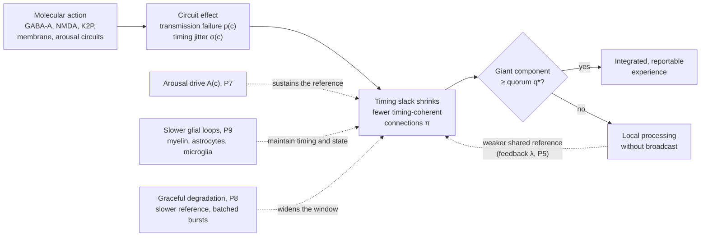
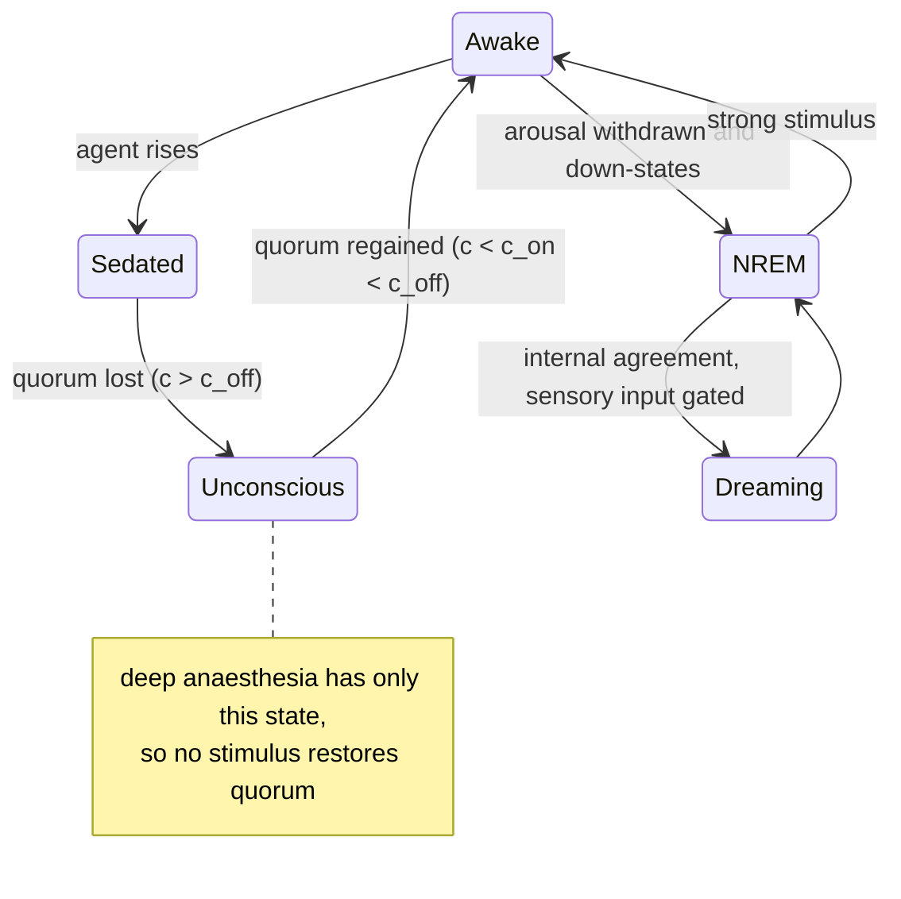

# The Distributed Perceptual Consensus Hypothesis of General Anaesthesia

**A timing-constrained network model of anaesthetic-induced unconsciousness**

| | |
|---|---|
| **Authors** | Gabriel Santos de Oliveira1 ([ORCID 0009-0003-9528-9731](https://orcid.org/0009-0003-9528-9731); [Lattes CV](https://lattes.cnpq.br/2102695116731989)); Callina Gertrudes Ferreira2 ([ORCID 0009-0002-8512-213X](https://orcid.org/0009-0002-8512-213X); [Lattes CV](https://lattes.cnpq.br/2112739936897542)) |
| **Affiliations** | 1 Independent researcher, Rio de Janeiro, Brazil. 2 Universidade Veiga de Almeida (UVA), Rio de Janeiro, Brazil |
| **Date** | 17 October 2026 |
| **Version** | 1.0.0 |
| **Article type** | Hypothesis and theory paper (not peer reviewed) |
| **Licence** | Text and figures: [CC BY 4.0](LICENSE-CC-BY-4.0). Code: [Apache License 2.0](LICENSE) |
| **Keywords** | general anaesthesia; consciousness; thalamocortical system; percolation; distributed consensus; neural synchrony; neural inertia; perturbational complexity index |

---

## Abstract

General anaesthetics are chemically diverse, act on many molecular targets, and yet reliably produce a common end state: reversible loss of consciousness. We propose the **Distributed Perceptual Consensus (DPC) hypothesis**, which treats conscious experience as the outcome of a continuously repeated, timing-constrained agreement process among distributed cortical and thalamic populations. Motivated by results from distributed computing, which show that agreement requires bounds on communication delays, we argue that such agreement is only possible when inter-areal signals arrive within an integration window around a shared rhythm. Anaesthetics, by whatever molecular route, degrade this condition in two ways: they cause transmission failure on a fraction of functional connections, and they increase the variability (jitter) of signal timing on the remainder. We formalise the brain as a graph whose *timing-coherent* subgraph undergoes a percolation transition as effect-site concentration rises. Loss of consciousness corresponds to the loss of a giant component able to reach quorum. Adding a single feedback assumption, that the global phase reference provided by the thalamocortical core itself depends on the size of that component, makes the transition bistable in the percolation model and, with its strength calibrated to one measured ratio, produces hysteresis between induction and emergence, a candidate mechanism for neural inertia that the phase-oscillator model did not reproduce robustly. The hypothesis is mechanism-agnostic at the molecular level and is intended to complement, not replace, receptor-level pharmacology and existing network theories such as cognitive unbinding and integrated information theory. We state the scope, distinguish established findings from hypothesis and from analogy, address eight principal objections, and list falsifiable predictions together with an analysis protocol for testing them.

---

## 1. Introduction and scope

### 1.1 The problem

More than 170 years after the first public demonstration of ether anaesthesia, no consensus exists on how anaesthetics produce unconsciousness (Franks, 2008; Alkire et al., 2008; Hemmings et al., 2019). The difficulty is that the agents are structurally unrelated (from the monatomic gas xenon to the alkylphenol propofol), act on many different molecular targets, and produce distinct electroencephalographic (EEG) signatures, yet converge on a similar behavioural endpoint. A satisfactory account must therefore explain how *heterogeneous molecular causes* produce a *common systems-level effect*. The search for a single molecular mechanism, which dominated the lipid-theory era, did not succeed, because the molecular facts are genuinely diverse (Section 2.1). DPC therefore seeks unification one level up: many molecular routes converging on one form of network failure, in the way that many different diseases converge on heart failure.

### 1.2 What this paper claims, and what it does not

This is a **hypothesis**, not a theorem. It has no formal proof and its value lies in whether its predictions survive experimental test. To avoid ambiguity we classify every claim as one of three types:

- **[E] Established:** supported by replicated experimental evidence, with citation.
- **[H] Hypothesis:** a novel or contested claim of this paper, stated so that it can be falsified.
- **[A] Analogy:** a computing concept used as an explanatory metaphor. Analogies motivate hypotheses but are not themselves claims about biology.

**What is new, and what is borrowed.** Several ingredients of DPC are not new: communication through coherence (Fries, 2005, 2015), recurrent processing (Lamme, 2006), functional disconnection as the common end point of anaesthesia (Hudetz and Mashour, 2016), percolation models of anaesthesia and of conscious perception (Zhou et al., 2015; Arese Lucini et al., 2019) and feedback-driven hysteresis (Kim et al., 2018); Section 2.3 credits each. The contributions of this paper are:

1. A single timing criterion in which transmission failure and inter-areal timing variability combine into one probability that a connection is usable, so that agents acting through different molecular routes enter one model.
2. The claim that what anaesthetics degrade is the *variability* of signal timing between areas relative to a shared rhythm, not its mean and not the coherence of ongoing rhythms (P4b, Section 6.8), with predictions that test it directly (Section 7, predictions 1, 3 and 8).
3. A quorum threshold computed from a network's degree distribution and compared with measurement on the wiring of a nematode, an insect and a human, including the directed wiring and a rewired null model (Appendices C and D).
4. Falsifiable predictions, an analysis protocol and an open, tested simulator in which every parameter is labelled measured, calibrated or free.

### 1.3 Scope and definitions

General anaesthesia comprises several separable components: unconsciousness, amnesia, analgesia and immobility, with stability of the autonomic, cardiovascular, respiratory and thermoregulatory systems (Brown et al., 2010). **This hypothesis addresses only unconsciousness.** Immobility, the basis of the minimum alveolar concentration (MAC) standard (Eger et al., 1965), is mediated largely at the level of the spinal cord (Rampil et al., 1993; Antognini and Schwartz, 1993) and is outside scope. Amnesia occurs at lower concentrations than unresponsiveness (Veselis et al., 1997) and is discussed only where it bears on the hypothesis.

We follow the distinctions of Sanders et al. (2012):

- **Responsiveness:** a behavioural response to a command or stimulus. In humans the operational endpoint is *loss of responsiveness* (LOR); in rodents it is *loss of righting reflex* (LORR).
- **Connected consciousness:** experience that includes awareness of the environment.
- **Disconnected consciousness:** experience without environmental awareness, such as dreaming.
- **Unconsciousness:** absence of any experience.

Unresponsiveness is therefore not equivalent to unconsciousness, and the hypothesis must account for both.

Other causes of unconsciousness, including fainting (syncope), epileptic seizures, concussion and coma, are outside the scope of this paper. One of them suggests an extension that is stated here as a hypothesis and not tested [H]. In syncope, global loss of blood flow to the brain can abolish consciousness in as little as about 7 s after sudden complete circulatory arrest (Wieling et al., 2009). Under DPC, neurons deprived of oxygen and glucose would fail to transmit, which is the same omission fault as in P4, a signal that never arrives, reached through a different route; the hypothesis therefore predicts that any cause that drives enough connections out of timing coherence abolishes integration at the same kind of threshold.

### 1.4 Terminology

Every term below is used in this sense throughout. Words borrowed from computing (for example bus, clock, round-robin, quorum, service, circuit breaker) appear only in passages marked [A] as analogies; each is mapped to one of these defined terms in Appendix A and is never used to state a claim.

| Term | Definition in this paper |
|---|---|
| Neural population | A group of neurons treated as one unit: a brain region in the human connectome, a single neuron in the *C. elegans* and *Drosophila* connectomes. It is a node of the network. The *C. elegans* network (448 nodes) also contains the muscles and other cells onto which its 302 neurons synapse, because it is the complete hermaphrodite wiring diagram (Cook et al., 2019). |
| Functional connection | A directed pathway by which one population influences another: a synapse or set of synapses between neurons, or a white-matter fibre bundle between regions. It is an edge of the network. A fibre bundle is not a single synapse: synaptic failure weakens a bundle rather than removing it (Section 9). |
| Transmission failure | A signal sent along a connection that does not produce its effect at the target, for example because transmitter is not released. Its probability is $p$. |
| Timing jitter | The trial-to-trial variability of a signal's arrival time, measured as a standard deviation $\sigma$ in milliseconds. A constant delay is not jitter. |
| Phase reference | A rhythm shared across populations against which arrival times are judged; P5 attributes it to the thalamocortical system. |
| Integration window | The interval $W$ around the phase reference within which an arriving signal can contribute to the current integration cycle. |
| Integration cycle | One repetition of the process by which populations converge on a shared state (P1), paced by the reference rhythm. |
| Occupied connection | The standard percolation term for a connection that is kept in the network. Here a connection is occupied when it transmits and its signal arrives within the integration window, which the paper also describes as *timing-coherent*. The probability of this is the occupation probability $\pi$. This timing sense of "coherent" is distinct from *spectral coherence*, the similarity of two EEG signals at a given frequency, which the paper always names in full. |
| Timing slack | The room left in the integration window after timing error: positive when signals arrive within the window, negative when they fall outside it. Loss of consciousness is proposed to occur when slack becomes negative on too many connections. |
| Giant component | The largest set of populations linked to one another by timing-coherent connections (the standard percolation term, here applied to the network of timing-coherent connections). Its share of all populations is $S$. |
| Quorum | The minimum share $q^*$ of populations that the giant component must contain for integrated, reportable content to arise (P3). |
| Effect-site concentration | The concentration of an agent at its site of action; in the models it is expressed relative to the agent's half-effect value (EC50), so 1 means half of the maximal circuit effect. |
| Loss and recovery of responsiveness | The behavioural endpoints of induction and emergence; in the models, loss and recovery of quorum, at concentrations $c_{\text{off}}$ and $c_{\text{on}}$. |
| Neural inertia | Recovery at a lower concentration than loss, $c_{\text{on}} < c_{\text{off}}$, not explained by drug distribution in the body. |
| Arousal drive | Activity of wake-promoting brain systems, such as orexinergic and brainstem nuclei, that sustains the phase reference independently of cortical coherence (P7). |
| Down-state | A period of near-silence across a cortical population during the slow oscillation of NREM sleep. |
| Broadcast | Propagation of activity from the populations that receive an input to the rest of the network. |
| Entrainment | Phase locking of a population to an external rhythm, such as a periodic stimulus. |
| Glia | Non-neuronal cells of the nervous system. Three types appear here: oligodendrocytes, which form myelin; astrocytes, which regulate the environment of synapses; and microglia, the resident immune cells of the brain. |
| Cascade control | The control-engineering term for slower outer loops that adjust the conditions under which a faster inner loop runs, each on its own timescale (P9). |
| Hub | A node with many more connections than the average node. |
| Order parameter | A single number that summarises the collective state of a system and changes sharply at a transition; here, $S$. |
| Hysteresis | Dependence of a state on the direction of change: here, quorum is lost at a higher concentration than the one at which it returns. |
| Bistability | The existence of two stable states under the same conditions; which one the system occupies depends on where it started. |
| Critical slowing down | As a system approaches a transition, it recovers more slowly from small disturbances, which shows as rising variance and autocorrelation of its fluctuations. |
| Phase locking | A constant difference between the phases of two rhythms over time; the phase lag is that difference. |
| Brain rhythms | Oscillations named by frequency: slow oscillation (below 1 Hz), delta (1 to 4 Hz), alpha (8 to 12 Hz), beta (13 to 30 Hz) and gamma (30 to 90 Hz). |
| Burst suppression | An EEG pattern of deep anaesthesia in which bursts of activity alternate with periods of near silence. |
| Sleep stages | Non-rapid-eye-movement (NREM) sleep, divided into stages N1 to N3 of increasing depth, with N3 dominated by slow waves; and rapid-eye-movement (REM) sleep, in which vivid dreams are most often reported. |
| K-complex | A large, isolated slow wave of NREM sleep, shown to be an isolated cortical down-state (Cash et al., 2009). |
| Arousal threshold; microarousal | The weakest stimulus that wakes a sleeper; a microarousal is a brief awakening lasting seconds. |
| Calibrated and free parameters | A calibrated parameter is fitted to one published measurement and then held fixed; a free parameter has no measured value and is varied across a range in the sensitivity analysis. |
| Test and consistency check | A test is a prediction that the model could fail; a consistency check follows from the model's equations and only confirms that the code implements them. |
| Seed; confidence interval | A seed is the starting value of the random-number generator, so different seeds give independent realisations of a network; each count of seeds is reported with its 95% confidence interval, the range likely to contain the true share. |
| Null model | A randomised copy of the data that keeps some of its properties, here each node's number of connections, used to test whether a result depends on the actual wiring. |
| Strongly connected component | In a network whose connections have a direction, a set of nodes each of which can reach every other along the directed connections. |

| Symbol | Meaning | Unit |
|---|---|---|
| $c$ | Effect-site concentration relative to EC50 | dimensionless |
| $p(c)$ | Transmission failure probability | dimensionless |
| $\sigma_0(c)$, $\sigma_{\text{eff}}$ | Agent-induced and effective timing jitter | ms |
| $W$ | Integration window | ms |
| $\pi$, $\pi_c$, $\pi_q$ | Occupation probability; its onset and quorum thresholds | dimensionless |
| $S$ | Share of populations in the giant component | dimensionless |
| $q^*$ | Quorum fraction | dimensionless |
| $\lambda$ | Strength of reference feedback | ms (percolation model), dimensionless (oscillator model) |
| $\sigma_b$ | Baseline timing jitter, independent of the agent | ms |
| $h(c)$ | Fractional effect of the agent, a Hill function of concentration | dimensionless |
| $a$ | Share of the agent's effect that acts on arousal circuits | dimensionless |
| $A_0$, $A(c)$ | Awake and concentration-dependent arousal share of the reference | dimensionless |
| $d$ | Share of integration cycles in down-states | dimensionless |
| $f$ | Frequency of the reference rhythm | Hz |
| $\mu$ | Myelin integrity (1 intact) | dimensionless |
| $\gamma$ | Increase in baseline jitter when myelin is entirely lost | dimensionless |
| $g$ | Strength of the microglial loop (0 after microglial depletion) | dimensionless |
| $s_a$ | Share of down-states that depends on astrocytic signalling | dimensionless |
| $\langle k \rangle$, $\langle k^2 \rangle$ | Mean degree and mean squared degree of the network | connections |

| Abbreviation | Meaning |
|---|---|
| DPC | Distributed Perceptual Consensus |
| EEG, MEG, ECoG | Electro-, magneto- and electrocortico-graphy: recordings of brain activity from the scalp, by its magnetic field, and from the cortical surface |
| fMRI | Functional magnetic resonance imaging |
| TMS | Transcranial magnetic stimulation |
| PCI | Perturbational complexity index (Section 8.1) |
| LOR, LORR | Loss of responsiveness; loss of righting reflex (Section 1.3) |
| MAC | Minimum alveolar concentration, the inhaled concentration that prevents movement to a painful stimulus in half of subjects |
| GABA-A, NMDA | Receptors for the inhibitory transmitter GABA and for glutamate, the main excitatory transmitter |
| P2Y12 | A receptor on microglia for the nucleotide ADP |
| VLPO; TRN | Ventrolateral preoptic nucleus, a sleep-promoting nucleus of the hypothalamus; thalamic reticular nucleus |

---

## 2. Background

### 2.1 Molecular mechanisms [E]

The Meyer-Overton correlation, which relates anaesthetic potency to lipid solubility (Meyer, 1899; Overton, 1901), motivated a century of lipid-based theories. Several findings show that lipid solubility alone is insufficient:

1. Anaesthetics inhibit a lipid-free protein, firefly luciferase, at potencies matching the Meyer-Overton line (Franks and Lieb, 1984).
2. Optical isomers of isoflurane, which have identical lipid solubility, differ in their effects on neuronal ion channels (Franks and Lieb, 1991).
3. Some lipophilic halogenated compounds violate the correlation (Koblin et al., 1994); such compounds were later termed *non-immobilisers*.
4. A single point mutation (N265M) in the β3 subunit of the GABA-A receptor strongly reduces the in vivo effects of propofol and etomidate in mice (Jurd et al., 2003).
5. Xenon acts principally as an NMDA receptor antagonist (Franks et al., 1998).

Membrane-mediated mechanisms remain biologically plausible as *contributing* routes. These include changes in the lateral pressure profile of the lipid bilayer that alter the conformational equilibria of embedded channels (Cantor, 1997), and the disruption of ordered lipid domains that activates TREK-1 potassium channels via phospholipase D2 (Pavel et al., 2020). The current view is that anaesthetics act on multiple targets, chiefly GABA-A receptors, NMDA receptors and two-pore-domain potassium (K2P) channels, with agent-specific profiles (Rudolph and Antkowiak, 2004; Hemmings et al., 2019).

The known routes differ in mechanism but converge on one consequence, a shift in ion currents that reduces the ability of neurons to excite one another:

| Molecular route | Agents with evidence | Effect on ion flow | DPC fault type (P4) | Sources |
|---|---|---|---|---|
| GABA-A receptor potentiation (prolonging channel opening) | Propofol, etomidate, barbiturates, isoflurane, sevoflurane | More Cl⁻ inhibitory current | Transmission failure | Mihic et al. (1997); Jurd et al. (2003) |
| NMDA receptor block: open-channel block (ketamine) or competition at the glycine co-agonist site (xenon) | Ketamine, xenon, nitrous oxide | Less Na⁺ and Ca²⁺ excitatory current | Timing variability and transmission failure | Franks et al. (1998); Jevtović-Todorović et al. (1998); Dickinson et al. (2007) |
| Two-pore-domain K⁺ channel activation (TREK-1, TASK) | Isoflurane, halothane, sevoflurane; xenon, nitrous oxide, cyclopropane | More K⁺ leak, hyperpolarisation | Transmission failure | Patel et al. (1999); Gruss et al. (2004); Heurteaux et al. (2004) |
| HCN channel inhibition | Volatile agents (subunit-specific); propofol | Less pacemaker cation current | Altered rhythm and timing | Chen et al. (2005); Ying et al. (2006) |
| Presynaptic Na⁺ channel inhibition, reducing Ca²⁺ entry and vesicle release | Isoflurane | Less transmitter released per spike | Transmission failure | Herold and Hemmings (2012); Baumgart et al. (2015) |
| α2-adrenoceptor agonism, acting through the endogenous sleep pathway | Dexmedetomidine | Indirect: inhibition of locus coeruleus neurons | Arousal suppression (P7) | Nelson et al. (2003) |
| Disruption of membrane lipid domains, releasing PLD2, which activates TREK-1 | Chloroform, isoflurane | Indirect: more K⁺ current | Transmission failure | Pavel et al. (2020) |
| Mitochondrial complex I (a sensitivity factor rather than an ion channel) | Volatile agents | Not a channel effect; complex I dysfunction increases sensitivity | Modulates susceptibility | Kayser et al. (1999); Morgan et al. (2002) |

Glycine receptors, which are abundant in the spinal cord, are also potentiated by volatile agents (Mihic et al., 1997) and are thought to contribute to immobility, which is outside the scope of this paper (Section 1.3).

Two further proposals are unconfirmed and are noted only for completeness. Anaesthetic binding to tubulin and altered microtubule stability have been reported (Emerson et al., 2013), and a microtubule-stabilising drug delayed isoflurane-induced loss of righting in rats (Khan et al., 2024), but these findings have not been independently replicated. A single study reported that xenon isotopes carrying nuclear spin are less potent in mice than spin-free isotopes (Li et al., 2018); no independent replication has been found.

**Implication for this paper:** the DPC hypothesis does not depend on which molecular mechanism operates. It requires only that, at the circuit level, agents increase transmission failure, timing jitter, or both.

### 2.2 Systems-level findings [E]

- **Thalamocortical involvement.** Two volatile anaesthetics both suppressed regional thalamic and midbrain reticular activity in human volunteers (Alkire et al., 2000). Nicotine microinjected into the central medial thalamus reverses sevoflurane-induced LORR in rats (Alkire et al., 2007). Thalamic stimulation can restore arousal in anaesthetised macaques (Redinbaugh et al., 2020).
- **Breakdown of cortical communication.** Propofol, sevoflurane and ketamine all disrupt frontal-parietal feedback connectivity (U. Lee et al., 2013). At the onset of propofol-induced unconsciousness, a slow oscillation appears and neuronal spiking becomes confined to brief phase windows that are asynchronous across cortex, fragmenting cortical networks (Lewis et al., 2012). Reviews of large-scale network studies conclude that a common correlate of anaesthetic-induced unresponsiveness is depression or functional disconnection of lateral frontoparietal networks (Hudetz and Mashour, 2016), together with reduced complexity and a smaller repertoire of brain states (Mashour and Hudetz, 2018).
- **Agent-specific EEG signatures.** Propofol produces increased beta power during sedation, followed by coherent frontal alpha (8 to 12 Hz) together with slow-delta (0.1 to 4 Hz) oscillations at LOR (Purdon et al., 2013, 2015; Ching et al., 2010). Ketamine produces increased gamma power and does not produce the propofol-like alpha pattern (Akeju et al., 2016).
- **Cellular decoupling.** Anaesthetics decouple the apical dendrites of layer 5 pyramidal neurons from their somata, interrupting cortico-cortical feedback integration (Suzuki and Larkum, 2020).
- **Loss of coordination, not of activity, across species.** In *Caenorhabditis elegans*, isoflurane leaves individual head neurons active but collapses the correlations between them (Awal et al., 2020). In *Drosophila*, isoflurane reduces stimulus-locked power and coherence in the central brain, while increasing them at twice the stimulus frequency in the optic lobes for some stimuli (Cohen et al., 2016), impairs low-frequency feedback while leaving high-frequency feedforward connectivity intact (Cohen et al., 2018), and fragments the integrated structure of brain activity into separate clusters (Leung et al., 2021).
- **Loss of individual signature.** Under sevoflurane and propofol, functional connectivity becomes less distinctive between individuals, most strongly in transmodal association cortex, and anaesthetised human connectivity becomes more similar to that of the macaque (Luppi et al., 2025).
- **Complexity.** The perturbational complexity index (PCI) is high in wakefulness and low during propofol- and xenon-induced unconsciousness. It remains high under ketamine, consistent with the dream reports of healthy volunteers on emergence (Casali et al., 2013; Sarasso et al., 2015).
- **Neural inertia.** In genetically diverse animals, the concentration at which consciousness returns is lower than the concentration at which it is lost, even when pharmacokinetic factors are controlled. This hysteresis is termed neural inertia; it was demonstrated in both mice and *Drosophila* (Friedman et al., 2010) and depends on excitability genes that act independently of induction sensitivity (Joiner et al., 2013; see also Kelz et al., 2008). Its measured size varies by agent: the ratio of induction to emergence concentration is about 1.08 for isoflurane and 2.85 for halothane in mice (Friedman et al., 2010), and in humans about 1.07 for propofol effect-site concentrations (1.5 and 1.4 µg/ml at loss and recovery of behavioural responsiveness; Warnaby et al., 2017, who found no consistent hysteresis in these values and identified inertia instead in slow-wave saturation), 1.11 (Iwakiri et al., 2005, who describe the concentrations as similar) and about 1.63 for measured propofol concentrations (Sepúlveda et al., 2018). Recovery proceeds through a sequence of discrete, metastable activity states (Hudson et al., 2014).
- **Glial cells.** Glia respond to anaesthetics, and manipulating them changes induction and emergence in mice. Anaesthetics suppress astrocytic calcium signalling in the awake mouse cortex at doses that do not alter neuronal responses to whisker stimulation (Thrane et al., 2012), and inhaled agents reversibly retract the fine processes of cortical astrocytes (Zhou et al., 2025). Activating astrocytes in the basal forebrain speeds isoflurane induction and slows recovery (Lin et al., 2023), whereas activating astrocytes in the parabrachial nucleus or the paraventricular thalamus speeds emergence (Liu et al., 2023; Zhao et al., 2024), so the effect depends on the region. Depleting microglia with the drug PLX5622 delays induction and hastens emergence with several agents (Cao et al., 2023; He et al., 2023), but the same group later found that PLX5622 also activates a liver receptor that speeds the clearance of anaesthetics, and that depleting microglia genetically did not hasten emergence (Cao et al., 2026). The firmer evidence is that genetic loss of the microglial receptor P2Y12 speeds recovery (Cao et al., 2023). Myelin sets conduction timing: in auditory brainstem circuits the geometry of myelinated axons is tuned to set when action potentials arrive (Ford et al., 2015), and in mice a subtle myelin deficit spreads out conduction times and reduces the synchrony of motor cortex activity (Kato et al., 2020). We found no study of anaesthetic requirements in human demyelinating disease, only case reports. Two animal studies exist: demyelinated mice took longer to recover from isoflurane, with effects that depended on the region demyelinated (Wang et al., 2024), and older demyelinated mice took longer to be induced at a fixed concentration, in small groups (Tot et al., 2024).

### 2.3 Prior models and the position of DPC

DPC builds on two groups of prior work. The first is conceptual:

| Framework | Central claim | Relationship to DPC |
|---|---|---|
| Communication through coherence (Fries, 2005, 2015) | Oscillating neuronal groups communicate effectively only when their windows for input and output are open at the same times | P2 is this condition; DPC adds the claim that anaesthetics act by making inter-areal timing variable relative to the shared rhythm, and asks how many connections must meet the condition for integration across the whole network |
| Perceptual cycles (VanRullen and Koch, 2003; VanRullen, 2016) | Perception proceeds in discrete cycles tied to brain oscillations; current evidence points to several rhythms rather than one | P1 adopts discrete cycles; DPC adds a timing condition on each exchange, a network-level quorum, and the proposal that anaesthetics act by breaking the cycles' timing |
| Recurrent processing (Lamme and Roelfsema, 2000; Lamme, 2006) | A feedforward sweep is probably insufficient for awareness; recurrent processing between areas is needed | P1 adopts recurrent cycles; DPC adds a timing condition on each exchange and a network-level quorum |
| Cognitive unbinding (Mashour, 2013) | Anaesthetics disrupt the synthesis of information across cortical networks | DPC proposes a specific reason synthesis fails: violation of a bounded-delay condition |
| Integrated information theory (Tononi et al., 2016) | Consciousness corresponds to integrated information (Φ) | DPC's order parameter measures network-level timing coherence; it is not Φ and is not claimed to approximate it, and DPC makes no claim about the nature of experience |
| Global neuronal workspace (Dehaene and Changeux, 2011) | Conscious access requires non-linear "ignition" and global broadcast | Quorum in DPC is a static, topological criterion that can be compared with the dynamic ignition of the workspace but is not equivalent to it; DPC adds a timing constraint |
| Thalamocortical switch (Alkire et al., 2000) | The thalamus gates conscious state | DPC assigns the thalamocortical core the role of supplying a shared phase reference, not of acting as an on/off switch |

The second group consists of quantitative models, several of which already contain elements of DPC. **These precede the present work and must be credited:**

| Prior model | What it established | What DPC adds |
|---|---|---|
| Breskin et al. (2006) | In living neuronal cultures, chemically weakening synapses makes the giant connected component disintegrate at a percolation transition | DPC applies percolation to whole connectomes and to timing as well as transmission |
| Arese Lucini et al. (2019) | The transition from conscious to subliminal perception in human functional networks is described as k-core percolation: the peripheral shells of the conscious network are inactivated while the inner core persists | DPC applies percolation to anaesthetic loss of consciousness and defines occupation by a timing criterion rather than by functional activation |
| Zhou et al. (2015) | A percolation model of thalamocortical and cortico-cortical transmission, with one transmission probability *p*, reproduces EEG features of anaesthesia; information transfer changes sharply near a critical *p* | The occupation probability is derived from a timing criterion that combines transmission failure with timing jitter, so that agents acting through either route enter the same model |
| Su et al. (2020) | Measured an induction-recovery hysteresis loop and explained it by percolation on self-similar multilayer networks | Feedback-driven hysteresis was shown by Kim et al. (2018); DPC attributes the feedback to the shared phase reference and calibrates its strength quantitatively to published inertia ratios |
| Kim et al. (2016) | The conditions for explosive synchronisation are met in human EEG networks just after anaesthetic-induced loss of consciousness | DPC tests the same transition on empirical connectomes of three species with a single parameter set |
| Kim et al. (2018) | Stuart-Landau oscillators with adaptive feedback on a 78-region connectome reproduce hysteresis of functional connectivity seen in EEG under ketamine and sevoflurane | The feedback mechanism in DPC (P5) is closely related; DPC's contribution is its interpretation as a timing reference and its link to consensus theory |
| Moon et al. (2015); H. Lee et al. (2013) | Network topology determines phase lead and lag between hubs and periphery, and the front-to-back direction of information flow disappears under sevoflurane; the hub structure of EEG networks is reconfigured after propofol-induced unconsciousness | Hub disruption under anaesthesia is already reported; DPC derives hub vulnerability from percolation on heavy-tailed networks (Albert et al., 2000) and predicts a larger shift of the loss concentration after hub lesions than after random lesions (prediction 6) |
| Proekt and Hudson (2018); Hudson et al. (2014) | Neural inertia and recovery through discrete metastable states can be explained by noise-driven transitions on a multi-well landscape | DPC offers a network-level origin for such barriers; the two accounts are compatible |

**The specific contributions claimed as new [H]**, to the authors' knowledge, are therefore narrower than a percolation or hysteresis model as such:

1. The necessary condition for conscious integration is formalised as *bounded inter-areal timing error*, motivated by the partial-synchrony results of distributed computing (Dwork et al., 1988), so that transmission failure and timing jitter combine into one occupation probability.
2. Molecularly distinct agents are placed in one parameter space defined by those two circuit-level quantities, which correspond to the omission and timing failures of distributed systems (Cristian, 1991); comparing agents in it requires measuring the two quantities independently for each agent (Section 9, item 13).
3. The same model, with one parameter set, is tested on the empirical connectomes of a nematode, an insect and a human, with plant tissue as a cellular control, and calibrated against measured neural inertia (Appendices C and D).

---

## 3. The hypothesis

### 3.1 Motivating analogy [A]

In distributed computing, a set of processes reaches *consensus* when it agrees on a single value despite some processes failing. Fischer, Lynch and Paterson (1985) proved that deterministic consensus is impossible in a fully asynchronous system if even one process can crash. Dwork, Lynch and Stockmeyer (1988) showed that consensus becomes achievable under *partial synchrony*, meaning that message delays and relative processing speeds are bounded, even if the bounds are not known in advance. Systems built on these results commonly require a *quorum*, a minimum fraction of participating processes, before committing a value. Faults are classified by how a process deviates from its specification (Cristian, 1991): it may stop (a *crash*), fail to deliver a message (an *omission*), deliver it outside the agreed time (a *timing* failure), or emit arbitrary or misleading messages (a *Byzantine* fault); Byzantine faults are tolerated only with a larger fraction of correct processes, more than two-thirds when messages are unsigned (Lamport et al., 1982).

The analogy, which is not a claim of literal equivalence, is that the brain must repeatedly settle on a single coherent interpretation of multisensory and internal signals that arrive at different areas at different times. Lamport (1978) showed that causality only partially orders the events of a distributed system, and that a consistent total order requires synchronised logical or physical clocks. We propose that the brain faces a comparable constraint.

### 3.2 Engineering analogues and their limits [A]

The terms used in this paper come from engineered systems that solve the same problem the brain is proposed to solve: keeping many distributed units in agreement despite delays, noise and failures. The table lists the systems that motivated each postulate, with references to their specifications, and states where each analogy fails.

| Engineered system | How it works | Counterpart in DPC | Where the analogy fails |
|---|---|---|---|
| Fly-by-wire flight control: the triple-triple redundant primary flight computer of the Boeing 777 (Yeh, 1996) and the command/monitor computers of the Airbus A320 family (Briere and Traverse, 1993) | Redundant channels compute the same command; disagreeing channels are outvoted or disconnected, and the aircraft falls back to a simpler control law when too few agree | Quorum (P3); fall-back to default dynamics when quorum is lost (P6) | Neural populations do not compute identical copies of one value, and there is no designated voter |
| Time-triggered architecture (Kopetz and Bauer, 2003), used in safety-critical vehicles | Nodes transmit in fixed time slots that repeat in a cycle (a round-robin of slots) against a synchronised global clock; a message outside its slot is discarded, and a node that loses synchrony is excluded from membership | Integration cycles (P1); the window $W$ (P2); late signals not integrated | The brain has no fixed slots and no global clock; its timing reference emerges from oscillation |
| Controller Area Network bus (ISO 11898-1:2024; ISO, 2024) | Every node must sample each bit within the same bit time, so signal propagation delay limits the product of bus length and bit rate | A bounded-delay condition that limits network size and speed (P2) | A CAN bus is one shared medium; the brain is a sparse network of point-to-point connections |
| Precision Time Protocol (IEEE Std 1588-2019; IEEE, 2020) | A reference clock is distributed through the network, with path delays measured and compensated | The shared thalamocortical phase reference (P5) | PTP has a designated master; the neural reference is emergent and itself depends on coherence |
| Synchronous power grids (Filatrella et al., 2008; Rohden et al., 2012) | Generators must remain frequency-synchronised; their dynamics are modelled with Kuramoto-like oscillator equations, and loss of synchrony can cascade into a blackout (U.S.-Canada Power System Outage Task Force, 2004) | The same mathematics as the oscillator model in Appendix D; collapse of global coherence | Grid protection disconnects equipment by design; DPC makes no claim that the neural transition is designed or protective |
| Circuit-breaker pattern in distributed software (Fowler, 2014) | Calls to a failing dependency are stopped; after a delay a trial call is allowed ("half-open") before normal operation resumes | Active shutdown by dedicated circuits (Section 5.2); the delayed, conditional return resembles neural inertia | A software circuit breaker exists to protect the system; DPC makes no claim that the neural transition serves a protective purpose |
| Distributed consensus (Lamport et al., 1982; Fischer et al., 1985; Dwork et al., 1988) | Agreement is impossible without timing bounds, achievable under partial synchrony, and tolerates fewer Byzantine than crash faults | Motivation for P2 and for the two failure modes in P4; no formal result is transferred, since partial synchrony concerns delay bounds that are unknown and hold only eventually, whereas $W$ is a fixed window | The brain does not run a consensus algorithm; the results are used as constraints, not as a description of mechanism |

**The physical medium differs.** Computers signal electronically, as electromagnetic waves in conductors. Neurons signal electrochemically: an action potential is an ionic current regenerated along the axon, and in human cortico-cortical pathways the median axonal conduction velocity is about 3.9 m/s, with a median axonal delay of about 10 ms (Lemaréchal et al., 2022). What transfers from engineering to neuroscience is therefore not the physics but the ratio of delay to cycle time. At 40 Hz a gamma cycle lasts 25 ms, so a typical cortico-cortical delay is about 40% of a cycle. In that regime timing is a first-order constraint on communication, as it is on a CAN bus whose propagation delay approaches its bit time.

**Signals arrive at many speeds.** The brain receives its inputs with widely different delays, set by biology rather than by the physics of the stimulus. Responses in human primary auditory cortex peak about 15 ms after a sound (Celesia, 1976), whereas the earliest visual response recorded over occipital cortex begins at about 56 ms (Foxe and Simpson, 2002), even though light travels far faster than sound. Olfaction is the only sense whose primary pathway reaches its cortex without a thalamic relay, although a thalamic route through the mediodorsal nucleus also exists (Kay and Sherman, 2007). Peripheral nerve fibres span about two orders of magnitude in conduction velocity, from unmyelinated fibres at about 0.5 to 2 m/s to large myelinated fibres at about 80 to 120 m/s (values tabulated by Yap et al., 2020, from a standard textbook) [A: links of different speeds, like 3G, 4G and 5G connections]. The brain compensates: after a few minutes of exposure to a constant lag between sound and image, the perceived moment of simultaneity shifts towards that lag (Fujisaki et al., 2004). Its rhythms are also nested, the phase of slower rhythms modulating the amplitude of faster ones, delta modulating theta and theta modulating gamma (Lakatos et al., 2005; Canolty and Knight, 2010) [A: several clock domains, with communication between them]. DPC's claim is that these compensations work only while timing slack remains positive.

### 3.3 Postulates [H]

**The central claim in plain language.** Integrated, reportable experience requires *positive timing slack*: signals passing between the populations of a nervous system must arrive within the window in which they can be combined, judged against a shared rhythm. Anaesthetics, whatever their molecular target, erode that slack by making transmission fail or arrival times vary. When slack turns negative on enough connections, the populations can no longer reach agreement, and experience is lost. The claim concerns timing margins, not a particular frequency: each nervous system uses its own rhythms, matched to its own conduction delays. Across mammals that differ several-thousand-fold in brain volume, the hierarchy of brain rhythms is largely preserved, which Buzsáki, Logothetis and Singer (2013) suggest may be achieved by larger-diameter, faster-conducting long-range axons in larger brains. If so, evolution preserves timing margins, which is the condition this hypothesis requires.

The postulates state the claim precisely. Figure A summarises the causal chain they describe.

*Figure A. Causal chain of the DPC hypothesis. Dashed arrows are feedback and modulating influences.*

- **P1 (Integration cycles).** Conscious content is generated in repeated integration cycles, during which distributed populations converge on a shared state. This builds on the older proposal that perception proceeds in discrete epochs rather than continuously, with cortical and thalamocortical oscillations as a possible neuronal basis (VanRullen and Koch, 2003). Later evidence points to several perceptual rhythms, depending on modality, task and region, rather than one unitary sampling rhythm (VanRullen, 2016); DPC's single phase reference (P5) is therefore a simplification, discussed in Section 9. The cycles are recurrent loops rather than a single pass: a feedforward sweep of activity is probably insufficient for awareness, whereas recurrent processing between areas allows features to be grouped so that a stimulus can enter consciousness (Lamme and Roelfsema, 2000; Lamme, 2006). Reciprocal signalling between areas, termed re-entry, is proposed to couple the functioning of cortex and thalamus (Edelman and Gally, 2013); large-scale integration is proposed to rely on dynamic links mediated by synchrony over multiple frequency bands (Varela et al., 2001); thalamocortical loops are proposed to bind activity by temporal coincidence (Llinás et al., 1998); and in predictive-coding accounts, each exchange compares feedback predictions with feedforward signals carrying the residual error (Rao and Ballard, 1999). Anaesthesia preferentially disrupts this recurrent component: directed feedback connectivity between frontal and parietal cortex diminishes at loss of consciousness and returns with responsiveness, while feedforward processing may persist (Lee et al., 2009); in rats, halothane and isoflurane reduced both feedforward and feedback information transfer at 50 Hz, the feedback transfer from frontal to posterior regions most, while increasing both at 30 Hz (Imas et al., 2005); and anaesthesia decouples the apical dendrites of layer 5 pyramidal neurons, the presumed target of feedback input, from their somata in mice (Suzuki and Larkum, 2020). In the terms of the analogy [A], each cycle is a loop that checks what arrived, and when, against what was expected; a cycle that loses quorum partway is abandoned rather than half-completed [A: a saga rolled back when one of its steps fails].
- **P2 (Bounded-delay condition).** A population contributes to a cycle only if its signals arrive within an integration window $W$ relative to a shared phase reference. Signals outside the window are not integrated. This is the condition proposed by communication through coherence, in which oscillating neuronal groups interact effectively only when their windows for input and output are open at the same times (Fries, 2005, 2015). The behavioural temporal binding window for multisensory events, of the order of 100 ms or more (Wallace and Stevenson, 2014), is a psychophysical counterpart of $W$. The neural window is expected to be narrower and frequency-dependent.
- **P3 (Quorum).** A cycle produces globally integrated, reportable content only if the timing-coherent populations form a connected component that includes at least a critical fraction $q^*$ of the network.
- **P4 (Two failure modes).** Anaesthetics reduce the fraction of functional connections that are timing-coherent by (a) increasing the probability that transmission fails (omission faults, signals that never arrive: for example enhanced GABA-A-mediated inhibition and reduced glutamate release; Baumgart et al., 2015) or (b) increasing the trial-to-trial variability of signal timing (timing faults, signals that arrive outside their window: for example NMDA antagonism by ketamine). The molecular route is irrelevant to the network-level effect, which is a reduction in coherence.
- **P4b (Network timing, a hypothesis not yet tested).** The brain integrates inputs against learned expectations of when they will arrive. What fails under anaesthesia is proposed to be the timing of signals *between* areas relative to the shared rhythm, which becomes more variable as that rhythm weakens (P5), and not the precision of single neurons. A constant delay is harmless under this hypothesis, because it can be anticipated; only variability matters. The few local measurements agree that single-neuron timing does not become noisier: deepening ketamine-xylazine anaesthesia lengthened first-spike latency in the gerbil auditory brainstem without changing spike jitter (Jing et al., 2021); propofol made the spike timing of rat insular pyramidal neurons more synchronous, by strengthening shared inhibition (Koyanagi et al., 2021); and the timing regularity of bursting neurons was maintained under pentobarbital (Kato et al., 2016). We found no study of trial-to-trial timing variability between cortical areas under anaesthesia. The hypothesis predicts that the trial-to-trial latency variability of responses between areas rises at concentrations just below loss of responsiveness, before their mean latency changes appreciably (Section 7, prediction 8).
- **P5 (Reference feedback).** The shared phase reference is itself generated by the coherent thalamocortical core [A: a gateway or orchestrator that keeps services in step, but is itself made of those services]. A smaller giant component therefore produces a weaker reference and greater effective timing error for all remaining connections.
- **P6 (Default dynamics).** When quorum is lost, cortex does not become silent. It falls into its intrinsic, locally generated dynamics (for example the slow oscillation, Steriade et al., 1993a), whose form is agent-specific.
- **P7 (Arousal and brain state).** Wake-promoting arousal systems sustain part of the shared reference independently of cortical coherence. Anaesthetics suppress these systems, as volatile agents inhibit orexinergic neurons (Kelz et al., 2008) and excite sleep-promoting neurons (Moore et al., 2012), which accelerates the loss of quorum without being required for it. In natural sleep the arousal drive is withdrawn and slow-oscillation down-states interrupt cortical transmission (Vyazovskiy et al., 2009).
- **P8 (Graceful degradation).** As timing slack shrinks, the system degrades in two linked ways before agreement fails. First, the reference rhythm slows, which widens the time available within each cycle: a timing error of σ milliseconds costs a phase error of 2π f σ, so a fourfold slower rhythm makes the same error four times less disruptive, at the cost of four times fewer integration cycles per second [A: link-speed fallback, as a mobile connection drops from 5G to 4G to 3G]. Second, continuous asynchronous activity gives way to synchronised bursts, which are easier to align but carry less [A: streaming replaced by batched polling]. The sequence seen during propofol induction, from beta oscillations in sedation to frontal alpha with slow oscillations at loss of consciousness (Purdon et al., 2013, 2015), and the burst suppression of deeper anaesthesia, in which suppression periods lengthen as the dose increases (Brown et al., 2010; Purdon et al., 2015) [A: exponential backoff], are proposed to be successive stages of this degradation; burst suppression has also been modelled as a consequence of reduced cerebral metabolism (Ching et al., 2012), an account this reading does not replace. The dominant interpretation of frontal alpha differs: Purdon et al. (2015) propose that the highly organised alpha oscillations most likely prevent normal communication between the thalamus and cortex, and thalamocortical models attribute them to thalamic mechanisms (Ching et al., 2010; Vijayan et al., 2013). The two readings are compatible in part, since a slower, narrower channel restricts throughput while improving timing reliability; they differ in what they predict (Section 7, prediction 9).
- **P9 (Glial cascade control).** The integration cycle, which runs in milliseconds, is regulated by slower glial loops that maintain the conditions for timing coherence, each on its own timescale [A: outer control loops that tune an inner loop]. Myelin sets conduction timing: the geometry of myelinated axons is tuned to set action-potential timing in auditory brainstem circuits (Ford et al., 2015), and in mouse motor cortex a subtle myelin deficit spreads out thalamocortical arrival times (Kato et al., 2020); blocking the formation of new oligodendrocytes in adult mice also prevents the learning-driven coupling of hippocampal and cortical rhythms (Steadman et al., 2020). That oligodendrocytes adjust conduction delays over time so that signals from distant regions arrive together is proposed by models of adaptive myelination (Pajevic et al., 2014, 2023; Noori et al., 2020). Astrocytes regulate cortical state over seconds to hours: their activity precedes and can trigger the slow oscillation (Poskanzer and Yuste, 2016), astrocytic calcium tracks the need for sleep (Ingiosi et al., 2020), and blocking astrocytic vesicle release reduces gamma oscillations (Lee et al., 2014). Microglia take part in a loop with noradrenaline: low noradrenergic tone, as under anaesthesia, increases microglial surveillance (Liu et al., 2019; Stowell et al., 2019), and microglial signalling lowers noradrenaline further (Ma et al., 2024). P9 proposes that anaesthetics disrupt these loops as well as the integration cycle, and that the microglial loop is one biological source of the reference feedback of P5, holding the unconscious state stable once it is reached. Regulation of fast neural activity by slower processes is an established principle (Turrigiano, 2008); what P9 adds is that the glial loops act on timing coherence. P1 to P8 do not depend on P9.

---

## 4. Formal model [H]

### 4.1 Network and coherence

Let the brain be represented by a graph $G = (V, E)$ of $N$ neural populations, with degree distribution $P(k)$. At effect-site concentration $c$, each functional connection $e$ transmits successfully with probability 1 − $p(c)$. Each agent acts through a Hill dose-response, with concentration expressed relative to the half-effect value and Hill coefficient $n$:

$$
h(c) = \frac{c^{n}}{1 + c^{n}}, \qquad p(c) = p_{\max}\,h(c), \qquad \sigma_0(c) = \sigma_{\max}\,h(c),
$$

where $p_{\max}$ and $\sigma_{\max}$ are the agent's maximal transmission failure and maximal added jitter (Appendix D lists the values). The arrival-time error $\delta_e$ of successful transmissions, relative to the phase reference, is modelled as a zero-mean Gaussian with standard deviation $\sigma_{\text{eff}}$.

A connection is **timing-coherent** if it transmits successfully and |$\delta_e$| ≤ $W$/2. Its probability of being coherent is

$$
\pi(c) = \bigl(1 - p(c)\bigr)\cdot \operatorname{erf}\!\left(\frac{W}{2\sqrt{2}\,\sigma_{\text{eff}}}\right)
$$

### 4.2 Percolation threshold

Treating coherence as bond percolation on a random graph with the given degree distribution, a giant component exists only if $\pi$ exceeds the critical value (Callaway et al., 2000):

$$
\pi_c = \frac{\langle k \rangle}{\langle k^2 \rangle - \langle k \rangle}
$$

Let $S(\pi)$ denote the fraction of populations in the giant component. The order parameter of the model is $S$, and P3 states that integrated content requires $S$ ≥ $q^*$. Heavy-tailed degree distributions, such as hub-dominated connectomes, have a large ⟨k²⟩ and therefore a low $\pi_c$. This predicts that integration is robust to random failures but vulnerable to failures concentrated at hubs (Callaway et al., 2000; Albert et al., 2000). The thalamus and frontal-parietal hubs are candidate sites.

### 4.3 Reference feedback and hysteresis

P5 is modelled by letting the effective jitter grow as the giant component shrinks:

$$
\sigma_{\text{eff}} = \sqrt{\sigma_b^2 + \sigma_0(c)^2 + \sigma_{\text{ref}}^2}, \qquad \sigma_{\text{ref}} = \lambda\,\bigl(1 - S\bigr)\bigl(1 - A(c)\bigr), \qquad A(c) = A_0\,\bigl(1 - a\,h(c)\bigr)
$$

where $\sigma_b$ is the agent-independent baseline jitter, $\sigma_0(c)$ the agent-induced jitter and $\sigma_{\text{ref}}$ the error added by a weakened reference; the three are independent, so their standard deviations add in quadrature. $\lambda \ge 0$ is the strength of the reference feedback, $A(c)$ is the share of the reference sustained by arousal (P7), $A_0$ its awake value, $h(c)$ the agent's fractional effect (a Hill function of concentration) and $a$ the share of that effect acting on arousal circuits. In natural sleep, $A_0$ is set to 0, a complete withdrawal of the arousal drive, and down-states silence a share $d$ of whole populations at any moment, removing them and their connections from the network; in the alternative account, each connection instead fails with probability $d$ (Section 5.6). The steady state then satisfies the self-consistency condition

$$
S = F\!\bigl(\pi(c, S)\bigr)
$$

where $F$ is the giant-component function of the graph. For $\lambda$ = 0 the transition is continuous and has no hysteresis. For sufficiently large $\lambda$, the equation has two stable solutions over a range of concentrations, a high-$S$ (conscious) branch and a low-$S$ (unconscious) branch. The system then loses consciousness at a concentration $c_{\text{off}}$ and regains it only at a lower concentration $c_{\text{on}}$ < $c_{\text{off}}$. **Neural inertia emerges from the model once $\lambda$ is large enough**, and its magnitude ($c_{\text{off}}$ − $c_{\text{on}}$) increases with $\lambda$. Because $\lambda$ is then chosen to reproduce one measured inertia ratio (Appendix C), reproducing that ratio is a calibration, not a test; the tests are the predictions that follow from the calibrated value.

### 4.4 Graded depth

Although conscious *access* is modelled as a threshold on $S$, the order parameter itself is continuous. This is consistent with graded sedation, with the progressive EEG changes seen with increasing concentration, and with individual variability in thresholds.

### 4.5 Adaptive reference rate (P8)

**What the phase model represents.** In the phase-oscillator implementation (Appendix D), the phase $\theta_i$ of population $i$ evolves as

$$
\dot\theta_i = \omega_i + \frac{K}{s_i}\sum_j w_{ji}\,m_{ji}\,\sin\bigl(\theta_j - \theta_i - \alpha_{ji}\bigr) + \lambda_{\text{osc}}\bigl[R + A(c)(1 - R)\bigr]\sin(\psi - \theta_i) + \xi_i,
$$

where $\omega_i$ is its natural frequency, $K$ the coupling, $s_i$ its total input strength, $w_{ji}$ the weight of the connection from $j$, $m_{ji}$ equal to 0 if that connection has failed and 1 otherwise, $\alpha_{ji}$ its phase error (conduction lag plus timing jitter), $R$ and $\psi$ the magnitude and phase of the network's mean rhythm, $\lambda_{\text{osc}}$ the dimensionless strength of the reference in this model (distinct from $\lambda$ of the percolation model, which is in milliseconds) and $\xi_i$ noise; in the stimulus conditions, the sensory populations also receive a periodic drive. Each node is a neural population, and its phase is the phase of that population's collective rhythm, the quantity reflected in local field potentials and EEG, not the state of any single neuron. Reducing an oscillating neural system to a phase is standard for weakly coupled oscillators near a periodic regime (Kuramoto, 1984; Brown et al., 2004), and phase-oscillator networks on connectomes are an established phenomenological description of large-scale brain synchrony (Cabral et al., 2011; Breakspear, 2017). The model is therefore phenomenological: it represents timing and coupling between populations and deliberately leaves out spikes, synaptic kinetics, the generation of the rhythm itself (Section 9, item 18) and neuromodulation. Its results concern the network conditions for agreement, not the cellular mechanisms of any agent.

In the phase-oscillator implementation (Appendix D), a timing error of $\sigma$ milliseconds becomes a phase error with standard deviation $2\pi f \sigma$, where $f$ is the frequency of the reference rhythm. Under P8 the reference slows as the agent takes effect,

$$
f(c) = f_{\text{awake}} - \bigl(f_{\text{awake}} - f_{\text{fallback}}\bigr)\,h(c),
$$

from $f_{\text{awake}} = 40$ Hz, within the gamma band of 30 to 90 Hz (Fries, 2015), towards $f_{\text{fallback}} = 10$ Hz, the centre of the 8 to 12 Hz frontal alpha seen at propofol-induced loss of consciousness (Purdon et al., 2013). Constant conduction delays are converted to phase at the same rate. Because the effective coupling of a connection with Gaussian timing error of phase standard deviation $s$ is reduced by the factor $e^{-s^2/2}$, a slower reference preserves coupling for the same error in milliseconds.

### 4.6 Glial regulation (P9)

Because the glial loops change slowly compared with the integration cycle, each is represented by a parameter held fixed during a concentration sweep, a separation of timescales. Damaged myelin raises the agent-independent baseline jitter $\sigma_b$ (3 ms; Section 4.7):

$$
\sigma_b(\mu) = \sigma_b\,\bigl(1 + \gamma\,(1 - \mu)\bigr)
$$

The microglial loop weakens the arousal drive as the giant component collapses:

$$
A(c, S) = A(c)\,\bigl(1 - g\,(1 - S)\bigr)
$$

so that it is silent in wakefulness ($S$ = 1) and removes the share $g$ of the arousal drive in the collapsed state; $g$ = 0 represents microglial depletion. Silencing astrocytes removes their share of sleep down-states, $d \to d\,(1 - s_a)$. No published measurement fixes $\gamma$, $g$ or $s_a$; they are free parameters, tested at $\gamma$ = 1, $\mu \in$ {1, 0.75, 0.5}, $g \in$ {0, 0.25, 0.5} and $s_a$ = 0.5. Because $\lambda$ was calibrated without the microglial loop, the tests concern the direction of each effect, not its size. Five checks were specified before the multi-seed run (Appendix C, tests M1, G1 to G3 and A1). Because the loop is silent in wakefulness, it cannot delay induction, as drug depletion of microglia does in mice (a result confounded by faster drug clearance; Cao et al., 2026); test G2 can therefore show only that depletion does not hasten induction, and the model does not reproduce the delayed induction.

### 4.7 Status of the model

The model is deliberately minimal. The integration window $W$ = 3 ms lies within measured integration windows for coincident synaptic input: 1 to 10 ms for thalamic input to rodent barrel cortex (Gabernet et al., 2005), under 2 ms in hippocampal pyramidal cells (Pouille and Scanziani, 2001) and several milliseconds for layer 5 dendrites (Larkum et al., 1999). The baseline jitter $\sigma_b$ = 3 ms is the precision, about 3 ms, of the firing of area MT neurons in alert macaques responding to time-varying stimuli (Buracas et al., 1998); single neurons in vitro reach under 1 ms (Mainen and Sejnowski, 1995). We found no study that measures the trial-to-trial timing variability of signals between cortical areas, so both values are varied from 1 to 10 ms in the sensitivity analysis. $\lambda$ is calibrated to measured neural inertia; the quorum $q^*$, the maximal effects $p(c)$ and $\sigma_0(c)$ of each agent class, the Hill coefficient and half-effect concentration of the dose-response, and the share $a$ of the agent's effect on arousal are free parameters, whose influence the sensitivity analysis reports. Random-graph percolation ignores the spatial embedding, modularity and directed (feedforward and feedback) structure of real connectomes; the quorum thresholds of the empirical connectomes are therefore also measured on their directed wiring (Appendix C). The model's purpose is to generate qualitative, falsifiable predictions (Section 7) and to guide future simulation on empirical connectomes. A reference implementation and a size-scaling validation study are given in Appendix C.

---

## 5. Mapping to clinical and physiological observations

### 5.1 Induction: paradoxical excitation [E] and a DPC account [H]

Low concentrations of GABAergic agents can cause disinhibition, agitation or euphoria, accompanied by increased beta and gamma power (Brown et al., 2010; Purdon et al., 2013). A network-modelling account proposes that low-dose propofol, through an interaction between GABA-A currents and the slow potassium M-current, switches interneurons from synchrony to antisynchrony and so disinhibits pyramidal cells (McCarthy et al., 2008).

DPC proposes a **complementary** contribution. As $\pi$ falls toward $\pi_c$, remaining coherent paths carry a greater share of recurrent drive, so activity becomes more intense on fewer routes, a form of load concentration [A: network congestion]. This account makes a distinguishing prediction (Section 7, prediction 4): the magnitude of induction-phase excitation should scale with the sensory and recurrent load at the time of induction, which a purely interneuron-based account does not require.

**What the simulations showed.** In the phase model on the human connectome, this load concentration did not appear. Hub activity rose by at least 10% before collapse in at most 1 of 10 seeds in each of nine settings (three global couplings, three compensation modes), in both an exploratory run and a confirmatory run on new seeds, and the rise was not larger at high sensory load. The exploratory run did show, post hoc, a surge of synchrony to at least 1.5 times the awake level just before collapse. The confirmatory run reproduced it at the reference coupling (7 to 9 of 10 seeds, depending on the compensation mode) but not reliably at weaker or stronger coupling (1 to 5 of 10), and the surge was not larger at high sensory load (2 to 8 of 10 seeds, close to chance). The congestion account is therefore not supported by the model and rests on prediction 4 alone. The pre-collapse synchrony surge is a model behaviour to compare with the rise in beta and gamma power during induction, not evidence for it. A related model behaviour found post hoc, coherence fluctuations rising at least tenfold before collapse (P1b, Appendix D.3), is tested again on fresh seeds as P1c (Appendix D.7).

### 5.2 Loss of consciousness

At $\pi$ < $\pi_c$ the giant component disappears. The thalamic reticular nucleus (TRN), a sheet of GABAergic neurons that gates thalamocortical transmission, is well placed to amplify this transition, and thalamocortical models show how propofol produces coherent frontal alpha through thalamic circuits (Ching et al., 2010). Under DPC, the resulting cortical activity is the network's default dynamics (P6), not a designed "safe mode". It is the slow oscillation with fragmented, phase-limited spiking for propofol (Lewis et al., 2012), and a different, gamma-rich pattern for ketamine (Akeju et al., 2016). The transition is not purely passive. Volatile anaesthetics directly excite sleep-promoting neurons of the ventrolateral preoptic nucleus, and acute lesions of these neurons produce resistance to isoflurane (Moore et al., 2012); sedation by several agents runs through the brain's own sleep pathway (Nelson et al., 2002, 2003); and a hypothalamic population activated by diverse anaesthetics deepens anaesthesia when stimulated and shortens it when ablated (Jiang-Xie et al., 2019). VLPO neurons are not required, however: rats still become anaesthetised with isoflurane after VLPO ablation, and the resulting sleep loss even increases their sensitivity (Eikermann et al., 2011). DPC therefore states the circuit-breaker idea [A] in a testable form, as postulate P7: anaesthetics also act on dedicated arousal-regulating circuits, which accelerates the loss of quorum without being necessary for it. In the model, removing the agent's action on arousal raises the loss concentration but does not prevent the loss (Appendix C, claim C7). DPC makes no claim that this shutdown evolved to protect neural tissue.

### 5.3 Light anaesthesia and isolated local processing

Under sedative doses of propofol, the auditory cortex continues to respond to speech, while higher-level comprehension responses in frontal and temporal regions are lost (Davis et al., 2007). With the isolated forearm technique, in which a cuff keeps the muscle relaxant out of one forearm so that the patient can still move it, some patients respond to commands during apparently adequate anaesthesia (Tunstall, 1977; Sanders et al., 2012). Intracranial recordings agree: after propofol-induced loss of consciousness, primary auditory cortex continues to respond to sounds, whereas responses beyond primary cortex are attenuated (Krom et al., 2020). Hippocampal neurons of anaesthetised patients still encode grammatical and semantic features of natural speech and predict features of upcoming words (Katlowitz et al., 2026). DPC interprets these findings as local processing inside small clusters of coherent populations that fall below quorum [A: a microservice running in an isolated sandbox]. Their content is computed, and local state can even change, but it is not globally broadcast or available for later report. Hippocampal neurons of anaesthetised patients showed plasticity: their discrimination of oddball tones grew over about 10 minutes (Katlowitz et al., 2026), so the claim is not that nothing is stored locally; it is that nothing reaches a global, reportable state [A: a local service updates its own state but cannot commit to the shared store].

The same distinction separates two kinds of memory. Implicit memory, such as priming, depends on plasticity within the populations that processed the input and does not require awareness; explicit (episodic) memory requires that the event was consciously experienced. Under anaesthesia, patients can show implicit memory for words presented during surgery with no explicit recall, which declined as hypnosis deepened and was still present at bispectral index values of 40 to 60, an EEG-derived scale of hypnotic depth from 100 (awake) to 0 (Lubke et al., 1999); in a meta-analysis of 44 studies, information presented during anaesthesia was remembered when testing was not delayed beyond 36 hours (Merikle and Daneman, 1996), although individual studies conflict, and in one study implicit memory appeared only for words played during surgical stimulation, although that group did not differ significantly from the group tested before stimulation (Deeprose et al., 2004). DPC accounts for this pattern: local learning continues while populations process their inputs, but an episode can only be written for a state that reached quorum, and under anaesthesia no such state exists [A: services keep updating their own state, but no transaction is committed to the shared log]. On emergence, local traces persist, but no episode exists to recall. Because amnesia occurs at lower concentrations than unresponsiveness (Veselis et al., 1997), we do not claim that loss of quorum is the *only* cause of anaesthetic amnesia.

### 5.4 Emergence and neural inertia

As concentration falls, the system remains on the low-$S$ branch until $c_{\text{on}}$ is reached (Section 4.3), which explains the hysteresis observed by Friedman et al. (2010). The "integrity check" of the analogy, a reboot that waits until timing variance has fallen [A], corresponds in the model to the requirement that $\sigma_{\text{eff}}$ falls below the value at which the high-$S$ branch becomes the only solution. Emergence is an active process that involves arousal pathways, including orexinergic signalling (Kelz et al., 2008): methylphenidate actively induces emergence from isoflurane in rats (Solt et al., 2011), optogenetic activation of dopamine neurons of the ventral tegmental area restores righting during continuous isoflurane in mice (Taylor et al., 2016), and cholinergic stimulation of prefrontal, but not parietal, cortex restores wake-like behaviour despite continuous sevoflurane in rats (Pal et al., 2018). It passes through discrete metastable states (Hudson et al., 2014), and early return of consciousness is associated with subcortical and limbic activation before full frontal-parietal recovery (Långsjö et al., 2012). DPC predicts that these intermediate states correspond to a giant component of intermediate size that recruits hub regions in a characteristic order.

Microglia are a candidate biological contribution to neural inertia (P9). Genetic loss of their P2Y12 receptor speeds recovery (Cao et al., 2023), the pattern expected if they help stabilise the unconscious state; the faster emergence after drug depletion of microglia (He et al., 2023) is confounded, because the drug also speeds the clearance of anaesthetics (Cao et al., 2026). We know of no study showing that microglia signal that recovery is safe; after isoflurane they boost neuronal activity once the anaesthetic has gone, by shielding inhibitory synapses (Haruwaka et al., 2024). Appendix C tests whether removing the microglial loop hastens emergence in the model (test G1).

### 5.5 Emergence delirium [H]

Emergence delirium (agitation and confusion in the immediate recovery period) is classified separately from postoperative delirium, which is defined as delirium occurring in hospital up to one week after the procedure or until discharge (Evered et al., 2018). DPC proposes that emergence delirium partly reflects **asynchronous recovery** of subsystems: limbic and subcortical components regain coherence before frontal-parietal components (consistent with Långsjö et al., 2012), producing a transient state in which affective processing is integrated but executive and contextual processing is not. We do not adopt the metaphor of "corrupted memory" because no evidence shows that anaesthesia corrupts stored information.

### 5.6 Sleep and dreaming [H]

*Figure B. States distinguished by the hypothesis. Recovery from anaesthesia occurs at a lower concentration than loss (neural inertia); sleep, unlike deep anaesthesia, retains a conscious state that a strong stimulus can restore.*

Natural sleep also abolishes consciousness, without any drug, and is neurophysiologically distinct from anaesthesia (Akeju and Brown, 2017). Under P7, non-rapid-eye-movement (NREM) sleep combines withdrawal of the arousal drive with slow-oscillation down-states. A down-state is a period in which a whole local population falls silent together (Vyazovskiy et al., 2009), and slow waves are often regional, the widespread ones being typical of early NREM sleep (Nir et al., 2011). The model therefore treats a down-state as silencing whole populations and asks what share of populations must be silent at the same moment for the sleeping network to lose quorum (Appendix C). The measured share of time spent in down-states gives a scale for comparison: about 0.10 in rat NREM sleep (silent periods of at least 50 ms, averaging 85.8 ms, between active periods averaging 815.5 ms; Vyazovskiy et al., 2009; shorter silences are not counted, so this underestimates the share), and an upper estimate of about 0.25 for human NREM sleep (down-states of about 400 ms, the duration Cash et al., 2009, report for both K-complexes and slow-oscillation down-states, at 37.3 slow waves per minute at each recording site, Nir et al., 2011). In human sleep, a slow wave involves on average 27.1% of the monitored regions, and 85% of slow waves reach fewer than half of the recording sites (Nir et al., 2011). A slow wave detected at more than half of the recording sites is classed as global (Nir et al., 2011), so a global down-state silences a larger share than either average. Appendix C also reports an alternative account in which down-states make individual connections fail. It is supported by the observation that during NREM sleep the response to transcranial magnetic stimulation is rapidly extinguished and does not propagate beyond the stimulated site, whereas in wakefulness it spreads to connected areas several centimetres away (Massimini et al., 2005).

Why sleep should pause the integration process is a further hypothesis of the authors [H]. Global agreement is proposed to be the most costly process the brain runs, so that pausing it frees resources for maintenance that does not need broadcast [A: the most demanding service is stopped so that maintenance jobs can run without competing for resources]. In a small study, cerebral glucose use fell by about 44% in slow-wave sleep and returned to waking levels in REM sleep (Maquet et al., 1990), the stage in which vivid dreaming is most often reported; and the synaptic homeostasis hypothesis proposes that the brain disconnects from the environment during sleep so that spontaneous activity can renormalise synaptic strength and restore cellular homeostasis (Tononi and Cirelli, 2014). Memory consolidation during slow-wave sleep coordinates hippocampus and neocortex (Diekelmann and Born, 2010), traffic that is targeted rather than global. On this view, waking from sleep resumes a process whose machinery stayed intact [A: resuming from sleep mode rather than booting], whereas recovery from anaesthesia must wait for the agent to clear and shows neural inertia [A: a forced shutdown followed by a boot sequence]. Resumption is not instantaneous: after an abrupt awakening, especially from slow-wave sleep, performance stays impaired for a time that, without prior sleep deprivation, rarely exceeds 30 minutes (sleep inertia; Tassi and Muzet, 2000). The view predicts that, at matched depth of slow-wave activity, responsiveness returns faster and with less hysteresis on arousal from sleep than on emergence from anaesthesia (Section 7, prediction 14).

Astrocytes are a candidate source of the down-states (P9): their activity precedes and can trigger the slow oscillation (Poskanzer and Yuste, 2016), astrocytic calcium falls during sleep, and disrupting an astrocytic calcium pathway increases microarousals (Bojarskaite et al., 2020). Appendix C tests whether, with global down-states, removing the astrocyte-dependent share of them restores quorum, that is, wakes the sleeper (test A1).

Dreaming poses the opposite question: why sleep, with low arousal, is sometimes accompanied by vivid experience. Dreams are reported from both REM and NREM sleep and are associated with local reductions of low-frequency activity in posterior cortex (Siclari et al., 2017). DPC proposes that during dreaming the populations reach agreement on internally generated activity, such as reactivated memories, while sensory input is gated at the thalamus (McCormick and Bal, 1994; Steriade et al., 1993b): the brain, disconnected from the environment, generates experience by itself (Nir and Tononi, 2010). This is disconnected consciousness in the sense of Section 1.3. Sleep supports the consolidation of memories, which are reactivated and redistributed from hippocampus to neocortex during slow-wave sleep (Diekelmann and Born, 2010; Rasch and Born, 2013); DPC does not explain that function, but places the experience of dreaming in the internal agreement that may accompany it. Whether sleep also increases the clearance of metabolites from the brain is disputed: an increase was reported during sleep and ketamine-xylazine anaesthesia (Xie et al., 2013), and a reduction during sleep and anaesthesia with a different method (Miao et al., 2024).

The same account applies to ketamine. After ketamine anaesthesia, volunteers reported long, vivid dreams unrelated to the external environment, and cortical complexity remained wakefulness-like (Sarasso et al., 2015). DPC first proposed that ketamine disrupts the coupling of cortex to its sensory input more than the agreement among internally generated activity, so that sensory broadcast fails while internal agreement survives (the ketamine pathway hypothesis, test K1 in Appendix D). In the phase model this failed: with the agent's timing error confined to connections leaving the sensory populations, internal agreement held (on average 97% to 102% of its awake value at the highest concentration on the three connectomes), but the stimulus still spread. We keep that result and revise the proposal. In macaque V1, NMDA receptor blockers reduced a measure of recurrent processing that depends on feedback from higher areas, whereas an AMPA receptor antagonist reduced feedforward-driven activity and left that measure unchanged (Self et al., 2012). Under ketamine, frontal-to-parietal (feedback) connectivity fell after loss of consciousness while parietal-to-frontal (feedforward) connectivity was preserved, as it is under propofol and sevoflurane (U. Lee et al., 2013). The revised proposal is that ketamine's timing faults fall mainly on feedback connections, so that loops cannot close while signals still travel forward. Because propofol and sevoflurane also inhibit feedback connectivity, this alone does not explain why complexity and dreaming are preserved under ketamine; that remains open (Section 6.2). Appendix D.7 states the test (K2) and its pass rule, fixed before it was run.

---

## 6. Principal objections and responses

### 6.1 Inhibition at the source

**Objection.** Anaesthetics mainly potentiate GABAergic inhibition. Why should there be a phase of increased high-frequency activity?

**Response.** Interneuron-mediated disinhibition (McCarthy et al., 2008) already explains much of this and is compatible with DPC. DPC adds the load-concentration contribution in Section 5.1 and specifies a test that separates the two. Whole-brain glucose metabolism falls by about half under propofol (Alkire et al., 1995), so any increase in high-frequency power must be local and transient. DPC predicts it should be concentrated on the hubs that carry rerouted traffic.

### 6.2 Molecular heterogeneity

**Objection.** Etomidate acts selectively on GABA-A receptors containing β2 or β3 subunits. Xenon acts mainly on NMDA receptors. Ketamine increases high-frequency activity rather than silencing cortex. How can one framework cover them?

**Response.** DPC is explicitly mechanism-agnostic at the molecular level (P4). GABAergic agents act chiefly by increasing transmission failure $p(c)$, which corresponds to omission faults [A]. Ketamine acts chiefly by increasing timing jitter and spurious activity $\sigma_0(c)$, which corresponds to timing faults, with spurious activity resembling Byzantine faults [A]. Both reduce $\pi(c)$ and can therefore abolish the giant component. Ketamine's preserved PCI and dream reports (Sarasso et al., 2015) indicate disconnected consciousness rather than unconsciousness. DPC accommodates this if ketamine disrupts coherence with external sensory input more than coherence among internally generated cortical activity. We state this as an open problem rather than a solved case.

### 6.3 Stereoselectivity and receptor specificity

**Objection.** Enantiomer-specific effects and knock-in resistance refute lipid-only theories.

**Response.** Agreed: these findings exclude lipid perturbation as the sole mechanism (Section 2.1). DPC requires no particular molecular mechanism. Receptor-specific findings are fully compatible with it, and membrane-mediated effects remain one of several routes.

### 6.4 Connected consciousness and preserved local processing

**Objection.** If integration collapses, why is complex auditory processing still present?

**Response.** DPC predicts a specific form of this dissociation: a stimulated sensory area can continue to follow its input, while propagation of that input to the rest of the network fails once global quorum is lost (Section 5.3). The prediction concerns broadcast, not the internal coherence of every local module, which in the simulations fell together with global coherence (Section 9, item 10). It matches intracranial recordings in which primary auditory cortex keeps responding after loss of consciousness while responses beyond it are attenuated (Krom et al., 2020). The hypothesis would be weakened by evidence of globally broadcast, reportable content at the same time as a giant component demonstrably below quorum.

### 6.5 Organisms without a cortex

**Objection.** *Caenorhabditis elegans* (302 neurons; White et al., 1986) and *Drosophila* are anaesthetised by the same agents, despite having no cortex or thalamus.

**Response.** The molecular and synaptic effects of anaesthetics are evolutionarily conserved: presynaptic syntaxin 1A in flies (Zalucki et al., 2015) and mitochondrial complex I in nematodes (Kayser et al., 1999) are examples. Conservation at the molecular level is expected under P4. At the systems level, the observed effect in both species is a loss of coordination rather than of activity: correlations between *C. elegans* head neurons collapse while each neuron remains active (Awal et al., 2020), and isoflurane fragments the integrated structure of fly brain activity (Leung et al., 2021). Appendix D tests the model on the connectomes of both species. The percolation argument applies to any network of coupled units, but the threshold depends on topology, and the behavioural endpoints differ (immobility in nematodes is not evidence of unconsciousness). DPC therefore makes a **restricted** claim: in any nervous system whose coordinated behaviour depends on timing-coherent communication across units, anaesthetics should abolish that coordination at a percolation-like threshold. We do not claim that the human thalamocortical architecture is scale-invariant, and we draw no conclusion about consciousness in invertebrates.

### 6.6 Immobility

**Objection.** Anaesthetics prevent movement through the spinal cord, not the brain.

**Response.** Agreed (Rampil et al., 1993; Antognini and Schwartz, 1993). Immobility is outside the scope of DPC (Section 1.3).

### 6.7 Anaesthesia in plants and single cells

**Objection.** Anaesthetics stop organ movement and block action potentials in plants (Yokawa et al., 2018) and affect single-celled organisms (Kelz and Mashour, 2019), where no relevant network exists.

**Response.** These findings show that anaesthetics have conserved effects on excitable membranes and signalling. They are consistent with P4 as a description of the molecular-to-cellular level. They do not test the network-level postulates (P1 to P3, P5), which concern only systems in which integration across many units is required.

### 6.8 Hypersynchrony under anaesthesia

**Objection.** Anaesthesia often increases large-scale synchrony rather than reducing it: propofol produces strong, spatially coordinated frontal alpha (Cimenser et al., 2011; Purdon et al., 2013), and the slow oscillation is shared across cortex. A hypothesis in which unconsciousness follows a loss of coherence appears to predict the opposite.

**Response.** DPC distinguishes the shared rhythm from the timing of the content carried relative to it. The rhythm is the phase reference of P5; integration requires that signals between populations arrive within the window around it (P2). The two can move in opposite directions [A: on a computer bus the clock and the data travel on separate lines, and a strong clock does not rescue data that arrive outside the sampling window; in a consensus cluster, heartbeats can be perfectly regular while no entry is committed]. Recordings during propofol induction show this dissociation. As consciousness is lost, a hypersynchronous frontal alpha state emerges; the early response of primary somatosensory cortex to median nerve stimulation is maintained, while the later responses that involve temporal and parietal regions vanish, and on single trials the late response is weaker the stronger the power and long-range coherence of ongoing frontal alpha (Supp et al., 2011). At the onset of propofol-induced unconsciousness, spiking is confined to brief windows of the slow oscillation that are not aligned between distant cortical sites (Lewis et al., 2012), and global coherence shows no coordinated delta activity (Cimenser et al., 2011). A coherent rhythm with fragmented content is also what P8 describes: a slower reference with activity batched into synchronised bursts. The measure that DPC requires is therefore the timing coherence of content between populations, such as stimulus-locked inter-areal phase locking, and not the coherence of ongoing rhythms (prediction 1). The models in this paper do not generate the rhythms themselves (Section 9, item 18).

---

## 7. Falsifiable predictions

| # | Prediction | Measurement | Result that would falsify DPC |
|---|---|---|---|
| 1 | LOR coincides with the collapse of the giant component of the functional network built from stimulus-locked inter-areal phase locking, the timing of content rather than of ongoing rhythms, and the collapse is sharper than the change in local power; the coherence of ongoing alpha may rise at the same time (Section 6.8) | High-density EEG, MEG or intracranial recordings with repeated stimuli during slow concentration ramps; stimulus-locked phase-locking network thresholded per connection, analysed separately from ongoing coherence | Gradual, linear decline of the giant component with no threshold behaviour at LOR, or a giant component that remains intact through LOR |
| 2 | Signatures of a critical transition appear just before LOR: rising variance and autocorrelation of the order parameter (critical slowing down) | Time series of $S(t)$ during induction | No increase in variance or autocorrelation before LOR under carefully controlled slow induction. Existing evidence is mixed: human ECoG dynamics became more stable as patients became anaesthetised with propofol (Alonso et al., 2014), whereas thalamocortical recordings in mice under ketamine-xylazine showed diverging fluctuations and a hysteresis loop (Hwang et al., 2012) |
| 3 | Inter-areal lag *variability*, not mean lag, predicts LOR across agents, for GABAergic agents through the reference feedback of P5, which adds timing error as the giant component shrinks | Distribution of lag across trials for frontal-parietal connections | Mean amplitude or local power predicts LOR as well as or better than lag variability across propofol, sevoflurane and ketamine |
| 4 | Induction-phase excitation scales with sensory and recurrent load | Compare beta and gamma surges at induction with and without sensory deprivation, matched for concentration | No difference in surge magnitude between high- and low-load conditions |
| 5 | Neural inertia ($c_{\text{off}}$ − $c_{\text{on}}$) correlates with the strength of thalamocortical reference coupling ($\lambda$) | Thalamocortical phase-locking in animal models, with optogenetic or pharmacological modulation of thalamic drive | Manipulating thalamocortical coupling changes LOR or emergence thresholds without changing hysteresis |
| 6 | Targeted disruption of hub connections lowers the concentration required for LOR more than random disruption of the same number of connections | Animal models with focal inactivation of hub versus non-hub regions | Equal threshold shifts for hub and non-hub disruption |
| 7 | Ketamine reduces coherence with external stimuli more than coherence among internally generated cortical activity | Stimulus-locked versus spontaneous inter-areal phase-locking under ketamine | Equal or greater loss of spontaneous internal coherence, while PCI remains high |
| 8 | Trial-to-trial variability in the latency of responses *between* areas rises at concentrations just below loss of responsiveness, before mean latency changes appreciably, while single-neuron timing stays precise (P4b) | Intracranial recordings of responses propagating between areas at stepped effect-site concentrations, in volunteers or patients | Inter-areal latency variability unchanged until responsiveness is lost, or rising only after mean latency. Evoked-response variability in rat auditory cortex is known to depend on anaesthetic depth, being highest at medium depth (Kisley and Gerstein, 1999), but it has not been measured between areas relative to loss of responsiveness |
| 9 | At the onset of propofol frontal alpha, phase locking between distant regions is better preserved in the alpha band than in broadband activity, and alpha onset follows a rise in timing variability (P8) | High-density EEG or intracranial recordings during slow induction | No preservation of alpha-band long-range phase locking relative to broadband, or alpha onset unrelated to timing variability |
| 10 | The stimulus intensity needed to wake a sleeper increases with the share and the spatial extent of down-states, measured directly, beyond what overall slow-wave power predicts (P7) | Intracranial or high-density EEG with graded arousing stimuli across N1-N3, measuring down-states and their extent | No relation between down-state share or extent and arousal threshold once slow-wave power is accounted for. The relation with slow-wave power itself is already reported: high delta power raises the arousal threshold in rats (Neckelmann and Ursin, 1993), and in human N2 sleep arousal is more likely during periods of weaker slow-wave activity and stronger inter-areal phase coherence (Bastuji et al., 2021) |
| 11 | Damaged myelin lowers the anaesthetic concentration needed for loss of responsiveness (P9) | Loss-of-righting-reflex dose-response in demyelinated mice (for example after cuprizone) against controls; in multiple sclerosis, white-matter integrity on diffusion imaging against propofol effect-site concentration at LOR, controlling for age | No difference, or reduced sensitivity. Existing evidence does not settle it: induction time at a fixed concentration was unchanged in one cuprizone study, which found slower emergence (Wang et al., 2024), and longer in older cuprizone mice in another, with small groups (Tot et al., 2024) |
| 12 | Microglial depletion narrows neural inertia, $c_{\text{off}}$ − $c_{\text{on}}$ (P9, P5) | Slow up-and-down concentration ramps at steady state in microglia-depleted and control mice | Inertia unchanged after depletion |
| 13 | Extending the finding that loss of an astrocytic calcium pathway lowers NREM delta power and increases microarousals (Bojarskaite et al., 2020): suppressing cortical astrocytic signalling lowers the arousal threshold in proportion to the fall in the share of down-states (P9, P7) | Chemogenetic or genetic suppression of astrocytic calcium, with sleep recordings and graded arousing stimuli | Fewer down-states with no change in the arousal threshold |
| 14 | At matched depth of slow-wave activity, responsiveness returns faster and with less hysteresis on arousal from NREM sleep than on emergence from anaesthesia (P7) | Graded arousing stimuli in N3 sleep compared with stepped reduction of propofol in the same volunteers at matched slow-wave activity, measuring the time and stimulus intensity at which responsiveness returns | Equal or slower return of responsiveness from sleep at matched depth |

---

## 8. Proposed analysis protocol

### 8.1 Perturbational complexity index (existing measure)

PCI (Casali et al., 2013) is an established index, not an invention of this paper. Cortex is perturbed with transcranial magnetic stimulation (TMS). Significant evoked source activity is binarised into a matrix of $L$ elements (sources × time samples), and the Lempel-Ziv complexity $c_L$ of that matrix (Lempel and Ziv, 1976) is normalised by its source entropy:

$$
\mathrm{PCI} = \frac{c_L \cdot \log_2 L}{L \cdot H(L)}, \qquad H(L) = -p_1\log_2 p_1 - (1-p_1)\log_2(1-p_1)
$$

where $p_1$ is the fraction of significant (value 1) elements. PCI is high in conscious states and low in unconsciousness induced by propofol or xenon. DPC predicts that PCI falls in step with $S$ for GABAergic agents and remains relatively preserved under ketamine (Section 6.2). PCI is supporting evidence; it does not test DPC specifically.

### 8.2 DPC-specific measures

1. Estimate pairwise phase synchrony with a measure robust to volume conduction, such as the weighted phase lag index, in frequency bands defined in advance.
2. Construct a functional network per time window and connection, using surrogate-based significance thresholds.
3. Compute the order parameter $S(t)$ (fraction of nodes in the giant component), its variance and lag-1 autocorrelation, and the distribution of inter-areal lag variability.
4. Fit the model in Section 4 to $S$ as a function of effect-site concentration, separately for induction and emergence, and estimate $\pi_c$, $q^*$ and $\lambda$.
5. Compare agents (propofol, sevoflurane, ketamine, dexmedetomidine as a non-GABAergic sedative) and compare with natural sleep, which differs neurophysiologically from anaesthesia (Akeju and Brown, 2017).
6. Pre-register the hypotheses, frequency bands and thresholds before analysis.

---

## 9. Limitations

1. **Analogy risk.** Computing concepts (consensus, quorum, clock skew) do not imply that the brain implements an algorithm. The predictions in Section 7 are stated in neurophysiological terms so that they can be tested without the analogy.
2. **Measured, calibrated and free parameters.** $W$ and the baseline jitter are measured within neurons or local circuits, not between cortical areas (Section 4.7), and $\lambda$ is calibrated to one measured inertia ratio (Appendix C). The quorum $q^*$, the oscillator coupling and the maximal effects of each agent class are free parameters; the sensitivity analysis (Appendix D) reports how the results depend on them.
3. **Simplified topology.** Random-graph percolation ignores spatial embedding, modularity, directionality and synaptic dynamics. It also treats each connection as either coherent or not, although a fibre bundle between regions contains many synapses, so that synaptic failure weakens a bundle rather than removing it.
4. **Measurement confounds.** EEG phase synchrony is affected by volume conduction, reference choice and changes in signal-to-noise ratio. These must be controlled before connectivity changes are interpreted.
5. **Ketamine.** DPC's account of disconnected consciousness under ketamine is provisional.
6. **Criticality.** Claims that cortical networks operate near criticality, first made from neuronal avalanches in rat cortical slices and cultures (Beggs and Plenz, 2003), remain an open question; an fMRI analysis of propofol-induced unconsciousness reported a departure from critical dynamics (Tagliazucchi et al., 2016) and near-critical slow cortical dynamics during consciousness (Toker et al., 2022). DPC does not require self-organised criticality; it requires only a percolation-like threshold in the coherent subgraph.
7. **Experience.** DPC addresses the conditions for integrated, reportable content, not why such integration is accompanied by experience.
8. **Arousal is modelled only as a share of the reference.** Without an arousal term, the reference simulator can remain unconscious even at zero concentration after strong reference feedback or loss of hub nodes, which patients do not. P7 adds an arousal drive that sustains part of the reference and is suppressed by the agent; with it, every validation run recovers (Appendix C, observations O1 and O2). The arousal level itself is a free parameter, because the measured inertia ratios are reproduced at every level tested, and the arousal systems are represented by a single number rather than by their own dynamics (Kelz et al., 2008).
9. **Neural inertia depends on the model class.** The percolation model reproduces the measured loss-to-recovery ratio when $\lambda$ is calibrated, but in the phase-oscillator model on the human connectome the reference feedback produced either no hysteresis distinguishable from run-to-run variation or, when stronger, a trapped unconscious state (Appendix D). Hysteresis is therefore not a robust consequence of P5 across model classes, and other mechanisms, including adaptive feedback (Kim et al., 2018) and noise-driven switching between metastable states (Proekt and Hudson, 2018), remain candidates.
10. **Local processing is narrower than local module integrity.** In the simulations, spontaneous coherence within anatomical modules generally fell together with global coherence; it did not persist inside every module. What persisted was stimulus-driven entrainment of the stimulated sensory area while propagation to the rest of the network failed. Section 6.4 is stated in that narrower form, which is also what intracranial recordings show (Krom et al., 2020).
11. **Paradoxical excitation.** In the oscillator model, fluctuations of global coherence peak at or after the loss of quorum rather than clearly before it. The model therefore gives only weak support to the account of induction-phase excitation in Section 5.1, and interneuron-mediated disinhibition (McCarthy et al., 2008) remains the more developed explanation.
12. **Natural sleep.** The model represents NREM sleep only by withdrawal of arousal and by down-states that silence either whole populations or single connections. The two accounts give different results (Appendix C), and which dominates in the brain is not known. The shares of time spent in down-states come from rat recordings and from a human estimate that combines two studies; the share of populations silent at any one moment, which the population account needs, has not been measured directly. REM sleep is not modelled, and the account of sleep as a pause that frees resources for maintenance (Section 5.6) is a hypothesis that the simulations do not test.
13. **Constraining each agent independently.** If the failure probability $p(c)$ and the jitter $\sigma_0(c)$ of each agent could be chosen freely, DPC could fit any outcome. The hypothesis is falsifiable only if these are measured independently for each agent, for example as synaptic failure rates and spike-timing variability in slice or in vivo recordings at known concentrations, before network-level predictions are compared with data.
14. **Fixed delays and jitter.** The model treats constant conduction delays as absorbed into the phase relations of ongoing oscillations, so that only the variability of timing matters. This assumption is plausible for stable oscillatory regimes but has not been tested here.
15. **One fly, one sex.** The *Drosophila* results rest on a single adult female brain (Dorkenwald et al., 2024). A complete connectome of the male central nervous system, including the ventral nerve cord, has since been published (Berg et al., 2026); repeating the cross-species study on it, once its terms of use are confirmed, would test whether the results generalise across individuals and sexes.
16. **Glial regulation is represented only by parameters.** The glial loops of P9 have their own dynamics, but the model holds each fixed during a sweep, and their strengths ($\gamma$, $g$, $s_a$) are free parameters; $\lambda$ was not recalibrated with the microglial loop. The evidence comes from mice. Astrocytic effects on anaesthesia differ in sign between regions (Lin et al., 2023; Liu et al., 2023; Zhao et al., 2024); several earlier astrocyte studies used a mouse line whose transgene is also expressed in neurons (Fujita et al., 2014); and astrocytic calcium signalling did not modulate hippocampal plasticity in one study (Agulhon et al., 2010). The microglial depletion findings (Cao et al., 2023; He et al., 2023) used the drug PLX5622, which also speeds the clearance of anaesthetics, and genetic depletion did not reproduce the faster emergence (Cao et al., 2026); the remaining support is genetic loss of the P2Y12 receptor (Cao et al., 2023), and no study has measured neural inertia with microglia manipulated. The ageing evidence is only suggestive: the propofol concentration at which half of volunteers lose consciousness falls with age, from 2.35 µg/ml at 25 years to 1.25 µg/ml at 75 (Schnider et al., 1999), but loss of neurons and receptor changes are equally possible causes.
17. **Mammalian timing in every species.** Both models use the same mammalian timing values for all three connectomes: a 40 Hz reference, a 3 ms integration window and 1 ms baseline jitter. Invertebrate nervous systems do not share this timescale. *C. elegans* neurons recorded in situ lack classical Na⁺ action potentials and respond with graded potentials (Goodman et al., 1998), although some fire all-or-none calcium action potentials (Liu et al., 2018). The cross-species results therefore test the network part of the hypothesis, whether each wiring diagram has a sharp quorum threshold and where it lies, which depends only on topology and on timing error relative to the window. They do not show that worms or flies integrate on a millisecond timescale. Accordingly, the critical jitter in Appendix C should be read as a multiple of the integration window (for *C. elegans*, about six windows), not as a value in milliseconds. A direct test in *C. elegans* would use whole-brain calcium imaging under slowly stepped isoflurane, building the functional network from correlated activity over seconds and measuring whether its giant component collapses at a threshold and recovers at a lower concentration; Awal et al. (2020) showed that the correlations collapse, but not whether they do so at a threshold or with inertia.
18. **The models do not generate the rhythms they assume.** Neither model produces alpha, the slow oscillation or burst suppression from its own dynamics: the percolation model has no rhythm, and the phase model imposes a single reference frequency. The phase model's global order parameter measures the coherence of the reference rhythm and of content together, so it cannot show the dissociation between a hypersynchronous rhythm and fragmented content described in Section 6.8. Separating the two requires measuring stimulus-locked coherence apart from ongoing coherence in the model, as prediction 1 requires in data.
19. **One phase reference where the brain has several rhythms.** P5 assumes a single shared reference, but perception appears to be sampled by several rhythms that depend on modality, task and region (VanRullen, 2016). Several references would make quorum a condition on more than one timing domain at once, and how they interact under anaesthesia is not modelled here.

---

## 10. Conclusion

The DPC hypothesis proposes that anaesthetic-induced unconsciousness occurs when the timing-coherent subgraph of the thalamocortical network falls below a percolation threshold, preventing distributed populations from reaching quorum on a shared state. It unifies molecularly distinct agents through two circuit-level parameters, failure probability and timing jitter, and derives neural inertia from feedback between the giant component and the phase reference it supplies. The hypothesis is consistent with established findings on thalamocortical gating, cortical fragmentation and complexity. It makes specific, falsifiable predictions, of which the most discriminating are critical slowing down before LOR (prediction 2), the primacy of lag variability over power (prediction 3), and the dependence of hysteresis on thalamocortical coupling (prediction 5).

---

## Appendix A. Glossary of analogies

Each computing term is used only as an analogy [A]. The middle column explains what the term means in computing; the right-hand column gives the defined term (Section 1.4) that carries the scientific claim.

| Computing term (analogy) | What it means in computing | Defined term used for the claim |
|---|---|---|
| Distributed cluster | A group of computers that work on one task together, exchanging messages over a network | Network of neural populations joined by functional connections |
| Microservice | A small, independent program that does one job and communicates with other programs only by messages | A neural population, or a group of populations, processing its own inputs |
| Isolated sandbox | An isolated environment in which a program runs without being able to affect the rest of the system | A population or group that processes its input while broadcast to the rest of the network fails |
| Bus, link | A channel over which components send signals: a bus is shared by many components, a link joins two | Functional connection |
| 3G/4G/5G links of different speeds | Successive generations of mobile networks, each faster and with shorter delays than the last | Connections with different conduction velocities and delays |
| Network congestion | Delays and losses that arise when more traffic is sent through a link than it can carry | Load concentrated on the remaining coherent connections as others fail (Section 5.1) |
| Gateway, orchestrator | A component that routes requests between services and coordinates their timing | Thalamocortical core supplying the phase reference (P5) |
| Clock | A regular signal that paces the operations of a circuit or system | Reference rhythm of frequency $f$ |
| Clock line versus data lines | Separate wires for the timing signal and for the data; a strong clock does not rescue data that arrive outside the sampling window | A coherent shared rhythm while the timing of content between populations fails (Section 6.8) |
| Heartbeat | A periodic message a service sends to show that it is still running, carrying no data | The shared rhythm when it carries no content (Section 6.8) |
| Clock skew | A constant difference between the times that two components read from their clocks | Constant timing offset of a connection (fixed delay) |
| Latency variance | Variation from message to message in how long a message takes to arrive | Timing jitter $\sigma$ |
| Timing slack | In chip design, the margin by which a signal arrives before the moment it must be sampled | Room left in the integration window after timing error (Section 1.4) |
| Several clock domains; clock-domain crossing | Parts of a circuit driven by different clocks, and the passing of signals between them, which needs special synchronisation | Populations whose rhythms differ, and communication between them |
| Consensus round; round-robin of time slots | One repetition of a protocol in which processes exchange values to agree; round-robin gives each participant a turn in a fixed cycle of time slots | Integration cycle (P1) |
| Quorum | The minimum number of participants whose agreement is needed for a decision to count | Minimum share $q^*$ of populations in the giant component (P3) |
| Commit to the shared log | Making a change permanent in a record that all participants share | Formation of an explicit (episodic) memory for a state that reached quorum |
| Saga | A long operation written as a sequence of steps; either all steps complete, or compensating steps undo the partial execution (Garcia-Molina and Salem, 1987) | A multi-step agreement across populations that is abandoned when quorum fails partway through a cycle |
| Omission fault; crash | A message that is never delivered; a crash is a process that stops and so omits every message (Cristian, 1991) | Transmission failure, probability $p$ |
| Timing fault; Byzantine fault | A message delivered outside its agreed time window (Cristian, 1991); a Byzantine fault is a process that keeps running but sends arbitrary or inconsistent messages (Lamport et al., 1982) | Timing jitter, $\sigma_0(c)$; spurious activity resembles a Byzantine fault |
| Link-speed fallback | A connection switching to a slower but more reliable rate when errors rise | Slowing of the reference rhythm under P8 |
| Streaming replaced by batched polling | Sending data continuously, replaced by collecting it and sending it in periodic bundles | Asynchronous activity giving way to synchronised bursts under P8 |
| Exponential backoff | After each failed attempt, waiting a longer interval, often double the last, before trying again | Lengthening suppression periods of burst suppression |
| Circuit breaker | A component that stops calls to a failing service for a while and then lets a test call through before resuming | Arousal-regulating circuits recruited by anaesthetics, which accelerate the loss of quorum without being required for it (P7); no protective function is claimed |
| Safe mode | A reduced mode that a system falls back to when its normal operation fails | Agent-specific default dynamics once quorum is lost (P6) |
| Integrity check before reboot | A check that the system is in a valid state before normal operation resumes | Neural inertia: recovery only once timing error has fallen far enough (Section 4.3) |
| Sleep mode versus booting | Suspending a computer keeps its working state in memory, so it resumes in seconds; booting starts the system from nothing | Waking from sleep, in which the machinery of agreement stayed intact, compared with recovery from anaesthesia (Section 5.6) |
| Forced shutdown followed by a boot sequence | Switching a system off without an orderly suspend, then starting it again in stages | Emergence from anaesthesia, through discrete intermediate states and with neural inertia (Sections 5.4 and 5.6) |
| Stopping the most demanding service so that maintenance jobs can run | Pausing the heaviest workload so that background tasks such as clean-up or reorganisation get the resources | The proposal that sleep pauses global agreement to free resources for maintenance (Section 5.6) |
| Outer control loop tuning an inner loop | In control engineering, a slower loop that adjusts the settings of a faster inner loop (cascade control) | Glial regulation of timing coherence (P9) |

## Declarations

- **Author information:** G.S.O. is a staff software engineer with a BSc in Computer Science from the Universidade Federal Rural do Rio de Janeiro (UFRRJ), Brazil (2015–2021). C.G.F. is an undergraduate student of psychology at the Universidade Veiga de Almeida (UVA), Brazil, since February 2025. The work was carried out independently, without institutional affiliation or institutional endorsement. Neither author's background is in clinical anaesthesia or experimental neuroscience; the paper therefore relies on published experimental work for every empirical claim, and critical review from those fields is invited.
- **Author contributions** (CRediT): G.S.O.: conceptualization, methodology, software, formal analysis, investigation, data curation, writing (original draft, review and editing), visualization. C.G.F.: conceptualization (development of the hypothesis through discussion). Both authors read and approved the final version.
- **Ethics:** no experiments on humans or animals were performed for this work, and no new data were collected. All data are previously published, publicly available datasets, used under their licences (listed in `NOTICE.md`). The human connectome is a group-level structural network derived from previously published, de-identified imaging data (Hagmann et al., 2008); no individual can be identified from it.
- **Use of AI tools:** G.S.O. used two generative AI tools. Google Search AI Mode (Google; the version of the underlying Gemini model was not recorded) was used during early exploration of the idea and of the literature. Claude (Anthropic; model Claude Opus 5.5, used through Claude Code), a large language model, was used under G.S.O.'s direction to draft and edit text, to search for and verify references, to write, test and run the simulation code and produce the figures, and to prepare the Brazilian Portuguese translation. The hypothesis and its postulates are the authors' own; every addition to the theory was decided by the authors. The existence and bibliographic details of every reference were checked against Crossref or PubMed, and each attribution against the source's abstract or, where needed, its full text; references suggested by AI tools that could not be verified, or whose details were incorrect, were removed or corrected. The authors reviewed all output and take full responsibility for the content of this paper. Neither AI tool is an author.
- **Competing interests:** none declared.
- **Funding:** none.
- **Data availability:** all simulation results, with per-seed measurements and run metadata, are in `simulator/results/`. Third-party data and software are listed with their licences in `NOTICE.md`.
- **Disclaimer:** this paper presents a theoretical hypothesis and computer simulations. It is not medical advice and must not be used to guide clinical practice.

---

## References

Abeysuriya, R. G., Hadida, J., Sotiropoulos, S. N., et al. (2018). A biophysical model of dynamic balancing of excitation and inhibition in fast oscillatory large-scale networks. *PLOS Computational Biology*, 14(2), e1006007. https://doi.org/10.1371/journal.pcbi.1006007

Agulhon, C., Fiacco, T. A., & McCarthy, K. D. (2010). Hippocampal short- and long-term plasticity are not modulated by astrocyte Ca2+ signaling. *Science*, 327(5970), 1250–1254. https://doi.org/10.1126/science.1184821

Akeju, O., & Brown, E. N. (2017). Neural oscillations demonstrate that general anesthesia and sedative states are neurophysiologically distinct from sleep. *Current Opinion in Neurobiology*, 44, 178–185. https://doi.org/10.1016/j.conb.2017.04.011

Akeju, O., Song, A. H., Hamilos, A. E., et al. (2016). Electroencephalogram signatures of ketamine anesthesia-induced unconsciousness. *Clinical Neurophysiology*, 127(6), 2414–2422. https://doi.org/10.1016/j.clinph.2016.03.005

Albert, R., Jeong, H., & Barabási, A.-L. (2000). Error and attack tolerance of complex networks. *Nature*, 406(6794), 378–382. https://doi.org/10.1038/35019019

Alkire, M. T., Haier, R. J., & Fallon, J. H. (2000). Toward a unified theory of narcosis: brain imaging evidence for a thalamocortical switch as the neurophysiologic basis of anesthetic-induced unconsciousness. *Consciousness and Cognition*, 9(3), 370–386.

Alkire, M. T., Haier, R. J., Barker, S. J., et al. (1995). Cerebral metabolism during propofol anesthesia in humans studied with positron emission tomography. *Anesthesiology*, 82(2), 393–403.

Alkire, M. T., Hudetz, A. G., & Tononi, G. (2008). Consciousness and anesthesia. *Science*, 322(5903), 876–880. https://doi.org/10.1126/science.1149213

Alkire, M. T., McReynolds, J. R., Hahn, E. L., & Trivedi, A. N. (2007). Thalamic microinjection of nicotine reverses sevoflurane-induced loss of righting reflex in the rat. *Anesthesiology*, 107(2), 264–272.

Alonso, L. M., Proekt, A., Schwartz, T. H., et al. (2014). Dynamical criticality during induction of anesthesia in human ECoG recordings. *Frontiers in Neural Circuits*, 8, 20. https://doi.org/10.3389/fncir.2014.00020

Antognini, J. F., & Schwartz, K. (1993). Exaggerated anesthetic requirements in the preferentially anesthetized brain. *Anesthesiology*, 79(6), 1244–1249.

Arese Lucini, F., Del Ferraro, G., Sigman, M., et al. (2019). How the Brain Transitions from Conscious to Subliminal Perception. *Neuroscience*, 411, 280–290. https://doi.org/10.1016/j.neuroscience.2019.03.047

Awal, M. R., Wirak, G. S., Gabel, C. V., & Connor, C. W. (2020). Collapse of global neuronal states in *Caenorhabditis elegans* under isoflurane anesthesia. *Anesthesiology*, 133(1), 133–144. https://doi.org/10.1097/ALN.0000000000003304

Barabási, A.-L., & Albert, R. (1999). Emergence of scaling in random networks. *Science*, 286(5439), 509–512.

Bastuji, H., Cadic-Melchior, A., Magnin, M., et al. (2021). Intracortical Functional Connectivity Predicts Arousal to Noxious Stimuli during Sleep in Humans. *The Journal of Neuroscience*, 41(23), 5115–5123. https://doi.org/10.1523/jneurosci.2935-20.2021

Baumgart, J. P., Zhou, Z.-Y., Hara, M., et al. (2015). Isoflurane inhibits synaptic vesicle exocytosis through reduced Ca2+ influx, not Ca2+-exocytosis coupling. *Proceedings of the National Academy of Sciences*, 112(38), 11959-11964. https://doi.org/10.1073/pnas.1500525112

Beggs, J. M., & Plenz, D. (2003). Neuronal avalanches in neocortical circuits. *Journal of Neuroscience*, 23(35), 11167–11177.

Berg, S., Beckett, I. R., Costa, M., et al. (2026). Sexual dimorphism in the complete *Drosophila* male central nervous system connectome. *Cell*, 189(18), 5504–5526.e15. https://doi.org/10.1016/j.cell.2026.08.015

Bojarskaite, L., Bjørnstad, D. M., Pettersen, K. H., et al. (2020). Astrocytic Ca2+ signaling is reduced during sleep and is involved in the regulation of slow wave sleep. *Nature Communications*, 11(1), 3240. https://doi.org/10.1038/s41467-020-17062-2

Breakspear, M. (2017). Dynamic models of large-scale brain activity. *Nature Neuroscience*, 20(3), 340–352. https://doi.org/10.1038/nn.4497

Breskin, I., Soriano, J., Moses, E., & Tlusty, T. (2006). Percolation in living neural networks. *Physical Review Letters*, 97(18), 188102. https://doi.org/10.1103/PhysRevLett.97.188102

Briere, D., & Traverse, P. (1993). AIRBUS A320/A330/A340 electrical flight controls: a family of fault-tolerant systems. In *Proceedings of the 23rd International Symposium on Fault-Tolerant Computing (FTCS-23)* (pp. 616–623). IEEE. https://doi.org/10.1109/FTCS.1993.627364

Brown, E. N., Lydic, R., & Schiff, N. D. (2010). General anesthesia, sleep, and coma. *New England Journal of Medicine*, 363(27), 2638–2650. https://doi.org/10.1056/NEJMra0808281

Brown, E., Moehlis, J., & Holmes, P. (2004). On the phase reduction and response dynamics of neural oscillator populations. *Neural Computation*, 16(4), 673–715. https://doi.org/10.1162/089976604322860668

Buhmann, J., Sheridan, A., Malin-Mayor, C., et al. (2021). Automatic detection of synaptic partners in a whole-brain Drosophila electron microscopy data set. *Nature Methods*, 18(7), 771-774. https://doi.org/10.1038/s41592-021-01183-7

Buracas, G. T., Zador, A. M., DeWeese, M. R., & Albright, T. D. (1998). Efficient discrimination of temporal patterns by motion-sensitive neurons in primate visual cortex. *Neuron*, 20(5), 959–969. https://doi.org/10.1016/s0896-6273(00)80477-8

Buzsáki, G., Logothetis, N., & Singer, W. (2013). Scaling Brain Size, Keeping Timing: Evolutionary Preservation of Brain Rhythms. *Neuron*, 80(3), 751-764. https://doi.org/10.1016/j.neuron.2013.10.002

Cabral, J., Hugues, E., Sporns, O., & Deco, G. (2011). Role of local network oscillations in resting-state functional connectivity. *NeuroImage*, 57(1), 130–139. https://doi.org/10.1016/j.neuroimage.2011.04.010

Callaway, D. S., Newman, M. E. J., Strogatz, S. H., & Watts, D. J. (2000). Network robustness and fragility: percolation on random graphs. *Physical Review Letters*, 85(25), 5468–5471.

Canolty, R. T., & Knight, R. T. (2010). The functional role of cross-frequency coupling. *Trends in Cognitive Sciences*, 14(11), 506-515. https://doi.org/10.1016/j.tics.2010.09.001

Cantor, R. S. (1997). The lateral pressure profile in membranes: a physical mechanism of general anesthesia. *Biochemistry*, 36(9), 2339–2344.

Cao, K., Cheng, W., Qiu, L., et al. (2026). More than microglial depletion: PLX5622 activates the hepatic constitutive androstane receptor to alter anesthesia and addiction. *Neuron*, 114(8), 1419–1432.e7. https://doi.org/10.1016/j.neuron.2025.12.044

Cao, K., Qiu, L., Lu, X., et al. (2023). Microglia modulate general anesthesia through P2Y12 receptor. *Current Biology*, 33(11), 2187–2200.e6. https://doi.org/10.1016/j.cub.2023.04.047

Casali, A. G., Gosseries, O., Rosanova, M., et al. (2013). A theoretically based index of consciousness independent of sensory processing and behavior. *Science Translational Medicine*, 5(198), 198ra105. https://doi.org/10.1126/scitranslmed.3006294

Cash, S. S., Halgren, E., Dehghani, N., et al. (2009). The Human K-Complex Represents an Isolated Cortical Down-State. *Science*, 324(5930), 1084-1087. https://doi.org/10.1126/science.1169626

Celesia, G. G. (1976). Organization of auditory cortical areas in man. *Brain*, 99(3), 403-414. https://doi.org/10.1093/brain/99.3.403

Chen, X., Sirois, J. E., Lei, Q., et al. (2005). HCN subunit-specific and cAMP-modulated effects of anesthetics on neuronal pacemaker currents. *Journal of Neuroscience*, 25(24), 5803-5814. https://doi.org/10.1523/JNEUROSCI.1153-05.2005

Ching, S., Cimenser, A., Purdon, P. L., Brown, E. N., & Kopell, N. J. (2010). Thalamocortical model for a propofol-induced α-rhythm associated with loss of consciousness. *Proceedings of the National Academy of Sciences USA*, 107(52), 22665–22670. https://doi.org/10.1073/pnas.1017069108

Ching, S., Purdon, P. L., Vijayan, S., et al. (2012). A neurophysiological–metabolic model for burst suppression. *Proceedings of the National Academy of Sciences*, 109(8), 3095-3100. https://doi.org/10.1073/pnas.1121461109

Cimenser, A., Purdon, P. L., Pierce, E. T., et al. (2011). Tracking brain states under general anesthesia by using global coherence analysis. *Proceedings of the National Academy of Sciences*, 108(21), 8832–8837. https://doi.org/10.1073/pnas.1017041108

Cohen, D., van Swinderen, B., & Tsuchiya, N. (2018). Isoflurane impairs low-frequency feedback but leaves high-frequency feedforward connectivity intact in the fly brain. *eNeuro*, 5(1), ENEURO.0329-17.2018.

Cohen, D., Zalucki, O. H., van Swinderen, B., & Tsuchiya, N. (2016). Local versus global effects of isoflurane anesthesia on visual processing in the fly brain. *eNeuro*, 3(4), ENEURO.0116-16.2016.

Cook, S. J., Jarrell, T. A., Brittin, C. A., et al. (2019). Whole-animal connectomes of both *Caenorhabditis elegans* sexes. *Nature*, 571, 63–71. https://doi.org/10.1038/s41586-019-1352-7

Cristian, F. (1991). Understanding fault-tolerant distributed systems. *Communications of the ACM*, 34(2), 56–78. https://doi.org/10.1145/102792.102801

Davis, M. H., Coleman, M. R., Absalom, A. R., et al. (2007). Dissociating speech perception and comprehension at reduced levels of awareness. *Proceedings of the National Academy of Sciences USA*, 104(41), 16032–16037. https://doi.org/10.1073/pnas.0701309104

Deeprose, C., Andrade, J., Varma, S., et al. (2004). Unconscious learning during surgery with propofol anaesthesia. *British Journal of Anaesthesia*, 92(2), 171-177. https://doi.org/10.1093/bja/aeh054

Dehaene, S., & Changeux, J.-P. (2011). Experimental and theoretical approaches to conscious processing. *Neuron*, 70(2), 200–227. https://doi.org/10.1016/j.neuron.2011.03.018

Dickinson, R., Peterson, B. K., Banks, P., et al. (2007). Competitive inhibition at the glycine site of the *N*-methyl-D-aspartate receptor by the anesthetics xenon and isoflurane: evidence from molecular modeling and electrophysiology. *Anesthesiology*, 107(5), 756–767. https://doi.org/10.1097/01.anes.0000287061.77674.71

Diekelmann, S., & Born, J. (2010). The memory function of sleep. *Nature Reviews Neuroscience*, 11(2), 114-126. https://doi.org/10.1038/nrn2762

Dorkenwald, S., Matsliah, A., Sterling, A. R., et al. (2024). Neuronal wiring diagram of an adult brain. *Nature*, 634, 124–138. https://doi.org/10.1038/s41586-024-07558-y

Dwork, C., Lynch, N., & Stockmeyer, L. (1988). Consensus in the presence of partial synchrony. *Journal of the ACM*, 35(2), 288–323.

Eckstein, N., Bates, A. S., Champion, A., et al. (2024). Neurotransmitter classification from electron microscopy images at synaptic sites in *Drosophila melanogaster*. *Cell*, 187(10), 2574–2594.e23. https://doi.org/10.1016/j.cell.2024.03.016

Edelman, G. M., & Gally, J. A. (2013). Reentry: a key mechanism for integration of brain function. *Frontiers in Integrative Neuroscience*, 7, 63. https://doi.org/10.3389/fnint.2013.00063

Eger, E. I., Saidman, L. J., & Brandstater, B. (1965). Minimum alveolar anesthetic concentration: a standard of anesthetic potency. *Anesthesiology*, 26(6), 756–763.

Eikermann, M., Vetrivelan, R., Grosse-Sundrup, M., et al. (2011). The ventrolateral preoptic nucleus is not required for isoflurane general anesthesia. *Brain Research*, 1426, 30-37. https://doi.org/10.1016/j.brainres.2011.10.018

Emerson, D. J., Weiser, B. P., Psonis, J., et al. (2013). Direct Modulation of Microtubule Stability Contributes to Anthracene General Anesthesia. *Journal of the American Chemical Society*, 135(14), 5389-5398. https://doi.org/10.1021/ja311171u

Erdős, P., & Rényi, A. (1959). On random graphs I. *Publicationes Mathematicae Debrecen*, 6, 290–297.

Evered, L., Silbert, B., Knopman, D. S., et al. (2018). Recommendations for the nomenclature of cognitive change associated with anaesthesia and surgery, 2018. *British Journal of Anaesthesia*, 121(5), 1005–1012.

Filatrella, G., Nielsen, A. H., & Pedersen, N. F. (2008). Analysis of a power grid using a Kuramoto-like model. *European Physical Journal B*, 61(4), 485–491. https://doi.org/10.1140/epjb/e2008-00098-8

Fischer, M. J., Lynch, N. A., & Paterson, M. S. (1985). Impossibility of distributed consensus with one faulty process. *Journal of the ACM*, 32(2), 374–382.

FitzHugh, R. (1961). Impulses and physiological states in theoretical models of nerve membrane. *Biophysical Journal*, 1(6), 445–466. https://doi.org/10.1016/S0006-3495(61)86902-6

Ford, M. C., Alexandrova, O., Cossell, L., et al. (2015). Tuning of Ranvier node and internode properties in myelinated axons to adjust action potential timing. *Nature Communications*, 6(1), 8073. https://doi.org/10.1038/ncomms9073

Fowler, M. (2014, March 6). CircuitBreaker. *martinfowler.com*. https://martinfowler.com/bliki/CircuitBreaker.html

Foxe, J. J., & Simpson, G. V. (2002). Flow of activation from V1 to frontal cortex in humans: a framework for defining "early" visual processing. *Experimental Brain Research*, 142(1), 139-150. https://doi.org/10.1007/s00221-001-0906-7

Franks, N. P. (2008). General anaesthesia: from molecular targets to neuronal pathways of sleep and arousal. *Nature Reviews Neuroscience*, 9(5), 370–386.

Franks, N. P., & Lieb, W. R. (1984). Do general anaesthetics act by competitive binding to specific receptors? *Nature*, 310(5978), 599–601.

Franks, N. P., & Lieb, W. R. (1991). Stereospecific effects of inhalational general anesthetic optical isomers on nerve ion channels. *Science*, 254(5030), 427–430.

Franks, N. P., Dickinson, R., de Sousa, S. L. M., Hall, A. C., & Lieb, W. R. (1998). How does xenon produce anaesthesia? *Nature*, 396(6709), 324.

Friedman, E. B., Sun, Y., Moore, J. T., et al. (2010). A conserved behavioral state barrier impedes transitions between anesthetic-induced unconsciousness and wakefulness: evidence for neural inertia. *PLoS ONE*, 5(7), e11903.

Fries, P. (2005). A mechanism for cognitive dynamics: neuronal communication through neuronal coherence. *Trends in Cognitive Sciences*, 9(10), 474–480. https://doi.org/10.1016/j.tics.2005.08.011

Fries, P. (2015). Rhythms for cognition: communication through coherence. *Neuron*, 88(1), 220–235. https://doi.org/10.1016/j.neuron.2015.09.034

Fujisaki, W., Shimojo, S., Kashino, M., et al. (2004). Recalibration of audiovisual simultaneity. *Nature Neuroscience*, 7(7), 773-778. https://doi.org/10.1038/nn1268

Fujita, T., Chen, M. J., Li, B., et al. (2014). Neuronal Transgene Expression in Dominant-Negative SNARE Mice. *The Journal of Neuroscience*, 34(50), 16594–16604. https://doi.org/10.1523/jneurosci.2585-14.2014

Gabernet, L., Jadhav, S. P., Feldman, D. E., Carandini, M., & Scanziani, M. (2005). Somatosensory integration controlled by dynamic thalamocortical feed-forward inhibition. *Neuron*, 48(2), 315–327. https://doi.org/10.1016/j.neuron.2005.09.022

Garcia-Molina, H., & Salem, K. (1987). Sagas. In *Proceedings of the 1987 ACM SIGMOD International Conference on Management of Data*, 249–259. https://doi.org/10.1145/38713.38742

Golomb, D., & Rinzel, J. (1993). Dynamics of globally coupled inhibitory neurons with heterogeneity. *Physical Review E*, 48(6), 4810-4814. https://doi.org/10.1103/physreve.48.4810

Goodman, M. B., Hall, D. H., Avery, L., & Lockery, S. R. (1998). Active currents regulate sensitivity and dynamic range in *C. elegans* neurons. *Neuron*, 20(4), 763–772. https://doi.org/10.1016/s0896-6273(00)81014-4

Gruss, M., Bushell, T. J., Bright, D. P., et al. (2004). Two-Pore-Domain K+ Channels Are a Novel Target for the Anesthetic Gases Xenon, Nitrous Oxide, and Cyclopropane. *Molecular Pharmacology*, 65(2), 443-452. https://doi.org/10.1124/mol.65.2.443

Hagmann, P., Cammoun, L., Gigandet, X., et al. (2008). Mapping the structural core of human cerebral cortex. *PLoS Biology*, 6(7), e159. https://doi.org/10.1371/journal.pbio.0060159

Haruwaka, K., Ying, Y., Liang, Y., et al. (2024). Microglia enhance post-anesthesia neuronal activity by shielding inhibitory synapses. *Nature Neuroscience*, 27(3), 449–461. https://doi.org/10.1038/s41593-023-01537-8

He, Y., Liu, T., He, Q., et al. (2023). Microglia facilitate and stabilize the response to general anesthesia via modulating the neuronal network in a brain region-specific manner. *eLife*, 12, RP92252. https://doi.org/10.7554/elife.92252

Heinrich, L., Funke, J., Pape, C., Nunez-Iglesias, J., & Saalfeld, S. (2018). Synaptic cleft segmentation in non-isotropic volume electron microscopy of the complete *Drosophila* brain. In *Medical Image Computing and Computer Assisted Intervention (MICCAI 2018)*, Lecture Notes in Computer Science, vol. 11071, 317–325. https://doi.org/10.1007/978-3-030-00934-2_36

Hemmings, H. C., Riegelhaupt, P. M., Kelz, M. B., et al. (2019). Towards a comprehensive understanding of anesthetic mechanisms of action: a decade of discovery. *Trends in Pharmacological Sciences*, 40(7), 464–481.

Herold, K. F., & Hemmings Jr., H. C. (2012). Sodium Channels as Targets for Volatile Anesthetics. *Frontiers in Pharmacology*, 3, 50. https://doi.org/10.3389/fphar.2012.00050

Heurteaux, C., Guy, N., Laigle, C., et al. (2004). TREK‐1, a K+ channel involved in neuroprotection and general anesthesia. *The EMBO Journal*, 23(13), 2684-2695. https://doi.org/10.1038/sj.emboj.7600234

Hill, A. V. (1910). The possible effects of the aggregation of the molecules of haemoglobin on its dissociation curves. *Journal of Physiology*, 40, iv–vii.

Hudetz, A. G., & Mashour, G. A. (2016). Disconnecting consciousness: is there a common anesthetic end point? *Anesthesia & Analgesia*, 123(5), 1228–1240. https://doi.org/10.1213/ANE.0000000000001353

Hudson, A. E., Calderon, D. P., Pfaff, D. W., & Proekt, A. (2014). Recovery of consciousness is mediated by a network of discrete metastable activity states. *Proceedings of the National Academy of Sciences USA*, 111(25), 9283–9288.

Hwang, E., Kim, S., Han, K., et al. (2012). Characterization of Phase Transition in the Thalamocortical System during Anesthesia-Induced Loss of Consciousness. *PLoS ONE*, 7(12), e50580. https://doi.org/10.1371/journal.pone.0050580

IEEE. (2020). *IEEE Standard for a Precision Clock Synchronization Protocol for Networked Measurement and Control Systems* (IEEE Std 1588-2019). https://doi.org/10.1109/IEEESTD.2020.9120376

Imas, O. A., Ropella, K. M., Ward, B. D., et al. (2005). Volatile anesthetics disrupt frontal-posterior recurrent information transfer at gamma frequencies in rat. *Neuroscience Letters*, 387(3), 145-150. https://doi.org/10.1016/j.neulet.2005.06.018

Ingiosi, A. M., Hayworth, C. R., Harvey, D. O., et al. (2020). A Role for Astroglial Calcium in Mammalian Sleep and Sleep Regulation. *Current Biology*, 30(22), 4373–4383.e7. https://doi.org/10.1016/j.cub.2020.08.052

ISO. (2024). *Road vehicles — Controller area network (CAN) — Part 1: Data link layer and physical coding sublayer* (ISO 11898-1:2024). International Organization for Standardization.

Iwakiri, H., Nishihara, N., Nagata, O., Matsukawa, T., Ozaki, M., & Sessler, D. I. (2005). Individual effect-site concentrations of propofol are similar at loss of consciousness and at awakening. *Anesthesia & Analgesia*, 100(1), 107–110. https://doi.org/10.1213/01.ANE.0000139358.15909.EA

Jevtović-Todorović, V., Todorović, S. M., Mennerick, S., et al. (1998). Nitrous oxide (laughing gas) is an NMDA antagonist, neuroprotectant and neurotoxin. *Nature Medicine*, 4(4), 460-463. https://doi.org/10.1038/nm0498-460

Jiang-Xie, L., Yin, L., Zhao, S., et al. (2019). A Common Neuroendocrine Substrate for Diverse General Anesthetics and Sleep. *Neuron*, 102(5), 1053-1065.e4. https://doi.org/10.1016/j.neuron.2019.03.033

Jing, Z., Pecka, M., & Grothe, B. (2021). Ketamine-xylazine anesthesia depth affects auditory neuronal responses in the lateral superior olive complex of the gerbil. *Journal of Neurophysiology*, 126(5), 1660–1669. https://doi.org/10.1152/jn.00217.2021

Joiner, W. J., Friedman, E. B., Hung, H.-T., et al. (2013). Genetic and anatomical basis of the barrier separating wakefulness and anesthetic-induced unresponsiveness. *PLoS Genetics*, 9(9), e1003605. https://doi.org/10.1371/journal.pgen.1003605

Jurd, R., Arras, M., Lambert, S., et al. (2003). General anesthetic actions in vivo strongly attenuated by a point mutation in the GABA_A receptor β3 subunit. *FASEB Journal*, 17(2), 250–252. https://doi.org/10.1096/fj.02-0611fje

Katlowitz, K. A., Cole, E. R., Mickiewicz, E. A., et al. (2026). Plasticity and language in the anaesthetized human hippocampus. *Nature*, 654(8119), 714–723. https://doi.org/10.1038/s41586-026-10448-0 (see also the Author Corrections, *Nature* 655, E1, and 657, E15–E16).

Kato, D., Wake, H., Lee, P. R., et al. (2020). Motor learning requires myelination to reduce asynchrony and spontaneity in neural activity. *Glia*, 68(1), 193–210. https://doi.org/10.1002/glia.23713

Kato, R., Yamanaka, M., Yokota, E., et al. (2016). Spike Timing Rigidity Is Maintained in Bursting Neurons under Pentobarbital-Induced Anesthetic Conditions. *Frontiers in Neural Circuits*, 10, 86. https://doi.org/10.3389/fncir.2016.00086

Kay, L. M., & Sherman, S. M. (2007). An argument for an olfactory thalamus. *Trends in Neurosciences*, 30(2), 47-53. https://doi.org/10.1016/j.tins.2006.11.007

Kayser, E. B., Morgan, P. G., & Sedensky, M. M. (1999). GAS-1: a mitochondrial protein controls sensitivity to volatile anesthetics in the nematode *Caenorhabditis elegans*. *Anesthesiology*, 90(2), 545–554. https://doi.org/10.1097/00000542-199902000-00031

Kelz, M. B., & Mashour, G. A. (2019). The biology of general anesthesia from paramecium to primate. *Current Biology*, 29(22), R1199–R1210. https://doi.org/10.1016/j.cub.2019.09.071

Kelz, M. B., Sun, Y., Chen, J., et al. (2008). An essential role for orexins in emergence from general anesthesia. *Proceedings of the National Academy of Sciences USA*, 105(4), 1309–1314. https://doi.org/10.1073/pnas.0707146105

Kesten, H. (1980). The critical probability of bond percolation on the square lattice equals 1/2. *Communications in Mathematical Physics*, 74(1), 41–59. https://doi.org/10.1007/BF01197577

Khan, S., Huang, Y., Timuçin, D., et al. (2024). Microtubule-Stabilizer Epothilone B Delays Anesthetic-Induced Unconsciousness in Rats. *eNeuro*, 11(8), ENEURO.0291-24.2024. https://doi.org/10.1523/eneuro.0291-24.2024

Kim, H., Moon, J.-Y., Mashour, G. A., & Lee, U. (2018). Mechanisms of hysteresis in human brain networks during transitions of consciousness and unconsciousness: theoretical principles and empirical evidence. *PLoS Computational Biology*, 14(8), e1006424. https://doi.org/10.1371/journal.pcbi.1006424

Kim, M., Mashour, G. A., Moraes, S.-B., et al. (2016). Functional and topological conditions for explosive synchronization develop in human brain networks with the onset of anesthetic-induced unconsciousness. *Frontiers in Computational Neuroscience*, 10, 1. https://doi.org/10.3389/fncom.2016.00001

Kisley, M. A., & Gerstein, G. L. (1999). Trial-to-Trial Variability and State-Dependent Modulation of Auditory-Evoked Responses in Cortex. *The Journal of Neuroscience*, 19(23), 10451–10460. https://doi.org/10.1523/jneurosci.19-23-10451.1999

Koblin, D. D., Chortkoff, B. S., Laster, M. J., et al. (1994). Polyhalogenated and perfluorinated compounds that disobey the Meyer-Overton hypothesis. *Anesthesia & Analgesia*, 79(6), 1043–1048. https://doi.org/10.1213/00000539-199412000-00004

Kopetz, H., & Bauer, G. (2003). The time-triggered architecture. *Proceedings of the IEEE*, 91(1), 112–126. https://doi.org/10.1109/JPROC.2002.805821

Koyanagi, Y., Oi, Y., & Kobayashi, M. (2021). Fast-spiking Interneurons Contribute to Propofol-induced Facilitation of Firing Synchrony in Pyramidal Neurons of the Rat Insular Cortex. *Anesthesiology*, 134(2), 219–233. https://doi.org/10.1097/aln.0000000000003653

Krom, A. J., Marmelshtein, A., Gelbard-Sagiv, H., et al. (2020). Anesthesia-induced loss of consciousness disrupts auditory responses beyond primary cortex. *Proceedings of the National Academy of Sciences USA*, 117(21), 11770–11780. https://doi.org/10.1073/pnas.1917251117

Kuramoto, Y. (1984). *Chemical Oscillations, Waves, and Turbulence*. Springer Series in Synergetics, vol. 19. Berlin: Springer.

Lakatos, P., Shah, A. S., Knuth, K. H., et al. (2005). An Oscillatory Hierarchy Controlling Neuronal Excitability and Stimulus Processing in the Auditory Cortex. *Journal of Neurophysiology*, 94(3), 1904-1911. https://doi.org/10.1152/jn.00263.2005

Lamme, V. A. F. (2006). Towards a true neural stance on consciousness. *Trends in Cognitive Sciences*, 10(11), 494-501. https://doi.org/10.1016/j.tics.2006.09.001

Lamme, V. A. F., & Roelfsema, P. R. (2000). The distinct modes of vision offered by feedforward and recurrent processing. *Trends in Neurosciences*, 23(11), 571-579. https://doi.org/10.1016/s0166-2236(00)01657-x

Lamport, L. (1978). Time, clocks, and the ordering of events in a distributed system. *Communications of the ACM*, 21(7), 558–565. https://doi.org/10.1145/359545.359563

Lamport, L., Shostak, R., & Pease, M. (1982). The Byzantine generals problem. *ACM Transactions on Programming Languages and Systems*, 4(3), 382–401. https://doi.org/10.1145/357172.357176

Långsjö, J. W., Alkire, M. T., Kaskinoro, K., et al. (2012). Returning from oblivion: imaging the neural core of consciousness. *Journal of Neuroscience*, 32(14), 4935–4943. https://doi.org/10.1523/JNEUROSCI.4962-11.2012

Larkum, M. E., Zhu, J. J., & Sakmann, B. (1999). A new cellular mechanism for coupling inputs arriving at different cortical layers. *Nature*, 398(6725), 338–341. https://doi.org/10.1038/18686

Lee, H. S., Ghetti, A., Pinto-Duarte, A., et al. (2014). Astrocytes contribute to gamma oscillations and recognition memory. *Proceedings of the National Academy of Sciences*, 111(32), E3343–E3352. https://doi.org/10.1073/pnas.1410893111

Lee, H., Mashour, G. A., Noh, G.-J., et al. (2013). Reconfiguration of Network Hub Structure after Propofol-induced Unconsciousness. *Anesthesiology*, 119(6), 1347–1359. https://doi.org/10.1097/aln.0b013e3182a8ec8c

Lee, U., Kim, S., Noh, G., et al. (2009). The directionality and functional organization of frontoparietal connectivity during consciousness and anesthesia in humans. *Consciousness and Cognition*, 18(4), 1069-1078. https://doi.org/10.1016/j.concog.2009.04.004

Lee, U., Ku, S., Noh, G., et al. (2013). Disruption of frontal–parietal communication by ketamine, propofol, and sevoflurane. *Anesthesiology*, 118(6), 1264–1275. https://doi.org/10.1097/ALN.0b013e31829103f5

Lemaréchal, J.-D., Jedynak, M., Trebaul, L., et al. (2022). A brain atlas of axonal and synaptic delays based on modelling of cortico-cortical evoked potentials. *Brain*, 145(5), 1653–1667. https://doi.org/10.1093/brain/awab362

Lempel, A., & Ziv, J. (1976). On the complexity of finite sequences. *IEEE Transactions on Information Theory*, 22(1), 75–81. https://doi.org/10.1109/TIT.1976.1055501

Leung, A., Cohen, D., van Swinderen, B., & Tsuchiya, N. (2021). Integrated information structure collapses with anesthetic loss of conscious arousal in *Drosophila melanogaster*. *PLoS Computational Biology*, 17(2), e1008722. https://doi.org/10.1371/journal.pcbi.1008722

Lewis, L. D., Weiner, V. S., Mukamel, E. A., et al. (2012). Rapid fragmentation of neuronal networks at the onset of propofol-induced unconsciousness. *Proceedings of the National Academy of Sciences USA*, 109(49), E3377–E3386. https://doi.org/10.1073/pnas.1210907109

Li, N., Lu, D., Yang, L., et al. (2018). Nuclear spin attenuates the anesthetic potency of xenon isotopes in mice: implications for the mechanisms of anesthesia and consciousness. *Anesthesiology*, 129(2), 271-277. https://doi.org/10.1097/aln.0000000000002226

Lin, J., Cheng, X., Wang, H., et al. (2023). Activation of astrocytes in the basal forebrain in mice facilitates isoflurane-induced loss of consciousness and prolongs recovery. *BMC Anesthesiology*, 23(1), 213. https://doi.org/10.1186/s12871-023-02166-1

Liu, P.-C., Yao, W., Chen, X.-Y., et al. (2023). Parabrachial nucleus astrocytes regulate wakefulness and isoflurane anesthesia in mice. *Frontiers in Pharmacology*, 13, 991238. https://doi.org/10.3389/fphar.2022.991238

Liu, Q., Kidd, P. B., Dobosiewicz, M., & Bargmann, C. I. (2018). *C. elegans* AWA olfactory neurons fire calcium-mediated all-or-none action potentials. *Cell*, 175(1), 57–70.e17. https://doi.org/10.1016/j.cell.2018.08.018

Liu, Y. U., Ying, Y., Li, Y., et al. (2019). Neuronal network activity controls microglial process surveillance in awake mice via norepinephrine signaling. *Nature Neuroscience*, 22(11), 1771–1781. https://doi.org/10.1038/s41593-019-0511-3

Llinás, R., & Ribary, U. (1993). Coherent 40-Hz oscillation characterizes dream state in humans. *Proceedings of the National Academy of Sciences USA*, 90(5), 2078–2081. https://doi.org/10.1073/pnas.90.5.2078

Llinás, R., Ribary, U., Contreras, D., et al. (1998). The neuronal basis for consciousness. *Philosophical Transactions of the Royal Society of London. Series B: Biological Sciences*, 353(1377), 1841-1849. https://doi.org/10.1098/rstb.1998.0336

Lubke, G. H., Kerssens, C., Phaf, H., et al. (1999). Dependence of Explicit and Implicit Memory on Hypnotic State in Trauma Patients. *Anesthesiology*, 90(3), 670-680. https://doi.org/10.1097/00000542-199903000-00007

Luppi, A. I., Golkowski, D., Ranft, A., et al. (2025). General anaesthesia decreases the uniqueness of brain functional connectivity across individuals and species. *Nature Human Behaviour*, 9(5), 987–1004. https://doi.org/10.1038/s41562-025-02121-9

Ma, C., Li, B., Silverman, D., et al. (2024). Microglia regulate sleep through calcium-dependent modulation of norepinephrine transmission. *Nature Neuroscience*, 27(2), 249–258. https://doi.org/10.1038/s41593-023-01548-5

Mainen, Z. F., & Sejnowski, T. J. (1995). Reliability of spike timing in neocortical neurons. *Science*, 268(5216), 1503–1506. https://doi.org/10.1126/science.7770778

Maquet, P., Dive, D., Salmon, E., et al. (1990). Cerebral glucose utilization during sleep-wake cycle in man determined by positron emission tomography and [18F]2-fluoro-2-deoxy-D-glucose method. *Brain Research*, 513(1), 136–143. https://doi.org/10.1016/0006-8993(90)91099-3

Mashour, G. A. (2013). Cognitive unbinding: a neuroscientific paradigm of general anesthesia and related states of unconsciousness. *Neuroscience & Biobehavioral Reviews*, 37(10 Pt 2), 2751–2759. https://doi.org/10.1016/j.neubiorev.2013.09.009

Mashour, G. A., & Hudetz, A. G. (2018). Neural correlates of unconsciousness in large-scale brain networks. *Trends in Neurosciences*, 41(3), 150–160. https://doi.org/10.1016/j.tins.2018.01.003

Massimini, M., Ferrarelli, F., Huber, R., et al. (2005). Breakdown of cortical effective connectivity during sleep. *Science*, 309(5744), 2228–2232. https://doi.org/10.1126/science.1117256

McCarthy, M. M., Brown, E. N., & Kopell, N. (2008). Potential network mechanisms mediating electroencephalographic beta rhythm changes during propofol-induced paradoxical excitation. *Journal of Neuroscience*, 28(50), 13488–13504. https://doi.org/10.1523/JNEUROSCI.3536-08.2008

McCormick, D. A., & Bal, T. (1994). Sensory gating mechanisms of the thalamus. *Current Opinion in Neurobiology*, 4(4), 550-556. https://doi.org/10.1016/0959-4388(94)90056-6

Merikle, P. M., & Daneman, M. (1996). Memory for Unconsciously Perceived Events: Evidence from Anesthetized Patients. *Consciousness and Cognition*, 5(4), 525-541. https://doi.org/10.1006/ccog.1996.0031

Meyer, H. (1899). Zur Theorie der Alkoholnarkose. *Archiv für experimentelle Pathologie und Pharmakologie*, 42(2–4), 109–118. https://doi.org/10.1007/BF01834479

Miao, A., Luo, T., Hsieh, B., et al. (2024). Brain clearance is reduced during sleep and anesthesia. *Nature Neuroscience*, 27(6), 1046-1050. https://doi.org/10.1038/s41593-024-01638-y

Mihic, S. J., Ye, Q., Wick, M. J., et al. (1997). Sites of alcohol and volatile anaesthetic action on GABAA and glycine receptors. *Nature*, 389(6649), 385-389. https://doi.org/10.1038/38738

Moon, J.-Y., Lee, U., Blain-Moraes, S., & Mashour, G. A. (2015). General relationship of global topology, local dynamics, and directionality in large-scale brain networks. *PLoS Computational Biology*, 11(4), e1004225. https://doi.org/10.1371/journal.pcbi.1004225

Moore, J. T., Chen, J., Han, B., et al. (2012). Direct Activation of Sleep-Promoting VLPO Neurons by Volatile Anesthetics Contributes to Anesthetic Hypnosis. *Current Biology*, 22(21), 2008-2016. https://doi.org/10.1016/j.cub.2012.08.042

Morgan, P. G., Hoppel, C. L., & Sedensky, M. M. (2002). Mitochondrial Defects and Anesthetic Sensitivity. *Anesthesiology*, 96(5), 1268-1270. https://doi.org/10.1097/00000542-200205000-00036

Nagumo, J., Arimoto, S., & Yoshizawa, S. (1962). An active pulse transmission line simulating nerve axon. *Proceedings of the IRE*, 50(10), 2061–2070. https://doi.org/10.1109/JRPROC.1962.288235

Neckelmann, D., & Ursin, R. (1993). Sleep stages and EEG power spectrum in relation to acoustical stimulus arousal threshold in the rat. *Sleep*, 16(5), 467–477. https://doi.org/10.1093/sleep/16.5.467

Nelson, L. E., Guo, T. Z., Lu, J., et al. (2002). The sedative component of anesthesia is mediated by GABAA receptors in an endogenous sleep pathway. *Nature Neuroscience*, 5(10), 979-984. https://doi.org/10.1038/nn913

Nelson, L. E., Lu, J., Guo, T., et al. (2003). The α2-Adrenoceptor Agonist Dexmedetomidine Converges on an Endogenous Sleep-promoting Pathway to Exert Its Sedative Effects. *Anesthesiology*, 98(2), 428-436. https://doi.org/10.1097/00000542-200302000-00024

Newman, M. E. J., & Ziff, R. M. (2000). Efficient Monte Carlo algorithm and high-precision results for percolation. *Physical Review Letters*, 85(19), 4104–4107. https://doi.org/10.1103/PhysRevLett.85.4104

Nir, Y., & Tononi, G. (2010). Dreaming and the brain: from phenomenology to neurophysiology. *Trends in Cognitive Sciences*, 14(2), 88-100. https://doi.org/10.1016/j.tics.2009.12.001

Nir, Y., Staba, R. J., Andrillon, T., et al. (2011). Regional Slow Waves and Spindles in Human Sleep. *Neuron*, 70(1), 153-169. https://doi.org/10.1016/j.neuron.2011.02.043

Noori, R., Park, D., Griffiths, J. D., et al. (2020). Activity-dependent myelination: A glial mechanism of oscillatory self-organization in large-scale brain networks. *Proceedings of the National Academy of Sciences*, 117(24), 13227–13237. https://doi.org/10.1073/pnas.1916646117

Overton, C. E. (1901). *Studien über die Narkose*. Jena: Gustav Fischer.

Pajevic, S., Basser, P. J., & Fields, R. D. (2014). Role of myelin plasticity in oscillations and synchrony of neuronal activity. *Neuroscience*, 276, 135–147. https://doi.org/10.1016/j.neuroscience.2013.11.007

Pajevic, S., Plenz, D., Basser, P. J., et al. (2023). Oligodendrocyte-mediated myelin plasticity and its role in neural synchronization. *eLife*, 12, e81982. https://doi.org/10.7554/elife.81982

Pal, D., Dean, J. G., Liu, T., et al. (2018). Differential role of prefrontal and parietal cortices in controlling level of consciousness. *Current Biology*, 28(13), 2145–2152.e5. https://doi.org/10.1016/j.cub.2018.05.025

Patel, A. J., Honoré, E., Lesage, F., et al. (1999). Inhalational anesthetics activate two-pore-domain background K+ channels. *Nature Neuroscience*, 2(5), 422-426. https://doi.org/10.1038/8084

Pavel, M. A., Petersen, E. N., Wang, H., Lerner, R. A., & Hansen, S. B. (2020). Studies on the mechanism of general anesthesia. *Proceedings of the National Academy of Sciences USA*, 117(24), 13757–13766. https://doi.org/10.1073/pnas.2004259117

Poskanzer, K. E., & Yuste, R. (2016). Astrocytes regulate cortical state switching in vivo. *Proceedings of the National Academy of Sciences*, 113(19), E2675–E2684. https://doi.org/10.1073/pnas.1520759113

Pouille, F., & Scanziani, M. (2001). Enforcement of temporal fidelity in pyramidal cells by somatic feed-forward inhibition. *Science*, 293(5532), 1159–1163. https://doi.org/10.1126/science.1060342

Proekt, A., & Hudson, A. E. (2018). A stochastic basis for neural inertia in emergence from general anaesthesia. *British Journal of Anaesthesia*, 121(1), 86–94. https://doi.org/10.1016/j.bja.2018.02.035

Purdon, P. L., Pierce, E. T., Mukamel, E. A., et al. (2013). Electroencephalogram signatures of loss and recovery of consciousness from propofol. *Proceedings of the National Academy of Sciences USA*, 110(12), E1142–E1151. https://doi.org/10.1073/pnas.1221180110

Purdon, P. L., Sampson, A., Pavone, K. J., et al. (2015). Clinical electroencephalography for anesthesiologists: Part I: Background and basic signatures. *Anesthesiology*, 123(4), 937-960. https://doi.org/10.1097/aln.0000000000000841

Rampil, I. J., Mason, P., & Singh, H. (1993). Anesthetic potency (MAC) is independent of forebrain structures in the rat. *Anesthesiology*, 78(4), 707–712. https://doi.org/10.1097/00000542-199304000-00014

Rao, R. P. N., & Ballard, D. H. (1999). Predictive coding in the visual cortex: a functional interpretation of some extra-classical receptive-field effects. *Nature Neuroscience*, 2(1), 79-87. https://doi.org/10.1038/4580

Rasch, B., & Born, J. (2013). About Sleep's Role in Memory. *Physiological Reviews*, 93(2), 681-766. https://doi.org/10.1152/physrev.00032.2012

Redinbaugh, M. J., Phillips, J. M., Kambi, N. A., et al. (2020). Thalamus modulates consciousness via layer-specific control of cortex. *Neuron*, 106(1), 66–75.e12. https://doi.org/10.1016/j.neuron.2020.01.005

Rohden, M., Sorge, A., Timme, M., & Witthaut, D. (2012). Self-organized synchronization in decentralized power grids. *Physical Review Letters*, 109(6), 064101. https://doi.org/10.1103/PhysRevLett.109.064101

Rudolph, U., & Antkowiak, B. (2004). Molecular and neuronal substrates for general anaesthetics. *Nature Reviews Neuroscience*, 5(9), 709–720. https://doi.org/10.1038/nrn1496

Sakaguchi, H., & Kuramoto, Y. (1986). A soluble active rotator model showing phase transitions via mutual entrainment. *Progress of Theoretical Physics*, 76(3), 576–581. https://doi.org/10.1143/PTP.76.576

Sanders, R. D., Tononi, G., Laureys, S., & Sleigh, J. W. (2012). Unresponsiveness ≠ unconsciousness. *Anesthesiology*, 116(4), 946–959. https://doi.org/10.1097/ALN.0b013e318249d0a7

Sanz Leon, P., Knock, S. A., Woodman, M. M., et al. (2013). The Virtual Brain: a simulator of primate brain network dynamics. *Frontiers in Neuroinformatics*, 7, 10. https://doi.org/10.3389/fninf.2013.00010

Sarasso, S., Boly, M., Napolitani, M., et al. (2015). Consciousness and complexity during unresponsiveness induced by propofol, xenon, and ketamine. *Current Biology*, 25(23), 3099–3105. https://doi.org/10.1016/j.cub.2015.10.014

Schaefer, A., Kong, R., Gordon, E. M., et al. (2018). Local-global parcellation of the human cerebral cortex from intrinsic functional connectivity MRI. *Cerebral Cortex*, 28(9), 3095–3114. https://doi.org/10.1093/cercor/bhx179

Schnider, T. W., Minto, C. F., Shafer, S. L., et al. (1999). The influence of age on propofol pharmacodynamics. *Anesthesiology*, 90(6), 1502–1516. https://doi.org/10.1097/00000542-199906000-00003

Self, M. W., Kooijmans, R. N., Supèr, H., Lamme, V. A., & Roelfsema, P. R. (2012). Different glutamate receptors convey feedforward and recurrent processing in macaque V1. *Proceedings of the National Academy of Sciences USA*, 109(27), 11031–11036. https://doi.org/10.1073/pnas.1119527109

Sepúlveda, P. O., Carrasco, E., Tapia, L. F., Ramos, M., et al. (2018). Evidence of hysteresis in propofol pharmacodynamics. *Anaesthesia*, 73(1), 40–48. https://doi.org/10.1111/anae.14009

Siclari, F., Baird, B., Perogamvros, L., et al. (2017). The neural correlates of dreaming. *Nature Neuroscience*, 20(6), 872-878. https://doi.org/10.1038/nn.4545

Solt, K., Cotten, J. F., Cimenser, A., et al. (2011). Methylphenidate actively induces emergence from general anesthesia. *Anesthesiology*, 115(4), 791–803. https://doi.org/10.1097/ALN.0b013e31822e92e5

Steadman, P. E., Xia, F., Ahmed, M., et al. (2020). Disruption of Oligodendrogenesis Impairs Memory Consolidation in Adult Mice. *Neuron*, 105(1), 150–164.e6. https://doi.org/10.1016/j.neuron.2019.10.013

Steriade, M., McCormick, D. A., & Sejnowski, T. J. (1993b). Thalamocortical Oscillations in the Sleeping and Aroused Brain. *Science*, 262(5134), 679-685. https://doi.org/10.1126/science.8235588

Steriade, M., Nuñez, A., & Amzica, F. (1993a). A novel slow (< 1 Hz) oscillation of neocortical neurons in vivo: depolarizing and hyperpolarizing components. *Journal of Neuroscience*, 13(8), 3252–3265. https://doi.org/10.1523/JNEUROSCI.13-08-03252.1993

Stowell, R. D., Sipe, G. O., Dawes, R. P., et al. (2019). Noradrenergic signaling in the wakeful state inhibits microglial surveillance and synaptic plasticity in the mouse visual cortex. *Nature Neuroscience*, 22(11), 1782–1792. https://doi.org/10.1038/s41593-019-0514-0

Su, C.-W., Zheng, L., Li, Y.-J., Zhou, H.-J., Wang, J., Huang, Z.-G., & Lai, Y.-C. (2020). Hysteresis in anesthesia and recovery: experimental observation and dynamical mechanism. *Physical Review Research*, 2(2), 023289. https://doi.org/10.1103/PhysRevResearch.2.023289

Supp, G. G., Siegel, M., Hipp, J. F., & Engel, A. K. (2011). Cortical hypersynchrony predicts breakdown of sensory processing during loss of consciousness. *Current Biology*, 21(23), 1988–1993. https://doi.org/10.1016/j.cub.2011.10.017

Suzuki, M., & Larkum, M. E. (2020). General anesthesia decouples cortical pyramidal neurons. *Cell*, 180(4), 666–676.e13. https://doi.org/10.1016/j.cell.2020.01.024

Tagliazucchi, E., Chialvo, D. R., Siniatchkin, M., et al. (2016). Large-scale signatures of unconsciousness are consistent with a departure from critical dynamics. *Journal of the Royal Society Interface*, 13(114), 20151027. https://doi.org/10.1098/rsif.2015.1027

Tarjan, R. E. (1975). Efficiency of a good but not linear set union algorithm. *Journal of the ACM*, 22(2), 215–225.

Tassi, P., & Muzet, A. (2000). Sleep inertia. *Sleep Medicine Reviews*, 4(4), 341–353. https://doi.org/10.1053/smrv.2000.0098

Taylor, N. E., Van Dort, C. J., Kenny, J. D., et al. (2016). Optogenetic activation of dopamine neurons in the ventral tegmental area induces reanimation from general anesthesia. *Proceedings of the National Academy of Sciences USA*, 113(45), 12826–12831. https://doi.org/10.1073/pnas.1614340113

Thrane, A. S., Rangroo Thrane, V., Zeppenfeld, D., et al. (2012). General anesthesia selectively disrupts astrocyte calcium signaling in the awake mouse cortex. *Proceedings of the National Academy of Sciences*, 109(46), 18974–18979. https://doi.org/10.1073/pnas.1209448109

Toker, D., Pappas, I., Lendner, J. D., et al. (2022). Consciousness is supported by near-critical slow cortical electrodynamics. *Proceedings of the National Academy of Sciences USA*, 119(7), e2024455119. https://doi.org/10.1073/pnas.2024455119

Tononi, G., & Cirelli, C. (2014). Sleep and the price of plasticity: from synaptic and cellular homeostasis to memory consolidation and integration. *Neuron*, 81(1), 12–34. https://doi.org/10.1016/j.neuron.2013.12.025

Tononi, G., Boly, M., Massimini, M., & Koch, C. (2016). Integrated information theory: from consciousness to its physical substrate. *Nature Reviews Neuroscience*, 17(7), 450–461. https://doi.org/10.1038/nrn.2016.44

Tot, O. K., Mrđenović, S., Ivić, V., et al. (2024). Age-Related Effects of Inhalational Anesthetics in B4galnt1-Null and Cuprizone-Treated Mice: Clinically Relevant Insights into Demyelinating Diseases. *Current Issues in Molecular Biology*, 46(8), 8376–8394. https://doi.org/10.3390/cimb46080494

Tunstall, M. E. (1977). Detecting wakefulness during general anaesthesia for caesarean section. *British Medical Journal*, 1(6072), 1321. https://doi.org/10.1136/bmj.1.6072.1321-a

Turrigiano, G. G. (2008). The self-tuning neuron: synaptic scaling of excitatory synapses. *Cell*, 135(3), 422–435. https://doi.org/10.1016/j.cell.2008.10.008

U.S.-Canada Power System Outage Task Force. (2004). *Final Report on the August 14, 2003 Blackout in the United States and Canada: Causes and Recommendations*. U.S. Department of Energy and Natural Resources Canada.

VanRullen, R. (2016). Perceptual cycles. *Trends in Cognitive Sciences*, 20(10), 723–735. https://doi.org/10.1016/j.tics.2016.07.006

VanRullen, R., & Koch, C. (2003). Is perception discrete or continuous? *Trends in Cognitive Sciences*, 7(5), 207–213. https://doi.org/10.1016/S1364-6613(03)00095-0

Varela, F., Lachaux, J.-P., Rodriguez, E., & Martinerie, J. (2001). The brainweb: phase synchronization and large-scale integration. *Nature Reviews Neuroscience*, 2(4), 229–239. https://doi.org/10.1038/35067550

Veselis, R. A., Reinsel, R. A., Feshchenko, V. A., & Wroński, M. (1997). The comparative amnestic effects of midazolam, propofol, thiopental, and fentanyl at equisedative concentrations. *Anesthesiology*, 87(4), 749–764. https://doi.org/10.1097/00000542-199710000-00007

Vijayan, S., Ching, S., Purdon, P. L., et al. (2013). Thalamocortical Mechanisms for the Anteriorization of Alpha Rhythms during Propofol-Induced Unconsciousness. *Journal of Neuroscience*, 33(27), 11070-11075. https://doi.org/10.1523/jneurosci.5670-12.2013

Vogels, T. P., Sprekeler, H., Zenke, F., et al. (2011). Inhibitory Plasticity Balances Excitation and Inhibition in Sensory Pathways and Memory Networks. *Science*, 334(6062), 1569-1573. https://doi.org/10.1126/science.1211095

Vyazovskiy, V. V., Olcese, U., Lazimy, Y. M., et al. (2009). Cortical Firing and Sleep Homeostasis. *Neuron*, 63(6), 865-878. https://doi.org/10.1016/j.neuron.2009.08.024

Wallace, M. T., & Stevenson, R. A. (2014). The construct of the multisensory temporal binding window and its dysregulation in developmental disabilities. *Neuropsychologia*, 64, 105–123. https://doi.org/10.1016/j.neuropsychologia.2014.08.005

Wang, X., Yi, R., Liang, X., et al. (2024). Myelin modulates the process of isoflurane anesthesia through the regulation of neural activity. *CNS Neuroscience & Therapeutics*, 30(8), e14922. https://doi.org/10.1111/cns.14922

Warnaby, C. E., Sleigh, J. W., Hight, D., Jbabdi, S., & Tracey, I. (2017). Investigation of slow-wave activity saturation during surgical anesthesia reveals a signature of neural inertia in humans. *Anesthesiology*, 127(4), 645–657. https://doi.org/10.1097/ALN.0000000000001759

White, J. G., Southgate, E., Thomson, J. N., & Brenner, S. (1986). The structure of the nervous system of the nematode *Caenorhabditis elegans*. *Philosophical Transactions of the Royal Society B*, 314(1165), 1–340. https://doi.org/10.1098/rstb.1986.0056

Wieling, W., Thijs, R. D., van Dijk, N., Wilde, A. A. M., Benditt, D. G., & van Dijk, J. G. (2009). Symptoms and signs of syncope: a review of the link between physiology and clinical clues. *Brain*, 132(10), 2630–2642. https://doi.org/10.1093/brain/awp179

Wilson, E. B. (1927). Probable inference, the law of succession, and statistical inference. *Journal of the American Statistical Association*, 22(158), 209–212. https://doi.org/10.1080/01621459.1927.10502953

Wilson, H. R., & Cowan, J. D. (1972). Excitatory and Inhibitory Interactions in Localized Populations of Model Neurons. *Biophysical Journal*, 12(1), 1-24. https://doi.org/10.1016/s0006-3495(72)86068-5

Xie, L., Kang, H., Xu, Q., et al. (2013). Sleep Drives Metabolite Clearance from the Adult Brain. *Science*, 342(6156), 373-377. https://doi.org/10.1126/science.1241224

Yap, J. Y. Y., Keatch, C., Lambert, E., et al. (2020). Critical Review of Transcutaneous Vagus Nerve Stimulation: Challenges for Translation to Clinical Practice. *Frontiers in Neuroscience*, 14, 284. https://doi.org/10.3389/fnins.2020.00284

Yeh, Y. C. (1996). Triple-triple redundant 777 primary flight computer. In *1996 IEEE Aerospace Applications Conference Proceedings* (Vol. 1, pp. 293–307). https://doi.org/10.1109/AERO.1996.495891

Ying, S.-W., Abbas, S. Y., Harrison, N. L., et al. (2006). Propofol block of I_h contributes to the suppression of neuronal excitability and rhythmic burst firing in thalamocortical neurons. *European Journal of Neuroscience*, 23(2), 465-480. https://doi.org/10.1111/j.1460-9568.2005.04587.x

Yokawa, K., Kagenishi, T., Pavlovič, A., et al. (2018). Anaesthetics stop diverse plant organ movements, affect endocytic vesicle recycling and ROS homeostasis, and block action potentials in Venus flytraps. *Annals of Botany*, 122(5), 747–756. https://doi.org/10.1093/aob/mcx155

Zalucki, O. H., Menon, H., Kottler, B., et al. (2015). Syntaxin1A-mediated resistance and hypersensitivity to isoflurane in *Drosophila melanogaster*. *Anesthesiology*, 122(5), 1060–1074. https://doi.org/10.1097/ALN.0000000000000629

Zhao, Y., Ou, M., Liu, J., et al. (2024). Astrocytes Modulate a Specific Paraventricular Thalamus→Prefrontal Cortex Projection to Enhance Consciousness Recovery from Anesthesia. *The Journal of Neuroscience*, 44(34), e1808232024. https://doi.org/10.1523/jneurosci.1808-23.2024

Zhou, B., Li, Q., Su, M., et al. (2025). Astrocyte morphological remodeling regulates consciousness state transitions induced by inhaled general anesthesia. *Molecular Psychiatry*, 30(9), 4006–4022. https://doi.org/10.1038/s41380-025-02978-2

Zhou, D. W., Mowrey, D. D., Tang, P., & Xu, Y. (2015). Percolation model of sensory transmission and loss of consciousness under general anesthesia. *Physical Review Letters*, 115(10), 108103. https://doi.org/10.1103/PhysRevLett.115.108103
