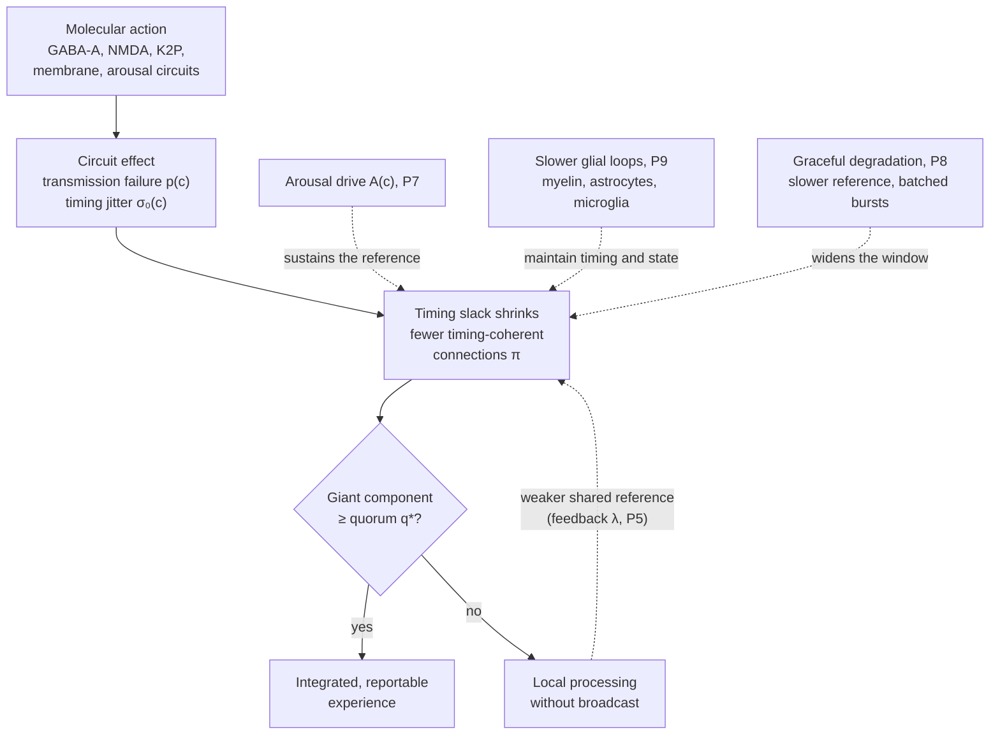
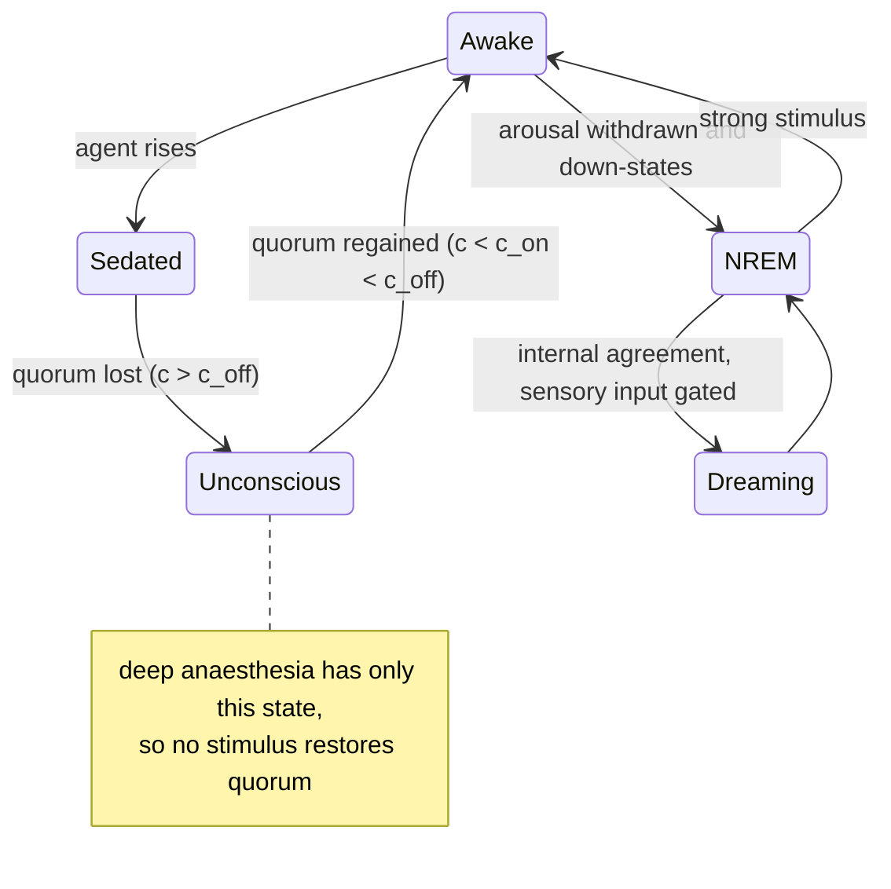
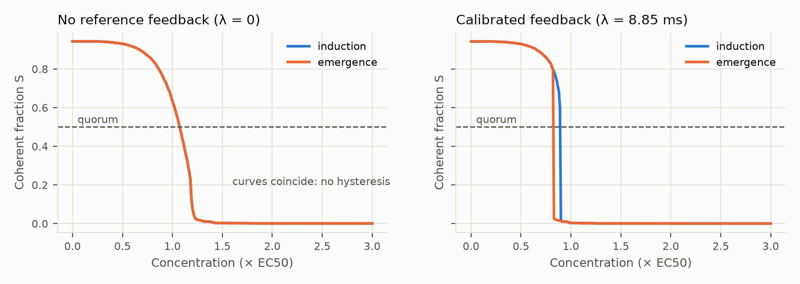
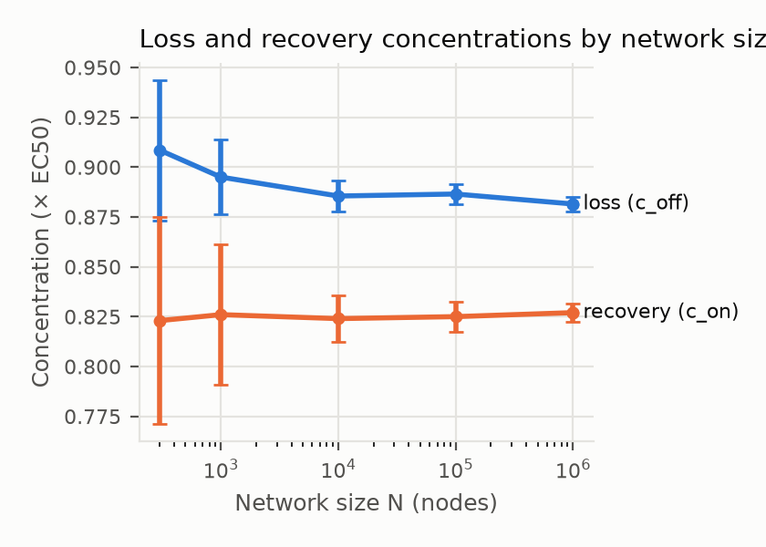
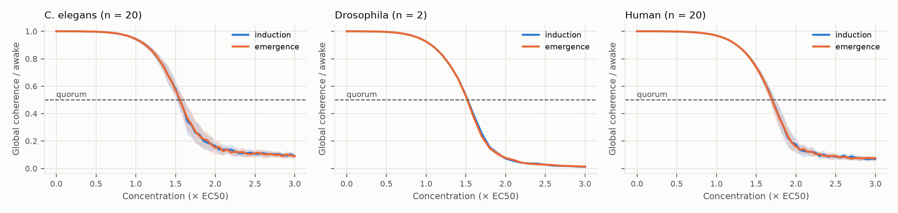
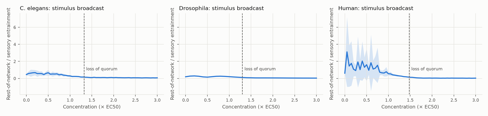
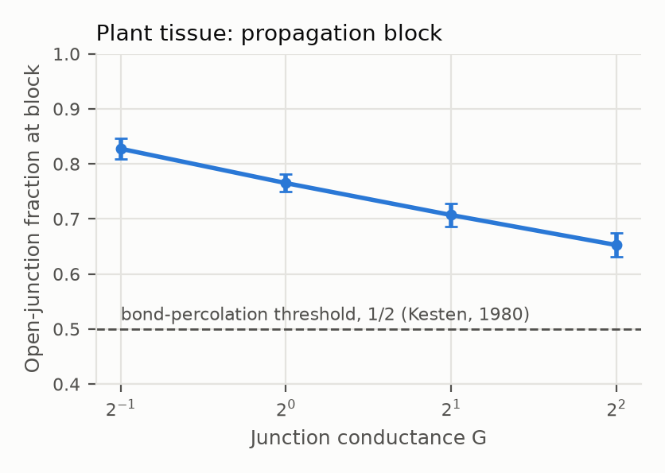
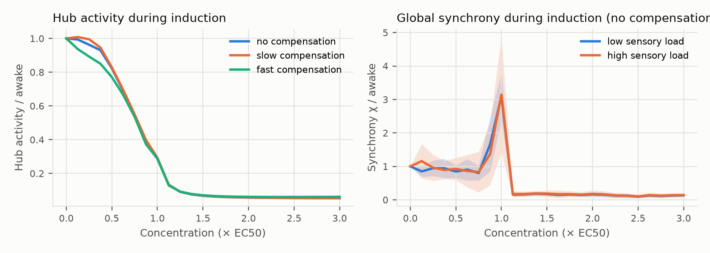

# The Distributed Perceptual Consensus Hypothesis of General Anaesthesia

**A timing-constrained network model of anaesthetic-induced unconsciousness**

| | |
|---|---|
| **Authors** | Gabriel Santos de Oliveira<sup>1</sup> ([ORCID 0009-0003-9528-9731](https://orcid.org/0009-0003-9528-9731); [Lattes CV](https://lattes.cnpq.br/2102695116731989)); Callina Gertrudes Ferreira<sup>2</sup> ([ORCID 0009-0002-8512-213X](https://orcid.org/0009-0002-8512-213X); [Lattes CV](https://lattes.cnpq.br/2112739936897542)) |
| **Affiliations** | <sup>1</sup> Independent researcher, Rio de Janeiro, Brazil. <sup>2</sup> Undergraduate student, Universidade Veiga de Almeida (UVA), Rio de Janeiro, Brazil (named for identification; the work was not carried out at or endorsed by UVA) |
| **Date** | 17 October 2026 |
| **Version** | 1.0.0 |
| **Article type** | Hypothesis and theory paper (not peer reviewed) |
| **Licence** | Text and figures: [CC BY 4.0](LICENSE-CC-BY-4.0). Code: [Apache License 2.0](LICENSE) |
| **Keywords** | general anaesthesia; consciousness; thalamocortical system; percolation; distributed consensus; neural synchrony; neural inertia; perturbational complexity index |

---

## Abstract

General anaesthetics are chemically diverse, act on many molecular targets, and yet reliably produce a common end state: reversible loss of consciousness. We propose the **Distributed Perceptual Consensus (DPC) hypothesis**: conscious experience is the outcome of a continuously repeated, timing-constrained agreement among distributed cortical and thalamic populations, possible only when signals between areas arrive within an integration window around a shared rhythm. The idea is borrowed from distributed computing, where deterministic agreement among processes that can crash requires bounds on delays. Anaesthetics, by whatever molecular route, cause transmission failure on some connections and increase the timing variability of the rest. We model the brain as a graph whose *timing-coherent* subgraph undergoes a percolation transition as concentration rises; consciousness is lost when no giant component large enough to reach quorum remains. Simulations of a percolation model on networks of up to one million nodes and of a phase-oscillator model on the *C. elegans*, *Drosophila* and human connectomes, with an excitatory-inhibitory population model for one further test, show that the model is internally consistent and produces its central claims: agents that cause transmission failure and agents that cause timing variability both abolish quorum on all three connectomes, the share of connections each connectome needs for quorum lies 2 to 5% above the standard estimate from its degree distribution (Callaway et al., 2000), and fluctuations rise at least tenfold before the collapse, a behaviour found after the first runs and reproduced on new random seeds of the same model. A single feedback assumption, that the shared rhythm depends on the size of the agreeing group, produces neural inertia in the percolation model once its strength is calibrated, but not in the phase-oscillator model, and even in the percolation model not up to the largest measured ratio. Seven proposed mechanisms failed and are reported with the revisions they prompted, among them congestion as the source of induction excitation and three accounts of ketamine's disconnected consciousness; why ketamine leaves consciousness disconnected rather than abolished remains the main open problem. The hypothesis is mechanism-agnostic at the molecular level and complements receptor-level pharmacology and existing network theories. We distinguish established findings from hypothesis and analogy, address eight principal objections, and list falsifiable predictions with an analysis protocol.

---

## 1. Introduction and scope

### 1.1 The problem

More than 170 years after the first public demonstration of ether anaesthesia, no consensus exists on how anaesthetics produce unconsciousness (Franks, 2008; Alkire et al., 2008; Hemmings et al., 2019). The difficulty is that the agents are structurally unrelated (from the monatomic gas xenon to the alkylphenol propofol), act on many different molecular targets, and produce distinct electroencephalographic (EEG) signatures, yet converge on a similar behavioural endpoint. A satisfactory account must therefore explain how *heterogeneous molecular causes* produce a *common systems-level effect*. The search for a single molecular mechanism, which dominated the lipid-theory era, did not succeed, because the molecular facts are genuinely diverse (Section 2.1). DPC therefore seeks unification one level up: many molecular routes converging on one form of network failure, in the way that many different diseases converge on heart failure.

### 1.2 What this paper claims, and what it does not

This is a **hypothesis**, not a theorem. It has no formal proof and its value lies in whether its predictions survive experimental test. It concerns the conditions under which integrated, reportable content is present, not what that content is or why it is accompanied by experience (Section 10, item 7). To avoid ambiguity we classify every claim as one of three types:

- **[E] Established:** supported by replicated experimental evidence, with citation.
- **[H] Hypothesis:** a novel or contested claim of this paper, stated so that it can be falsified.
- **[A] Analogy:** a computing concept used as an explanatory metaphor. Analogies motivate hypotheses but are not themselves claims about biology.

**The postulates.** The hypothesis is stated as postulates P1 to P9, with P4b a refinement of P4, all of type [H], defined in Section 3.3 and referred to by number throughout. In one line each:

| Postulate | In one line |
|---|---|
| P1 Integration cycles | Conscious content is generated in repeated cycles in which distributed populations converge on a shared state |
| P2 Bounded-delay condition | A population contributes to a cycle only if its signals arrive within an integration window around a shared rhythm |
| P3 Quorum | Integrated, reportable content requires the timing-coherent populations to form one connected group of at least a share $q^*$ of the network |
| P4 Two failure modes | Anaesthetics reduce the timing-coherent connections by making transmission fail, by making signal timing variable, or both |
| P4b Network timing | What anaesthesia degrades is the timing of signals between areas relative to the shared rhythm, not the precision of single neurons |
| P5 Reference feedback | The shared rhythm is generated by the coherent thalamocortical core itself, so a smaller agreeing group weakens it |
| P6 Default dynamics | When quorum is lost, cortex falls into its own local, agent-specific dynamics |
| P7 Arousal and brain state | Wake-promoting arousal systems sustain part of the shared rhythm independently of cortical coherence |
| P8 Graceful degradation | As timing slack shrinks, the shared rhythm slows and activity turns into bursts before agreement fails |
| P9 Glial cascade control | Slower glial loops maintain the conditions for timing coherence; an extension on which P1 to P8 do not depend |

**What is new, and what is borrowed.** Several ingredients of DPC are not new: communication through coherence (Fries, 2005, 2015), recurrent processing (Lamme and Roelfsema, 2000; Lamme, 2006), functional disconnection as the common end point of anaesthesia (Hudetz and Mashour, 2016), percolation models of anaesthesia and of conscious perception (Zhou et al., 2015; Arese Lucini et al., 2019) and feedback-driven hysteresis (Kim et al., 2018); Section 2.3 credits each. The contributions of this paper are:

1. Timing variability between areas as a second, independent route to the loss of usable connections, alongside transmission failure, combined with it into one probability per connection. Placing all agents on one transmission parameter is not new (Zhou et al., 2015). In the percolation model the two routes are interchangeable at the network level, so they can be told apart only by measuring each separately (Section 10, item 13).
2. The proposal [H] that one quantity anaesthetics degrade is the *variability* of signal timing between areas relative to a shared rhythm, rather than its mean or the coherence of ongoing rhythms (P4b, Section 7.8). Section 8 tests it directly in predictions 1, 3 and 8.
3. A quorum threshold computed from a network's degree distribution with the standard generating-function estimate (Callaway et al., 2000) and compared with measurement on the wiring of a nematode, an insect and a human, including the directed wiring and a rewired null model (Appendices B and C).
4. Falsifiable predictions, an analysis protocol and an open, tested simulator in which every parameter is labelled measured, calibrated, assumed or free.

### 1.3 Scope and definitions

General anaesthesia comprises several separable components: unconsciousness, amnesia, analgesia and immobility, while autonomic, cardiovascular, respiratory and thermoregulatory function is kept stable (Brown et al., 2010). It is not sleep: during maintenance the EEG can resemble that of slow-wave sleep, but its patterns generally differ from those of sleep, and burst suppression, seen in deep anaesthesia and in coma, does not occur in sleep. Brown et al. (2010) describe general anaesthesia as a reversible drug-induced coma. **This hypothesis addresses only unconsciousness.** Immobility, the basis of the minimum alveolar concentration (MAC) standard (Eger et al., 1965), is outside scope: it does not depend on the forebrain (Rampil et al., 1993) and is mediated largely at the level of the spinal cord (Antognini and Schwartz, 1993; Rampil, 1994). Memory and responsiveness can be impaired separately (Veselis et al., 1997); amnesia is discussed only where it bears on the hypothesis.

We follow the distinctions of Sanders et al. (2012):

- **Responsiveness:** a behavioural response to a command or stimulus. In humans the operational endpoint is *loss of responsiveness* (LOR); in rodents it is *loss of righting reflex* (LORR).
- **Connected consciousness:** experience that includes awareness of the environment.
- **Disconnected consciousness:** experience without environmental awareness, such as dreaming.
- **Unconsciousness:** absence of any experience.

Unresponsiveness is therefore not equivalent to unconsciousness, and the hypothesis must account for both.

Other causes of unconsciousness, including fainting (syncope), epileptic seizures, concussion and coma, are outside the scope of this paper. One of them suggests an extension that is stated here as a hypothesis and not tested [H]. In syncope, when the circulation stops abruptly and completely, the resulting global fall in cerebral blood flow can abolish consciousness in as little as roughly 7 s (Wieling et al., 2009). Under DPC, neurons deprived of oxygen and glucose would fail to transmit: the omission fault of P4 (Section 3.3), a signal that never arrives, reached through a different route. The hypothesis therefore predicts that any cause that drives enough connections out of timing coherence abolishes integration at the same kind of threshold, an abrupt loss of the giant component rather than a graded decline, as prediction 1 states for anaesthesia (Section 8).

### 1.4 Terminology

Every term is used in one defined sense, given with the symbols and abbreviations in Appendix A (A.1 to A.3). The argument rests on six of them: *timing-coherent* connections, the *integration window*, *timing slack*, the *giant component*, *quorum* and *neural inertia*. For readability some have synonyms: a timing-coherent connection is also called *occupied*, the percolation term; the shared rhythm is also called the *phase reference* or *reference rhythm*; and the giant component is also called the *agreeing group*. Words borrowed from computing (for example bus, clock, quorum, circuit breaker) appear only in passages marked [A] as analogies; Appendix A.4 maps each to a defined term, and none is used to state a claim. Two exceptions are names given to parts of the hypothesis: *quorum* (P3) and *graceful degradation* (P8).

---

## 2. Background

### 2.1 Molecular mechanisms [E]

The Meyer-Overton correlation, which relates anaesthetic potency to lipid solubility (Meyer, 1899; Overton, 1901), motivated a century of lipid-based theories. Several findings show that lipid solubility alone is insufficient:

1. Anaesthetics inhibit a lipid-free protein, firefly luciferase, at potencies matching the Meyer-Overton line (Franks and Lieb, 1984).
2. Optical isomers of isoflurane, which have identical lipid solubility, differ in their effects on neuronal ion channels (Franks and Lieb, 1991).
3. Some lipophilic halogenated compounds violate the correlation (Koblin et al., 1994); such compounds were later termed *non-immobilisers*.
4. A single point mutation (N265M) in the β3 subunit of the γ-aminobutyric acid type A (GABA-A) receptor strongly reduces the in vivo effects of propofol and etomidate in mice (Jurd et al., 2003).
5. Xenon has negligible effects on GABA-A receptors, which most general anaesthetics enhance, and instead potently inhibits N-methyl-D-aspartate (NMDA) receptors, a class of glutamate receptor (Franks et al., 1998).

Membrane-mediated mechanisms remain biologically plausible as *contributing* routes. These include changes in the lateral pressure profile of the lipid bilayer that alter the conformational equilibria of embedded channels (Cantor, 1997), and the disruption of ordered lipid domains that activates TREK-1 potassium channels via phospholipase D2 (PLD2; Pavel et al., 2020). The current view is that anaesthetics act on multiple targets, chiefly GABA-A receptors, NMDA receptors and two-pore-domain potassium (K2P) channels, with agent-specific profiles (Rudolph and Antkowiak, 2004; Hemmings et al., 2019).

The known routes differ in mechanism. Most shift ion currents so as to reduce excitatory transmission or neuronal excitability, although ketamine raises cortical gamma activity (Akeju et al., 2016). The column "DPC fault type" is the hypothesis of P4 [H], not an established classification:

| Molecular route | Agents with evidence | Effect on ion flow | DPC fault type (P4) [H] | Sources |
|---|---|---|---|---|
| GABA-A receptor potentiation (prolonging channel opening) | Propofol, etomidate, barbiturates, isoflurane, sevoflurane | More Cl⁻ inhibitory current | Transmission failure | Mihic et al. (1997); Jurd et al. (2003) |
| NMDA receptor block: open-channel block together with fewer channel openings (ketamine), or binding at the glycine co-agonist site (xenon, isoflurane) | Ketamine, xenon, nitrous oxide; isoflurane | Less Na⁺ and Ca²⁺ excitatory current | Timing variability and transmission failure | Orser et al. (1997); Franks et al. (1998); Jevtović-Todorović et al. (1998); Dickinson et al. (2007) |
| Two-pore-domain K⁺ channel activation (TREK-1, TASK) | TREK-1: the volatile agents halothane, isoflurane, chloroform and diethyl ether, and the gases xenon, nitrous oxide and cyclopropane; TASK: of these agents only halothane and isoflurane, as the gases leave TASK-3 unaffected | More K⁺ leak, hyperpolarisation | Transmission failure | Patel et al. (1999); Gruss et al. (2004); Heurteaux et al. (2004) |
| Inhibition of hyperpolarisation-activated cyclic-nucleotide-gated (HCN) channels | Volatile agents (subunit-specific); propofol | Less pacemaker cation current | Altered rhythm and timing | Chen et al. (2005); Ying et al. (2006) |
| Presynaptic Na⁺ channel inhibition, reducing Ca²⁺ entry and vesicle release | Isoflurane | Less transmitter released per spike | Transmission failure | Herold and Hemmings (2012) for Na⁺ channels; Baumgart et al. (2015) for reduced Ca²⁺ entry and release |
| α2-adrenoceptor agonism, acting through the endogenous sleep pathway | Dexmedetomidine | Indirect: inhibition of locus coeruleus neurons | Arousal suppression (P7) | Nelson et al. (2003) |
| Disruption of membrane lipid domains, releasing PLD2, which activates TREK-1 | Chloroform, isoflurane | Indirect: more K⁺ current | Transmission failure | Pavel et al. (2020) |
| Mitochondrial complex I (a sensitivity factor rather than an ion channel) | Volatile agents | Not a channel effect; complex I dysfunction increases sensitivity | Modulates susceptibility | Kayser et al. (1999) |

Glycine receptors, which are abundant in the spinal cord, are also potentiated by volatile agents (Mihic et al., 1997) and are thought to contribute to immobility, which is outside the scope of this paper (Section 1.3).

Two further proposals are unconfirmed and are noted only for completeness. A photoactive anaesthetic analogue was found bound to β-tubulin in tadpoles (Emerson et al., 2013). A single dose of the microtubule stabiliser epothilone B delayed isoflurane-induced loss of righting in rats (Khan et al., 2024) and, by about 29 s on the following day, in mice (Huang et al., 2026), in studies from one laboratory. In contrast, two weeks of daily epothilone D, also a stabiliser, made mice more sensitive to isoflurane, as did the destabiliser vinblastine, while paclitaxel shifted sensitivity marginally the other way (Li et al., 2025). The direction of the effect differs between drugs and dosing schedules, and whether microtubules contribute to anaesthesia remains unsettled. A single study reported that xenon isotopes carrying nuclear spin are less potent in mice than spin-free isotopes (Li et al., 2018); no independent replication has been found.

**Implication for this paper:** the DPC hypothesis does not depend on which molecular mechanism operates. It requires only that, at the circuit level, agents increase transmission failure, timing jitter, or both.

### 2.2 Systems-level findings [E]

- **Thalamocortical involvement.** Two volatile anaesthetics both suppressed regional thalamic and midbrain reticular activity in human volunteers (Alkire et al., 2000). Nicotine microinjected into the central medial thalamus reverses sevoflurane-induced LORR in rats (Alkire et al., 2007). Thalamic stimulation can restore arousal in anaesthetised macaques (Redinbaugh et al., 2020).
- **Breakdown of cortical communication.** Propofol, sevoflurane and ketamine all disrupt frontal-parietal feedback connectivity (U. Lee et al., 2013). At the onset of propofol-induced unconsciousness, a slow oscillation appears and neuronal spiking becomes confined to brief phase windows that are asynchronous across cortex, fragmenting cortical networks (Lewis et al., 2012). Reviews of large-scale network studies conclude that unresponsiveness under anaesthetics is commonly accompanied by reduced activity in, or functional disconnection of, the lateral frontoparietal networks (Hudetz and Mashour, 2016), together with reduced complexity and a smaller repertoire of brain states (Mashour and Hudetz, 2018).
- **Agent-specific EEG signatures.** Propofol produces increased beta power during sedation, followed by coherent frontal alpha (8 to 12 Hz) together with slow-delta (0.1 to 4 Hz) oscillations at LOR (Purdon et al., 2013, 2015; Ching et al., 2010). Ketamine produces increased gamma power and does not produce the propofol-like alpha pattern (Akeju et al., 2016).
- **Cellular decoupling.** In mice, anaesthetics decouple the apical dendrites of layer 5 pyramidal neurons from their somata, which would interrupt cortico-cortical feedback integration if that feedback arrives mainly on the apical dendrites (Suzuki and Larkum, 2020).
- **Loss of coordination, not of activity, across species.** In *Caenorhabditis elegans*, isoflurane leaves individual head neurons active but collapses the correlations between them (Awal et al., 2020). In *Drosophila*, isoflurane reduces stimulus-locked power and coherence in the central brain, while increasing them at twice the stimulus frequency in the optic lobes for some stimuli (Cohen et al., 2016). It also impairs low-frequency feedback while leaving high-frequency feedforward connectivity intact (Cohen et al., 2018), and fragments the integrated structure of brain activity into separate clusters (Leung et al., 2021).
- **Loss of individual signature.** Under sevoflurane and propofol, functional connectivity becomes less distinctive between individuals, most strongly in transmodal association cortex, and anaesthetised human connectivity becomes more similar to that of the macaque (Luppi et al., 2025).
- **Complexity.** The perturbational complexity index (PCI) is high in wakefulness and low during propofol- and xenon-induced unconsciousness. It remains high under ketamine, consistent with the dream reports of healthy volunteers on emergence (Sarasso et al., 2015); the original validation of the index used midazolam, xenon and propofol (Casali et al., 2013).
- **Neural inertia.** In both insects and mammals, the concentration at which consciousness returns is lower than the concentration at which it is lost, and the difference is not fully explained by pharmacokinetics. This hysteresis is termed neural inertia; it was demonstrated in both mice and *Drosophila* (Friedman et al., 2010) and depends on excitability genes that act independently of induction sensitivity (Joiner et al., 2013; see also Kelz et al., 2008). Its measured size varies by agent. The ratio of induction to emergence concentration is about 1.08 for isoflurane and 2.85 for halothane in mice (Friedman et al., 2010). In humans it is about 1.07 for propofol effect-site concentrations (1.5 and 1.4 µg/ml at loss and recovery of behavioural responsiveness; Warnaby et al., 2017), whose authors found no consistent hysteresis in these values and identified inertia instead in slow-wave saturation. It is 1.11 in another study (Iwakiri et al., 2005), whose authors describe the concentrations as similar, although the difference was statistically significant. For measured propofol concentrations it is about 1.63 (Sepúlveda et al., 2018), whose authors caution that the gap could instead arise from systematic error in how effect-site concentrations were estimated, not from neural inertia. Recovery proceeds through a sequence of discrete, metastable activity states (Hudson et al., 2014).
- **Glial cells.** Glia respond to anaesthetics, and manipulating them changes induction and emergence in mice. In awake mice, anaesthetics suppress calcium signals in cortical astrocytes even at doses too low to change how neurons respond when the whiskers are stimulated (Thrane et al., 2012). Inhaled agents also cause a reversible disruption of the fine astrocytic processes in somatosensory cortex (Zhou et al., 2025). Activating astrocytes in the basal forebrain speeds isoflurane induction and slows recovery (Lin et al., 2023), whereas activating astrocytes in the parabrachial nucleus or the paraventricular thalamus speeds emergence (Liu et al., 2023; Zhao et al., 2024). The effect therefore depends on the region. Depleting microglia with the drug PLX5622 reduces sensitivity to several anaesthetics and shortens their effect (Cao et al., 2023; He et al., 2023). The same group later found, however, that PLX5622 also activates a liver receptor that speeds the clearance of anaesthetics, and that depleting microglia genetically did not hasten emergence (Cao et al., 2026). The firmer evidence is that genetic loss of the microglial receptor P2Y12 speeds recovery (Cao et al., 2023). Myelin sets conduction timing. In auditory brainstem circuits the geometry of myelinated axons is tuned to set when action potentials arrive (Ford et al., 2015), and in mice a subtle myelin deficit spreads out conduction times and reduces the synchrony of motor cortex activity (Kato et al., 2020). We found no study of anaesthetic requirements in human demyelinating disease, only case reports. Two animal studies exist. Demyelinated mice took longer to recover from isoflurane, with effects that depended on the region demyelinated (Wang et al., 2024), and older demyelinated mice took longer to be induced at a fixed concentration, in small groups (Tot et al., 2024).

### 2.3 Prior models and the position of DPC

DPC builds on two groups of prior work. The first is conceptual:

| Framework | Central claim | Relationship to DPC |
|---|---|---|
| Communication through coherence (Fries, 2005, 2015) | Oscillating neuronal groups communicate effectively only when their windows for receiving and sending signals coincide in time | P2 is this condition; DPC adds the claim that anaesthetics act by making inter-areal timing variable relative to the shared rhythm, and asks how many connections must meet the condition for integration across the whole network |
| Perceptual cycles (VanRullen and Koch, 2003; VanRullen, 2016) | Perception proceeds in discrete cycles tied to brain oscillations; current evidence points to several rhythms rather than one | P1 adopts discrete cycles; DPC adds a timing condition on each exchange, a network-level quorum, and the proposal that anaesthetics act by breaking the cycles' timing |
| Recurrent processing (Lamme and Roelfsema, 2000; Lamme, 2006) | A feedforward sweep is probably insufficient for awareness; recurrent processing between areas is needed | P1 adopts recurrent cycles; DPC adds a timing condition on each exchange and a network-level quorum |
| Cognitive unbinding (Mashour, 2013) | Anaesthetics disrupt the synthesis of information across cortical networks | DPC proposes a specific reason synthesis fails: violation of a bounded-delay condition |
| Integrated information theory (Tononi et al., 2016) | Consciousness corresponds to integrated information (Φ) | DPC's order parameter measures network-level timing coherence; it is not Φ and is not claimed to approximate it, and DPC makes no claim about the nature of experience |
| Global neuronal workspace (Dehaene and Changeux, 2011) | Conscious access requires non-linear "ignition" and global broadcast | Quorum in DPC is a static, topological criterion that can be compared with the dynamic ignition of the workspace but is not equivalent to it; DPC adds a timing constraint |
| Thalamocortical switch (Alkire et al., 2000) | The thalamus gates conscious state | DPC assigns the thalamocortical core the role of supplying a shared phase reference, not of acting as an on/off switch |
| Mean-field anaesthetic phase transition (Steyn-Ross et al., 1999; Bojak and Liley, 2005) | Anaesthetic modulation of inhibitory synaptic kinetics moves a mean-field model of cortex through distinct stationary regimes, suggesting a phase transition (Steyn-Ross et al., 1999); a related mean-field model accounts for anaesthetic changes in the EEG through ligand-gated synaptic responses (Bojak and Liley, 2005) | DPC also treats loss of consciousness as a transition, but in a network of discrete connections whose timing coherence percolates; it does not model the EEG spectrum, which these models do |
| Slow oscillation as the default cortical state (Sanchez-Vives et al., 2017) | Slow oscillations are proposed as the baseline, low-complexity pattern of cortical activity, which the brain must leave to regain the complexity that accompanies consciousness | Compatible with P6 and P7: in DPC the slow oscillation is what the network does once quorum is lost; DPC adds a criterion for when that happens |
| Dendritic integration theory (Aru et al., 2020, whose abstract calls it Dendritic Information Theory) | Cortical pyramidal cells gate the integration of bottom-up and top-down signals in their dendrites, and in unconscious states this integration is prevented; anaesthetics decouple the dendrites of layer 5 pyramidal cells from their cell bodies (Suzuki and Larkum, 2020) | Compatible: a cellular route by which feedback signals could fail to count, one candidate mechanism for the omission faults of P4 |

The second group consists of quantitative models, several of which already contain elements of DPC. **These precede the present work and must be credited:**

| Prior model | What it established | What DPC adds |
|---|---|---|
| Breskin et al. (2006) | In living neuronal cultures, chemically weakening synapses makes the giant connected component disintegrate at a percolation transition | DPC applies percolation to whole connectomes and to timing as well as transmission |
| Arese Lucini et al. (2019) | Human functional brain networks are modelled as passing from conscious to subliminal perception by k-core percolation: the outer k-shells of the network switch off, while its innermost core stays active | DPC applies percolation to anaesthetic loss of consciousness and defines occupation by a timing criterion rather than by functional activation |
| Zhou et al. (2015) | A percolation model of thalamocortical and cortico-cortical transmission, with one transmission probability *p*, reproduces EEG features of anaesthesia; information transfer changes sharply near a critical *p* | Zhou et al. already placed every agent on one transmission parameter; DPC adds timing variability as a second, independent route into the same occupation probability |
| Su et al. (2020) | Measured an induction-recovery hysteresis loop in the burst-suppression ratio of local field potentials (two mice, isoflurane) and explained it by percolation on self-similar multilayer networks | DPC attributes hysteresis to feedback through the shared rhythm rather than to self-similar network structure; for feedback-driven hysteresis see Kim et al. (2018), below |
| Kim et al. (2016) | The conditions for explosive synchronisation are met in human EEG networks just after anaesthetic-induced loss of consciousness | DPC tests a percolation transition, not explosive synchronisation, on empirical connectomes of three species with a single parameter set |
| Kim et al. (2018) | Stuart-Landau oscillators with adaptive feedback on a 78-region connectome reproduce hysteresis of functional connectivity seen in EEG under ketamine and sevoflurane | The feedback mechanism in DPC (P5) is closely related, and Kim et al. already linked the size of the hysteresis to anaesthetic potency; DPC attributes the feedback to a shared timing reference and calibrates its strength to measured inertia ratios |
| Moon et al. (2015); H. Lee et al. (2013) | Network topology determines phase lead and lag between hubs and periphery, and the front-to-back direction of information flow disappears under sevoflurane; the hub structure of EEG networks is reconfigured after propofol-induced unconsciousness | Hub disruption under anaesthesia has already been reported. DPC explains why hubs are vulnerable, by percolation on networks whose degree distribution is heavy-tailed (Albert et al., 2000), and predicts that disrupting hub connections lowers the concentration needed for loss of responsiveness more than disrupting the same number of random connections (prediction 6) |
| Proekt and Hudson (2018); Hudson et al. (2014) | Recovery of consciousness passes through discrete metastable states (Hudson et al., 2014), and neural inertia can be explained by noise-driven transitions on a multi-well landscape, compared with inertia data from mice and *Drosophila* (Proekt and Hudson, 2018) | DPC offers a network-level origin for such barriers; the two accounts are compatible |

What is claimed as new [H] is therefore narrower than a percolation or hysteresis model as such; Section 1.2 lists it.


---

## 3. The hypothesis

### 3.1 Motivating analogy [A]

In distributed computing, a set of processes reaches *consensus* when it agrees on a single value despite some processes failing. Fischer, Lynch and Paterson (1985) proved that deterministic consensus is impossible in a fully asynchronous system if even one process can crash. Dwork, Lynch and Stockmeyer (1988) showed that consensus becomes achievable under *partial synchrony*, meaning that message delays and relative processing speeds are bounded, even if the bounds are not known in advance. Systems built on these results commonly require a *quorum*, a minimum fraction of participating processes, before committing a value. Faults are classified by how a process deviates from its specification (Cristian, 1991): it may stop (a *crash*), fail to deliver a message (an *omission*), deliver it outside the agreed time (a *timing* failure), or emit arbitrary or misleading messages (a *Byzantine* fault). Byzantine faults are tolerated only with a larger fraction of correct processes, more than two-thirds when messages are unsigned (Lamport et al., 1982). Timing bounds are not the only route to agreement: randomised protocols reach it without any bound on delays, provided a majority of processes keep working (Ben-Or, 1983), and so do protocols that use unreliable failure detectors (Chandra and Toueg, 1996). DPC takes the timing-bounded route as its analogy [A]; whether neural circuits use anything resembling randomised agreement or failure detection is unknown.

The analogy, which is not a claim of literal equivalence, is that the brain must repeatedly settle on a single coherent interpretation of multisensory and internal signals that arrive at different areas at different times. Lamport (1978) showed that causality only partially orders the events of a distributed system. He also showed that a consistent total order can be obtained with a system of logical clocks, with synchronised physical clocks added so that the order agrees with what users observe. We propose that the brain faces a comparable constraint.

### 3.2 Engineering analogues and their limits [A]

The terms used in this paper come from engineered systems that solve the same problem the brain is proposed to solve: keeping many distributed units in agreement despite delays, noise and failures. The table lists the systems that motivated each postulate, with references to their specifications, and states where each analogy fails.

| Engineered system | How it works | Counterpart in DPC | Where the analogy fails |
|---|---|---|---|
| Fly-by-wire flight control: the triple-triple redundant primary flight computer of the Boeing 777 (Yeh, 1996) and the command/monitor computers of the Airbus A320 family (Briere and Traverse, 1993) | Redundant channels compute the same command; disagreeing channels are outvoted or disconnected, and the aircraft falls back to a simpler control law when too few agree | Quorum (P3); fall-back to default dynamics when quorum is lost (P6) | Neural populations do not compute identical copies of one value, and there is no designated voter |
| Time-triggered architecture (Kopetz and Bauer, 2003), used in safety-critical vehicles | Nodes transmit in fixed time slots that repeat in a cycle (a round-robin of slots) against a synchronised global clock; a message outside its slot is discarded, and a node that loses synchrony is excluded from membership | Integration cycles (P1); the window $W$ (P2); late signals not integrated | The brain has no fixed slots and no global clock; its timing reference emerges from oscillation |
| Controller Area Network bus (ISO 11898-1:2024; ISO, 2024) | Every node must sample each bit within the same bit time, so signal propagation delay limits the product of bus length and bit rate | A bounded-delay condition that limits network size and speed (P2) | A CAN bus is one shared medium; the brain is a sparse network of point-to-point connections |
| Precision Time Protocol (IEEE Std 1588-2019; IEEE, 2020) | A reference clock is distributed through the network, with path delays measured and compensated | The shared thalamocortical phase reference (P5) | PTP has a designated master; the neural reference is emergent and itself depends on coherence |
| Synchronous power grids (Filatrella et al., 2008; Rohden et al., 2012) | Generators must remain frequency-synchronised; their dynamics are modelled with Kuramoto-like oscillator equations, and loss of synchrony can cascade into a blackout (U.S.-Canada Power System Outage Task Force, 2004) | The same mathematics as the oscillator model in Appendix C; collapse of global coherence | Grid protection disconnects equipment by design; DPC makes no claim that the neural transition is designed or protective |
| Circuit-breaker pattern in distributed software (Fowler, 2014) | Calls to a failing dependency are stopped; after a delay a trial call is allowed ("half-open") before normal operation resumes | Active shutdown by dedicated circuits (Section 5.2); the delayed, conditional return resembles neural inertia | A software circuit breaker exists to protect the system; DPC makes no claim that the neural transition serves a protective purpose |
| Distributed consensus (Lamport et al., 1982; Fischer et al., 1985; Dwork et al., 1988) | Deterministic agreement is impossible without timing bounds when a process can crash (randomised protocols and failure detectors avoid this), is achievable under partial synchrony, and tolerates fewer Byzantine than crash faults | Motivation for P2 and for the two failure modes in P4; no formal result is transferred, since partial synchrony concerns delay bounds that either exist but are not known in advance or are known but hold only after an unknown time, whereas $W$ is a fixed window | The brain does not run a consensus algorithm; the results are used as constraints, not as a description of mechanism |

**The physical medium differs.** Computers signal electronically, as electromagnetic waves in conductors. Neurons signal electrochemically: an action potential is an ionic current regenerated along the axon, and in human cortico-cortical pathways the median axonal conduction velocity is about 3.9 m/s, with a median axonal delay of about 10 ms (Lemaréchal et al., 2022). What transfers from engineering to neuroscience is therefore not the physics but the ratio of delay to cycle time. At 40 Hz a gamma cycle lasts 25 ms, so a typical cortico-cortical delay is about 40% of a cycle. In that regime DPC proposes that timing is a first-order constraint on communication [H], as it is on a CAN bus whose propagation delay approaches its bit time. A constant delay can be absorbed by a matching phase offset (Fries, 2015); the proposal concerns its variability.

**Signals arrive at many speeds.** The brain receives its inputs with widely different delays, set by biology rather than by the physics of the stimulus. Responses in human primary auditory cortex peak about 15 ms after a sound (Celesia, 1976), whereas the earliest visual response recorded over occipital cortex begins at about 56 ms (Foxe and Simpson, 2002), even though light travels far faster than sound. Peripheral nerve fibres span about two orders of magnitude in conduction velocity, from unmyelinated fibres at about 0.5 to 2 m/s to large myelinated fibres at about 80 to 120 m/s (values tabulated by Yap et al., 2020, from a standard textbook) [A: links of different speeds, like 3G, 4G and 5G connections]. The brain compensates: once people have spent several minutes exposed to sounds and images offset by an unchanging delay, the point at which they judge the two to coincide moves towards that delay (Fujisaki et al., 2004). Its rhythms are also nested, the phase of slower rhythms modulating the amplitude of faster ones, delta modulating theta and theta modulating gamma (Lakatos et al., 2005; Canolty and Knight, 2010) [A: several clock domains, with communication between them]. DPC proposes [H] that these compensations work only while timing slack (Section 3.3) remains positive; prediction 8 (Section 8) states what would falsify it.

### 3.3 Postulates [H]

**The central claim in plain language.** Integrated, reportable experience requires *positive timing slack*: signals passing between the populations of a nervous system must arrive within the window in which they can be combined, judged against a shared rhythm. Anaesthetics, whatever their molecular target, erode that slack by making transmission fail or arrival times vary. When slack turns negative on enough connections, the populations can no longer reach agreement, and experience is lost. Agreement involves no vote and no voter: no population holds a copy of a value or counts the others. Populations agree when connections whose signals arrive in time link them into one group, locked to the shared rhythm. The claim concerns timing margins, not a particular frequency: each nervous system uses its own rhythms, matched to its own conduction delays. Across mammals that differ several-thousand-fold in brain volume, the hierarchy of brain rhythms is largely preserved, which Buzsáki, Logothetis and Singer (2013) suggest may be achieved by larger-diameter, faster-conducting long-range axons in larger brains. If so, timing margins would be preserved across brain sizes [H], which is the condition this hypothesis requires.

The postulates state the claim precisely. Figure A summarises the causal chain they describe.



*Figure A. Causal chain of the DPC hypothesis. Dashed arrows are feedback and modulating influences. The symbols are defined in Section 4 and listed in Appendix A.2.*


- **P1 (Integration cycles).** Conscious content is generated in repeated integration cycles, during which distributed populations converge on a shared state. The cycles adopt two earlier proposals (Section 2.3): that perception proceeds in discrete epochs (VanRullen and Koch, 2003), and that awareness needs recurrent processing between areas rather than a single feedforward sweep (Lamme and Roelfsema, 2000; Lamme, 2006). Related accounts tie such loops to re-entry between cortex and thalamus (Edelman and Gally, 2013), to dynamic links established by synchronisation across frequency bands (Varela et al., 2001), to thalamocortical binding by temporal coincidence (Llinás et al., 1998) and to the comparison of feedback predictions with feedforward errors (Rao and Ballard, 1999). The evidence points to several perceptual rhythms rather than one (VanRullen, 2016), so DPC's single phase reference (P5) is a simplification (Section 10). Several studies report that anaesthesia disrupts this recurrent component more than the feedforward one, though not uniformly. Under propofol, directed feedback connectivity from frontal to parietal cortex weakens as consciousness is lost and recovers when the participants again respond to spoken commands, while earlier animal data had indicated that feedforward processing may continue (Lee et al., 2009). In rats, halothane and isoflurane reduced both feedforward and feedback information transfer at 50 Hz, the feedback transfer from frontal to posterior regions most, while increasing both at 30 Hz (Imas et al., 2005). In mice, anaesthesia decouples the apical dendrites of layer 5 pyramidal neurons, the presumed target of feedback input, from their somata (Suzuki and Larkum, 2020). In the terms of the analogy [A], each cycle is a loop that checks what arrived, and when, against what was expected. DPC proposes [H] that a cycle that loses quorum partway is abandoned rather than half-completed [A: a saga rolled back when one of its steps fails].
- **P2 (Bounded-delay condition).** A population contributes to a cycle only if its signals arrive within an integration window $W$ relative to a shared phase reference. Signals outside the window are not integrated. This is the condition proposed by communication through coherence, in which oscillating neuronal groups interact effectively only when their windows for receiving and sending signals coincide in time (Fries, 2005, 2015). The behavioural temporal binding window for multisensory events, of the order of 100 ms or more (Wallace and Stevenson, 2014), is a psychophysical counterpart of $W$. The neural window is expected to be narrower and frequency-dependent.
- **P3 (Quorum).** A cycle produces globally integrated, reportable content only if the timing-coherent populations form a connected component that includes at least a critical fraction $q^*$ of the network.
- **P4 (Two failure modes).** Anaesthetics reduce the fraction of functional connections that are timing-coherent in one or both of two ways. (a) They increase the probability that transmission fails (omission faults, signals that never arrive: for example enhanced GABA-A-mediated inhibition and reduced glutamate release; Baumgart et al., 2015). (b) They increase the trial-to-trial variability of signal timing (timing faults, signals that arrive outside their window: proposed here for NMDA antagonism by ketamine [H]). The hypothesis is that the molecular route affects the network only through these two quantities [H]. Counting enhanced inhibition as an omission fault is a modelling simplification: an inhibitory signal does arrive, but the excitatory transmission the connection would otherwise carry does not. Networks with signed, inhibitory connections are tested separately (Appendix C, tests SG1 and SG2). The assignment of ketamine to timing faults is an assumption of the model, not a finding. We found no study showing that ketamine increases timing variability between areas. Nor can the assignment rest on NMDA antagonism alone: xenon, also an NMDA antagonist (Section 2.1), lowers cortical complexity as propofol does, whereas ketamine leaves it wakefulness-like (Sarasso et al., 2015). A circuit effect of NMDA receptor inhibition that is established is different: in awake rats it mainly reduced the activity of putative inhibitory interneurons and, with a delay, increased the firing of most pyramidal neurons, which suggests disinhibition (Homayoun and Moghaddam, 2007).
- **P4b (Network timing, a hypothesis not yet tested).** The brain integrates inputs against learned expectations of when they will arrive. What fails under anaesthesia is proposed to be the timing of signals *between* areas relative to the shared rhythm, which becomes more variable as that rhythm weakens (P5), and not the precision of single neurons. A constant delay is harmless under this hypothesis, because it can be anticipated; only variability matters. The models contain no such anticipation, and in them constant timing errors are not harmless. In the phase model, fixed timing offsets abolish quorum (S4) one or two concentration steps earlier than fluctuating jitter of the same size in 20 of 20 *C. elegans* and 18 of 20 human seeds, and at the same step in all 6 *Drosophila* seeds; with measured conduction delays, quorum on the human connectome is lost at a mean of 1.1575 rather than 1.565 times the EC50 (D1; both comparisons post hoc). This part of P4b therefore depends on a compensation mechanism that the models lack. At the behavioural scale, people adapt to the mean of a variable delay about as well as to a constant one (Yamamoto and Kawabata, 2011; Beech et al., 2025, 2026); those delays, of 100 to 230 ms on average, are far longer than the window proposed here, so they do not test whether variability between areas is compensated. The few local measurements agree that single-neuron timing does not become noisier. Deepening ketamine-xylazine anaesthesia lengthened first-spike latency in the gerbil auditory brainstem without changing spike jitter (Jing et al., 2021). Propofol made the spike timing of rat insular pyramidal neurons more synchronous, by strengthening shared inhibition (Koyanagi et al., 2021). The timing regularity of bursting neurons was maintained under pentobarbital (Kato et al., 2016). We found no study of the trial-to-trial latency variability of responses between cortical areas under anaesthesia. In the nearest intracranial study, responses of distant areas to single electrical pulses were more variable under propofol than in wakefulness, most of all in prefrontal cortex, while the latency of the first response peak did not change with state (Zelmann et al., 2023). That variability was the spread of the response signal, not of its timing. It also rose in spontaneous activity, and it was measured after loss of consciousness rather than across graded concentrations. The hypothesis predicts that the trial-to-trial latency variability of responses between areas rises at concentrations just below loss of responsiveness, before their mean latency changes appreciably (Section 8, prediction 8).
- **P5 (Reference feedback).** The shared phase reference is proposed to be generated by the coherent thalamocortical core itself [A: a gateway or orchestrator that keeps services in step, but is itself made of those services]. A smaller giant component therefore produces a weaker reference and greater effective timing error for all remaining connections.
- **P6 (Default dynamics).** When quorum is lost, cortex does not become silent. It falls into its intrinsic, locally generated dynamics (for example the slow oscillation, Steriade et al., 1993a), whose form is agent-specific.
- **P7 (Arousal and brain state).** Wake-promoting arousal systems sustain part of the shared reference independently of cortical coherence. Anaesthetics suppress these systems. Isoflurane and sevoflurane lower the number of orexinergic neurons that express c-Fos, which suggests that these agents inhibit them (Kelz et al., 2008), and isoflurane depolarises sleep-promoting neurons (Moore et al., 2012). In the model, this suppression accelerates the loss of quorum without being required for it (Appendix B, consistency check C7). In natural sleep the arousal drive is withdrawn, and during slow-oscillation down-states whole local populations of cortical neurons fall silent (Vyazovskiy et al., 2009).
- **P8 (Graceful degradation).** As timing slack shrinks, the system degrades in two linked ways before agreement fails. First, the reference rhythm slows, which widens the time available within each cycle. A timing error of σ milliseconds costs a phase error of 2π f σ, so a fourfold slower rhythm turns the same timing error into a fourfold smaller phase error, at the cost of four times fewer integration cycles per second [A: link-speed fallback, as a mobile connection drops from 5G to 4G to 3G]. Second, continuous asynchronous activity gives way to synchronised bursts, which are easier to align but carry less [A: streaming replaced by batched polling]. The sequence seen during propofol induction, from beta oscillations in sedation to frontal alpha with slow oscillations at loss of consciousness (Purdon et al., 2013, 2015), is proposed to be a succession of stages of this degradation, and so is the burst suppression of deeper anaesthesia, in which suppression periods lengthen as the dose increases (Brown et al., 2010; Purdon et al., 2015) [A: exponential backoff]. Burst suppression has also been modelled as a consequence of reduced cerebral metabolism (Ching et al., 2012), an account this reading does not replace. The dominant interpretation of frontal alpha differs: Purdon et al. (2015) propose that the highly organised alpha oscillations most likely prevent normal communication between the thalamus and cortex, and thalamocortical models attribute them to thalamic mechanisms (Ching et al., 2010; Vijayan et al., 2013). The two readings are compatible in part, since a slower, narrower channel restricts throughput while improving timing reliability; they differ in what they predict (Section 8, prediction 9). The oscillator model does not support this specific mechanism: a slower rhythm did not protect more against timing faults than against transmission failure (tests F1 and F3, Section 6).
- **P9 (Glial cascade control; an extension, on which P1 to P8 do not depend).** The integration cycle, which runs in milliseconds, is regulated by slower glial loops that maintain the conditions for timing coherence, each on its own timescale [A: outer control loops that tune an inner loop]. Myelin sets conduction timing (Section 2.2), and in mouse motor cortex a subtle myelin deficit spreads out thalamocortical arrival times (Kato et al., 2020). Blocking the formation of new oligodendrocytes in adult mice also prevents the learning-driven coupling of hippocampal and cortical rhythms (Steadman et al., 2020). That oligodendrocytes adjust conduction delays over time so that signals from distant regions arrive together is proposed by models of adaptive myelination (Pajevic et al., 2014, 2023; Noori et al., 2020). Astrocytes regulate cortical state over seconds to hours: their activity precedes and can trigger the slow oscillation (Poskanzer and Yuste, 2016), astrocytic calcium tracks the need for sleep (Ingiosi et al., 2020), and blocking astrocytic vesicle release reduces gamma oscillations (Lee et al., 2014). Microglia take part in a loop with noradrenaline: low noradrenergic tone, as under anaesthesia, increases microglial surveillance (Liu et al., 2019; Stowell et al., 2019), and microglial signalling lowers noradrenaline further (Ma et al., 2024). P9 proposes that anaesthetics disrupt these loops as well as the integration cycle, and that the microglial loop is one biological source of the reference feedback of P5, holding the unconscious state stable once it is reached. Regulation of fast neural activity by slower processes is an established principle (Turrigiano, 2008); what P9 adds is that the glial loops act on timing coherence. P1 to P8 do not depend on P9.

---

## 4. Formal model [H]

### 4.1 Network and coherence

Let the brain be represented by a graph $G = (V, E)$ of $N$ neural populations, with degree distribution $P(k)$. At effect-site concentration $c$, expressed relative to the agent's half-maximal effective concentration (EC50), the concentration that produces half of its maximal effect, each functional connection $e$ transmits successfully with probability 1 − $p(c)$. Each agent acts through a Hill dose-response, with concentration expressed relative to the EC50 and Hill coefficient $n$:

$$
h(c) = \frac{c^{n}}{1 + c^{n}}, \qquad p(c) = p_{\max}\,h(c), \qquad \sigma_0(c) = \sigma_{\max}\,h(c),
$$

where $p_{\max}$ and $\sigma_{\max}$ are the agent's maximal transmission failure and maximal added jitter (Appendix C lists the values). The arrival-time error $\delta_e$ of successful transmissions, relative to the phase reference, is modelled as a zero-mean Gaussian with standard deviation $\sigma_{\text{eff}}$, which combines baseline jitter, the agent's added jitter $\sigma_0(c)$ and the error of a weakened reference (Section 4.3).

A connection is **timing-coherent** if it transmits successfully and |$\delta_e$| ≤ $W$/2. Its probability of being coherent is

$$
\pi(c) = \bigl(1 - p(c)\bigr)\cdot \operatorname{erf}\!\left(\frac{W}{2\sqrt{2}\,\sigma_{\text{eff}}}\right)
$$

### 4.2 Percolation threshold

Treating coherence as bond percolation on a random graph with the given degree distribution, a giant component exists only if $\pi$ exceeds the critical value (Callaway et al., 2000):

$$
\pi_c = \frac{\langle k \rangle}{\langle k^2 \rangle - \langle k \rangle}
$$

Let $S(\pi)$ denote the fraction of populations in the giant component. The order parameter of the model is $S$, and P3 states that integrated content requires $S$ ≥ $q^*$. Heavy-tailed degree distributions, such as hub-dominated connectomes, have a large ⟨k²⟩ and therefore a low $\pi_c$. This predicts that integration is robust to random failures but vulnerable to failures concentrated at hubs (Callaway et al., 2000; Albert et al., 2000). The thalamus and frontal-parietal hubs are candidate sites.

### 4.3 Reference feedback and hysteresis

P5 is modelled by letting the effective jitter grow as the giant component shrinks:

$$
\sigma_{\text{eff}} = \sqrt{\sigma_b^2 + \sigma_0(c)^2 + \sigma_{\text{ref}}^2}, \qquad \sigma_{\text{ref}} = \lambda\,\bigl(1 - S\bigr)\bigl(1 - A(c)\bigr), \qquad A(c) = A_0\,\bigl(1 - a\,h(c)\bigr)
$$

where $\sigma_b$ is the agent-independent baseline jitter, $\sigma_0(c)$ the agent-induced jitter and $\sigma_{\text{ref}}$ the error added by a weakened reference; the three are independent, so their standard deviations add in quadrature. $\lambda \ge 0$ is the strength of the reference feedback, $A(c)$ is the share of the reference sustained by arousal (P7), $A_0$ its awake value, $h(c)$ the agent's fractional effect (a Hill function of concentration) and $a$ the share of that effect acting on arousal circuits. In natural sleep, $A_0$ is set to 0, a complete withdrawal of the arousal drive, and down-states silence a share $d$ of whole populations at any moment, removing them and their connections from the network; in the alternative account, each connection instead fails with probability $d$ (Section 5.6). The steady state then satisfies the self-consistency condition

$$
S = F\!\bigl(\pi(c, S)\bigr)
$$

where $F$ is the giant-component function of the graph. In this percolation model, for $\lambda$ = 0 the transition is continuous and has no hysteresis. For sufficiently large $\lambda$, the equation has two stable solutions over a range of concentrations, a high-$S$ (conscious) branch and a low-$S$ (unconscious) branch. The system then loses consciousness at a concentration $c_{\text{off}}$ and regains it only at a lower concentration $c_{\text{on}}$ < $c_{\text{off}}$. **Neural inertia emerges from the model once $\lambda$ is large enough**, and its magnitude ($c_{\text{off}}$ − $c_{\text{on}}$) increases with $\lambda$. Because $\lambda$ is then chosen to reproduce one measured inertia ratio (Appendix B), reproducing that ratio is a calibration, not a test; the tests are the predictions that follow from the calibrated value. The phase-oscillator model did not show robust hysteresis with any feedback strength tried (Appendix C, calibration and tests H0, H1 and S3).

### 4.4 Graded depth

Although conscious *access* is modelled as a threshold on $S$, the order parameter itself is continuous. This is consistent with graded sedation, with the progressive EEG changes seen with increasing concentration, and with individual variability in thresholds.

### 4.5 Adaptive reference rate (P8)

**What the phase model represents.** In the phase-oscillator implementation (Appendix C), the phase $\theta_i$ of population $i$ evolves as

$$
\dot\theta_i = \omega_i + \frac{K}{s_i}\sum_j w_{ji}\,m_{ji}\,\sin\bigl(\theta_j - \theta_i - \alpha_{ji}\bigr) + \lambda_{\text{osc}}\bigl[R + A(c)(1 - R)\bigr]\sin(\psi - \theta_i) + \xi_i,
$$

where $\omega_i$ is its natural frequency, $K$ the coupling, $s_i$ its total input strength, $w_{ji}$ the weight of the connection from $j$, $m_{ji}$ equal to 0 if that connection has failed and 1 otherwise, $\alpha_{ji}$ its phase error (conduction lag plus timing jitter), $R$ and $\psi$ the magnitude and phase of the network's mean rhythm, $\lambda_{\text{osc}}$ the dimensionless strength of the reference in this model (distinct from $\lambda$ of the percolation model, which is in milliseconds) and $\xi_i$ noise; in the stimulus conditions, the sensory populations also receive a periodic drive. In the human connectome each node is a neural population, and its phase is the phase of that population's collective rhythm, the quantity reflected in local field potentials and EEG, not the state of any single neuron. In the *C. elegans* and *Drosophila* connectomes each node is a single neuron, whose phase stands for the timing of its activity; for them the model tests the wiring, not the cellular dynamics (Section 10, item 17). Models of that kind exist: a leaky integrate-and-fire model of the whole *Drosophila* brain, built from an earlier release of the same connectome and its predicted neurotransmitters, predicted neurons of the feeding circuit that were then confirmed experimentally, and recovered the known circuit for antennal grooming (Shiu et al., 2024). Reducing an oscillating neural system to a phase is standard for weakly coupled oscillators near a periodic regime (Kuramoto, 1984; Brown et al., 2004), and phase-oscillator networks on connectomes are an established phenomenological description of large-scale brain synchrony (Cabral et al., 2011; Breakspear, 2017). The model is therefore phenomenological: it represents timing and coupling between populations and deliberately leaves out spikes, synaptic kinetics, the generation of the rhythm itself (Section 10, item 18) and neuromodulation. Its results concern the network conditions for agreement, not the cellular mechanisms of any agent. Time in the model is dimensionless, its scale set by the coupling $K$. Timing errors and conduction delays, which are given in milliseconds, enter only as phase errors, $2\pi f \sigma$ at the reference frequency $f$, so timing affects the results only through its ratio to the cycle length. The concentration is raised and lowered in steps, and at each step the network is integrated for a fixed time before it is measured. If that time were too short for the network to settle, the lag alone could produce an apparent hysteresis; the convergence study doubles the simulated time at every step and halves the integration step to check this, on the human connectome and on two *Drosophila* seeds (Appendix C.4). By the rule stated in Appendix C.4 before the study produced any result, the loss concentrations converged on both connectomes: their means moved by at most 0.02 under either change. The phase model shows no hysteresis beyond one grid step on either connectome, and the only one-step hysteresis, in one *Drosophila* seed with a stimulus, disappeared with twice the simulated time, so by the same rule it is an artefact of the settling time. The *broadcast ratio* (the entrainment of the rest of the network to a stimulus, relative to that of the stimulated sensory populations) did not converge, except awake on the human connectome. With twice the simulated time, the broadcast left after quorum was lost fell further relative to the awake value: from 0.23 to 0.13 of it on the human connectome, and from 0.82 to 0.36 on *Drosophila*, where the awake broadcast itself more than doubled, from 0.06 to 0.15. The reference settings therefore understate the collapse of broadcast, most of all in the fly, and absolute broadcast ratios depend on the integration time; test T3 in the fly (Section 6) is read with this caveat. To keep each *Drosophila* run to about 35 minutes, those runs settle for 200 integration steps at each concentration rather than 400, and the concentration changes in steps of 0.1 EC50 rather than 0.05 EC50. Their loss concentrations are therefore resolved only to 0.1 and often coincide across seeds, so a standard deviation of zero across *Drosophila* seeds reflects the grid, not identical dynamics.

In the phase-oscillator implementation (Appendix C), a timing error of $\sigma$ milliseconds becomes a phase error with standard deviation $2\pi f \sigma$, where $f$ is the frequency of the reference rhythm. Under P8 the reference slows as the agent takes effect,

$$
f(c) = f_{\text{awake}} - \bigl(f_{\text{awake}} - f_{\text{fallback}}\bigr)\,h(c),
$$

from $f_{\text{awake}} = 40$ Hz, within the gamma band of 30 to 90 Hz (Fries, 2015), towards $f_{\text{fallback}} = 10$ Hz, the centre of the 8 to 12 Hz frontal alpha seen at propofol-induced loss of consciousness (Purdon et al., 2013). Constant conduction delays are converted to phase at the same rate. Because the effective coupling of a connection with Gaussian timing error of phase standard deviation $s$ is reduced by the factor $e^{-s^2/2}$, a slower reference preserves coupling for the same error in milliseconds. The same fallback rate is used for every agent, although ketamine does not produce frontal alpha (Akeju et al., 2016); this is a simplification. In the cross-species study the slower rate raised the loss concentration of the GABAergic-like agent in every seed on all three connectomes (test F1), but its distinctive prediction, that it protects more against timing faults than against transmission failure, failed in every seed (test F3: 0 of 20, 0 of 6 and 0 of 20). P8 is kept as a proposal whose specific mechanism the model does not support (Appendix D).

### 4.6 Glial regulation (P9, an extension)

Because the glial loops change slowly compared with the integration cycle, each is represented by a parameter held fixed during a concentration sweep, a separation of timescales. Damaged myelin raises the agent-independent baseline jitter $\sigma_b$ (3 ms; Section 4.7):

$$
\sigma_b(\mu) = \sigma_b\,\bigl(1 + \gamma\,(1 - \mu)\bigr)
$$

The microglial loop weakens the arousal drive as the giant component collapses:

$$
A(c, S) = A(c)\,\bigl(1 - g\,(1 - S)\bigr)
$$

so that it is weak in wakefulness, where $S$ is close to but below 1, grows as the giant component shrinks and removes the share $g$ of the arousal drive in the collapsed state; because it already acts during induction, removing it slightly delays the loss of quorum as well as hastening emergence (Appendix B.7); $g$ = 0 represents microglial depletion. Silencing astrocytes removes their share of sleep down-states, $d \to d\,(1 - s_a)$. No published measurement fixes $\gamma$, $g$ or $s_a$; they are free parameters, tested at $\gamma$ = 1, $\mu \in$ {1, 0.75, 0.5}, $g \in$ {0, 0.25, 0.5} and $s_a$ = 0.5. Because $\lambda$ was calibrated without the microglial loop, the tests concern the direction of each effect, not its size. Five checks were specified before the multi-seed run (Appendix B): four consistency checks, which follow from the equations (M1, G1 to G3), and one test, A1, which the model could fail. A1 failed in every seed at every network size: silencing the astrocytic share of global down-states did not restore quorum in sleep (Appendix B). Because the loop is silent in wakefulness, it cannot reduce sensitivity at induction, as drug depletion of microglia does in mice (Cao et al., 2023), a result confounded by faster drug clearance (Cao et al., 2026); check G2 can therefore show only that depletion does not hasten induction, and the model does not reproduce the reduced sensitivity.

### 4.7 Status of the model

The model is deliberately minimal. The integration window $W$ = 3 ms lies within measured integration windows for coincident synaptic input: 1 to 10 ms for thalamic input to rodent barrel cortex (the whisker area of somatosensory cortex; Gabernet et al., 2005), under 2 ms in hippocampal pyramidal cells (Pouille and Scanziani, 2001) and several milliseconds for layer 5 dendrites (Larkum et al., 1999). The baseline jitter $\sigma_b$ = 3 ms is the precision, about 3 ms, of the firing of neurons in the middle temporal visual area (MT) of alert macaques responding to time-varying stimuli (Buracas et al., 1998); single neurons in vitro reach under 1 ms (Mainen and Sejnowski, 1995). We found no study that measures the trial-to-trial latency variability of signals between cortical areas; intracranial stimulation studies under propofol report the variability of the response signal and the mean response latency instead (Zelmann et al., 2023; van Blooijs et al., 2024). Both values are therefore varied from 1 to 10 ms in the sensitivity analysis. The results depend on them: with $W$ = 1 ms, with $\sigma_b$ = 10 ms, or with a mean degree of 4, all or nearly all claims of the validation study fail (Appendix B, sensitivity analysis). At the reference values only about 38% of connections are timing-coherent in wakefulness ($\operatorname{erf}(W / (2\sqrt{2}\,\sigma_b)) \approx 0.38$). $\lambda$ is calibrated to measured neural inertia; the quorum $q^*$, the maximal effects $p(c)$ and $\sigma_0(c)$ of each agent class, the Hill coefficient and EC50 of the dose-response, and the share $a$ of the agent's effect on arousal are free parameters, whose influence the sensitivity analysis reports. Random-graph percolation ignores the spatial embedding, modularity and directed (feedforward and feedback) structure of real connectomes; the quorum thresholds of the empirical connectomes are therefore also measured on their directed wiring (Appendix B). One further test uses a third model, of interacting excitatory and inhibitory populations on the human connectome (Wilson and Cowan, 1972), to ask whether congestion causes the excitation seen at induction (Section 5.1, Appendix C.5). The model's purpose is to generate qualitative, falsifiable predictions (Section 8) and to guide future simulation on empirical connectomes. A reference implementation and a size-scaling validation study are given in Appendix B.


---

## 5. Mapping to clinical and physiological observations

### 5.1 Induction: paradoxical excitation [E] and a DPC account [H]

Low concentrations of GABAergic agents can cause disinhibition, agitation or euphoria, accompanied by increased beta and gamma power (Brown et al., 2010; Purdon et al., 2013). A network-modelling account proposes that low-dose propofol, through an interaction between GABA-A currents and the slow potassium M-current, switches interneurons from synchrony to antisynchrony, which the authors propose as a network mechanism of the beta-band changes of paradoxical excitation (McCarthy et al., 2008).

DPC proposes a **complementary** contribution. As $\pi$ falls towards $\pi_c$, remaining coherent paths carry a greater share of recurrent drive, so activity becomes more intense on fewer routes, a form of load concentration [A: network congestion]. This account makes a distinguishing prediction (Section 8, prediction 4): the magnitude of induction-phase excitation should scale with the sensory and recurrent load at the time of induction, which a purely interneuron-based account does not require.

**What the simulations showed.** In the Wilson-Cowan excitatory-inhibitory model on the human connectome (Appendix C.5), this load concentration did not appear. Hub activity rose by at least 10% before collapse in at most 1 of 10 seeds in each of nine settings (three global couplings, each with no, slow or fast homeostatic inhibitory plasticity), in both an exploratory run and a confirmatory run on new seeds, and the rise was not larger at high sensory load. The exploratory run did show, post hoc, a surge of synchrony to at least 1.5 times the awake level just before collapse. The confirmatory run reproduced it at the middle of the three global couplings tested (coupling 1, 8 to 10 of 10 seeds, depending on the plasticity) but not reliably at the weaker or stronger one (2 to 5 of 10); all three couplings are free parameters, so no coupling is privileged, and the surge was not larger at high sensory load (2 to 8 of 10 seeds, close to chance). The congestion account is therefore not supported by the model and rests on prediction 4 alone. The pre-collapse synchrony surge is a model behaviour to compare with the rise in beta and gamma power during induction, not evidence for it. A related model behaviour found post hoc, coherence fluctuations rising at least tenfold on the conscious side of the threshold (T1b, Appendix C.3), was then tested on fresh seeds as T1c, fixed before the run, and it replicated in 16 of 20 *C. elegans* seeds, 6 of 6 *Drosophila* seeds and 20 of 20 human seeds (Appendix C.7).

**Revised account [H].** DPC therefore replaces congestion with two behaviours the models do show as the network approaches the percolation threshold: the coherent network flickers between agreeing and fragmenting states before it fragments for good (critical fluctuations, T1b and T1c), and in the Wilson-Cowan model the surviving core synchronises more strongly just before it breaks apart (survivor lock-in, the post hoc synchrony surge above, reproduced on fresh seeds only at the middle coupling). On this account the excitation of induction reflects an unstable, over-synchronised remnant of the network rather than extra load on its surviving routes, which links it to the hypersynchrony discussed in Section 7.8. Two limits apply. Rising fluctuations near a threshold are expected of threshold models in general, so T1c shows that the model behaviour repeats, not that DPC is right; and the surge was not robust across couplings. The account is tested in data by prediction 2 (rising variance before loss of responsiveness).

### 5.2 Loss of consciousness

At $\pi$ < $\pi_c$ the giant component disappears. The thalamic reticular nucleus (TRN), a sheet of GABAergic neurons that gates thalamocortical transmission, is proposed here to amplify this transition [H], and thalamocortical models show how propofol produces coherent frontal alpha through thalamic circuits (Ching et al., 2010). Under DPC, the resulting cortical activity is the network's default dynamics (P6), not a designed "safe mode". It is the slow oscillation with fragmented, phase-limited spiking for propofol (Lewis et al., 2012), and a different, gamma-rich pattern for ketamine (Akeju et al., 2016). The transition is not purely passive. In mice, isoflurane directly depolarises sleep-promoting neurons of the ventrolateral preoptic nucleus (VLPO), halothane and isoflurane increase their activity, and destroying these neurons produces an acute resistance to isoflurane that had reversed by 24 days (Moore et al., 2012); sedation by several agents runs through the brain's own sleep pathway (Nelson et al., 2002, 2003); and a hypothalamic population activated by diverse anaesthetics deepens anaesthesia when stimulated and shortens it when silenced optogenetically (Jiang-Xie et al., 2019). VLPO neurons are not required, however: rats still become anaesthetised with isoflurane after VLPO ablation, and the resulting sleep loss even increases their sensitivity (Eikermann et al., 2011). DPC therefore states the circuit-breaker idea [A] in a testable form, as postulate P7: anaesthetics also act on dedicated arousal-regulating circuits, which accelerates the loss of quorum without being necessary for it. In the model, removing the agent's action on arousal raises the loss concentration but does not prevent the loss (Appendix B, check C7); this follows from the model's equations and is a consistency check, not a test. DPC makes no claim that this shutdown evolved to protect neural tissue.

### 5.3 Light anaesthesia and isolated local processing

Under propofol sedation, temporal-lobe responses to speech persist at every level of sedation, while the extra responses that sentences containing ambiguous words evoke in frontal and posterior temporal cortex are lost at light sedation (Davis et al., 2007). With the isolated forearm technique, in which a cuff keeps the muscle relaxant out of one forearm so that the patient can still move it, some patients respond to commands during apparently adequate anaesthesia (Tunstall, 1977; Sanders et al., 2012). Intracranial recordings agree: after propofol-induced loss of consciousness, primary auditory cortex continues to respond to sounds, whereas responses beyond primary cortex are attenuated (Krom et al., 2020). Hippocampal neurons of anaesthetised patients still encode grammatical and semantic features of natural speech and predict features of upcoming words (Katlowitz et al., 2026). DPC interprets these findings as local processing inside small clusters of coherent populations that fall below quorum [A: a microservice running in an isolated sandbox]. Their content is computed, and local state can even change, but DPC proposes [H] that it is not globally broadcast or available for later report. Hippocampal neurons of anaesthetised patients showed plasticity: their discrimination of oddball tones grew over about 10 minutes (Katlowitz et al., 2026), so the claim is not that nothing is stored locally; it is that nothing reaches a global, reportable state [A: a local service updates its own state but cannot commit to the shared store].

The same distinction separates two kinds of memory. Implicit memory, such as priming, depends on plasticity within the populations that processed the input and does not require awareness; explicit (episodic) memory is memory for events that were consciously experienced. Under anaesthesia, patients can show implicit memory for words presented during surgery with no explicit recall, which declined as hypnosis deepened and was still present at bispectral index values of 40 to 60, an EEG-derived scale of hypnotic depth from 100 (awake) to 0 (Lubke et al., 1999); a meta-analysis pooling 44 studies found memory for specific material presented during anaesthesia, provided that patients were tested within 36 hours (Merikle and Daneman, 1996), although individual studies conflict, and in one study implicit memory appeared only for words played during surgical stimulation, although that group did not differ significantly from the group tested before stimulation (Deeprose et al., 2004). DPC proposes an account of this pattern [H]: local learning continues while populations process their inputs, but an episode can only be written for a state that reached quorum, and under anaesthesia no such state exists [A: services keep updating their own state, but no transaction is committed to the shared log]. On emergence, local traces persist, but no episode exists to recall. At equally sedating concentrations, propofol and midazolam impair memory strongly, thiopental mildly and fentanyl not at all (Veselis et al., 1997), so memory and responsiveness can be affected separately; we do not claim that loss of quorum is the *only* cause of anaesthetic amnesia.

### 5.4 Emergence and neural inertia

As concentration falls, the system remains on the low-$S$ branch until $c_{\text{on}}$ is reached (Section 4.3), which can reproduce the hysteresis observed by Friedman et al. (2010) once $\lambda$ is fitted to it (Section 4.3); this is a calibration, not an independent explanation. In the terms of an analogy (Appendix A.4), recovery resembles an integrity check before a reboot, which waits until timing variance has fallen [A]; in the model this corresponds to the requirement that $\sigma_{\text{eff}}$ falls below the value at which the high-$S$ branch becomes the only solution. Emergence is an active process that involves arousal pathways, including orexinergic signalling (Kelz et al., 2008): methylphenidate actively induces emergence from isoflurane in rats (Solt et al., 2011), optogenetic activation of dopamine neurons of the ventral tegmental area restores righting during continuous isoflurane in mice (Taylor et al., 2016), and cholinergic stimulation of prefrontal, but not parietal, cortex restores wake-like behaviour despite continuous sevoflurane in rats (Pal et al., 2018). It passes through discrete metastable states (Hudson et al., 2014), and early return of consciousness is associated with subcortical and limbic activation before full frontal-parietal recovery (Långsjö et al., 2012). DPC proposes [H] that these intermediate states correspond to giant components of intermediate size.

**What the simulations showed.** P5 was proposed to explain neural inertia: the shared reference is produced by the agreeing group, so a shrinking group weakens it, which shrinks the group further, and recovery has to rebuild the reference from a weak start. In the percolation model this produces inertia. Without reference feedback there is none (consistency check C2, every seed at every network size), and with it quorum is lost at a higher concentration than the one at which it returns: on random networks of up to 1,000,000 nodes, $c_{\text{off}}$ ≈ 0.88 and $c_{\text{on}}$ ≈ 0.83 times the EC50. With $\lambda$ calibrated, the model reproduces every measured ratio from 1.07 to 1.63 at every arousal level tested (Appendix B.3), although the lowest, 1.07, comes from a study that reported no consistent hysteresis (Warnaby et al., 2017). Four limits qualify this result. First, reproducing a ratio is a calibration, and a feedback loop acting through a threshold is expected to have two stable states, so the result shows that the mechanism works, not that the brain uses it. Second, the model has a ceiling: the halothane ratio of 2.85 (Friedman et al., 2010) could not be reached, because before the mean ratio approached it some networks no longer recovered at zero concentration; the largest ratio reached rose with the arousal level, from 2.05 at level 0 to 2.40 at 0.7. Third, the phase-oscillator model, in which coupling is graded rather than all-or-nothing, showed no graded inertia at any feedback strength tried (Appendix C.2): each run's ratio of loss to recovery concentration stayed within run-to-run noise, 0.91 to 1.05, except one of four runs at the strongest feedback, which did not recover at all. At the reference strength, hysteresis averaged −0.008 ± 0.029, 0.000 and 0.005 ± 0.032 EC50 on the *C. elegans*, *Drosophila* and human connectomes, and it was strictly positive in only 2 of 20, 0 of 6 and 5 of 20 seeds (test S3, Appendix C.3). That network instead flickered near the threshold, its fluctuations rising at least tenfold before collapse (T1b, replicated on fresh seeds as T1c). Fourth, other mechanisms also explain inertia, among them noise-driven switching between metastable states (Proekt and Hudson, 2018) and adaptive feedback in oscillator networks (Kim et al., 2018). We therefore keep P5 as a hypothesis that the models show to be workable under one condition, an all-or-nothing integration window (P2), not as an established explanation; prediction 5 tests it in data.

**A lead noticed after the results [H].** The feedback that produces inertia can also trap the network: with the strongest calibrated feedback, some small networks stayed unconscious with no agent present (test O1: 4 of 20 seeds at 302 nodes and 2 of 20 at 1,000, none in larger networks), and the arousal drive of P7 is what prevents this. Inertia and the risk of not waking may therefore be two sides of one feedback, with the arousal level setting how much inertia is safe. This was noticed after the results were seen and has not been tested. It would predict that losing arousal pathways makes trapping more frequent and emergence slower, as the loss of orexinergic neurons slows emergence but leaves induction unaffected (Kelz et al., 2008), and that a stronger arousal drive allows larger inertia without trapping.

Microglia are a candidate biological contribution to neural inertia (P9). Genetic loss of their P2Y12 receptor speeds recovery (Cao et al., 2023), the pattern expected if they help stabilise the unconscious state; the faster emergence after drug depletion of microglia (He et al., 2023) is confounded, because the drug also speeds the clearance of anaesthetics (Cao et al., 2026). We know of no study showing that microglia signal that recovery is safe; after isoflurane they boost neuronal activity once the anaesthetic has gone, by shielding inhibitory synapses (Haruwaka et al., 2024). Appendix B checks whether removing the microglial loop hastens emergence in the model (consistency check G1).

### 5.5 Emergence delirium [H]

Emergence delirium (agitation and confusion in the immediate recovery period) is classified separately from postoperative delirium, which is defined as delirium occurring in hospital up to one week after the procedure or until discharge (Evered et al., 2018). DPC proposes that emergence delirium partly reflects **asynchronous recovery** of subsystems: limbic and subcortical components regain coherence before frontal-parietal components (consistent with Långsjö et al., 2012), producing a transient state in which affective processing is integrated but executive and contextual processing is not. We do not adopt the metaphor of "corrupted memory" because we know of no evidence that anaesthesia corrupts stored information.

### 5.6 Sleep and dreaming [H]

Figure B sets out the states the hypothesis distinguishes: wakefulness, sedation and anaesthetic unconsciousness, and NREM sleep and dreaming.



*Figure B. States distinguished by the hypothesis. Recovery from anaesthesia occurs at a lower concentration than loss (neural inertia); sleep, unlike deep anaesthesia, retains a conscious state that a strong stimulus can restore.*

Natural sleep also abolishes consciousness, without any drug, and is neurophysiologically distinct from anaesthesia (Akeju and Brown, 2017). Under P7, non-rapid-eye-movement (NREM) sleep combines withdrawal of the arousal drive with slow-oscillation down-states. A down-state is a period in which a whole local population falls silent together (Vyazovskiy et al., 2009), and slow waves are often regional, the widespread ones being typical of early NREM sleep (Nir et al., 2011). The model therefore treats a down-state as silencing whole populations and asks what share of populations must be silent at the same moment for the sleeping network to lose quorum (Appendix B). In the model that share is about 15% (0.152 in the largest networks). The measured share of time spent in down-states gives a scale for comparison: 0.095 in rat NREM sleep (silent periods of at least 50 ms, averaging 85.8 ms, between active periods averaging 815.5 ms; Vyazovskiy et al., 2009; shorter silences are not counted, so this underestimates the share), and an upper estimate of about 0.25 for human NREM sleep (down-states of about 400 ms, the duration Cash et al., 2009, report for both K-complexes and slow-oscillation down-states, at 37.3 slow waves per minute at each recording site, Nir et al., 2011). In human sleep, a slow wave involves on average 27.1% of the monitored regions, and 85% of slow waves reach fewer than half of the recording sites (Nir et al., 2011). A slow wave detected at more than half of the recording sites is classed as global (Nir et al., 2011), so a global down-state silences a larger share than either average. The rat share therefore abolishes quorum in no seed at any network size (test O3, which asks whether it does), whereas the human upper estimate abolishes it in every seed (test O4); the sleep result rests on that upper estimate. Appendix B also reports an alternative account in which down-states make individual connections fail. It fits the finding that, after transcranial magnetic stimulation, activity in wakefulness travels on to linked cortical regions some centimetres distant, whereas in NREM sleep the response fades quickly and stays confined to the site of stimulation (Massimini et al., 2005).

Why sleep should pause the integration process is a further hypothesis of the authors [H]. Global agreement is proposed to be the most costly process the brain runs, so that pausing it frees resources for maintenance that does not need broadcast [A: the most demanding service is stopped so that maintenance jobs can run without competing for resources]. In a small study, cerebral glucose use fell by about 44% in slow-wave sleep and returned to waking levels in rapid-eye-movement (REM) sleep (Maquet et al., 1990), the stage in which vivid dreaming is most often reported; and the synaptic homeostasis hypothesis proposes that the brain disconnects from the environment during sleep so that spontaneous activity can renormalise synaptic strength and restore cellular homeostasis (Tononi and Cirelli, 2014). Memory consolidation during slow-wave sleep coordinates hippocampus and neocortex (Diekelmann and Born, 2010). On this view, waking from sleep resumes a process whose machinery stayed intact [A: resuming from sleep mode rather than booting], whereas recovery from anaesthesia usually waits for the agent to clear, although arousal pathways can drive emergence during continuous anaesthetic (Section 5.4), and shows neural inertia [A: a forced shutdown followed by a boot sequence]. Resumption is not instantaneous: performance remains below par for a while after being woken suddenly, more so from slow-wave sleep, and unless the sleeper was severely sleep-deprived beforehand this period seldom lasts beyond 30 minutes (sleep inertia; Tassi and Muzet, 2000). The view predicts that, at matched depth of slow-wave activity, responsiveness returns faster and with less hysteresis on arousal from sleep than on emergence from anaesthesia (Section 8, prediction 14).

Astrocytes are a candidate source of the down-states (P9): their activity precedes and can trigger the slow oscillation (Poskanzer and Yuste, 2016), astrocytic calcium falls during sleep, and disrupting an astrocytic calcium pathway increases microarousals (Bojarskaite et al., 2020). Appendix B tests whether, with global down-states, removing the astrocyte-dependent share of them restores quorum, that is, wakes the sleeper (test A1). The test was re-specified when the down-state model changed, before its multi-seed run, and it failed in every seed at every network size: removing the astrocytic share of global down-states did not restore quorum. The astrocytic route to down-states is therefore not supported by the model.

Dreaming poses the opposite question: why sleep, with low arousal, is sometimes accompanied by vivid experience. Dreams are reported from both REM and NREM sleep and are associated with local reductions of low-frequency activity in posterior cortex (Siclari et al., 2017). DPC proposes that during dreaming the populations reach agreement on internally generated activity, such as reactivated memories, while sensory input is gated at the thalamus (McCormick and Bal, 1994; Steriade et al., 1993b): the brain, disconnected from the environment, generates experience by itself (Nir and Tononi, 2010). This is disconnected consciousness in the sense of Section 1.3. Sleep supports the consolidation of memories, which are reactivated and redistributed from hippocampus to neocortex during slow-wave sleep (Diekelmann and Born, 2010; Rasch and Born, 2013); DPC does not explain that function, but places the experience of dreaming in the internal agreement that may accompany it. Whether sleep also increases the clearance of metabolites from the brain is disputed: an increase was reported during sleep and ketamine-xylazine anaesthesia (Xie et al., 2013), and, measured with a different method, a reduction during sleep and anaesthesia (Miao et al., 2024).

The same account applies to ketamine. On emerging from ketamine anaesthesia, volunteers described lengthy and vivid dreams with no connection to their surroundings, and cortical complexity stayed close to that of wakefulness (Sarasso et al., 2015). DPC first proposed that ketamine disrupts the coupling of cortex to its sensory input more than the agreement among internally generated activity, so that sensory broadcast fails while internal agreement survives (the ketamine pathway hypothesis, test K1 in Appendix C). In the phase model this was not supported. With the agent's timing error confined to connections leaving the sensory populations, internal agreement held in every seed (on average 96% to 100% of its awake value at the highest concentration on the three connectomes), but broadcast fell to half its awake value or less in only 12 of 20 *C. elegans*, 2 of 6 *Drosophila* and 10 of 20 human seeds (test K1), and its median to about half (0.47, 0.52 and 0.55 of the awake value). Before the code corrections the stimulus had spread almost unimpeded (2 of 20, 0 of 6 and 0 of 20 seeds); a post hoc diagnostic traces the change in *C. elegans* mainly to the corrected measurement window and the removal of muscles from the graph (Appendix D). That first result prompted the revision below; the corrected result, holding in about half the seeds, neither confirms nor rules out the pathway account. In macaque V1, blocking NMDA receptors lowered figure-ground modulation, an index of recurrent processing that relies on signals sent back from higher visual areas, whereas blocking AMPA-type glutamate receptors cut feedforward-driven activity without altering that index (Self et al., 2012). Under ketamine, frontal-to-parietal (feedback) connectivity fell after loss of consciousness while parietal-to-frontal (feedforward) connectivity was preserved, as it is under propofol and sevoflurane (U. Lee et al., 2013). The revised proposal was that ketamine's timing faults fall mainly on feedback connections, so that loops cannot close while signals still travel forward. Because propofol and sevoflurane also inhibit feedback connectivity, this alone would not explain why complexity and dreaming are preserved under ketamine; that remains open (Section 7.2). We fixed a test of the revision (K2) and its pass rule before running it, together with the expectation that it might fail in this model (Appendix C.7). It failed. With the agent's timing error confined to feedback connections, quorum was lost within the concentration range in only 1 of 20 *C. elegans* seeds, at 2.35 EC50, and in none of 6 *Drosophila* seeds, and the same error on as many randomly chosen connections never abolished it. Feedback faults did lower agreement more than random ones: at the highest concentration, coherence fell to 75% of its awake value against 91% in *C. elegans*, and to 88% against 91% in *Drosophila*. That comparison was not pre-specified and is exploratory. In the model, then, ketamine's timing faults abolish quorum reliably only when they act across the network (test T2b), and placing them on feedback connections deepens the loss of agreement without causing it. We keep the feedback proposal in this weaker form, as a contributing factor whose test lies in recordings of directed connectivity (U. Lee et al., 2013), and Appendix D records both revisions.

---

## 6. Summary of the simulation results

Appendices B and C report every test; this section summarises them. The simulations ask whether the models behave as the hypothesis says, not whether brains do (Section 4.7). The percolation model is run on random networks of 302 to 1,000,000 nodes with 20 seeds per size; the phase-oscillator model on the *C. elegans* (20 seeds), *Drosophila* (6 seeds) and human (20 seeds) connectomes; and the Wilson-Cowan model, for the congestion test only, on the human connectome (10 seeds per setting). A count such as 18 of 20 is the number of seeds in which a test held. A percolation-model test counts as held only if it holds in every seed at every network size, a pre-specified test passes if it holds in at least 80% of seeds, and the other phase-model and Wilson-Cowan tests are reported as counts, without a pass rule. Tests fixed before their run are distinguished from analyses found afterwards (post hoc), which were then replicated or are labelled as such, and from consistency checks, which follow from the model's equations and show only that the code implements them. Figures 1 to 6 (Appendix C.8) plot the main results: the transition and inertia of the percolation model (Figures 1 and 2), coherence on the three connectomes (Figure 3), the broadcast of a stimulus (Figure 4), the block of propagation in plant tissue, which occurred in every run with 17 to 35% of junctions closed on average (Figure 5), and the congestion test (Figure 6).

| Result | Status | Evidence |
|---|---|---|
| Agents that cause transmission failure and agents that cause timing jitter both abolish quorum | Held | Percolation: every seed at every size (C1). Phase model: 20 of 20, 6 of 6 and 20 of 20 seeds for each agent class (T2a, T2b); also with measured conduction delays (D1), with inhibitory connections signed (SG1, SG2), with fixed timing offsets (S4) and on rewired connectomes with the same degrees (N1) |
| The quorum threshold of a connectome is predictable from its wiring | Held | The generating-function formula lies 2 to 5% below the measured threshold on all three connectomes (Appendix B.5) |
| Reference feedback sharpens the transition (prediction 1) | Held from 1,000 nodes up | 19 of 20 seeds at 302 nodes, every seed at every larger size (C4) |
| Hub damage lowers the loss concentration more than random damage | Held | Every seed at every network size (C5) |
| Fluctuations rise before the collapse | Held after revision | The pre-specified surge at the collapse failed (T1: 7 of 20, 0 of 6, 5 of 20); a rise of at least tenfold on the conscious side of the threshold, found post hoc (T1b: 18 of 20, 6 of 6, 20 of 20), passed on fresh seeds as a pre-specified test (T1c: 16 of 20, 6 of 6, 20 of 20) |
| Reduced arousal delays emergence more than it shifts induction | Held | Every seed at every size (C6) |
| Sleep loses quorum at the measured human share of down-states but not at the rat share | Held | Quorum is lost when about 15% of populations are silent at once (0.152 in the largest networks); the rat share (0.095) abolishes quorum in no seed (O3) and the human estimates (0.25 and 0.271) in every seed (O4, O5); deep anaesthesia has no conscious state to return to (E3) |
| Glial extension (P9) | One test, failed | Damaged myelin lowers the loss concentration (M1) and the microglial loop shapes emergence (G1 to G3) in every seed, but all four are consistency checks that follow from the equations; the one test, whether silencing astrocytes restores quorum in sleep, failed in every seed (A1) |
| Neural inertia from reference feedback (P5) | Held in one model, with limits | Reproduced in the percolation model once $\lambda$ is calibrated, up to a ceiling below the largest measured ratio; absent from the phase model (Section 5.4) |
| The sensory area keeps processing while broadcast collapses (T3) | Held in most seeds of two connectomes | 17 of 20 *C. elegans* and 16 of 20 human seeds, but 0 of 6 *Drosophila* seeds (see below); it also holds on rewired connectomes (N2: 19 of 20 and 20 of 20), so it reflects the degree distribution rather than the particular wiring |
| A slower reference rate protects more against timing faults (P8) | Failed | The slower rate raised the loss concentration (F1, every seed) but its distinctive prediction failed in every seed (F3) |
| Congestion causes the excitation of induction | Failed | Hub activity rose by at least 10% in at most 1 of 10 seeds in every setting (W1 to W4), in an exploratory and a confirmatory run; replaced by survivor lock-in with critical fluctuations (Section 5.1) |
| Ketamine leaves an internal agreement cut off from the senses | Not shown | Sensory-pathway faults kept agreement but halved broadcast in only about half the seeds (K1: 12 of 20, 2 of 6, 10 of 20); local islands of coherence did not form (S1, S2: no seed); timing faults on feedback connections alone rarely abolished quorum (K2, pre-specified: 1 of 20, 0 of 6) |

**The fly.** In *Drosophila*, T3 held in no seed: at the reference settings the broadcast left after quorum was lost stayed at 0.75 to 1.21 of its awake value. The fly's awake broadcast is low (about 0.06) and did not converge (Section 4.5). With twice the simulated time, the broadcast after loss fell to 0.30 and 0.43 of the awake value in the two seeds checked, which meets the post hoc criterion T3b but not T3, because the sensory neurons' entrainment also fell slightly (from 0.837 to 0.826 and 0.836). By the reading rule fixed before the convergence study, the fly result is reported with this caveat.

**Ketamine, the main open problem.** We expected the hypothesis to explain why consciousness under ketamine is disconnected rather than lost, and it does not. In the phase model, ketamine-like timing faults abolish quorum reliably only when they act across the whole network (T2b). Confined to the sensory pathways (K1) or to feedback connections (K2), they left quorum intact in almost every seed, and when they grew with connection length quorum was lost but no local islands of agreement, which dreaming would require, outlasted it (S2; Appendix C.3). The hypothesis therefore accounts for loss of consciousness under ketamine, but not for the preserved complexity and dreams that distinguish it from propofol (Sarasso et al., 2015); Section 5.6 gives the details.

---

## 7. Principal objections and responses

### 7.1 Inhibition at the source

**Objection.** Anaesthetics mainly potentiate GABAergic inhibition. Why should there be a phase of increased high-frequency activity?

**Response.** Interneuron antisynchrony (McCarthy et al., 2008) already explains much of this and is compatible with DPC. DPC's further proposal, load concentration on the surviving paths, failed its tests in the model; its revised account, survivor lock-in with critical fluctuations, is a set of model behaviours to compare with data, not an established explanation (Section 5.1; predictions 2 and 4).

### 7.2 Molecular heterogeneity

**Objection.** Etomidate acts selectively on GABA-A receptors containing β2 or β3 subunits. Xenon acts mainly on NMDA receptors. Ketamine increases high-frequency activity rather than silencing cortex. How can one framework cover them?

**Response.** DPC is explicitly mechanism-agnostic at the molecular level (P4). DPC proposes [H] that GABAergic agents act chiefly by increasing transmission failure $p(c)$, which corresponds to omission faults [A], and that ketamine acts chiefly by increasing timing jitter $\sigma_0(c)$, which corresponds to timing faults [A]; the spurious activity ketamine also causes resembles a Byzantine fault [A] but is not modelled. Both reduce $\pi(c)$ and can therefore abolish the giant component. Ketamine's preserved PCI and dream reports (Sarasso et al., 2015) indicate disconnected consciousness rather than unconsciousness, and neither of DPC's two accounts of it, sensory-pathway faults (K1) and faults concentrated on feedback connections (K2), was supported in the model (Section 5.6). We state this as an open problem rather than a solved case.

### 7.3 Stereoselectivity and receptor specificity

**Objection.** Enantiomer-specific effects and knock-in resistance refute lipid-only theories.

**Response.** Agreed: these findings exclude lipid perturbation as the sole mechanism (Section 2.1). DPC requires no particular molecular mechanism. Receptor-specific findings are fully compatible with it, and membrane-mediated effects remain one of several proposed contributing routes (Section 2.1).

### 7.4 Connected consciousness and preserved local processing

**Objection.** If integration collapses, why is complex auditory processing still present?

**Response.** DPC predicts a specific form of this dissociation: a stimulated sensory area can continue to follow its input, while propagation of that input to the rest of the network fails once global quorum is lost (Section 5.3). The prediction concerns broadcast, not the internal coherence of every local module, which in the simulations fell together with global coherence (Section 10, item 10). It matches intracranial recordings in which primary auditory cortex keeps responding after loss of consciousness while responses beyond it are attenuated (Krom et al., 2020). The hypothesis would be weakened by evidence of globally broadcast, reportable content at the same time as a giant component demonstrably below quorum.

### 7.5 Organisms without a cortex

**Objection.** *Caenorhabditis elegans* (302 neurons; White et al., 1986) and *Drosophila* are anaesthetised by the same agents, despite having no cortex or thalamus.

**Response.** The molecular and synaptic effects of anaesthetics are evolutionarily conserved: presynaptic syntaxin 1A in flies (Zalucki et al., 2015) and mitochondrial complex I in nematodes (Kayser et al., 1999) are examples. Conservation at the molecular level is expected under P4. At the systems level, the observed effect in both species is a loss of coordination rather than of activity: correlations between *C. elegans* head neurons collapse while each neuron remains active (Awal et al., 2020), and isoflurane fragments the integrated structure of fly brain activity (Leung et al., 2021). Appendix C tests the model on the connectomes of both species, with 20 seeds for *C. elegans* and, because each run takes about 35 minutes, 6 for *Drosophila* in both the cross-species study and the pre-specified tests (Appendix C.7), so the *Drosophila* confidence intervals are wider. The percolation argument applies to any network of coupled units, but the threshold depends on topology, and the behavioural endpoints differ (immobility in nematodes is not evidence of unconsciousness). DPC therefore makes a **restricted** claim: in any nervous system whose coordinated behaviour depends on timing-coherent communication across units, anaesthetics should abolish that coordination at a percolation-like threshold. We do not claim that the human thalamocortical architecture is scale-invariant, and we draw no conclusion about consciousness in invertebrates.

### 7.6 Immobility

**Objection.** Anaesthetics prevent movement through the spinal cord, not the brain.

**Response.** Agreed: anaesthetic immobility does not depend on the forebrain (Rampil et al., 1993) and is mediated largely in the spinal cord (Antognini and Schwartz, 1993; Rampil, 1994). Immobility is outside the scope of DPC (Section 1.3).

### 7.7 Anaesthesia in plants and single cells

**Objection.** Anaesthetics stop organ movement and block action potentials in plants (Yokawa et al., 2018) and affect single-celled organisms (Kelz and Mashour, 2019), where no relevant network exists.

**Response.** These findings show that anaesthetics have conserved effects on excitable membranes and signalling. They are consistent with P4 as a description of the molecular-to-cellular level. They do not test the network-level postulates (P1 to P3, P5), which concern only systems in which integration across many units is required.

### 7.8 Hypersynchrony under anaesthesia

**Objection.** Anaesthesia often increases large-scale synchrony rather than reducing it: propofol produces strong, spatially coordinated frontal alpha (Cimenser et al., 2011; Purdon et al., 2013), and the slow oscillation is shared across cortex. A hypothesis in which unconsciousness follows a loss of coherence appears to predict the opposite.

**Response.** DPC distinguishes the shared rhythm from the timing of the content carried relative to it. The rhythm is the phase reference of P5; integration requires that signals between populations arrive within the window around it (P2). The two can move in opposite directions [A: on a computer bus the clock and the data travel on separate lines, and a strong clock does not rescue data that arrive outside the sampling window; in a consensus cluster, heartbeats can be perfectly regular while no entry is committed]. Recordings during propofol induction show this dissociation. As consciousness is lost, frontal cortex enters a hypersynchronous alpha state; primary somatosensory cortex still produces its early response to median nerve stimulation, but the later responses, which draw in temporal and parietal regions, disappear, and the late response is smaller on single trials in which ongoing frontal alpha has greater power and greater coherence over long distances (Supp et al., 2011). At the onset of propofol-induced unconsciousness, spiking is confined to brief windows of the slow oscillation that are not aligned between distant cortical sites (Lewis et al., 2012), and global coherence shows no coordinated delta activity (Cimenser et al., 2011). A coherent rhythm with fragmented content is also what P8 describes: a slower reference with activity batched into synchronised bursts, although P8's distinctive prediction failed in the model (test F3, Section 4.5). The measure that DPC requires is therefore the timing coherence of content between populations, such as stimulus-locked inter-areal phase locking, and not the coherence of ongoing rhythms (prediction 1). The models in this paper do not generate the rhythms themselves (Section 10, item 18).

---

## 8. Falsifiable predictions

| # | Prediction | Measurement | Result that would falsify DPC |
|---|---|---|---|
| 1 | LOR coincides with the collapse of the giant component of the functional network built from stimulus-locked inter-areal phase locking, the timing of content rather than of ongoing rhythms, and the collapse is sharper than the change in local power; the coherence of ongoing alpha may rise at the same time (Section 7.8) | High-density EEG, magnetoencephalography (MEG) or intracranial recordings with repeated stimuli during slow concentration ramps; stimulus-locked phase-locking network thresholded per connection, analysed separately from ongoing coherence | Gradual, linear decline of the giant component with no threshold behaviour at LOR, or a giant component that remains intact through LOR |
| 2 | Signatures of a critical transition appear just before LOR: rising variance and autocorrelation of the order parameter (critical slowing down) | Time series of $S(t)$ during induction | No increase in variance or autocorrelation before LOR under carefully controlled slow induction. Existing evidence is mixed: human electrocorticography (ECoG) dynamics became more stable as patients became anaesthetised with propofol (Alonso et al., 2014), whereas thalamocortical recordings in mice under ketamine-xylazine showed diverging fluctuations and a hysteresis loop (Hwang et al., 2012) |
| 3 | Inter-areal lag *variability*, not mean lag, predicts LOR across agents; for GABAergic agents the variability is expected to arise through the reference feedback of P5, which adds timing error as the giant component shrinks | Distribution of lag across trials for frontal-parietal connections | Mean amplitude or local power predicts LOR as well as or better than lag variability across propofol, sevoflurane and ketamine |
| 4 | Induction-phase excitation scales with sensory and recurrent load | Compare beta and gamma surges at induction with and without sensory deprivation, matched for concentration | No difference in surge magnitude between high- and low-load conditions. The model's version of this account already failed (Section 5.1), and sensory deprivation may also change arousal, which must be controlled |
| 5 | Neural inertia ($c_{\text{off}}$ − $c_{\text{on}}$) correlates with the strength of thalamocortical reference coupling ($\lambda$) | Thalamocortical phase-locking in animal models, with optogenetic or pharmacological modulation of thalamic drive | Manipulating thalamocortical coupling changes LOR or emergence thresholds without changing hysteresis. In the percolation model $\lambda$ is calibrated, not measured, and the oscillator model shows no robust hysteresis (Section 4.3) |
| 6 | Targeted disruption of hub connections lowers the concentration required for LOR more than random disruption of the same number of connections | Animal models with focal inactivation of hub versus non-hub regions | Equal threshold shifts for hub and non-hub disruption. Many network accounts make the same prediction, so it does not single out DPC; in the model it holds in every run at every network size tested (Appendix B, test C5) |
| 7 | Ketamine reduces coherence with external stimuli more than coherence among internally generated cortical activity | Stimulus-locked versus spontaneous inter-areal phase-locking under ketamine | Equal or greater loss of spontaneous internal coherence, while PCI remains high. The model's version of this proposal failed (test K1, Section 5.6); the prediction is kept as an empirical test |
| 8 | Trial-to-trial variability in the latency of responses *between* areas rises at concentrations just below loss of responsiveness, before mean latency changes appreciably, while single-neuron timing stays precise (P4b) | Intracranial recordings of responses propagating between areas at stepped effect-site concentrations, in volunteers or patients | Inter-areal latency variability unchanged until responsiveness is lost, or rising only after mean latency. Evoked-response variability in rat auditory cortex is known to depend on anaesthetic depth, being highest at medium depth (Kisley and Gerstein, 1999), but it has not been measured between areas relative to loss of responsiveness. Under propofol, intracranial responses to single pulses become more variable after loss of consciousness without a change in first-peak latency (Zelmann et al., 2023), and the mean latency of the earliest response component lengthened from 22.0 to 26.4 ms at surgical depth in another study (van Blooijs et al., 2024); neither measured timing variability between areas across graded concentrations |
| 9 | At the onset of propofol frontal alpha, phase locking between distant regions is better preserved in the alpha band than in broadband activity, and alpha onset follows a rise in timing variability (P8) | High-density EEG or intracranial recordings during slow induction | No preservation of alpha-band long-range phase locking relative to broadband, or alpha onset unrelated to timing variability. The model's version of P8's distinctive prediction failed (test F3, Section 4.5); the prediction is kept as an empirical test |
| 10 | The stimulus intensity needed to wake a sleeper increases with the share and the spatial extent of down-states, measured directly, beyond what overall slow-wave power predicts (P7) | Intracranial or high-density EEG with graded arousing stimuli across N1-N3, measuring down-states and their extent | No relation between down-state share or extent and arousal threshold once slow-wave power is accounted for. The relation with slow-wave power itself is already reported: high delta power raises the arousal threshold in rats (Neckelmann and Ursin, 1993), and in human N2 sleep arousal is more likely during periods of weaker slow-wave activity and stronger inter-areal phase coherence (Bastuji et al., 2021) |
| 11 | Damaged myelin lowers the anaesthetic concentration needed for loss of responsiveness (P9) | Loss-of-righting-reflex dose-response in demyelinated mice (for example after cuprizone) against controls; in multiple sclerosis, white-matter integrity on diffusion imaging against propofol effect-site concentration at LOR, controlling for age | No difference, or reduced sensitivity. Existing evidence does not settle it: induction time at a fixed concentration was unchanged in one cuprizone study, which found slower emergence (Wang et al., 2024), and longer in older cuprizone mice in another, with small groups (Tot et al., 2024) |
| 12 | Microglial depletion narrows neural inertia, $c_{\text{off}}$ − $c_{\text{on}}$ (P9, P5) | Slow up-and-down concentration ramps at steady state in microglia-depleted and control mice | Inertia unchanged after depletion. In one study genetic depletion of microglia did not hasten emergence (Cao et al., 2026) |
| 13 | Extending the finding that loss of an astrocytic calcium pathway lowers NREM delta power and increases microarousals (Bojarskaite et al., 2020): suppressing cortical astrocytic signalling lowers the arousal threshold in proportion to the fall in the share of down-states (P9, P7) | Chemogenetic or genetic suppression of astrocytic calcium, with sleep recordings and graded arousing stimuli | Fewer down-states with no change in the arousal threshold. The model's version of this effect (test A1) failed |
| 14 | At matched depth of slow-wave activity, responsiveness returns faster and with less hysteresis on arousal from NREM sleep than on emergence from anaesthesia (P7) | Graded arousing stimuli in N3 sleep compared with stepped reduction of propofol in the same volunteers at matched slow-wave activity, measuring the time and stimulus intensity at which responsiveness returns | Equal or slower return of responsiveness from sleep at matched depth. A faster return from sleep is also expected because no drug has to clear, so the distinctive part is the smaller hysteresis at matched depth |

A falsifying result that is a null result (predictions 4, 6, 10, 11, 12 and 14) will be claimed only through an equivalence test against a smallest effect size of interest fixed before data collection (two one-sided tests; Lakens et al., 2018). The absence of an effect will thus be shown, not inferred from a non-significant difference. For prediction 1, "threshold behaviour" means that a sigmoid fits the giant component against concentration better than a straight line by the Bayesian information criterion, with the minimum slope ratio fixed before the analysis.

---

## 9. Proposed analysis protocol

### 9.1 Perturbational complexity index (existing measure)

PCI (Casali et al., 2013) is an established index, not an invention of this paper. Cortex is perturbed with transcranial magnetic stimulation (TMS). Significant evoked source activity is binarised into a matrix of $L$ elements (sources × time samples), and the Lempel-Ziv complexity $c_L$ of that matrix (Lempel and Ziv, 1976) is normalised by its source entropy:

$$
\mathrm{PCI} = \frac{c_L \cdot \log_2 L}{L \cdot H(L)}, \qquad H(L) = -p_1\log_2 p_1 - (1-p_1)\log_2(1-p_1)
$$

where $p_1$ is the fraction of significant (value 1) elements. PCI is high in conscious states and low in unconsciousness induced by propofol or xenon (Casali et al., 2013; Sarasso et al., 2015). DPC predicts that PCI falls in step with $S$ for GABAergic agents and remains relatively preserved under ketamine (Section 7.2). PCI is supporting evidence; it does not test DPC specifically.

### 9.2 DPC-specific measures

1. Estimate pairwise phase synchrony with a measure robust to volume conduction, such as the weighted phase lag index, in frequency bands defined in advance.
2. Construct a functional network per time window and connection, using surrogate-based significance thresholds.
3. Compute the order parameter $S(t)$ (fraction of nodes in the giant component), its variance and lag-1 autocorrelation, and the distribution of inter-areal lag variability.
4. Fit the model in Section 4 to $S$ as a function of effect-site concentration, separately for induction and emergence, and estimate $\pi_c$, $q^*$ and $\lambda$. These may not be separately identifiable from $S$ alone, so the fit will report their joint uncertainty (a profile likelihood or posterior), not point values only.
5. Compare agents (propofol, sevoflurane, ketamine, dexmedetomidine as a non-GABAergic sedative) and compare with natural sleep, which differs neurophysiologically from anaesthesia (Akeju and Brown, 2017).
6. Pre-register the hypotheses, frequency bands and thresholds before analysis.

---

## 10. Limitations

1. **Analogy risk.** Computing concepts (consensus, quorum, clock skew) do not imply that the brain implements an algorithm. The predictions in Section 8 are stated in neurophysiological terms so that they can be tested without the analogy.
2. **Measured, calibrated and free parameters.** $W$ and the baseline jitter are measured within neurons or local circuits, not between cortical areas (Section 4.7), and $\lambda$ is calibrated to one measured inertia ratio (Appendix B): 1.08, for isoflurane in mice (Friedman et al., 2010), chosen because its authors showed that the hysteresis is not fully explained by pharmacokinetics, and because it lies between the human propofol estimates of 1.07 and 1.11. Those estimates are weaker reference points, since their authors found no consistent hysteresis (Warnaby et al., 2017) or describe the two concentrations as similar (Iwakiri et al., 2005). The other measured ratios from 1.07 to 1.63 give other values of $\lambda$, which Appendix B reports and with which the sensitivity analysis (Appendix B.6) repeats the tests. The largest measured ratio, 2.85 for halothane in mice (Friedman et al., 2010), could not be reproduced: as $\lambda$ grows, the mean ratio reaches only about 2.0 to 2.4, rising with the arousal level, before some seeds no longer recover at zero concentration (Appendix B.3). The model's neural inertia is therefore bounded, and an agent with inertia as large as halothane's lies outside it. The quorum $q^*$, the oscillator coupling and the maximal effects of each agent class are free parameters; the sensitivity analysis (Appendix B.6) reports how the results depend on them.
3. **Simplified topology.** Random-graph percolation ignores spatial embedding, modularity, directionality and synaptic dynamics. It also treats each connection as either coherent or not, although a fibre bundle between regions contains many synapses, so that synaptic failure weakens a bundle rather than removing it.
4. **Measurement confounds.** EEG phase synchrony is affected by volume conduction, reference choice and changes in signal-to-noise ratio. These must be controlled before connectivity changes are interpreted.
5. **Ketamine.** DPC's account of disconnected consciousness under ketamine is provisional: its first version was not supported in the model (test K1 held in only about half the seeds), the revised version failed its pre-specified test (K2) and is kept only as a contributing factor, and neither explains why complexity is preserved under ketamine (Section 7.2).
6. **Criticality.** Claims that cortical networks operate near criticality, first made from neuronal avalanches in rat cortical slices and cultures (Beggs and Plenz, 2003), remain an open question; a functional magnetic resonance imaging (fMRI) analysis of propofol-induced unconsciousness reported a departure from critical dynamics (Tagliazucchi et al., 2016), and cortical recordings (electrocorticography and magnetoencephalography) in humans and macaques reported near-critical slow cortical dynamics during consciousness (Toker et al., 2022). DPC does not require self-organised criticality; it requires only a percolation-like threshold in the coherent subgraph.
7. **Experience.** DPC addresses the conditions for integrated, reportable content, not why such integration is accompanied by experience.
8. **Arousal is modelled only as a share of the reference.** Without an arousal term, the reference simulator can remain unconscious even at zero concentration after strong reference feedback or loss of hub nodes, which patients do not. P7 adds an arousal drive that sustains part of the reference and is suppressed by the agent. With it, most runs recover, but not all: some stay trapped unconscious at zero concentration (test O1: 4 of 20 seeds at 302 nodes and 2 of 20 at 1,000, none in larger networks), and more do after a hub lesion (test O2: 4 of 20 seeds at 302 and at 1,000 nodes, none in larger networks; Appendix B). The arousal level itself is a free parameter, because the measured inertia ratios from 1.07 to 1.63 are reproduced at every level tested (the halothane ratio of 2.85 at none, limitation 2), and the arousal systems are represented by a single number rather than by their own dynamics (Kelz et al., 2008).
9. **Neural inertia depends on the model class.** The percolation model reproduces the measured loss-to-recovery ratio when $\lambda$ is calibrated, but in the phase-oscillator model on the human connectome the reference feedback produced no hysteresis distinguishable from run-to-run variation at any strength tried (Appendix C.2). Hysteresis is therefore not a robust consequence of P5 across model classes, the percolation model cannot reach the largest measured ratio, and part of its agreement with the data is a calibration (Section 5.4); other mechanisms, including adaptive feedback (Kim et al., 2018) and noise-driven switching between metastable states (Proekt and Hudson, 2018), remain candidates.
10. **Local processing is narrower than local module integrity.** In the simulations, spontaneous coherence within anatomical modules generally fell together with global coherence; it did not persist inside every module. What persisted was stimulus-driven entrainment of the stimulated sensory area while propagation to the rest of the network failed. Section 7.4 is stated in that narrower form, which is also what intracranial recordings show (Krom et al., 2020).
11. **Paradoxical excitation.** The congestion account failed in the model (tests W1 to W4). In the oscillator model, fluctuations of global coherence peak at or after the loss of quorum rather than clearly before it, so the pre-specified test T1 failed; they do rise at least tenfold on the conscious side of the threshold, a post hoc finding (T1b) that replicated on fresh seeds (T1c). The revised account of Section 5.1, survivor lock-in with critical fluctuations, therefore rests on a replicated but generic threshold behaviour and on a synchrony surge reproduced only at one coupling, and interneuron antisynchrony (McCarthy et al., 2008) remains the more developed explanation.
12. **Natural sleep.** The model represents NREM sleep only by withdrawal of arousal and by down-states that silence either whole populations or single connections. The two accounts give different results (Appendix B), and which dominates in the brain is not known. The shares of time spent in down-states come from rat recordings and from a human estimate that combines two studies; the share of populations silent at any one moment, which the population account needs, has not been measured directly. REM sleep is not modelled, and the account of sleep as a pause that frees resources for maintenance (Section 5.6) is a hypothesis that the simulations do not test.
13. **Constraining each agent independently.** If the failure probability $p(c)$ and the jitter $\sigma_0(c)$ of each agent could be chosen freely, DPC could fit any outcome. The hypothesis is falsifiable only if these are measured independently for each agent, for example as synaptic failure rates and spike-timing variability in slice or in vivo recordings at known concentrations, before network-level predictions are compared with data.
14. **Fixed delays and jitter.** The model treats constant conduction delays as absorbed into the phase relations of ongoing oscillations, so that only the variability of timing matters. This assumption is plausible for stable oscillatory regimes but has not been tested here.
15. **One fly, one sex, few seeds.** The *Drosophila* results rest on a single adult female brain (Dorkenwald et al., 2024) and, because each run takes about 35 minutes, on 6 seeds per condition in both the cross-species study and the pre-specified tests, on a coarser concentration grid (Section 4.5), so their confidence intervals are wide. The shorter settling of the *Drosophila* runs also weakens the collapse of broadcast, so test T3, which held in no *Drosophila* seed, is reported with a caveat (Sections 4.5 and 6). A complete connectome of the male central nervous system, including the ventral nerve cord, has since been published (Berg et al., 2026); repeating the cross-species study on it, once its terms of use are confirmed, would test whether the results generalise across individuals and sexes.
16. **Glial regulation is represented only by parameters.** The glial loops of P9 have their own dynamics, but the model holds each fixed during a sweep, and their strengths ($\gamma$, $g$, $s_a$) are free parameters; $\lambda$ was not recalibrated with the microglial loop. The evidence comes from mice. Astrocytic effects on anaesthesia differ in sign between regions (Lin et al., 2023; Liu et al., 2023; Zhao et al., 2024); several earlier astrocyte studies used a mouse line whose transgene is also expressed in neurons (Fujita et al., 2014); and astrocytic calcium signalling did not modulate hippocampal plasticity in one study (Agulhon et al., 2010). The microglial depletion findings (Cao et al., 2023; He et al., 2023) used the drug PLX5622, which also speeds the clearance of anaesthetics, and genetic depletion did not reproduce the faster emergence (Cao et al., 2026); the remaining support is genetic loss of the P2Y12 receptor (Cao et al., 2023), and no study has measured neural inertia with microglia manipulated. The ageing evidence is only suggestive: the propofol concentration at which half of volunteers lose consciousness falls with age, from 2.35 µg/ml at 25 years to 1.25 µg/ml at 75 (Schnider et al., 1999), but loss of neurons and receptor changes are equally possible causes.
17. **Mammalian timing in every species.** Both models use the same mammalian timing values for all three connectomes: a 40 Hz reference, a 3 ms integration window and 3 ms baseline jitter. Invertebrate nervous systems do not share this timescale. An identified *C. elegans* sensory neuron recorded in situ lacks classical Na⁺ action potentials, and the other neurons recorded share its membrane properties (Goodman et al., 1998), although one class of sensory neuron, AWA, fires all-or-none calcium action potentials (Liu et al., 2018). The cross-species results therefore test the network part of the hypothesis, whether each wiring diagram has a sharp quorum threshold and where it lies, which depends only on topology and on timing error relative to the window. They do not show that worms or flies integrate on a millisecond timescale. Accordingly, the critical jitter in Appendix B should be read as a multiple of the integration window (for *C. elegans*, about seven windows), not as a value in milliseconds. A direct test in *C. elegans* would use whole-brain calcium imaging under slowly stepped isoflurane, building the functional network from correlated activity over seconds and measuring whether its giant component collapses at a threshold and recovers at a lower concentration; Awal et al. (2020) showed that the correlations collapse, but not whether they do so at a threshold or with inertia.
18. **The models do not generate the rhythms they assume.** Neither model produces alpha, the slow oscillation or burst suppression from its own dynamics: the percolation model has no rhythm, and the phase model imposes a single reference frequency. The phase model's global order parameter measures the coherence of the reference rhythm and of content together, so it cannot show the dissociation between a hypersynchronous rhythm and fragmented content described in Section 7.8. Separating the two requires measuring stimulus-locked coherence apart from ongoing coherence in the model, as prediction 1 requires in data.
19. **One phase reference where the brain has several rhythms.** P5 assumes a single shared reference, but perception appears to be sampled by several rhythms that depend on modality, task and region (VanRullen, 2016). Several references would make quorum a condition on more than one timing domain at once, and how they interact under anaesthesia is not modelled here.
20. **No thalamus in the human connectome.** The 998-region structural network (Hagmann et al., 2008) is cortical, so the thalamocortical phase reference of P5 enters the models as a parameter, not through thalamic anatomy.
21. **Many tests, some added later.** Many tests were run across organisms, network sizes and parameter settings without correction for multiple comparisons. Several analyses were added after earlier results (T1b, X1, X2 and the re-specified A1); they are labelled post hoc or re-specified, and the model-revision history in Appendix D records each change.
22. **Consistency checks are not support.** Checks such as C7, M1 and G1 to G3 follow from the model's equations. They confirm that the code implements the model and are not counted as evidence for the hypothesis.
23. **Concentration is relative.** Concentrations are expressed relative to each agent's EC50; no pharmacokinetic model maps them to clinical doses or effect-site concentrations.
24. **No quantitative comparison with rival accounts.** The paper does not fit DPC and the accounts of Section 2.3 to the same data; prediction 3 and the protocol of Section 9 are where they would be compared.
25. **Quorum loss is guaranteed by the chosen maxima.** With transmission failure of up to 95% and added timing error of up to 40 ms, longer than a whole 25 ms cycle at 40 Hz, quorum loss in tests C1, T2a and T2b could not fail. Those results show that the mechanism operates as stated, not that it is supported; what they add is where the loss happens and that both routes reach it.
26. **The model needs more transmission failure than is measured.** On the connectomes, quorum is lost only when 85 to 90% of transmissions fail (Appendix B.5), whereas isoflurane at about twice its MAC inhibits glutamate release by about 62% in cultured neurons (Baumgart et al., 2015). Read literally, the model reaches unconsciousness only beyond measured anaesthetic effects, unless timing error contributes much more than assumed or the threshold is lower in real networks.
27. **Rats should stay conscious in NREM sleep, in the model.** The rat share of down-states never abolishes quorum (test O3), so the model implies that rats remain conscious during NREM sleep unless their down-states are larger or more synchronised than the share of time they occupy. The comparison also treats a share of time as a share of populations silent at once.
28. **Pass rules, realisations and multiplicity.** Percolation checks count as holding only in every seed, the pre-specified tests at 80% of seeds, and the cross-species results are reported as counts. Seeds are realisations of one wiring diagram, not independent brains, so the counts describe the model's own variability, not generality across individuals, and none is corrected for multiple comparisons (item 21).
29. **Results that depend on the calibration choice.** Switching the reference ratio from 1.11 to 1.08 (Appendix D) changed some outcomes: with λ calibrated to 1.11, the hub-lesion test C5 held in 9 of 20 seeds at 10,000 nodes, against every seed at the reference value. λ and the arousal level are not separately identified, since every arousal level tested reproduces every ratio, and λ was not recalibrated when the Hill coefficient was varied. Results close to such edges are fragile, and the sensitivity analysis (Appendix B.6) shows where.

---

## 11. Conclusion

The DPC hypothesis proposes that anaesthetic-induced unconsciousness occurs when the timing-coherent subgraph of the thalamocortical network falls below a percolation threshold, preventing distributed populations from reaching quorum on a shared state. It places molecularly distinct agents in one parameter space of two circuit-level quantities, transmission failure and timing variability. The simulations are consistent with its core: both kinds of fault abolish quorum on three real connectomes, the share of connections each needs for quorum follows from its wiring, and fluctuations rise before the collapse. They support neural inertia only in part, in the percolation model, once calibrated and below a ceiling. Seven proposed mechanisms did not survive: congestion as the source of induction excitation, the sensory-pathway and feedback-connection accounts of ketamine, local islands of coherence, the astrocytic route to sleep down-states, the specific mechanism of P8 and inertia in the phase-oscillator model. Each is reported where it is proposed, and Appendix D records how each changed the hypothesis. The most important gap is ketamine: the hypothesis explains why consciousness is lost under it but not why it is disconnected rather than abolished. The hypothesis is consistent with established findings on thalamocortical gating, cortical fragmentation and complexity, and it can fail in data. Its most specific predictions are the primacy of inter-areal lag variability over power (prediction 3), the rise in trial-to-trial latency variability between areas before loss of responsiveness (prediction 8) and the dependence of hysteresis on thalamocortical coupling (prediction 5). What would refute the core, rather than one of its mechanisms, is stated in advance: if the giant component of the stimulus-locked phase-locking network declines gradually or stays intact through loss of responsiveness (prediction 1), or if timing variability between areas does not rise before responsiveness is lost and before mean latency changes (prediction 8), DPC is wrong, whatever revisions its mechanisms have received.

---

## Appendix A. Terms, symbols, abbreviations and analogies

### A.1 Terms

| Term | Definition in this paper |
|---|---|
| Neural population | A group of neurons treated as one unit: a brain region in the human connectome, a single neuron in the *C. elegans* and *Drosophila* connectomes. It is a node of the network. The *C. elegans* network contains neurons only: 300 of the 302 in the complete hermaphrodite wiring diagram (Cook et al., 2019), because two (CANL and CANR) have no synapses in the OpenWorm edge list; muscles and other cells are left out. |
| Functional connection | A directed pathway by which one population influences another: a synapse or set of synapses between neurons, or a white-matter fibre bundle between regions. It is an edge of the network. A fibre bundle is not a single synapse: synaptic failure weakens a bundle rather than removing it (Section 10). |
| Transmission failure | A signal sent along a connection that does not produce its effect at the target, for example because transmitter is not released. Its probability is $p$. |
| Timing jitter | The trial-to-trial variability of a signal's arrival time, measured as a standard deviation $\sigma$ in milliseconds. A constant delay is not jitter. |
| Phase reference | A rhythm shared across populations against which arrival times are judged; P5 attributes it to the thalamocortical system. |
| Integration window | The interval $W$ around the phase reference within which an arriving signal can contribute to the current integration cycle. |
| Integration cycle | One repetition of the process by which populations converge on a shared state (P1), paced by the reference rhythm. |
| Occupied connection | The standard percolation term for a connection that is kept in the network. Here a connection is occupied when it transmits and its signal arrives within the integration window, which the paper also describes as *timing-coherent*. The probability of this is the occupation probability $\pi$. This timing sense of "coherent" is distinct from *spectral coherence*, the similarity of two EEG signals at a given frequency, which the paper always names in full. |
| Timing slack | The room left in the integration window after timing error: positive when signals arrive within the window, negative when they fall outside it. Loss of consciousness is proposed to occur when slack becomes negative on too many connections. |
| Giant component | The largest set of populations linked to one another by timing-coherent connections (the standard percolation term, here applied to the network of timing-coherent connections). Its share of all populations is $S$. |
| Quorum | The minimum share $q^*$ of populations that the giant component must contain for integrated, reportable content to arise (P3). |
| Effect-site concentration | The concentration of an agent at its site of action; in the models it is expressed relative to the agent's half-maximal effective concentration (EC50), so 1 means half of the maximal circuit effect. |
| Loss and recovery of responsiveness | The behavioural endpoints of induction and emergence; in the models, loss and recovery of quorum, at concentrations $c_{\text{off}}$ and $c_{\text{on}}$. |
| Neural inertia | Recovery at a lower concentration than loss, $c_{\text{on}} < c_{\text{off}}$, not explained by drug distribution in the body. |
| Arousal drive | Activity of wake-promoting brain systems, such as orexinergic and brainstem nuclei, that sustains the phase reference independently of cortical coherence (P7). |
| Down-state | A period of near-silence across a cortical population during the slow oscillation of NREM sleep. |
| Broadcast | Propagation of activity from the populations that receive an input to the rest of the network. |
| Entrainment | Phase locking of a population to an external rhythm, such as a periodic stimulus. |
| Glia | Non-neuronal cells of the nervous system. Three types appear here: oligodendrocytes, which form myelin; astrocytes, which regulate the environment of synapses; and microglia, the resident immune cells of the brain. |
| Cascade control | The control-engineering term for slower outer loops that adjust the conditions under which a faster inner loop runs, each on its own timescale (P9). |
| Barrel cortex | The area of rodent somatosensory cortex that receives input from the whiskers, named after the barrel-shaped clusters of neurons, one per whisker, that it contains. |
| Hub | A node with many more connections than the average node. |
| Order parameter | A single number that summarises the collective state of a system and changes sharply at a transition; here, $S$. |
| Hysteresis | Dependence of a state on the direction of change: here, quorum is lost at a higher concentration than the one at which it returns. |
| Bistability | The existence of two stable states under the same conditions; which one the system occupies depends on where it started. |
| Critical slowing down | As a system approaches a transition, it recovers more slowly from small disturbances, which shows as rising variance and autocorrelation of its fluctuations. |
| Phase locking | A constant difference between the phases of two rhythms over time; the phase lag is that difference. |
| Brain rhythms | Oscillations named by frequency: slow oscillation (below 1 Hz), delta (1 to 4 Hz), alpha (8 to 12 Hz), beta (13 to 30 Hz) and gamma (30 to 90 Hz). |
| Burst suppression | An EEG pattern of deep anaesthesia in which bursts of activity alternate with periods of near silence. |
| Sleep stages | Non-rapid-eye-movement (NREM) sleep, divided into stages N1 to N3 of increasing depth, with N3 dominated by slow waves; and rapid-eye-movement (REM) sleep, in which vivid dreams are most often reported. |
| K-complex | A large, isolated slow wave of NREM sleep, shown to be an isolated cortical down-state (Cash et al., 2009). |
| Arousal threshold; microarousal | The weakest stimulus that wakes a sleeper; a microarousal is a brief awakening lasting seconds. |
| Calibrated and free parameters | A calibrated parameter is fitted to one published measurement and then held fixed; a free parameter has no measured value and is varied across a range in the sensitivity analysis. |
| Test and consistency check | A test is a prediction that the model could fail; a consistency check follows from the model's equations and only confirms that the code implements them. |
| Seed; confidence interval | A seed is the starting value of the random-number generator, so different seeds give independent realisations of a network; each count of seeds is reported with its 95% confidence interval, the range likely to contain the true share. |
| Null model | A randomised copy of the data that keeps some of its properties, here each node's number of connections, used to test whether a result depends on the actual wiring. |
| Strongly connected component | In a network whose connections have a direction, a set of nodes each of which can reach every other along the directed connections. |

### A.2 Symbols

| Symbol | Meaning | Unit |
|---|---|---|
| $c$ | Effect-site concentration relative to EC50 | dimensionless |
| $p(c)$ | Transmission failure probability | dimensionless |
| $\sigma_0(c)$, $\sigma_{\text{eff}}$ | Agent-induced and effective timing jitter | ms |
| $W$ | Integration window | ms |
| $\pi$, $\pi_c$, $\pi_q$ | Occupation probability; its onset and quorum thresholds | dimensionless |
| $S$ | Share of populations in the giant component | dimensionless |
| $q^*$ | Quorum fraction | dimensionless |
| $\lambda$ | Strength of reference feedback in the percolation model | ms |
| $\lambda_{\text{osc}}$ | Strength of reference feedback in the phase-oscillator model | dimensionless |
| $\sigma_b$ | Baseline timing jitter, independent of the agent | ms |
| $h(c)$ | Fractional effect of the agent, a Hill function of concentration | dimensionless |
| $a$ | Share of the agent's effect that acts on arousal circuits | dimensionless |
| $A_0$, $A(c)$ | Awake and concentration-dependent arousal share of the reference | dimensionless |
| $d$ | Share of populations (or, in the alternative account, of connections) silenced by down-states at any moment | dimensionless |
| $f$ | Frequency of the reference rhythm | Hz |
| $\mu$ | Myelin integrity (1 intact) | dimensionless |
| $\gamma$ | Increase in baseline jitter when myelin is entirely lost | dimensionless |
| $g$ | Strength of the microglial loop (0 after microglial depletion) | dimensionless |
| $s_a$ | Share of down-states that depends on astrocytic signalling | dimensionless |
| $\langle k \rangle$, $\langle k^2 \rangle$ | Mean degree and mean squared degree of the network | connections |

### A.3 Abbreviations

| Abbreviation | Meaning |
|---|---|
| DPC | Distributed Perceptual Consensus |
| EEG, MEG, ECoG | Electro-, magneto- and electrocortico-graphy: recordings of brain activity from the scalp, by its magnetic field, and from the cortical surface |
| fMRI | Functional magnetic resonance imaging |
| TMS | Transcranial magnetic stimulation |
| PCI | Perturbational complexity index (Section 9.1) |
| LOR, LORR | Loss of responsiveness; loss of righting reflex (Section 1.3) |
| MAC | Minimum alveolar concentration, the inhaled concentration that prevents movement to a painful stimulus in half of subjects |
| GABA-A, NMDA | Receptors for the inhibitory transmitter GABA and for glutamate, the main excitatory transmitter |
| AMPA | A receptor for glutamate that carries most fast excitatory transmission |
| HCN; TREK-1, TASK | Hyperpolarisation-activated cyclic-nucleotide-gated channels, which carry a pacemaker current; two-pore-domain potassium channels |
| NREM, REM | Non-rapid-eye-movement and rapid-eye-movement sleep |
| MT; V1 | Middle temporal visual area; primary visual cortex |
| c-Fos | A protein expressed by recently active neurons, used as a marker of activity |
| P2Y12 | A receptor on microglia for the nucleotide ADP |
| VLPO; TRN | Ventrolateral preoptic nucleus, a sleep-promoting nucleus of the hypothalamus; thalamic reticular nucleus |

### A.4 Analogies

Each computing term is used only as an analogy [A]. The middle column explains what the term means in computing; the right-hand column gives the defined term (Appendix A.1) that carries the scientific claim.

| Computing term (analogy) | What it means in computing | Defined term used for the claim |
|---|---|---|
| Distributed cluster | A group of computers that work on one task together, exchanging messages over a network | Network of neural populations joined by functional connections |
| Microservice | A small, independent program that does one job and communicates with other programs only by messages | A neural population, or a group of populations, processing its own inputs |
| Isolated sandbox | An isolated environment in which a program runs without being able to affect the rest of the system | A population or group that processes its input while broadcast to the rest of the network fails |
| Bus, link | A channel over which components send signals: a bus is shared by many components, a link joins two | Functional connection |
| 3G/4G/5G links of different speeds | Successive generations of mobile networks, each faster and with shorter delays than the last | Connections with different conduction velocities and delays |
| Network congestion | Delays and losses that arise when more traffic is sent through a link than it can carry | Load concentrated on the remaining coherent connections as others fail (Section 5.1) |
| Gateway, orchestrator | A component that routes requests between services and coordinates their timing | Thalamocortical core supplying the phase reference (P5) |
| Clock | A regular signal that paces the operations of a circuit or system | Reference rhythm of frequency $f$ |
| Clock line versus data lines | Separate wires for the timing signal and for the data; a strong clock does not rescue data that arrive outside the sampling window | A coherent shared rhythm while the timing of content between populations fails (Section 7.8) |
| Heartbeat | A periodic message a service sends to show that it is still running, carrying no data | The shared rhythm when it carries no content (Section 7.8) |
| Clock skew | A constant difference between the times that two components read from their clocks | Constant timing offset of a connection (fixed delay) |
| Latency variance | Variation from message to message in how long a message takes to arrive | Timing jitter $\sigma$ |
| Timing slack | In chip design, the margin by which a signal arrives before the moment it must be sampled | Room left in the integration window after timing error (Appendix A.1) |
| Several clock domains; clock-domain crossing | Parts of a circuit driven by different clocks, and the passing of signals between them, which needs special synchronisation | Populations whose rhythms differ, and communication between them |
| Consensus round; round-robin of time slots | One repetition of a protocol in which processes exchange values to agree; round-robin gives each participant a turn in a fixed cycle of time slots | Integration cycle (P1) |
| Quorum | The minimum number of participants whose agreement is needed for a decision to count | Minimum share $q^*$ of populations in the giant component (P3) |
| Commit to the shared log | Making a change permanent in a record that all participants share | Formation of an explicit (episodic) memory for a state that reached quorum |
| Saga | A long operation written as a sequence of steps; either all steps complete, or compensating steps undo the partial execution (Garcia-Molina and Salem, 1987) | A multi-step agreement across populations that is abandoned when quorum fails partway through a cycle |
| Omission fault; crash | A message that is never delivered; a crash is a process that stops and so omits every message (Cristian, 1991) | Transmission failure, probability $p$ |
| Timing fault; Byzantine fault | A message delivered outside its agreed time window (Cristian, 1991); a Byzantine fault is a process that keeps running but sends arbitrary or inconsistent messages (Lamport et al., 1982) | Timing jitter, $\sigma_0(c)$; spurious activity resembles a Byzantine fault |
| Link-speed fallback | A connection switching to a slower but more reliable rate when errors rise | Slowing of the reference rhythm under P8 |
| Streaming replaced by batched polling | Sending data continuously, replaced by collecting it and sending it in periodic bundles | Asynchronous activity giving way to synchronised bursts under P8 |
| Exponential backoff | After each failed attempt, waiting a longer interval, often double the last, before trying again | Lengthening suppression periods of burst suppression |
| Circuit breaker | A component that stops calls to a failing service for a while and then lets a test call through before resuming | Arousal-regulating circuits recruited by anaesthetics, which accelerate the loss of quorum without being required for it (P7); no protective function is claimed |
| Safe mode | A reduced mode that a system falls back to when its normal operation fails | Agent-specific default dynamics once quorum is lost (P6) |
| Integrity check before reboot | A check that the system is in a valid state before normal operation resumes | Neural inertia: recovery only once timing error has fallen far enough (Sections 4.3 and 5.4) |
| Sleep mode versus booting | Suspending a computer keeps its working state in memory, so it resumes in seconds; booting starts the system from nothing | Waking from sleep, in which the machinery of agreement stayed intact, compared with recovery from anaesthesia (Section 5.6) |
| Forced shutdown followed by a boot sequence | Switching a system off without an orderly suspend, then starting it again in stages | Emergence from anaesthesia, through discrete intermediate states and with neural inertia (Sections 5.4 and 5.6) |
| Stopping the most demanding service so that maintenance jobs can run | Pausing the heaviest workload so that background tasks such as clean-up or reorganisation get the resources | The proposal that sleep pauses global agreement to free resources for maintenance (Section 5.6) |
| Outer control loop tuning an inner loop | In control engineering, a slower loop that adjusts the settings of a faster inner loop (cascade control) | Glial regulation of timing coherence (P9) |

## Declarations

- **Author information:** G.S.O. is a staff software engineer with a BSc in Computer Science from the Universidade Federal Rural do Rio de Janeiro (UFRRJ), Brazil (2015–2021). C.G.F. is an undergraduate student of psychology at the Universidade Veiga de Almeida (UVA), Brazil, since February 2025. The work was carried out independently, outside any institution and without institutional endorsement; UVA is named only to identify C.G.F. Neither author's background is in clinical anaesthesia or experimental neuroscience; the paper therefore relies on published experimental work for every empirical claim, and critical review from those fields is invited.
- **Author contributions** (CRediT): G.S.O.: conceptualisation, methodology, software, formal analysis, investigation, data curation, writing (original draft, review and editing), visualisation. C.G.F.: conceptualisation (development of the hypothesis through discussion), writing (review and editing). Both authors read and approved the final version and agree to be accountable for all aspects of the work.
- **Ethics:** no experiments on humans or animals were performed for this work, and no new empirical data were collected; the simulations produce new computational results. All data are previously published, publicly available datasets, used under their licences (listed in `NOTICE.md`). The human connectome is a group-averaged structural network derived from previously published, de-identified imaging data (Hagmann et al., 2008); no individual can be identified from it.
- **Use of AI tools:** G.S.O. used two generative AI tools. Gemini in Google Search (AI Mode, Google; the service does not disclose the model version) was used on 17 October 2026 for early exploration of the idea and of the literature. Claude Opus 5.5 (Anthropic; model identifier claude-opus-5-5), a large language model used through Claude Code, was used under G.S.O.'s direction to draft and edit text, to search for and check references, to write, test and run the simulation code, the interactive explainer and the figures, to run automated reviews of the manuscript and code, one of which read interim results of the pre-specified study (Appendix C.7), and to prepare the Brazilian Portuguese translation. The hypothesis and its postulates are the authors' own; every addition to the theory was decided by the authors. Claude checked the existence and bibliographic details of every indexed reference against Crossref or PubMed, and each attribution against the source's full text where it was openly available and otherwise against its abstract; G.S.O. reviewed these checks, and references that could not be verified, or whose details were incorrect, were removed or corrected. The simulation code was checked by automated tests, by comparison with exact results where they exist (the percolation thresholds of random graphs and the bond-percolation threshold of the square lattice) and by a second implementation of the percolation model in JavaScript, also written with AI assistance, whose values match the Python model to within 10⁻⁶. A hostile review of the manuscript and code by AI reviewers found errors in the phase-oscillator code that were corrected before the final runs (Appendix D). The authors reviewed all output and take full responsibility for the content of this paper. Neither AI tool is an author.
- **Competing interests:** none declared.
- **Funding:** none.
- **Data and code availability:** the simulator (Apache License 2.0), every study report with per-seed measurements and run metadata (`simulator/results/`, including superseded runs in `simulator/results/archive/`) and the interactive explainer are in the repository archived with this paper on Zenodo (DOI to be added on deposit). Each report records the Git commit and the SHA-256 hash of every module that produced it. Third-party data and software are listed with their licences in `NOTICE.md`.
- **Pre-specification:** no study was registered in a public registry. Tests labelled pre-specified were written into this paper or into the simulator before the runs that evaluate them, and the repository's version history records when; post hoc analyses are labelled as such.
- **Disclaimer:** this paper presents a theoretical hypothesis and computer simulations. It is not medical advice and must not be used to guide clinical practice.

---

## References

Abeysuriya, R. G., Hadida, J., Sotiropoulos, S. N., et al. (2018). A biophysical model of dynamic balancing of excitation and inhibition in fast oscillatory large-scale networks. *PLOS Computational Biology*, 14(2), e1006007. https://doi.org/10.1371/journal.pcbi.1006007

Agulhon, C., Fiacco, T. A., & McCarthy, K. D. (2010). Hippocampal short- and long-term plasticity are not modulated by astrocyte Ca2+ signaling. *Science*, 327(5970), 1250–1254. https://doi.org/10.1126/science.1184821

Akeju, O., & Brown, E. N. (2017). Neural oscillations demonstrate that general anesthesia and sedative states are neurophysiologically distinct from sleep. *Current Opinion in Neurobiology*, 44, 178–185. https://doi.org/10.1016/j.conb.2017.04.011

Akeju, O., Song, A. H., Hamilos, A. E., et al. (2016). Electroencephalogram signatures of ketamine anesthesia-induced unconsciousness. *Clinical Neurophysiology*, 127(6), 2414–2422. https://doi.org/10.1016/j.clinph.2016.03.005

Albert, R., Jeong, H., & Barabási, A.-L. (2000). Error and attack tolerance of complex networks. *Nature*, 406(6794), 378–382. https://doi.org/10.1038/35019019

Alkire, M. T., Haier, R. J., & Fallon, J. H. (2000). Toward a unified theory of narcosis: brain imaging evidence for a thalamocortical switch as the neurophysiologic basis of anesthetic-induced unconsciousness. *Consciousness and Cognition*, 9(3), 370–386. https://doi.org/10.1006/ccog.1999.0423

Alkire, M. T., Hudetz, A. G., & Tononi, G. (2008). Consciousness and anesthesia. *Science*, 322(5903), 876–880. https://doi.org/10.1126/science.1149213

Alkire, M. T., McReynolds, J. R., Hahn, E. L., & Trivedi, A. N. (2007). Thalamic microinjection of nicotine reverses sevoflurane-induced loss of righting reflex in the rat. *Anesthesiology*, 107(2), 264–272. https://doi.org/10.1097/01.anes.0000270741.33766.24

Alonso, L. M., Proekt, A., Schwartz, T. H., et al. (2014). Dynamical criticality during induction of anesthesia in human ECoG recordings. *Frontiers in Neural Circuits*, 8, 20. https://doi.org/10.3389/fncir.2014.00020

Antognini, J. F., & Schwartz, K. (1993). Exaggerated anesthetic requirements in the preferentially anesthetized brain. *Anesthesiology*, 79(6), 1244–1249. https://doi.org/10.1097/00000542-199312000-00015

Arese Lucini, F., Del Ferraro, G., Sigman, M., et al. (2019). How the Brain Transitions from Conscious to Subliminal Perception. *Neuroscience*, 411, 280–290. https://doi.org/10.1016/j.neuroscience.2019.03.047

Aru, J., Suzuki, M., & Larkum, M. E. (2020). Cellular mechanisms of conscious processing. *Trends in Cognitive Sciences*, 24(10), 814–825. https://doi.org/10.1016/j.tics.2020.07.006

Awal, M. R., Wirak, G. S., Gabel, C. V., & Connor, C. W. (2020). Collapse of global neuronal states in *Caenorhabditis elegans* under isoflurane anesthesia. *Anesthesiology*, 133(1), 133–144. https://doi.org/10.1097/ALN.0000000000003304

Barabási, A.-L., & Albert, R. (1999). Emergence of scaling in random networks. *Science*, 286(5439), 509–512. https://doi.org/10.1126/science.286.5439.509

Bastuji, H., Cadic-Melchior, A., Magnin, M., et al. (2021). Intracortical Functional Connectivity Predicts Arousal to Noxious Stimuli during Sleep in Humans. *The Journal of Neuroscience*, 41(23), 5115–5123. https://doi.org/10.1523/jneurosci.2935-20.2021

Baumgart, J. P., Zhou, Z.-Y., Hara, M., et al. (2015). Isoflurane inhibits synaptic vesicle exocytosis through reduced Ca2+ influx, not Ca2+-exocytosis coupling. *Proceedings of the National Academy of Sciences*, 112(38), 11959–11964. https://doi.org/10.1073/pnas.1500525112

Beggs, J. M., & Plenz, D. (2003). Neuronal avalanches in neocortical circuits. *Journal of Neuroscience*, 23(35), 11167–11177. https://doi.org/10.1523/JNEUROSCI.23-35-11167.2003

Beech, S., Stanton Fraser, D., & Gilchrist, I. D. (2025). Visuomotor adaptation to constant and varying delays in a target acquisition task. *Journal of Vision*, 25(6), 8. https://doi.org/10.1167/jov.25.6.8

Beech, S., Stanton Fraser, D., & Gilchrist, I. D. (2026). Visuomotor adaptation and savings to constant and varying visual feedback delays in a driving simulator. *Journal of Vision*, 26(4), 7. https://doi.org/10.1167/jov.26.4.7

Ben-Or, M. (1983). Another advantage of free choice (extended abstract): Completely asynchronous agreement protocols. In *Proceedings of the Second Annual ACM Symposium on Principles of Distributed Computing* (pp. 27–30). https://doi.org/10.1145/800221.806707

Berg, S., Beckett, I. R., Costa, M., et al. (2026). Sexual dimorphism in the complete *Drosophila* male central nervous system connectome. *Cell*, 189(18), 5504–5526.e15. https://doi.org/10.1016/j.cell.2026.08.015

Bojak, I., & Liley, D. T. J. (2005). Modeling the effects of anesthesia on the electroencephalogram. *Physical Review E*, 71(4), 041902. https://doi.org/10.1103/PhysRevE.71.041902

Bojarskaite, L., Bjørnstad, D. M., Pettersen, K. H., et al. (2020). Astrocytic Ca2+ signaling is reduced during sleep and is involved in the regulation of slow wave sleep. *Nature Communications*, 11(1), 3240. https://doi.org/10.1038/s41467-020-17062-2

Breakspear, M. (2017). Dynamic models of large-scale brain activity. *Nature Neuroscience*, 20(3), 340–352. https://doi.org/10.1038/nn.4497

Breskin, I., Soriano, J., Moses, E., & Tlusty, T. (2006). Percolation in living neural networks. *Physical Review Letters*, 97(18), 188102. https://doi.org/10.1103/PhysRevLett.97.188102

Briere, D., & Traverse, P. (1993). AIRBUS A320/A330/A340 electrical flight controls: a family of fault-tolerant systems. In *Proceedings of the 23rd International Symposium on Fault-Tolerant Computing (FTCS-23)* (pp. 616–623). IEEE. https://doi.org/10.1109/FTCS.1993.627364

Brown, E. N., Lydic, R., & Schiff, N. D. (2010). General anesthesia, sleep, and coma. *New England Journal of Medicine*, 363(27), 2638–2650. https://doi.org/10.1056/NEJMra0808281

Brown, E., Moehlis, J., & Holmes, P. (2004). On the phase reduction and response dynamics of neural oscillator populations. *Neural Computation*, 16(4), 673–715. https://doi.org/10.1162/089976604322860668

Buhmann, J., Sheridan, A., Malin-Mayor, C., et al. (2021). Automatic detection of synaptic partners in a whole-brain Drosophila electron microscopy data set. *Nature Methods*, 18(7), 771–774. https://doi.org/10.1038/s41592-021-01183-7

Buracas, G. T., Zador, A. M., DeWeese, M. R., & Albright, T. D. (1998). Efficient discrimination of temporal patterns by motion-sensitive neurons in primate visual cortex. *Neuron*, 20(5), 959–969. https://doi.org/10.1016/s0896-6273(00)80477-8

Buzsáki, G., Logothetis, N., & Singer, W. (2013). Scaling Brain Size, Keeping Timing: Evolutionary Preservation of Brain Rhythms. *Neuron*, 80(3), 751–764. https://doi.org/10.1016/j.neuron.2013.10.002

Cabral, J., Hugues, E., Sporns, O., & Deco, G. (2011). Role of local network oscillations in resting-state functional connectivity. *NeuroImage*, 57(1), 130–139. https://doi.org/10.1016/j.neuroimage.2011.04.010

Callaway, D. S., Newman, M. E. J., Strogatz, S. H., & Watts, D. J. (2000). Network robustness and fragility: percolation on random graphs. *Physical Review Letters*, 85(25), 5468–5471. https://doi.org/10.1103/PhysRevLett.85.5468

Canolty, R. T., & Knight, R. T. (2010). The functional role of cross-frequency coupling. *Trends in Cognitive Sciences*, 14(11), 506–515. https://doi.org/10.1016/j.tics.2010.09.001

Cantor, R. S. (1997). The lateral pressure profile in membranes: a physical mechanism of general anesthesia. *Biochemistry*, 36(9), 2339–2344. https://doi.org/10.1021/bi9627323

Cao, K., Cheng, W., Qiu, L., et al. (2026). More than microglial depletion: PLX5622 activates the hepatic constitutive androstane receptor to alter anesthesia and addiction. *Neuron*, 114(8), 1419–1432.e7. https://doi.org/10.1016/j.neuron.2025.12.044

Cao, K., Qiu, L., Lu, X., et al. (2023). Microglia modulate general anesthesia through P2Y12 receptor. *Current Biology*, 33(11), 2187–2200.e6. https://doi.org/10.1016/j.cub.2023.04.047

Casali, A. G., Gosseries, O., Rosanova, M., et al. (2013). A theoretically based index of consciousness independent of sensory processing and behavior. *Science Translational Medicine*, 5(198), 198ra105. https://doi.org/10.1126/scitranslmed.3006294

Cash, S. S., Halgren, E., Dehghani, N., et al. (2009). The Human K-Complex Represents an Isolated Cortical Down-State. *Science*, 324(5930), 1084–1087. https://doi.org/10.1126/science.1169626

Celesia, G. G. (1976). Organization of auditory cortical areas in man. *Brain*, 99(3), 403–414. https://doi.org/10.1093/brain/99.3.403

Chandra, T. D., & Toueg, S. (1996). Unreliable failure detectors for reliable distributed systems. *Journal of the ACM*, 43(2), 225–267. https://doi.org/10.1145/226643.226647

Chen, X., Sirois, J. E., Lei, Q., et al. (2005). HCN subunit-specific and cAMP-modulated effects of anesthetics on neuronal pacemaker currents. *Journal of Neuroscience*, 25(24), 5803–5814. https://doi.org/10.1523/JNEUROSCI.1153-05.2005

Ching, S., Cimenser, A., Purdon, P. L., Brown, E. N., & Kopell, N. J. (2010). Thalamocortical model for a propofol-induced α-rhythm associated with loss of consciousness. *Proceedings of the National Academy of Sciences USA*, 107(52), 22665–22670. https://doi.org/10.1073/pnas.1017069108

Ching, S., Purdon, P. L., Vijayan, S., et al. (2012). A neurophysiological–metabolic model for burst suppression. *Proceedings of the National Academy of Sciences*, 109(8), 3095–3100. https://doi.org/10.1073/pnas.1121461109

Cimenser, A., Purdon, P. L., Pierce, E. T., et al. (2011). Tracking brain states under general anesthesia by using global coherence analysis. *Proceedings of the National Academy of Sciences*, 108(21), 8832–8837. https://doi.org/10.1073/pnas.1017041108

Cohen, D., van Swinderen, B., & Tsuchiya, N. (2018). Isoflurane impairs low-frequency feedback but leaves high-frequency feedforward connectivity intact in the fly brain. *eNeuro*, 5(1), ENEURO.0329-17.2018. https://doi.org/10.1523/ENEURO.0329-17.2018

Cohen, D., Zalucki, O. H., van Swinderen, B., & Tsuchiya, N. (2016). Local versus global effects of isoflurane anesthesia on visual processing in the fly brain. *eNeuro*, 3(4), ENEURO.0116-16.2016. https://doi.org/10.1523/ENEURO.0116-16.2016

Cook, S. J., Jarrell, T. A., Brittin, C. A., et al. (2019). Whole-animal connectomes of both *Caenorhabditis elegans* sexes. *Nature*, 571, 63–71. https://doi.org/10.1038/s41586-019-1352-7

Cristian, F. (1991). Understanding fault-tolerant distributed systems. *Communications of the ACM*, 34(2), 56–78. https://doi.org/10.1145/102792.102801

Davis, M. H., Coleman, M. R., Absalom, A. R., et al. (2007). Dissociating speech perception and comprehension at reduced levels of awareness. *Proceedings of the National Academy of Sciences USA*, 104(41), 16032–16037. https://doi.org/10.1073/pnas.0701309104

Deeprose, C., Andrade, J., Varma, S., et al. (2004). Unconscious learning during surgery with propofol anaesthesia. *British Journal of Anaesthesia*, 92(2), 171–177. https://doi.org/10.1093/bja/aeh054

Dehaene, S., & Changeux, J.-P. (2011). Experimental and theoretical approaches to conscious processing. *Neuron*, 70(2), 200–227. https://doi.org/10.1016/j.neuron.2011.03.018

Dickinson, R., Peterson, B. K., Banks, P., et al. (2007). Competitive inhibition at the glycine site of the *N*-methyl-D-aspartate receptor by the anesthetics xenon and isoflurane: evidence from molecular modeling and electrophysiology. *Anesthesiology*, 107(5), 756–767. https://doi.org/10.1097/01.anes.0000287061.77674.71

Diekelmann, S., & Born, J. (2010). The memory function of sleep. *Nature Reviews Neuroscience*, 11(2), 114–126. https://doi.org/10.1038/nrn2762

Dorkenwald, S., Matsliah, A., Sterling, A. R., et al. (2024). Neuronal wiring diagram of an adult brain. *Nature*, 634, 124–138. https://doi.org/10.1038/s41586-024-07558-y

Dwork, C., Lynch, N., & Stockmeyer, L. (1988). Consensus in the presence of partial synchrony. *Journal of the ACM*, 35(2), 288–323. https://doi.org/10.1145/42282.42283

Eckstein, N., Bates, A. S., Champion, A., et al. (2024). Neurotransmitter classification from electron microscopy images at synaptic sites in *Drosophila melanogaster*. *Cell*, 187(10), 2574–2594.e23. https://doi.org/10.1016/j.cell.2024.03.016

Edelman, G. M., & Gally, J. A. (2013). Reentry: a key mechanism for integration of brain function. *Frontiers in Integrative Neuroscience*, 7, 63. https://doi.org/10.3389/fnint.2013.00063

Eger, E. I., Saidman, L. J., & Brandstater, B. (1965). Minimum alveolar anesthetic concentration: a standard of anesthetic potency. *Anesthesiology*, 26(6), 756–763. https://doi.org/10.1097/00000542-196511000-00010

Eikermann, M., Vetrivelan, R., Grosse-Sundrup, M., et al. (2011). The ventrolateral preoptic nucleus is not required for isoflurane general anesthesia. *Brain Research*, 1426, 30–37. https://doi.org/10.1016/j.brainres.2011.10.018

Emerson, D. J., Weiser, B. P., Psonis, J., et al. (2013). Direct Modulation of Microtubule Stability Contributes to Anthracene General Anesthesia. *Journal of the American Chemical Society*, 135(14), 5389–5398. https://doi.org/10.1021/ja311171u

Erdős, P., & Rényi, A. (1959). On random graphs I. *Publicationes Mathematicae Debrecen*, 6, 290–297.

Evered, L., Silbert, B., Knopman, D. S., et al. (2018). Recommendations for the nomenclature of cognitive change associated with anaesthesia and surgery, 2018. *British Journal of Anaesthesia*, 121(5), 1005–1012. https://doi.org/10.1016/j.bja.2017.11.087

Filatrella, G., Nielsen, A. H., & Pedersen, N. F. (2008). Analysis of a power grid using a Kuramoto-like model. *European Physical Journal B*, 61(4), 485–491. https://doi.org/10.1140/epjb/e2008-00098-8

Fischer, M. J., Lynch, N. A., & Paterson, M. S. (1985). Impossibility of distributed consensus with one faulty process. *Journal of the ACM*, 32(2), 374–382. https://doi.org/10.1145/3149.214121

FitzHugh, R. (1961). Impulses and physiological states in theoretical models of nerve membrane. *Biophysical Journal*, 1(6), 445–466. https://doi.org/10.1016/S0006-3495(61)86902-6

Ford, M. C., Alexandrova, O., Cossell, L., et al. (2015). Tuning of Ranvier node and internode properties in myelinated axons to adjust action potential timing. *Nature Communications*, 6(1), 8073. https://doi.org/10.1038/ncomms9073

Fowler, M. (2014, March 6). CircuitBreaker. *martinfowler.com*. https://martinfowler.com/bliki/CircuitBreaker.html

Foxe, J. J., & Simpson, G. V. (2002). Flow of activation from V1 to frontal cortex in humans: a framework for defining "early" visual processing. *Experimental Brain Research*, 142(1), 139–150. https://doi.org/10.1007/s00221-001-0906-7

Franks, N. P. (2008). General anaesthesia: from molecular targets to neuronal pathways of sleep and arousal. *Nature Reviews Neuroscience*, 9(5), 370–386. https://doi.org/10.1038/nrn2372

Franks, N. P., & Lieb, W. R. (1984). Do general anaesthetics act by competitive binding to specific receptors? *Nature*, 310(5978), 599–601. https://doi.org/10.1038/310599a0

Franks, N. P., & Lieb, W. R. (1991). Stereospecific effects of inhalational general anesthetic optical isomers on nerve ion channels. *Science*, 254(5030), 427–430. https://doi.org/10.1126/science.1925602

Franks, N. P., Dickinson, R., de Sousa, S. L. M., Hall, A. C., & Lieb, W. R. (1998). How does xenon produce anaesthesia? *Nature*, 396(6709), 324. https://doi.org/10.1038/24525

Friedman, E. B., Sun, Y., Moore, J. T., et al. (2010). A conserved behavioral state barrier impedes transitions between anesthetic-induced unconsciousness and wakefulness: evidence for neural inertia. *PLoS ONE*, 5(7), e11903. https://doi.org/10.1371/journal.pone.0011903

Fries, P. (2005). A mechanism for cognitive dynamics: neuronal communication through neuronal coherence. *Trends in Cognitive Sciences*, 9(10), 474–480. https://doi.org/10.1016/j.tics.2005.08.011

Fries, P. (2015). Rhythms for cognition: communication through coherence. *Neuron*, 88(1), 220–235. https://doi.org/10.1016/j.neuron.2015.09.034

Fujisaki, W., Shimojo, S., Kashino, M., et al. (2004). Recalibration of audiovisual simultaneity. *Nature Neuroscience*, 7(7), 773–778. https://doi.org/10.1038/nn1268

Fujita, T., Chen, M. J., Li, B., et al. (2014). Neuronal Transgene Expression in Dominant-Negative SNARE Mice. *The Journal of Neuroscience*, 34(50), 16594–16604. https://doi.org/10.1523/jneurosci.2585-14.2014

Gabernet, L., Jadhav, S. P., Feldman, D. E., Carandini, M., & Scanziani, M. (2005). Somatosensory integration controlled by dynamic thalamocortical feed-forward inhibition. *Neuron*, 48(2), 315–327. https://doi.org/10.1016/j.neuron.2005.09.022

Garcia-Molina, H., & Salem, K. (1987). Sagas. In *Proceedings of the 1987 ACM SIGMOD International Conference on Management of Data*, 249–259. https://doi.org/10.1145/38713.38742

Golomb, D., & Rinzel, J. (1993). Dynamics of globally coupled inhibitory neurons with heterogeneity. *Physical Review E*, 48(6), 4810–4814. https://doi.org/10.1103/physreve.48.4810

Goodman, M. B., Hall, D. H., Avery, L., & Lockery, S. R. (1998). Active currents regulate sensitivity and dynamic range in *C. elegans* neurons. *Neuron*, 20(4), 763–772. https://doi.org/10.1016/s0896-6273(00)81014-4

Gruss, M., Bushell, T. J., Bright, D. P., et al. (2004). Two-Pore-Domain K+ Channels Are a Novel Target for the Anesthetic Gases Xenon, Nitrous Oxide, and Cyclopropane. *Molecular Pharmacology*, 65(2), 443–452. https://doi.org/10.1124/mol.65.2.443

Hagmann, P., Cammoun, L., Gigandet, X., et al. (2008). Mapping the structural core of human cerebral cortex. *PLoS Biology*, 6(7), e159. https://doi.org/10.1371/journal.pbio.0060159

Haruwaka, K., Ying, Y., Liang, Y., et al. (2024). Microglia enhance post-anesthesia neuronal activity by shielding inhibitory synapses. *Nature Neuroscience*, 27(3), 449–461. https://doi.org/10.1038/s41593-023-01537-8

He, Y., Liu, T., He, Q., et al. (2023). Microglia facilitate and stabilize the response to general anesthesia via modulating the neuronal network in a brain region-specific manner. *eLife*, 12, RP92252. https://doi.org/10.7554/elife.92252

Heinrich, L., Funke, J., Pape, C., Nunez-Iglesias, J., & Saalfeld, S. (2018). Synaptic cleft segmentation in non-isotropic volume electron microscopy of the complete *Drosophila* brain. In *Medical Image Computing and Computer Assisted Intervention (MICCAI 2018)*, Lecture Notes in Computer Science, vol. 11071, 317–325. https://doi.org/10.1007/978-3-030-00934-2_36

Hemmings, H. C., Riegelhaupt, P. M., Kelz, M. B., et al. (2019). Towards a comprehensive understanding of anesthetic mechanisms of action: a decade of discovery. *Trends in Pharmacological Sciences*, 40(7), 464–481. https://doi.org/10.1016/j.tips.2019.05.001

Herold, K. F., & Hemmings Jr., H. C. (2012). Sodium Channels as Targets for Volatile Anesthetics. *Frontiers in Pharmacology*, 3, 50. https://doi.org/10.3389/fphar.2012.00050

Heurteaux, C., Guy, N., Laigle, C., et al. (2004). TREK‐1, a K+ channel involved in neuroprotection and general anesthesia. *The EMBO Journal*, 23(13), 2684–2695. https://doi.org/10.1038/sj.emboj.7600234

Hill, A. V. (1910). The possible effects of the aggregation of the molecules of haemoglobin on its dissociation curves. *Journal of Physiology*, 40(Suppl.), iv–vii. https://doi.org/10.1113/jphysiol.1910.sp001386

Homayoun, H., & Moghaddam, B. (2007). NMDA receptor hypofunction produces opposite effects on prefrontal cortex interneurons and pyramidal neurons. *Journal of Neuroscience*, 27(43), 11496–11500. https://doi.org/10.1523/JNEUROSCI.2213-07.2007

Huang, Y., Qiu, Z., Yu, X., et al. (2026). Brain-penetrant microtubule-stabilizer epothilone B delays isoflurane-induced unconsciousness in mice. *Neuropharmacology*, 287, 110834. https://doi.org/10.1016/j.neuropharm.2026.110834

Hudetz, A. G., & Mashour, G. A. (2016). Disconnecting consciousness: is there a common anesthetic end point? *Anesthesia & Analgesia*, 123(5), 1228–1240. https://doi.org/10.1213/ANE.0000000000001353

Hudson, A. E., Calderon, D. P., Pfaff, D. W., & Proekt, A. (2014). Recovery of consciousness is mediated by a network of discrete metastable activity states. *Proceedings of the National Academy of Sciences USA*, 111(25), 9283–9288. https://doi.org/10.1073/pnas.1408296111

Hwang, E., Kim, S., Han, K., et al. (2012). Characterization of Phase Transition in the Thalamocortical System during Anesthesia-Induced Loss of Consciousness. *PLoS ONE*, 7(12), e50580. https://doi.org/10.1371/journal.pone.0050580

IEEE. (2020). *IEEE Standard for a Precision Clock Synchronization Protocol for Networked Measurement and Control Systems* (IEEE Std 1588-2019). https://doi.org/10.1109/IEEESTD.2020.9120376

Imas, O. A., Ropella, K. M., Ward, B. D., et al. (2005). Volatile anesthetics disrupt frontal-posterior recurrent information transfer at gamma frequencies in rat. *Neuroscience Letters*, 387(3), 145–150. https://doi.org/10.1016/j.neulet.2005.06.018

Ingiosi, A. M., Hayworth, C. R., Harvey, D. O., et al. (2020). A Role for Astroglial Calcium in Mammalian Sleep and Sleep Regulation. *Current Biology*, 30(22), 4373–4383.e7. https://doi.org/10.1016/j.cub.2020.08.052

ISO. (2024). *Road vehicles – Controller area network (CAN) – Part 1: Data link layer and physical coding sublayer* (ISO 11898-1:2024). International Organization for Standardization.

Iwakiri, H., Nishihara, N., Nagata, O., Matsukawa, T., Ozaki, M., & Sessler, D. I. (2005). Individual effect-site concentrations of propofol are similar at loss of consciousness and at awakening. *Anesthesia & Analgesia*, 100(1), 107–110. https://doi.org/10.1213/01.ANE.0000139358.15909.EA

Jevtović-Todorović, V., Todorović, S. M., Mennerick, S., et al. (1998). Nitrous oxide (laughing gas) is an NMDA antagonist, neuroprotectant and neurotoxin. *Nature Medicine*, 4(4), 460–463. https://doi.org/10.1038/nm0498-460

Jiang-Xie, L., Yin, L., Zhao, S., et al. (2019). A Common Neuroendocrine Substrate for Diverse General Anesthetics and Sleep. *Neuron*, 102(5), 1053-1065.e4. https://doi.org/10.1016/j.neuron.2019.03.033

Jing, Z., Pecka, M., & Grothe, B. (2021). Ketamine-xylazine anesthesia depth affects auditory neuronal responses in the lateral superior olive complex of the gerbil. *Journal of Neurophysiology*, 126(5), 1660–1669. https://doi.org/10.1152/jn.00217.2021

Joiner, W. J., Friedman, E. B., Hung, H.-T., et al. (2013). Genetic and anatomical basis of the barrier separating wakefulness and anesthetic-induced unresponsiveness. *PLoS Genetics*, 9(9), e1003605. https://doi.org/10.1371/journal.pgen.1003605

Jurd, R., Arras, M., Lambert, S., et al. (2003). General anesthetic actions in vivo strongly attenuated by a point mutation in the GABA_A receptor β3 subunit. *FASEB Journal*, 17(2), 250–252. https://doi.org/10.1096/fj.02-0611fje

Katlowitz, K. A., Cole, E. R., Mickiewicz, E. A., et al. (2026). Plasticity and language in the anaesthetized human hippocampus. *Nature*, 654(8119), 714–723. https://doi.org/10.1038/s41586-026-10448-0 (see also the Author Corrections, *Nature* 655, E1, and 657, E15–E16).

Kato, D., Wake, H., Lee, P. R., et al. (2020). Motor learning requires myelination to reduce asynchrony and spontaneity in neural activity. *Glia*, 68(1), 193–210. https://doi.org/10.1002/glia.23713

Kato, R., Yamanaka, M., Yokota, E., et al. (2016). Spike Timing Rigidity Is Maintained in Bursting Neurons under Pentobarbital-Induced Anesthetic Conditions. *Frontiers in Neural Circuits*, 10, 86. https://doi.org/10.3389/fncir.2016.00086

Kayser, E. B., Morgan, P. G., & Sedensky, M. M. (1999). GAS-1: a mitochondrial protein controls sensitivity to volatile anesthetics in the nematode *Caenorhabditis elegans*. *Anesthesiology*, 90(2), 545–554. https://doi.org/10.1097/00000542-199902000-00031

Kelz, M. B., & Mashour, G. A. (2019). The biology of general anesthesia from paramecium to primate. *Current Biology*, 29(22), R1199–R1210. https://doi.org/10.1016/j.cub.2019.09.071

Kelz, M. B., Sun, Y., Chen, J., et al. (2008). An essential role for orexins in emergence from general anesthesia. *Proceedings of the National Academy of Sciences USA*, 105(4), 1309–1314. https://doi.org/10.1073/pnas.0707146105

Kesten, H. (1980). The critical probability of bond percolation on the square lattice equals 1/2. *Communications in Mathematical Physics*, 74(1), 41–59. https://doi.org/10.1007/BF01197577

Khan, S., Huang, Y., Timuçin, D., et al. (2024). Microtubule-Stabilizer Epothilone B Delays Anesthetic-Induced Unconsciousness in Rats. *eNeuro*, 11(8), ENEURO.0291-24.2024. https://doi.org/10.1523/eneuro.0291-24.2024

Kim, H., Moon, J.-Y., Mashour, G. A., & Lee, U. (2018). Mechanisms of hysteresis in human brain networks during transitions of consciousness and unconsciousness: theoretical principles and empirical evidence. *PLoS Computational Biology*, 14(8), e1006424. https://doi.org/10.1371/journal.pcbi.1006424

Kim, M., Mashour, G. A., Moraes, S.-B., et al. (2016). Functional and topological conditions for explosive synchronization develop in human brain networks with the onset of anesthetic-induced unconsciousness. *Frontiers in Computational Neuroscience*, 10, 1. https://doi.org/10.3389/fncom.2016.00001

Kisley, M. A., & Gerstein, G. L. (1999). Trial-to-Trial Variability and State-Dependent Modulation of Auditory-Evoked Responses in Cortex. *The Journal of Neuroscience*, 19(23), 10451–10460. https://doi.org/10.1523/jneurosci.19-23-10451.1999

Koblin, D. D., Chortkoff, B. S., Laster, M. J., et al. (1994). Polyhalogenated and perfluorinated compounds that disobey the Meyer-Overton hypothesis. *Anesthesia & Analgesia*, 79(6), 1043–1048. https://doi.org/10.1213/00000539-199412000-00004

Kopetz, H., & Bauer, G. (2003). The time-triggered architecture. *Proceedings of the IEEE*, 91(1), 112–126. https://doi.org/10.1109/JPROC.2002.805821

Koyanagi, Y., Oi, Y., & Kobayashi, M. (2021). Fast-spiking Interneurons Contribute to Propofol-induced Facilitation of Firing Synchrony in Pyramidal Neurons of the Rat Insular Cortex. *Anesthesiology*, 134(2), 219–233. https://doi.org/10.1097/aln.0000000000003653

Krom, A. J., Marmelshtein, A., Gelbard-Sagiv, H., et al. (2020). Anesthesia-induced loss of consciousness disrupts auditory responses beyond primary cortex. *Proceedings of the National Academy of Sciences USA*, 117(21), 11770–11780. https://doi.org/10.1073/pnas.1917251117

Kuramoto, Y. (1984). *Chemical Oscillations, Waves, and Turbulence*. Springer Series in Synergetics, vol. 19. Berlin: Springer.

Lakatos, P., Shah, A. S., Knuth, K. H., et al. (2005). An Oscillatory Hierarchy Controlling Neuronal Excitability and Stimulus Processing in the Auditory Cortex. *Journal of Neurophysiology*, 94(3), 1904–1911. https://doi.org/10.1152/jn.00263.2005

Lakens, D., Scheel, A. M., & Isager, P. M. (2018). Equivalence testing for psychological research: A tutorial. *Advances in Methods and Practices in Psychological Science*, 1(2), 259–269. https://doi.org/10.1177/2515245918770963

Lamme, V. A. F. (2006). Towards a true neural stance on consciousness. *Trends in Cognitive Sciences*, 10(11), 494–501. https://doi.org/10.1016/j.tics.2006.09.001

Lamme, V. A. F., & Roelfsema, P. R. (2000). The distinct modes of vision offered by feedforward and recurrent processing. *Trends in Neurosciences*, 23(11), 571–579. https://doi.org/10.1016/s0166-2236(00)01657-x

Lamport, L. (1978). Time, clocks, and the ordering of events in a distributed system. *Communications of the ACM*, 21(7), 558–565. https://doi.org/10.1145/359545.359563

Lamport, L., Shostak, R., & Pease, M. (1982). The Byzantine generals problem. *ACM Transactions on Programming Languages and Systems*, 4(3), 382–401. https://doi.org/10.1145/357172.357176

Långsjö, J. W., Alkire, M. T., Kaskinoro, K., et al. (2012). Returning from oblivion: imaging the neural core of consciousness. *Journal of Neuroscience*, 32(14), 4935–4943. https://doi.org/10.1523/JNEUROSCI.4962-11.2012

Larkum, M. E., Zhu, J. J., & Sakmann, B. (1999). A new cellular mechanism for coupling inputs arriving at different cortical layers. *Nature*, 398(6725), 338–341. https://doi.org/10.1038/18686

Lee, H. S., Ghetti, A., Pinto-Duarte, A., et al. (2014). Astrocytes contribute to gamma oscillations and recognition memory. *Proceedings of the National Academy of Sciences*, 111(32), E3343–E3352. https://doi.org/10.1073/pnas.1410893111

Lee, H., Mashour, G. A., Noh, G.-J., et al. (2013). Reconfiguration of Network Hub Structure after Propofol-induced Unconsciousness. *Anesthesiology*, 119(6), 1347–1359. https://doi.org/10.1097/aln.0b013e3182a8ec8c

Lee, U., Kim, S., Noh, G., et al. (2009). The directionality and functional organization of frontoparietal connectivity during consciousness and anesthesia in humans. *Consciousness and Cognition*, 18(4), 1069–1078. https://doi.org/10.1016/j.concog.2009.04.004

Lee, U., Ku, S., Noh, G., et al. (2013). Disruption of frontal–parietal communication by ketamine, propofol, and sevoflurane. *Anesthesiology*, 118(6), 1264–1275. https://doi.org/10.1097/ALN.0b013e31829103f5

Lemaréchal, J.-D., Jedynak, M., Trebaul, L., et al. (2022). A brain atlas of axonal and synaptic delays based on modelling of cortico-cortical evoked potentials. *Brain*, 145(5), 1653–1667. https://doi.org/10.1093/brain/awab362

Lempel, A., & Ziv, J. (1976). On the complexity of finite sequences. *IEEE Transactions on Information Theory*, 22(1), 75–81. https://doi.org/10.1109/TIT.1976.1055501

Leung, A., Cohen, D., van Swinderen, B., & Tsuchiya, N. (2021). Integrated information structure collapses with anesthetic loss of conscious arousal in *Drosophila melanogaster*. *PLoS Computational Biology*, 17(2), e1008722. https://doi.org/10.1371/journal.pcbi.1008722

Lewis, L. D., Weiner, V. S., Mukamel, E. A., et al. (2012). Rapid fragmentation of neuronal networks at the onset of propofol-induced unconsciousness. *Proceedings of the National Academy of Sciences USA*, 109(49), E3377–E3386. https://doi.org/10.1073/pnas.1210907109

Li, N., Lu, D., Yang, L., et al. (2018). Nuclear spin attenuates the anesthetic potency of xenon isotopes in mice: implications for the mechanisms of anesthesia and consciousness. *Anesthesiology*, 129(2), 271–277. https://doi.org/10.1097/aln.0000000000002226

Li, N., You, Z., Ren, Y., et al. (2025). Microtubule-modulating drugs alter sensitivity to isoflurane in mice. *BMC Anesthesiology*, 25(1), 109. https://doi.org/10.1186/s12871-025-02956-9

Lin, J., Cheng, X., Wang, H., et al. (2023). Activation of astrocytes in the basal forebrain in mice facilitates isoflurane-induced loss of consciousness and prolongs recovery. *BMC Anesthesiology*, 23(1), 213. https://doi.org/10.1186/s12871-023-02166-1

Liu, P.-C., Yao, W., Chen, X.-Y., et al. (2023). Parabrachial nucleus astrocytes regulate wakefulness and isoflurane anesthesia in mice. *Frontiers in Pharmacology*, 13, 991238. https://doi.org/10.3389/fphar.2022.991238

Liu, Q., Kidd, P. B., Dobosiewicz, M., & Bargmann, C. I. (2018). *C. elegans* AWA olfactory neurons fire calcium-mediated all-or-none action potentials. *Cell*, 175(1), 57–70.e17. https://doi.org/10.1016/j.cell.2018.08.018

Liu, Y. U., Ying, Y., Li, Y., et al. (2019). Neuronal network activity controls microglial process surveillance in awake mice via norepinephrine signaling. *Nature Neuroscience*, 22(11), 1771–1781. https://doi.org/10.1038/s41593-019-0511-3

Llinás, R., & Ribary, U. (1993). Coherent 40-Hz oscillation characterizes dream state in humans. *Proceedings of the National Academy of Sciences USA*, 90(5), 2078–2081. https://doi.org/10.1073/pnas.90.5.2078

Llinás, R., Ribary, U., Contreras, D., et al. (1998). The neuronal basis for consciousness. *Philosophical Transactions of the Royal Society of London. Series B: Biological Sciences*, 353(1377), 1841–1849. https://doi.org/10.1098/rstb.1998.0336

Lubke, G. H., Kerssens, C., Phaf, H., et al. (1999). Dependence of Explicit and Implicit Memory on Hypnotic State in Trauma Patients. *Anesthesiology*, 90(3), 670–680. https://doi.org/10.1097/00000542-199903000-00007

Luppi, A. I., Golkowski, D., Ranft, A., et al. (2025). General anaesthesia decreases the uniqueness of brain functional connectivity across individuals and species. *Nature Human Behaviour*, 9(5), 987–1004. https://doi.org/10.1038/s41562-025-02121-9

Ma, C., Li, B., Silverman, D., et al. (2024). Microglia regulate sleep through calcium-dependent modulation of norepinephrine transmission. *Nature Neuroscience*, 27(2), 249–258. https://doi.org/10.1038/s41593-023-01548-5

Mainen, Z. F., & Sejnowski, T. J. (1995). Reliability of spike timing in neocortical neurons. *Science*, 268(5216), 1503–1506. https://doi.org/10.1126/science.7770778

Maquet, P., Dive, D., Salmon, E., et al. (1990). Cerebral glucose utilization during sleep-wake cycle in man determined by positron emission tomography and [18F]2-fluoro-2-deoxy-D-glucose method. *Brain Research*, 513(1), 136–143. https://doi.org/10.1016/0006-8993(90)91099-3

Mashour, G. A. (2013). Cognitive unbinding: a neuroscientific paradigm of general anesthesia and related states of unconsciousness. *Neuroscience & Biobehavioral Reviews*, 37(10 Pt 2), 2751–2759. https://doi.org/10.1016/j.neubiorev.2013.09.009

Mashour, G. A., & Hudetz, A. G. (2018). Neural correlates of unconsciousness in large-scale brain networks. *Trends in Neurosciences*, 41(3), 150–160. https://doi.org/10.1016/j.tins.2018.01.003

Maslov, S., & Sneppen, K. (2002). Specificity and stability in topology of protein networks. *Science*, 296(5569), 910–913. https://doi.org/10.1126/science.1065103

Massimini, M., Ferrarelli, F., Huber, R., et al. (2005). Breakdown of cortical effective connectivity during sleep. *Science*, 309(5744), 2228–2232. https://doi.org/10.1126/science.1117256

McCarthy, M. M., Brown, E. N., & Kopell, N. (2008). Potential network mechanisms mediating electroencephalographic beta rhythm changes during propofol-induced paradoxical excitation. *Journal of Neuroscience*, 28(50), 13488–13504. https://doi.org/10.1523/JNEUROSCI.3536-08.2008

McCormick, D. A., & Bal, T. (1994). Sensory gating mechanisms of the thalamus. *Current Opinion in Neurobiology*, 4(4), 550–556. https://doi.org/10.1016/0959-4388(94)90056-6

Merikle, P. M., & Daneman, M. (1996). Memory for Unconsciously Perceived Events: Evidence from Anesthetized Patients. *Consciousness and Cognition*, 5(4), 525–541. https://doi.org/10.1006/ccog.1996.0031

Meyer, H. (1899). Zur Theorie der Alkoholnarkose. *Archiv für experimentelle Pathologie und Pharmakologie*, 42(2–4), 109–118. https://doi.org/10.1007/BF01834479

Miao, A., Luo, T., Hsieh, B., et al. (2024). Brain clearance is reduced during sleep and anesthesia. *Nature Neuroscience*, 27(6), 1046–1050. https://doi.org/10.1038/s41593-024-01638-y. Author correction: *Nature Neuroscience*, 27(7), 1425. https://doi.org/10.1038/s41593-024-01698-0

Mihic, S. J., Ye, Q., Wick, M. J., et al. (1997). Sites of alcohol and volatile anaesthetic action on GABAA and glycine receptors. *Nature*, 389(6649), 385–389. https://doi.org/10.1038/38738

Moon, J.-Y., Lee, U., Blain-Moraes, S., & Mashour, G. A. (2015). General relationship of global topology, local dynamics, and directionality in large-scale brain networks. *PLoS Computational Biology*, 11(4), e1004225. https://doi.org/10.1371/journal.pcbi.1004225

Moore, J. T., Chen, J., Han, B., et al. (2012). Direct Activation of Sleep-Promoting VLPO Neurons by Volatile Anesthetics Contributes to Anesthetic Hypnosis. *Current Biology*, 22(21), 2008–2016. https://doi.org/10.1016/j.cub.2012.08.042

Nagumo, J., Arimoto, S., & Yoshizawa, S. (1962). An active pulse transmission line simulating nerve axon. *Proceedings of the IRE*, 50(10), 2061–2070. https://doi.org/10.1109/JRPROC.1962.288235

Neckelmann, D., & Ursin, R. (1993). Sleep stages and EEG power spectrum in relation to acoustical stimulus arousal threshold in the rat. *Sleep*, 16(5), 467–477. https://doi.org/10.1093/sleep/16.5.467

Nelson, L. E., Guo, T. Z., Lu, J., et al. (2002). The sedative component of anesthesia is mediated by GABAA receptors in an endogenous sleep pathway. *Nature Neuroscience*, 5(10), 979–984. https://doi.org/10.1038/nn913

Nelson, L. E., Lu, J., Guo, T., et al. (2003). The α2-Adrenoceptor Agonist Dexmedetomidine Converges on an Endogenous Sleep-promoting Pathway to Exert Its Sedative Effects. *Anesthesiology*, 98(2), 428–436. https://doi.org/10.1097/00000542-200302000-00024

Newman, M. E. J., & Ziff, R. M. (2000). Efficient Monte Carlo algorithm and high-precision results for percolation. *Physical Review Letters*, 85(19), 4104–4107. https://doi.org/10.1103/PhysRevLett.85.4104

Nir, Y., & Tononi, G. (2010). Dreaming and the brain: from phenomenology to neurophysiology. *Trends in Cognitive Sciences*, 14(2), 88–100. https://doi.org/10.1016/j.tics.2009.12.001

Nir, Y., Staba, R. J., Andrillon, T., et al. (2011). Regional Slow Waves and Spindles in Human Sleep. *Neuron*, 70(1), 153–169. https://doi.org/10.1016/j.neuron.2011.02.043

Noori, R., Park, D., Griffiths, J. D., et al. (2020). Activity-dependent myelination: A glial mechanism of oscillatory self-organization in large-scale brain networks. *Proceedings of the National Academy of Sciences*, 117(24), 13227–13237. https://doi.org/10.1073/pnas.1916646117

Orser, B. A., Pennefather, P. S., & MacDonald, J. F. (1997). Multiple mechanisms of ketamine blockade of N-methyl-D-aspartate receptors. *Anesthesiology*, 86(4), 903–917. https://doi.org/10.1097/00000542-199704000-00021

Overton, C. E. (1901). *Studien über die Narkose*. Jena: Gustav Fischer.

Pajevic, S., Basser, P. J., & Fields, R. D. (2014). Role of myelin plasticity in oscillations and synchrony of neuronal activity. *Neuroscience*, 276, 135–147. https://doi.org/10.1016/j.neuroscience.2013.11.007

Pajevic, S., Plenz, D., Basser, P. J., et al. (2023). Oligodendrocyte-mediated myelin plasticity and its role in neural synchronization. *eLife*, 12, e81982. https://doi.org/10.7554/elife.81982

Pal, D., Dean, J. G., Liu, T., et al. (2018). Differential role of prefrontal and parietal cortices in controlling level of consciousness. *Current Biology*, 28(13), 2145–2152.e5. https://doi.org/10.1016/j.cub.2018.05.025

Patel, A. J., Honoré, E., Lesage, F., et al. (1999). Inhalational anesthetics activate two-pore-domain background K+ channels. *Nature Neuroscience*, 2(5), 422–426. https://doi.org/10.1038/8084

Pavel, M. A., Petersen, E. N., Wang, H., Lerner, R. A., & Hansen, S. B. (2020). Studies on the mechanism of general anesthesia. *Proceedings of the National Academy of Sciences USA*, 117(24), 13757–13766. https://doi.org/10.1073/pnas.2004259117

Poskanzer, K. E., & Yuste, R. (2016). Astrocytes regulate cortical state switching in vivo. *Proceedings of the National Academy of Sciences*, 113(19), E2675–E2684. https://doi.org/10.1073/pnas.1520759113

Pouille, F., & Scanziani, M. (2001). Enforcement of temporal fidelity in pyramidal cells by somatic feed-forward inhibition. *Science*, 293(5532), 1159–1163. https://doi.org/10.1126/science.1060342

Proekt, A., & Hudson, A. E. (2018). A stochastic basis for neural inertia in emergence from general anaesthesia. *British Journal of Anaesthesia*, 121(1), 86–94. https://doi.org/10.1016/j.bja.2018.02.035

Purdon, P. L., Pierce, E. T., Mukamel, E. A., et al. (2013). Electroencephalogram signatures of loss and recovery of consciousness from propofol. *Proceedings of the National Academy of Sciences USA*, 110(12), E1142–E1151. https://doi.org/10.1073/pnas.1221180110

Purdon, P. L., Sampson, A., Pavone, K. J., et al. (2015). Clinical electroencephalography for anesthesiologists: Part I: Background and basic signatures. *Anesthesiology*, 123(4), 937–960. https://doi.org/10.1097/aln.0000000000000841

Rampil, I. J. (1994). Anesthetic potency is not altered after hypothermic spinal cord transection in rats. *Anesthesiology*, 80(3), 606–610. https://doi.org/10.1097/00000542-199403000-00017

Rampil, I. J., Mason, P., & Singh, H. (1993). Anesthetic potency (MAC) is independent of forebrain structures in the rat. *Anesthesiology*, 78(4), 707–712. https://doi.org/10.1097/00000542-199304000-00014

Rao, R. P. N., & Ballard, D. H. (1999). Predictive coding in the visual cortex: a functional interpretation of some extra-classical receptive-field effects. *Nature Neuroscience*, 2(1), 79–87. https://doi.org/10.1038/4580

Rasch, B., & Born, J. (2013). About Sleep's Role in Memory. *Physiological Reviews*, 93(2), 681–766. https://doi.org/10.1152/physrev.00032.2012

Redinbaugh, M. J., Phillips, J. M., Kambi, N. A., et al. (2020). Thalamus modulates consciousness via layer-specific control of cortex. *Neuron*, 106(1), 66–75.e12. https://doi.org/10.1016/j.neuron.2020.01.005

Rohden, M., Sorge, A., Timme, M., & Witthaut, D. (2012). Self-organized synchronization in decentralized power grids. *Physical Review Letters*, 109(6), 064101. https://doi.org/10.1103/PhysRevLett.109.064101

Rudolph, U., & Antkowiak, B. (2004). Molecular and neuronal substrates for general anaesthetics. *Nature Reviews Neuroscience*, 5(9), 709–720. https://doi.org/10.1038/nrn1496

Sakaguchi, H., & Kuramoto, Y. (1986). A soluble active rotator model showing phase transitions via mutual entrainment. *Progress of Theoretical Physics*, 76(3), 576–581. https://doi.org/10.1143/PTP.76.576

Sanchez-Vives, M. V., Massimini, M., & Mattia, M. (2017). Shaping the default activity pattern of the cortical network. *Neuron*, 94(5), 993–1001. https://doi.org/10.1016/j.neuron.2017.05.015

Sanders, R. D., Tononi, G., Laureys, S., & Sleigh, J. W. (2012). Unresponsiveness ≠ unconsciousness. *Anesthesiology*, 116(4), 946–959. https://doi.org/10.1097/ALN.0b013e318249d0a7

Sanz Leon, P., Knock, S. A., Woodman, M. M., et al. (2013). The Virtual Brain: a simulator of primate brain network dynamics. *Frontiers in Neuroinformatics*, 7, 10. https://doi.org/10.3389/fninf.2013.00010

Sarasso, S., Boly, M., Napolitani, M., et al. (2015). Consciousness and complexity during unresponsiveness induced by propofol, xenon, and ketamine. *Current Biology*, 25(23), 3099–3105. https://doi.org/10.1016/j.cub.2015.10.014

Schaefer, A., Kong, R., Gordon, E. M., et al. (2018). Local-global parcellation of the human cerebral cortex from intrinsic functional connectivity MRI. *Cerebral Cortex*, 28(9), 3095–3114. https://doi.org/10.1093/cercor/bhx179

Schnider, T. W., Minto, C. F., Shafer, S. L., et al. (1999). The influence of age on propofol pharmacodynamics. *Anesthesiology*, 90(6), 1502–1516. https://doi.org/10.1097/00000542-199906000-00003

Self, M. W., Kooijmans, R. N., Supèr, H., Lamme, V. A., & Roelfsema, P. R. (2012). Different glutamate receptors convey feedforward and recurrent processing in macaque V1. *Proceedings of the National Academy of Sciences USA*, 109(27), 11031–11036. https://doi.org/10.1073/pnas.1119527109

Sepúlveda, P. O., Carrasco, E., Tapia, L. F., Ramos, M., et al. (2018). Evidence of hysteresis in propofol pharmacodynamics. *Anaesthesia*, 73(1), 40–48. https://doi.org/10.1111/anae.14009

Shiu, P. K., Sterne, G. R., Spiller, N., et al. (2024). A *Drosophila* computational brain model reveals sensorimotor processing. *Nature*, 634(8032), 210–219. https://doi.org/10.1038/s41586-024-07763-9

Siclari, F., Baird, B., Perogamvros, L., et al. (2017). The neural correlates of dreaming. *Nature Neuroscience*, 20(6), 872–878. https://doi.org/10.1038/nn.4545

Solt, K., Cotten, J. F., Cimenser, A., et al. (2011). Methylphenidate actively induces emergence from general anesthesia. *Anesthesiology*, 115(4), 791–803. https://doi.org/10.1097/ALN.0b013e31822e92e5

Steadman, P. E., Xia, F., Ahmed, M., et al. (2020). Disruption of Oligodendrogenesis Impairs Memory Consolidation in Adult Mice. *Neuron*, 105(1), 150–164.e6. https://doi.org/10.1016/j.neuron.2019.10.013

Steriade, M., McCormick, D. A., & Sejnowski, T. J. (1993b). Thalamocortical Oscillations in the Sleeping and Aroused Brain. *Science*, 262(5134), 679–685. https://doi.org/10.1126/science.8235588

Steriade, M., Nuñez, A., & Amzica, F. (1993a). A novel slow (< 1 Hz) oscillation of neocortical neurons in vivo: depolarizing and hyperpolarizing components. *Journal of Neuroscience*, 13(8), 3252–3265. https://doi.org/10.1523/JNEUROSCI.13-08-03252.1993

Steyn-Ross, M. L., Steyn-Ross, D. A., Sleigh, J. W., & Liley, D. T. J. (1999). Theoretical electroencephalogram stationary spectrum for a white-noise-driven cortex: Evidence for a general anesthetic-induced phase transition. *Physical Review E*, 60(6), 7299–7311. https://doi.org/10.1103/PhysRevE.60.7299

Stowell, R. D., Sipe, G. O., Dawes, R. P., et al. (2019). Noradrenergic signaling in the wakeful state inhibits microglial surveillance and synaptic plasticity in the mouse visual cortex. *Nature Neuroscience*, 22(11), 1782–1792. https://doi.org/10.1038/s41593-019-0514-0. Author correction: *Nature Neuroscience*, 23(1), 152. https://doi.org/10.1038/s41593-019-0558-1

Su, C.-W., Zheng, L., Li, Y.-J., Zhou, H.-J., Wang, J., Huang, Z.-G., & Lai, Y.-C. (2020). Hysteresis in anesthesia and recovery: experimental observation and dynamical mechanism. *Physical Review Research*, 2(2), 023289. https://doi.org/10.1103/PhysRevResearch.2.023289

Supp, G. G., Siegel, M., Hipp, J. F., & Engel, A. K. (2011). Cortical hypersynchrony predicts breakdown of sensory processing during loss of consciousness. *Current Biology*, 21(23), 1988–1993. https://doi.org/10.1016/j.cub.2011.10.017

Suzuki, M., & Larkum, M. E. (2020). General anesthesia decouples cortical pyramidal neurons. *Cell*, 180(4), 666–676.e13. https://doi.org/10.1016/j.cell.2020.01.024

Tagliazucchi, E., Chialvo, D. R., Siniatchkin, M., et al. (2016). Large-scale signatures of unconsciousness are consistent with a departure from critical dynamics. *Journal of the Royal Society Interface*, 13(114), 20151027. https://doi.org/10.1098/rsif.2015.1027

Tarjan, R. E. (1975). Efficiency of a good but not linear set union algorithm. *Journal of the ACM*, 22(2), 215–225. https://doi.org/10.1145/321879.321884

Tassi, P., & Muzet, A. (2000). Sleep inertia. *Sleep Medicine Reviews*, 4(4), 341–353. https://doi.org/10.1053/smrv.2000.0098

Taylor, N. E., Van Dort, C. J., Kenny, J. D., et al. (2016). Optogenetic activation of dopamine neurons in the ventral tegmental area induces reanimation from general anesthesia. *Proceedings of the National Academy of Sciences USA*, 113(45), 12826–12831. https://doi.org/10.1073/pnas.1614340113

Thrane, A. S., Rangroo Thrane, V., Zeppenfeld, D., et al. (2012). General anesthesia selectively disrupts astrocyte calcium signaling in the awake mouse cortex. *Proceedings of the National Academy of Sciences*, 109(46), 18974–18979. https://doi.org/10.1073/pnas.1209448109

Toker, D., Pappas, I., Lendner, J. D., et al. (2022). Consciousness is supported by near-critical slow cortical electrodynamics. *Proceedings of the National Academy of Sciences USA*, 119(7), e2024455119. https://doi.org/10.1073/pnas.2024455119

Tononi, G., & Cirelli, C. (2014). Sleep and the price of plasticity: from synaptic and cellular homeostasis to memory consolidation and integration. *Neuron*, 81(1), 12–34. https://doi.org/10.1016/j.neuron.2013.12.025

Tononi, G., Boly, M., Massimini, M., & Koch, C. (2016). Integrated information theory: from consciousness to its physical substrate. *Nature Reviews Neuroscience*, 17(7), 450–461. https://doi.org/10.1038/nrn.2016.44

Tot, O. K., Mrđenović, S., Ivić, V., et al. (2024). Age-Related Effects of Inhalational Anesthetics in B4galnt1-Null and Cuprizone-Treated Mice: Clinically Relevant Insights into Demyelinating Diseases. *Current Issues in Molecular Biology*, 46(8), 8376–8394. https://doi.org/10.3390/cimb46080494

Tunstall, M. E. (1977). Detecting wakefulness during general anaesthesia for caesarean section. *British Medical Journal*, 1(6072), 1321. https://doi.org/10.1136/bmj.1.6072.1321-a

Turrigiano, G. G. (2008). The self-tuning neuron: synaptic scaling of excitatory synapses. *Cell*, 135(3), 422–435. https://doi.org/10.1016/j.cell.2008.10.008

U.S.-Canada Power System Outage Task Force. (2004). *Final Report on the August 14, 2003 Blackout in the United States and Canada: Causes and Recommendations*. U.S. Department of Energy and Natural Resources Canada.

van Blooijs, D., Blok, S., Huiskamp, G. J. M., et al. (2024). The effect of propofol on effective brain networks. *Clinical Neurophysiology*, 161, 222–230. https://doi.org/10.1016/j.clinph.2024.01.012

VanRullen, R. (2016). Perceptual cycles. *Trends in Cognitive Sciences*, 20(10), 723–735. https://doi.org/10.1016/j.tics.2016.07.006

VanRullen, R., & Koch, C. (2003). Is perception discrete or continuous? *Trends in Cognitive Sciences*, 7(5), 207–213. https://doi.org/10.1016/S1364-6613(03)00095-0

Varela, F., Lachaux, J.-P., Rodriguez, E., & Martinerie, J. (2001). The brainweb: phase synchronization and large-scale integration. *Nature Reviews Neuroscience*, 2(4), 229–239. https://doi.org/10.1038/35067550

Veselis, R. A., Reinsel, R. A., Feshchenko, V. A., & Wroński, M. (1997). The comparative amnestic effects of midazolam, propofol, thiopental, and fentanyl at equisedative concentrations. *Anesthesiology*, 87(4), 749–764. https://doi.org/10.1097/00000542-199710000-00007

Vijayan, S., Ching, S., Purdon, P. L., et al. (2013). Thalamocortical Mechanisms for the Anteriorization of Alpha Rhythms during Propofol-Induced Unconsciousness. *Journal of Neuroscience*, 33(27), 11070–11075. https://doi.org/10.1523/jneurosci.5670-12.2013

Vogels, T. P., Sprekeler, H., Zenke, F., et al. (2011). Inhibitory Plasticity Balances Excitation and Inhibition in Sensory Pathways and Memory Networks. *Science*, 334(6062), 1569–1573. https://doi.org/10.1126/science.1211095

Vyazovskiy, V. V., Olcese, U., Lazimy, Y. M., et al. (2009). Cortical Firing and Sleep Homeostasis. *Neuron*, 63(6), 865–878. https://doi.org/10.1016/j.neuron.2009.08.024

Wallace, M. T., & Stevenson, R. A. (2014). The construct of the multisensory temporal binding window and its dysregulation in developmental disabilities. *Neuropsychologia*, 64, 105–123. https://doi.org/10.1016/j.neuropsychologia.2014.08.005

Wang, X., Yi, R., Liang, X., et al. (2024). Myelin modulates the process of isoflurane anesthesia through the regulation of neural activity. *CNS Neuroscience & Therapeutics*, 30(8), e14922. https://doi.org/10.1111/cns.14922

Warnaby, C. E., Sleigh, J. W., Hight, D., Jbabdi, S., & Tracey, I. (2017). Investigation of slow-wave activity saturation during surgical anesthesia reveals a signature of neural inertia in humans. *Anesthesiology*, 127(4), 645–657. https://doi.org/10.1097/ALN.0000000000001759

White, J. G., Southgate, E., Thomson, J. N., & Brenner, S. (1986). The structure of the nervous system of the nematode *Caenorhabditis elegans*. *Philosophical Transactions of the Royal Society B*, 314(1165), 1–340. https://doi.org/10.1098/rstb.1986.0056

Wieling, W., Thijs, R. D., van Dijk, N., Wilde, A. A. M., Benditt, D. G., & van Dijk, J. G. (2009). Symptoms and signs of syncope: a review of the link between physiology and clinical clues. *Brain*, 132(10), 2630–2642. https://doi.org/10.1093/brain/awp179

Wilson, E. B. (1927). Probable inference, the law of succession, and statistical inference. *Journal of the American Statistical Association*, 22(158), 209–212. https://doi.org/10.1080/01621459.1927.10502953

Wilson, H. R., & Cowan, J. D. (1972). Excitatory and Inhibitory Interactions in Localized Populations of Model Neurons. *Biophysical Journal*, 12(1), 1–24. https://doi.org/10.1016/s0006-3495(72)86068-5

Xie, L., Kang, H., Xu, Q., et al. (2013). Sleep Drives Metabolite Clearance from the Adult Brain. *Science*, 342(6156), 373–377. https://doi.org/10.1126/science.1241224

Yamamoto, K., & Kawabata, H. (2011). Temporal recalibration in vocalization induced by adaptation of delayed auditory feedback. *PLoS ONE*, 6(12), e29414. https://doi.org/10.1371/journal.pone.0029414

Yap, J. Y. Y., Keatch, C., Lambert, E., et al. (2020). Critical Review of Transcutaneous Vagus Nerve Stimulation: Challenges for Translation to Clinical Practice. *Frontiers in Neuroscience*, 14, 284. https://doi.org/10.3389/fnins.2020.00284

Yeh, Y. C. (1996). Triple-triple redundant 777 primary flight computer. In *1996 IEEE Aerospace Applications Conference Proceedings* (Vol. 1, pp. 293–307). https://doi.org/10.1109/AERO.1996.495891

Ying, S.-W., Abbas, S. Y., Harrison, N. L., et al. (2006). Propofol block of I_h contributes to the suppression of neuronal excitability and rhythmic burst firing in thalamocortical neurons. *European Journal of Neuroscience*, 23(2), 465–480. https://doi.org/10.1111/j.1460-9568.2005.04587.x

Yokawa, K., Kagenishi, T., Pavlovič, A., et al. (2018). Anaesthetics stop diverse plant organ movements, affect endocytic vesicle recycling and ROS homeostasis, and block action potentials in Venus flytraps. *Annals of Botany*, 122(5), 747–756. https://doi.org/10.1093/aob/mcx155

Zalucki, O. H., Menon, H., Kottler, B., et al. (2015). Syntaxin1A-mediated resistance and hypersensitivity to isoflurane in *Drosophila melanogaster*. *Anesthesiology*, 122(5), 1060–1074. https://doi.org/10.1097/ALN.0000000000000629

Zelmann, R., Paulk, A. C., Tian, F., et al. (2023). Differential cortical network engagement during states of un/consciousness in humans. *Neuron*, 111(21), 3479–3495.e6. https://doi.org/10.1016/j.neuron.2023.08.007

Zhao, Y., Ou, M., Liu, J., et al. (2024). Astrocytes Modulate a Specific Paraventricular Thalamus→Prefrontal Cortex Projection to Enhance Consciousness Recovery from Anesthesia. *The Journal of Neuroscience*, 44(34), e1808232024. https://doi.org/10.1523/jneurosci.1808-23.2024

Zhou, B., Li, Q., Su, M., et al. (2025). Astrocyte morphological remodeling regulates consciousness state transitions induced by inhaled general anesthesia. *Molecular Psychiatry*, 30(9), 4006–4022. https://doi.org/10.1038/s41380-025-02978-2

Zhou, D. W., Mowrey, D. D., Tang, P., & Xu, Y. (2015). Percolation model of sensory transmission and loss of consciousness under general anesthesia. *Physical Review Letters*, 115(10), 108103. https://doi.org/10.1103/PhysRevLett.115.108103

---

## Appendix B: Computational reference simulator (percolation model)

### B.1 Purpose

The percolation model implements Section 4 exactly as written. The studies below check that the model has the properties the paper attributes to it and calibrate its one fitted parameter. A simulation cannot show that the brain works this way; it shows that the stated mechanism is internally consistent and produces the claimed behaviour. Every parameter is labelled in the source as measured, calibrated or free.

### B.2 Algorithms and software

| Component | Method | Reference |
|---|---|---|
| Homogeneous network | Erdős-Rényi $G(n, m)$ random graph | Erdős and Rényi (1959) |
| Hub-dominated network | Barabási-Albert preferential attachment | Barabási and Albert (1999) |
| Giant component $F(\pi)$ | Newman-Ziff algorithm: edges added in random order, giving the giant-component fraction for every $\pi$ in one pass | Newman and Ziff (2000) |
| Connected components | Union-find with union by size and path compression | Tarjan (1975) |
| Self-consistent state | Fixed-point iteration of $S = F(\pi(c, S))$ from the previous state, so that induction and emergence follow their own branches | Section 4.3 |
| Dose-response | Hill equation | Hill (1910) |
| Quorum threshold formula | Generating functions of the degree distribution | Callaway et al. (2000) |
| Statistics | Mean and sample standard deviation across seeds; the number of seeds in which a check holds, with its Wilson 95% interval | Wilson (1927) |
| Software | CPython; the percolation model and its validation, calibration and glial studies use the standard library only; the quorum thresholds, sensitivity analysis, oscillator, congestion and plant studies also use NumPy, SciPy and PyArrow, at the versions recorded in each report | |

The code, its tests and the figures were written with Claude Opus 5.5 (Anthropic) through Claude Code under the authors' direction, as stated in the Declarations.

### B.3 Calibration of the reference feedback

Source: `simulator/results/calibration_feedback_full_20261018T210709Z.md`.

#### Run metadata

| Field | Value |
|---|---|
| Started (UTC) | 2026-10-18T21:07:09.189545+00:00 |
| Finished (UTC) | 2026-10-18T21:09:13.015266+00:00 |
| Machine | Mac14,9, Apple M2 Pro |
| CPU cores | 10 (6 performance, 4 efficiency) |
| Memory | 32 GiB |
| Operating system | macOS 26.7.1 (build 25G241), arm64 |
| Python | CPython 3.15.0; standard library only |
| Git commit | `0677161701738895512e2b047b40f3857406a5d5` (working tree dirty: False) |
| SHA-256 `calibrate_feedback.py` | `fcdf7a99af69780b32150dbd9c12868165ce3d578fa27a6fc4ad6817ff56536f` |
| SHA-256 `dpc_simulator.py` | `07f3b3f1828859c628f596f543d65e33c45403483d5696bd355d8f48fd856fdf` |
| SHA-256 `provenance.py` | `94071e252347139bab3c5f113d52a38f65feaeaa0c03738ec8d81090c9139cb2` |
| SHA-256 `reporting.py` | `de80a53d63e90383ed325db5098aea06b71b3f846d8368ddeb12347ce3c4470b` |

#### Feedback λ calibrated to published inertia ratios (N = 10,000, 10 seeds)

| Arousal level | Target ratio | λ (ms) | Model ratio | Reproduced | Source |
|---|---|---|---|---|---|
| 0 | 1.07 | 5.43 | 1.069 | yes | Warnaby et al. (2017), propofol, humans |
| 0 | 1.08 | 5.64 | 1.080 | yes | Friedman et al. (2010), isoflurane, mice (reference target) |
| 0 | 1.11 | 6.06 | 1.109 | yes | Iwakiri et al. (2005), propofol, humans |
| 0 | 1.63 | 8.43 | 1.625 | yes | Sepúlveda et al. (2018), propofol, humans |
| 0 | 2.85 | 8.53 | 2.045 | no | Friedman et al. (2010), halothane, mice |
| 0.3 | 1.07 | 6.89 | 1.070 | yes | Warnaby et al. (2017), propofol, humans |
| 0.3 | 1.08 | 7.18 | 1.079 | yes | Friedman et al. (2010), isoflurane, mice (reference target) |
| 0.3 | 1.11 | 7.93 | 1.109 | yes | Iwakiri et al. (2005), propofol, humans |
| 0.3 | 1.63 | 11.92 | 1.627 | yes | Sepúlveda et al. (2018), propofol, humans |
| 0.3 | 2.85 | 12.19 | 2.085 | no | Friedman et al. (2010), halothane, mice |
| 0.5 | 1.07 | 8.49 | 1.069 | yes | Warnaby et al. (2017), propofol, humans |
| 0.5 | 1.08 | 8.85 | 1.079 | yes | Friedman et al. (2010), isoflurane, mice (reference target) |
| 0.5 | 1.11 | 10.06 | 1.110 | yes | Iwakiri et al. (2005), propofol, humans |
| 0.5 | 1.63 | 16.52 | 1.623 | yes | Sepúlveda et al. (2018), propofol, humans |
| 0.5 | 2.85 | 17.07 | 2.213 | no | Friedman et al. (2010), halothane, mice |
| 0.7 | 1.07 | 11.32 | 1.070 | yes | Warnaby et al. (2017), propofol, humans |
| 0.7 | 1.08 | 12.08 | 1.079 | yes | Friedman et al. (2010), isoflurane, mice (reference target) |
| 0.7 | 1.11 | 14.13 | 1.109 | yes | Iwakiri et al. (2005), propofol, humans |
| 0.7 | 1.63 | 27.06 | 1.627 | yes | Sepúlveda et al. (2018), propofol, humans |
| 0.7 | 2.85 | 28.45 | 2.402 | no | Friedman et al. (2010), halothane, mice |

### B.4 Validation across network sizes

Network sizes run from 302 nodes, the number of *C. elegans* neurons (White et al., 1986), and 1,000, the finest common cortical parcellation (Schaefer et al., 2018), to 1,000,000. Claims C1-C7 are properties the paper attributes to the model; observations O1-O5 and extension tests E1-E3 are reported without entering the verdict. Each check is labelled either a test, which the model could fail, or a consistency check, which follows from the model's equations and confirms only that the code implements them. Every count of seeds is given with its Wilson 95% confidence interval (Wilson, 1927); a check is said to hold only when it holds in every seed. Source: `simulator/results/validation_full_20261019T113035Z.md`.

#### Run metadata

| Field | Value |
|---|---|
| Started (UTC) | 2026-10-19T11:30:35+00:00 |
| Finished (UTC) | 2026-10-19T11:42:10+00:00 |
| Machine | Mac14,9, Apple M2 Pro |
| CPU cores | 10 (6 performance, 4 efficiency) |
| Memory | 32 GiB |
| Operating system | macOS 26.7.1 (build 25G241), arm64 |
| Python | CPython 3.15.0; standard library only |
| Git commit | `d8b06eb7b3df89d97b0e5aa7570ac537e4627cfe` (working tree dirty: True) |
| SHA-256 `dpc_simulator.py` | `07f3b3f1828859c628f596f543d65e33c45403483d5696bd355d8f48fd856fdf` |
| SHA-256 `provenance.py` | `f320d7cc34706f1a0a92ea109c270872557e999139b9832304eef1fc5032b122` |
| SHA-256 `reporting.py` | `de80a53d63e90383ed325db5098aea06b71b3f846d8368ddeb12347ce3c4470b` |
| SHA-256 `validation_study.py` | `41c52312248b55a561b4e95113c02cc99664085bbdcecc6520365cb99a723f58` |
| Wall time | 695.5 s |
| Worker processes | 10 |
| Seeds per size | 20 (base seed 20261017) |

#### Claims (seeds in which the claim holds)

| ID | Statement | Kind | N = 302 | N = 1,000 | N = 10,000 | N = 100,000 | N = 1,000,000 |
|---|---|---|---|---|---|---|---|
| C1 | Omission-fault and timing-fault agents both abolish quorum (Section 6.2) | test | 20/20 (84–100%) | 20/20 (84–100%) | 20/20 (84–100%) | 20/20 (84–100%) | 20/20 (84–100%) |
| C2 | Without reference feedback (lambda = 0) there is no hysteresis (Section 4.3) | consistency check | 20/20 (84–100%) | 20/20 (84–100%) | 20/20 (84–100%) | 20/20 (84–100%) | 20/20 (84–100%) |
| C3 | Hysteresis (neural inertia) grows with lambda; no recovery counts as unbounded (prediction 5) | consistency check | 20/20 (84–100%) | 20/20 (84–100%) | 20/20 (84–100%) | 20/20 (84–100%) | 20/20 (84–100%) |
| C4 | Reference feedback sharpens the loss-of-consciousness transition (prediction 1) | test | 19/20 (76–99%) | 20/20 (84–100%) | 20/20 (84–100%) | 20/20 (84–100%) | 20/20 (84–100%) |
| C5 | Hub lesions lower the loss concentration more than random lesions (prediction 6) | test | 20/20 (84–100%) | 20/20 (84–100%) | 20/20 (84–100%) | 20/20 (84–100%) | 20/20 (84–100%) |
| C6 | Reduced arousal delays emergence more than it shifts induction (Kelz et al., 2008) | test | 20/20 (84–100%) | 20/20 (84–100%) | 20/20 (84–100%) | 20/20 (84–100%) | 20/20 (84–100%) |
| C7 | Without the agent's action on arousal circuits, quorum is still lost but at a higher concentration (Moore et al., 2012; Eikermann et al., 2011) | consistency check | 20/20 (84–100%) | 20/20 (84–100%) | 20/20 (84–100%) | 20/20 (84–100%) | 20/20 (84–100%) |

#### Observations (seeds in which the observation occurs; not part of the verdict)

| ID | Statement | Kind | N = 302 | N = 1,000 | N = 10,000 | N = 100,000 | N = 1,000,000 |
|---|---|---|---|---|---|---|---|
| O1 | Trapped unconscious at zero concentration, lambda = 16.52 ms at the reference arousal level | test | 4/20 (8–42%) | 2/20 (3–30%) | 0/20 (0–16%) | 0/20 (0–16%) | 0/20 (0–16%) |
| O2 | Trapped unconscious at zero concentration after hub lesion, lambda = 8.85 ms | test | 4/20 (8–42%) | 4/20 (8–42%) | 0/20 (0–16%) | 0/20 (0–16%) | 0/20 (0–16%) |
| O3 | Sleep with population-level down-states at the rat share (0.095) loses quorum | test | 0/20 (0–16%) | 0/20 (0–16%) | 0/20 (0–16%) | 0/20 (0–16%) | 0/20 (0–16%) |
| O4 | Sleep with population-level down-states at the human share (0.25) loses quorum | test | 20/20 (84–100%) | 20/20 (84–100%) | 20/20 (84–100%) | 20/20 (84–100%) | 20/20 (84–100%) |
| O5 | Sleep with one typical human slow wave silencing its measured share of regions (0.271) loses quorum (Nir et al., 2011) | test | 20/20 (84–100%) | 20/20 (84–100%) | 20/20 (84–100%) | 20/20 (84–100%) | 20/20 (84–100%) |

#### Extension tests (seeds in which the pre-specified test passes; not part of the verdict)

| ID | Statement | Kind | N = 302 | N = 1,000 | N = 10,000 | N = 100,000 | N = 1,000,000 |
|---|---|---|---|---|---|---|---|
| E1 | Sleep (no arousal, connection-level down-states, share 0.095, rat) has a wakeable stable unconscious state | test | 15/20 (53–89%) | 15/20 (53–89%) | 20/20 (84–100%) | 20/20 (84–100%) | 20/20 (84–100%) |
| E2 | Deeper sleep (connection-level down-states, share 0.25, human upper estimate) has a wakeable stable unconscious state | test | 18/20 (70–97%) | 17/20 (64–95%) | 18/20 (70–97%) | 20/20 (84–100%) | 20/20 (84–100%) |
| E3 | Deep anaesthesia has only an unconscious state, so no perturbation restores quorum | test | 20/20 (84–100%) | 20/20 (84–100%) | 20/20 (84–100%) | 20/20 (84–100%) | 20/20 (84–100%) |

#### Thresholds (mean ± SD across seeds, relative concentration units)

| Quantity | N = 302 | N = 1,000 | N = 10,000 | N = 100,000 | N = 1,000,000 |
|---|---|---|---|---|---|
| c_off, GABAergic-like | 0.909 ± 0.035 | 0.895 ± 0.019 | 0.886 ± 0.008 | 0.887 ± 0.005 | 0.881 ± 0.004 |
| c_on, GABAergic-like | 0.823 ± 0.052 | 0.826 ± 0.035 | 0.824 ± 0.012 | 0.825 ± 0.008 | 0.827 ± 0.005 |
| Hysteresis, GABAergic-like | 0.085 ± 0.037 | 0.069 ± 0.041 | 0.061 ± 0.013 | 0.061 ± 0.010 | 0.054 ± 0.005 |
| Transition width, GABAergic-like | 0.291 ± 0.102 | 0.246 ± 0.031 | 0.240 ± 0.014 | 0.241 ± 0.005 | 0.232 ± 0.004 |
| Transmission failure p at c_off, GABAergic-like | 0.385 ± 0.035 | 0.371 ± 0.019 | 0.362 ± 0.008 | 0.363 ± 0.005 | 0.358 ± 0.004 |
| Effective jitter (ms) at c_off, GABAergic-like | 3.880 ± 0.231 | 3.853 ± 0.177 | 3.871 ± 0.167 | 3.864 ± 0.172 | 3.707 ± 0.148 |
| Coherence probability π at c_off, GABAergic-like | 0.186 ± 0.015 | 0.191 ± 0.011 | 0.193 ± 0.009 | 0.193 ± 0.009 | 0.202 ± 0.008 |
| Share of populations silent at once for sleep to lose quorum | 0.168 ± 0.032 | 0.171 ± 0.013 | 0.155 ± 0.005 | 0.152 ± 0.003 | 0.152 ± 0.000 |
| c_off, NMDA-antagonist-like | 0.626 ± 0.020 | 0.624 ± 0.009 | 0.622 ± 0.004 | 0.621 ± 0.002 | 0.620 ± 0.000 |
| c_off, hub graph intact | 0.913 ± 0.043 | 0.918 ± 0.018 | 0.904 ± 0.008 | 0.903 ± 0.004 | 0.900 ± 0.000 |
| c_off, random lesion | 0.890 ± 0.038 | 0.865 ± 0.019 | 0.858 ± 0.010 | 0.855 ± 0.005 | 0.860 ± 0.002 |
| c_off, hub lesion | 0.545 ± 0.136 | 0.512 ± 0.073 | 0.442 ± 0.029 | 0.451 ± 0.010 | 0.447 ± 0.004 |
| c_on, hub lesion | 0.521 ± 0.115 (16/20) | 0.459 ± 0.056 (16/20) | 0.429 ± 0.027 | 0.450 ± 0.011 | 0.447 ± 0.005 |
| Seconds per seed | 0.036 ± 0.007 | 0.073 ± 0.013 | 0.882 ± 0.086 | 15.717 ± 1.188 | 319.851 ± 24.713 |

**Verdict:** At least one claim failed; see the claims table.

### B.5 Quorum thresholds of empirical connectomes

Source: `simulator/results/percolation_full_20261020T011339Z.md`.

#### Run metadata

| Field | Value |
|---|---|
| Started (UTC) | 2026-10-20T01:13:39.951591+00:00 |
| Finished (UTC) | 2026-10-20T01:14:31.518881+00:00 |
| Machine | Mac14,9, Apple M2 Pro |
| CPU cores | 10 (6 performance, 4 efficiency) |
| Memory | 32 GiB |
| Operating system | macOS 26.7.1 (build 25G241), arm64 |
| Python | CPython 3.13.2; numpy 2.5.4, scipy 1.18.1, pyarrow 26.0.0 |
| Git commit | `38e86cbaa5c084c7a9d05a0da2bf4d08648ada80` (working tree dirty: False) |
| SHA-256 `calibration.py` | `f0760a3875a9007af2640417c43eb9c99b6a2898e63ac5ce1a5b6c915a502f8d` |
| SHA-256 `connectomes.py` | `b13446025b96ad86be7f4121b4c2b227dc58a4f38dc1c4db866c8b3bff86f3d1` |
| SHA-256 `dpc_simulator.py` | `07f3b3f1828859c628f596f543d65e33c45403483d5696bd355d8f48fd856fdf` |
| SHA-256 `percolation_thresholds.py` | `68e2a92cf39b833e3f277c3039404d0a04c51c36d22ce28bf36e63b3633a7bd7` |
| SHA-256 `phase_dynamics.py` | `7470f3f061d933b64e51bb060752914bbcfa166b3653d1dc89beeb4fc032241a` |
| SHA-256 `plant_tissue.py` | `1b04ef76f1fa0860e6a7daca5ea54dab72234bd9e11855efa616f248ad91c935` |
| SHA-256 `provenance.py` | `f320d7cc34706f1a0a92ea109c270872557e999139b9832304eef1fc5032b122` |
| SHA-256 `reporting.py` | `de80a53d63e90383ed325db5098aea06b71b3f846d8368ddeb12347ce3c4470b` |

#### Percolation and quorum thresholds (connectomes treated as undirected)

| Organism | Nodes | Connections | Mean degree | Onset π_c (formula) | Quorum π_q, q* = 0.5 (formula) | Quorum π_q (measured) | Critical failure p_q (formula / measured) | Critical jitter σ_q, ms (formula / measured) |
|---|---|---|---|---|---|---|---|---|
| C. elegans | 300 | 3,465 | 23.1 | 0.0326 | 0.0568 | 0.0579 ± 0.0054 | 0.852 / 0.849 | 21.1 / 20.6 |
| Drosophila | 138,639 | 2,511,789 | 36.2 | 0.0053 | 0.0415 | 0.0438 ± 0.0002 | 0.892 / 0.886 | 28.8 / 27.3 |
| Human | 998 | 17,865 | 35.8 | 0.0239 | 0.0368 | 0.0381 ± 0.0022 | 0.904 / 0.901 | 32.5 / 31.4 |

#### Quorum threshold on the directed wiring (largest strongly connected component)

| Organism | Quorum π_q, undirected | Quorum π_q, directed (strong component) | Critical failure p_q | Critical jitter σ_q, ms |
|---|---|---|---|---|
| C. elegans | 0.0579 | 0.1058 ± 0.0079 | 0.724 | 11.3 |
| Drosophila | 0.0438 | 0.1503 ± 0.0006 | 0.608 | 7.9 |
| Human | 0.0381 | 0.0495 ± 0.0015 | 0.871 | 24.2 |

### B.6 Sensitivity to free parameters

Each free parameter is varied with the others held at their reference values. Source: `simulator/results/sensitivity_full_20261020T110144Z.md`.

#### Run metadata

| Field | Value |
|---|---|
| Started (UTC) | 2026-10-20T11:01:44.960633+00:00 |
| Finished (UTC) | 2026-10-20T11:38:55.373135+00:00 |
| Machine | Mac14,9, Apple M2 Pro |
| CPU cores | 10 (6 performance, 4 efficiency) |
| Memory | 32 GiB |
| Operating system | macOS 26.7.1 (build 25G241), arm64 |
| Python | CPython 3.13.2; numpy 2.5.4, scipy 1.18.1 |
| Git commit | `7ce71a8c1e3d7b2becfe0d5eeb5a91593a3f3702` (working tree dirty: False) |
| SHA-256 `calibration.py` | `5cdcad39d08837ed395d1f6dbd4c5d935fe24b8632b9814c1b672ee8c4146bb1` |
| SHA-256 `comparisons.py` | `340b044083ffa2e8f98988da8fb400fa25c961db5f08c4bce42e5681441b92c8` |
| SHA-256 `connectomes.py` | `b13446025b96ad86be7f4121b4c2b227dc58a4f38dc1c4db866c8b3bff86f3d1` |
| SHA-256 `dpc_simulator.py` | `621859b0bca3cc34cedd82e1559e1097bf90142d698e8c7d95b3e0907417c452` |
| SHA-256 `phase_dynamics.py` | `7470f3f061d933b64e51bb060752914bbcfa166b3653d1dc89beeb4fc032241a` |
| SHA-256 `plant_tissue.py` | `e9dac3d0f0c2c9baa8e813f65ea71615e65a027edd4d3115e86e556203ece030` |
| SHA-256 `provenance.py` | `f320d7cc34706f1a0a92ea109c270872557e999139b9832304eef1fc5032b122` |
| SHA-256 `reporting.py` | `78a8c5e399d134fdcf01a2af3be99396ff3a3eb25ebb62915bcb27ec8635fc37` |
| SHA-256 `sensitivity_study.py` | `daea6c16bd09a62045dc06d6a25dcd796cb82dae7776925b5d06e0b841592911` |
| SHA-256 `species_study.py` | `423902f7037b6735db60c2826cfe212cf0c664859aeeda83317d9ea3421217ba` |
| SHA-256 `validation_study.py` | `70b5ecf19ef90acbd8d2b4729a130debe15094411a6c01f8bdbd2ca69a21f050` |

#### Percolation model: claims holding across seeds (N = 10,000)

| Variation | C1 | C2 | C3 | C4 | C5 | C6 | C7 |
|---|---|---|---|---|---|---|---|
| Quorum fraction = 0.3 | 10/10 (72–100%) | 10/10 (72–100%) | 10/10 (72–100%) | 10/10 (72–100%) | 10/10 (72–100%) | 10/10 (72–100%) | 10/10 (72–100%) |
| Quorum fraction = 0.5 (reference) | 10/10 (72–100%) | 10/10 (72–100%) | 10/10 (72–100%) | 10/10 (72–100%) | 10/10 (72–100%) | 10/10 (72–100%) | 10/10 (72–100%) |
| Quorum fraction = 0.7 | 10/10 (72–100%) | 10/10 (72–100%) | 10/10 (72–100%) | 10/10 (72–100%) | 0/10 (0–28%) | 10/10 (72–100%) | 10/10 (72–100%) |
| Arousal level (λ recalibrated) = 0 | 10/10 (72–100%) | 10/10 (72–100%) | 10/10 (72–100%) | 10/10 (72–100%) | 0/10 (0–28%) | n/a | n/a |
| Arousal level (λ recalibrated) = 0.3 | 10/10 (72–100%) | 10/10 (72–100%) | 10/10 (72–100%) | 10/10 (72–100%) | 4/10 (17–69%) | 10/10 (72–100%) | 10/10 (72–100%) |
| Arousal level (λ recalibrated) = 0.5 (reference) | 10/10 (72–100%) | 10/10 (72–100%) | 10/10 (72–100%) | 10/10 (72–100%) | 10/10 (72–100%) | 10/10 (72–100%) | 10/10 (72–100%) |
| Arousal level (λ recalibrated) = 0.7 | 10/10 (72–100%) | 10/10 (72–100%) | 10/10 (72–100%) | 10/10 (72–100%) | 10/10 (72–100%) | 10/10 (72–100%) | 10/10 (72–100%) |
| Feedback λ (ms), one per reproduced inertia ratio = 8.49 | 10/10 (72–100%) | 10/10 (72–100%) | 10/10 (72–100%) | 10/10 (72–100%) | 10/10 (72–100%) | 10/10 (72–100%) | 10/10 (72–100%) |
| Feedback λ (ms), one per reproduced inertia ratio = 8.85 (reference) | 10/10 (72–100%) | 10/10 (72–100%) | 10/10 (72–100%) | 10/10 (72–100%) | 10/10 (72–100%) | 10/10 (72–100%) | 10/10 (72–100%) |
| Feedback λ (ms), one per reproduced inertia ratio = 10.06 | 10/10 (72–100%) | 10/10 (72–100%) | 10/10 (72–100%) | 10/10 (72–100%) | 4/10 (17–69%) | 10/10 (72–100%) | 10/10 (72–100%) |
| Feedback λ (ms), one per reproduced inertia ratio = 16.52 | 10/10 (72–100%) | 10/10 (72–100%) | 10/10 (72–100%) | 10/10 (72–100%) | 0/10 (0–28%) | 0/10 (0–28%) | 10/10 (72–100%) |
| Hill coefficient = 2 | 10/10 (72–100%) | 10/10 (72–100%) | 10/10 (72–100%) | 10/10 (72–100%) | 10/10 (72–100%) | 10/10 (72–100%) | 10/10 (72–100%) |
| Hill coefficient = 4 (reference) | 10/10 (72–100%) | 10/10 (72–100%) | 10/10 (72–100%) | 10/10 (72–100%) | 10/10 (72–100%) | 10/10 (72–100%) | 10/10 (72–100%) |
| Hill coefficient = 8 | 10/10 (72–100%) | 10/10 (72–100%) | 9/10 (60–98%) | 10/10 (72–100%) | 10/10 (72–100%) | 10/10 (72–100%) | 10/10 (72–100%) |
| Mean degree = 4 | 0/10 (0–28%) | 10/10 (72–100%) | 0/10 (0–28%) | 0/10 (0–28%) | 0/10 (0–28%) | 0/10 (0–28%) | 0/10 (0–28%) |
| Mean degree = 8 (reference) | 10/10 (72–100%) | 10/10 (72–100%) | 10/10 (72–100%) | 10/10 (72–100%) | 10/10 (72–100%) | 10/10 (72–100%) | 10/10 (72–100%) |
| Mean degree = 16 | 10/10 (72–100%) | 10/10 (72–100%) | 10/10 (72–100%) | 10/10 (72–100%) | 10/10 (72–100%) | 10/10 (72–100%) | 10/10 (72–100%) |
| Integration window W (ms) = 1 | 0/10 (0–28%) | 0/10 (0–28%) | 0/10 (0–28%) | 0/10 (0–28%) | 0/10 (0–28%) | 0/10 (0–28%) | 0/10 (0–28%) |
| Integration window W (ms) = 3 (reference) | 10/10 (72–100%) | 10/10 (72–100%) | 10/10 (72–100%) | 10/10 (72–100%) | 10/10 (72–100%) | 10/10 (72–100%) | 10/10 (72–100%) |
| Integration window W (ms) = 10 | 10/10 (72–100%) | 10/10 (72–100%) | 10/10 (72–100%) | 10/10 (72–100%) | 10/10 (72–100%) | 10/10 (72–100%) | 10/10 (72–100%) |
| Baseline jitter (ms) = 1 | 10/10 (72–100%) | 10/10 (72–100%) | 10/10 (72–100%) | 10/10 (72–100%) | 10/10 (72–100%) | 10/10 (72–100%) | 10/10 (72–100%) |
| Baseline jitter (ms) = 3 (reference) | 10/10 (72–100%) | 10/10 (72–100%) | 10/10 (72–100%) | 10/10 (72–100%) | 10/10 (72–100%) | 10/10 (72–100%) | 10/10 (72–100%) |
| Baseline jitter (ms) = 10 | 0/10 (0–28%) | 0/10 (0–28%) | 0/10 (0–28%) | 0/10 (0–28%) | 0/10 (0–28%) | 0/10 (0–28%) | 0/10 (0–28%) |
| Maximal transmission failure, GABAergic-like = 0.6 | 10/10 (72–100%) | 10/10 (72–100%) | 10/10 (72–100%) | 0/10 (0–28%) | 10/10 (72–100%) | 10/10 (72–100%) | 10/10 (72–100%) |
| Maximal transmission failure, GABAergic-like = 0.8 | 10/10 (72–100%) | 10/10 (72–100%) | 10/10 (72–100%) | 10/10 (72–100%) | 10/10 (72–100%) | 10/10 (72–100%) | 10/10 (72–100%) |
| Maximal transmission failure, GABAergic-like = 0.95 (reference) | 10/10 (72–100%) | 10/10 (72–100%) | 10/10 (72–100%) | 10/10 (72–100%) | 10/10 (72–100%) | 10/10 (72–100%) | 10/10 (72–100%) |

#### Phase-oscillator model, human connectome: pillars holding across seeds

| Variation | T2a | T2b | T3 |
|---|---|---|---|
| Synaptic coupling K = 2 | 5/5 (57–100%) | 5/5 (57–100%) | 3/5 (23–88%) |
| Synaptic coupling K = 4 (reference) | 5/5 (57–100%) | 5/5 (57–100%) | 3/5 (23–88%) |
| Synaptic coupling K = 8 | 5/5 (57–100%) | 5/5 (57–100%) | 5/5 (57–100%) |
| Natural-frequency spread = 0.25 | 0/5 (0–43%) | 5/5 (57–100%) | 0/5 (0–43%) |
| Natural-frequency spread = 0.5 (reference) | 5/5 (57–100%) | 5/5 (57–100%) | 3/5 (23–88%) |
| Natural-frequency spread = 1 | 5/5 (57–100%) | 5/5 (57–100%) | 2/5 (12–77%) |
| Noise intensity D = 0.02 | 5/5 (57–100%) | 5/5 (57–100%) | 4/5 (38–96%) |
| Noise intensity D = 0.05 (reference) | 5/5 (57–100%) | 5/5 (57–100%) | 3/5 (23–88%) |
| Noise intensity D = 0.1 | 5/5 (57–100%) | 5/5 (57–100%) | 4/5 (38–96%) |
| Quorum fraction = 0.3 | 5/5 (57–100%) | 5/5 (57–100%) | 5/5 (57–100%) |
| Quorum fraction = 0.5 (reference) | 5/5 (57–100%) | 5/5 (57–100%) | 3/5 (23–88%) |
| Quorum fraction = 0.7 | 5/5 (57–100%) | 5/5 (57–100%) | 5/5 (57–100%) |
| Jitter correlation time τ = 0.25 | 5/5 (57–100%) | 5/5 (57–100%) | 4/5 (38–96%) |
| Jitter correlation time τ = 1 (reference) | 5/5 (57–100%) | 5/5 (57–100%) | 3/5 (23–88%) |
| Jitter correlation time τ = 4 | 5/5 (57–100%) | 5/5 (57–100%) | 3/5 (23–88%) |

### B.7 Glial regulation (postulate P9)

The glial extensions of Section 4.6 run on the same networks and seeds. The checks were fixed before the multi-seed run; a single exploratory seed at N = 1,000 was run beforehand to confirm that the code executes, and its results were seen before the checks were written, so the checks are not blind to the direction of the effects. Source: `simulator/results/glia_full_20261020T011431Z.md`.

#### Run metadata

| Field | Value |
|---|---|
| Started (UTC) | 2026-10-20T01:14:31+00:00 |
| Finished (UTC) | 2026-10-20T01:14:38+00:00 |
| Machine | Mac14,9, Apple M2 Pro |
| CPU cores | 10 (6 performance, 4 efficiency) |
| Memory | 32 GiB |
| Operating system | macOS 26.7.1 (build 25G241), arm64 |
| Python | CPython 3.15.0; standard library only |
| Git commit | `38e86cbaa5c084c7a9d05a0da2bf4d08648ada80` (working tree dirty: False) |
| SHA-256 `dpc_simulator.py` | `07f3b3f1828859c628f596f543d65e33c45403483d5696bd355d8f48fd856fdf` |
| SHA-256 `glial_regulation.py` | `6a83e08c5caeb89942041d31bb0384932187e405f266d06ba78c9df07ac81e86` |
| SHA-256 `glial_study.py` | `00f4ea0fe4c4c671ffa2c6b56e3c3afdb81233603809840fa449c3462f141295` |
| SHA-256 `provenance.py` | `f320d7cc34706f1a0a92ea109c270872557e999139b9832304eef1fc5032b122` |
| SHA-256 `reporting.py` | `de80a53d63e90383ed325db5098aea06b71b3f846d8368ddeb12347ce3c4470b` |
| SHA-256 `validation_study.py` | `41c52312248b55a561b4e95113c02cc99664085bbdcecc6520365cb99a723f58` |
| Wall time | 6.4 s |
| Worker processes | 10 |
| Seeds per size | 20 (base seed 20261017) |

#### Pre-specified tests (seeds in which the test passes)

| ID | Statement | Kind | N = 302 | N = 1,000 | N = 10,000 | N = 100,000 |
|---|---|---|---|---|---|---|
| M1 | Damaged myelin lowers the loss concentration (integrity 1.0 > 0.75 > 0.5) | consistency check | 20/20 (84–100%) | 20/20 (84–100%) | 20/20 (84–100%) | 20/20 (84–100%) |
| G1 | Removing the microglial loop hastens emergence (direction of Cao et al., 2023, P2Y12 loss) | consistency check | 20/20 (84–100%) | 20/20 (84–100%) | 20/20 (84–100%) | 20/20 (84–100%) |
| G2 | Removing the microglial loop does not hasten induction | consistency check | 20/20 (84–100%) | 20/20 (84–100%) | 20/20 (84–100%) | 20/20 (84–100%) |
| G3 | Neural inertia grows with the strength of the microglial loop | consistency check | 20/20 (84–100%) | 20/20 (84–100%) | 20/20 (84–100%) | 20/20 (84–100%) |
| A1 | Re-specified after the down-state model changed: with global down-states (0.5 of populations), sleep loses quorum, and silencing astrocytes' share (0.5) of them restores it | test | 0/20 (0–16%) | 0/20 (0–16%) | 0/20 (0–16%) | 0/20 (0–16%) |

#### Thresholds (mean ± SD across seeds, relative concentration units)

| Quantity | N = 302 | N = 1,000 | N = 10,000 | N = 100,000 |
|---|---|---|---|---|
| c_off, myelin integrity 1.0 | 0.909 ± 0.035 | 0.895 ± 0.019 | 0.886 ± 0.008 | 0.887 ± 0.005 |
| c_off, myelin integrity 0.75 | 0.834 ± 0.041 | 0.827 ± 0.022 | 0.818 ± 0.009 | 0.821 ± 0.002 |
| c_off, myelin integrity 0.5 | 0.751 ± 0.054 | 0.745 ± 0.025 | 0.739 ± 0.012 | 0.743 ± 0.005 |
| c_off, microglial gain 0.0 | 0.909 ± 0.035 | 0.895 ± 0.019 | 0.886 ± 0.008 | 0.887 ± 0.005 |
| c_on, microglial gain 0.0 | 0.823 ± 0.052 | 0.826 ± 0.035 | 0.824 ± 0.012 | 0.825 ± 0.008 |
| c_off, microglial gain 0.25 | 0.901 ± 0.038 | 0.886 ± 0.020 | 0.875 ± 0.008 | 0.875 ± 0.005 |
| c_on, microglial gain 0.25 | 0.782 ± 0.061 | 0.785 ± 0.045 | 0.775 ± 0.018 | 0.773 ± 0.011 |
| c_off, microglial gain 0.5 | 0.891 ± 0.037 | 0.878 ± 0.019 | 0.865 ± 0.008 | 0.866 ± 0.005 |
| c_on, microglial gain 0.5 | 0.732 ± 0.074 | 0.731 ± 0.063 | 0.714 ± 0.023 | 0.709 ± 0.014 |
| Seconds per seed | 0.011 ± 0.004 | 0.017 ± 0.005 | 0.149 ± 0.019 | 2.665 ± 0.246 |

**Verdict:** At least one pre-specified test failed; see the table.

### B.8 Listing: `simulator/dpc_simulator.py`

<!-- begin dpc_simulator.py -->
```python
"""Reference simulator for the Distributed Perceptual Consensus (DPC) hypothesis.

Implements the formal model of Section 4 of the white paper:

    pi(c, S)  = (1 - p(c)) * erf(W / (2 * sqrt(2) * sigma_eff))
    sigma_eff = sqrt(sigma_b^2 + sigma_agent(c)^2 + sigma_ref(c, S)^2)
    sigma_ref = lambda * (1 - S) * (1 - A(c, S))
    S         = F(pi(c, S))

The three timing errors are independent, so their standard deviations add in quadrature.
F is the giant-component fraction of the network under bond percolation, computed exactly
for a fixed set of random edge draws with the Newman-Ziff algorithm, so every fixed-point
evaluation is a lookup rather than a new Monte Carlo run. Sleep down-states silence whole
populations (Nir et al., 2011, report that slow waves are often regional), so they remove
nodes rather than individual connections.

The simulator shows whether the model behaves as the paper claims. It is not evidence about
the brain. Each parameter below is labelled assumed, calibrated or free.

Standard library only. Run with: python3 dpc_simulator.py
"""

from __future__ import annotations

import bisect
import math
import random
from dataclasses import dataclass, replace
from enum import Enum
from functools import lru_cache
from typing import Callable, Protocol, Sequence, TypeVar

Edge = tuple[int, int]


# ---------------------------------------------------------------------------
# Reference parameters
#
# Assumed: set from a published estimate (source given), not measured for this model.
# Calibrated: fitted to one published measurement (target given), then held fixed.
# Free: not measurable at this level of description; results are reported over a range.
# ---------------------------------------------------------------------------

REFERENCE_SEED = 20261017
# Free: illustrative random topology; empirical connectomes are used in the species study.
REFERENCE_NODE_COUNT = 2_000
REFERENCE_MEAN_DEGREE = 8.0
REFERENCE_EDGES_PER_NEW_NODE = 4  # preferential attachment; gives mean degree 8

# Measured range: the window for integrating thalamic input in rodent barrel cortex spans 1-10 ms
# (Gabernet et al., 2005), and it is under 2 ms in hippocampal pyramidal cells (Pouille & Scanziani,
# 2001); 3 ms lies within that range, and the sensitivity analysis covers 1-10 ms.
REFERENCE_INTEGRATION_WINDOW_MS = 3.0
# Measured: in area MT of alert macaques, responses to time-varying stimuli are rate-modulated with
# a precision of about 3 ms (Buracas et al., 1998);
# single neurons in vitro reach under 1 ms (Mainen & Sejnowski, 1995). No trial-to-trial timing
# variability between cortical areas has been measured, so the sensitivity analysis covers 1-10 ms.
REFERENCE_BASELINE_JITTER_MS = 3.0
# Free: share of the timing reference sustained by wake-active arousal systems. The measured
# inertia ratios from 1.07 to 1.63 are reproduced at every level tested (calibrate_feedback.py), so
# they do not determine it; the midpoint of the tested range is used and results are reported across it.
REFERENCE_AROUSAL_LEVEL = 0.5
# Measured: loss-to-recovery concentration ratio for isoflurane in mice (Friedman et al., 2010), the
# reference target; the other published ratios give the sensitivity range (calibrate_feedback.py).
REFERENCE_INERTIA_RATIO = 1.08
# Calibrated: λ reproducing REFERENCE_INERTIA_RATIO at each arousal level tested (calibrate_feedback.py;
# test_dpc_simulator checks that the stored values still reproduce the ratio).
CALIBRATED_FEEDBACK_MS_BY_AROUSAL = {0.0: 5.64, 0.3: 7.18, 0.5: 8.85, 0.7: 12.08}
REFERENCE_FEEDBACK_JITTER_MS = CALIBRATED_FEEDBACK_MS_BY_AROUSAL[REFERENCE_AROUSAL_LEVEL]
# Free.
REFERENCE_QUORUM_FRACTION = 0.5

# Concentrations are expressed relative to each agent's half-maximal effective concentration (EC50).
REFERENCE_MAX_RELATIVE_CONCENTRATION = 3.0
REFERENCE_CONCENTRATION_STEP = 0.01

REFERENCE_LESION_FRACTION = 0.05
# No feedback, then the values calibrated at the reference arousal level to each published
# inertia ratio (calibrate_feedback.py): 1.07 (Warnaby et al., 2017), 1.08 (Friedman et al., 2010,
# isoflurane), 1.11 (Iwakiri et al., 2005) and 1.63 (Sepulveda et al., 2018). The halothane ratio of
# 2.85 (Friedman et al., 2010) is not reproduced at any arousal level: before the mean ratio reaches
# it, some seeds no longer recover at zero concentration.
REFERENCE_FEEDBACK_SERIES_MS = (0.0, 8.49, 8.85, 10.06, 16.52)
# Free: share of arousal drive left after orexinergic neurons are lost (Kelz et al., 2008);
# other arousal systems remain, so the share is partial rather than zero.
OREXIN_ABLATION_REMAINING_SHARE = 0.5
# Free: natural sleep modelled as complete withdrawal of the arousal drive, with no agent.
SLEEP_AROUSAL_LEVEL = 0.0
# Derived from reported means: OFF periods of 85.8 ms between ON periods of 815.5 ms in rat
# NREM sleep (Vyazovskiy et al., 2009), so 85.8 / (85.8 + 815.5) of the time is spent in OFF periods.
SLEEP_DOWN_STATE_FRACTION = 0.095
# Upper estimate for human NREM sleep, combining two studies: down-states of about 400 ms
# (Cash et al., 2009) at 37.3 slow waves per minute (Nir et al., 2011).
HUMAN_SLEEP_DOWN_STATE_FRACTION_UPPER = 0.25
# A concentration well beyond loss of quorum, used to test whether a perturbation can restore it.
DEEP_ANAESTHESIA_CONCENTRATION = 2.0

# Transition width: concentration span over which S falls from near-awake to near-collapsed.
TRANSITION_UPPER_FRACTION = 0.9
TRANSITION_LOWER_FRACTION = 0.1

SOLVER_TOLERANCE = 1e-9
SOLVER_MAX_ITERATIONS = 500


# ---------------------------------------------------------------------------
# Network
# ---------------------------------------------------------------------------


@dataclass(frozen=True)
class Graph:
    """Undirected graph of neural populations (nodes) and functional connections (edges)."""

    node_count: int
    edges: tuple[Edge, ...]

    def degrees(self) -> list[int]:
        degrees = [0] * self.node_count
        for source, target in self.edges:
            degrees[source] += 1
            degrees[target] += 1
        return degrees

    def without_nodes(self, removed: set[int]) -> Graph:
        """Lesioned nodes stay in the count, so they remain outside any coherent component."""
        kept = tuple(edge for edge in self.edges if edge[0] not in removed and edge[1] not in removed)
        return Graph(self.node_count, kept)


class GraphBuilder(Protocol):
    node_count: int

    def build(self, rng: random.Random) -> Graph: ...

    def resized(self, node_count: int) -> GraphBuilder: ...

    def with_mean_degree(self, mean_degree: float) -> GraphBuilder: ...


@dataclass(frozen=True)
class RandomGraphBuilder:
    """Erdos-Renyi G(n, m) graph with homogeneous (Poisson) degree distribution."""

    node_count: int
    mean_degree: float

    def build(self, rng: random.Random) -> Graph:
        target_edge_count = round(self.node_count * self.mean_degree / 2)
        edges: set[Edge] = set()
        while len(edges) < target_edge_count:
            source, target = rng.randrange(self.node_count), rng.randrange(self.node_count)
            if source != target:
                edges.add((min(source, target), max(source, target)))
        return Graph(self.node_count, tuple(sorted(edges)))

    def resized(self, node_count: int) -> RandomGraphBuilder:
        return replace(self, node_count=node_count)

    def with_mean_degree(self, mean_degree: float) -> RandomGraphBuilder:
        return replace(self, mean_degree=mean_degree)


@dataclass(frozen=True)
class PreferentialAttachmentGraphBuilder:
    """Barabasi-Albert graph: heavy-tailed degrees with a small set of hubs."""

    node_count: int
    edges_per_new_node: int

    def build(self, rng: random.Random) -> Graph:
        seed_size = self.edges_per_new_node + 1
        edges = [(source, target) for source in range(seed_size) for target in range(source + 1, seed_size)]
        endpoint_pool = [node for edge in edges for node in edge]
        for new_node in range(seed_size, self.node_count):
            targets: set[int] = set()
            while len(targets) < self.edges_per_new_node:
                targets.add(rng.choice(endpoint_pool))
            for target in targets:
                edges.append((target, new_node))
                endpoint_pool.extend((target, new_node))
        return Graph(self.node_count, tuple(edges))

    def resized(self, node_count: int) -> PreferentialAttachmentGraphBuilder:
        return replace(self, node_count=node_count)

    def with_mean_degree(self, mean_degree: float) -> PreferentialAttachmentGraphBuilder:
        """Each new node brings this many edges, so the mean degree is about twice the value."""
        return replace(self, edges_per_new_node=max(1, round(mean_degree / 2)))


# ---------------------------------------------------------------------------
# Percolation
# ---------------------------------------------------------------------------


class DisjointSet:
    """Union-find that tracks the size of the largest component."""

    def __init__(self, element_count: int) -> None:
        self._parent = list(range(element_count))
        self._size = [1] * element_count
        self.largest_component_size = 1 if element_count else 0

    def find(self, element: int) -> int:
        root = element
        while self._parent[root] != root:
            root = self._parent[root]
        while self._parent[element] != root:
            self._parent[element], element = root, self._parent[element]
        return root

    def union(self, first: int, second: int) -> None:
        first_root, second_root = self.find(first), self.find(second)
        if first_root == second_root:
            return
        if self._size[first_root] < self._size[second_root]:
            first_root, second_root = second_root, first_root
        self._parent[second_root] = first_root
        self._size[first_root] += self._size[second_root]
        self.largest_component_size = max(self.largest_component_size, self._size[first_root])


class PercolationCurve:
    """Exact giant-component fraction F(pi) for one fixed draw of edge thresholds (Newman-Ziff).

    Each edge receives a uniform threshold u. At occupation probability pi the
    coherent edges are those with u < pi, so F is deterministic and monotone in pi.
    """

    def __init__(self, sorted_thresholds: Sequence[float], giant_fractions: Sequence[float]) -> None:
        self._sorted_thresholds = list(sorted_thresholds)
        self._giant_fractions = list(giant_fractions)

    @classmethod
    def from_graph(cls, graph: Graph, rng: random.Random) -> PercolationCurve:
        threshold_by_edge = sorted((rng.random(), edge) for edge in graph.edges)
        components = DisjointSet(graph.node_count)
        giant_fractions = [components.largest_component_size / graph.node_count]
        for _, (source, target) in threshold_by_edge:
            components.union(source, target)
            giant_fractions.append(components.largest_component_size / graph.node_count)
        return cls([threshold for threshold, _ in threshold_by_edge], giant_fractions)

    def giant_fraction(self, occupation_probability: float) -> float:
        occupied_edge_count = bisect.bisect_left(self._sorted_thresholds, occupation_probability)
        return self._giant_fractions[occupied_edge_count]


# ---------------------------------------------------------------------------
# Pharmacodynamics and timing
# ---------------------------------------------------------------------------


@dataclass(frozen=True)
class AnaestheticAgent:
    """Circuit-level effect of an anaesthetic class (postulate P4), with a Hill dose-response.

    arousal_suppression is the share of the agent's effect that also acts on wake-promoting
    arousal circuits (1: fully; isoflurane and sevoflurane reduce c-Fos in orexinergic neurons,
    Kelz et al., 2008, and isoflurane depolarises sleep-promoting VLPO neurons, Moore et al., 2012).
    """

    name: str
    max_transmission_failure: float
    max_added_jitter_ms: float
    half_effect_concentration: float = 1.0
    hill_coefficient: float = 4.0
    arousal_suppression: float = 1.0

    def effect_fraction(self, concentration: float) -> float:
        if concentration <= 0:
            return 0.0
        scaled = (concentration / self.half_effect_concentration) ** self.hill_coefficient
        return scaled / (1 + scaled)

    def transmission_failure(self, concentration: float) -> float:
        return self.max_transmission_failure * self.effect_fraction(concentration)

    def added_jitter_ms(self, concentration: float) -> float:
        return self.max_added_jitter_ms * self.effect_fraction(concentration)


GABAERGIC_LIKE_AGENT = AnaestheticAgent("GABAergic-like (omission faults)", max_transmission_failure=0.95, max_added_jitter_ms=1.0)
NMDA_ANTAGONIST_LIKE_AGENT = AnaestheticAgent("NMDA-antagonist-like (timing faults)", max_transmission_failure=0.2, max_added_jitter_ms=40.0)


@dataclass(frozen=True)
class TimingParameters:
    """Integration window W, intrinsic jitter and reference feedback lambda (P2, P5)."""

    integration_window_ms: float
    baseline_jitter_ms: float
    feedback_jitter_ms: float


class DownStates(Enum):
    """What a slow-oscillation down-state silences.

    POPULATIONS: whole populations fall silent together, as down-states are population-wide
    OFF periods (Vyazovskiy et al., 2009) that are often regional (Nir et al., 2011).
    CONNECTIONS: each connection fails independently, the alternative in which signals stop
    crossing between regions (Section 5.6).
    """

    POPULATIONS = "populations"
    CONNECTIONS = "connections"


@dataclass(frozen=True)
class BrainState:
    """Physiological state independent of any agent (P7).

    arousal_level: share of the timing reference that wake-active arousal systems sustain on
    their own, independent of cortical coherence (0 none, 1 the reference never weakens).
    down_state_fraction: share of populations (or connections) silenced by slow-oscillation
    down-states at any moment (0 in wakefulness).
    """

    arousal_level: float
    down_state_fraction: float = 0.0
    down_states: DownStates = DownStates.POPULATIONS

    def silenced_connection_share(self) -> float:
        return self.down_state_fraction if self.down_states is DownStates.CONNECTIONS else 0.0

    def silenced_population_share(self) -> float:
        return self.down_state_fraction if self.down_states is DownStates.POPULATIONS else 0.0


def sustained_arousal(arousal_level: float, agent: AnaestheticAgent, concentration: float) -> float:
    """Share of the reference sustained by arousal, suppressed by the agent (Kelz et al., 2008; Moore et al., 2012).

    Shared by the percolation and phase-oscillator models so that both use one definition (P7).
    """
    return arousal_level * (1 - agent.arousal_suppression * agent.effect_fraction(concentration))


def within_window(window_ms: float, jitter_ms: float) -> float:
    """Probability that a Gaussian timing error of SD jitter_ms falls within ±window_ms / 2."""
    return math.erf(window_ms / (2 * math.sqrt(2) * jitter_ms))


class CoherenceModel:
    """Probability that a functional connection is timing-coherent (Section 4.1)."""

    def __init__(self, timing: TimingParameters, agent: AnaestheticAgent, state: BrainState) -> None:
        self._timing = timing
        self._agent = agent
        self._state = state

    def arousal(self, concentration: float) -> float:
        """Arousal drive, suppressed by the agent, as anaesthetics suppress orexinergic neurons (Kelz et al., 2008)."""
        return sustained_arousal(self._state.arousal_level, self._agent, concentration)

    def arousal_at(self, concentration: float, coherent_fraction: float) -> float:
        """Arousal drive in a given network state; independent of the state here, overridden by extensions."""
        return self.arousal(concentration)

    def reference_error_ms(self, concentration: float, coherent_fraction: float) -> float:
        """Timing error added by a weakened reference: grows as the giant component shrinks, unless arousal sustains it."""
        unsustained = 1 - self.arousal_at(concentration, coherent_fraction)
        return self._timing.feedback_jitter_ms * (1 - coherent_fraction) * unsustained

    def effective_jitter_ms(self, concentration: float, coherent_fraction: float) -> float:
        """Independent timing errors combine in quadrature."""
        return math.hypot(
            self._timing.baseline_jitter_ms,
            self._agent.added_jitter_ms(concentration),
            self.reference_error_ms(concentration, coherent_fraction),
        )

    def coherence_probability(self, concentration: float, coherent_fraction: float) -> float:
        jitter_ms = self.effective_jitter_ms(concentration, coherent_fraction)
        transmits = (1 - self._agent.transmission_failure(concentration)) * (1 - self._state.silenced_connection_share())
        return transmits * within_window(self._timing.integration_window_ms, jitter_ms)


# ---------------------------------------------------------------------------
# Self-consistent giant component and concentration sweeps
# ---------------------------------------------------------------------------


class CoherentCoreSolver:
    """Solves S = F(pi(c, S)) by fixed-point iteration from a given starting state.

    Because F and pi are both monotone in S, iteration from the previous state
    converges to the nearest stable branch, which is what produces hysteresis.
    """

    def __init__(self, curve: PercolationCurve, coherence: CoherenceModel) -> None:
        self._curve = curve
        self._coherence = coherence

    def solve(self, concentration: float, initial_fraction: float) -> float:
        fraction = initial_fraction
        for _ in range(SOLVER_MAX_ITERATIONS):
            occupation = self._coherence.coherence_probability(concentration, fraction)
            next_fraction = self._curve.giant_fraction(occupation)
            if abs(next_fraction - fraction) < SOLVER_TOLERANCE:
                return next_fraction
            fraction = next_fraction
        raise RuntimeError(f"Giant component did not converge at concentration {concentration:.3f}")


@dataclass(frozen=True)
class ConcentrationGrid:
    maximum: float
    step: float

    def ascending(self) -> list[float]:
        point_count = round(self.maximum / self.step)
        return [index * self.step for index in range(point_count + 1)]


class HasConcentration(Protocol):
    concentration: float


Point = TypeVar("Point", bound=HasConcentration)


def loss_concentration(induction: Sequence[Point], is_conscious: Callable[[Point], bool]) -> float | None:
    """Highest concentration on induction before quorum is first lost (c_off); None if never lost or never held.

    Both thresholds are the last conscious grid point on their branch, so a system without
    bistability reports exactly zero hysteresis. Shared by every model in this directory.
    """
    first_unconscious = next((index for index, point in enumerate(induction) if not is_conscious(point)), None)
    if first_unconscious is None or first_unconscious == 0:
        return None
    return induction[first_unconscious - 1].concentration


def recovery_concentration(emergence: Sequence[Point], is_conscious: Callable[[Point], bool]) -> float | None:
    """Highest concentration on emergence at which quorum has returned (c_on)."""
    return next((point.concentration for point in emergence if is_conscious(point)), None)


def hysteresis_width(loss: float | None, recovery: float | None) -> float | None:
    return None if loss is None or recovery is None else loss - recovery


@dataclass(frozen=True)
class SweepPoint:
    concentration: float
    coherent_fraction: float
    is_conscious: bool


@dataclass(frozen=True)
class SweepResult:
    induction: tuple[SweepPoint, ...]
    emergence: tuple[SweepPoint, ...]

    @property
    def loss_concentration(self) -> float | None:
        return loss_concentration(self.induction, lambda point: point.is_conscious)

    @property
    def recovery_concentration(self) -> float | None:
        return recovery_concentration(self.emergence, lambda point: point.is_conscious)

    @property
    def hysteresis_width(self) -> float | None:
        return hysteresis_width(self.loss_concentration, self.recovery_concentration)

    @property
    def transition_width(self) -> float | None:
        """Induction span between the last S >= 0.9 and the first S < 0.1; small means sharp."""
        last_high = max(
            (point.concentration for point in self.induction if point.coherent_fraction >= TRANSITION_UPPER_FRACTION),
            default=None,
        )
        first_low = next(
            (point.concentration for point in self.induction if point.coherent_fraction < TRANSITION_LOWER_FRACTION),
            None,
        )
        if last_high is None or first_low is None:
            return None
        return first_low - last_high


class AnaestheticSweep:
    """Raises concentration from zero (induction), then lowers it again (emergence)."""

    AWAKE_FRACTION = 1.0

    def __init__(self, solver: CoherentCoreSolver, quorum_fraction: float) -> None:
        self._solver = solver
        self._quorum_fraction = quorum_fraction

    def run(self, grid: ConcentrationGrid) -> SweepResult:
        ascending = grid.ascending()
        induction = self._follow_branch(ascending, self.AWAKE_FRACTION)
        emergence = self._follow_branch(list(reversed(ascending)), induction[-1].coherent_fraction)
        return SweepResult(tuple(induction), tuple(emergence))

    def _follow_branch(self, concentrations: Sequence[float], initial_fraction: float) -> list[SweepPoint]:
        points: list[SweepPoint] = []
        fraction = initial_fraction
        for concentration in concentrations:
            fraction = self._solver.solve(concentration, fraction)
            points.append(SweepPoint(concentration, fraction, fraction >= self._quorum_fraction))
        return points


# ---------------------------------------------------------------------------
# Scenarios and experiments
# ---------------------------------------------------------------------------


@dataclass(frozen=True)
class Scenario:
    """Everything needed to run one sweep, grouped to keep call sites small."""

    graph_builder: GraphBuilder
    timing: TimingParameters
    agent: AnaestheticAgent
    quorum_fraction: float
    grid: ConcentrationGrid
    seed: int
    state: BrainState = BrainState(REFERENCE_AROUSAL_LEVEL)


REFERENCE_SCENARIO = Scenario(
    graph_builder=RandomGraphBuilder(REFERENCE_NODE_COUNT, REFERENCE_MEAN_DEGREE),
    timing=TimingParameters(REFERENCE_INTEGRATION_WINDOW_MS, REFERENCE_BASELINE_JITTER_MS, REFERENCE_FEEDBACK_JITTER_MS),
    agent=GABAERGIC_LIKE_AGENT,
    quorum_fraction=REFERENCE_QUORUM_FRACTION,
    grid=ConcentrationGrid(REFERENCE_MAX_RELATIVE_CONCENTRATION, REFERENCE_CONCENTRATION_STEP),
    seed=REFERENCE_SEED,
)

HUB_SCENARIO = replace(
    REFERENCE_SCENARIO,
    graph_builder=PreferentialAttachmentGraphBuilder(REFERENCE_NODE_COUNT, REFERENCE_EDGES_PER_NEW_NODE),
)

GraphTransform = Callable[[Graph, random.Random], Graph]
CoherenceFactory = Callable[[TimingParameters, AnaestheticAgent, BrainState], CoherenceModel]


@dataclass(frozen=True)
class ModelVariant:
    """Changes to the reference model: a lesion of the graph and/or a different coherence model."""

    transform_graph: GraphTransform | None = None
    coherence: CoherenceFactory = CoherenceModel


REFERENCE_MODEL = ModelVariant()


# A million-node graph and its curve take a few hundred megabytes, so each worker keeps only the
# most recent ones. The many experiments of one seed share them, which removes repeated builds.
GRAPH_CACHE_SIZE = 1
CURVE_CACHE_SIZE = 2


@lru_cache(maxsize=GRAPH_CACHE_SIZE)
def built_graph(builder: GraphBuilder, seed: int) -> tuple[Graph, object]:
    """The seed's graph and the random-generator state right after building it."""
    rng = random.Random(seed)
    graph = builder.build(rng)
    return graph, rng.getstate()


@lru_cache(maxsize=CURVE_CACHE_SIZE)
def percolation_curve(builder: GraphBuilder, seed: int, transform_graph: GraphTransform | None, silenced_share: float) -> PercolationCurve:
    """Draws exactly as building the graph afresh would, so a cached graph gives identical results."""
    graph, state = built_graph(builder, seed)
    rng = random.Random()
    rng.setstate(state)
    if transform_graph is not None:
        graph = transform_graph(graph, rng)
    if silenced_share > 0:
        graph = remove_random_nodes(silenced_share)(graph, rng)
    return PercolationCurve.from_graph(graph, rng)


def build_curve(scenario: Scenario, transform_graph: GraphTransform | None = None) -> PercolationCurve:
    """The scenario's percolation curve; down-states silence a random share of whole populations."""
    return percolation_curve(scenario.graph_builder, scenario.seed, transform_graph, scenario.state.silenced_population_share())


def solver_on(curve: PercolationCurve, scenario: Scenario, variant: ModelVariant = REFERENCE_MODEL) -> CoherentCoreSolver:
    return CoherentCoreSolver(curve, variant.coherence(scenario.timing, scenario.agent, scenario.state))


def build_solver(scenario: Scenario, variant: ModelVariant = REFERENCE_MODEL) -> CoherentCoreSolver:
    return solver_on(build_curve(scenario, variant.transform_graph), scenario, variant)


def run_on_curve(curve: PercolationCurve, scenario: Scenario, variant: ModelVariant = REFERENCE_MODEL) -> SweepResult:
    """A sweep on an already-built curve, so that variants of one network share its percolation draws."""
    return AnaestheticSweep(solver_on(curve, scenario, variant), scenario.quorum_fraction).run(scenario.grid)


def run_scenario(scenario: Scenario, variant: ModelVariant = REFERENCE_MODEL) -> SweepResult:
    return run_on_curve(build_curve(scenario, variant.transform_graph), scenario, variant)


@dataclass(frozen=True)
class StableStates:
    """Steady coherent fractions reached from an awake and from a collapsed starting state."""

    concentration: float
    from_awake: float
    from_collapsed: float
    quorum_fraction: float

    @property
    def holds_quorum(self) -> bool:
        """The state reached from wakefulness keeps quorum."""
        return self.from_awake >= self.quorum_fraction

    @property
    def can_be_woken(self) -> bool:
        """Both a conscious and an unconscious steady state exist, so a strong perturbation can restore quorum."""
        return self.from_awake >= self.quorum_fraction > self.from_collapsed

    @property
    def only_unconscious(self) -> bool:
        return self.from_awake < self.quorum_fraction and self.from_collapsed < self.quorum_fraction


COLLAPSED_FRACTION = 0.0


def stable_states(scenario: Scenario, concentration: float, variant: ModelVariant = REFERENCE_MODEL) -> StableStates:
    solver = build_solver(scenario, variant)
    return StableStates(
        concentration=concentration,
        from_awake=solver.solve(concentration, AnaestheticSweep.AWAKE_FRACTION),
        from_collapsed=solver.solve(concentration, COLLAPSED_FRACTION),
        quorum_fraction=scenario.quorum_fraction,
    )


def with_arousal(scenario: Scenario, arousal_level: float) -> Scenario:
    return replace(scenario, state=replace(scenario.state, arousal_level=arousal_level))


def arousal_ablation(base: Scenario, remaining_share: float) -> dict[str, SweepResult]:
    """Kelz et al. (2008): losing orexinergic arousal delays emergence without changing induction."""
    return {
        "intact arousal": run_scenario(base),
        "reduced arousal": run_scenario(with_arousal(base, base.state.arousal_level * remaining_share)),
    }


def active_shutdown_removed(base: Scenario) -> dict[str, SweepResult]:
    """The agent acting on the network only, not on arousal circuits: the effect of an acute
    lesion of the sleep-promoting circuits that anaesthetics recruit (Moore et al., 2012)."""
    passive_agent = replace(base.agent, arousal_suppression=0.0)
    return {"with active shutdown": run_scenario(base), "network only": run_scenario(replace(base, agent=passive_agent))}


def sleep_versus_anaesthesia(base: Scenario, sleep: BrainState, deep_concentration: float) -> dict[str, StableStates]:
    """Sleep as a brain state at zero concentration, compared with deep anaesthesia in the awake state."""
    return {
        "sleep": stable_states(replace(base, state=sleep), concentration=0.0),
        "deep anaesthesia": stable_states(base, concentration=deep_concentration),
    }


@dataclass(frozen=True)
class LossPoint:
    """What the agent is doing to connections at the last concentration before quorum is lost."""

    concentration: float
    transmission_failure: float
    agent_jitter_ms: float
    effective_jitter_ms: float
    coherence_probability: float


def loss_point(scenario: Scenario, result: SweepResult, variant: ModelVariant = REFERENCE_MODEL) -> LossPoint | None:
    if result.loss_concentration is None:
        return None
    point = next(p for p in result.induction if p.concentration == result.loss_concentration)
    model = variant.coherence(scenario.timing, scenario.agent, scenario.state)
    return LossPoint(
        concentration=point.concentration,
        transmission_failure=scenario.agent.transmission_failure(point.concentration),
        agent_jitter_ms=scenario.agent.added_jitter_ms(point.concentration),
        effective_jitter_ms=model.effective_jitter_ms(point.concentration, point.coherent_fraction),
        coherence_probability=model.coherence_probability(point.concentration, point.coherent_fraction),
    )


SILENCED_SHARE_BISECTION_STEPS = 8


def smallest_crossing(crosses: Callable[[float], bool], steps: int) -> float:
    """Smallest value in [0, 1] at which crosses becomes true, by bisection; 1.0 if it never does.

    crosses must be false below the crossing and true above it.
    """
    low, high = 0.0, 1.0
    for _ in range(steps):
        middle = (low + high) / 2
        low, high = (low, middle) if crosses(middle) else (middle, high)
    return high


def silenced_share_for_sleep(base: Scenario, sleep: BrainState) -> float:
    """Smallest share of silenced populations at which the sleeping network, started awake, loses quorum."""

    def loses_quorum(share: float) -> bool:
        state = replace(sleep, down_state_fraction=share, down_states=DownStates.POPULATIONS)
        return not stable_states(replace(base, state=state), concentration=0.0).holds_quorum

    return smallest_crossing(loses_quorum, SILENCED_SHARE_BISECTION_STEPS)


def remove_highest_degree_nodes(fraction: float) -> GraphTransform:
    def transform(graph: Graph, _: random.Random) -> Graph:
        degrees = graph.degrees()
        ranked = sorted(range(graph.node_count), key=lambda node: degrees[node], reverse=True)
        return graph.without_nodes(set(ranked[: round(fraction * graph.node_count)]))

    return transform


def remove_random_nodes(fraction: float) -> GraphTransform:
    def transform(graph: Graph, rng: random.Random) -> Graph:
        return graph.without_nodes(set(rng.sample(range(graph.node_count), round(fraction * graph.node_count))))

    return transform


def feedback_series_for(arousal_level: float) -> tuple[float, ...]:
    """The calibrated λ series, rescaled to an arousal level at which λ itself has been calibrated."""
    if arousal_level not in CALIBRATED_FEEDBACK_MS_BY_AROUSAL:
        raise ValueError(f"No calibrated feedback for arousal level {arousal_level}")
    scale = CALIBRATED_FEEDBACK_MS_BY_AROUSAL[arousal_level] / CALIBRATED_FEEDBACK_MS_BY_AROUSAL[REFERENCE_AROUSAL_LEVEL]
    return tuple(value * scale for value in REFERENCE_FEEDBACK_SERIES_MS)


def feedback_strength_series(base: Scenario, feedback_values_ms: Sequence[float]) -> list[tuple[float, SweepResult]]:
    """Prediction 5: hysteresis width (neural inertia) grows with reference feedback lambda."""
    return [
        (feedback_ms, run_scenario(replace(base, timing=replace(base.timing, feedback_jitter_ms=feedback_ms))))
        for feedback_ms in feedback_values_ms
    ]


def agent_comparison(base: Scenario, agents: Sequence[AnaestheticAgent]) -> list[tuple[AnaestheticAgent, SweepResult]]:
    """Section 6.2: omission-fault and timing-fault agents both abolish quorum."""
    return [(agent, run_scenario(replace(base, agent=agent))) for agent in agents]


def lesion_comparison(hub_scenario: Scenario, lesion_fraction: float) -> dict[str, SweepResult]:
    """Prediction 6: losing hubs lowers the loss concentration more than losing random nodes."""
    return {
        "intact": run_scenario(hub_scenario),
        "random lesion": run_scenario(hub_scenario, ModelVariant(transform_graph=remove_random_nodes(lesion_fraction))),
        "hub lesion": run_scenario(hub_scenario, ModelVariant(transform_graph=remove_highest_degree_nodes(lesion_fraction))),
    }


# ---------------------------------------------------------------------------
# Reporting
# ---------------------------------------------------------------------------


def format_concentration(value: float | None) -> str:
    return "not reached" if value is None else f"{value:.2f}"


def print_sweep_profile(title: str, result: SweepResult, sample_every: int) -> None:
    print(f"\n{title}")
    print(f"{'concentration':>14} {'S induction':>12} {'S emergence':>12}")
    emergence_by_concentration = {round(point.concentration, 6): point for point in result.emergence}
    for point in result.induction[::sample_every]:
        emergence_point = emergence_by_concentration[round(point.concentration, 6)]
        print(f"{point.concentration:>14.2f} {point.coherent_fraction:>12.3f} {emergence_point.coherent_fraction:>12.3f}")


def print_threshold_row(label: str, result: SweepResult) -> None:
    print(
        f"{label:>38}  c_off={format_concentration(result.loss_concentration):>11}"
        f"  c_on={format_concentration(result.recovery_concentration):>11}"
        f"  hysteresis={format_concentration(result.hysteresis_width):>11}"
        f"  width={format_concentration(result.transition_width):>11}"
    )


PROFILE_SAMPLE_EVERY = 10


def main() -> None:
    print("DPC reference simulator: illustrative parameters, relative concentration units")

    print_sweep_profile(
        "1. Threshold and hysteresis (GABAergic-like agent, random graph)",
        run_scenario(REFERENCE_SCENARIO),
        PROFILE_SAMPLE_EVERY,
    )

    print("\n2. Neural inertia versus reference feedback lambda (prediction 5)")
    for feedback_ms, result in feedback_strength_series(REFERENCE_SCENARIO, REFERENCE_FEEDBACK_SERIES_MS):
        print_threshold_row(f"lambda = {feedback_ms:g} ms", result)

    print("\n3. Molecularly distinct agents converge on loss of quorum (Section 6.2)")
    for agent, result in agent_comparison(REFERENCE_SCENARIO, (GABAERGIC_LIKE_AGENT, NMDA_ANTAGONIST_LIKE_AGENT)):
        print_threshold_row(agent.name, result)

    print(f"\n4. Hub versus random lesion of {REFERENCE_LESION_FRACTION:.0%} of nodes (prediction 6)")
    for label, result in lesion_comparison(HUB_SCENARIO, REFERENCE_LESION_FRACTION).items():
        print_threshold_row(label, result)


if __name__ == "__main__":
    main()
```
<!-- end dpc_simulator.py -->

### B.9 Listing: `simulator/validation_study.py`

<!-- begin validation_study.py -->
```python
"""Size-scaling validation study for the DPC reference simulator.

Runs every reference experiment across several network sizes and independent
random seeds in parallel, checks each qualitative claim of the paper against
the model, and writes a JSON and a Markdown report that record the machine,
software versions, source hashes and timestamps of the run.

Usage:
    python3 validation_study.py           # full study
    python3 validation_study.py --quick   # small smoke run

Exit status is non-zero if any claim fails for any seed at any size.
"""

from __future__ import annotations

import argparse
import math
import os
import sys
import time
from dataclasses import asdict, dataclass, replace
from datetime import datetime, timezone
from typing import Callable, Sequence

import comparisons
import dpc_simulator as dpc
import provenance
import reporting

# Network sizes, chosen to bracket the scales at which the hypothesis could apply:
# 302 = C. elegans connectome (White et al., 1986); 1,000 = finest common cortical
# parcellation (Schaefer et al., 2018); 10^4 to 10^6 = mesoscale population models,
# used to check that thresholds converge as finite-size effects shrink.
FULL_NODE_COUNTS = (302, 1_000, 10_000, 100_000, 1_000_000)
FULL_SEEDS_PER_SIZE = 20
QUICK_NODE_COUNTS = (302, 1_000)
QUICK_SEEDS_PER_SIZE = 3


# ---------------------------------------------------------------------------
# Measurements
# ---------------------------------------------------------------------------


# Measured spatial extent of human slow waves (Nir et al., 2011, depth electrodes): on average a slow wave
# involves 27.1% of monitored regions (25.0% late in the night). That late-night share is a spatial extent, not the share of time
# behind HUMAN_SLEEP_DOWN_STATE_FRACTION_UPPER, but the two coincide at 0.25, so O4 already tests it. Used as the share of populations silent together during one slow wave.
HUMAN_SLOW_WAVE_EXTENT = 0.271
POPULATION_SLEEP_SHARES = (
    ("sleep, populations", dpc.SLEEP_DOWN_STATE_FRACTION),
    ("deep sleep, populations", dpc.HUMAN_SLEEP_DOWN_STATE_FRACTION_UPPER),
    ("slow wave, populations", HUMAN_SLOW_WAVE_EXTENT),
)

@dataclass(frozen=True)
class StudyDesign:
    label: str
    node_counts: tuple[int, ...]
    seeds_per_size: int
    base_seed: int = dpc.REFERENCE_SEED

    def tasks(self) -> list[SeedTask]:
        return [
            SeedTask(node_count, self.base_seed + seed_index)
            for node_count in self.node_counts
            for seed_index in range(self.seeds_per_size)
        ]


@dataclass(frozen=True)
class SeedTask:
    node_count: int
    seed: int


@dataclass(frozen=True)
class ThresholdSummary:
    loss_concentration: float | None
    recovery_concentration: float | None
    hysteresis_width: float | None
    transition_width: float | None

    @classmethod
    def of(cls, result: dpc.SweepResult) -> ThresholdSummary:
        return cls(
            result.loss_concentration,
            result.recovery_concentration,
            result.hysteresis_width,
            result.transition_width,
        )


@dataclass(frozen=True)
class SeedMeasurement:
    node_count: int
    seed: int
    reference: ThresholdSummary
    reference_loss_point: dpc.LossPoint | None
    silenced_share_for_sleep: float
    # Ordered from no feedback to the strongest calibrated feedback, as (λ in ms, thresholds) pairs.
    feedback_series: tuple[tuple[float, ThresholdSummary], ...]
    by_agent: dict[str, ThresholdSummary]
    by_lesion: dict[str, ThresholdSummary]
    by_arousal: dict[str, ThresholdSummary]
    by_shutdown: dict[str, ThresholdSummary]
    arousal_level: float
    stable_states: dict[str, dpc.StableStates]
    duration_seconds: float


ScenarioTransform = Callable[[dpc.Scenario], dpc.Scenario]


def unchanged(scenario: dpc.Scenario) -> dpc.Scenario:
    return scenario


def sized(scenario: dpc.Scenario, task: SeedTask) -> dpc.Scenario:
    return replace(scenario, graph_builder=scenario.graph_builder.resized(task.node_count), seed=task.seed)


def measure_seed(task: SeedTask, transform: ScenarioTransform = unchanged) -> SeedMeasurement:
    """Every experiment for one seed; transform alters both base scenarios (sensitivity analysis)."""
    started = time.perf_counter()
    reference = transform(sized(dpc.REFERENCE_SCENARIO, task))
    hub = transform(sized(dpc.HUB_SCENARIO, task))
    feedback = dpc.feedback_strength_series(reference, dpc.feedback_series_for(reference.state.arousal_level))
    agents = dpc.agent_comparison(reference, (dpc.GABAERGIC_LIKE_AGENT, dpc.NMDA_ANTAGONIST_LIKE_AGENT))
    lesions = dpc.lesion_comparison(hub, dpc.REFERENCE_LESION_FRACTION)
    arousal = dpc.arousal_ablation(reference, dpc.OREXIN_ABLATION_REMAINING_SHARE)
    shutdown = dpc.active_shutdown_removed(reference)
    connection_sleep = dpc.BrainState(dpc.SLEEP_AROUSAL_LEVEL, dpc.SLEEP_DOWN_STATE_FRACTION, dpc.DownStates.CONNECTIONS)
    states = dpc.sleep_versus_anaesthesia(reference, connection_sleep, dpc.DEEP_ANAESTHESIA_CONCENTRATION)
    deep_sleep = replace(connection_sleep, down_state_fraction=dpc.HUMAN_SLEEP_DOWN_STATE_FRACTION_UPPER)
    states["deep sleep"] = dpc.stable_states(replace(reference, state=deep_sleep), concentration=0.0)
    for name, share in POPULATION_SLEEP_SHARES:
        population_sleep = dpc.BrainState(dpc.SLEEP_AROUSAL_LEVEL, share, dpc.DownStates.POPULATIONS)
        states[name] = dpc.stable_states(replace(reference, state=population_sleep), concentration=0.0)
    reference_result = dpc.run_scenario(reference)
    return SeedMeasurement(
        node_count=task.node_count,
        seed=task.seed,
        reference=ThresholdSummary.of(reference_result),
        reference_loss_point=dpc.loss_point(reference, reference_result),
        silenced_share_for_sleep=dpc.silenced_share_for_sleep(reference, dpc.BrainState(dpc.SLEEP_AROUSAL_LEVEL)),
        feedback_series=tuple((feedback_ms, ThresholdSummary.of(result)) for feedback_ms, result in feedback),
        by_agent={agent.name: ThresholdSummary.of(result) for agent, result in agents},
        by_lesion={label: ThresholdSummary.of(result) for label, result in lesions.items()},
        by_arousal={label: ThresholdSummary.of(result) for label, result in arousal.items()},
        by_shutdown={label: ThresholdSummary.of(result) for label, result in shutdown.items()},
        arousal_level=reference.state.arousal_level,
        stable_states=states,
        duration_seconds=time.perf_counter() - started,
    )


# ---------------------------------------------------------------------------
# Claims checked against the model
# ---------------------------------------------------------------------------


Claim = reporting.Check


def all_agents_lose_quorum(measurement: SeedMeasurement) -> bool:
    return all(summary.loss_concentration is not None for summary in measurement.by_agent.values())


def without_feedback(measurement: SeedMeasurement) -> ThresholdSummary:
    return measurement.feedback_series[0][1]


def strongest_feedback(measurement: SeedMeasurement) -> ThresholdSummary:
    return measurement.feedback_series[-1][1]


def no_hysteresis_without_feedback(measurement: SeedMeasurement) -> bool:
    width = without_feedback(measurement).hysteresis_width
    return width is not None and comparisons.equals(width, 0)


def inertia_width(summary: ThresholdSummary) -> float | None:
    """Hysteresis width, where never recovering (even at zero concentration) counts as unbounded inertia."""
    if summary.loss_concentration is None:
        return None
    return math.inf if summary.recovery_concentration is None else summary.hysteresis_width


def is_trapped_unconscious(summary: ThresholdSummary) -> bool:
    return summary.loss_concentration is not None and summary.recovery_concentration is None


def hysteresis_grows_with_feedback(measurement: SeedMeasurement) -> bool:
    widths = [inertia_width(summary) for _, summary in measurement.feedback_series]
    if any(width is None for width in widths):
        return False
    never_shrinks = all(comparisons.at_most(earlier, later) for earlier, later in zip(widths, widths[1:]))
    return never_shrinks and comparisons.exceeds(widths[-1], widths[0])


def feedback_sharpens_transition(measurement: SeedMeasurement) -> bool:
    width_without = without_feedback(measurement).transition_width
    width_with = strongest_feedback(measurement).transition_width
    return width_without is not None and width_with is not None and width_with < width_without


def hub_lesion_lowers_threshold_more(measurement: SeedMeasurement) -> bool:
    hub = measurement.by_lesion["hub lesion"].loss_concentration
    random_lesion = measurement.by_lesion["random lesion"].loss_concentration
    return hub is not None and random_lesion is not None and comparisons.exceeds(random_lesion, hub)


def reduced_arousal_delays_emergence_more_than_induction(measurement: SeedMeasurement) -> bool | None:
    """Undefined (None) without arousal, since there is then nothing to reduce."""
    if measurement.arousal_level == 0:
        return None
    intact, reduced = measurement.by_arousal["intact arousal"], measurement.by_arousal["reduced arousal"]
    values = (intact.loss_concentration, reduced.loss_concentration, intact.recovery_concentration, reduced.recovery_concentration)
    if any(value is None for value in values):
        return False
    induction_shift = abs(intact.loss_concentration - reduced.loss_concentration)
    emergence_shift = intact.recovery_concentration - reduced.recovery_concentration
    return comparisons.exceeds(emergence_shift, induction_shift)


def active_shutdown_accelerates_but_is_not_required(measurement: SeedMeasurement) -> bool | None:
    """Undefined (None) without arousal, since the agent then has no arousal action to remove."""
    if measurement.arousal_level == 0:
        return None
    with_shutdown = measurement.by_shutdown["with active shutdown"].loss_concentration
    network_only = measurement.by_shutdown["network only"].loss_concentration
    return with_shutdown is not None and network_only is not None and comparisons.exceeds(network_only, with_shutdown)


CLAIMS = (
    Claim("C1", "Omission-fault and timing-fault agents both abolish quorum (Section 6.2)", all_agents_lose_quorum),
    Claim("C2", "Without reference feedback (lambda = 0) there is no hysteresis (Section 4.3)", no_hysteresis_without_feedback, reporting.CONSISTENCY_CHECK),
    Claim(
        "C3",
        "Hysteresis (neural inertia) grows with lambda; no recovery counts as unbounded (prediction 5)",
        hysteresis_grows_with_feedback,
        reporting.CONSISTENCY_CHECK,
    ),
    Claim("C4", "Reference feedback sharpens the loss-of-consciousness transition (prediction 1)", feedback_sharpens_transition),
    Claim("C5", "Hub lesions lower the loss concentration more than random lesions (prediction 6)", hub_lesion_lowers_threshold_more),
    Claim(
        "C6",
        "Reduced arousal delays emergence more than it shifts induction (Kelz et al., 2008)",
        reduced_arousal_delays_emergence_more_than_induction,
    ),
    Claim(
        "C7",
        "Without the agent's action on arousal circuits, quorum is still lost but at a higher concentration (Moore et al., 2012; Eikermann et al., 2011)",
        active_shutdown_accelerates_but_is_not_required,
        reporting.CONSISTENCY_CHECK,
    ),
)

# Pre-specified tests of the sleep extension (Section 9). Reported, not part of the verdict:
# they test a proposed extension of the hypothesis, not a property the paper already claims.
EXTENSION_TESTS = (
    Claim(
        "E1",
        f"Sleep (no arousal, connection-level down-states, share {dpc.SLEEP_DOWN_STATE_FRACTION}, rat) has a wakeable stable unconscious state",
        lambda m: m.stable_states["sleep"].can_be_woken,
    ),
    Claim(
        "E2",
        f"Deeper sleep (connection-level down-states, share {dpc.HUMAN_SLEEP_DOWN_STATE_FRACTION_UPPER}, human upper estimate) has a wakeable stable unconscious state",
        lambda m: m.stable_states["deep sleep"].can_be_woken,
    ),
    Claim(
        "E3",
        "Deep anaesthesia has only an unconscious state, so no perturbation restores quorum",
        lambda m: m.stable_states["deep anaesthesia"].only_unconscious,
    ),
)


# Reported for transparency; they do not affect the verdict.
OBSERVATIONS = (
    Claim(
        "O1",
        f"Trapped unconscious at zero concentration, lambda = {dpc.REFERENCE_FEEDBACK_SERIES_MS[-1]:g} ms at the reference arousal level",
        lambda m: is_trapped_unconscious(strongest_feedback(m)),
    ),
    Claim(
        "O2",
        f"Trapped unconscious at zero concentration after hub lesion, lambda = {dpc.REFERENCE_FEEDBACK_JITTER_MS:g} ms",
        lambda m: is_trapped_unconscious(m.by_lesion["hub lesion"]),
    ),
    Claim(
        "O3",
        f"Sleep with population-level down-states at the rat share ({dpc.SLEEP_DOWN_STATE_FRACTION}) loses quorum",
        lambda m: not m.stable_states["sleep, populations"].holds_quorum,
    ),
    Claim(
        "O4",
        f"Sleep with population-level down-states at the human share ({dpc.HUMAN_SLEEP_DOWN_STATE_FRACTION_UPPER}) loses quorum",
        lambda m: not m.stable_states["deep sleep, populations"].holds_quorum,
    ),
    Claim(
        "O5",
        f"Sleep with one typical human slow wave silencing its measured share of regions ({HUMAN_SLOW_WAVE_EXTENT}) loses quorum (Nir et al., 2011)",
        lambda m: not m.stable_states["slow wave, populations"].holds_quorum,
    ),
)


def size_label(node_count: int) -> str:
    return f"N = {node_count:,}"


def evaluate_claims(
    claims: Sequence[Claim], measurements: Sequence[SeedMeasurement], node_counts: Sequence[int]
) -> list[reporting.CheckOutcome]:
    groups = {size_label(n): [m for m in measurements if m.node_count == n] for n in node_counts}
    return reporting.evaluate(claims, groups)


# ---------------------------------------------------------------------------
# Descriptive statistics
# ---------------------------------------------------------------------------


Distribution = reporting.Distribution
SummarySelector = Callable[[SeedMeasurement], float | None]

REPORTED_QUANTITIES: tuple[tuple[str, SummarySelector], ...] = (
    ("c_off, GABAergic-like", lambda m: m.reference.loss_concentration),
    ("c_on, GABAergic-like", lambda m: m.reference.recovery_concentration),
    ("Hysteresis, GABAergic-like", lambda m: m.reference.hysteresis_width),
    ("Transition width, GABAergic-like", lambda m: m.reference.transition_width),
    ("Transmission failure p at c_off, GABAergic-like", lambda m: m.reference_loss_point and m.reference_loss_point.transmission_failure),
    ("Effective jitter (ms) at c_off, GABAergic-like", lambda m: m.reference_loss_point and m.reference_loss_point.effective_jitter_ms),
    ("Coherence probability π at c_off, GABAergic-like", lambda m: m.reference_loss_point and m.reference_loss_point.coherence_probability),
    ("Share of populations silent at once for sleep to lose quorum", lambda m: m.silenced_share_for_sleep),
    ("c_off, NMDA-antagonist-like", lambda m: m.by_agent[dpc.NMDA_ANTAGONIST_LIKE_AGENT.name].loss_concentration),
    ("c_off, hub graph intact", lambda m: m.by_lesion["intact"].loss_concentration),
    ("c_off, random lesion", lambda m: m.by_lesion["random lesion"].loss_concentration),
    ("c_off, hub lesion", lambda m: m.by_lesion["hub lesion"].loss_concentration),
    ("c_on, hub lesion", lambda m: m.by_lesion["hub lesion"].recovery_concentration),
    ("Seconds per seed", lambda m: m.duration_seconds),
)


def summarise(measurements: Sequence[SeedMeasurement], node_counts: Sequence[int]) -> dict[str, dict[int, Distribution]]:
    return {
        label: {
            node_count: Distribution.of([select(m) for m in measurements if m.node_count == node_count])
            for node_count in node_counts
        }
        for label, select in REPORTED_QUANTITIES
    }


# ---------------------------------------------------------------------------
# Provenance
# ---------------------------------------------------------------------------


def collect_provenance(design: StudyDesign, worker_count: int) -> dict[str, object]:
    return provenance.collect(provenance.loaded_sources()) | {
        "design": {
            "label": design.label,
            "node_counts": list(design.node_counts),
            "seeds_per_size": design.seeds_per_size,
            "base_seed": design.base_seed,
            "worker_processes": worker_count,
            "reference_scenario": asdict(dpc.REFERENCE_SCENARIO),
            "hub_scenario_graph_builder": asdict(dpc.HUB_SCENARIO.graph_builder),
            "agents": [asdict(dpc.GABAERGIC_LIKE_AGENT), asdict(dpc.NMDA_ANTAGONIST_LIKE_AGENT)],
            "feedback_series_ms": list(dpc.REFERENCE_FEEDBACK_SERIES_MS),
            "lesion_fraction": dpc.REFERENCE_LESION_FRACTION,
        },
    }


# ---------------------------------------------------------------------------
# Reports
# ---------------------------------------------------------------------------


@dataclass(frozen=True)
class StudyReport:
    started_utc: datetime
    finished_utc: datetime
    provenance: dict[str, object]
    measurements: list[SeedMeasurement]
    statistics_by_quantity: dict[str, dict[int, Distribution]]
    claim_outcomes: list[reporting.CheckOutcome]
    observation_outcomes: list[reporting.CheckOutcome]
    extension_outcomes: list[reporting.CheckOutcome]

    @property
    def all_claims_hold(self) -> bool:
        return all(outcome.holds for outcome in self.claim_outcomes)

    @property
    def wall_seconds(self) -> float:
        return (self.finished_utc - self.started_utc).total_seconds()


def to_document(report: StudyReport) -> dict[str, object]:
    document = {
        "started_utc": report.started_utc.isoformat(),
        "finished_utc": report.finished_utc.isoformat(),
        "wall_seconds": report.wall_seconds,
        "all_claims_hold": report.all_claims_hold,
        "provenance": report.provenance,
        "claims": [asdict(outcome) | {"holds": outcome.holds} for outcome in report.claim_outcomes],
        "observations": [asdict(outcome) for outcome in report.observation_outcomes],
        "extension_tests": [asdict(outcome) for outcome in report.extension_outcomes],
        "statistics": {
            label: {str(node_count): asdict(distribution) for node_count, distribution in by_size.items()}
            for label, by_size in report.statistics_by_quantity.items()
        },
        "measurements": [asdict(measurement) for measurement in report.measurements],
    }
    return document


def to_markdown(report: StudyReport) -> str:
    design = report.provenance["design"]
    node_counts = design["node_counts"]
    sizes = [size_label(n) for n in node_counts]
    timestamps = {"started_utc": report.started_utc.isoformat(timespec="seconds"), "finished_utc": report.finished_utc.isoformat(timespec="seconds")}
    study_rows = [
        f"| Wall time | {report.wall_seconds:.1f} s |",
        f"| Worker processes | {design['worker_processes']} |",
        f"| Seeds per size | {design['seeds_per_size']} (base seed {design['base_seed']}) |",
    ]
    lines = [
        *reporting.run_metadata_section(timestamps, [*provenance.markdown_rows(report.provenance), *study_rows]),
        "### Claims (seeds in which the claim holds)",
        "",
        *reporting.outcome_table(report.claim_outcomes, sizes),
        "",
        "### Observations (seeds in which the observation occurs; not part of the verdict)",
        "",
        *reporting.outcome_table(report.observation_outcomes, sizes),
        "",
        "### Extension tests (seeds in which the pre-specified test passes; not part of the verdict)",
        "",
        *reporting.outcome_table(report.extension_outcomes, sizes),
    ]
    lines += [
        "",
        "### Thresholds (mean ± SD across seeds, relative concentration units)",
        "",
        *reporting.markdown_table(
            ["Quantity", *sizes],
            [[label, *[by_size[n].describe() for n in node_counts]] for label, by_size in report.statistics_by_quantity.items()],
        ),
    ]
    verdict = "All claims hold for every seed at every size." if report.all_claims_hold else "At least one claim failed; see the claims table."
    lines += ["", f"**Verdict:** {verdict}", ""]
    return "\n".join(lines)


# ---------------------------------------------------------------------------
# Entry point
# ---------------------------------------------------------------------------


def claims_markdown(measurements: Sequence[SeedMeasurement], node_counts: Sequence[int]) -> str:
    sections = [
        (title, evaluate_claims(checks, measurements, node_counts))
        for title, checks in (("Claims", CLAIMS), ("Observations", OBSERVATIONS), ("Extension tests", EXTENSION_TESTS))
    ]
    return reporting.outcome_sections(sections, [size_label(n) for n in node_counts])


def run_study(design: StudyDesign, worker_count: int) -> StudyReport:
    started = datetime.now(timezone.utc)
    provenance = collect_provenance(design, worker_count)
    tasks = design.tasks()
    live = reporting.ParallelRun("validation", worker_count, live_markdown=lambda done: claims_markdown(done, design.node_counts))
    measurements = reporting.run_in_parallel(measure_seed, tasks, live)
    finished = datetime.now(timezone.utc)
    return StudyReport(
        started_utc=started,
        finished_utc=finished,
        provenance=provenance,
        measurements=measurements,
        statistics_by_quantity=summarise(measurements, design.node_counts),
        claim_outcomes=evaluate_claims(CLAIMS, measurements, design.node_counts),
        observation_outcomes=evaluate_claims(OBSERVATIONS, measurements, design.node_counts),
        extension_outcomes=evaluate_claims(EXTENSION_TESTS, measurements, design.node_counts),
    )


def parse_design(arguments: Sequence[str]) -> StudyDesign:
    parser = argparse.ArgumentParser(description=__doc__, formatter_class=argparse.RawDescriptionHelpFormatter)
    parser.add_argument("--quick", action="store_true", help="small smoke run instead of the full study")
    options = parser.parse_args(arguments)
    if options.quick:
        return StudyDesign("quick", QUICK_NODE_COUNTS, QUICK_SEEDS_PER_SIZE)
    return StudyDesign("full", FULL_NODE_COUNTS, FULL_SEEDS_PER_SIZE)


def main(arguments: Sequence[str]) -> int:
    provenance.record_launch()
    design = parse_design(arguments)
    worker_count = os.cpu_count() or 1
    report = run_study(design, worker_count)
    markdown = to_markdown(report)
    reporting.publish("validation", to_document(report) | {"label": design.label}, markdown)
    return 0 if report.all_claims_hold else 1


if __name__ == "__main__":
    sys.exit(main(sys.argv[1:]))
```
<!-- end validation_study.py -->

### B.10 Listing: `simulator/glial_regulation.py`

<!-- begin glial_regulation.py -->
```python
"""Glial regulation of timing coherence (postulate P9): slower loops nested around the integration cycle.

Three glial cell types are represented as parameters that change slowly compared with the
millisecond integration cycle, so each is held fixed during a concentration sweep (separation
of timescales):

- Oligodendrocytes (myelin): set conduction timing; damaged myelin adds conduction-time
  variability (Kato et al., 2020), modelled as a higher baseline jitter.
- Microglia: under anaesthesia, low noradrenaline activates microglia, which lower
  noradrenaline further (Liu et al., 2019; Stowell et al., 2019; Ma et al., 2024); genetic
  loss of their P2Y12 receptor speeds recovery (Cao et al., 2023). Drug depletion (PLX5622)
  also hastens emergence, but that drug speeds anaesthetic clearance (Cao et al., 2026).
  Modelled as an arousal drive that weakens further as the giant component collapses.
- Astrocytes: trigger slow-oscillation states (Poskanzer & Yuste, 2016); modelled as the share
  of sleep down-states that depends on astrocytic signalling.

Standard library only, like dpc_simulator.py, which it extends through its model variants.
"""

from __future__ import annotations

from dataclasses import replace
from functools import partial

import dpc_simulator as dpc

# Free parameters: no published measurement fixes them, so the study reports their effect over a range.
# Complete loss of myelin doubles the baseline conduction-time jitter.
DEMYELINATION_JITTER_GAIN = 1.0
MYELIN_INTEGRITY_SERIES = (1.0, 0.75, 0.5)
# 0 represents removing the microglial loop entirely.
MICROGLIAL_DEPLETED_GAIN = 0.0
MICROGLIAL_GAIN_SERIES = (MICROGLIAL_DEPLETED_GAIN, 0.25, 0.5)
STRONGEST_MICROGLIAL_GAIN = max(MICROGLIAL_GAIN_SERIES)
# Share of sleep down-states lost when astrocytic signalling is silenced.
ASTROCYTIC_DOWN_STATE_SHARE = 0.5

# Operational definition: a slow wave is global when it is detected at more than half of the
# recording locations (Nir et al., 2011). Half the populations is therefore the least a global
# down-state silences, and is used as its share.
GLOBAL_DOWN_STATE_SHARE = 0.5
GLOBAL_SLEEP = dpc.BrainState(dpc.SLEEP_AROUSAL_LEVEL, GLOBAL_DOWN_STATE_SHARE)


def demyelinated(scenario: dpc.Scenario, myelin_integrity: float) -> dpc.Scenario:
    """Scenario with baseline jitter raised in proportion to the share of myelin lost."""
    added_share = DEMYELINATION_JITTER_GAIN * (1 - myelin_integrity)
    jitter_ms = scenario.timing.baseline_jitter_ms * (1 + added_share)
    return replace(scenario, timing=replace(scenario.timing, baseline_jitter_ms=jitter_ms))


def astrocytes_silenced(sleep: dpc.BrainState) -> dpc.BrainState:
    """Sleep state without the down-states that depend on astrocytic signalling."""
    return replace(sleep, down_state_fraction=sleep.down_state_fraction * (1 - ASTROCYTIC_DOWN_STATE_SHARE))


class MicroglialCoherenceModel(dpc.CoherenceModel):
    """Coherence model in which a microglial loop weakens arousal as the giant component collapses.

    The loop is weak in wakefulness, where the coherent fraction is close to but below 1, grows as the
    giant component shrinks, and in the collapsed state removes the share microglial_gain of the arousal
    drive, which stabilises the unconscious state.
    With gain 0 it reproduces dpc.CoherenceModel exactly.
    """

    def __init__(
        self, timing: dpc.TimingParameters, agent: dpc.AnaestheticAgent, state: dpc.BrainState, microglial_gain: float
    ) -> None:
        super().__init__(timing, agent, state)
        self._microglial_gain = microglial_gain

    def arousal_at(self, concentration: float, coherent_fraction: float) -> float:
        return self.arousal(concentration) * (1 - self._microglial_gain * (1 - coherent_fraction))


def with_microglia(microglial_gain: float) -> dpc.ModelVariant:
    return dpc.ModelVariant(coherence=partial(MicroglialCoherenceModel, microglial_gain=microglial_gain))

```
<!-- end glial_regulation.py -->

---

## Appendix C: Phase-model, congestion and plant-tissue studies

### C.1 Methods

The phase-oscillator model (`simulator/phase_dynamics.py`), a Kuramoto-Sakaguchi network (Kuramoto, 1984; Sakaguchi and Kuramoto, 1986) of the kind used for large-scale brain dynamics (Cabral et al., 2011; Breakspear, 2017), is run on three empirical connectomes (`simulator/connectomes.py`): *C. elegans* (OpenWorm c302 edge list of the complete hermaphrodite wiring diagram, derived from Cook et al., 2019; neurons only, 300 of the 302, since CANL and CANR have no synapses in the list, with each gap junction counted once in each direction), adult *Drosophila* (FlyWire v783, Dorkenwald et al., 2024, with synapses detected by Buhmann et al., 2021, and Heinrich et al., 2018, and transmitters predicted by Eckstein et al., 2024; connections of at least five synapses) and a 998-region human structural connectome (Hagmann et al., 2008; Sanz Leon et al., 2013). Each dataset is checked against a pinned SHA-256 digest before use. All parameters, with their basis, are listed in `simulator/calibration.py`. The congestion test uses Wilson-Cowan excitatory-inhibitory populations (Wilson and Cowan, 1972) with the local parameters and inhibitory plasticity rule of Abeysuriya et al. (2018), after Vogels et al. (2011), on the human connectome; synchrony is measured with the index of Golomb and Rinzel (1993) with measured conduction delays (`simulator/excitatory_inhibitory.py`). Plant tissue is a sheet of FitzHugh-Nagumo cells (FitzHugh, 1961; Nagumo et al., 1962) coupled through junctions (`simulator/plant_tissue.py`); on a square lattice the bond-percolation threshold is exactly 1/2 (Kesten, 1980). Pre-specified tests were fixed before the runs that evaluate them; post hoc analyses are labelled as such and do not enter any verdict. Timing jitter in the phase model persists for a correlation time τ before it changes (an Ornstein-Uhlenbeck process), so that it acts as a timing error during each exchange; jitter redrawn at every integration step would average to a uniform weakening of coupling, indistinguishable from transmission failure. As a null model, the GABAergic-like and sensory-stimulus conditions are repeated on rewired copies of the *C. elegans* and human connectomes made by degree-preserving double-edge swaps (Maslov and Sneppen, 2002), which keep every node's number of inputs and outputs exactly and create no self-connection or duplicate (conditions N1 and N2). Every parameter is listed below with its basis: measured, a measured range, calibrated, or free; the sensitivity analysis varies each one that is not measured.

| Parameter | Value | Basis | Source |
|---|---|---|---|
| Baseline timing jitter (ms) | `3.0` | assumed | within-neuron value used between areas: precision of rate modulation in macaque MT in vivo, Buracas et al. (1998); swept 1-10 |
| Integration window W (ms) | `3.0` | assumed | within-cell windows used between areas: 1-10 ms in rodent barrel cortex, Gabernet et al. (2005); under 2 ms in hippocampus, Pouille and Scanziani (2001); swept 1-10 |
| Oscillation frequency (Hz) | `40.0` | assumed | within the gamma band, Fries (2015); Llinás and Ribary (1993) |
| Jitter correlation time τ | `1.0` | free | sensitivity analysis |
| Percolation feedback λ (ms) | `8.85` | calibrated | ratio 1.08, Friedman et al. (2010), isoflurane |
| Oscillator feedback λ | `0.45` | free | calibration to ratio 1.08 failed: inertia within noise |
| Conduction velocity (m/s) | `3.9` | measured | Lemaréchal et al. (2022) |
| Arousal level | `0.5` | free | inertia ratios 1.07-1.63 reproduced at every level tested |
| Fallback reference rate, P8 (Hz) | `10.0` | assumed | centre of the measured frontal alpha band, 8-12 Hz, Purdon et al. (2013) |
| Synaptic coupling K | `4.0` | free | sensitivity analysis |
| Natural-frequency spread | `0.5` | free | sensitivity analysis |
| Noise intensity D | `0.05` | free | sensitivity analysis |
| Quorum fraction | `0.5` | free | sensitivity analysis |
| GABAergic-like agent | `{'name': 'GABAergic-like (omission faults)', 'max_transmission_failure': 0.95, 'max_added_jitter_ms': 1.0, 'half_effect_concentration': 1.0, 'hill_coefficient': 4.0, 'arousal_suppression': 1.0}` | free | maximal failure swept 0.6-0.95; failure at loss of quorum compared with 62% inhibition of glutamate release by 0.7 mM isoflurane (about 2 MAC) in cultured rat hippocampal neurons, Baumgart et al. (2015) |
| NMDA-antagonist-like agent | `{'name': 'NMDA-antagonist-like (timing faults)', 'max_transmission_failure': 0.2, 'max_added_jitter_ms': 40.0, 'half_effect_concentration': 1.0, 'hill_coefficient': 4.0, 'arousal_suppression': 1.0}` | free | maximal effects not measurable at this scale |
| Sensory stimulus | `{'strength': 1.0, 'angular_frequency': 0.3}` | free | see comment in calibration.py |
| FitzHugh-Nagumo a, b, ε | `[0.7, 0.8, 0.08]` | standard model values | FitzHugh (1961) |
| Plant junction conductance | `[0.5, 1.0, 2.0, 4.0]` | free | reported across the range |

### C.2 Oscillator feedback calibration

The attempt to calibrate the oscillator model's feedback to the measured inertia ratio is reported in full. Source: `simulator/results/calibration_phase_feedback_full_20261019T114211Z.md`.

#### Run metadata

| Field | Value |
|---|---|
| Started (UTC) | 2026-10-19T11:42:11.362852+00:00 |
| Finished (UTC) | 2026-10-19T11:45:00.718733+00:00 |
| Machine | Mac14,9, Apple M2 Pro |
| CPU cores | 10 (6 performance, 4 efficiency) |
| Memory | 32 GiB |
| Operating system | macOS 26.7.1 (build 25G241), arm64 |
| Python | CPython 3.13.2; numpy 2.5.4, scipy 1.18.1 |
| Git commit | `d8b06eb7b3df89d97b0e5aa7570ac537e4627cfe` (working tree dirty: True) |
| SHA-256 `calibrate_phase_feedback.py` | `357acbe814c3697094f2fd3b094253a6c509a6fdcd654625065b7c4b69213b9e` |
| SHA-256 `calibration.py` | `2fba7af8d15b3ce31231dc5bcf9c38ba429e740252ec8250f51fcc910f268915` |
| SHA-256 `connectomes.py` | `b6c0dfb53639d036ca42b1f9710afa944d5c29bb620ec7e584185ab363e35127` |
| SHA-256 `dpc_simulator.py` | `07f3b3f1828859c628f596f543d65e33c45403483d5696bd355d8f48fd856fdf` |
| SHA-256 `phase_dynamics.py` | `7470f3f061d933b64e51bb060752914bbcfa166b3653d1dc89beeb4fc032241a` |
| SHA-256 `plant_tissue.py` | `a50afa829fd68ec4d78524ff7e34fb7b9f7a6615b9108eb0f6906054e81a7041` |
| SHA-256 `provenance.py` | `f320d7cc34706f1a0a92ea109c270872557e999139b9832304eef1fc5032b122` |
| SHA-256 `reporting.py` | `de80a53d63e90383ed325db5098aea06b71b3f846d8368ddeb12347ce3c4470b` |

#### Oscillator feedback λ against the inertia ratio (human connectome, target 1.08)

| λ | Mean ratio | Ratio per seed |
|---|---|---|
| 0 | 0.990 | 1.000, 0.913, 1.000, 1.045 |
| 0.3 | 1.000 | 1.000, 1.000, 1.000, 1.000 |
| 0.45 | 1.000 | 1.000, 1.032, 1.000, 0.968 |
| 0.6 | 0.987 | 0.974, 1.000, 1.000, 0.972 |
| 0.75 | 0.986 | n/a, 1.038, 1.000, 0.920 |

### C.3 Cross-species study

Source: `simulator/results/species_full_20261020T103719Z.md`.

#### Run metadata

| Field | Value |
|---|---|
| Started (UTC) | 2026-10-20T10:37:19.773458+00:00 |
| Finished (UTC) | 2026-10-20T10:37:19.784052+00:00 |
| Machine | Mac14,9, Apple M2 Pro |
| CPU cores | 10 (6 performance, 4 efficiency) |
| Memory | 32 GiB |
| Operating system | macOS 26.7.1 (build 25G241), arm64 |
| Python | CPython 3.13.2; numpy 2.5.4, scipy 1.18.1, pyarrow 26.0.0, matplotlib 3.11.2 |
| Git commit | `ca2968fa252b68b06ddf08bfc97ee530bb2939ef` (working tree dirty: False) |
| SHA-256 `calibration.py` | `f0760a3875a9007af2640417c43eb9c99b6a2898e63ac5ce1a5b6c915a502f8d` |
| SHA-256 `comparisons.py` | `340b044083ffa2e8f98988da8fb400fa25c961db5f08c4bce42e5681441b92c8` |
| SHA-256 `connectomes.py` | `b13446025b96ad86be7f4121b4c2b227dc58a4f38dc1c4db866c8b3bff86f3d1` |
| SHA-256 `dpc_simulator.py` | `621859b0bca3cc34cedd82e1559e1097bf90142d698e8c7d95b3e0907417c452` |
| SHA-256 `phase_dynamics.py` | `7470f3f061d933b64e51bb060752914bbcfa166b3653d1dc89beeb4fc032241a` |
| SHA-256 `plant_tissue.py` | `e9dac3d0f0c2c9baa8e813f65ea71615e65a027edd4d3115e86e556203ece030` |
| SHA-256 `provenance.py` | `f320d7cc34706f1a0a92ea109c270872557e999139b9832304eef1fc5032b122` |
| SHA-256 `reporting.py` | `78a8c5e399d134fdcf01a2af3be99396ff3a3eb25ebb62915bcb27ec8635fc37` |
| SHA-256 `species_study.py` | `423902f7037b6735db60c2826cfe212cf0c664859aeeda83317d9ea3421217ba` |
| Dataset `celegans_openworm` | MIT (OpenWorm c302); SHA-256 `142693f17556148d7f962835b18ac6dd5af18b7467eef61815ebc1dd5474c0ca` |
| Dataset `drosophila_flywire783` | CC BY 4.0 (FlyWire, Zenodo record 10676866); SHA-256 `24f960ae3e7d4f8cd30db3b62e99fb5179cc3d1e76d8c155bfb441e9737d3faf` |
| Dataset `human_tvb998` | GPL-3.0 (The Virtual Brain data); used, not redistributed; SHA-256 `31c65d4b6bf1760d06e0c4ab95c71c8dd499e48814e47bf2284e62a2b9301afd` |

Re-evaluation: the runs of `species_full_20261019T123532Z.json` (run 2026-10-19T12:35:32.250135+00:00 to 2026-10-19T20:24:41.282006+00:00), unchanged, with every verdict recomputed by the code recorded above. No simulation was run.

#### Pillars (seeds in which the pillar holds)

| ID | Statement | Kind | C. elegans | Drosophila | Human |
|---|---|---|---|---|---|
| T1 | Coherence fluctuations surge at the collapse (paradoxical excitation as critical fluctuation) | test | 7/20 (18–57%) | 0/6 (0–39%) | 5/20 (11–47%) |
| T2a | GABAergic-like agent abolishes quorum | test | 20/20 (84–100%) | 6/6 (61–100%) | 20/20 (84–100%) |
| T2b | NMDA-antagonist-like agent abolishes quorum | test | 20/20 (84–100%) | 6/6 (61–100%) | 20/20 (84–100%) |
| T3 | Stimulated sensory area keeps processing while broadcast collapses | test | 17/20 (64–95%) | 0/6 (0–39%) | 16/20 (58–92%) |

#### Extension tests (pre-specified; not part of the verdict)

| ID | Statement | Kind | C. elegans | Drosophila | Human |
|---|---|---|---|---|---|
| D1 | With measured conduction delays, the GABAergic-like agent still abolishes quorum | test | not run | not run | 20/20 (84–100%) |
| SG1 | With GABA connections signed inhibitory, the GABAergic-like agent still abolishes quorum | test | not run | 6/6 (61–100%) | not run |
| SG2 | With GABA and glutamate connections signed inhibitory, the GABAergic-like agent still abolishes quorum | test | not run | 6/6 (61–100%) | not run |
| K1 | Ketamine pathway hypothesis: quorum persists while the stimulus stops propagating | test | 12/20 (39–78%) | 2/6 (10–70%) | 10/20 (30–70%) |
| F1 | Adaptive reference rate (P8) raises the loss concentration, GABAergic-like agent, paired by seed | test | 20/20 (84–100%) | 6/6 (61–100%) | 20/20 (84–100%) |
| F2 | Adaptive reference rate (P8) raises the loss concentration, NMDA-antagonist-like agent, paired by seed | test | 19/20 (76–99%) | 6/6 (61–100%) | 18/20 (70–97%) |
| F3 | The adaptive rate protects more against the jitter-type than the failure-type agent, paired by seed | test | 0/20 (0–16%) | 0/6 (0–39%) | 0/20 (0–16%) |

#### Secondary analyses (not part of the verdict)

| ID | Statement | Kind | C. elegans | Drosophila | Human |
|---|---|---|---|---|---|
| T1b | Post hoc: fluctuations rise at least tenfold on the conscious side of the threshold | test | 18/20 (70–97%) | 6/6 (61–100%) | 20/20 (84–100%) |
| T3b | Post hoc: sensory area retains at least 80% of its entrainment while broadcast collapses | test | 17/20 (64–95%) | 0/6 (0–39%) | 16/20 (58–92%) |
| H0 | No hysteresis without reference feedback | test | 10/20 (30–70%) | 6/6 (61–100%) | 9/20 (26–66%) |
| N1 | Null model: on a rewired connectome with the same degrees, the GABAergic-like agent abolishes quorum | test | 20/20 (84–100%) | not run | 20/20 (84–100%) |
| N2 | Null model: on a rewired connectome, the stimulated area keeps processing while broadcast collapses | test | 19/20 (76–99%) | not run | 20/20 (84–100%) |
| H1 | Hysteresis is never negative with reference feedback | test | 15/20 (53–89%) | 6/6 (61–100%) | 17/20 (64–95%) |
| S1 | Spontaneous local coherence outlasts global coherence (uniform jitter) | test | 0/20 (0–16%) | 0/6 (0–39%) | 0/20 (0–16%) |
| S2 | Spontaneous local coherence outlasts global coherence (conduction-length jitter) | test | not run | not run | 0/20 (0–16%) |
| S3 | Hysteresis is strictly positive with reference feedback | test | 2/20 (3–30%) | 0/6 (0–39%) | 5/20 (11–47%) |
| S4 | NMDA-antagonist-like agent abolishes quorum with fixed timing offsets instead of fluctuating jitter | test | 20/20 (84–100%) | 6/6 (61–100%) | 20/20 (84–100%) |

#### Measurements (mean ± SD across seeds; concentrations relative to EC50)

| Quantity | Condition | C. elegans | Drosophila | Human |
|---|---|---|---|---|
| c_off | GABAergic-like | 1.385 ± 0.059 | 1.400 ± 0.000 | 1.565 ± 0.046 |
| c_off, adaptive reference rate (P8) | GABAergic-like, adaptive reference rate | 1.518 ± 0.067 | 1.500 ± 0.000 | 1.738 ± 0.043 |
| c_on | GABAergic-like | 1.393 ± 0.054 | 1.400 ± 0.000 | 1.560 ± 0.031 |
| Hysteresis | GABAergic-like | -0.008 ± 0.029 | 0.000 ± 0.000 | 0.005 ± 0.032 |
| Susceptibility surge (peak / awake) | GABAergic-like | 124.455 ± 62.656 | 294.912 ± 189.249 | 838.379 ± 320.712 |
| c_off | NMDA-antagonist-like | 0.650 ± 0.000 | 0.600 ± 0.000 | 0.695 ± 0.015 |
| Broadcast ratio, awake | GABAergic-like, sensory stimulus | 0.506 ± 0.131 | 0.063 ± 0.007 | 0.272 ± 0.175 |
| Broadcast ratio, first unconscious | GABAergic-like, sensory stimulus | 0.149 ± 0.047 | 0.057 ± 0.007 | 0.052 ± 0.028 |
| Sensory entrainment, awake | GABAergic-like, sensory stimulus | 0.426 ± 0.071 | 0.832 ± 0.003 | 0.184 ± 0.028 |
| Sensory entrainment, first unconscious | GABAergic-like, sensory stimulus | 0.785 ± 0.043 | 0.830 ± 0.004 | 0.753 ± 0.095 |
| Local minus global coherence above chance | NMDA-antagonist-like | -0.059 ± 0.004 | -0.007 ± 0.000 | -0.091 ± 0.006 |
| Seconds per run | GABAergic-like | 15.271 ± 0.251 | 1910.615 ± 4.933 | 67.681 ± 0.279 |

#### Plant tissue (cellular control)

| Claim | Holds |
|---|---|
| Propagation is blocked in every run | yes |
| Block never occurs below the bond-percolation threshold (1/2) | yes |
| Block point falls as junction conductance rises | yes |

| Junction conductance | Open-junction fraction at propagation block |
|---|---|
| 0.5 | 0.827 ± 0.019 |
| 1 | 0.765 ± 0.016 |
| 2 | 0.707 ± 0.021 |
| 4 | 0.653 ± 0.022 |

### C.4 Numerical convergence of the phase model

The GABAergic-like and sensory-stimulus conditions are repeated with twice the simulated time at each concentration and with half the integration step, on the human connectome (5 seeds) and on two *Drosophila* seeds, whose reference runs settle for only 200 steps. A result that does not move under either change does not depend on the numerical settings, and a hysteresis that survives twice the settling time is not an artefact of changing the concentration too fast. The reading rule below was written at 00:56 UTC on 19 October 2026, before the convergence study started (01:13 UTC), and committed at 01:19 UTC; after the code corrections recorded in Appendix D, the study was run again under the same rule: a loss concentration has converged when its mean across seeds changes by less than one step of the concentration grid (0.05 times the EC50 for the human connectome, 0.1 for *Drosophila*) under both changes; a broadcast ratio has converged when its mean changes by less than its standard deviation across seeds in the reference runs; and a hysteresis is an artefact of the settling time if it shrinks by more than half with twice the simulated time. A result that fails this rule is reported with a caveat in the main text. Source: `simulator/results/convergence_full_20261019T225958Z.md`.

#### Run metadata

| Field | Value |
|---|---|
| Started (UTC) | 2026-10-19T22:59:58.084085+00:00 |
| Finished (UTC) | 2026-10-20T01:13:27.351832+00:00 |
| Machine | Mac14,9, Apple M2 Pro |
| CPU cores | 10 (6 performance, 4 efficiency) |
| Memory | 32 GiB |
| Operating system | macOS 26.7.1 (build 25G241), arm64 |
| Python | CPython 3.13.2; numpy 2.5.4, scipy 1.18.1, pyarrow 26.0.0 |
| Git commit | `f71c3697cd844b603ce53bbf7dcf405b5e5f8d92` (working tree dirty: False) |
| SHA-256 `calibration.py` | `f0760a3875a9007af2640417c43eb9c99b6a2898e63ac5ce1a5b6c915a502f8d` |
| SHA-256 `connectomes.py` | `b13446025b96ad86be7f4121b4c2b227dc58a4f38dc1c4db866c8b3bff86f3d1` |
| SHA-256 `convergence_study.py` | `cacef9c2f486a92f1160e76587408321d67f7ae713c51f5fb96f075b02f6ca8a` |
| SHA-256 `dpc_simulator.py` | `07f3b3f1828859c628f596f543d65e33c45403483d5696bd355d8f48fd856fdf` |
| SHA-256 `phase_dynamics.py` | `7470f3f061d933b64e51bb060752914bbcfa166b3653d1dc89beeb4fc032241a` |
| SHA-256 `plant_tissue.py` | `1b04ef76f1fa0860e6a7daca5ea54dab72234bd9e11855efa616f248ad91c935` |
| SHA-256 `provenance.py` | `f320d7cc34706f1a0a92ea109c270872557e999139b9832304eef1fc5032b122` |
| SHA-256 `reporting.py` | `de80a53d63e90383ed325db5098aea06b71b3f846d8368ddeb12347ce3c4470b` |
| SHA-256 `species_study.py` | `614fcb5caba1cbd4534dbd00467c79b68f1c9d1def17877508922315609b11fd` |

#### Phase model on the Human connectome: reference settings against longer and finer integration

| Quantity (mean ± SD across seeds) | reference | twice the simulated time | half the time step |
|---|---|---|---|
| c_off | 1.540 ± 0.055 | 1.550 ± 0.035 | 1.560 ± 0.022 |
| Broadcast ratio, awake | 0.341 ± 0.199 | 0.237 ± 0.102 | 0.334 ± 0.220 |
| Broadcast ratio, first unconscious | 0.077 ± 0.029 | 0.031 ± 0.010 | 0.045 ± 0.019 |
| Hysteresis (c_off - c_on) | -0.010 ± 0.042 | 0.000 ± 0.000 | 0.000 ± 0.000 |

#### Phase model on the Drosophila connectome: reference settings against longer and finer integration

| Quantity (mean ± SD across seeds) | reference | twice the simulated time | half the time step |
|---|---|---|---|
| c_off | 1.400 ± 0.000 | 1.400 ± 0.000 | 1.400 ± 0.000 |
| Broadcast ratio, awake | 0.062 ± 0.001 | 0.146 ± 0.003 | 0.062 ± 0.002 |
| Broadcast ratio, first unconscious | 0.051 ± 0.000 | 0.053 ± 0.013 | 0.048 ± 0.000 |
| Hysteresis (c_off - c_on) | 0.000 ± 0.000 | 0.000 ± 0.000 | 0.000 ± 0.000 |

### C.5 Congestion and graceful degradation (exploratory run)

Source: `simulator/results/congestion_full_20261020T011438Z.md`.

#### Run metadata

| Field | Value |
|---|---|
| Started (UTC) | 2026-10-20T01:14:38.594732+00:00 |
| Finished (UTC) | 2026-10-20T01:32:36.430633+00:00 |
| Machine | Mac14,9, Apple M2 Pro |
| CPU cores | 10 (6 performance, 4 efficiency) |
| Memory | 32 GiB |
| Operating system | macOS 26.7.1 (build 25G241), arm64 |
| Python | CPython 3.13.2; numpy 2.5.4, scipy 1.18.1 |
| Git commit | `38e86cbaa5c084c7a9d05a0da2bf4d08648ada80` (working tree dirty: False) |
| SHA-256 `calibration.py` | `f0760a3875a9007af2640417c43eb9c99b6a2898e63ac5ce1a5b6c915a502f8d` |
| SHA-256 `congestion_study.py` | `f6d346699defb083b07fbd6bed0cb4339053262712857274028c6d862e74e50a` |
| SHA-256 `connectomes.py` | `b13446025b96ad86be7f4121b4c2b227dc58a4f38dc1c4db866c8b3bff86f3d1` |
| SHA-256 `dpc_simulator.py` | `07f3b3f1828859c628f596f543d65e33c45403483d5696bd355d8f48fd856fdf` |
| SHA-256 `excitatory_inhibitory.py` | `8a9b47e6f8a66f76cd22a46262f540d7d1182ac7a969d3ed69a58aa16666c074` |
| SHA-256 `phase_dynamics.py` | `7470f3f061d933b64e51bb060752914bbcfa166b3653d1dc89beeb4fc032241a` |
| SHA-256 `plant_tissue.py` | `1b04ef76f1fa0860e6a7daca5ea54dab72234bd9e11855efa616f248ad91c935` |
| SHA-256 `provenance.py` | `f320d7cc34706f1a0a92ea109c270872557e999139b9832304eef1fc5032b122` |
| SHA-256 `reporting.py` | `de80a53d63e90383ed325db5098aea06b71b3f846d8368ddeb12347ce3c4470b` |

#### Pre-specified tests (runs in which the test passes)

| ID | Statement | Kind | none, C=0.5 | none, C=1 | none, C=2 | slow, C=0.5 | slow, C=1 | slow, C=2 | fast, C=0.5 | fast, C=1 | fast, C=2 |
|---|---|---|---|---|---|---|---|---|---|---|---|
| W1 | Hub activity rises ≥10% before collapse, no compensation | test | 0/10 (0–28%) | 0/10 (0–28%) | 0/10 (0–28%) | not run | not run | not run | not run | not run | not run |
| W4 | The rise is larger at high sensory load (and reaches 10%) | test | 0/10 (0–28%) | 0/10 (0–28%) | 1/10 (2–40%) | 0/10 (0–28%) | 1/10 (2–40%) | 0/10 (0–28%) | 0/10 (0–28%) | 0/10 (0–28%) | 0/10 (0–28%) |
| W2 | Hub activity rises ≥10% before collapse, slow compensation | test | not run | not run | not run | 0/10 (0–28%) | 0/10 (0–28%) | 1/10 (2–40%) | not run | not run | not run |
| W3 | Hub activity rises ≥10% before collapse, fast compensation | test | not run | not run | not run | not run | not run | not run | 0/10 (0–28%) | 0/10 (0–28%) | 0/10 (0–28%) |

#### Post hoc analyses (not part of the verdict)

| ID | Statement | Kind | none, C=0.5 | none, C=1 | none, C=2 | slow, C=0.5 | slow, C=1 | slow, C=2 | fast, C=0.5 | fast, C=1 | fast, C=2 |
|---|---|---|---|---|---|---|---|---|---|---|---|
| X1 | Post hoc: synchrony surges to ≥1.5 times awake before collapse | test | 4/10 (17–69%) | 10/10 (72–100%) | 0/10 (0–28%) | 8/10 (49–94%) | 9/10 (60–98%) | 0/10 (0–28%) | 6/10 (31–83%) | 10/10 (72–100%) | 1/10 (2–40%) |
| X2 | Post hoc: the synchrony surge is larger at high sensory load | test | 5/10 (24–76%) | 5/10 (24–76%) | 7/10 (40–89%) | 2/10 (6–51%) | 6/10 (31–83%) | 3/10 (11–60%) | 2/10 (6–51%) | 3/10 (11–60%) | 6/10 (31–83%) |

#### Graceful degradation, P8 (pre-specified; reported separately from the verdict)

| ID | Statement | Kind | none, C=0.5 | none, C=1 | none, C=2 | slow, C=0.5 | slow, C=1 | slow, C=2 | fast, C=0.5 | fast, C=1 | fast, C=2 |
|---|---|---|---|---|---|---|---|---|---|---|---|
| B1 | Batching: burstiness rises to ≥1.5 times awake at or beyond the synchrony surge | test | 0/10 (0–28%) | 7/10 (40–89%) | 1/10 (2–40%) | 2/10 (6–51%) | 8/10 (49–94%) | 1/10 (2–40%) | 2/10 (6–51%) | 8/10 (49–94%) | 1/10 (2–40%) |
| B2 | Backoff: bursts are further apart at the deepest step that has them than at the surge | test | n/a | n/a | 4/7 (25–84%) | 2/2 (34–100%) | n/a | 5/6 (44–97%) | 1/1 (21–100%) | n/a | 1/4 (5–70%) |

#### Measurements (mean ± SD across seeds)

| Condition | Peak hub activity / awake, low load | Same, high load | Synchrony surge, low load | Same, high load | Collapse concentration |
|---|---|---|---|---|---|
| none, C=0.5 | 1.009 ± 0.016 | 1.011 ± 0.014 | 1.551 ± 0.570 | 1.562 ± 0.509 | 1.288 ± 0.514 |
| none, C=1 | 1.013 ± 0.019 | 1.009 ± 0.012 | 3.094 ± 0.718 | 3.195 ± 1.662 | 1.125 ± 0.000 |
| none, C=2 | 1.025 ± 0.029 | 1.024 ± 0.039 | 1.204 ± 0.181 | 1.396 ± 0.396 | 1.000 ± 0.000 |
| slow, C=0.5 | 1.011 ± 0.013 | 1.015 ± 0.019 | 1.931 ± 0.659 | 1.599 ± 0.474 | 1.150 ± 0.079 |
| slow, C=1 | 1.023 ± 0.024 | 1.033 ± 0.038 | 3.084 ± 0.934 | 3.100 ± 1.224 | 1.125 ± 0.000 |
| slow, C=2 | 1.029 ± 0.040 | 1.021 ± 0.029 | 1.115 ± 0.164 | 1.340 ± 0.663 | 0.988 ± 0.040 |
| fast, C=0.5 | 1.000 ± 0.000 | 1.000 ± 0.002 | 2.060 ± 0.951 | 1.857 ± 1.037 | 1.137 ± 0.040 |
| fast, C=1 | 1.000 ± 0.000 | 1.000 ± 0.000 | 3.872 ± 0.848 | 3.295 ± 0.738 | 1.125 ± 0.000 |
| fast, C=2 | 1.000 ± 0.000 | 1.000 ± 0.000 | 1.188 ± 0.511 | 1.259 ± 0.347 | 0.975 ± 0.053 |

### C.6 Synchrony surge (confirmatory run on fresh seeds)

Source: `simulator/results/congestion_confirmatory_20261020T013236Z.md`.

#### Run metadata

| Field | Value |
|---|---|
| Started (UTC) | 2026-10-20T01:32:36.901705+00:00 |
| Finished (UTC) | 2026-10-20T01:50:32.632551+00:00 |
| Machine | Mac14,9, Apple M2 Pro |
| CPU cores | 10 (6 performance, 4 efficiency) |
| Memory | 32 GiB |
| Operating system | macOS 26.7.1 (build 25G241), arm64 |
| Python | CPython 3.13.2; numpy 2.5.4, scipy 1.18.1 |
| Git commit | `38e86cbaa5c084c7a9d05a0da2bf4d08648ada80` (working tree dirty: False) |
| SHA-256 `calibration.py` | `f0760a3875a9007af2640417c43eb9c99b6a2898e63ac5ce1a5b6c915a502f8d` |
| SHA-256 `congestion_study.py` | `f6d346699defb083b07fbd6bed0cb4339053262712857274028c6d862e74e50a` |
| SHA-256 `connectomes.py` | `b13446025b96ad86be7f4121b4c2b227dc58a4f38dc1c4db866c8b3bff86f3d1` |
| SHA-256 `dpc_simulator.py` | `07f3b3f1828859c628f596f543d65e33c45403483d5696bd355d8f48fd856fdf` |
| SHA-256 `excitatory_inhibitory.py` | `8a9b47e6f8a66f76cd22a46262f540d7d1182ac7a969d3ed69a58aa16666c074` |
| SHA-256 `phase_dynamics.py` | `7470f3f061d933b64e51bb060752914bbcfa166b3653d1dc89beeb4fc032241a` |
| SHA-256 `plant_tissue.py` | `1b04ef76f1fa0860e6a7daca5ea54dab72234bd9e11855efa616f248ad91c935` |
| SHA-256 `provenance.py` | `f320d7cc34706f1a0a92ea109c270872557e999139b9832304eef1fc5032b122` |
| SHA-256 `reporting.py` | `de80a53d63e90383ed325db5098aea06b71b3f846d8368ddeb12347ce3c4470b` |

#### Confirmatory tests (runs in which the test passes)

| ID | Statement | Kind | none, C=0.5 | none, C=1 | none, C=2 | slow, C=0.5 | slow, C=1 | slow, C=2 | fast, C=0.5 | fast, C=1 | fast, C=2 |
|---|---|---|---|---|---|---|---|---|---|---|---|
| X1 | synchrony surges to ≥1.5 times awake before collapse | test | 4/10 (17–69%) | 9/10 (60–98%) | 2/10 (6–51%) | 5/10 (24–76%) | 10/10 (72–100%) | 3/10 (11–60%) | 2/10 (6–51%) | 8/10 (49–94%) | 2/10 (6–51%) |
| X2 | the synchrony surge is larger at high sensory load | test | 5/10 (24–76%) | 8/10 (49–94%) | 5/10 (24–76%) | 7/10 (40–89%) | 7/10 (40–89%) | 2/10 (6–51%) | 5/10 (24–76%) | 7/10 (40–89%) | 4/10 (17–69%) |

#### Activity tests (secondary in this mode)

| ID | Statement | Kind | none, C=0.5 | none, C=1 | none, C=2 | slow, C=0.5 | slow, C=1 | slow, C=2 | fast, C=0.5 | fast, C=1 | fast, C=2 |
|---|---|---|---|---|---|---|---|---|---|---|---|
| W1 | Hub activity rises ≥10% before collapse, no compensation | test | 0/10 (0–28%) | 0/10 (0–28%) | 1/10 (2–40%) | not run | not run | not run | not run | not run | not run |
| W4 | The rise is larger at high sensory load (and reaches 10%) | test | 0/10 (0–28%) | 1/10 (2–40%) | 0/10 (0–28%) | 0/10 (0–28%) | 0/10 (0–28%) | 0/10 (0–28%) | 0/10 (0–28%) | 0/10 (0–28%) | 0/10 (0–28%) |
| W2 | Hub activity rises ≥10% before collapse, slow compensation | test | not run | not run | not run | 0/10 (0–28%) | 0/10 (0–28%) | 0/10 (0–28%) | not run | not run | not run |
| W3 | Hub activity rises ≥10% before collapse, fast compensation | test | not run | not run | not run | not run | not run | not run | 0/10 (0–28%) | 0/10 (0–28%) | 0/10 (0–28%) |

#### Graceful degradation, P8 (pre-specified; reported separately from the verdict)

| ID | Statement | Kind | none, C=0.5 | none, C=1 | none, C=2 | slow, C=0.5 | slow, C=1 | slow, C=2 | fast, C=0.5 | fast, C=1 | fast, C=2 |
|---|---|---|---|---|---|---|---|---|---|---|---|
| B1 | Batching: burstiness rises to ≥1.5 times awake at or beyond the synchrony surge | test | 1/10 (2–40%) | 6/10 (31–83%) | 4/10 (17–69%) | 3/10 (11–60%) | 7/10 (40–89%) | 7/10 (40–89%) | 1/10 (2–40%) | 5/10 (24–76%) | 4/10 (17–69%) |
| B2 | Backoff: bursts are further apart at the deepest step that has them than at the surge | test | 2/2 (34–100%) | n/a | 4/6 (30–90%) | n/a | n/a | 1/1 (21–100%) | 2/2 (34–100%) | n/a | 1/2 (9–91%) |

#### Measurements (mean ± SD across seeds)

| Condition | Peak hub activity / awake, low load | Same, high load | Synchrony surge, low load | Same, high load | Collapse concentration |
|---|---|---|---|---|---|
| none, C=0.5 | 1.009 ± 0.016 | 1.020 ± 0.025 | 1.482 ± 0.281 | 1.698 ± 0.738 | 1.125 ± 0.000 |
| none, C=1 | 1.014 ± 0.016 | 1.023 ± 0.040 | 2.571 ± 1.025 | 3.502 ± 0.978 | 1.125 ± 0.000 |
| none, C=2 | 1.043 ± 0.086 | 1.014 ± 0.023 | 1.308 ± 0.424 | 1.215 ± 0.252 | 1.000 ± 0.000 |
| slow, C=0.5 | 1.005 ± 0.006 | 1.019 ± 0.018 | 1.836 ± 0.990 | 1.882 ± 0.734 | 1.113 ± 0.040 |
| slow, C=1 | 1.017 ± 0.029 | 1.008 ± 0.012 | 3.116 ± 0.986 | 3.050 ± 0.892 | 1.125 ± 0.000 |
| slow, C=2 | 1.015 ± 0.021 | 1.014 ± 0.025 | 1.455 ± 0.444 | 1.341 ± 0.569 | 0.975 ± 0.079 |
| fast, C=0.5 | 1.000 ± 0.000 | 1.000 ± 0.000 | 1.378 ± 0.300 | 1.565 ± 0.771 | 1.137 ± 0.040 |
| fast, C=1 | 1.000 ± 0.000 | 1.000 ± 0.001 | 2.868 ± 0.958 | 3.498 ± 0.644 | 1.125 ± 0.000 |
| fast, C=2 | 1.000 ± 0.000 | 1.000 ± 0.000 | 1.251 ± 0.299 | 1.224 ± 0.410 | 0.988 ± 0.040 |

### C.7 Pre-specified tests on fresh seeds: K2 and T1c

The text below is quoted exactly as it was fixed before the run. It uses the report identifiers P1b and P1c, which this paper shows as T1b and T1c (Appendix C.9), and its feedback shares were computed on the earlier *C. elegans* graph: on the corrected graph of neurons only, 23% of *C. elegans* connections are feedback, and the *Drosophila* share is unchanged at 27%.

The tests below, their conditions and their pass rule were written into this paper before the study that evaluates them was run (`simulator/prespecified_study.py`). Before that, the code was checked with one shortened run (one *C. elegans* seed, with a quarter of the integration time); it is not part of the results. The study uses seeds that no earlier run used (from the base seed plus 2000): 20 for *C. elegans*, 6 for *Drosophila* and 20 for the human connectome. A test passes for an organism when it holds in at least 80% of that organism's seeds.

**Feedback connections.** A connection is classed as feedback when its target lies fewer steps from the sensory populations than its source, counting steps along directed connections from the nearest sensory population (breadth-first search). Connections from populations that no sensory population reaches are not classed. By this rule 21% of *C. elegans* connections and 27% of *Drosophila* connections are feedback. The human connectome is not used for K2: diffusion imaging gives no direction, so every connection appears in both directions and the classification would be arbitrary.

**K2 (ketamine's timing faults on feedback connections).** The NMDA-antagonist-like agent adds its timing error only on feedback connections; baseline timing error and transmission failure act as before, and the sensory stimulus of P3 is applied.

- K2a: quorum is lost within the concentration range.
- K2b: at the first concentration without quorum, the stimulus still spreads: the broadcast ratio is at least half its awake value. Seeds in which quorum is never lost count as failing.
- K2c (control, paired by seed): with the same added timing error on an equal number of connections drawn at random, quorum is lost at a higher concentration than with feedback faults, or not at all, while feedback faults abolish it.

What we expect, stated before the run: the phase model has no rule that agreement requires closed loops, and forward and lateral connections alone can keep populations in step. Test K1 showed that timing error confined to a minority of connections left quorum intact. K2 may therefore fail in this model. A failure would show that the model cannot decide where ketamine acts; it would not refute the proposal, which then rests on prediction 7 (Section 8) and on directional connectivity measured in patients (U. Lee et al., 2013). A pass would show that, in these two wiring diagrams, feedback connections are where timing faults break agreement.

**P1c (replication of P1b).** P1b, found post hoc in Appendix C.3, states that under the GABAergic-like agent the susceptibility at the last conscious concentration is at least ten times its awake value. P1c applies exactly this criterion to the fresh seeds on all three connectomes. A rise of fluctuations near a threshold is expected of threshold models in general, so P1c tests whether the model behaviour repeats, not whether DPC is right.

A first launch of the study was stopped after its *C. elegans* runs, before any of its results were read, so that agent names and comments in the simulator could be brought into line with the paper's terms (omission and timing faults; giant component). No equation or parameter changed. The study was then run again from the start on the same seeds; the report below is from that run. Worker processes of the stopped launch kept running for about an hour, sharing the processor with the first *Drosophila* runs of the new launch; this lengthened their reported run times but cannot change their results, which depend only on the code and the seed. While the run was in progress, an automated reviewer read the interim *C. elegans* results; nothing was changed after that, since the tests and pass rule were already fixed. The order of these events cannot be checked from the repository alone: the tests were written into the paper in the working copy before the run started (17:49 UTC on 18 October 2026), but the first commit that contains them was made at 18:25 UTC, after the run had started, so the reader has the authors' account of the order. The tests were not registered in any public registry. A hostile review and a second code audit on 19 October 2026 then found errors in the phase-oscillator code (timing errors added rather than combined in quadrature, and entrainment measured over 1.43 instead of a whole number of stimulus cycles) and in how the connectomes were loaded (Appendix D). The study was therefore run again with the corrected code and the same seeds, tests and pass rule; the report below is from that run, and the first report is kept in `simulator/results/archive/`.

Source: `simulator/results/prespecified_full_20261019T202442Z.md`.

#### Run metadata

| Field | Value |
|---|---|
| Started (UTC) | 2026-10-19T20:24:42.209041+00:00 |
| Finished (UTC) | 2026-10-19T22:59:49.502980+00:00 |
| Machine | Mac14,9, Apple M2 Pro |
| CPU cores | 10 (6 performance, 4 efficiency) |
| Memory | 32 GiB |
| Operating system | macOS 26.7.1 (build 25G241), arm64 |
| Python | CPython 3.13.2; numpy 2.5.4, scipy 1.18.1, pyarrow 26.0.0, matplotlib 3.11.2 |
| Git commit | `3f06e46337f6f6fb5efc703dd7b9851a195c82f2` (working tree dirty: False) |
| SHA-256 `calibration.py` | `f0760a3875a9007af2640417c43eb9c99b6a2898e63ac5ce1a5b6c915a502f8d` |
| SHA-256 `connectomes.py` | `b13446025b96ad86be7f4121b4c2b227dc58a4f38dc1c4db866c8b3bff86f3d1` |
| SHA-256 `dpc_simulator.py` | `07f3b3f1828859c628f596f543d65e33c45403483d5696bd355d8f48fd856fdf` |
| SHA-256 `phase_dynamics.py` | `7470f3f061d933b64e51bb060752914bbcfa166b3653d1dc89beeb4fc032241a` |
| SHA-256 `plant_tissue.py` | `1b04ef76f1fa0860e6a7daca5ea54dab72234bd9e11855efa616f248ad91c935` |
| SHA-256 `prespecified_study.py` | `3a736f1d66d9b9f307138f039ebe145cf44c74c8441a8c623b9d834dc84f866b` |
| SHA-256 `provenance.py` | `f320d7cc34706f1a0a92ea109c270872557e999139b9832304eef1fc5032b122` |
| SHA-256 `reporting.py` | `de80a53d63e90383ed325db5098aea06b71b3f846d8368ddeb12347ce3c4470b` |
| SHA-256 `species_study.py` | `614fcb5caba1cbd4534dbd00467c79b68f1c9d1def17877508922315609b11fd` |

#### Pre-specified tests (seeds in which the test holds; passes at 80% or more)

| ID | Statement | C. elegans | Drosophila | Human |
|---|---|---|---|---|
| K2a | Timing faults on feedback connections alone abolish quorum | 1/20 (1–24%), fails | 0/6 (0–39%), fails | not run |
| K2b | Where they do, the stimulus still spreads (broadcast at least half its awake value) | 1/20 (1–24%), fails | 0/6 (0–39%), fails | not run |
| T1c | Replication of P1b: fluctuations rise at least tenfold on the conscious side of the threshold | 16/20 (58–92%), passes | 6/6 (61–100%), passes | 20/20 (84–100%), passes |
| K2c | Control: as many random connections need a higher concentration, or never abolish quorum | 1/20 (1–24%), fails | 0/6 (0–39%), fails | not run |

#### Feedback connections (share of all connections)

| Organism | Feedback share |
|---|---|
| C. elegans | 23.3% |
| Drosophila | 27.0% |

#### Measurements (mean ± SD across seeds; concentrations relative to EC50)

| Quantity | Condition | C. elegans | Drosophila | Human |
|---|---|---|---|---|
| Loss concentration | NMDA-antagonist-like on feedback connections, sensory stimulus | 2.350 ± 0.000 (1/20) | not reached (0/6) | not reached (0/0) |
| Loss concentration | NMDA-antagonist-like on as many random connections, sensory stimulus | not reached (0/20) | not reached (0/6) | not reached (0/0) |
| Broadcast ratio, awake | NMDA-antagonist-like on feedback connections, sensory stimulus | 0.524 ± 0.261 | 0.052 ± 0.008 | not reached (0/0) |
| Broadcast ratio, first unconscious | NMDA-antagonist-like on feedback connections, sensory stimulus | 0.486 ± 0.000 (1/20) | not reached (0/6) | not reached (0/0) |
| Coherence at the highest concentration, relative to awake | NMDA-antagonist-like on feedback connections, sensory stimulus | 0.750 ± 0.064 | 0.875 ± 0.005 | not reached (0/0) |
| Coherence at the highest concentration, relative to awake | NMDA-antagonist-like on as many random connections, sensory stimulus | 0.914 ± 0.023 | 0.910 ± 0.002 | not reached (0/0) |
| Loss concentration | GABAergic-like | 1.388 ± 0.058 | 1.400 ± 0.000 | 1.560 ± 0.038 |

### C.8 Figures













### C.9 Reproducing every result

```sh
cd simulator
python3.13 -m venv ../.venv && ../.venv/bin/pip install -r requirements.txt
../.venv/bin/python -m unittest discover -s tests -t .
python3 calibrate_feedback.py && python3 validation_study.py && python3 glial_study.py
../.venv/bin/python percolation_thresholds.py
../.venv/bin/python calibrate_phase_feedback.py
../.venv/bin/python sensitivity_study.py
../.venv/bin/python congestion_study.py && ../.venv/bin/python congestion_study.py --confirm
../.venv/bin/python species_study.py
../.venv/bin/python convergence_study.py
../.venv/bin/python prespecified_study.py
../.venv/bin/python figures.py
python3 paper_appendices.py
../.venv/bin/python explainer_export.py && python3 results_catalogue.py
```

Some reports name tests with labels used elsewhere: P1 to P3b, which are also the labels of postulates P1 to P3 although the tests do not correspond to them, and the congestion study's G1 and G2, which are also the labels of the glial study's microglia checks. The paper and the explainer show these tests as T1 to T3b and B1 and B2; the reports keep the identifiers they were written with:

| Study | Report identifier | Label in the paper |
|---|---|---|
| species and pre-specified | P1 | T1 |
| species and pre-specified | P1b | T1b |
| species and pre-specified | P1c | T1c |
| species and pre-specified | P2a | T2a |
| species and pre-specified | P2b | T2b |
| species and pre-specified | P3 | T3 |
| species and pre-specified | P3b | T3b |
| congestion | G1 | B1 |
| congestion | G2 | B2 |

Every report records the machine, operating system, Python and package versions, Git commit and the SHA-256 hash of every simulator module that ran. Since the code corrections of 19 October 2026 (Appendix D), each study records its sources when it starts, so that the record describes the code that ran; earlier reports recorded them when the run ended. The table below is generated from the reports and the repository each time the appendices are built: for every report cited in Appendices B and C it compares the hash of each simulator file the report recorded with that file in the commit the report names, and, where they differ, finds the later commit in which that code was committed unchanged. Every earlier report is kept, unedited, in `simulator/results/archive/`, with a README for each set naming its successor and the reason.

| Report | Commit | Sources recorded | Simulator files | Hashes against the commit |
|---|---|---|---|---|
| `calibration_feedback_full_20261018T210709Z` | `0677161` | at the end of the run | 4 | every file matches |
| `calibration_phase_feedback_full_20261019T114211Z` | `d8b06eb` | at launch | 8 | run from uncommitted changes to 4 file(s), committed unchanged in `f8aafa2` |
| `congestion_confirmatory_20261020T013236Z` | `38e86cb` | at launch | 9 | every file matches |
| `congestion_full_20261020T011438Z` | `38e86cb` | at launch | 9 | every file matches |
| `convergence_full_20261019T225958Z` | `f71c369` | at launch | 9 | every file matches |
| `glia_full_20261020T011431Z` | `38e86cb` | at launch | 6 | every file matches |
| `percolation_full_20261020T011339Z` | `38e86cb` | at launch | 8 | every file matches |
| `prespecified_full_20261019T202442Z` | `3f06e46` | at launch | 9 | every file matches |
| `sensitivity_full_20261020T110144Z` | `7ce71a8` | at launch | 11 | every file matches |
| `species_full_20261020T103719Z` | `ca2968f` | at launch | 9 | every file matches |
| `validation_full_20261019T113035Z` | `d8b06eb` | at launch | 4 | run from uncommitted changes to 2 file(s), committed unchanged in `f8aafa2` |

---

## Appendix D: Model revision history

The hypothesis and its models changed while this paper was written. Each change is listed here in the order it happened, with the result that prompted it. No failed test was removed: every one is still reported in Appendices B and C, and every superseded report is kept in `simulator/results/archive/` and can be opened in the explainer's results archive.

| Topic | Initial assumption | What the simulations showed | What the literature added | Revision | New test |
|---|---|---|---|---|---|
| Model after internal review (17 October 2026) | Independent timing errors added; baseline jitter 1 ms; timing error redrawn at every integration step | Redrawn jitter averages to a uniform weakening of coupling, indistinguishable from transmission failure | In vivo cortical spike-timing precision is about 3 ms (Buracas et al., 1998) | Errors combined in quadrature; baseline jitter 3 ms; jitter that persists for a correlation time; feedback recalibrated; rewired null model and Wilson intervals added | All studies rerun; the first reports are kept in `archive/pre_revision_2026-10-17/` |
| Calibration target (18 October 2026) | λ calibrated to the human propofol ratio 1.11 (Iwakiri et al., 2005) | With λ calibrated to 1.11, the hub-lesion test C5 held in 9 of 20 seeds at 10,000 nodes; with λ calibrated to 1.08, in every seed at every size | Iwakiri et al. describe the two concentrations as similar; Friedman et al. (2010) show, in mice, a hysteresis not fully explained by pharmacokinetics | Reference ratio changed to 1.08 (isoflurane in mice), after the results at 1.11 had been seen; the other measured ratios are kept as a sensitivity range (Section 10, items 2 and 29) | λ for each reproduced ratio in the sensitivity analysis; the halothane ratio of 2.85 cannot be reproduced |
| Paradoxical excitation | Congestion: as connections fail, traffic concentrates on the surviving routes (Section 5.1) | Hub activity rose by at least 10% before collapse in at most 1 of 10 seeds in every setting (tests W1 to W4), in an exploratory and a confirmatory run | Neurons do not queue or resend signals; interneuron antisynchrony is the developed account (McCarthy et al., 2008) | Congestion is not supported and rests on prediction 4 alone. It is replaced by survivor lock-in with critical fluctuations (Section 5.1): fluctuations rising tenfold on the conscious side of the threshold (T1b, post hoc) replaced the pre-specified T1, which failed, and a synchrony surge before collapse (X1, post hoc) was partly reproduced on fresh seeds | T1c, the replication of T1b on fresh seeds (Appendix C.7): passed in 16 of 20 *C. elegans*, 6 of 6 *Drosophila* and 20 of 20 human seeds |
| Neural inertia (P5) | The shared reference, produced by the agreeing group, makes the network bistable, so consciousness returns at a lower concentration than the one at which it is lost | Percolation model: inertia appears with reference feedback and reproduces the measured ratios 1.07 to 1.63 once λ is calibrated, but cannot reach halothane's 2.85 before some networks stop recovering. Phase model: no graded inertia at any feedback strength (S3 in at most 5 of 20 seeds); the network flickers near the threshold instead (T1b, T1c) | Noise-driven switching between metastable states (Proekt and Hudson, 2018) and adaptive feedback (Kim et al., 2018) also explain inertia | P5 kept as workable only with an all-or-nothing integration window (P2), part of its fit being a calibration. Lead noticed after the results: inertia and trapping as two sides of one feedback, with arousal setting how much inertia is safe (Section 5.4) | Prediction 5, in data; the arousal lead is untested |
| Ketamine | The senses are cut off from an internal agreement that survives (K1) | Internal agreement held but the stimulus still spread (K1 held in at most 2 of 20 seeds). After the code corrections K1 held in about half the seeds (12 of 20, 2 of 6, 10 of 20); a post hoc diagnostic (`simulator/results/diagnostics/`) traces the change in *C. elegans* mainly to the corrected measurement window and the removal of muscles | NMDA receptors carry recurrent more than feedforward signals in macaque V1 (Self et al., 2012); ketamine inhibits frontal-parietal feedback connectivity while feedforward connectivity is preserved (U. Lee et al., 2013) | Timing faults concentrated on feedback connections, so that loops cannot close | K2a to K2c, fixed before the run (Appendix C.7); next row |
| Ketamine, feedback faults | Timing faults on feedback connections alone abolish quorum while the stimulus still spreads (K2a, K2b), at a lower concentration than on as many random connections (K2c) | Quorum was lost with feedback faults in only 1 of 20 *C. elegans* seeds and none of 6 *Drosophila* seeds, and never with random ones; feedback faults lowered coherence more (exploratory) | Nothing new; the measured loss of frontal-parietal feedback connectivity under ketamine (U. Lee et al., 2013) still stands | Kept only as a contributing factor: in the model, ketamine's timing faults abolish quorum reliably when they act across the network (T2b), and feedback placement deepens the loss of agreement without causing it | None in the model; the stronger form is not re-tested under another name |
| Ketamine, local islands | Spontaneous local coherence outlasts global coherence (S1, S2) | Failed in every seed | Not pursued further; the idea is not re-tested under another name | Dropped | None |
| Sleep down-states | Down-states make individual connections fail | Supported a wakeable sleep state at the rat share (E1, every seed from 10,000 nodes) and at the human upper estimate (E2, every seed from 100,000 nodes) | A down-state silences a whole local population (Vyazovskiy et al., 2009); slow waves are often regional (Nir et al., 2011) | Down-states silence whole populations; the connection-level version is kept as an alternative | O3, O4 and O5, the measured extent of a human slow wave (Appendix B) |
| Astrocytes and sleep | Removing the astrocytic share of down-states restores quorum in sleep (A1) | Re-specified when the down-state model changed, before its multi-seed run; then failed in every seed at every network size | Astrocytic effects on anaesthesia differ in sign between regions (Section 2.2) | The astrocytic route to down-states is not supported by the model | None |
| Microglia | Drug depletion of microglia hastens emergence, as reported with PLX5622 | Reproduced by construction (consistency check G1) | PLX5622 also speeds the clearance of anaesthetics, and genetic depletion did not hasten emergence (Cao et al., 2026) | The firmer evidence is the genetic P2Y12 result (Cao et al., 2023); G1 is reported as a consistency check, not support | Prediction 12, with the 2026 result noted |
| Graceful degradation (P8) | A slower reference protects more against timing faults than against transmission failure | The slower rate raised the loss concentration (F1) but its distinctive prediction failed in every seed (F3) | Frontal alpha is attributed mainly to thalamic mechanisms (Ching et al., 2010; Vijayan et al., 2013) | P8 is kept as a proposal whose specific mechanism the model does not support | Prediction 9, in recorded data |
| Phase-oscillator code (hostile review, 19 October 2026) | The phase model implements Section 4 as written | An AI review of the code found that timing errors were added instead of combined in quadrature, that entrainment was measured over 1.43 stimulus cycles, so that a population not following the stimulus left a residue, that a floating-point comparison counted equal hysteresis widths as shrinking, and that each report recorded its source files at the end of the run rather than at its start | Not applicable | Code corrected, each defect with a regression test; entrainment measured over two whole stimulus cycles; sources recorded at launch; every phase-model study and the pre-specified tests rerun with the same seeds | All phase-model results reported here come from the corrected code; the first reports are archived in `simulator/results/archive/` |
| Connectome loading (second code audit, 19 October 2026) | The loaders and null model match the datasets | A second audit found that the *C. elegans* graph included muscles and other cells (448 nodes) and counted most gap junctions twice in each direction, that the null model's target shuffle broke reciprocal pairs and some degrees, that missing transmitter predictions in FlyWire were read as GABA, and that a single noisy window could count as a congestion collapse | Not applicable | The worm graph is neurons only (300 nodes) with each gap junction counted once per direction; the null model uses degree-preserving double-edge swaps (Maslov and Sneppen, 2002); missing predictions count as unknown; a collapse must be sustained; each with a regression test | Every affected study rerun on the same seeds; the earlier reports are archived |
| Verdict comparisons (20 October 2026) | Comparing two concentrations, gains or widths with a plain greater-than is exact | Two verdicts were decided by floating-point rounding: test F3 called two equal one-step gains unequal in every *Drosophila* seed (6 of 6, correctly 0 of 6), and test T1 counted 3 of 7 runs lying exactly on its window edge as outside (*C. elegans* 5 of 20, correctly 7; human 4 of 20, correctly 5) | Not applicable | One comparison rule for every verdict on grid values, equal within 10⁻⁹ counting as equal, with regression tests built from these values; the species verdicts were recomputed from the stored runs without rerunning any simulation; no other report contains such a tie | None; the recomputed report records the run it was computed from |
| Test labels (20 October 2026) | Test identifiers may reuse other labels | Tests P1 to P3b shared their names with postulates P1 to P3, although they do not test those postulates, and the congestion study's G1 and G2 shared theirs with the glial checks | Not applicable | Shown in this paper and the explainer as T1 to T3b and B1 and B2; the reports keep their identifiers (Appendix C.9) | None |
