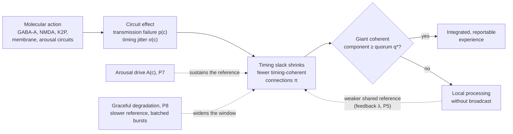
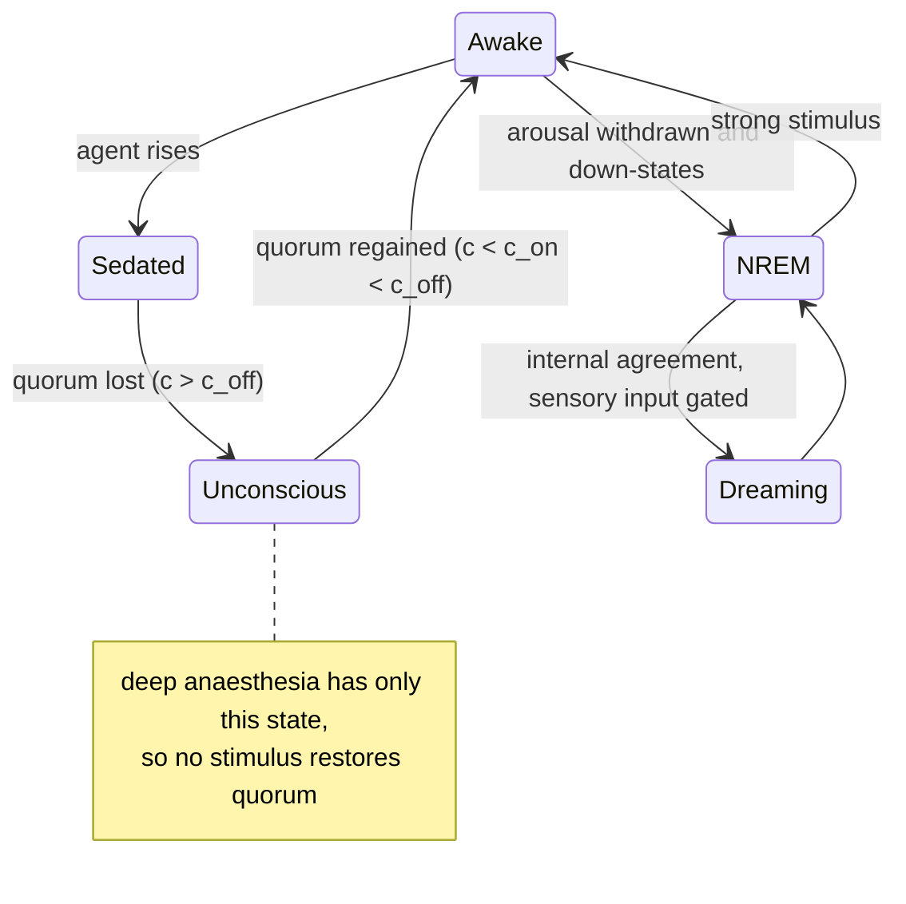

# The Distributed Perceptual Consensus Hypothesis of General Anaesthesia

**A timing-constrained network model of anaesthetic-induced unconsciousness**

| | |
|---|---|
| **Authors** | Gabriel Santos de Oliveira1 ([ORCID 0009-0003-9528-9731](https://orcid.org/0009-0003-9528-9731); [Lattes CV](https://lattes.cnpq.br/2102695116731989)); Callina Gertrudes Ferreira2 ([ORCID 0009-0002-8512-213X](https://orcid.org/0009-0002-8512-213X)) |
| **Affiliations** | 1 Independent researcher; software engineer, BSc in Computer Science, Universidade Federal Rural do Rio de Janeiro (UFRRJ), Brazil, 2015–2021. 2 Undergraduate student of psychology, Universidade Veiga de Almeida (UVA), Brazil, since February 2025 |
| **Date** | 17 October 2026 |
| **Version** | 1.0.0 |
| **Article type** | Hypothesis and theory paper (not peer reviewed) |
| **Licence** | Text and figures: [CC BY 4.0](LICENSE-CC-BY-4.0). Code: [Apache License 2.0](LICENSE) |
| **Keywords** | general anaesthesia; consciousness; thalamocortical system; percolation; distributed consensus; neural synchrony; neural inertia; perturbational complexity index |

---

## Abstract

General anaesthetics are chemically diverse, act on many molecular targets, and yet reliably produce a common end state: reversible loss of consciousness. We propose the **Distributed Perceptual Consensus (DPC) hypothesis**, which treats conscious experience as the outcome of a continuously repeated, timing-constrained agreement process among distributed cortical and thalamic populations. Borrowing formal results from distributed computing, we argue that such agreement is only possible when inter-areal communication delays are bounded within an integration window, a condition known as partial synchrony. Anaesthetics, by whatever molecular route, degrade this condition in two ways: they cause transmission failure on a fraction of functional connections, and they increase the variability (jitter) of signal timing on the remainder. We formalise the brain as a graph whose *timing-coherent* subgraph undergoes a percolation transition as effect-site concentration rises. Loss of consciousness corresponds to the loss of a giant coherent component able to reach quorum. Adding a single feedback assumption, that the global phase reference provided by the thalamocortical core itself depends on the size of that component, makes the transition bistable and predicts hysteresis between induction and emergence, offering a mechanistic account of neural inertia. The hypothesis is mechanism-agnostic at the molecular level and is intended to complement, not replace, receptor-level pharmacology and existing network theories such as cognitive unbinding and integrated information theory. We state the scope, distinguish established findings from hypothesis and from analogy, address seven principal objections, and list falsifiable predictions together with an analysis protocol for testing them.

---

## 1. Introduction and scope

### 1.1 The problem

More than 170 years after the first public demonstration of ether anaesthesia, no consensus exists on how anaesthetics produce unconsciousness (Franks, 2008; Alkire et al., 2008; Hemmings et al., 2019). The difficulty is that the agents are structurally unrelated (from the monatomic gas xenon to the steroid-like alkylphenol propofol), act on many different molecular targets, and produce distinct electroencephalographic (EEG) signatures, yet converge on a similar behavioural endpoint. A satisfactory account must therefore explain how *heterogeneous molecular causes* produce a *common systems-level effect*. The search for a single molecular mechanism, which dominated the lipid-theory era, did not succeed, because the molecular facts are genuinely diverse (Section 2.1). DPC therefore seeks unification one level up: many molecular routes converging on one form of network failure, in the way that many different diseases converge on heart failure.

### 1.2 What this paper claims, and what it does not

This is a **hypothesis**, not a theorem. It has no formal proof and its value lies in whether its predictions survive experimental test. To avoid ambiguity we classify every claim as one of three types:

- **[E] Established:** supported by replicated experimental evidence, with citation.
- **[H] Hypothesis:** a novel or contested claim of this paper, stated so that it can be falsified.
- **[A] Analogy:** a computing concept used as an explanatory metaphor. Analogies motivate hypotheses but are not themselves claims about biology.

### 1.3 Scope and definitions

General anaesthesia comprises several separable components: unconsciousness (hypnosis), amnesia, immobility in response to noxious stimulation, and autonomic stability (Brown et al., 2010). **This hypothesis addresses only unconsciousness.** Immobility, the basis of the minimum alveolar concentration (MAC) standard (Eger et al., 1965), is mediated largely at the level of the spinal cord (Rampil et al., 1993; Antognini & Schwartz, 1993) and is outside scope. Amnesia occurs at lower concentrations than unresponsiveness (Veselis et al., 1997) and is discussed only where it bears on the hypothesis.

We follow the distinctions of Sanders et al. (2012):

- **Responsiveness:** a behavioural response to a command or stimulus. In humans the operational endpoint is *loss of responsiveness* (LOR); in rodents it is *loss of righting reflex* (LORR).
- **Connected consciousness:** experience that includes awareness of the environment.
- **Disconnected consciousness:** experience without environmental awareness, such as dreaming.
- **Unconsciousness:** absence of any experience.

Unresponsiveness is therefore not equivalent to unconsciousness, and the hypothesis must account for both.

### 1.4 Terminology

Every term below is used in this sense throughout. Words borrowed from computing (for example bus, clock, round-robin, quorum, service, circuit breaker) appear only in passages marked [A] as analogies; each is mapped to one of these defined terms in Appendix A and is never used to state a claim.

| Term | Definition in this paper |
|---|---|
| Neural population | A group of neurons treated as one unit: a brain region in the human connectome, a single neuron in the *C. elegans* and *Drosophila* connectomes. It is a node of the network. |
| Functional connection | A directed pathway by which one population influences another: a synapse or set of synapses between neurons, or a white-matter fibre bundle between regions. It is an edge of the network. A fibre bundle is not a single synapse: synaptic failure weakens a bundle rather than removing it (Section 9). |
| Transmission failure | A signal sent along a connection that does not produce its effect at the target, for example because transmitter is not released. Its probability is $p$. |
| Timing jitter | The trial-to-trial variability of a signal's arrival time, measured as a standard deviation $\sigma$ in milliseconds. A constant delay is not jitter. |
| Phase reference | A rhythm shared across populations against which arrival times are judged; P5 attributes it to the thalamocortical system. |
| Integration window | The interval $W$ around the phase reference within which an arriving signal can contribute to the current integration cycle. |
| Integration cycle | One repetition of the process by which populations converge on a shared state (P1), paced by the reference rhythm. |
| Timing-coherent connection | A connection that transmits and whose signal arrives within the integration window. The probability of this is the occupation probability $\pi$. |
| Timing slack | The room left in the integration window after timing error: positive when signals arrive within the window, negative when they fall outside it. Loss of consciousness is proposed to occur when slack becomes negative on too many connections. |
| Giant coherent component | The largest set of populations linked to one another by timing-coherent connections. Its share of all populations is $S$. |
| Quorum | The minimum share $q^*$ of populations that the giant coherent component must contain for integrated, reportable content to arise (P3). |
| Effect-site concentration | The concentration of an agent at its site of action; in the models it is expressed relative to the agent's half-effect value (EC50), so 1 means half of the maximal circuit effect. |
| Loss and recovery of responsiveness | The behavioural endpoints of induction and emergence; in the models, loss and recovery of quorum, at concentrations $c_{\text{off}}$ and $c_{\text{on}}$. |
| Neural inertia | Recovery at a lower concentration than loss, $c_{\text{on}} < c_{\text{off}}$, not explained by drug distribution in the body. |
| Arousal drive | Activity of wake-promoting brain systems, such as orexinergic and brainstem nuclei, that sustains the phase reference independently of cortical coherence (P7). |
| Down-state | A period of near-silence across a cortical population during the slow oscillation of NREM sleep. |
| Broadcast | Propagation of activity from the populations that receive an input to the rest of the network. |
| Entrainment | Phase locking of a population to an external rhythm, such as a periodic stimulus. |

| Symbol | Meaning | Unit |
|---|---|---|
| $c$ | Effect-site concentration relative to EC50 | dimensionless |
| $p(c)$ | Transmission failure probability | dimensionless |
| $\sigma_0(c)$, $\sigma_{\text{eff}}$ | Agent-induced and effective timing jitter | ms |
| $W$ | Integration window | ms |
| $\pi$, $\pi_c$, $\pi_q$ | Occupation probability; its onset and quorum thresholds | dimensionless |
| $S$ | Share of populations in the giant coherent component | dimensionless |
| $q^*$ | Quorum fraction | dimensionless |
| $\lambda$ | Strength of reference feedback | ms (percolation model), dimensionless (oscillator model) |
| $A_0$, $A(c)$ | Awake and concentration-dependent arousal share of the reference | dimensionless |
| $d$ | Share of integration cycles in down-states | dimensionless |
| $f$ | Frequency of the reference rhythm | Hz |
| $\langle k \rangle$, $\langle k^2 \rangle$ | Mean degree and mean squared degree of the network | connections |

---

## 2. Background

### 2.1 Molecular mechanisms [E]

The Meyer-Overton correlation, which relates anaesthetic potency to lipid solubility (Meyer, 1899; Overton, 1901), motivated a century of lipid-based theories. Several findings show that lipid solubility alone is insufficient:

1. Anaesthetics inhibit a lipid-free protein, firefly luciferase, at potencies matching the Meyer-Overton line (Franks & Lieb, 1984).
2. Optical isomers of isoflurane, which have identical lipid solubility, differ in their effects on neuronal ion channels (Franks & Lieb, 1991).
3. Some lipophilic halogenated compounds, termed *non-immobilisers*, violate the correlation (Koblin et al., 1994).
4. A single point mutation (N265M) in the β3 subunit of the GABA-A receptor strongly reduces the in vivo effects of propofol and etomidate in mice (Jurd et al., 2003).
5. Xenon acts principally as an NMDA receptor antagonist (Franks et al., 1998).

Membrane-mediated mechanisms remain biologically plausible as *contributing* routes. These include changes in the lateral pressure profile of the lipid bilayer that alter the conformational equilibria of embedded channels (Cantor, 1997), and the disruption of ordered lipid domains that activates TREK-1 potassium channels via phospholipase D2 (Pavel et al., 2020). The current view is that anaesthetics act on multiple targets, chiefly GABA-A receptors, NMDA receptors and two-pore-domain potassium (K2P) channels, with agent-specific profiles (Rudolph & Antkowiak, 2004; Hemmings et al., 2019).

The known routes differ in mechanism but converge on one consequence, a shift in ion currents that reduces the ability of neurons to excite one another:

| Molecular route | Agents with evidence | Effect on ion flow | DPC fault type (P4) | Sources |
|---|---|---|---|---|
| GABA-A receptor potentiation (binding between subunits, prolonging channel opening) | Propofol, etomidate, barbiturates, isoflurane, sevoflurane | More Cl⁻ inhibitory current | Transmission failure | Mihic et al. (1997); Jurd et al. (2003) |
| NMDA receptor block: open-channel block (ketamine) or competition at the glycine co-agonist site (xenon) | Ketamine, xenon, nitrous oxide | Less Na⁺ and Ca²⁺ excitatory current | Timing variability and transmission failure | Franks et al. (1998); Jevtović-Todorović et al. (1998) |
| Two-pore-domain K⁺ channel activation (TREK-1, TASK) | Isoflurane, halothane, sevoflurane; xenon, nitrous oxide, cyclopropane | More K⁺ leak, hyperpolarisation | Transmission failure | Patel et al. (1999); Gruss et al. (2004); Heurteaux et al. (2004) |
| HCN channel inhibition | Volatile agents (subunit-specific); propofol | Less pacemaker cation current | Altered rhythm and timing | Chen et al. (2005); Ying et al. (2006) |
| Presynaptic Na⁺ channel inhibition, reducing Ca²⁺ entry and vesicle release | Isoflurane | Less transmitter released per spike | Transmission failure | Herold & Hemmings (2012); Baumgart et al. (2015) |
| α2-adrenoceptor agonism, acting through the endogenous sleep pathway | Dexmedetomidine | Indirect: K⁺ efflux in locus coeruleus neurons | Arousal suppression (P7) | Nelson et al. (2003) |
| Disruption of membrane lipid domains, releasing PLD2, which activates TREK-1 | Chloroform, isoflurane | Indirect: more K⁺ current | Transmission failure | Pavel et al. (2020) |
| Mitochondrial complex I (a sensitivity factor rather than an ion channel) | Volatile agents | Not a channel effect; complex I dysfunction increases sensitivity | Modulates susceptibility | Kayser et al. (1999); Morgan et al. (2002) |

Glycine receptors in the spinal cord are also potentiated by volatile agents (Mihic et al., 1997) and contribute to immobility, which is outside the scope of this paper (Section 1.3).

Two further proposals are unconfirmed and are noted only for completeness. Anaesthetic binding to tubulin and altered microtubule stability have been reported (Emerson et al., 2013), and a microtubule-stabilising drug delayed isoflurane-induced loss of righting in rats (Khan et al., 2024), but these findings have not been independently replicated. A single study reported that xenon isotopes carrying nuclear spin are less potent in mice than spin-free isotopes (Li et al., 2018); no independent replication has been found.

**Implication for this paper:** the DPC hypothesis does not depend on which molecular mechanism operates. It requires only that, at the circuit level, agents increase transmission failure, timing jitter, or both.

### 2.2 Systems-level findings [E]

- **Thalamocortical involvement.** Anaesthetics consistently depress thalamic activity (Alkire et al., 2000). Nicotine microinjected into the central medial thalamus reverses sevoflurane-induced LORR in rats (Alkire et al., 2007). Thalamic stimulation can restore arousal in anaesthetised macaques (Redinbaugh et al., 2020).
- **Breakdown of cortical communication.** Propofol, sevoflurane and ketamine all disrupt frontal-parietal feedback connectivity (Lee et al., 2013). At the onset of propofol-induced unconsciousness, a slow oscillation appears and neuronal spiking becomes confined to brief phase windows that are asynchronous across cortex, fragmenting cortical networks (Lewis et al., 2012).
- **Agent-specific EEG signatures.** Propofol produces increased beta power during sedation, followed by coherent frontal alpha (8 to 12 Hz) together with slow (0.1 to 1 Hz) and delta (1 to 4 Hz) oscillations at LOR (Purdon et al., 2013; Ching et al., 2010). Ketamine produces increased gamma power and does not produce the propofol-like alpha pattern (Akeju et al., 2016).
- **Cellular decoupling.** Anaesthetics decouple the apical dendrites of layer 5 pyramidal neurons from their somata, interrupting cortico-cortical feedback integration (Suzuki & Larkum, 2020).
- **Loss of coordination, not of activity, across species.** In *Caenorhabditis elegans*, isoflurane leaves individual head neurons active but collapses the correlations between them (Awal et al., 2020). In *Drosophila*, isoflurane reduces stimulus-locked power and coherence in the central brain but not at the periphery (Cohen et al., 2016), impairs low-frequency feedback while leaving high-frequency feedforward connectivity intact (Cohen et al., 2018), and fragments the integrated structure of brain activity into separate clusters (Leung et al., 2021).
- **Loss of individual signature.** Under sevoflurane and propofol, functional connectivity becomes less distinctive between individuals, most strongly in transmodal association cortex, and anaesthetised human connectivity becomes more similar to that of the macaque (Luppi et al., 2025).
- **Complexity.** The perturbational complexity index (PCI) is high in wakefulness and low during propofol- and xenon-induced unconsciousness. It remains high under ketamine, consistent with the dream reports of patients on emergence (Casali et al., 2013; Sarasso et al., 2015).
- **Neural inertia.** In genetically diverse animals, the concentration at which consciousness returns is lower than the concentration at which it is lost, even when pharmacokinetic factors are controlled. This hysteresis is termed neural inertia; it was demonstrated in both mice and *Drosophila* (Friedman et al., 2010) and depends on excitability genes that act independently of induction sensitivity (Joiner et al., 2013; see also Kelz et al., 2008). Its measured size varies by agent: the ratio of induction to emergence concentration is about 1.08 for isoflurane and 2.85 for halothane in mice (Friedman et al., 2010), and 1.07 to 1.11 for propofol effect-site concentrations in humans (Warnaby et al., 2017; Iwakiri et al., 2005). Recovery proceeds through a sequence of discrete, metastable activity states (Hudson et al., 2014).

### 2.3 Prior models and the position of DPC

DPC builds on two groups of prior work. The first is conceptual:

| Framework | Central claim | Relationship to DPC |
|---|---|---|
| Cognitive unbinding (Mashour, 2013) | Anaesthetics disrupt the synthesis of information across cortical networks | DPC proposes a specific reason synthesis fails: violation of a bounded-delay condition |
| Integrated information theory (Tononi et al., 2016) | Consciousness corresponds to integrated information (Φ) | DPC's order parameter is one physically measurable proxy for integration; DPC makes no claim about the nature of experience |
| Global neuronal workspace (Dehaene & Changeux, 2011) | Conscious access requires non-linear "ignition" and global broadcast | Quorum in DPC corresponds operationally to ignition; DPC adds a timing constraint |
| Thalamocortical switch (Alkire et al., 2000) | The thalamus gates conscious state | DPC assigns the thalamocortical core the role of supplying a shared phase reference, not of acting as an on/off switch |

The second group consists of quantitative models, several of which already contain elements of DPC. **These precede the present work and must be credited:**

| Prior model | What it established | What DPC adds |
|---|---|---|
| Zhou et al. (2015) | A percolation model of thalamocortical and cortico-cortical transmission, with one transmission probability *p*, reproduces EEG features of anaesthesia; information transfer changes sharply near a critical *p* | The occupation probability is derived from a timing criterion that combines transmission failure with timing jitter, so that agents acting through either route enter the same model |
| Su et al. (2020) | Measured an induction-recovery hysteresis loop and explained it by percolation on self-similar multilayer networks | Hysteresis arises from feedback between the coherent core and a shared phase reference, and its strength is calibrated to published inertia ratios |
| Kim et al. (2016) | The conditions for explosive synchronisation are met in human EEG networks just after anaesthetic-induced loss of consciousness | DPC tests the same transition on empirical connectomes of three species with a single parameter set |
| Kim et al. (2018) | Stuart-Landau oscillators with adaptive feedback on a 78-region connectome reproduce hysteresis of functional connectivity seen in EEG under ketamine and sevoflurane | The feedback mechanism in DPC (P5) is closely related; DPC's contribution is its interpretation as a timing reference and its link to consensus theory |
| Moon et al. (2015) | Network topology determines phase lead and lag between hubs and periphery; the front-to-back direction of information flow disappears under sevoflurane | DPC predicts hub vulnerability (prediction 6) from percolation on heavy-tailed networks |
| Proekt & Hudson (2018); Hudson et al. (2014) | Neural inertia and recovery through discrete metastable states can be explained by noise-driven transitions on a multi-well landscape | DPC offers a network-level origin for such barriers; the two accounts are compatible |

**The specific contributions claimed as new [H]**, to the author's knowledge, are therefore narrower than a percolation or hysteresis model as such:

1. The necessary condition for conscious integration is formalised as *bounded inter-areal timing error*, following the partial-synchrony results of distributed computing (Dwork et al., 1988), so that transmission failure and timing jitter combine into one occupation probability.
2. Molecularly distinct agents are unified by those two circuit-level parameters, which correspond to the crash and Byzantine fault classes of distributed systems.
3. The same model, with one parameter set, is tested on the empirical connectomes of a nematode, an insect and a human, with plant tissue as a cellular control, and calibrated against measured neural inertia (Appendices C and D).

---|---|---|
| Cognitive unbinding (Mashour, 2013) | Anaesthetics disrupt the synthesis of information across cortical networks | DPC specifies *why* synthesis fails: violation of a bounded-delay condition, with a percolation threshold |
| Integrated information theory (Tononi et al., 2016) | Consciousness corresponds to integrated information (Φ) | DPC's order parameter is one physically measurable proxy for integration; DPC makes no claim about the nature of experience |
| Global neuronal workspace (Dehaene & Changeux, 2011) | Conscious access requires non-linear "ignition" and global broadcast | Quorum in DPC corresponds operationally to ignition; DPC adds the timing constraint and the hysteresis mechanism |
| Thalamocortical switch (Alkire et al., 2000) | The thalamus gates conscious state | DPC assigns the thalamocortical core the role of supplying a shared phase reference, not of acting as an on/off switch |

**The specific contributions claimed as novel [H]** are:

1. The necessary condition for conscious integration is formalised as *bounded inter-areal timing error*, following the partial-synchrony results of distributed computing.
2. Molecularly distinct agents are unified by two circuit-level parameters, failure probability and timing jitter, which act on a single order parameter.
3. Neural inertia is derived as a consequence of a feedback loop between the coherent component and the phase reference, rather than being added as an independent assumption.

---

## 3. The hypothesis

### 3.1 Motivating analogy [A]

In distributed computing, a set of processes reaches *consensus* when it agrees on a single value despite some processes failing. Fischer, Lynch and Paterson (1985) proved that deterministic consensus is impossible in a fully asynchronous system if even one process can crash. Dwork, Lynch and Stockmeyer (1988) showed that consensus becomes achievable under *partial synchrony*, meaning that message delays and relative processing speeds are bounded, even if the bounds are not known in advance. Systems built on these results commonly require a *quorum*, a minimum fraction of participating processes, before committing a value. Faults are classified as *crash faults* (a process stops) or *Byzantine faults* (a process emits arbitrary or misleading messages), and Byzantine faults are tolerated only with a larger fraction of correct processes (Lamport et al., 1982).

The analogy, which is not a claim of literal equivalence, is that the brain must repeatedly settle on a single coherent interpretation of multisensory and internal signals that arrive at different areas at different times. Lamport (1978) showed that event ordering in a distributed system requires shared timing references. We propose that the brain faces a comparable constraint.

### 3.2 Engineering analogues and their limits [A]

The terms used in this paper come from engineered systems that solve the same problem the brain is proposed to solve: keeping many distributed units in agreement despite delays, noise and failures. The table lists the systems that motivated each postulate, with references to their specifications, and states where each analogy fails.

| Engineered system | How it works | Counterpart in DPC | Where the analogy fails |
|---|---|---|---|
| Fly-by-wire flight control: the triple-triple redundant primary flight computer of the Boeing 777 (Yeh, 1996) and the command/monitor computers of the Airbus A320 family (Briere & Traverse, 1993) | Redundant channels compute the same command; disagreeing channels are outvoted or disconnected, and the aircraft falls back to a simpler control law when too few agree | Quorum (P3); fall-back to default dynamics when quorum is lost (P6) | Neural populations do not compute identical copies of one value, and there is no designated voter |
| Time-triggered architecture (Kopetz & Bauer, 2003), used in safety-critical vehicles | Nodes transmit in fixed time slots that repeat in a cycle (a round-robin of slots) against a synchronised global clock; a message outside its slot is discarded, and a node that loses synchrony is excluded from membership | Integration cycles (P1); the window $W$ (P2); late signals not integrated | The brain has no fixed slots and no global clock; its timing reference emerges from oscillation |
| Controller Area Network bus (ISO 11898-1:2024; ISO, 2024) | Every node must sample each bit within the same bit time, so signal propagation delay limits the product of bus length and bit rate | A bounded-delay condition that limits network size and speed (P2) | A CAN bus is one shared medium; the brain is a sparse network of point-to-point connections |
| Precision Time Protocol (IEEE Std 1588-2019; IEEE, 2020) | A reference clock is distributed through the network, with path delays measured and compensated | The shared thalamocortical phase reference (P5) | PTP has a designated master; the neural reference is emergent and itself depends on coherence |
| Synchronous power grids (Filatrella et al., 2008; Rohden et al., 2012) | Generators must remain frequency-synchronised; their dynamics are modelled with Kuramoto-like oscillator equations, and loss of synchrony can cascade into a blackout (U.S.-Canada Power System Outage Task Force, 2004) | The same mathematics as the oscillator model in Appendix D; collapse of global coherence | Grid protection disconnects equipment by design; DPC makes no claim that the neural transition is designed or protective |
| Circuit-breaker pattern in distributed software (Fowler, 2014) | Calls to a failing dependency are stopped; after a delay a trial call is allowed ("half-open") before normal operation resumes | Active shutdown by dedicated circuits (Section 5.2); the delayed, conditional return resembles neural inertia | A software circuit breaker exists to protect the system; DPC makes no claim that the neural transition serves a protective purpose |
| Distributed consensus (Lamport et al., 1982; Fischer et al., 1985; Dwork et al., 1988) | Agreement is impossible without timing bounds, achievable under partial synchrony, and tolerates fewer Byzantine than crash faults | The formal basis of P2 and of the two failure modes in P4 | The brain does not run a consensus algorithm; the results are used as constraints, not as a description of mechanism |

**The physical medium differs.** Computers signal electronically, as electromagnetic waves in conductors. Neurons signal electrochemically: an action potential is an ionic current regenerated along the axon, and in human cortico-cortical pathways the median axonal conduction velocity is about 3.9 m/s, with a median axonal delay of about 10 ms (Lemaréchal et al., 2022). What transfers from engineering to neuroscience is therefore not the physics but the ratio of delay to cycle time. At 40 Hz a gamma cycle lasts 25 ms, so a typical cortico-cortical delay is about 40% of a cycle. In that regime timing is a first-order constraint on communication, as it is on a CAN bus whose propagation delay approaches its bit time.

**Signals arrive at many speeds.** The brain receives its inputs with widely different delays, set by biology rather than by the physics of the stimulus. Responses in human primary auditory cortex peak about 15 ms after a sound (Celesia, 1976), whereas the earliest visual response recorded over occipital cortex begins at about 56 ms (Foxe & Simpson, 2002), largely because of slow phototransduction in the retina, even though light travels far faster than sound. Olfaction is the only sense whose primary pathway reaches its cortex without a thalamic relay (Kay & Sherman, 2007). Peripheral nerve fibres span about two orders of magnitude in conduction velocity, from unmyelinated fibres at about 0.5 to 2 m/s to large myelinated fibres at about 80 to 120 m/s (values tabulated by Yap et al., 2020, from a standard textbook) [A: links of different speeds]. The brain compensates: after a few minutes of exposure to a constant lag between sound and image, the perceived moment of simultaneity shifts towards that lag (Fujisaki et al., 2004). Its rhythms are also nested, the phase of slower rhythms modulating the amplitude of faster ones, delta modulating theta and theta modulating gamma (Lakatos et al., 2005; Canolty & Knight, 2010) [A: several clock domains, with communication between them]. DPC's claim is that these compensations work only while timing slack remains positive.

### 3.3 Postulates [H]

**The central claim in plain language.** Integrated, reportable experience requires *positive timing slack*: signals passing between the populations of a nervous system must arrive within the window in which they can be combined, judged against a shared rhythm. Anaesthetics, whatever their molecular target, erode that slack by making transmission fail or arrival times vary. When slack turns negative on enough connections, the populations can no longer reach agreement, and experience is lost. The claim concerns timing margins, not a particular frequency: each nervous system uses its own rhythms, matched to its own conduction delays. Across mammals that differ several-thousand-fold in brain volume, the hierarchy of brain rhythms is largely preserved, which Buzsáki, Logothetis and Singer (2013) suggest may be achieved by larger-diameter, faster-conducting long-range axons in larger brains. If so, evolution preserves timing margins, which is the condition this hypothesis requires.

The postulates state the claim precisely. Figure A summarises the causal chain they describe.

*Figure A. Causal chain of the DPC hypothesis. Dashed arrows are feedback and modulating influences.*

- **P1 (Integration cycles).** Conscious content is generated in repeated integration cycles, during which distributed populations converge on a shared state. The cycles are recurrent loops rather than a single pass: a feedforward sweep of activity is probably insufficient for awareness, whereas recurrent processing between areas allows features to be grouped so that a stimulus can enter consciousness (Lamme & Roelfsema, 2000; Lamme, 2006). Reciprocal signalling between areas, termed re-entry, couples the cortex and thalamus (Edelman & Gally, 2013); thalamocortical loops are proposed to bind activity by temporal coincidence (Llinás et al., 1998); and in predictive-coding accounts, each exchange compares feedback predictions with feedforward signals carrying the residual error (Rao & Ballard, 1999). Anaesthesia preferentially disrupts this recurrent component: directed feedback connectivity between frontal and parietal cortex diminishes at loss of consciousness and returns with responsiveness, while feedforward processing may persist (Lee et al., 2009); volatile agents reduce frontal-to-posterior feedback information transfer at gamma frequencies in rats (Imas et al., 2005); and anaesthesia decouples feedback input to the apical dendrites of cortical pyramidal neurons while feedforward signalling is left relatively unchanged (Suzuki & Larkum, 2020). In the terms of the analogy [A], each cycle is a loop that checks what arrived, and when, against what was expected.
- **P2 (Bounded-delay condition).** A population contributes to a cycle only if its signals arrive within an integration window $W$ relative to a shared phase reference. Signals outside the window are not integrated. The behavioural temporal binding window for multisensory events, typically of the order of 100 ms (Wallace & Stevenson, 2014), is a psychophysical counterpart of $W$. The neural window is expected to be narrower and frequency-dependent.
- **P3 (Quorum).** A cycle produces globally integrated, reportable content only if the timing-coherent populations form a connected component that includes at least a critical fraction $q^*$ of the network.
- **P4 (Two failure modes).** Anaesthetics reduce the fraction of functional connections that are timing-coherent by (a) increasing the probability that transmission fails (crash-like faults, for example enhanced GABA-A-mediated inhibition and reduced glutamate release; Baumgart et al., 2015) or (b) increasing the trial-to-trial variability of signal timing (noise-like faults, for example NMDA antagonism by ketamine). The molecular route is irrelevant to the network-level effect, which is a reduction in coherence.
- **P4b, stated as an untested hypothesis.** The brain integrates inputs against learned expectations of when they will arrive. Anaesthetics widen the variance of arrival times beyond that expected window, and no fast compensation is available to rescale the window, so that late signals are discarded and agreement fails. A constant delay is harmless under this hypothesis, because it can be anticipated; only variability matters. No study found for this paper has measured whether general anaesthetics increase spike-timing or transmission-latency variability (one study reported more regular firing intervals in fast-spiking interneurons under pentobarbital; Kato et al., 2016). The hypothesis therefore predicts that the trial-to-trial latency variability of evoked responses, such as auditory evoked potentials, rises at concentrations just below loss of responsiveness, before their mean latency changes appreciably (Section 7, prediction 8).
- **P5 (Reference feedback).** The shared phase reference is itself generated by the coherent thalamocortical core. A smaller coherent component therefore produces a weaker reference and greater effective timing error for all remaining connections.
- **P6 (Default dynamics).** When quorum is lost, cortex does not become silent. It falls into its intrinsic, locally generated dynamics (for example the slow oscillation, Steriade et al., 1993a), whose form is agent-specific.
- **P7 (Arousal and brain state).** Wake-promoting arousal systems sustain part of the shared reference independently of cortical coherence. Anaesthetics suppress these systems, as volatile agents inhibit orexinergic neurons (Kelz et al., 2008) and excite sleep-promoting neurons (Moore et al., 2012), which accelerates the loss of quorum without being required for it. In natural sleep the arousal drive is withdrawn and slow-oscillation down-states interrupt cortical transmission (Vyazovskiy et al., 2009).
- **P8 (Graceful degradation).** As timing slack shrinks, the system degrades in two linked ways before agreement fails. First, the reference rhythm slows, which widens the time available within each cycle: a timing error of σ milliseconds costs a phase error of 2π f σ, so a fourfold slower rhythm makes the same error four times less disruptive, at the cost of four times fewer integration cycles per second [A: link-speed fallback]. Second, continuous asynchronous activity gives way to synchronised bursts, which are easier to align but carry less [A: streaming replaced by batched polling]. The sequence seen during propofol induction, from beta oscillations in sedation to frontal alpha with slow oscillations at loss of consciousness (Purdon et al., 2013, 2015), and the burst suppression of deeper anaesthesia, in which suppression periods lengthen as the dose increases (Brown et al., 2010; Purdon et al., 2015) [A: exponential backoff], are proposed to be successive stages of this degradation. The dominant interpretation of frontal alpha differs: Purdon et al. (2015) propose that the highly organised alpha oscillations most likely prevent normal communication, and thalamocortical models attribute them to thalamic mechanisms (Ching et al., 2010; Vijayan et al., 2013). The two readings are compatible in part, since a slower, narrower channel restricts throughput while improving timing reliability; they differ in what they predict (Section 7, prediction 9).

---

## 4. Formal model [H]

### 4.1 Network and coherence

Let the brain be represented by a graph $G = (V, E)$ of $N$ neural populations, with degree distribution $P(k)$. At effect-site concentration $c$, each functional connection $e$ transmits successfully with probability 1 − $p(c)$. The arrival-time error $\delta_e$ of successful transmissions, relative to the phase reference, is modelled as a zero-mean Gaussian with standard deviation $\sigma_{\text{eff}}$.

A connection is **timing-coherent** if it transmits successfully and |$\delta_e$| ≤ $W$/2. Its probability of being coherent is

$$
\pi(c) = \bigl(1 - p(c)\bigr)\cdot \operatorname{erf}\!\left(\frac{W}{2\sqrt{2}\,\sigma_{\text{eff}}}\right)
$$

### 4.2 Percolation threshold

Treating coherence as bond percolation on a random graph with the given degree distribution, a giant coherent component exists only if $\pi$ exceeds the critical value (Callaway et al., 2000):

$$
\pi_c = \frac{\langle k \rangle}{\langle k^2 \rangle - \langle k \rangle}
$$

Let $S(\pi)$ denote the fraction of populations in the giant coherent component. The order parameter of the model is $S$, and P3 states that integrated content requires $S$ ≥ $q^*$. Heavy-tailed degree distributions, such as hub-dominated connectomes, have a large ⟨k²⟩ and therefore a low $\pi_c$. This predicts that integration is robust to random failures but vulnerable to failures concentrated at hubs (Callaway et al., 2000). The thalamus and frontal-parietal hubs are candidate sites.

### 4.3 Reference feedback and hysteresis

P5 is modelled by letting the effective jitter grow as the coherent core shrinks:

$$
\sigma_{\text{eff}} = \sigma_0(c) + \lambda\,\bigl(1 - S\bigr)\bigl(1 - A(c)\bigr), \qquad A(c) = A_0\,\bigl(1 - a\,h(c)\bigr)
$$

where $\sigma_0(c)$ is the agent-induced jitter, $\lambda \ge 0$ is the strength of the reference feedback, $A(c)$ is the share of the reference sustained by arousal (P7), $A_0$ its awake value, $h(c)$ the agent's fractional effect (a Hill function of concentration) and $a$ the share of that effect acting on arousal circuits. In natural sleep, $A_0$ is reduced and the transmission probability is further multiplied by $1 - d$, where $d$ is the fraction of integration cycles falling in down-states. The steady state then satisfies the self-consistency condition

$$
S = F\!\bigl(\pi(c, S)\bigr)
$$

where $F$ is the giant-component function of the graph. For $\lambda$ = 0 the transition is continuous and has no hysteresis. For sufficiently large $\lambda$, the equation has two stable solutions over a range of concentrations, a high-$S$ (conscious) branch and a low-$S$ (unconscious) branch. The system then loses consciousness at a concentration $c_{\text{off}}$ and regains it only at a lower concentration $c_{\text{on}}$ < $c_{\text{off}}$. **Neural inertia emerges as a property of the model**, and its magnitude ($c_{\text{off}}$ − $c_{\text{on}}$) is predicted to increase with $\lambda$.

### 4.4 Graded depth

Although conscious *access* is modelled as a threshold on $S$, the order parameter itself is continuous. This is consistent with graded sedation, with the progressive EEG changes seen with increasing concentration, and with individual variability in thresholds.

### 4.5 Adaptive reference rate (P8)

In the phase-oscillator implementation (Appendix D), a timing error of $\sigma$ milliseconds becomes a phase error with standard deviation $2\pi f \sigma$, where $f$ is the frequency of the reference rhythm. Under P8 the reference slows as the agent takes effect,

$$
f(c) = f_{\text{awake}} - \bigl(f_{\text{awake}} - f_{\text{fallback}}\bigr)\,h(c),
$$

from $f_{\text{awake}} = 40$ Hz, within the gamma band of 30 to 90 Hz (Fries, 2015), towards $f_{\text{fallback}} = 10$ Hz, the centre of the 8 to 12 Hz frontal alpha seen at propofol-induced loss of consciousness (Purdon et al., 2013). Constant conduction delays are converted to phase at the same rate. Because the effective coupling of a connection with Gaussian timing error of phase standard deviation $s$ is reduced by the factor $e^{-s^2/2}$, a slower reference preserves coupling for the same error in milliseconds.

### 4.6 Status of the model

The model is deliberately minimal. Its quantitative parameters ($W$, $q^*$, $\lambda$, $p(c)$, $\sigma_0(c)$) are not yet measured. Random-graph percolation ignores the spatial embedding, modularity and directed (feedforward and feedback) structure of real connectomes. The model's purpose is to generate qualitative, falsifiable predictions (Section 7) and to guide future simulation on empirical connectomes. A reference implementation and a size-scaling validation study are given in Appendix C.

---

## 5. Mapping to clinical and physiological observations

### 5.1 Induction: paradoxical excitation [E] and a DPC account [H]

Low concentrations of GABAergic agents can cause disinhibition, agitation or euphoria, accompanied by increased beta and gamma power (Brown et al., 2010; Purdon et al., 2013). The established mechanistic account is that low-dose GABA-A potentiation preferentially affects inhibitory interneuron networks, causing net disinhibition of pyramidal cells (McCarthy et al., 2008).

DPC proposes a **complementary** contribution. As $\pi$ falls toward $\pi_c$, remaining coherent paths carry a greater share of recurrent drive, so activity becomes more intense on fewer routes, a form of load concentration [A: network congestion]. This account makes a distinguishing prediction (Section 7, prediction 4): the magnitude of induction-phase excitation should scale with the sensory and recurrent load at the time of induction, which a purely interneuron-based account does not require.

### 5.2 Loss of consciousness

At $\pi$ < $\pi_c$ the giant coherent component disappears. The thalamic reticular nucleus (TRN), a sheet of GABAergic neurons that gates thalamocortical transmission, is well placed to amplify this transition, and thalamocortical models show how propofol produces coherent frontal alpha through thalamic circuits (Ching et al., 2010). Under DPC, the resulting cortical activity is the network's default dynamics (P6), not a designed "safe mode". It is the slow oscillation with fragmented, phase-limited spiking for propofol (Lewis et al., 2012), and a different, gamma-rich pattern for ketamine (Akeju et al., 2016). The transition is not purely passive. Volatile anaesthetics directly excite sleep-promoting neurons of the ventrolateral preoptic nucleus, and acute lesions of these neurons produce resistance to isoflurane (Moore et al., 2012); sedation by several agents runs through the brain's own sleep pathway (Nelson et al., 2002, 2003); and a hypothalamic population activated by diverse anaesthetics deepens anaesthesia when stimulated and shortens it when ablated (Jiang-Xie et al., 2019). These circuits are not required, however: isoflurane anaesthesia still occurs after VLPO ablation (Eikermann et al., 2011). DPC therefore states the circuit-breaker idea [A] in a testable form, as postulate P7: anaesthetics also act on dedicated arousal-regulating circuits, which accelerates the loss of quorum without being necessary for it. In the model, removing the agent's action on arousal raises the loss concentration but does not prevent the loss (Appendix C, claim C7). DPC makes no claim that this shutdown evolved to protect neural tissue.

### 5.3 Light anaesthesia and isolated local processing

Under sedative doses of propofol, the auditory cortex continues to respond to speech, while higher-level comprehension responses in frontal and temporal regions are lost (Davis et al., 2007). With the isolated forearm technique, some patients respond to commands during apparently adequate anaesthesia (Tunstall, 1977; Sanders et al., 2012). Intracranial recordings agree: after propofol-induced loss of consciousness, primary auditory cortex continues to respond to sounds, whereas responses beyond primary cortex collapse (Krom et al., 2020). Hippocampal neurons of anaesthetised patients still encode grammatical and semantic features of natural speech and predict features of upcoming words (Katlowitz et al., 2026). DPC interprets these findings as local processing inside small coherent components that fall below quorum [A: isolated sandbox]. Their content is computed, and local state can even change, but it is not globally broadcast or available for later report. Hippocampal neurons of anaesthetised patients showed plasticity, with responses to repeated tones growing over minutes (Katlowitz et al., 2026), so the claim is not that nothing is stored locally; it is that nothing reaches a global, reportable state [A: a local service updates its own state but cannot commit to the shared store].

The same distinction separates two kinds of memory. Implicit memory, such as priming, depends on plasticity within the populations that processed the input and does not require awareness; explicit (episodic) memory requires that the event was consciously experienced. Under anaesthesia, patients can show implicit memory for words presented during surgery with no explicit recall, at moderate depths of hypnosis but not deeper ones (Lubke et al., 1999); in a meta-analysis of 44 studies, information presented during anaesthesia was remembered when testing was not delayed beyond 36 hours (Merikle & Daneman, 1996), although individual studies conflict, and in one study implicit memory appeared only for words played during surgical stimulation (Deeprose et al., 2004). DPC accounts for this pattern: local learning continues while populations process their inputs, but an episode can only be written for a state that reached quorum, and under anaesthesia no such state exists [A: services keep updating their own state, but no transaction is committed to the shared log]. On emergence, local traces persist, but no episode exists to recall. Because amnesia occurs at lower concentrations than unresponsiveness and has receptor-specific hippocampal contributions (Veselis et al., 1997), we do not claim that loss of quorum is the *only* cause of anaesthetic amnesia.

### 5.4 Emergence and neural inertia

As concentration falls, the system remains on the low-$S$ branch until $c_{\text{on}}$ is reached (Section 4.3), which explains the hysteresis observed by Friedman et al. (2010). The "integrity check" of the analogy, a reboot that waits until timing variance has fallen [A], corresponds in the model to the requirement that $\sigma_{\text{eff}}$ falls below the value at which the high-$S$ branch becomes the only solution. Emergence is an active process that involves arousal pathways, including orexinergic signalling (Kelz et al., 2008). It passes through discrete metastable states (Hudson et al., 2014), and early return of consciousness is associated with subcortical and limbic activation before full frontal-parietal recovery (Långsjö et al., 2012). DPC predicts that these intermediate states correspond to coherent components of intermediate size that recruit hub regions in a characteristic order.

### 5.5 Emergence delirium [H]

Emergence delirium (agitation and confusion in the immediate recovery period) is distinct from postoperative delirium, which arises later and has different risk factors (Evered et al., 2018). DPC proposes that emergence delirium partly reflects **asynchronous recovery** of subsystems: limbic and subcortical components regain coherence before frontal-parietal components (consistent with Långsjö et al., 2012), producing a transient state in which affective processing is integrated but executive and contextual processing is not. We do not adopt the metaphor of "corrupted memory" because no evidence shows that anaesthesia corrupts stored information.

### 5.6 Sleep and dreaming [H]

*Figure B. States distinguished by the hypothesis. Recovery from anaesthesia occurs at a lower concentration than loss (neural inertia); sleep, unlike deep anaesthesia, retains a conscious state that a strong stimulus can restore.*

Natural sleep also abolishes consciousness, without any drug, and is neurophysiologically distinct from anaesthesia (Akeju & Brown, 2017). Under P7, non-rapid-eye-movement (NREM) sleep combines withdrawal of the arousal drive with slow-oscillation down-states, during which cortical transmission fails. In the percolation model, withdrawing arousal alone does not keep the network unconscious; it also needs down-states to occupy a sufficient share of the time (Appendix C, tests E1 and E2). Rat recordings give a down-state share of about 0.10 to 0.15 (computed from reported mean durations of silent and active periods; Vyazovskiy et al., 2009; Ji & Wilson, 2007), which is not sufficient in the model, whereas an estimate for human deep sleep of about 0.25 (combining down-state durations from Cash et al., 2009, with slow-wave rates from Nir et al., 2011) is. The model therefore predicts that the stability of sleep, and the strength of stimulus needed to wake the sleeper, increase with the share of time spent in down-states (Section 7, prediction 10). Unlike deep anaesthesia, in which only the unconscious state exists, sleep in the model retains a conscious state that a strong enough perturbation can restore, consistent with the arousability of sleep.

Dreaming poses the opposite question: why sleep, with low arousal, is sometimes accompanied by vivid experience. Dreams are reported from both REM and NREM sleep and are associated with local reductions of low-frequency activity in posterior cortex (Siclari et al., 2017). DPC proposes that during dreaming the populations reach agreement on internally generated activity, such as reactivated memories, while sensory input is gated at the thalamus (McCormick & Bal, 1994; Steriade et al., 1993b): the brain, disconnected from the environment, generates experience by itself (Nir & Tononi, 2010). This is disconnected consciousness in the sense of Section 1.3. Sleep supports the consolidation of memories, which are reactivated and redistributed from hippocampus to neocortex during slow-wave sleep (Diekelmann & Born, 2010; Rasch & Born, 2013); DPC does not explain that function, but places the experience of dreaming in the internal agreement that may accompany it. Whether sleep also increases the clearance of metabolites from the brain is disputed: an increase was reported during sleep and ketamine-xylazine anaesthesia (Xie et al., 2013), and a reduction during sleep and anaesthesia with a different method (Miao et al., 2024).

The same account applies to ketamine. After ketamine anaesthesia, volunteers reported long, vivid dreams unrelated to the external environment, and cortical complexity remained wakefulness-like (Sarasso et al., 2015). DPC proposes that ketamine disrupts the coupling of cortex to its sensory input more than the agreement among internally generated activity: sensory broadcast fails while internal agreement survives. Appendix D tests this as the ketamine pathway hypothesis (test K1).

---

## 6. Principal objections and responses

### 6.1 Inhibition at the source

**Objection.** Anaesthetics mainly potentiate GABAergic inhibition. Why should there be a phase of increased high-frequency activity?

**Response.** Interneuron-mediated disinhibition (McCarthy et al., 2008) already explains much of this and is compatible with DPC. DPC adds the load-concentration contribution in Section 5.1 and specifies a test that separates the two. Whole-brain metabolism falls under anaesthesia (Alkire et al., 1995), so any increase in high-frequency power must be local and transient. DPC predicts it should be concentrated on the hubs that carry rerouted traffic.

### 6.2 Molecular heterogeneity

**Objection.** Etomidate acts selectively on GABA-A receptors containing β2 or β3 subunits. Xenon acts mainly on NMDA receptors. Ketamine increases high-frequency activity rather than silencing cortex. How can one framework cover them?

**Response.** DPC is explicitly mechanism-agnostic at the molecular level (P4). GABAergic agents act chiefly by increasing transmission failure $p(c)$, which corresponds to crash-like faults [A]. Ketamine acts chiefly by increasing timing jitter and spurious activity $\sigma_0(c)$, which corresponds to noise-like or Byzantine-like faults [A]. Both reduce $\pi(c)$ and can therefore abolish the giant coherent component. Ketamine's preserved PCI and dream reports (Sarasso et al., 2015) indicate disconnected consciousness rather than unconsciousness. DPC accommodates this if ketamine disrupts coherence with external sensory input more than coherence among internally generated cortical activity. We state this as an open problem rather than a solved case.

### 6.3 Stereoselectivity and receptor specificity

**Objection.** Enantiomer-specific effects and knock-in resistance refute lipid-only theories.

**Response.** Agreed: these findings exclude lipid perturbation as the sole mechanism (Section 2.1). DPC requires no particular molecular mechanism. Receptor-specific findings are fully compatible with it, and membrane-mediated effects remain one of several routes.

### 6.4 Connected consciousness and preserved local processing

**Objection.** If integration collapses, why is complex auditory processing still present?

**Response.** DPC predicts a specific form of this dissociation: a stimulated sensory area can continue to follow its input, while propagation of that input to the rest of the network fails once global quorum is lost (Section 5.3). The prediction concerns broadcast, not the internal coherence of every local module, which in the simulations fell together with global coherence (Section 9, item 10). It matches intracranial recordings in which primary auditory cortex keeps responding after loss of consciousness while responses beyond it collapse (Krom et al., 2020). The hypothesis would be weakened by evidence of globally broadcast, reportable content at the same time as a demonstrably sub-threshold coherent component.

### 6.5 Organisms without a cortex

**Objection.** *Caenorhabditis elegans* (302 neurons; White et al., 1986) and *Drosophila* are anaesthetised by the same agents, despite having no cortex or thalamus.

**Response.** The molecular and synaptic effects of anaesthetics are evolutionarily conserved: presynaptic syntaxin 1A in flies (Zalucki et al., 2015) and mitochondrial complex I in nematodes (Kayser et al., 1999) are examples. Conservation at the molecular level is expected under P4. At the systems level, the observed effect in both species is a loss of coordination rather than of activity: correlations between *C. elegans* head neurons collapse while each neuron remains active (Awal et al., 2020), and isoflurane fragments the integrated structure of fly brain activity (Leung et al., 2021). Appendix D tests the model on the connectomes of both species. The percolation argument applies to any network of coupled units, but the threshold depends on topology, and the behavioural endpoints differ (immobility in nematodes is not evidence of unconsciousness). DPC therefore makes a **restricted** claim: in any nervous system whose coordinated behaviour depends on timing-coherent communication across units, anaesthetics should abolish that coordination at a percolation-like threshold. We do not claim that the human thalamocortical architecture is scale-invariant, and we draw no conclusion about consciousness in invertebrates.

### 6.6 Immobility

**Objection.** Anaesthetics prevent movement through the spinal cord, not the brain.

**Response.** Agreed (Rampil et al., 1993). Immobility is outside the scope of DPC (Section 1.3).

### 6.7 Anaesthesia in plants and single cells

**Objection.** Anaesthetics stop organ movement and block action potentials in plants (Yokawa et al., 2018) and affect single-celled organisms (Kelz & Mashour, 2019), where no relevant network exists.

**Response.** These findings show that anaesthetics have conserved effects on excitable membranes and signalling. They are consistent with P4 as a description of the molecular-to-cellular level. They do not test the network-level postulates (P1 to P3, P5), which concern only systems in which integration across many units is required.

---

## 7. Falsifiable predictions

| # | Prediction | Measurement | Result that would falsify DPC |
|---|---|---|---|
| 1 | LOR coincides with the collapse of the giant component of the phase-locked functional network, and the collapse is sharper than the change in local power | High-density EEG, MEG or intracranial recordings during slow concentration ramps; phase-locking network thresholded per connection | Gradual, linear decline of the giant component with no threshold behaviour at LOR, or a giant component that remains intact through LOR |
| 2 | Signatures of a critical transition appear just before LOR: rising variance and autocorrelation of the order parameter (critical slowing down) | Time series of $S(t)$ during induction | No increase in variance or autocorrelation before LOR under carefully controlled slow induction |
| 3 | Inter-areal lag *variability*, not mean lag, predicts LOR across agents | Distribution of lag across trials for frontal-parietal connections | Mean amplitude or local power predicts LOR as well as or better than lag variability across propofol, sevoflurane and ketamine |
| 4 | Induction-phase excitation scales with sensory and recurrent load | Compare beta and gamma surges at induction with and without sensory deprivation, matched for concentration | No difference in surge magnitude between high- and low-load conditions |
| 5 | Neural inertia ($c_{\text{off}}$ − $c_{\text{on}}$) correlates with the strength of thalamocortical reference coupling ($\lambda$) | Thalamocortical phase-locking in animal models, with optogenetic or pharmacological modulation of thalamic drive | Manipulating thalamocortical coupling changes LOR or emergence thresholds without changing hysteresis |
| 6 | Targeted disruption of hub connections lowers the concentration required for LOR more than random disruption of the same number of connections | Animal models with focal inactivation of hub versus non-hub regions | Equal threshold shifts for hub and non-hub disruption |
| 7 | Ketamine reduces coherence with external stimuli more than coherence among internally generated cortical activity | Stimulus-locked versus spontaneous inter-areal phase-locking under ketamine | Equal or greater loss of spontaneous internal coherence, while PCI remains high |
| 8 | Trial-to-trial latency variability of evoked responses rises at concentrations just below loss of responsiveness, before mean latency changes appreciably (P4b) | Intraoperative or volunteer recordings of auditory evoked potentials at stepped effect-site concentrations | Latency variability unchanged until responsiveness is lost, or rising only after mean latency |
| 9 | At the onset of propofol frontal alpha, phase locking between distant regions is better preserved in the alpha band than in broadband activity, and alpha onset follows a rise in timing variability (P8) | High-density EEG or intracranial recordings during slow induction | No preservation of alpha-band long-range phase locking relative to broadband, or alpha onset unrelated to timing variability |
| 10 | Across NREM stages, the stimulus intensity needed to wake a sleeper increases with the share of time spent in down-states (P7) | Intracranial or high-density EEG with graded arousing stimuli across N1-N3 | No relation between down-state share and arousal threshold |

---

## 8. Proposed analysis protocol

### 8.1 Perturbational complexity index (existing measure)

PCI (Casali et al., 2013) is an established index, not an invention of this paper. Cortex is perturbed with transcranial magnetic stimulation (TMS). Significant evoked source activity is binarised into a matrix of $L$ elements (sources × time samples), and the Lempel-Ziv complexity $c_L$ of that matrix (Lempel & Ziv, 1976) is normalised by its source entropy:

$$
\mathrm{PCI} = \frac{c_L \cdot \log_2 L}{L \cdot H(L)}, \qquad H(L) = -p_1\log_2 p_1 - (1-p_1)\log_2(1-p_1)
$$

where $p_1$ is the fraction of significant (value 1) elements. PCI is high in conscious states and low in unconsciousness induced by propofol or xenon. DPC predicts that PCI falls in step with $S$ for GABAergic agents and remains relatively preserved under ketamine (Section 6.2). PCI is supporting evidence; it does not test DPC specifically.

### 8.2 DPC-specific measures

1. Estimate pairwise phase synchrony with a measure robust to volume conduction, such as the weighted phase lag index, in frequency bands defined in advance.
2. Construct a functional network per time window and connection, using surrogate-based significance thresholds.
3. Compute the order parameter $S(t)$ (fraction of nodes in the giant component), its variance and lag-1 autocorrelation, and the distribution of inter-areal lag variability.
4. Fit the model in Section 4 to $S$ as a function of effect-site concentration, separately for induction and emergence, and estimate $\pi_c$, $q^*$ and $\lambda$.
5. Compare agents (propofol, sevoflurane, ketamine, dexmedetomidine as a non-GABAergic sedative) and compare with natural sleep, which differs neurophysiologically from anaesthesia (Akeju & Brown, 2017).
6. Pre-register the hypotheses, frequency bands and thresholds before analysis.

---

## 9. Limitations

1. **Analogy risk.** Computing concepts (consensus, quorum, clock skew) do not imply that the brain implements an algorithm. The predictions in Section 7 are stated in neurophysiological terms so that they can be tested without the analogy.
2. **Partly measured parameters.** $W$ and the baseline jitter are taken from published physiology, and $\lambda$ is calibrated to measured neural inertia (Appendix C). The quorum $q^*$, the oscillator coupling and the maximal effects of each agent class are free parameters; the sensitivity analysis (Appendix D) reports how the results depend on them.
3. **Simplified topology.** Random-graph percolation ignores spatial embedding, modularity, directionality and synaptic dynamics.
4. **Measurement confounds.** EEG phase synchrony is affected by volume conduction, reference choice and changes in signal-to-noise ratio. These must be controlled before connectivity changes are interpreted.
5. **Ketamine.** DPC's account of disconnected consciousness under ketamine is provisional.
6. **Criticality.** Claims that the waking brain operates near criticality are debated (Beggs & Plenz, 2003). DPC does not require self-organised criticality; it requires only a percolation-like threshold in the coherent subgraph.
7. **Experience.** DPC addresses the conditions for integrated, reportable content, not why such integration is accompanied by experience.
8. **No arousal drive in the model.** The reference simulator (Appendix C) shows that, with strong reference feedback or after loss of hub nodes, the low-coherence state can persist even at zero concentration. Patients do not remain unconscious after the agent has cleared, so the model is incomplete. An explicit arousal input, for example orexinergic and brainstem drive (Kelz et al., 2008), is required to make emergence guaranteed.
9. **Neural inertia depends on the model class.** The percolation model reproduces the measured loss-to-recovery ratio when $\lambda$ is calibrated, but in the phase-oscillator model on the human connectome the reference feedback produced either no hysteresis distinguishable from run-to-run variation or, when stronger, a trapped unconscious state (Appendix D). Hysteresis is therefore not a robust consequence of P5 across model classes, and other mechanisms, including adaptive coupling (Kim et al., 2018) and noise-driven switching between metastable states (Proekt & Hudson, 2018), remain candidates.
10. **Local processing is narrower than local module integrity.** In the simulations, spontaneous coherence within anatomical modules generally fell together with global coherence; it did not persist inside every module. What persisted was stimulus-driven entrainment of the stimulated sensory area while propagation to the rest of the network failed. Section 6.4 is stated in that narrower form, which is also what intracranial recordings show (Krom et al., 2020).
11. **Paradoxical excitation.** In the oscillator model, fluctuations of global coherence peak at or after the loss of quorum rather than clearly before it. The model therefore gives only weak support to the account of induction-phase excitation in Section 5.1, and interneuron-mediated disinhibition (McCarthy et al., 2008) remains the better-established explanation.
12. **Natural sleep.** Non-rapid-eye-movement sleep also abolishes consciousness without a drug, and its neurophysiology differs from that of anaesthesia (Akeju & Brown, 2017). DPC does not yet specify how sleep reduces timing coherence, or why the two states differ.
13. **Constraining each agent independently.** If the failure probability $p(c)$ and the jitter $\sigma_0(c)$ of each agent could be chosen freely, DPC could fit any outcome. The hypothesis is falsifiable only if these are measured independently for each agent, for example as synaptic failure rates and spike-timing variability in slice or in vivo recordings at known concentrations, before network-level predictions are compared with data.
14. **Fixed delays and jitter.** The model treats constant conduction delays as absorbed into the phase relations of ongoing oscillations, so that only the variability of timing matters. This assumption is plausible for stable oscillatory regimes but has not been tested here.

---

## 10. Conclusion

The DPC hypothesis proposes that anaesthetic-induced unconsciousness occurs when the timing-coherent subgraph of the thalamocortical network falls below a percolation threshold, preventing distributed populations from reaching quorum on a shared state. It unifies molecularly distinct agents through two circuit-level parameters, failure probability and timing jitter, and derives neural inertia from feedback between the coherent core and the phase reference it supplies. The hypothesis is consistent with established findings on thalamocortical gating, cortical fragmentation and complexity. It makes specific, falsifiable predictions, of which the most discriminating are critical slowing down before LOR (prediction 2), the primacy of lag variability over power (prediction 3), and the dependence of hysteresis on thalamocortical coupling (prediction 5).

---

## Appendix A. Glossary of analogies

Each computing term is used only as an analogy [A]. The right-hand column gives the defined term (Section 1.4) that carries the scientific claim.

| Computing term (analogy) | Defined term used for the claim |
|---|---|
| Distributed cluster | Network of neural populations joined by functional connections |
| Microservice | A neural population, or a group of populations, processing its own inputs |
| Bus, link | Functional connection |
| 3G/4G/5G links of different speeds | Connections with different conduction velocities and delays |
| Gateway, orchestrator | Thalamocortical core supplying the phase reference (P5) |
| Clock | Reference rhythm of frequency $f$ |
| Clock skew | Constant timing offset of a connection (fixed delay) |
| Latency variance | Timing jitter $\sigma$ |
| Timing slack | Room left in the integration window after timing error (Section 1.4) |
| Consensus round, round-robin of time slots | Integration cycle (P1) |
| Quorum | Minimum share $q^*$ of populations in the giant coherent component (P3) |
| Crash fault | Transmission failure, probability $p$ |
| Byzantine or noise fault | Timing jitter and spurious activity, $\sigma_0(c)$ |
| Clock-domain crossing | Communication between populations whose rhythms differ |
| Link-speed fallback | Slowing of the reference rhythm under P8 |
| Streaming replaced by batched polling | Asynchronous activity giving way to synchronised bursts under P8 |
| Exponential backoff | Lengthening suppression periods of burst suppression |
| Circuit breaker | Arousal-regulating circuits recruited by anaesthetics, which accelerate the loss of quorum without being required for it (P7); no protective function is claimed |
| Safe mode | Agent-specific default dynamics once quorum is lost (P6) |
| Integrity check before reboot | Neural inertia: recovery only once timing error has fallen far enough (Section 4.3) |
| Isolated sandbox | A population or group that processes its input while broadcast to the rest of the network fails |
| Commit to the shared log | Formation of an explicit (episodic) memory for a state that reached quorum |
| Saga | A multi-step agreement across populations that is abandoned when quorum fails partway through a cycle |

## Declarations

- **Author information:** G.S.O. is a software engineer with a BSc in Computer Science from the Universidade Federal Rural do Rio de Janeiro (UFRRJ), Brazil (2015–2021). C.G.F. is an undergraduate student of psychology at the Universidade Veiga de Almeida (UVA), Brazil, since February 2025. The work was carried out independently, without institutional affiliation or institutional endorsement. Neither author's background is in clinical anaesthesia or experimental neuroscience; the paper therefore relies on published experimental work for every empirical claim, and critical review from those fields is invited.
- **Author contributions** (CRediT): G.S.O.: conceptualization, methodology, software, formal analysis, investigation, data curation, writing (original draft, review and editing), visualization. C.G.F.: conceptualization (development of the hypothesis through discussion). Both authors read and approved the final version.
- **Ethics:** no experiments on humans or animals were performed for this work, and no new data were collected. All data are previously published, publicly available datasets, used under their licences (listed in `NOTICE.md`). The human connectome is a group-level structural network derived from previously published, de-identified imaging data (Hagmann et al., 2008); no individual can be identified from it.
- **Use of AI tools:** G.S.O. used two generative AI tools. Google Search AI Mode (Google, based on Gemini models) was used during early exploration of the idea and of the literature. Claude (Anthropic), a large language model, was used to assist with editing the text, searching for and verifying references, and writing and testing the simulation code. Every reference was checked against its primary source or a bibliographic database (Crossref or PubMed); references suggested by AI tools that could not be verified, or whose details were incorrect, were removed or corrected. The authors reviewed all output and take full responsibility for the content of this paper. Neither AI tool is an author.
- **Competing interests:** none declared.
- **Funding:** none.
- **Data availability:** all simulation results, with per-seed measurements and run metadata, are in `simulator/results/`. Third-party data and software are listed with their licences in `NOTICE.md`.
- **Disclaimer:** this paper presents a theoretical hypothesis and computer simulations. It is not medical advice and must not be used to guide clinical practice.

---

## References

Abeysuriya, R. G., Hadida, J., Sotiropoulos, S. N., et al. (2018). A biophysical model of dynamic balancing of excitation and inhibition in fast oscillatory large-scale networks. *PLOS Computational Biology*, 14(2), e1006007. https://doi.org/10.1371/journal.pcbi.1006007

Akeju, O., & Brown, E. N. (2017). Neural oscillations demonstrate that general anesthesia and sedative states are neurophysiologically distinct from sleep. *Current Opinion in Neurobiology*, 44, 178–185.

Akeju, O., Song, A. H., Hamilos, A. E., et al. (2016). Electroencephalogram signatures of ketamine anesthesia-induced unconsciousness. *Clinical Neurophysiology*, 127(6), 2414–2422.

Alkire, M. T., Haier, R. J., & Fallon, J. H. (2000). Toward a unified theory of narcosis: brain imaging evidence for a thalamocortical switch as the neurophysiologic basis of anesthetic-induced unconsciousness. *Consciousness and Cognition*, 9(3), 370–386.

Alkire, M. T., Haier, R. J., Barker, S. J., et al. (1995). Cerebral metabolism during propofol anesthesia in humans studied with positron emission tomography. *Anesthesiology*, 82(2), 393–403.

Alkire, M. T., Hudetz, A. G., & Tononi, G. (2008). Consciousness and anesthesia. *Science*, 322(5903), 876–880.

Alkire, M. T., McReynolds, J. R., Hahn, E. L., & Trivedi, A. N. (2007). Thalamic microinjection of nicotine reverses sevoflurane-induced loss of righting reflex in the rat. *Anesthesiology*, 107(2), 264–272.

Antognini, J. F., & Schwartz, K. (1993). Exaggerated anesthetic requirements in the preferentially anesthetized brain. *Anesthesiology*, 79(6), 1244–1249.

Awal, M. R., Wirak, G. S., Gabel, C. V., & Connor, C. W. (2020). Collapse of global neuronal states in *Caenorhabditis elegans* under isoflurane anesthesia. *Anesthesiology*, 133(1), 133–144. https://doi.org/10.1097/ALN.0000000000003304

Barabási, A.-L., & Albert, R. (1999). Emergence of scaling in random networks. *Science*, 286(5439), 509–512.

Baumgart, J. P., Zhou, Z., Hara, M., et al. (2015). Isoflurane inhibits synaptic vesicle exocytosis through reduced Ca2+ influx, not Ca2+-exocytosis coupling. *Proceedings of the National Academy of Sciences*, 112(38), 11959-11964. https://doi.org/10.1073/pnas.1500525112

Beggs, J. M., & Plenz, D. (2003). Neuronal avalanches in neocortical circuits. *Journal of Neuroscience*, 23(35), 11167–11177.

Breakspear, M. (2017). Dynamic models of large-scale brain activity. *Nature Neuroscience*, 20(3), 340–352. https://doi.org/10.1038/nn.4497

Briere, D., & Traverse, P. (1993). AIRBUS A320/A330/A340 electrical flight controls: a family of fault-tolerant systems. In *Proceedings of the 23rd International Symposium on Fault-Tolerant Computing (FTCS-23)* (pp. 616–623). IEEE. https://doi.org/10.1109/FTCS.1993.627364

Brown, E. N., Lydic, R., & Schiff, N. D. (2010). General anesthesia, sleep, and coma. *New England Journal of Medicine*, 363(27), 2638–2650.

Buhmann, J., Sheridan, A., Malin-Mayor, C., et al. (2021). Automatic detection of synaptic partners in a whole-brain Drosophila electron microscopy data set. *Nature Methods*, 18(7), 771-774. https://doi.org/10.1038/s41592-021-01183-7

Buzsáki, G., Logothetis, N., & Singer, W. (2013). Scaling Brain Size, Keeping Timing: Evolutionary Preservation of Brain Rhythms. *Neuron*, 80(3), 751-764. https://doi.org/10.1016/j.neuron.2013.10.002

Cabral, J., Hugues, E., Sporns, O., & Deco, G. (2011). Role of local network oscillations in resting-state functional connectivity. *NeuroImage*, 57(1), 130–139. https://doi.org/10.1016/j.neuroimage.2011.04.010

Callaway, D. S., Newman, M. E. J., Strogatz, S. H., & Watts, D. J. (2000). Network robustness and fragility: percolation on random graphs. *Physical Review Letters*, 85(25), 5468–5471.

Canolty, R. T., & Knight, R. T. (2010). The functional role of cross-frequency coupling. *Trends in Cognitive Sciences*, 14(11), 506-515. https://doi.org/10.1016/j.tics.2010.09.001

Cantor, R. S. (1997). The lateral pressure profile in membranes: a physical mechanism of general anesthesia. *Biochemistry*, 36(9), 2339–2344.

Casali, A. G., Gosseries, O., Rosanova, M., et al. (2013). A theoretically based index of consciousness independent of sensory processing and behavior. *Science Translational Medicine*, 5(198), 198ra105.

Cash, S. S., Halgren, E., Dehghani, N., et al. (2009). The Human K-Complex Represents an Isolated Cortical Down-State. *Science*, 324(5930), 1084-1087. https://doi.org/10.1126/science.1169626

Celesia, G. G. (1976). Organization of auditory cortical areas in man. *Brain*, 99(3), 403-414. https://doi.org/10.1093/brain/99.3.403

Chen, X., Sirois, J. E., Lei, Q., et al. (2005). HCN subunit-specific and cAMP-modulated effects of anesthetics on neuronal pacemaker currents. *Journal of Neuroscience*, 25(24), 5803-5814. https://doi.org/10.1523/JNEUROSCI.1153-05.2005

Ching, S., Cimenser, A., Purdon, P. L., Brown, E. N., & Kopell, N. J. (2010). Thalamocortical model for a propofol-induced α-rhythm associated with loss of consciousness. *Proceedings of the National Academy of Sciences USA*, 107(52), 22665–22670.

Ching, S., Purdon, P. L., Vijayan, S., et al. (2012). A neurophysiological–metabolic model for burst suppression. *Proceedings of the National Academy of Sciences*, 109(8), 3095-3100. https://doi.org/10.1073/pnas.1121461109

Cohen, D., van Swinderen, B., & Tsuchiya, N. (2018). Isoflurane impairs low-frequency feedback but leaves high-frequency feedforward connectivity intact in the fly brain. *eNeuro*, 5(1), ENEURO.0329-17.2018.

Cohen, D., Zalucki, O. H., van Swinderen, B., & Tsuchiya, N. (2016). Local versus global effects of isoflurane anesthesia on visual processing in the fly brain. *eNeuro*, 3(4), ENEURO.0116-16.2016.

Cook, S. J., Jarrell, T. A., Brittin, C. A., et al. (2019). Whole-animal connectomes of both *Caenorhabditis elegans* sexes. *Nature*, 571, 63–71. https://doi.org/10.1038/s41586-019-1352-7

Davis, M. H., Coleman, M. R., Absalom, A. R., et al. (2007). Dissociating speech perception and comprehension at reduced levels of awareness. *Proceedings of the National Academy of Sciences USA*, 104(41), 16032–16037.

Deeprose, C., Andrade, J., Varma, S., et al. (2004). Unconscious learning during surgery with propofol anaesthesia. *British Journal of Anaesthesia*, 92(2), 171-177. https://doi.org/10.1093/bja/aeh054

Dehaene, S., & Changeux, J.-P. (2011). Experimental and theoretical approaches to conscious processing. *Neuron*, 70(2), 200–227.

Diekelmann, S., & Born, J. (2010). The memory function of sleep. *Nature Reviews Neuroscience*, 11(2), 114-126. https://doi.org/10.1038/nrn2762

Dorkenwald, S., Matsliah, A., Sterling, A. R., et al. (2024). Neuronal wiring diagram of an adult brain. *Nature*, 634, 124–138. https://doi.org/10.1038/s41586-024-07558-y

Dwork, C., Lynch, N., & Stockmeyer, L. (1988). Consensus in the presence of partial synchrony. *Journal of the ACM*, 35(2), 288–323.

Edelman, G. M., & Gally, J. A. (2013). Reentry: a key mechanism for integration of brain function. *Frontiers in Integrative Neuroscience*, 7. https://doi.org/10.3389/fnint.2013.00063

Eger, E. I., Saidman, L. J., & Brandstater, B. (1965). Minimum alveolar anesthetic concentration: a standard of anesthetic potency. *Anesthesiology*, 26(6), 756–763.

Eikermann, M., Vetrivelan, R., Grosse-Sundrup, M., et al. (2011). The ventrolateral preoptic nucleus is not required for isoflurane general anesthesia. *Brain Research*, 1426, 30-37. https://doi.org/10.1016/j.brainres.2011.10.018

Emerson, D. J., Weiser, B. P., Psonis, J., et al. (2013). Direct Modulation of Microtubule Stability Contributes to Anthracene General Anesthesia. *Journal of the American Chemical Society*, 135(14), 5389-5398. https://doi.org/10.1021/ja311171u

Erdős, P., & Rényi, A. (1959). On random graphs I. *Publicationes Mathematicae Debrecen*, 6, 290–297.

Evered, L., Silbert, B., Knopman, D. S., et al. (2018). Recommendations for the nomenclature of cognitive change associated with anaesthesia and surgery, 2018. *British Journal of Anaesthesia*, 121(5), 1005–1012.

Filatrella, G., Nielsen, A. H., & Pedersen, N. F. (2008). Analysis of a power grid using a Kuramoto-like model. *European Physical Journal B*, 61(4), 485–491. https://doi.org/10.1140/epjb/e2008-00098-8

Fischer, M. J., Lynch, N. A., & Paterson, M. S. (1985). Impossibility of distributed consensus with one faulty process. *Journal of the ACM*, 32(2), 374–382.

FitzHugh, R. (1961). Impulses and physiological states in theoretical models of nerve membrane. *Biophysical Journal*, 1(6), 445–466. https://doi.org/10.1016/S0006-3495(61)86902-6

Fowler, M. (2014, March 6). CircuitBreaker. *martinfowler.com*. https://martinfowler.com/bliki/CircuitBreaker.html

Foxe, J. J., & Simpson, G. V. (2002). Flow of activation from V1 to frontal cortex in humans: a framework for defining "early" visual processing. *Experimental Brain Research*, 142(1), 139-150. https://doi.org/10.1007/s00221-001-0906-7

Franks, N. P. (2008). General anaesthesia: from molecular targets to neuronal pathways of sleep and arousal. *Nature Reviews Neuroscience*, 9(5), 370–386.

Franks, N. P., & Lieb, W. R. (1984). Do general anaesthetics act by competitive binding to specific receptors? *Nature*, 310(5978), 599–601.

Franks, N. P., & Lieb, W. R. (1991). Stereospecific effects of inhalational general anesthetic optical isomers on nerve ion channels. *Science*, 254(5030), 427–430.

Franks, N. P., Dickinson, R., de Sousa, S. L. M., Hall, A. C., & Lieb, W. R. (1998). How does xenon produce anaesthesia? *Nature*, 396(6709), 324.

Friedman, E. B., Sun, Y., Moore, J. T., et al. (2010). A conserved behavioral state barrier impedes transitions between anesthetic-induced unconsciousness and wakefulness: evidence for neural inertia. *PLoS ONE*, 5(7), e11903.

Fries, P. (2015). Rhythms for cognition: communication through coherence. *Neuron*, 88(1), 220–235. https://doi.org/10.1016/j.neuron.2015.09.034

Fujisaki, W., Shimojo, S., Kashino, M., et al. (2004). Recalibration of audiovisual simultaneity. *Nature Neuroscience*, 7(7), 773-778. https://doi.org/10.1038/nn1268

Golomb, D., & Rinzel, J. (1993). Dynamics of globally coupled inhibitory neurons with heterogeneity. *Physical Review E*, 48(6), 4810-4814. https://doi.org/10.1103/physreve.48.4810

Gruss, M., Bushell, T. J., Bright, D. P., et al. (2004). Two-Pore-Domain K+ Channels Are a Novel Target for the Anesthetic Gases Xenon, Nitrous Oxide, and Cyclopropane. *Molecular Pharmacology*, 65(2), 443-452. https://doi.org/10.1124/mol.65.2.443

Hagmann, P., Cammoun, L., Gigandet, X., et al. (2008). Mapping the structural core of human cerebral cortex. *PLoS Biology*, 6(7), e159. https://doi.org/10.1371/journal.pbio.0060159

Heinrich, L., Funke, J., Pape, C., et al. (2018). Synaptic Cleft Segmentation in Non-isotropic Volume Electron Microscopy of the Complete Drosophila Brain. *Lecture Notes in Computer Science*, 317-325. https://doi.org/10.1007/978-3-030-00934-2_36

Hemmings, H. C., Riegelhaupt, P. M., Kelz, M. B., et al. (2019). Towards a comprehensive understanding of anesthetic mechanisms of action: a decade of discovery. *Trends in Pharmacological Sciences*, 40(7), 464–481.

Herold, K. F., & Hemmings Jr., H. C. (2012). Sodium Channels as Targets for Volatile Anesthetics. *Frontiers in Pharmacology*, 3, 50. https://doi.org/10.3389/fphar.2012.00050

Heurteaux, C., Guy, N., Laigle, C., et al. (2004). TREK‐1, a K+ channel involved in neuroprotection and general anesthesia. *The EMBO Journal*, 23(13), 2684-2695. https://doi.org/10.1038/sj.emboj.7600234

Hill, A. V. (1910). The possible effects of the aggregation of the molecules of haemoglobin on its dissociation curves. *Journal of Physiology*, 40, iv–vii.

Hudson, A. E., Calderon, D. P., Pfaff, D. W., & Proekt, A. (2014). Recovery of consciousness is mediated by a network of discrete metastable activity states. *Proceedings of the National Academy of Sciences USA*, 111(25), 9283–9288.

IEEE. (2020). *IEEE Standard for a Precision Clock Synchronization Protocol for Networked Measurement and Control Systems* (IEEE Std 1588-2019). https://doi.org/10.1109/IEEESTD.2020.9120376

Imas, O. A., Ropella, K. M., Ward, B. D., et al. (2005). Volatile anesthetics disrupt frontal-posterior recurrent information transfer at gamma frequencies in rat. *Neuroscience Letters*, 387(3), 145-150. https://doi.org/10.1016/j.neulet.2005.06.018

ISO. (2024). *Road vehicles — Controller area network (CAN) — Part 1: Data link layer and physical coding sublayer* (ISO 11898-1:2024). International Organization for Standardization.

Iwakiri, H., Nishihara, N., Nagata, O., Matsukawa, T., Ozaki, M., & Sessler, D. I. (2005). Individual effect-site concentrations of propofol are similar at loss of consciousness and at awakening. *Anesthesia & Analgesia*, 100(1), 107–110. https://doi.org/10.1213/01.ANE.0000139358.15909.EA

Jevtović-Todorović, V., Todorovć, S. M., Mennerick, S., et al. (1998). Nitrous oxide (laughing gas) is an NMDA antagonist, neuroprotectant and neurotoxin. *Nature Medicine*, 4(4), 460-463. https://doi.org/10.1038/nm0498-460

Ji, D., & Wilson, M. A. (2007). Coordinated memory replay in the visual cortex and hippocampus during sleep. *Nature Neuroscience*, 10(1), 100-107. https://doi.org/10.1038/nn1825

Jiang-Xie, L., Yin, L., Zhao, S., et al. (2019). A Common Neuroendocrine Substrate for Diverse General Anesthetics and Sleep. *Neuron*, 102(5), 1053-1065.e4. https://doi.org/10.1016/j.neuron.2019.03.033

Joiner, W. J., Friedman, E. B., Hung, H.-T., et al. (2013). Genetic and anatomical basis of the barrier separating wakefulness and anesthetic-induced unresponsiveness. *PLoS Genetics*, 9(9), e1003605. https://doi.org/10.1371/journal.pgen.1003605

Jurd, R., Arras, M., Lambert, S., et al. (2003). General anesthetic actions in vivo strongly attenuated by a point mutation in the GABA_A receptor β3 subunit. *FASEB Journal*, 17(2), 250–252.

Katlowitz, K. A., Cole, E. R., Mickiewicz, E. A., et al. (2026). Plasticity and language in the anaesthetized human hippocampus. *Nature*, 654(8119), 714–723. https://doi.org/10.1038/s41586-026-10448-0 (see also the Author Corrections, *Nature* 655, E1, and 657, E15–E16).

Kato, R., Yamanaka, M., Yokota, E., et al. (2016). Spike Timing Rigidity Is Maintained in Bursting Neurons under Pentobarbital-Induced Anesthetic Conditions. *Frontiers in Neural Circuits*, 10. https://doi.org/10.3389/fncir.2016.00086

Kay, L. M., & Sherman, S. M. (2007). An argument for an olfactory thalamus. *Trends in Neurosciences*, 30(2), 47-53. https://doi.org/10.1016/j.tins.2006.11.007

Kayser, E. B., Morgan, P. G., & Sedensky, M. M. (1999). GAS-1: a mitochondrial protein controls sensitivity to volatile anesthetics in the nematode *Caenorhabditis elegans*. *Anesthesiology*, 90(2), 545–554.

Keener, J. P. (1987). Propagation and its failure in coupled systems of discrete excitable cells. *SIAM Journal on Applied Mathematics*, 47(3), 556–572. https://doi.org/10.1137/0147038

Kelz, M. B., & Mashour, G. A. (2019). The biology of general anesthesia from paramecium to primate. *Current Biology*, 29(22), R1199–R1210.

Kelz, M. B., Sun, Y., Chen, J., et al. (2008). An essential role for orexins in emergence from general anesthesia. *Proceedings of the National Academy of Sciences USA*, 105(4), 1309–1314.

Kesten, H. (1980). The critical probability of bond percolation on the square lattice equals 1/2. *Communications in Mathematical Physics*, 74(1), 41–59. https://doi.org/10.1007/BF01197577

Khan, S., Huang, Y., Timuçin, D., et al. (2024). Microtubule-Stabilizer Epothilone B Delays Anesthetic-Induced Unconsciousness in Rats. *eneuro*, 11(8), ENEURO.0291-24.2024. https://doi.org/10.1523/eneuro.0291-24.2024

Kim, H., Moon, J.-Y., Mashour, G. A., & Lee, U. (2018). Mechanisms of hysteresis in human brain networks during transitions of consciousness and unconsciousness: theoretical principles and empirical evidence. *PLoS Computational Biology*, 14(8), e1006424. https://doi.org/10.1371/journal.pcbi.1006424

Kim, M., Mashour, G. A., Moraes, S.-B., et al. (2016). Functional and topological conditions for explosive synchronization develop in human brain networks with the onset of anesthetic-induced unconsciousness. *Frontiers in Computational Neuroscience*, 10, 1. https://doi.org/10.3389/fncom.2016.00001

Koblin, D. D., Chortkoff, B. S., Laster, M. J., et al. (1994). Polyhalogenated and perfluorinated compounds that disobey the Meyer-Overton hypothesis. *Anesthesia & Analgesia*, 79(6), 1043–1048.

Kopetz, H., & Bauer, G. (2003). The time-triggered architecture. *Proceedings of the IEEE*, 91(1), 112–126. https://doi.org/10.1109/JPROC.2002.805821

Krom, A. J., Marmelshtein, A., Gelbard-Sagiv, H., et al. (2020). Anesthesia-induced loss of consciousness disrupts auditory responses beyond primary cortex. *Proceedings of the National Academy of Sciences USA*, 117(21), 11770–11780. https://doi.org/10.1073/pnas.1917251117

Kuramoto, Y. (1984). *Chemical Oscillations, Waves, and Turbulence*. Springer Series in Synergetics, vol. 19. Berlin: Springer.

Lakatos, P., Shah, A. S., Knuth, K. H., et al. (2005). An Oscillatory Hierarchy Controlling Neuronal Excitability and Stimulus Processing in the Auditory Cortex. *Journal of Neurophysiology*, 94(3), 1904-1911. https://doi.org/10.1152/jn.00263.2005

Lamme, V. A. F. (2006). Towards a true neural stance on consciousness. *Trends in Cognitive Sciences*, 10(11), 494-501. https://doi.org/10.1016/j.tics.2006.09.001

Lamme, V. A. F., & Roelfsema, P. R. (2000). The distinct modes of vision offered by feedforward and recurrent processing. *Trends in Neurosciences*, 23(11), 571-579. https://doi.org/10.1016/s0166-2236(00)01657-x

Lamport, L. (1978). Time, clocks, and the ordering of events in a distributed system. *Communications of the ACM*, 21(7), 558–565.

Lamport, L., Shostak, R., & Pease, M. (1982). The Byzantine generals problem. *ACM Transactions on Programming Languages and Systems*, 4(3), 382–401.

Långsjö, J. W., Alkire, M. T., Kaskinoro, K., et al. (2012). Returning from oblivion: imaging the neural core of consciousness. *Journal of Neuroscience*, 32(14), 4935–4943.

Lee, U., Kim, S., Noh, G., et al. (2009). The directionality and functional organization of frontoparietal connectivity during consciousness and anesthesia in humans. *Consciousness and Cognition*, 18(4), 1069-1078. https://doi.org/10.1016/j.concog.2009.04.004

Lee, U., Ku, S., Noh, G., et al. (2013). Disruption of frontal–parietal communication by ketamine, propofol, and sevoflurane. *Anesthesiology*, 118(6), 1264–1275.

Lemaréchal, J.-D., Jedynak, M., Trebaul, L., et al. (2022). A brain atlas of axonal and synaptic delays based on modelling of cortico-cortical evoked potentials. *Brain*, 145(5), 1653–1667. https://doi.org/10.1093/brain/awab362

Lempel, A., & Ziv, J. (1976). On the complexity of finite sequences. *IEEE Transactions on Information Theory*, 22(1), 75–81.

Leung, A., Cohen, D., van Swinderen, B., & Tsuchiya, N. (2021). Integrated information structure collapses with anesthetic loss of conscious arousal in *Drosophila melanogaster*. *PLoS Computational Biology*, 17(2), e1008722. https://doi.org/10.1371/journal.pcbi.1008722

Lewis, L. D., Weiner, V. S., Mukamel, E. A., et al. (2012). Rapid fragmentation of neuronal networks at the onset of propofol-induced unconsciousness. *Proceedings of the National Academy of Sciences USA*, 109(49), E3377–E3386.

Li, N., Lu, D., Yang, L., et al. (2018). Nuclear Spin Attenuates the Anesthetic Potency of Xenon Isotopes in Mice. *Anesthesiology*, 129(2), 271-277. https://doi.org/10.1097/aln.0000000000002226

Llinás, R., Ribary, U., Contreras, D., et al. (1998). The neuronal basis for consciousness. *Philosophical Transactions of the Royal Society of London. Series B: Biological Sciences*, 353(1377), 1841-1849. https://doi.org/10.1098/rstb.1998.0336

Lubke, G. H., Kerssens, C., Phaf, H., et al. (1999). Dependence of Explicit and Implicit Memory on Hypnotic State in Trauma Patients. *Anesthesiology*, 90(3), 670-680. https://doi.org/10.1097/00000542-199903000-00007

Luppi, A. I., Golkowski, D., Ranft, A., et al. (2025). General anaesthesia decreases the uniqueness of brain functional connectivity across individuals and species. *Nature Human Behaviour*, 9(5), 987–1004. https://doi.org/10.1038/s41562-025-02121-9

Mainen, Z. F., & Sejnowski, T. J. (1995). Reliability of spike timing in neocortical neurons. *Science*, 268(5216), 1503–1506. https://doi.org/10.1126/science.7770778

Mashour, G. A. (2013). Cognitive unbinding: a neuroscientific paradigm of general anesthesia and related states of unconsciousness. *Neuroscience & Biobehavioral Reviews*, 37(10), 2751–2759.

McCarthy, M. M., Brown, E. N., & Kopell, N. (2008). Potential network mechanisms mediating electroencephalographic beta rhythm changes during propofol-induced paradoxical excitation. *Journal of Neuroscience*, 28(50), 13488–13504.

McCormick, D. A., & Bal, T. (1994). Sensory gating mechanisms of the thalamus. *Current Opinion in Neurobiology*, 4(4), 550-556. https://doi.org/10.1016/0959-4388(94)90056-6

Merikle, P. M., & Daneman, M. (1996). Memory for Unconsciously Perceived Events: Evidence from Anesthetized Patients. *Consciousness and Cognition*, 5(4), 525-541. https://doi.org/10.1006/ccog.1996.0031

Meyer, H. (1899). Zur Theorie der Alkoholnarkose. *Archiv für experimentelle Pathologie und Pharmakologie*, 42, 109–118.

Miao, A., Luo, T., Hsieh, B., et al. (2024). Brain clearance is reduced during sleep and anesthesia. *Nature Neuroscience*, 27(6), 1046-1050. https://doi.org/10.1038/s41593-024-01638-y

Mihic, S. J., Ye, Q., Wick, M. J., et al. (1997). Sites of alcohol and volatile anaesthetic action on GABAA and glycine receptors. *Nature*, 389(6649), 385-389. https://doi.org/10.1038/38738

Moon, J.-Y., Lee, U., Blain-Moraes, S., & Mashour, G. A. (2015). General relationship of global topology, local dynamics, and directionality in large-scale brain networks. *PLoS Computational Biology*, 11(4), e1004225. https://doi.org/10.1371/journal.pcbi.1004225

Moore, J. T., Chen, J., Han, B., et al. (2012). Direct Activation of Sleep-Promoting VLPO Neurons by Volatile Anesthetics Contributes to Anesthetic Hypnosis. *Current Biology*, 22(21), 2008-2016. https://doi.org/10.1016/j.cub.2012.08.042

Morgan, P. G., Hoppel, C. L., & Sedensky, M. M. (2002). Mitochondrial Defects and Anesthetic Sensitivity. *Anesthesiology*, 96(5), 1268-1270. https://doi.org/10.1097/00000542-200205000-00036

Nagumo, J., Arimoto, S., & Yoshizawa, S. (1962). An active pulse transmission line simulating nerve axon. *Proceedings of the IRE*, 50(10), 2061–2070. https://doi.org/10.1109/JRPROC.1962.288235

Nelson, L. E., Guo, T. Z., Lu, J., et al. (2002). The sedative component of anesthesia is mediated by GABAA receptors in an endogenous sleep pathway. *Nature Neuroscience*, 5(10), 979-984. https://doi.org/10.1038/nn913

Nelson, L. E., Lu, J., Guo, T., et al. (2003). The α2-Adrenoceptor Agonist Dexmedetomidine Converges on an Endogenous Sleep-promoting Pathway to Exert Its Sedative Effects. *Anesthesiology*, 98(2), 428-436. https://doi.org/10.1097/00000542-200302000-00024

Newman, M. E. J., & Ziff, R. M. (2000). Efficient Monte Carlo algorithm and high-precision results for percolation. *Physical Review Letters*, 85(19), 4104–4107.

Nir, Y., & Tononi, G. (2010). Dreaming and the brain: from phenomenology to neurophysiology. *Trends in Cognitive Sciences*, 14(2), 88-100. https://doi.org/10.1016/j.tics.2009.12.001

Nir, Y., Staba, R. J., Andrillon, T., et al. (2011). Regional Slow Waves and Spindles in Human Sleep. *Neuron*, 70(1), 153-169. https://doi.org/10.1016/j.neuron.2011.02.043

Overton, C. E. (1901). *Studien über die Narkose*. Jena: Gustav Fischer.

Patel, A. J., Honoré, E., Lesage, F., et al. (1999). Inhalational anesthetics activate two-pore-domain background K+ channels. *Nature Neuroscience*, 2(5), 422-426. https://doi.org/10.1038/8084

Pavel, M. A., Petersen, E. N., Wang, H., Lerner, R. A., & Hansen, S. B. (2020). Studies on the mechanism of general anesthesia. *Proceedings of the National Academy of Sciences USA*, 117(24), 13757–13766.

Proekt, A., & Hudson, A. E. (2018). A stochastic basis for neural inertia in emergence from general anaesthesia. *British Journal of Anaesthesia*, 121(1), 86–94.

Purdon, P. L., Pierce, E. T., Mukamel, E. A., et al. (2013). Electroencephalogram signatures of loss and recovery of consciousness from propofol. *Proceedings of the National Academy of Sciences USA*, 110(12), E1142–E1151.

Purdon, P. L., Sampson, A., Pavone, K. J., et al. (2015). Clinical Electroencephalography for Anesthesiologists. *Anesthesiology*, 123(4), 937-960. https://doi.org/10.1097/aln.0000000000000841

Rampil, I. J., Mason, P., & Singh, H. (1993). Anesthetic potency (MAC) is independent of forebrain structures in the rat. *Anesthesiology*, 78(4), 707–712.

Rao, R. P. N., & Ballard, D. H. (1999). Predictive coding in the visual cortex: a functional interpretation of some extra-classical receptive-field effects. *Nature Neuroscience*, 2(1), 79-87. https://doi.org/10.1038/4580

Rasch, B., & Born, J. (2013). About Sleep's Role in Memory. *Physiological Reviews*, 93(2), 681-766. https://doi.org/10.1152/physrev.00032.2012

Redinbaugh, M. J., Phillips, J. M., Kambi, N. A., et al. (2020). Thalamus modulates consciousness via layer-specific control of cortex. *Neuron*, 106(1), 66–75.

Rohden, M., Sorge, A., Timme, M., & Witthaut, D. (2012). Self-organized synchronization in decentralized power grids. *Physical Review Letters*, 109(6), 064101. https://doi.org/10.1103/PhysRevLett.109.064101

Rudolph, U., & Antkowiak, B. (2004). Molecular and neuronal substrates for general anaesthetics. *Nature Reviews Neuroscience*, 5(9), 709–720.

Sakaguchi, H., & Kuramoto, Y. (1986). A soluble active rotator model showing phase transitions via mutual entrainment. *Progress of Theoretical Physics*, 76(3), 576–581. https://doi.org/10.1143/PTP.76.576

Sanders, R. D., Tononi, G., Laureys, S., & Sleigh, J. W. (2012). Unresponsiveness ≠ unconsciousness. *Anesthesiology*, 116(4), 946–959.

Sanz Leon, P., Knock, S. A., Woodman, M. M., et al. (2013). The Virtual Brain: a simulator of primate brain network dynamics. *Frontiers in Neuroinformatics*, 7, 10. https://doi.org/10.3389/fninf.2013.00010

Sarasso, S., Boly, M., Napolitani, M., et al. (2015). Consciousness and complexity during unresponsiveness induced by propofol, xenon, and ketamine. *Current Biology*, 25(23), 3099–3105.

Schaefer, A., Kong, R., Gordon, E. M., et al. (2018). Local-global parcellation of the human cerebral cortex from intrinsic functional connectivity MRI. *Cerebral Cortex*, 28(9), 3095–3114.

Sepúlveda, P. O., Carrasco, E., Tapia, L. F., Ramos, M., et al. (2018). Evidence of hysteresis in propofol pharmacodynamics. *Anaesthesia*, 73(1), 40–48. https://doi.org/10.1111/anae.14009

Siclari, F., Baird, B., Perogamvros, L., et al. (2017). The neural correlates of dreaming. *Nature Neuroscience*, 20(6), 872-878. https://doi.org/10.1038/nn.4545

Steriade, M., McCormick, D. A., & Sejnowski, T. J. (1993b). Thalamocortical Oscillations in the Sleeping and Aroused Brain. *Science*, 262(5134), 679-685. https://doi.org/10.1126/science.8235588

Steriade, M., Nuñez, A., & Amzica, F. (1993a). A novel slow (< 1 Hz) oscillation of neocortical neurons in vivo: depolarizing and hyperpolarizing components. *Journal of Neuroscience*, 13(8), 3252–3265.

Su, C.-W., Zheng, L., Li, Y., Zhou, H., Wang, J., Huang, Z., & Lai, Y.-C. (2020). Hysteresis in anesthesia and recovery: experimental observation and dynamical mechanism. *Physical Review Research*, 2(2), 023289. https://doi.org/10.1103/PhysRevResearch.2.023289

Suzuki, M., & Larkum, M. E. (2020). General anesthesia decouples cortical pyramidal neurons. *Cell*, 180(4), 666–676.

Tarjan, R. E. (1975). Efficiency of a good but not linear set union algorithm. *Journal of the ACM*, 22(2), 215–225.

Tononi, G., Boly, M., Massimini, M., & Koch, C. (2016). Integrated information theory: from consciousness to its physical substrate. *Nature Reviews Neuroscience*, 17(7), 450–461.

Tunstall, M. E. (1977). Detecting wakefulness during general anaesthesia for caesarean section. *British Medical Journal*, 1(6072), 1321.

U.S.-Canada Power System Outage Task Force. (2004). *Final Report on the August 14, 2003 Blackout in the United States and Canada: Causes and Recommendations*. U.S. Department of Energy and Natural Resources Canada.

Veselis, R. A., Reinsel, R. A., Feshchenko, V. A., & Wroński, M. (1997). The comparative amnestic effects of midazolam, propofol, thiopental, and fentanyl at equisedative concentrations. *Anesthesiology*, 87(4), 749–764.

Vijayan, S., Ching, S., Purdon, P. L., et al. (2013). Thalamocortical Mechanisms for the Anteriorization of Alpha Rhythms during Propofol-Induced Unconsciousness. *Journal of Neuroscience*, 33(27), 11070-11075. https://doi.org/10.1523/jneurosci.5670-12.2013

Vogels, T. P., Sprekeler, H., Zenke, F., et al. (2011). Inhibitory Plasticity Balances Excitation and Inhibition in Sensory Pathways and Memory Networks. *Science*, 334(6062), 1569-1573. https://doi.org/10.1126/science.1211095

Vyazovskiy, V. V., Olcese, U., Lazimy, Y. M., et al. (2009). Cortical Firing and Sleep Homeostasis. *Neuron*, 63(6), 865-878. https://doi.org/10.1016/j.neuron.2009.08.024

Wallace, M. T., & Stevenson, R. A. (2014). The construct of the multisensory temporal binding window and its dysregulation in developmental disabilities. *Neuropsychologia*, 64, 105–123.

Warnaby, C. E., Sleigh, J. W., Hight, D., Jbabdi, S., & Tracey, I. (2017). Investigation of slow-wave activity saturation during surgical anesthesia reveals a signature of neural inertia in humans. *Anesthesiology*, 127(4), 645–657. https://doi.org/10.1097/ALN.0000000000001759

White, J. G., Southgate, E., Thomson, J. N., & Brenner, S. (1986). The structure of the nervous system of the nematode *Caenorhabditis elegans*. *Philosophical Transactions of the Royal Society B*, 314(1165), 1–340.

Wilson, H. R., & Cowan, J. D. (1972). Excitatory and Inhibitory Interactions in Localized Populations of Model Neurons. *Biophysical Journal*, 12(1), 1-24. https://doi.org/10.1016/s0006-3495(72)86068-5

Xie, L., Kang, H., Xu, Q., et al. (2013). Sleep Drives Metabolite Clearance from the Adult Brain. *Science*, 342(6156), 373-377. https://doi.org/10.1126/science.1241224

Yap, J. Y. Y., Keatch, C., Lambert, E., et al. (2020). Critical Review of Transcutaneous Vagus Nerve Stimulation: Challenges for Translation to Clinical Practice. *Frontiers in Neuroscience*, 14, 284. https://doi.org/10.3389/fnins.2020.00284

Yeh, Y. C. (1996). Triple-triple redundant 777 primary flight computer. In *1996 IEEE Aerospace Applications Conference Proceedings* (Vol. 1, pp. 293–307). https://doi.org/10.1109/AERO.1996.495891

Ying, S.-W., Abbas, S. Y., Harrison, N. L., et al. (2006). Propofol block of I_h contributes to the suppression of neuronal excitability and rhythmic burst firing in thalamocortical neurons. *European Journal of Neuroscience*, 23(2), 465-480. https://doi.org/10.1111/j.1460-9568.2005.04587.x

Yokawa, K., Kagenishi, T., Pavlovič, A., et al. (2018). Anaesthetics stop diverse plant organ movements, affect endocytic vesicle recycling and ROS homeostasis, and block action potentials in Venus flytraps. *Annals of Botany*, 122(5), 747–756.

Zalucki, O. H., Menon, H., Kottler, B., et al. (2015). Syntaxin1A-mediated resistance and hypersensitivity to isoflurane in *Drosophila melanogaster*. *Anesthesiology*, 122(5), 1060–1074.

Zhou, D. W., Mowrey, D. D., Tang, P., & Xu, Y. (2015). Percolation model of sensory transmission and loss of consciousness under general anesthesia. *Physical Review Letters*, 115(10), 108103. https://doi.org/10.1103/PhysRevLett.115.108103
