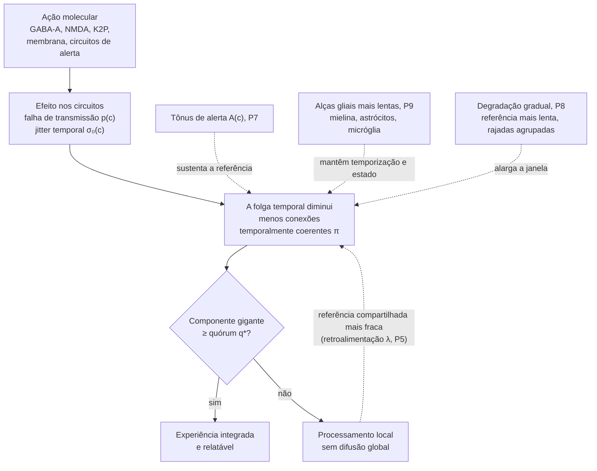

# A Hipótese do Consenso Perceptivo Distribuído na Anestesia Geral

**Um modelo de rede com restrição temporal para a inconsciência induzida por anestésicos**

> **Tradução para o português brasileiro, produzida com o auxílio de uma ferramenta de IA (Claude Opus 5.5, Anthropic; ver Declarações) e revisada pelos autores.** A versão de referência é a em inglês ([`white_paper_anesthesia_consensus.md`](white_paper_anesthesia_consensus.md)); em caso de divergência, prevalece o texto em inglês. Os títulos das obras citadas permanecem no idioma original, como é praxe acadêmica. Os apêndices B a D e as referências não foram traduzidos.

| | |
|---|---|
| **Autores** | Gabriel Santos de Oliveira<sup>1</sup> ([ORCID 0009-0003-9528-9731](https://orcid.org/0009-0003-9528-9731); [Currículo Lattes](https://lattes.cnpq.br/2102695116731989)); Callina Gertrudes Ferreira<sup>1</sup> ([ORCID 0009-0002-8512-213X](https://orcid.org/0009-0002-8512-213X); [Currículo Lattes](https://lattes.cnpq.br/2112739936897542)) |
| **Afiliações** | <sup>1</sup> Pesquisadores independentes, Rio de Janeiro, Brasil. O trabalho não foi realizado em nenhuma instituição nem financiado por nenhuma |
| **Data** | 17 de outubro de 2026 |
| **Versão** | 1.0.0 |
| **Tipo de artigo** | Artigo de hipótese e teoria (sem revisão por pares) |
| **Licença** | Texto e figuras: [CC BY 4.0](LICENSE-CC-BY-4.0). Código: [Apache License 2.0](LICENSE) |
| **Palavras-chave** | anestesia geral; consciência; sistema talamocortical; percolação; consenso distribuído; sincronia neural; inércia neural; índice de complexidade perturbacional |

---

## Resumo

Os anestésicos gerais são quimicamente diversos, atuam sobre muitos alvos moleculares e, ainda assim, produzem de forma confiável um mesmo estado final: a perda reversível da consciência. Propomos a **hipótese do Consenso Perceptivo Distribuído (CPD)**: o conteúdo integrado e relatável exige que os sinais entre áreas cerebrais cheguem dentro de uma janela de integração curta em torno de um ritmo compartilhado, e que as conexões que atendem a essa condição liguem um grupo conectado de populações que abranja uma fração mínima da rede, um quórum. Os termos vêm da computação distribuída e são usados como analogia, e não como afirmações de equivalência. Propõe-se que os anestésicos reduzam as conexões que atendem à condição ao fazer a transmissão falhar, ao tornar mais variável a temporização dos sinais entre áreas, ou ambos, de modo que o grupo conectado passe por uma transição de percolação. Isso estende o modelo de percolação de Zhou et al. (2015), que reduzia todo agente a uma única probabilidade de transmissão numa rede sintética, acrescentando-lhe três elementos: a variabilidade temporal como uma segunda via; um ritmo compartilhado que depende do grupo concordante; e limiares calculados na conectividade de um nematoide, de um inseto e de um ser humano. As previsões mais distintivas são que a variabilidade, de um ensaio para outro, da latência das respostas entre áreas, e não a latência média nem a coerência dos ritmos em curso, aumenta logo antes da perda de responsividade, e que, entre as concentrações de recuperação e de perda, um breve estímulo de despertar restaura uma responsividade que dura mais que o próprio estímulo. As simulações mostram que o mecanismo pode operar, e não que os cérebros o utilizam: vários resultados centrais não poderiam ter falhado nas doses escolhidas; o limiar calculado a partir da distribuição de graus de um conectoma coincide com a simulação com diferença de 2 a 5,5%, como se espera em redes densas; a retroalimentação produz inércia neural no modelo de percolação depois de calibrada, mas não em um modelo de osciladores; e, nos conectomas, o quórum só é perdido quando 85 a 90% das transmissões falham, mais do que já foi medido. Seis mecanismos propostos falharam e são relatados com as revisões que motivaram. Separamos achados estabelecidos de hipóteses e analogias, respondemos a oito objeções principais e apresentamos quinze previsões falseáveis com um protocolo de análise; o simulador e todos os resultados são abertos.

---

## 1. Introdução e escopo

### 1.1 O problema

180 anos após a primeira demonstração pública da anestesia com éter, não há consenso sobre como os anestésicos produzem a inconsciência (Franks, 2008; Alkire et al., 2008; Hemmings et al., 2019). A dificuldade está em que os agentes não têm relação estrutural entre si (do gás monoatômico xenônio ao alquilfenol propofol), atuam sobre muitos alvos moleculares diferentes e produzem assinaturas eletroencefalográficas (EEG) distintas, mas convergem para um desfecho comportamental semelhante. Uma explicação satisfatória precisa, portanto, mostrar como *causas moleculares heterogêneas* produzem um *efeito comum no nível do sistema*. A busca por um único mecanismo molecular, que dominou a era das teorias lipídicas, não teve êxito, porque os fatos moleculares são genuinamente diversos (Seção 2.1). Por isso, a CPD busca a unificação um nível acima: muitas vias moleculares convergindo para uma única forma de falha de rede, assim como muitas doenças diferentes convergem para a insuficiência cardíaca.

### 1.2 O que este artigo afirma e o que não afirma

Esta é uma **hipótese**, não um teorema. Ela não tem demonstração formal, e seu valor está em saber se suas previsões resistem ao teste experimental. Ela trata das condições em que há conteúdo integrado e relatável, e não de qual é esse conteúdo nem de por que ele é acompanhado de experiência (Seção 10, item 7). Para evitar ambiguidades, classificamos cada afirmação em um de três tipos:

- **[E] Estabelecido:** apoiado por evidência experimental replicada, com citação.
- **[H] Hipótese:** uma afirmação nova ou controversa deste artigo, formulada de modo a poder ser falseada.
- **[A] Analogia:** um conceito da computação usado como metáfora explicativa. As analogias motivam hipóteses, mas não são, elas próprias, afirmações sobre a biologia.

**Os postulados.** A hipótese é formulada nos postulados P1 a P9, sendo P4b um refinamento de P4, todos do tipo [H], definidos na Seção 3.3 e citados por número ao longo do texto. Em uma linha cada:

| Postulado | Em uma linha | Situação nos modelos |
|---|---|---|
| P1 Ciclos de integração | O conteúdo consciente é gerado em ciclos repetidos nos quais populações distribuídas convergem para um estado compartilhado | Suposto pelos dois modelos, não testado |
| P2 Condição de atraso limitado | Uma população só contribui para um ciclo se seus sinais chegarem dentro de uma janela de integração em torno de um ritmo compartilhado | Implementado no modelo de percolação e, no modelo de osciladores, pela leitura do Apêndice C.12 |
| P3 Quórum | O conteúdo integrado e relatável exige que as populações temporalmente coerentes formem um único grupo conectado com pelo menos uma fração $q^*$ da rede | Como em P2 |
| P4 Dois modos de falha | Os anestésicos reduzem as conexões temporalmente coerentes ao fazer a transmissão falhar, ao tornar variável a temporização dos sinais, ou ambos | A falha de transmissão abole o quórum nos três conectomas (garantido de antemão pelas doses escolhidas, limitação 25); a variabilidade temporal sozinha o faz em *C. elegans* e *Drosophila*, mas não no conectoma humano (Apêndice C.12) |
| P4b Temporização na rede | O que a anestesia degrada é a temporização dos sinais entre áreas em relação ao ritmo compartilhado, e não a precisão de neurônios isolados | Não testado em dados; a versão com compensação aprendida falhou (Apêndice C.10) |
| P5 Retroalimentação da referência | O ritmo compartilhado é gerado pelo próprio núcleo talamocortical coerente, de modo que um grupo concordante menor o enfraquece | Produz inércia no modelo de percolação depois de calibrado, também nos grafos dos conectomas de *C. elegans* e humano; ausente do modelo de osciladores, também quando lido com o próprio quórum da CPD (Apêndice C.12) |
| P6 Dinâmica padrão | Quando o quórum se perde, o córtex passa à sua própria dinâmica local, específica de cada agente | Não testado diretamente (limitação 30) |
| P7 Alerta e estado cerebral | Os sistemas de alerta que promovem a vigília sustentam parte do ritmo compartilhado independentemente da coerência cortical | Presente nas equações do modelo; a recuperação causada pelo alerta em concentração fixa não foi simulada |
| P8 Degradação gradual | À medida que a folga temporal diminui, o ritmo compartilhado desacelera e a atividade passa a ocorrer em rajadas antes que a concordância falhe | O ritmo mais lento retarda a perda, mas sua previsão distintiva falhou (F3) |
| P9 Controle glial em cascata | Alças gliais mais lentas mantêm as condições para a coerência temporal; uma extensão da qual P1 a P8 não dependem | Apenas verificações de consistência; seu único teste não poderia ter passado (A1) |

**O que é novo e o que é aproveitado.** Vários ingredientes da CPD não são novos: a comunicação por coerência (Fries, 2005, 2015), o processamento recorrente (Lamme & Roelfsema, 2000; Lamme, 2006), a desconexão funcional como via final comum da anestesia (Hudetz & Mashour, 2016), os modelos de percolação da anestesia e da percepção consciente (Zhou et al., 2015; Arese Lucini et al., 2019) e a histerese produzida por retroalimentação (Kim et al., 2018); a Seção 2.3 dá o crédito a cada um. O modelo anterior mais próximo é o de Zhou et al. (2015): a anestesia reduz uma única probabilidade de transmissão numa rede sintética em camadas, a perda da consciência aparece como uma transição de percolação, e o modelo reproduz as assinaturas eletroencefalográficas da anestesia geral, o que este artigo não tenta fazer. As contribuições deste artigo, em relação a esse modelo e aos demais acima, são:

1. A variabilidade temporal entre áreas como uma segunda via, independente, para a perda de conexões utilizáveis, ao lado da falha de transmissão, combinada com ela em uma única probabilidade por conexão. Colocar todos os agentes em um único parâmetro de transmissão não é novo (Zhou et al., 2015). No modelo de percolação, as duas vias são intercambiáveis quanto à perda do quórum, embora só a falha de transmissão produza histerese nas redes maiores (Apêndice B), de modo que só podem ser distinguidas medindo cada uma separadamente (Seção 10, item 13).
2. A proposta [H] de que uma das grandezas que os anestésicos degradam é a *variabilidade* da temporização dos sinais entre áreas em relação a um ritmo compartilhado, e não sua média ou a coerência dos ritmos em curso (P4b, Seção 7.8). A Seção 8 propõe testes diretos dessa proposta (previsões 3 e 8).
3. Um limiar de quórum calculado a partir da distribuição de graus de uma rede com a estimativa padrão por funções geradoras (Callaway et al., 2000) e comparado com a medição na conectividade de um nematoide, de um inseto e de um ser humano, incluindo a conectividade dirigida e um modelo nulo com conexões embaralhadas no modelo de fase (Apêndices B e C). A estimativa em si é padrão e sabidamente precisa em redes densas (Melnik et al., 2011); o que é novo é sua aplicação à anestesia em três conectomas reais.
4. A proposta [H] de que o tônus de alerta restaure o quórum em concentração fixa ao fortalecer o ritmo compartilhado (P7), com a previsão de que, entre as concentrações de recuperação e de perda, a restauração dure mais que o estímulo (Seção 5.4, previsão 15).
5. Previsões falseáveis, um protocolo de análise e um simulador aberto e testado em que cada parâmetro é identificado como medido, calibrado, suposto ou livre.

### 1.3 Escopo e definições

A anestesia geral compreende vários componentes separáveis: inconsciência, amnésia, analgesia e imobilidade, enquanto o anestesista mantém a estabilidade autonômica, cardiovascular, respiratória e termorreguladora (Brown et al., 2010). Ela não é sono: durante a manutenção, o EEG pode se assemelhar ao do sono de ondas lentas, mas seus padrões em geral diferem dos do sono, e o padrão de surto-supressão, visto na anestesia profunda e no coma, não ocorre no sono. Brown et al. (2010) descrevem a anestesia geral como um coma reversível induzido por fármacos. **Esta hipótese trata apenas da inconsciência.** A imobilidade, base do padrão de concentração alveolar mínima (CAM; Eger et al., 1965), está fora do escopo: não depende do prosencéfalo (Rampil et al., 1993) e é mediada em grande parte pela medula espinal (Antognini & Schwartz, 1993; Rampil, 1994). A memória e a responsividade podem ser prejudicadas separadamente (Veselis et al., 1997); a amnésia é discutida apenas quando diz respeito à hipótese.

Seguimos as distinções de Sanders et al. (2012):

- **Responsividade:** uma resposta comportamental a um comando ou estímulo. Em humanos, o desfecho operacional é a *perda de responsividade* (LOR, do inglês *loss of responsiveness*); em roedores, é a *perda do reflexo de endireitamento* (LORR).
- **Consciência conectada:** experiência que inclui a percepção do ambiente.
- **Consciência desconectada:** experiência sem percepção do ambiente, como no sonho.
- **Inconsciência:** ausência de qualquer experiência.

Portanto, irresponsividade não equivale a inconsciência, e a hipótese precisa dar conta de ambas.

Outras causas de inconsciência, incluindo o desmaio (síncope), as crises epilépticas, a concussão e o coma, estão fora do escopo deste artigo. Uma delas sugere uma extensão, formulada aqui como hipótese e não testada [H]. Na síncope, quando a circulação cessa de forma abrupta e total, a queda global do fluxo sanguíneo cerebral pode abolir a consciência em apenas cerca de 7 s (Wieling et al., 2009). Segundo a CPD, neurônios privados de oxigênio e glicose deixariam de transmitir: a falha por omissão de P4 (Seção 3.3), um sinal que nunca chega, alcançada por outra via. A hipótese prevê, portanto, que qualquer causa que faça conexões suficientes perderem a coerência temporal abole a integração no mesmo tipo de limiar, uma perda abrupta do componente gigante, e não um declínio gradual, como a previsão 1 afirma para a anestesia (Seção 8).

### 1.4 Terminologia

Cada termo é usado em um único sentido definido, apresentado com os símbolos e as siglas no Apêndice A (A.1 a A.3). O argumento se apoia em seis deles: conexões *temporalmente coerentes*, a *janela de integração*, a *folga temporal*, o *componente gigante*, o *quórum* e a *inércia neural*. Para facilitar a leitura, alguns têm sinônimos: uma conexão temporalmente coerente também é chamada de *ocupada*, o termo da percolação; o ritmo compartilhado também é chamado de *referência de fase* ou *ritmo de referência*; e o componente gigante também é chamado de *grupo concordante*. Palavras emprestadas da computação (por exemplo barramento, relógio, quórum, disjuntor) aparecem apenas em trechos marcados com [A], como analogias; o Apêndice A.4 associa cada uma a um termo definido, e nenhuma é usada para formular uma afirmação. Há duas exceções, nomes dados a partes da hipótese: *quórum* (P3) e *degradação gradual* (P8). Aqui, quórum significa apenas que o componente gigante das conexões temporalmente coerentes inclui pelo menos uma fração $q^*$ das populações; não há votação, nem votante, nem valor sobre o qual se concorde. Perda de responsividade (LOR) é usada sempre que a medida é comportamental, e perda da consciência apenas quando o estudo citado usou esse termo ou tinha evidência além do comportamento, como entrevista *post hoc* ou o índice de complexidade perturbacional.

---

## 2. Fundamentação

### 2.1 Mecanismos moleculares [E]

A correlação de Meyer-Overton, que relaciona a potência anestésica à solubilidade em lipídios (Meyer, 1899; Overton, 1901), motivou um século de teorias lipídicas. Vários achados mostram que a solubilidade em lipídios, por si só, é insuficiente:

1. Os anestésicos inibem uma proteína sem lipídios, a luciferase de vaga-lume, com potências que coincidem com a reta de Meyer-Overton (Franks & Lieb, 1984).
2. Isômeros ópticos do isoflurano, que têm solubilidade lipídica idêntica, diferem em seus efeitos sobre canais iônicos neuronais (Franks & Lieb, 1991).
3. Alguns compostos halogenados lipofílicos violam a correlação (Koblin et al., 1994); compostos desse tipo foram depois chamados de *não imobilizadores*.
4. Uma única mutação pontual (N265M) na subunidade β3 do receptor do ácido γ-aminobutírico do tipo A (GABA-A) reduz fortemente os efeitos *in vivo* do propofol e do etomidato em camundongos (Jurd et al., 2003).
5. O xenônio tem efeitos desprezíveis sobre os receptores GABA-A, que a maioria dos anestésicos gerais potencializa, e, em vez disso, inibe os receptores de N-metil-D-aspartato (NMDA), uma classe de receptores de glutamato (Franks et al., 1998).

Mecanismos mediados pela membrana continuam biologicamente plausíveis como vias que *contribuem*. Entre eles estão as alterações no perfil de pressão lateral da bicamada lipídica, que modificam os equilíbrios conformacionais dos canais nela inseridos (Cantor, 1997), e a desorganização de domínios lipídicos ordenados, que ativa os canais de potássio TREK-1 por meio da fosfolipase D2 (PLD2; Pavel et al., 2020). A visão atual é que os anestésicos atuam sobre múltiplos alvos, principalmente receptores GABA-A, receptores NMDA e canais de potássio com dois domínios de poro (K2P), com perfis específicos para cada agente (Rudolph & Antkowiak, 2004; Hemmings et al., 2019).

As vias conhecidas diferem quanto ao mecanismo. A maioria altera as correntes iônicas de modo a reduzir a transmissão excitatória ou a excitabilidade neuronal, embora a cetamina aumente a atividade gama cortical (Akeju et al., 2016). A coluna "Tipo de falha na CPD" é a hipótese de P4 [H], e não uma classificação estabelecida:

| Via molecular | Agentes com evidência | Efeito sobre o fluxo iônico | Tipo de falha na CPD (P4) [H] | Fontes |
|---|---|---|---|---|
| Potencialização do receptor GABA-A (prolongando a abertura do canal) | Propofol, etomidato, barbitúricos, isoflurano, sevoflurano | Mais corrente inibitória de Cl⁻ | Falha de transmissão | Mihic et al. (1997); Jurd et al. (2003) |
| Bloqueio do receptor NMDA: bloqueio do canal aberto junto com menos aberturas do canal (cetamina), ou ligação no sítio do coagonista glicina (xenônio, isoflurano) | Cetamina, xenônio, óxido nitroso; isoflurano | Menos corrente excitatória de Na⁺ e Ca²⁺ | Variabilidade temporal e falha de transmissão | Orser et al. (1997); Franks et al. (1998); Jevtović-Todorović et al. (1998); Dickinson et al. (2007) |
| Ativação de canais de K⁺ com dois domínios de poro (TREK-1, TASK) | TREK-1: os agentes voláteis halotano, isoflurano, clorofórmio e éter dietílico, e os gases xenônio, óxido nitroso e ciclopropano; TASK: desses agentes, somente halotano e isoflurano, já que os gases não alteram o TASK-3 | Mais vazamento de K⁺, hiperpolarização | Falha de transmissão | Patel et al. (1999); Gruss et al. (2004); Heurteaux et al. (2004) |
| Inibição de canais ativados por hiperpolarização e regulados por nucleotídeos cíclicos (HCN) | Agentes voláteis (conforme a subunidade); propofol; cetamina, cuja potência hipnótica é fortemente reduzida em camundongos sem HCN1 | Menos corrente catiônica de marca-passo | Ritmo e temporização alterados | Chen et al. (2005); Ying et al. (2006); Chen et al. (2009) |
| Inibição de canais de Na⁺ pré-sinápticos, reduzindo a entrada de Ca²⁺ e a liberação de vesículas | Isoflurano | Menos neurotransmissor liberado por potencial de ação | Falha de transmissão | Herold & Hemmings (2012), para os canais de Na⁺; Baumgart et al. (2015), para a redução da entrada de Ca²⁺ e da liberação |
| Agonismo dos receptores α2-adrenérgicos, atuando pela via endógena do sono | Dexmedetomidina | Indireto: inibição dos neurônios do *locus coeruleus* | Supressão do alerta (P7) | Nelson et al. (2003) |
| Desorganização de domínios lipídicos da membrana, liberando a PLD2, que ativa o TREK-1 | Clorofórmio, isoflurano | Indireto: mais corrente de K⁺ | Falha de transmissão | Pavel et al. (2020) |
| Complexo I mitocondrial (um fator de sensibilidade, e não um canal iônico) | Agentes voláteis | Não é um efeito sobre canais; a disfunção do complexo I aumenta a sensibilidade | Modula a suscetibilidade | Kayser et al. (1999) |

Os receptores de glicina, abundantes na medula espinal, também são potencializados por agentes voláteis (Mihic et al., 1997) e considera-se que contribuem para a imobilidade, que está fora do escopo deste artigo (Seção 1.3).

Duas outras propostas não foram confirmadas e são mencionadas apenas a título de completude. Um análogo anestésico fotoativo foi encontrado ligado à β-tubulina em girinos (Emerson et al., 2013). Uma dose única do estabilizador de microtúbulos epotilona B retardou a perda do reflexo de endireitamento induzida por isoflurano em ratos (Khan et al., 2024) e, em cerca de 29 s no dia seguinte, em camundongos (Huang et al., 2026), em estudos de um mesmo laboratório. Em contraste, duas semanas de epotilona D diária, também um estabilizador, tornaram camundongos mais sensíveis ao isoflurano, assim como o desestabilizador vimblastina, enquanto o paclitaxel deslocou a sensibilidade levemente no sentido oposto (Li et al., 2025). O sentido do efeito difere entre fármacos e esquemas de dosagem, e se os microtúbulos contribuem para a anestesia continua em aberto. Um único estudo relatou que isótopos de xenônio com spin nuclear são menos potentes em camundongos do que isótopos sem spin (Li et al., 2018); não se encontrou replicação independente.

**Implicação para este artigo:** a hipótese CPD não depende de qual mecanismo molecular está em ação. Ela exige apenas que, no nível dos circuitos, os agentes aumentem a falha de transmissão, o *jitter* temporal ou ambos.

### 2.2 Achados no nível dos sistemas [E]

Os achados abaixo são estabelecidos, salvo quando uma frase diz o contrário: resultados de um único estudo, a leitura de uma revisão, resultados de que os próprios autores duvidam e resultados que depois se mostraram sujeitos a fatores de confusão estão identificados como tais onde aparecem.

- **Envolvimento talamocortical.** Dois anestésicos voláteis suprimiram a atividade regional do tálamo e da formação reticular mesencefálica em voluntários humanos (Alkire et al., 2000). Nicotina microinjetada no tálamo medial central reverte a perda do reflexo de endireitamento induzida por sevoflurano em ratos (Alkire et al., 2007). A estimulação talâmica pode restaurar o alerta em macacos anestesiados (Redinbaugh et al., 2020). Se o tálamo ou o córtex muda primeiro é uma questão em aberto: em pacientes com eletrodos cerebrais profundos, o EEG frontal mudou abruptamente na perda da consciência, enquanto os registros subcorticais mudaram pouco (Velly et al., 2007), ao passo que, no EEG estereotáxico, a complexidade no núcleo anterior do tálamo caiu antes da do córtex pré-frontal e do temporal (Fan et al., 2026).
- **Colapso da comunicação cortical.** Propofol, sevoflurano e cetamina perturbam a conectividade de retroalimentação frontoparietal (U. Lee et al., 2013). No início da inconsciência induzida por propofol, surge uma oscilação lenta, e os disparos neuronais ficam confinados a breves janelas de fase, assíncronas ao longo do córtex, fragmentando as redes corticais (Lewis et al., 2012). Uma revisão recente lê esse achado como uma fragmentação da temporização e da coordenação da atividade local entre áreas corticais, e não como seu desaparecimento, e descreve a atividade sob propofol e agentes voláteis como frequentemente mais estereotipada, temporalmente restrita e mal coordenada entre regiões (Kordas, 2026). Sob anestesia em macacos, os padrões mais frequentes de conectividade funcional passam a espelhar a conectividade anatômica, ao passo que a vigília explora um repertório mais rico, diferente da anatomia (Barttfeld et al., 2015). Revisões de estudos de redes em larga escala concluem que a irresponsividade sob anestésicos costuma vir acompanhada de atividade reduzida ou de desconexão funcional nas redes frontoparietais laterais (Hudetz & Mashour, 2016), junto com menor complexidade e um repertório menor de estados cerebrais (Mashour & Hudetz, 2018).
- **Assinaturas de EEG específicas de cada agente.** O propofol aumenta a potência beta durante a sedação e, na perda de responsividade, produz alfa frontal coerente (8 a 12 Hz) juntamente com oscilações lentas e delta (0,1 a 4 Hz) (Purdon et al., 2013, 2015; Ching et al., 2010). A cetamina aumenta a potência gama e não produz o padrão alfa característico do propofol (Akeju et al., 2016).
- **Desacoplamento celular.** Em camundongos, os anestésicos desacoplam os dendritos apicais dos neurônios piramidais da camada 5 de seus corpos celulares, o que interromperia a integração da retroalimentação entre áreas corticais se essa retroalimentação chegasse principalmente aos dendritos apicais (Suzuki & Larkum, 2020).
- **Perda de coordenação, e não de atividade, em várias espécies.** Em *Caenorhabditis elegans*, o isoflurano mantém ativos os neurônios individuais da cabeça, mas faz colapsar as correlações entre eles (Awal et al., 2020). Em *Drosophila*, o isoflurano reduz a potência e a coerência sincronizadas ao estímulo no cérebro central, enquanto as aumenta no dobro da frequência do estímulo nos lobos ópticos para alguns estímulos (Cohen et al., 2016). Também prejudica a retroalimentação de baixa frequência mantendo intacta a conectividade de alimentação direta (*feedforward*) de alta frequência (Cohen et al., 2018) e fragmenta a estrutura integrada da atividade cerebral em agrupamentos separados (Leung et al., 2021).
- **Perda da assinatura individual.** Sob sevoflurano e propofol, a conectividade funcional torna-se menos distintiva entre indivíduos, sobretudo no córtex de associação transmodal, e a conectividade de humanos anestesiados fica mais parecida com a do macaco (Luppi et al., 2025; um único estudo).
- **Complexidade.** O índice de complexidade perturbacional (PCI) é alto na vigília e baixo durante a inconsciência induzida por propofol e xenônio. Ele permanece alto sob cetamina, em consonância com os relatos de sonhos de voluntários saudáveis ao despertar (Sarasso et al., 2015); a validação original do índice usou midazolam, xenônio e propofol (Casali et al., 2013).
- **Inércia neural.** Em insetos e em mamíferos, a concentração em que a consciência retorna é menor do que aquela em que é perdida, e a diferença não é totalmente explicada pela farmacocinética. Essa histerese é chamada de inércia neural; foi demonstrada em camundongos e em *Drosophila* (Friedman et al., 2010) e depende de genes de excitabilidade que atuam independentemente da sensibilidade à indução (Joiner et al., 2013; ver também Kelz et al., 2008). Seu tamanho medido varia conforme o agente. A razão entre as concentrações de indução e de despertar é de cerca de 1,08 para o isoflurano e 2,85 para o halotano em camundongos (Friedman et al., 2010). Em humanos, é de cerca de 1,07 para as concentrações de propofol no sítio efetor (1,5 e 1,4 µg/mL na perda e na recuperação da responsividade comportamental; Warnaby et al., 2017), cujos autores não encontraram histerese sistemática nesses valores e identificaram, em vez disso, a inércia na saturação das ondas lentas. É de 1,11 em outro estudo (Iwakiri et al., 2005), cujos autores descrevem as concentrações como semelhantes, embora a diferença tenha sido estatisticamente significativa. Para concentrações de propofol medidas, é de cerca de 1,63 (Sepúlveda et al., 2018), cujos autores advertem que a diferença poderia decorrer de um erro sistemático na estimativa das concentrações no sítio efetor, e não da inércia neural. O único estudo desenhado para testar a inércia neural em humanos, em 36 voluntários com aumentos e reduções em degraus de propofol ou sevoflurano, cada um com ou sem remifentanil, não encontrou diferença entre as concentrações de indução e de recuperação para o propofol, e encontrou diferenças para o sevoflurano na maioria dos desfechos, em alguns apenas com remifentanil; seus autores concluíram que o desfecho medido influencia se a inércia neural é detectada (Kuizenga et al., 2018). Se a inércia neural existe em humanos é, portanto, controverso, e a explicação da CPD para ela (P5) depende disso. A recuperação passa por uma sequência de estados de atividade discretos e metaestáveis (Hudson et al., 2014).
- **Células gliais.** As células gliais respondem aos anestésicos, e manipulá-las altera a indução e o despertar em camundongos. Em camundongos acordados, os anestésicos suprimem os sinais de cálcio dos astrócitos corticais mesmo em doses baixas demais para mudar a forma como os neurônios respondem quando as vibrissas são estimuladas (Thrane et al., 2012). Os agentes inalatórios também causam uma perturbação reversível dos prolongamentos finos dos astrócitos no córtex somatossensorial (Zhou et al., 2025). Ativar astrócitos do prosencéfalo basal acelera a indução com isoflurano e retarda a recuperação (Lin et al., 2023), enquanto ativar astrócitos do núcleo parabraquial ou do tálamo paraventricular acelera o despertar (Liu et al., 2023; Zhao et al., 2024). O efeito, portanto, depende da região. Depletar a micróglia com o fármaco PLX5622 reduz a sensibilidade a vários anestésicos e abrevia seu efeito (Cao et al., 2023; He et al., 2023). O mesmo grupo verificou depois, porém, que o PLX5622 também ativa um receptor hepático que acelera a depuração dos anestésicos e que depletar a micróglia geneticamente não antecipou o despertar (Cao et al., 2026). A evidência mais sólida é que a perda genética do receptor P2Y12 da micróglia acelera a recuperação (Cao et al., 2023). A mielina determina a temporização da condução. Em circuitos do tronco encefálico auditivo, a geometria dos axônios mielinizados é ajustada para determinar o momento de chegada dos potenciais de ação (Ford et al., 2015), e em camundongos um déficit sutil de mielina dispersa os tempos de condução e reduz a sincronia da atividade do córtex motor (Kato et al., 2020). Não encontramos estudos sobre a necessidade de anestésico em doenças desmielinizantes humanas, apenas relatos de caso. Há dois estudos em animais. Camundongos desmielinizados demoraram mais para se recuperar do isoflurano, com efeitos que dependiam da região desmielinizada (Wang et al., 2024), e camundongos desmielinizados mais velhos demoraram mais para ser induzidos em concentração fixa, em grupos pequenos (Tot et al., 2024).

### 2.3 Modelos anteriores e a posição da CPD

A CPD se apoia em dois grupos de trabalhos anteriores. O primeiro é conceitual:

| Referencial | Afirmação central | Relação com a CPD |
|---|---|---|
| Comunicação por coerência (Fries, 2005, 2015) | Grupos neuronais oscilantes só se comunicam de forma eficaz quando suas janelas para receber e para enviar sinais coincidem no tempo | P2 é essa condição; a CPD acrescenta a afirmação de que os anestésicos atuam tornando variável a temporização entre áreas em relação ao ritmo compartilhado, e pergunta quantas conexões precisam cumprir a condição para que haja integração em toda a rede |
| Ciclos perceptivos (VanRullen & Koch, 2003; VanRullen, 2016) | A percepção ocorre em ciclos discretos ligados às oscilações cerebrais; as evidências atuais apontam para vários ritmos, e não um só | P1 adota ciclos discretos; a CPD acrescenta uma condição temporal a cada troca, um quórum no nível da rede e a proposta de que os anestésicos agem rompendo a temporização dos ciclos |
| Processamento recorrente (Lamme & Roelfsema, 2000; Lamme, 2006) | Uma varredura apenas *feedforward* provavelmente não basta para a percepção consciente; é necessário processamento recorrente entre áreas | P1 adota ciclos recorrentes; a CPD acrescenta uma condição temporal a cada troca e um quórum no nível da rede |
| Desvinculação cognitiva (*cognitive unbinding*; Mashour, 2013) | Os anestésicos perturbam a síntese de informação entre redes corticais | A CPD propõe um motivo específico para a falha da síntese: a violação de uma condição de atraso limitado |
| Teoria da informação integrada (Tononi et al., 2016) | A consciência corresponde à informação integrada (Φ) | O parâmetro de ordem da CPD mede a coerência temporal no nível da rede; não é Φ nem pretende aproximá-lo, e a CPD não faz afirmações sobre a natureza da experiência |
| Espaço de trabalho neuronal global (Dehaene & Changeux, 2011) | O acesso consciente exige uma "ignição" não linear e a difusão global | O quórum da CPD é um critério estático e topológico que pode ser comparado com a ignição dinâmica do espaço de trabalho, mas não é equivalente a ela; a CPD acrescenta uma restrição temporal |
| Interruptor talamocortical (Alkire et al., 2000) | O tálamo controla o acesso ao estado consciente (*gating*) | A CPD atribui ao núcleo talamocortical o papel de fornecer uma referência de fase compartilhada, e não o de um interruptor liga-desliga |
| Transição de fase anestésica em campo médio (Steyn-Ross et al., 1999; Bojak & Liley, 2005) | A modulação anestésica da cinética sináptica inibitória leva um modelo de campo médio do córtex por regimes estacionários distintos, o que sugere uma transição de fase (Steyn-Ross et al., 1999); um modelo de campo médio relacionado explica as alterações anestésicas do EEG por meio de respostas sinápticas de canais ativados por ligantes (Bojak & Liley, 2005) | A CPD também trata a perda da consciência como uma transição, mas em uma rede de conexões discretas cuja coerência temporal percola; ela não modela o espectro do EEG, o que esses modelos fazem |
| A oscilação lenta como estado cortical padrão (Sanchez-Vives et al., 2017) | As oscilações lentas são propostas como o padrão basal de atividade cortical, de baixa complexidade, do qual o cérebro precisa sair para readquirir a complexidade que acompanha a consciência | Compatível com P6 e P7: na CPD, a oscilação lenta é o que a rede faz depois que o quórum é perdido; a CPD acrescenta um critério para quando isso acontece |
| Teoria da integração dendrítica (Aru et al., 2020, cujo resumo a chama de *Dendritic Information Theory*) | As células piramidais corticais controlam, em seus dendritos, a integração dos sinais ascendentes (*bottom-up*) e descendentes (*top-down*), e nos estados inconscientes essa integração é impedida; os anestésicos desacoplam os dendritos das células piramidais da camada 5 de seus corpos celulares (Suzuki & Larkum, 2020) | Compatível: uma via celular pela qual os sinais de retroalimentação poderiam deixar de contar, um mecanismo candidato para as falhas por omissão de P4 |

O segundo grupo é formado por modelos quantitativos, vários dos quais já contêm elementos da CPD. **Esses trabalhos precedem o presente e devem ser creditados:**

| Modelo anterior | O que estabeleceu | O que a CPD acrescenta |
|---|---|---|
| Breskin et al. (2006) | Em culturas de neurônios vivos, enfraquecer quimicamente as sinapses faz o componente conexo gigante se desintegrar em uma transição de percolação | A CPD aplica a percolação a conectomas inteiros e à temporização, além da transmissão |
| Arese Lucini et al. (2019) | A passagem da percepção consciente para a subliminar em redes funcionais do cérebro humano é modelada como percolação de *k-core*: as camadas externas (*k-shells*) da rede se desligam, enquanto o seu núcleo mais interno continua ativo | A CPD aplica a percolação à perda da consciência induzida por anestésicos e define a ocupação por um critério temporal, e não pela ativação funcional |
| Zhou et al. (2015) | Um modelo de percolação da transmissão talamocortical e corticocortical, com uma única probabilidade de transmissão *p*, reproduz características do EEG na anestesia; a transferência de informação muda bruscamente perto de um *p* crítico | Zhou et al. já colocaram todos os agentes em um único parâmetro de transmissão; a CPD acrescenta a variabilidade temporal como uma segunda via, independente, para a mesma probabilidade de ocupação |
| Su et al. (2020) | Mediu um ciclo de histerese entre indução e recuperação na razão de surto-supressão dos potenciais de campo locais (dois camundongos, isoflurano) e o explicou por percolação em redes multicamadas autossimilares | A CPD atribui a histerese à retroalimentação pelo ritmo compartilhado, e não à estrutura autossimilar da rede; para a histerese produzida por retroalimentação, ver Kim et al. (2018), abaixo |
| Tian e Sun (2022) | No conectoma da mosca-da-fruta, a formação da conectividade funcional é descrita como um processo de percolação controlado pelo equilíbrio entre excitação e inibição | A CPD usa a percolação no mesmo conectoma para a perda de quórum sob anestesia, com a ocupação definida pela transmissão e pela temporização |
| Du e Huang (2025) | Um modelo de rede recorrente ajustado à eletrocorticografia de macacos na vigília, na anestesia e na recuperação: sua função de resposta é suprimida e sua dinâmica mais caótica sob anestesia | Ao contrário desse modelo, os modelos da CPD não são ajustados a registros; a Seção 8 propõe as medidas que os testariam |
| Kim et al. (2016) | As condições para a sincronização explosiva são satisfeitas em redes de EEG humanas logo após a perda de consciência induzida por anestésicos | A CPD testa uma transição de percolação, e não a sincronização explosiva, em conectomas empíricos de três espécies, com um único conjunto de parâmetros |
| Kim et al. (2018) | Osciladores de Stuart-Landau com retroalimentação adaptativa em um conectoma de 78 regiões reproduzem a histerese da conectividade funcional observada no EEG sob cetamina e sevoflurano | O mecanismo de retroalimentação da CPD (P5) é muito próximo, e Kim et al. já relacionaram o tamanho da histerese à potência do anestésico; a CPD atribui a retroalimentação a uma referência temporal compartilhada e calibra sua intensidade pelas razões de inércia medidas |
| Moon et al. (2015); H. Lee et al. (2013) | A topologia da rede determina o avanço e o atraso de fase entre os *hubs* e a periferia, e o sentido anteroposterior do fluxo de informação desaparece sob sevoflurano; a estrutura de *hubs* das redes de EEG se reconfigura após a inconsciência induzida por propofol | A perturbação dos *hubs* sob anestesia já foi relatada. A CPD explica por que os *hubs* são vulneráveis, pela percolação em redes cuja distribuição de graus tem cauda pesada (Albert et al., 2000), e prevê que perturbar as conexões dos *hubs* reduz a concentração necessária para a perda de responsividade mais do que perturbar o mesmo número de conexões ao acaso (previsão 6) |
| Proekt & Hudson (2018); Hudson et al. (2014) | A recuperação da consciência passa por estados metaestáveis discretos (Hudson et al., 2014), e a inércia neural pode ser explicada por transições impulsionadas por ruído em uma paisagem de múltiplos poços, comparada com dados de inércia de camundongos e de *Drosophila* (Proekt & Hudson, 2018) | A CPD oferece uma origem, no nível da rede, para essas barreiras; as duas explicações são compatíveis |

O que se apresenta como novo [H] é, portanto, mais restrito do que um modelo de percolação ou de histerese em si; a Seção 1.2 o enumera.

---


## 3. A hipótese

### 3.1 Analogia motivadora [A]

Na computação distribuída, um conjunto de processos atinge o *consenso* quando concorda sobre um único valor, mesmo que alguns processos falhem. Fischer, Lynch e Paterson (1985) provaram que o consenso determinístico é impossível em um sistema totalmente assíncrono se um único processo puder parar. Dwork, Lynch e Stockmeyer (1988) mostraram que o consenso se torna possível sob *sincronia parcial*, isto é, quando os atrasos das mensagens e as velocidades relativas de processamento são limitados, ainda que esses limites não sejam conhecidos de antemão. Sistemas construídos sobre esses resultados costumam exigir um *quórum*, uma fração mínima de processos participantes, antes de confirmar um valor. As falhas são classificadas pela forma como um processo se desvia de sua especificação (Cristian, 1991): ele pode parar (*crash*), deixar de entregar uma mensagem (uma *omissão*), entregá-la fora do tempo combinado (uma falha de *temporização*) ou emitir mensagens arbitrárias ou enganosas (uma falha *bizantina*). As falhas bizantinas só são toleradas com uma fração maior de processos corretos, mais de dois terços quando as mensagens não são assinadas (Lamport et al., 1982). Os limites temporais não são o único caminho para a concordância: protocolos aleatorizados a alcançam sem nenhum limite para os atrasos, desde que a maioria dos processos continue funcionando (Ben-Or, 1983), assim como protocolos que usam detectores de falhas não confiáveis (Chandra & Toueg, 1996). A CPD adota como analogia o caminho dos limites temporais [A]; não se sabe se os circuitos neurais usam algo semelhante à concordância aleatorizada ou à detecção de falhas.

A analogia, que não afirma uma equivalência literal, é que o cérebro precisa chegar repetidamente a uma única interpretação coerente de sinais multissensoriais e internos que chegam a áreas diferentes em momentos diferentes. Lamport (1978) mostrou que a causalidade ordena apenas parcialmente os eventos de um sistema distribuído. Mostrou também que uma ordem total consistente pode ser obtida com um sistema de relógios lógicos, acrescentando-se relógios físicos sincronizados para que a ordem concorde com o que os usuários observam. Propomos que o cérebro enfrenta uma restrição comparável.

### 3.2 Análogos da engenharia e seus limites [A]

Os termos usados neste artigo vêm de sistemas de engenharia que mantêm muitas unidades distribuídas em concordância apesar de atrasos, ruído e falhas, um problema que se propõe que o cérebro também enfrente [A]. A tabela lista os sistemas que motivaram cada postulado, com referências às suas especificações, e indica onde cada analogia falha.

| Sistema de engenharia | Como funciona | Correspondente na CPD | Onde a analogia falha |
|---|---|---|---|
| Controle de voo *fly-by-wire*: o computador primário de voo com redundância tripla-tripla do Boeing 777 (Yeh, 1996) e os computadores de comando e monitoramento da família Airbus A320 (Briere & Traverse, 1993) | Canais redundantes calculam o mesmo comando; canais discordantes são vencidos na votação ou desligados, e a aeronave passa a uma lei de controle mais simples quando o número de canais concordantes é insuficiente | Quórum (P3); passagem à dinâmica padrão quando o quórum é perdido (P6) | As populações neurais não calculam cópias idênticas de um mesmo valor, e não há um votante designado |
| Arquitetura acionada por tempo (Kopetz & Bauer, 2003), usada em veículos críticos para a segurança | Os nós transmitem em intervalos (*slots*) de tempo fixos que se repetem em ciclo (um *round-robin* de intervalos) em relação a um relógio global sincronizado; uma mensagem fora de seu intervalo é descartada, e um nó que perde a sincronia é excluído do grupo | Ciclos de integração (P1); a janela $W$ (P2); sinais atrasados não integrados | O cérebro não tem intervalos fixos nem relógio global; sua referência temporal emerge da oscilação |
| Barramento CAN (*Controller Area Network*; ISO 11898-1:2024; ISO, 2024) | Todos os nós precisam amostrar cada bit dentro do mesmo tempo de bit, de modo que o atraso de propagação limita o produto entre o comprimento do barramento e a taxa de bits | Uma condição de atraso limitado que restringe o tamanho e a velocidade da rede (P2) | Um barramento CAN é um único meio compartilhado; o cérebro é uma rede esparsa de conexões ponto a ponto |
| Protocolo de Tempo de Precisão (IEEE Std 1588-2019; IEEE, 2020) | Um relógio de referência é distribuído pela rede, com os atrasos de percurso medidos e compensados | A referência de fase talamocortical compartilhada (P5) | O PTP tem um mestre designado; a referência neural é emergente e depende ela própria da coerência |
| Redes elétricas síncronas (Filatrella et al., 2008; Rohden et al., 2012) | Os geradores precisam permanecer sincronizados em frequência; sua dinâmica é modelada com equações de osciladores do tipo Kuramoto, e a perda de sincronia pode se propagar em cascata até um apagão (U.S.-Canada Power System Outage Task Force, 2004) | A mesma matemática do modelo de osciladores do Apêndice C; o colapso da coerência global | A proteção da rede elétrica desliga equipamentos de forma intencional; a CPD não afirma que a transição neural seja projetada ou protetora |
| Padrão disjuntor (*circuit breaker*) em software distribuído (Fowler, 2014) | As chamadas a uma dependência com falha são interrompidas; após um intervalo, permite-se uma chamada de teste ("meio aberto") antes que o funcionamento normal seja retomado | Desligamento ativo por circuitos dedicados (Seção 5.2); o retorno retardado e condicional se assemelha à inércia neural | Um disjuntor de software existe para proteger o sistema; a CPD não afirma que a transição neural tenha finalidade protetora |
| Consenso distribuído (Lamport et al., 1982; Fischer et al., 1985; Dwork et al., 1988) | A concordância determinística é impossível sem limites temporais quando um processo pode parar (protocolos aleatorizados e detectores de falhas evitam isso), é possível sob sincronia parcial e tolera menos falhas bizantinas do que falhas por parada | Motivação para P2 e para os dois modos de falha de P4; nenhum resultado formal é transferido, pois a sincronia parcial diz respeito a limites de atraso que existem, mas não são conhecidos de antemão, ou que são conhecidos, mas só valem a partir de um momento desconhecido, enquanto $W$ é uma janela fixa | O cérebro não executa um algoritmo de consenso; os resultados são usados como restrições, e não como descrição do mecanismo |

**O meio físico é diferente.** Os computadores sinalizam eletronicamente, por ondas eletromagnéticas em condutores. Os neurônios sinalizam eletroquimicamente: um potencial de ação é uma corrente iônica regenerada ao longo do axônio, e nas vias corticocorticais humanas a velocidade mediana de condução axonal é de cerca de 3,9 m/s, com atraso axonal mediano de cerca de 10 ms (Lemaréchal et al., 2022). O que se transfere da engenharia para a neurociência não é, portanto, a física, mas a razão entre o atraso e a duração do ciclo. A 40 Hz, um ciclo gama dura 25 ms, de modo que um atraso corticocortical típico corresponde a cerca de 40% de um ciclo. Nesse regime, a CPD propõe que a temporização seja uma restrição de primeira ordem para a comunicação [H], assim como em um barramento CAN cujo atraso de propagação se aproxima do tempo de bit. Um atraso constante pode ser absorvido por um deslocamento de fase correspondente (Fries, 2015); a proposta diz respeito à sua variabilidade.

**Os sinais chegam em muitas velocidades.** O cérebro recebe suas entradas com atrasos muito diferentes, determinados pela biologia e não pela física do estímulo. As respostas no córtex auditivo primário humano atingem o pico cerca de 15 ms após um som (Celesia, 1976), enquanto a resposta visual mais precoce registrada sobre o córtex occipital começa por volta de 56 ms (Foxe & Simpson, 2002), embora a luz viaje muito mais rápido que o som. As fibras nervosas periféricas abrangem cerca de duas ordens de grandeza em velocidade de condução, de cerca de 0,5 a 2 m/s nas fibras amielínicas a cerca de 80 a 120 m/s nas grandes fibras mielinizadas (valores tabulados por Yap et al., 2020, a partir de um livro-texto de referência) [A: enlaces de velocidades diferentes, como conexões 3G, 4G e 5G]. O cérebro compensa: depois de passarem vários minutos expostas a sons e imagens defasados por um atraso invariável, as pessoas passam a julgar que os dois coincidem num ponto deslocado na direção desse atraso (Fujisaki et al., 2004). Seus ritmos também são aninhados, com a fase dos ritmos mais lentos modulando a amplitude dos mais rápidos: o delta modula o teta, e o teta modula o gama (Lakatos et al., 2005; Canolty & Knight, 2010) [A: vários domínios de relógio, com comunicação entre eles]. A CPD propõe [H] que essas compensações só funcionem enquanto a folga temporal (Seção 3.3) permanecer positiva; a previsão 8 (Seção 8) indica o que a falsearia.

### 3.3 Postulados [H]

**A afirmação central em linguagem simples.** A experiência integrada e relatável exige *folga temporal positiva*: os sinais que passam entre as populações de um sistema nervoso precisam chegar dentro da janela em que podem ser combinados, avaliados em relação a um ritmo compartilhado. Os anestésicos, qualquer que seja seu alvo molecular, corroem essa folga ao fazer a transmissão falhar ou os instantes de chegada variarem. Quando a folga se torna negativa em conexões suficientes, as populações já não conseguem chegar a uma concordância, e a experiência se perde. A concordância não envolve votação nem votante: nenhuma população guarda uma cópia de um valor nem conta as demais. As populações concordam quando conexões cujos sinais chegam a tempo as reúnem em um só grupo, travado no ritmo compartilhado. A afirmação diz respeito a margens temporais, e não a uma frequência em particular: cada sistema nervoso usa seus próprios ritmos, ajustados aos seus próprios atrasos de condução. Entre mamíferos cujos volumes cerebrais diferem milhares de vezes, a hierarquia dos ritmos cerebrais é amplamente preservada, o que, como sugerem Buzsáki, Logothetis e Singer (2013), pode ser obtido por axônios de longo alcance de maior diâmetro e condução mais rápida nos cérebros maiores. Se for assim, as margens temporais seriam preservadas entre cérebros de tamanhos diferentes [H], que é a condição exigida por esta hipótese.

Os postulados formulam a afirmação com precisão. A Figura A resume a cadeia causal que descrevem.



*Figura A. Cadeia causal da hipótese CPD. As setas tracejadas indicam influências de retroalimentação e de modulação. Os símbolos são definidos na Seção 4 e listados no Apêndice A.2.*

- **P1 (Ciclos de integração).** O conteúdo consciente é gerado em ciclos de integração repetidos, durante os quais populações distribuídas convergem para um estado compartilhado. Os ciclos adotam duas propostas anteriores (Seção 2.3): a de que a percepção ocorre em épocas discretas (VanRullen & Koch, 2003) e a de que a percepção consciente exige processamento recorrente entre áreas, e não uma única varredura *feedforward* (Lamme & Roelfsema, 2000; Lamme, 2006). Abordagens relacionadas ligam essas alças à reentrada entre córtex e tálamo (Edelman & Gally, 2013), a ligações dinâmicas estabelecidas pela sincronização em diversas bandas de frequência (Varela et al., 2001), à integração talamocortical por coincidência temporal (Llinás et al., 1998) e à comparação de predições de retroalimentação com erros *feedforward* (Rao & Ballard, 1999). As evidências apontam para vários ritmos perceptivos, e não para um só (VanRullen, 2016), de modo que a referência de fase única da CPD (P5) é uma simplificação (Seção 10). Vários estudos relatam que a anestesia perturba esse componente recorrente mais do que o *feedforward*, embora não de modo uniforme. Sob propofol, a conectividade dirigida de retroalimentação do córtex frontal para o parietal enfraquece quando a consciência se perde e se recupera quando os participantes voltam a responder a comandos verbais, ao passo que dados anteriores em animais indicavam que o processamento *feedforward* pode continuar (Lee et al., 2009). Em ratos, o halotano e o isoflurano reduziram a transferência de informação *feedforward* e de retroalimentação em 50 Hz, sobretudo a retroalimentação das regiões frontais para as posteriores, enquanto aumentaram ambas em 30 Hz (Imas et al., 2005). Em camundongos, a anestesia desacopla os dendritos apicais dos neurônios piramidais da camada 5, o provável alvo da entrada de retroalimentação, de seus corpos celulares (Suzuki & Larkum, 2020). Nos termos da analogia [A], cada ciclo é uma alça que verifica o que chegou, e quando chegou, em relação ao que era esperado. A CPD propõe [H] que um ciclo que perde o quórum no meio seja abandonado, e não concluído pela metade [A: uma saga desfeita quando uma de suas etapas falha].
- **P2 (Condição de atraso limitado).** Uma população contribui para um ciclo apenas se seus sinais chegarem dentro de uma janela de integração $W$ em relação a uma referência de fase compartilhada. Sinais fora da janela não são integrados. Essa é a condição proposta pela comunicação por coerência, na qual grupos neuronais oscilantes só interagem de forma eficaz quando suas janelas para receber e para enviar sinais coincidem no tempo (Fries, 2005, 2015). A janela comportamental de integração temporal para eventos multissensoriais, da ordem de 100 ms ou mais (Wallace & Stevenson, 2014), é uma contrapartida psicofísica de $W$. Espera-se que a janela neural seja mais estreita e dependente da frequência.
- **P3 (Quórum).** Um ciclo produz conteúdo globalmente integrado e relatável apenas se as populações temporalmente coerentes formarem um componente conexo que inclua pelo menos uma fração crítica $q^*$ da rede.
- **P4 (Dois modos de falha).** Os anestésicos reduzem a fração de conexões funcionais temporalmente coerentes de uma ou de ambas as formas a seguir. (a) Aumentam a probabilidade de falha da transmissão (falhas por omissão, sinais que nunca chegam: por exemplo, aumento da inibição mediada por GABA-A e redução da liberação de glutamato; Baumgart et al., 2015). (b) Aumentam a variabilidade, de um ensaio para outro, da temporização dos sinais (falhas de temporização, sinais que chegam fora de sua janela: proposto aqui para o antagonismo do receptor NMDA pela cetamina [H]). A hipótese é que a via molecular afeta a rede apenas por meio dessas duas grandezas e da parcela do ritmo compartilhado sustentada pelo alerta (P7) [H]. Contar o aumento da inibição como falha por omissão é uma simplificação do modelo: um sinal inibitório chega, mas a transmissão excitatória que a conexão carregaria de outro modo não chega. Redes cujas conexões têm sinal, negativo nas inibitórias, são testadas separadamente (Apêndice C, testes SG1 e SG2). A atribuição da cetamina às falhas de temporização é uma suposição do modelo, e não um achado. Não encontramos nenhum estudo que mostre que a cetamina aumenta a variabilidade temporal entre áreas. Essa atribuição também não pode se apoiar apenas no antagonismo do receptor NMDA: o xenônio, também antagonista NMDA (Seção 2.1), reduz a complexidade cortical como o propofol, ao passo que a cetamina a mantém semelhante à da vigília (Sarasso et al., 2015). Há um efeito de circuito estabelecido da inibição dos receptores NMDA, e ele é outro: em ratos acordados, ela reduziu sobretudo a atividade de interneurônios inibitórios presumidos e, com atraso, aumentou o disparo da maioria dos neurônios piramidais, o que sugere desinibição (Homayoun & Moghaddam, 2007).
- **P4b (Temporização na rede, hipótese ainda não testada em dados).** O cérebro integra as entradas em relação a expectativas aprendidas sobre quando elas chegarão. Propõe-se que o que falha sob anestesia seja a temporização dos sinais *entre* áreas em relação ao ritmo compartilhado, que se torna mais variável à medida que esse ritmo enfraquece (P5), e não a precisão de neurônios isolados. Segundo esta hipótese, um atraso constante é inofensivo, pois pode ser antecipado; só a variabilidade importa. Os modelos não têm essa antecipação, e neles erros de temporização constantes não são inofensivos. No modelo de fase, defasagens temporais fixas abolem o quórum (S4) um ou dois passos de concentração antes do que um *jitter* flutuante de mesmo tamanho em 20 de 20 sementes de *C. elegans* e 18 de 20 sementes humanas, e no mesmo passo em todas as 6 sementes de *Drosophila*; com atrasos de condução medidos, o quórum no conectoma humano é perdido em média a 1,16 em vez de 1,57 vezes a CE50, a concentração em que o agente produz metade de seu efeito máximo (D1; ambas as comparações *post hoc*; as concentrações foram amostradas a cada 0,05 CE50). Esta parte de P4b depende, portanto, de um mecanismo de compensação que os modelos não têm. Um teste especificado de antemão (Apêndice C.10) deu a cada conexão uma expectativa aprendida de seu tempo de chegada, guiada pela fase do sinal que chega em relação à fase do próprio receptor, e falhou: a coerência caiu já na concentração zero com todos os agentes, muito provavelmente porque o aprendizado também absorveu as pequenas diferenças de fase que mantêm em sincronia populações com frequências naturais diferentes (esse mecanismo não foi medido diretamente), e, sem atrasos de condução, o quórum foi perdido abaixo de 0,13 CE50 com todos os agentes, contra 0,60 a 1,58 CE50 sem aprendizado (os testes L1, L3 e L4 não se mantiveram em nenhuma semente). Com atrasos de condução medidos, o aprendizado primeiro fez o que P4b propõe, elevando a coerência na vigília de 0,41 para 0,62 em todas as sementes, antes que a mesma deriva retirasse o quórum a uma média de 0,735 CE50, contra 1,205 CE50 sem aprendizado. Um receptor que vê apenas a fase de chegada não consegue distinguir um atraso constante da relação de fase que o acoplamento mantém; como o cérebro tornaria inofensivos os atrasos constantes continua, portanto, em aberto. Na escala do comportamento, as pessoas se adaptam à média de um atraso variável quase tão bem quanto a um atraso constante (Yamamoto & Kawabata, 2011; Beech et al., 2025, 2026); esses atrasos, de 100 a 230 ms em média, são muito mais longos que a janela proposta aqui e, por isso, não testam se a variabilidade entre áreas é compensada. As poucas medições locais concordam que a temporização de neurônios isolados não fica mais ruidosa. Aprofundar a anestesia com cetamina-xilazina alongou a latência do primeiro disparo no tronco encefálico auditivo do gerbil sem alterar o *jitter* dos disparos (Jing et al., 2021). O propofol tornou mais sincrônica a temporização dos disparos de neurônios piramidais do córtex insular de rato, ao fortalecer a inibição compartilhada (Koyanagi et al., 2021). A regularidade temporal de neurônios em rajadas foi mantida sob pentobarbital (Kato et al., 2016). Não encontramos nenhum estudo sobre a variabilidade, de um ensaio para outro, da latência das respostas entre áreas corticais sob anestesia. O mais próximo mediu com fMRI a variabilidade, de um ensaio para outro, de respostas auditivas: a redução de variabilidade que um estímulo repetido normalmente produz foi abolida sob sedação e anestesia com propofol (Huang et al., 2018), o que diz respeito à amplitude das respostas dentro das regiões, e não à temporização dos sinais entre elas. No estudo intracraniano mais próximo, as respostas de áreas distantes a pulsos elétricos isolados foram mais variáveis sob propofol do que na vigília, sobretudo no córtex pré-frontal, enquanto a latência do primeiro pico da resposta não mudou com o estado (Zelmann et al., 2023). Essa variabilidade era a dispersão do sinal da resposta, e não de sua temporização. Também aumentou na atividade espontânea e foi medida depois da perda da consciência, e não ao longo de concentrações graduadas. A hipótese prevê que a variabilidade, de um ensaio para outro, da latência das respostas entre áreas aumente em concentrações logo abaixo da perda de responsividade, antes que sua latência média mude de forma apreciável (Seção 8, previsão 8).
- **P5 (Retroalimentação da referência).** Propõe-se que a referência de fase compartilhada seja gerada pelo próprio núcleo talamocortical coerente [A: um *gateway* ou orquestrador que mantém os serviços em sincronia, mas é ele próprio formado por esses serviços]. Um componente gigante menor produz, portanto, uma referência mais fraca e um erro temporal efetivo maior para todas as conexões restantes.
- **P6 (Dinâmica padrão).** Quando o quórum é perdido, o córtex não silencia. Ele passa à sua dinâmica intrínseca, gerada localmente (por exemplo, a oscilação lenta; Steriade et al., 1993a), cuja forma é específica de cada agente.
- **P7 (Alerta e estado cerebral).** Os sistemas de alerta promotores da vigília sustentam parte da referência compartilhada independentemente da coerência cortical. Os anestésicos suprimem esses sistemas. O isoflurano e o sevoflurano diminuem o número de neurônios orexinérgicos que expressam c-Fos, o que sugere que esses agentes os inibem (Kelz et al., 2008), e o isoflurano despolariza neurônios promotores do sono (Moore et al., 2012). No modelo, essa supressão acelera a perda do quórum sem ser necessária para ela (Apêndice B, verificação de consistência C7). No sono natural, o tônus de alerta é retirado, e durante os estados DOWN da oscilação lenta populações locais inteiras de neurônios corticais silenciam (Vyazovskiy et al., 2009).
- **P8 (Degradação gradual).** À medida que a folga temporal diminui, o sistema se degrada de duas maneiras interligadas antes que a concordância falhe. Primeiro, o ritmo de referência desacelera, o que aumenta o tempo disponível em cada ciclo. Um erro temporal de σ milissegundos custa um erro de fase de 2π f σ, de modo que um ritmo quatro vezes mais lento converte o mesmo erro temporal em um erro de fase quatro vezes menor, ao custo de quatro vezes menos ciclos de integração por segundo [A: redução da velocidade do enlace, como quando uma conexão móvel cai de 5G para 4G e para 3G]. Segundo, a atividade contínua e assíncrona dá lugar a rajadas sincronizadas, mais fáceis de alinhar, mas que carregam menos informação [A: transmissão contínua substituída por consultas periódicas em lote]. A sequência observada durante a indução com propofol, de oscilações beta na sedação ao alfa frontal com oscilações lentas na perda da consciência (Purdon et al., 2013, 2015), é proposta como uma sucessão de estágios dessa degradação, assim como o padrão de surto-supressão da anestesia mais profunda, na qual os períodos de supressão se alongam à medida que a dose aumenta (Brown et al., 2010; Purdon et al., 2015) [A: recuo exponencial]. A surto-supressão também foi modelada como consequência da redução do metabolismo cerebral (Ching et al., 2012), explicação que esta leitura não substitui. A interpretação dominante do alfa frontal é diferente: Purdon et al. (2015) propõem que as oscilações alfa altamente organizadas provavelmente impeçam a comunicação normal entre o tálamo e o córtex, e modelos talamocorticais as atribuem a mecanismos talâmicos (Ching et al., 2010; Vijayan et al., 2013). As duas leituras são em parte compatíveis, já que um canal mais lento e mais estreito restringe a vazão enquanto melhora a confiabilidade temporal; elas diferem no que preveem (Seção 8, previsão 9). O modelo de osciladores não sustenta esse mecanismo específico: um ritmo mais lento não protegeu mais contra falhas de temporização do que contra falhas de transmissão (testes F1 e F3, Seção 6).
- **P9 (Controle glial em cascata; uma extensão, da qual P1 a P8 não dependem).** O ciclo de integração, que ocorre em milissegundos, é regulado por alças gliais mais lentas que mantêm as condições para a coerência temporal, cada uma em sua própria escala de tempo [A: alças de controle externas que ajustam uma alça interna]. A mielina determina a temporização da condução (Seção 2.2), e no córtex motor de camundongos um déficit sutil de mielina dispersa os tempos de chegada talamocorticais (Kato et al., 2020). Bloquear a formação de novos oligodendrócitos em camundongos adultos também impede o acoplamento, induzido pelo aprendizado, entre os ritmos do hipocampo e do córtex (Steadman et al., 2020). Modelos de mielinização adaptativa propõem que os oligodendrócitos ajustem os atrasos de condução ao longo do tempo, para que sinais de regiões distantes cheguem juntos (Pajevic et al., 2014, 2023; Noori et al., 2020). Os astrócitos regulam o estado cortical ao longo de segundos a horas: sua atividade precede a oscilação lenta e pode desencadeá-la (Poskanzer & Yuste, 2016), o cálcio dos astrócitos acompanha a necessidade de sono (Ingiosi et al., 2020), e bloquear a liberação vesicular dos astrócitos reduz as oscilações gama (Lee et al., 2014). A micróglia participa de uma alça com a noradrenalina: um tônus noradrenérgico baixo, como sob anestesia, aumenta a vigilância da micróglia (Liu et al., 2019; Stowell et al., 2019), e a sinalização da micróglia reduz ainda mais a noradrenalina (Ma et al., 2024). P9 propõe que os anestésicos perturbem essas alças além do ciclo de integração, e que a alça da micróglia seja uma fonte biológica da retroalimentação da referência de P5, mantendo estável o estado inconsciente depois que ele é alcançado. A regulação da atividade neural rápida por processos mais lentos é um princípio estabelecido (Turrigiano, 2008); o que P9 acrescenta é que as alças gliais atuam sobre a coerência temporal. P1 a P8 não dependem de P9.

---

## 4. Modelo formal [H]

### 4.1 Rede e coerência

Seja o cérebro representado por um grafo $G = (V, E)$ de $N$ populações neurais, com distribuição de graus $P(k)$. Na concentração $c$ no sítio efetor, expressa em relação à concentração efetiva média do agente (CE50), a que produz metade do seu efeito máximo, cada conexão funcional $e$ transmite com sucesso com probabilidade 1 − $p(c)$. Cada agente atua por uma curva dose-resposta de Hill, com a concentração expressa em relação à CE50 e coeficiente de Hill $n$:

$$
h(c) = \frac{c^{n}}{1 + c^{n}}, \qquad p(c) = p_{\max}\,h(c), \qquad \sigma_0(c) = \sigma_{\max}\,h(c),
$$

em que $p_{\max}$ e $\sigma_{\max}$ são a falha de transmissão máxima e o *jitter* acrescentado máximo do agente (o Apêndice C lista os valores). O erro de instante de chegada $\delta_e$ das transmissões bem-sucedidas, em relação à referência de fase, é modelado como uma gaussiana de média zero e desvio-padrão $\sigma_{\text{eff}}$, que combina o *jitter* basal, o *jitter* acrescentado pelo agente $\sigma_0(c)$ e o erro de uma referência enfraquecida (Seção 4.3).

Uma conexão é **temporalmente coerente** se transmite com sucesso e |$\delta_e$| ≤ $W$/2. Sua probabilidade de ser coerente é

$$
\pi(c) = \bigl(1 - p(c)\bigr)\cdot \operatorname{erf}\!\left(\frac{W}{2\sqrt{2}\,\sigma_{\text{eff}}}\right)
$$

### 4.2 Limiar de percolação

Tratando a coerência como percolação de ligações em um grafo aleatório com a distribuição de graus dada, um componente gigante só existe se $\pi$ exceder o valor crítico (Callaway et al., 2000):

$$
\pi_c = \frac{\langle k \rangle}{\langle k^2 \rangle - \langle k \rangle}
$$

Seja $S(\pi)$ a fração de populações no componente gigante. O parâmetro de ordem do modelo é $S$, e P3 afirma que o conteúdo integrado exige $S$ ≥ $q^*$. Distribuições de graus de cauda pesada, como as de conectomas dominados por *hubs*, têm ⟨k²⟩ grande e, portanto, $\pi_c$ baixo. Isso prevê que a integração é robusta a falhas aleatórias, mas vulnerável a falhas concentradas nos *hubs* (Callaway et al., 2000; Albert et al., 2000). O tálamo e os *hubs* frontoparietais são locais candidatos.

### 4.3 Retroalimentação da referência e histerese

P5 é modelado fazendo o *jitter* efetivo crescer à medida que o componente gigante encolhe:

$$
\sigma_{\text{eff}} = \sqrt{\sigma_b^2 + \sigma_0(c)^2 + \sigma_{\text{ref}}^2}, \qquad \sigma_{\text{ref}} = \lambda\,\bigl(1 - S\bigr)\bigl(1 - A(c)\bigr), \qquad A(c) = A_0\,\bigl(1 - a\,h(c)\bigr)
$$

em que $\sigma_b$ é o *jitter* basal independente do agente, $\sigma_0(c)$ o *jitter* induzido pelo agente e $\sigma_{\text{ref}}$ o erro acrescentado por uma referência enfraquecida; os três são independentes, de modo que seus desvios-padrão se somam em quadratura. $\lambda \ge 0$ é a intensidade da retroalimentação da referência, $A(c)$ é a fração da referência sustentada pelo alerta (P7), $A_0$ seu valor na vigília, $h(c)$ o efeito fracionário do agente (uma função de Hill da concentração) e $a$ a fração desse efeito que atua sobre os circuitos de alerta. No sono natural, $A_0$ é fixado em 0, uma retirada completa do tônus de alerta, e os estados DOWN silenciam a cada momento uma fração $d$ de populações inteiras, removendo-as da rede junto com suas conexões; na explicação alternativa, cada conexão falha com probabilidade $d$ (Seção 5.6). O estado estacionário satisfaz então a condição de autoconsistência

$$
S = F\!\bigl(\pi(c, S)\bigr)
$$

em que $F$ é a função de componente gigante do grafo. Neste modelo de percolação, para $\lambda$ = 0, a transição é contínua e não apresenta histerese. Para $\lambda$ suficientemente grande, a equação tem duas soluções estáveis em uma faixa de concentrações, um ramo de $S$ alto (consciente) e um ramo de $S$ baixo (inconsciente). O sistema então perde a consciência em uma concentração $c_{\text{off}}$ e só a recupera em uma concentração menor $c_{\text{on}}$ < $c_{\text{off}}$. **A inércia neural surge do modelo quando $\lambda$ é grande o suficiente**, e sua magnitude ($c_{\text{off}}$ − $c_{\text{on}}$) aumenta com $\lambda$. Como $\lambda$ é então escolhido para reproduzir uma razão de inércia medida (Apêndice B), reproduzir essa razão é uma calibração, e não um teste; os testes são as previsões que decorrem do valor calibrado. O modelo de osciladores de fase não mostrou histerese robusta com nenhuma das intensidades de retroalimentação testadas (Apêndice C, calibração e testes H0, H1 e S3).

### 4.4 Profundidade graduada

Embora o *acesso* consciente seja modelado como um limiar sobre $S$, o próprio parâmetro de ordem é contínuo. Isso está em consonância com a sedação graduada, com as alterações progressivas do EEG observadas com o aumento da concentração e com a variabilidade individual dos limiares. Os registros divergem quanto à abruptude da transição. Durante a indução lenta com propofol, a conectividade funcional medida por RMf caiu gradualmente, enquanto a recuperação foi abrupta (Huang et al., 2021); no EEG estereotáxico, a complexidade no núcleo anterior do tálamo caiu antes da perda da consciência e mais cedo que no córtex pré-frontal e no temporal, de modo que as mudanças locais e as entre regiões foram defasadas no tempo (Fan et al., 2026); e o acoplamento de ondas lentas frontais mudou em um degrau discreto, enquanto o acoplamento alfa posterior declinou de forma contínua (Tong et al., 2026). A CPD prevê uma mudança abrupta no componente gigante das conexões temporalmente coerentes, e não em toda medida da atividade cerebral; um declínio gradual desse componente gigante ao longo da perda de responsividade a refutaria (previsão 1). Várias medidas, de fato, não caem de forma abrupta, ou nem caem. Em estéreo-EEG, a informação mútua de permutação entre regiões aumentou ou se manteve estável após a perda de consciência induzida por propofol (Liang et al., 2025); sob sevoflurano, a magnitude da conectividade funcional no EEG foi maior durante a perda de consciência do que no estado consciente (Dong et al., 2023); durante uma infusão ultralenta de propofol, a inclinação espectral do EEG acompanhou o tempo de resposta de forma contínua (Zhang et al., 2023); e em macacos a conectividade funcional continuou a cair com a dose de isoflurano além da perda de consciência (Lv et al., 2016). Medidas da magnitude do acoplamento podem subir quando a atividade se torna hipersincrônica (Seção 7.8), de modo que não testam a CPD; a ordem em que as regiões mudam, relatada nesses estudos, não é prevista pela CPD tal como formulada.

### 4.5 Taxa de referência adaptativa (P8)

**O que o modelo de fase representa.** Na implementação com osciladores de fase (Apêndice C), a fase $\theta_i$ da população $i$ evolui como

$$
\dot\theta_i = \omega_i + \frac{K}{s_i}\sum_j w_{ji}\,m_{ji}\,\sin\bigl(\theta_j - \theta_i - \alpha_{ji}\bigr) + \lambda_{\text{osc}}\bigl[R + A(c)(1 - R)\bigr]\sin(\psi - \theta_i) + \xi_i,
$$

em que $\omega_i$ é sua frequência natural, $K$ o acoplamento, $s_i$ a intensidade total de suas entradas, $w_{ji}$ o peso da conexão vinda de $j$, $m_{ji}$ igual a 0 se essa conexão falhou e a 1 caso contrário, $\alpha_{ji}$ seu erro de fase (atraso de condução mais *jitter* temporal), $R$ e $\psi$ a magnitude e a fase do ritmo médio da rede, $\lambda_{\text{osc}}$ a intensidade adimensional da referência neste modelo (diferente do $\lambda$ do modelo de percolação, que está em milissegundos) e $\xi_i$ o ruído; nas condições com estímulo, as populações sensoriais também recebem um estímulo periódico. No conectoma humano, cada nó é uma população neural, e sua fase é a fase do ritmo coletivo dessa população, a grandeza refletida nos potenciais de campo locais e no EEG, e não o estado de um neurônio isolado. Nos conectomas de *C. elegans* e de *Drosophila*, cada nó é um único neurônio, cuja fase representa a temporização de sua atividade; para eles, o modelo testa a fiação, e não a dinâmica celular (Seção 10, item 17). Modelos desse tipo existem: um modelo de integração e disparo com vazamento (*leaky integrate-and-fire*) de todo o cérebro de *Drosophila*, construído a partir de uma versão anterior do mesmo conectoma e de seus neurotransmissores previstos, previu neurônios do circuito de alimentação que foram depois confirmados experimentalmente e recuperou o circuito conhecido de autolimpeza das antenas (Shiu et al., 2024). Reduzir um sistema neural oscilante a uma fase é o procedimento padrão para osciladores fracamente acoplados próximos de um regime periódico (Kuramoto, 1984; Brown et al., 2004), e redes de osciladores de fase sobre conectomas são uma descrição fenomenológica estabelecida da sincronia cerebral em larga escala (Cabral et al., 2011; Breakspear, 2017). O modelo é, portanto, fenomenológico: representa a temporização e o acoplamento entre populações e deixa de fora, deliberadamente, os disparos, a cinética sináptica, a geração do próprio ritmo (Seção 10, item 18) e a neuromodulação. Seus resultados dizem respeito às condições de rede para a concordância, e não aos mecanismos celulares de cada agente. O tempo no modelo é adimensional, com a escala fixada pelo acoplamento $K$. Os erros temporais e os atrasos de condução, dados em milissegundos, entram apenas como erros de fase, $2\pi f \sigma$ na frequência de referência $f$, de modo que a temporização afeta os resultados apenas por meio de sua razão com a duração do ciclo. A concentração é aumentada e reduzida em degraus, e a cada degrau a rede é integrada por um tempo fixo antes de ser medida. Se esse tempo fosse curto demais para a rede se acomodar, o atraso por si só poderia produzir uma histerese aparente; o estudo de convergência dobra o tempo simulado em cada degrau e reduz à metade o passo de integração para verificar isso, no conectoma humano e em duas sementes de *Drosophila* (Apêndice C.4). Pela regra fixada no Apêndice C.4 antes da primeira execução do estudo, as concentrações de perda convergiram nos dois conectomas: suas médias variaram no máximo 0,02 com qualquer das duas mudanças. O modelo de fase não mostra histerese maior que um passo da grade em nenhum dos conectomas. Uma histerese de um passo apareceu em duas execuções humanas de referência e em uma semente de *Drosophila* com estímulo e desapareceu com o dobro do tempo simulado; pela mesma regra, é um artefato do tempo de estabilização; com o dobro do tempo, outra semente humana mostrou, em vez disso, uma histerese de um passo. A *razão de difusão global* (o arrastamento do restante da rede por um estímulo, em relação ao das populações sensoriais estimuladas) não convergiu, exceto na vigília no conectoma humano. O dobro do tempo simulado também dobra a janela em que a difusão global é medida, o que baixa seu piso de travamento ao acaso (limitação 31), de modo que essa verificação mistura tempo de estabilização com duração da janela. Com o dobro do tempo simulado, a difusão global que resta após a perda do quórum caiu ainda mais em relação ao valor de vigília: de 0,22 para 0,13 dele no conectoma humano e de 0,82 para 0,36 em *Drosophila*, onde a própria difusão global na vigília mais que dobrou, de 0,06 para 0,15. As configurações de referência subestimam, portanto, o colapso da difusão global, sobretudo na mosca, e as razões absolutas de difusão global dependem do tempo de integração; o teste T3 na mosca (Seção 6) é lido com essa ressalva. Para manter cada execução de *Drosophila* entre meia hora e uma hora, essas execuções se estabilizam durante 200 passos de integração em cada concentração, em vez de 400, e a concentração muda em passos de 0,1 CE50, em vez de 0,05 CE50. Por isso, suas concentrações de perda têm resolução de apenas 0,1 e muitas vezes coincidem entre sementes; um desvio-padrão igual a zero entre as sementes de *Drosophila* reflete a grade de concentrações, não dinâmicas idênticas.

Na implementação com osciladores de fase (Apêndice C), um erro temporal de $\sigma$ milissegundos torna-se um erro de fase com desvio-padrão $2\pi f \sigma$, em que $f$ é a frequência do ritmo de referência. Segundo P8, a referência desacelera à medida que o agente faz efeito,

$$
f(c) = f_{\text{awake}} - \bigl(f_{\text{awake}} - f_{\text{fallback}}\bigr)\,h(c),
$$

de $f_{\text{awake}} = 40$ Hz, dentro da faixa gama de 30 a 90 Hz (Fries, 2015), em direção a $f_{\text{fallback}} = 10$ Hz, o centro do alfa frontal de 8 a 12 Hz observado na perda da consciência induzida por propofol (Purdon et al., 2013). Os atrasos de condução constantes são convertidos em fase à mesma taxa. Como o acoplamento efetivo de uma conexão com erro temporal gaussiano de desvio-padrão de fase $s$ é reduzido pelo fator $e^{-s^2/2}$, uma referência mais lenta preserva o acoplamento para o mesmo erro em milissegundos. A mesma taxa de *fallback* é usada para todos os agentes, embora a cetamina não produza alfa frontal (Akeju et al., 2016); trata-se de uma simplificação. No estudo entre espécies, a taxa mais lenta elevou a concentração de perda do agente semelhante aos GABAérgicos em todas as sementes, nos três conectomas (teste F1), mas sua previsão distintiva, a de que ela protege mais contra falhas de temporização do que contra falhas de transmissão, falhou em todas as sementes (teste F3: 0 de 20, 0 de 6 e 0 de 20). P8 é mantido como uma proposta cujo mecanismo específico o modelo não sustenta (Apêndice D).

### 4.6 Regulação glial (P9, uma extensão)

Como as alças gliais mudam lentamente em comparação com o ciclo de integração, cada uma é representada por um parâmetro mantido fixo durante uma varredura de concentração, uma separação de escalas de tempo. A mielina danificada eleva o *jitter* basal $\sigma_b$, independente do agente (3 ms; Seção 4.7):

$$
\sigma_b(\mu) = \sigma_b\,\bigl(1 + \gamma\,(1 - \mu)\bigr)
$$

A alça da micróglia enfraquece o tônus de alerta à medida que o componente gigante colapsa:

$$
A(c, S) = A(c)\,\bigl(1 - g\,(1 - S)\bigr)
$$

de modo que ela é fraca na vigília, em que $S$ fica perto de 1, mas abaixo dele, cresce à medida que o componente gigante encolhe e remove a fração $g$ do tônus de alerta no estado colapsado; como já atua durante a indução, removê-la retarda levemente a perda do quórum, além de acelerar o despertar (Apêndice B.7); $g$ = 0 representa a depleção da micróglia. Silenciar os astrócitos remove sua parcela dos estados DOWN do sono, $d \to d\,(1 - s_a)$. Nenhuma medição publicada fixa $\gamma$, $g$ ou $s_a$; são parâmetros livres, testados com $\gamma$ = 1, $\mu \in$ {1; 0,75; 0,5}, $g \in$ {0; 0,25; 0,5} e $s_a$ = 0,5. Como $\lambda$ foi calibrado sem a alça da micróglia, os testes dizem respeito à direção de cada efeito, e não à sua magnitude. Cinco verificações foram especificadas antes da execução com várias sementes (Apêndice B): quatro verificações de consistência, que decorrem das equações (M1, G1 a G3), e um teste, A1, em que o modelo poderia falhar. O A1 falhou em todas as sementes, em todos os tamanhos de rede: silenciar a parcela astrocitária dos estados DOWN globais não restaurou o quórum no sono (Apêndice B). O teste, porém, não poderia ter passado: a parcela que ele deixa silenciosa, um quarto das populações, é a parcela humana com a qual o teste O4 já perde o quórum, de modo que o A1 nada diz sobre os astrócitos, e a via astrocitária não foi testada, e não refutada. Como a alça fica silenciosa na vigília, ela não consegue reduzir a sensibilidade na indução, como faz a depleção farmacológica da micróglia em camundongos (Cao et al., 2023), um resultado sujeito a fator de confusão, a depuração mais rápida do fármaco (Cao et al., 2026); a verificação G2 só pode mostrar, portanto, que a depleção não antecipa a indução, e o modelo não reproduz a redução da sensibilidade.

### 4.7 Situação do modelo

O modelo é deliberadamente mínimo. A janela de integração $W$ = 3 ms está dentro das janelas de integração medidas para entradas sinápticas coincidentes: de 1 a 10 ms para a entrada talâmica no córtex de barris de roedores (a área das vibrissas no córtex somatossensorial; Gabernet et al., 2005), menos de 2 ms em células piramidais do hipocampo (Pouille & Scanziani, 2001) e vários milissegundos nos dendritos da camada 5 (Larkum et al., 1999). O *jitter* basal $\sigma_b$ = 3 ms é a precisão, de cerca de 3 ms, dos disparos de neurônios da área visual temporal média (MT) de macacos alertas respondendo a estímulos variáveis no tempo (Buracas et al., 1998); neurônios isolados *in vitro* chegam a menos de 1 ms (Mainen & Sejnowski, 1995). Não encontramos nenhum estudo que meça a variabilidade, de um ensaio para outro, da latência dos sinais entre áreas corticais; estudos de estimulação intracraniana sob propofol relatam, em vez disso, a variabilidade do sinal da resposta e a latência da resposta (Zelmann et al., 2023; van Blooijs et al., 2024). Por isso, os dois valores variam de 1 a 10 ms na análise de sensibilidade. Os resultados dependem deles: com $W$ = 1 ms, com $\sigma_b$ = 10 ms ou com grau médio 4, todas ou quase todas as afirmações do estudo de validação falham (Apêndice B, análise de sensibilidade). Nos valores de referência, apenas cerca de 38% das conexões são temporalmente coerentes na vigília ($\operatorname{erf}(W / (2\sqrt{2}\,\sigma_b)) \approx 0.38$). $\lambda$ é calibrado pela inércia neural medida; o quórum $q^*$, os efeitos máximos $p(c)$ e $\sigma_0(c)$ de cada classe de agente, o coeficiente de Hill da curva dose-resposta e a fração $a$ do efeito do agente sobre o alerta são parâmetros livres, e a CE50 define a unidade de concentração. A análise de sensibilidade varia, entre outros, $q^*$, a falha de transmissão máxima do agente semelhante aos GABAérgicos e o coeficiente de Hill; os efeitos máximos do agente semelhante aos antagonistas de NMDA e a fração $a$ não são variados. A percolação em grafos aleatórios ignora a disposição espacial, a modularidade e a estrutura dirigida (*feedforward* e retroalimentação) dos conectomas reais; por isso, os limiares de quórum dos conectomas empíricos também são medidos na sua conectividade dirigida (Apêndice B). Um teste adicional usa um terceiro modelo, de populações excitatórias e inibitórias em interação no conectoma humano (Wilson & Cowan, 1972), para perguntar se o congestionamento causa a excitação observada na indução (Seção 5.1, Apêndice C.5). O propósito do modelo é gerar previsões qualitativas e falseáveis (Seção 8) e orientar simulações futuras em conectomas empíricos. Uma implementação de referência e um estudo de validação em diferentes tamanhos de rede são apresentados no Apêndice B.

**Como o modelo de osciladores de fase lê P2 e P3.** O modelo de percolação implementa a janela e o quórum como foram formulados: uma conexão conta apenas quando seu erro temporal fica dentro de $W/2$, e o quórum é a fração de populações no componente gigante das conexões que contam. O modelo de osciladores de fase, que produz todos os resultados nos conectomas, não o fazia em sua construção original. Nele, o erro temporal enfraquece de forma contínua o acoplamento de uma conexão, em vez de excluir os sinais atrasados, e o quórum é lido como uma coerência de fase global de pelo menos metade de seu valor na vigília, um corte numa curva contínua, e não um componente gigante. Seus resultados nos Apêndices C.3 a C.11 mostram, portanto, o que os dois tipos de falha fazem com a concordância entre osciladores acoplados numa conectividade real; eles não testam P2 e P3 diretamente. Uma leitura que os testa, contando uma conexão quando seu erro temporal dentro de um ciclo fica dentro da janela e perguntando se as conexões que contam formam um componente gigante de pelo menos $q^*$, foi acrescentada depois, com seus testes fixados antes de serem executados (Apêndice C.12). Com essa leitura, a falha de transmissão abole o quórum nos três conectomas, mas a variabilidade temporal sozinha só o faz nos dois conectomas de invertebrados e, no humano, em nenhuma semente, embora a coerência global colapse ali; a inércia não aparece no modelo de osciladores em nenhuma intensidade de retroalimentação.


---

## 5. Correspondência com observações clínicas e fisiológicas

### 5.1 Indução: excitação paradoxal [E] e uma explicação pela CPD [H]

Concentrações baixas de agentes GABAérgicos podem causar desinibição, agitação ou euforia, acompanhadas de aumento da potência beta e gama (Brown et al., 2010; Purdon et al., 2013). Uma explicação baseada em modelagem de redes propõe que o propofol em dose baixa, por meio de uma interação entre as correntes GABA-A e a corrente M, uma corrente lenta de potássio, faz os interneurônios passarem da sincronia à antissincronia, que os autores propõem como mecanismo de rede das alterações na banda beta da excitação paradoxal (McCarthy et al., 2008).

A CPD propõe uma contribuição **complementar**. À medida que $\pi$ cai em direção a $\pi_c$, os caminhos coerentes restantes carregam uma parcela maior do impulso recorrente, de modo que a atividade se torna mais intensa em menos rotas, uma forma de concentração de carga [A: congestionamento de rede]. Essa explicação faz uma previsão distintiva (Seção 8, previsão 4): a magnitude da excitação na fase de indução deve aumentar com a carga sensorial e recorrente no momento da indução, o que uma explicação baseada apenas em interneurônios não exige.

**O que as simulações mostraram.** No modelo excitatório-inibitório de Wilson-Cowan sobre o conectoma humano (Apêndice C.5), essa concentração de carga não apareceu. A atividade dos *hubs* subiu pelo menos 10% antes do colapso em no máximo 1 de 10 sementes em cada uma de nove configurações (três acoplamentos globais, cada um sem plasticidade inibitória homeostática ou com ela lenta ou rápida), tanto em uma execução exploratória quanto em uma execução confirmatória com sementes novas, e a subida não foi maior com carga sensorial alta. A execução exploratória mostrou, em análise *post hoc*, um pico de sincronia de pelo menos 1,5 vez o nível de vigília antes do colapso, quase só no acoplamento intermediário dos três acoplamentos globais testados (29 de 30 sementes no acoplamento 1, 18 de 30 no mais fraco e 1 de 30 no mais forte). A execução confirmatória o reproduziu no acoplamento 1 (8 a 10 de 10 sementes, conforme a plasticidade), mas não de forma confiável no mais fraco ou no mais forte (2 a 5 de 10); os três acoplamentos são parâmetros livres, de modo que nenhum é privilegiado, e o pico não foi maior com carga sensorial alta (2 a 8 de 10 sementes, perto do acaso). A explicação por congestionamento, portanto, não é sustentada pelo modelo e depende apenas da previsão 4. O pico de sincronia antes do colapso é um comportamento do modelo a ser comparado com o aumento da potência beta e gama durante a indução, e não um indício a favor dele. Um comportamento relacionado do modelo, encontrado *post hoc*, em que as flutuações da coerência aumentam pelo menos dez vezes do lado consciente do limiar (T1b, Apêndice C.3), foi depois testado com sementes novas como T1c, fixado antes da execução, e se replicou em 16 de 20 sementes de *C. elegans*, 6 de 6 de *Drosophila* e 20 de 20 do conectoma humano (Apêndice C.7).

**Explicação revisada [H].** A CPD substitui, portanto, o congestionamento por dois comportamentos que os modelos de fato mostram quando a rede se aproxima do limiar de percolação: a rede coerente alterna entre estados de concordância e de fragmentação antes de se fragmentar de vez (flutuações críticas, T1b e T1c), e, no modelo de Wilson-Cowan, a sincronia aumenta logo antes de a rede se desfazer, enquanto a atividade dos *hubs* cai para cerca de 30% do valor de vigília (travamento dos sobreviventes, o pico de sincronia *post hoc* descrito acima, reproduzido com sementes novas apenas no acoplamento intermediário). Segundo essa explicação, a excitação da indução refletiria um remanescente instável e hipersincronizado da rede, e não uma carga extra em suas rotas restantes, o que a liga à hipersincronia discutida na Seção 7.8. O modelo reproduz o aumento da sincronia, mas não um aumento da atividade, de modo que ainda não explica a excitação em si. Há dois limites. O aumento das flutuações perto de um limiar é esperado de modelos de limiar em geral, de modo que T1c mostra que o comportamento do modelo se repete, e não que a CPD está correta; e o pico não foi robusto entre acoplamentos. A explicação é testada em dados pela previsão 2 (aumento da variância antes da perda de responsividade).

### 5.2 Perda da consciência

Com $\pi$ < $\pi_c$, o componente gigante desaparece. O núcleo reticular talâmico (NRT), uma lâmina de neurônios GABAérgicos que regula a passagem da transmissão talamocortical, é proposto aqui como amplificador dessa transição [H], e modelos talamocorticais mostram como o propofol produz alfa frontal coerente por meio de circuitos talâmicos (Ching et al., 2010). No EEG de 17 pacientes cirúrgicos em concentrações-alvo graduadas de propofol, o autoacoplamento de ondas lentas frontais (bicoerência) mudou em um degrau discreto durante a perda de consciência, enquanto o acoplamento alfa posterior declinou de forma contínua com a concentração (Tong et al., 2026). Uma mudança em degrau é o que um limiar prevê, embora não mostre que o limiar seja uma transição de percolação. Segundo a CPD, a atividade cortical resultante é a dinâmica padrão da rede (P6), e não um "modo de segurança" projetado. Com propofol, é a oscilação lenta com disparos fragmentados e limitados em fase (Lewis et al., 2012); com cetamina, é um padrão diferente, rico em gama (Akeju et al., 2016). A transição não é puramente passiva. Em camundongos, o isoflurano despolariza diretamente neurônios promotores do sono do núcleo pré-óptico ventrolateral (VLPO), o halotano e o isoflurano aumentam sua atividade, e a destruição desses neurônios produz uma resistência aguda ao isoflurano, que já tinha se revertido aos 24 dias (Moore et al., 2012); a sedação por vários agentes passa pela própria via do sono do cérebro (Nelson et al., 2002, 2003); e uma população hipotalâmica ativada por diversos anestésicos aprofunda a anestesia quando estimulada e a abrevia quando silenciada por optogenética (Jiang-Xie et al., 2019). Os neurônios do VLPO, porém, não são necessários: ratos ainda ficam anestesiados com isoflurano após a ablação do VLPO, e a perda de sono resultante chega a aumentar sua sensibilidade (Eikermann et al., 2011). A CPD formula, portanto, a ideia do disjuntor [A] de forma testável, como o postulado P7: os anestésicos também atuam sobre circuitos dedicados à regulação do alerta, o que acelera a perda do quórum sem ser necessário para ela. No modelo, remover a ação do agente sobre o alerta eleva a concentração em que ocorre a perda, mas não impede a perda (Apêndice B, verificação C7); isso decorre das equações do modelo e é uma verificação de consistência, e não um teste. A CPD não afirma que esse desligamento tenha evoluído para proteger o tecido neural.

### 5.3 Anestesia leve e processamento local isolado

Sob sedação com propofol, as respostas do lobo temporal à fala persistem em todos os níveis de sedação, enquanto as respostas extras que frases com palavras ambíguas evocam no córtex frontal e no temporal posterior se perdem já na sedação leve (Davis et al., 2007). Registros intracranianos concordam: após a perda de responsividade induzida por propofol, as respostas de disparos e de potenciais de campo no córtex auditivo primário persistiram, as respostas em regiões auditivas de ordem superior foram variáveis, com os disparos em grande parte atenuados, e as respostas nos córtices de associação foram atenuadas (Krom et al., 2020). Neurônios hipocampais de pacientes anestesiados ainda codificam características gramaticais e semânticas da fala natural e predizem características das palavras seguintes (Katlowitz et al., 2026). A CPD interpreta esses achados como processamento local dentro de pequenos agrupamentos de populações coerentes que ficam abaixo do quórum [A: um microsserviço rodando em um ambiente isolado (*sandbox*)]. Seu conteúdo é processado, e o estado local pode até mudar, mas a CPD propõe [H] que ele não seja difundido globalmente nem fique disponível para relato posterior. Neurônios hipocampais de pacientes anestesiados mostraram plasticidade: sua discriminação de tons desviantes (*oddball*) cresceu ao longo de cerca de 10 minutos (Katlowitz et al., 2026); portanto, a afirmação não é que nada seja armazenado localmente, e sim que nada alcança um estado global e relatável [A: um serviço local atualiza seu próprio estado, mas não consegue confirmar a gravação no armazenamento compartilhado].

A técnica do antebraço isolado mostra algo diferente. Um manguito impede o bloqueador neuromuscular de chegar a um antebraço, e alguns pacientes movem essa mão sob comando durante uma anestesia aparentemente adequada (Tunstall, 1977; Sanders et al., 2012): após a intubação traqueal, 12 de 260 pacientes (4,6%) o fizeram num estudo multicêntrico (Sanders et al., 2017). Um paciente que obedece a um comando está responsivo e conectado, de modo que a CPD interpreta esses casos não como processamento local, mas como quórum mantido numa dose julgada adequada [H], e prevê que um componente gigante acima do quórum seria encontrado nesse paciente.

A mesma distinção separa dois tipos de memória. A memória implícita, como o *priming* (pré-ativação), depende da plasticidade nas populações que processaram a entrada e não exige consciência; a memória explícita (episódica) é a memória de eventos que foram experimentados conscientemente. Sob anestesia, pacientes podem mostrar memória implícita de palavras apresentadas durante a cirurgia sem nenhuma lembrança explícita, memória que diminuiu à medida que a hipnose se aprofundou e ainda estava presente com valores do índice bispectral de 40 a 60 (Lubke et al., 1999), numa escala de profundidade hipnótica derivada do EEG que vai de 100 (acordado) a 0; uma metanálise que reuniu 44 estudos encontrou memória para material específico apresentado durante a anestesia, desde que os pacientes fossem testados em até 36 horas (Merikle & Daneman, 1996), embora estudos individuais sejam conflitantes, e em um estudo a memória implícita apareceu apenas para palavras tocadas durante a estimulação cirúrgica, embora esse grupo não tenha diferido significativamente do grupo testado antes da estimulação (Deeprose et al., 2004). A CPD propõe uma explicação para esse padrão [H]: o aprendizado local continua enquanto as populações processam suas entradas, mas um episódio só pode ser gravado para um estado que alcançou o quórum, e sob anestesia esse estado não existe [A: os serviços continuam atualizando seu próprio estado, mas nenhuma transação é confirmada no registro compartilhado]. Ao despertar, os traços locais persistem, mas não existe episódio a ser lembrado. Em concentrações igualmente sedativas, o propofol e o midazolam prejudicam fortemente a memória, o tiopental levemente e o fentanil em nada (Veselis et al., 1997), de modo que a memória e a responsividade podem ser afetadas separadamente; não afirmamos que a perda do quórum seja a *única* causa da amnésia anestésica.

### 5.4 Despertar e inércia neural

À medida que a concentração cai, o sistema permanece no ramo de $S$ baixo até que $c_{\text{on}}$ seja alcançada (Seção 4.3), o que pode reproduzir a histerese observada por Friedman et al. (2010) depois que $\lambda$ é ajustado a ela (Seção 4.3); trata-se de uma calibração, e não de uma explicação independente. Nos termos de uma analogia (Apêndice A.4), a recuperação lembra uma verificação de integridade antes de uma reinicialização, que espera até que a variância temporal tenha diminuído [A]; no modelo, isso corresponde à exigência de que $\sigma_{\text{eff}}$ caia abaixo do valor em que o ramo de $S$ alto se torna a única solução. O despertar é um processo ativo que envolve vias de alerta, incluindo a sinalização orexinérgica (Kelz et al., 2008): o metilfenidato induz ativamente o despertar da anestesia com isoflurano em ratos (Solt et al., 2011), a ativação optogenética de neurônios dopaminérgicos da área tegmental ventral restaura o reflexo de endireitamento durante a administração contínua de isoflurano em camundongos (Taylor et al., 2016), e a estimulação colinérgica do córtex pré-frontal, mas não do parietal, restaura um comportamento semelhante à vigília apesar da administração contínua de sevoflurano em ratos (Pal et al., 2018); a estimulação do tálamo lateral central em macacos anestesiados restaurou o alerta e um processamento neural semelhante ao da vigília (Redinbaugh et al., 2020), e a estimulação talâmica reverteu as características eletrofisiológicas da inconsciência induzida por propofol em macacos, entre elas a queda da coerência acima de 4 Hz (Bastos et al., 2021). Nesses experimentos, a consciência retorna enquanto a concentração do agente, e portanto sua ação sobre as conexões, permanece inalterada. A CPD explica isso por meio de P7 [H]: o tônus de alerta sustenta parte do ritmo compartilhado, de modo que elevá-lo em concentração fixa reduz o erro de uma referência enfraquecida, $\sigma_{\text{ref}} = \lambda(1 - S)(1 - A)$ na Seção 4.3, mais conexões ficam dentro da janela, e $S$ pode subir acima de $q^*$ com $p(c)$ e $\sigma_0(c)$ inalterados. Isso decorre da equação do modelo e não foi simulado. Disso resulta uma previsão mais precisa (previsão 15): entre $c_{\text{on}}$ e $c_{\text{off}}$, onde o modelo de percolação tem dois estados estáveis, um breve estímulo de despertar deveria restaurar um quórum que dura mais que o estímulo, ao passo que, acima de $c_{\text{off}}$, o quórum deveria voltar apenas enquanto o estímulo durar. O modelo de fase não mostrou inércia robusta (Seção 4.3), de modo que essa previsão se apoia apenas no modelo de percolação. O despertar passa por estados metaestáveis discretos (Hudson et al., 2014), e o retorno precoce da consciência está associado à ativação subcortical e límbica antes da recuperação frontoparietal completa (Långsjö et al., 2012). A CPD propõe [H] que esses estados intermediários correspondam a componentes gigantes de tamanho intermediário. A recuperação da responsividade não significa que toda medida de coordenação tenha se recuperado: em camundongos, a correlação entre regiões da atividade de cálcio cortical permaneceu abaixo do nível anterior à anestesia por pelo menos 1,5 hora após a recuperação comportamental, enquanto a atividade local se recuperava (Zhang et al., 2026). A CPD exige apenas que o componente gigante das conexões temporalmente coerentes ultrapasse $q^*$ [H]; prevê, portanto, que esse componente, ao contrário da correlação média, volte junto com a responsividade.

**O que as simulações mostraram.** P5 foi proposto para explicar a inércia neural: a referência compartilhada é produzida pelo grupo concordante, de modo que um grupo que encolhe a enfraquece, o que encolhe o grupo ainda mais, e a recuperação precisa reconstruir a referência a partir de um início fraco. No modelo de percolação, isso produz inércia. Sem a retroalimentação da referência não há inércia (verificação de consistência C2, todas as sementes em todos os tamanhos de rede), e com ela o quórum é perdido em uma concentração mais alta do que aquela em que retorna: em redes aleatórias de até 1.000.000 de nós, $c_{\text{off}}$ ≈ 0,88 e $c_{\text{on}}$ ≈ 0,83 CE50. Com $\lambda$ calibrado, o modelo reproduz todas as razões medidas de 1,07 a 1,63, em todos os níveis de alerta testados (Apêndice B.3), embora a menor, 1,07, venha de um estudo que não relatou histerese sistemática (Warnaby et al., 2017). Quatro limites qualificam esse resultado. Primeiro, reproduzir uma razão é uma calibração, e espera-se que uma alça de retroalimentação que atue por meio de um limiar tenha dois estados estáveis; o resultado mostra, portanto, que o mecanismo funciona, e não que o cérebro o utiliza. Segundo, o modelo tem um teto: a razão de 2,85 do halotano (Friedman et al., 2010) não pôde ser alcançada, porque, antes que a razão média se aproximasse dela, algumas redes deixaram de se recuperar com concentração zero; a maior razão alcançada aumentou com o nível de alerta, de 2,04 no nível 0 para 2,40 no nível 0,7. Terceiro, o modelo de osciladores de fase, no qual o acoplamento é gradual e não do tipo tudo ou nada, não mostrou inércia gradual em nenhuma intensidade de retroalimentação testada (Apêndice C.2): a razão entre as concentrações de perda e de recuperação de cada execução ficou dentro do ruído entre execuções, de 0,91 a 1,05, exceto em uma de quatro execuções na retroalimentação mais forte, para a qual não foi possível calcular a razão (sem perda ou sem recuperação dentro da faixa de concentrações). Uma varredura *post hoc* no conectoma de *C. elegans* não encontrou inércia além do ruído entre execuções no nível de alerta 0 nem em intensidades de retroalimentação entre 0,6 e 0,75, e todas as execuções se recuperaram (`simulator/results/diagnostics/`). Na intensidade de referência, a histerese foi em média de −0,0075 ± 0,029, 0,000 e 0,005 ± 0,032 CE50 nos conectomas de *C. elegans*, *Drosophila* e humano, e foi estritamente positiva em apenas 2 de 20, 0 de 6 e 5 de 20 sementes (teste S3, Apêndice C.3). Essa rede, em vez disso, alternou entre estados perto do limiar, com flutuações que aumentaram pelo menos dez vezes antes do colapso (T1b, replicado com sementes novas como T1c). Quarto, outros mecanismos também explicam a inércia, entre eles a alternância induzida por ruído entre estados metaestáveis (Proekt & Hudson, 2018) e a retroalimentação adaptativa em redes de osciladores (Kim et al., 2018). Mantemos, portanto, P5 como uma hipótese que os modelos mostram ser viável sob uma condição, uma janela de integração do tipo tudo ou nada (P2), e não como uma explicação estabelecida; a previsão 5 a testa em dados.

**Uma pista notada depois dos resultados [H].** A retroalimentação que produz a inércia também pode aprisionar a rede: com a retroalimentação calibrada mais forte, algumas redes pequenas permaneceram inconscientes sem nenhum agente presente (teste O1: 4 de 20 sementes com 302 nós e 2 de 20 com 1.000, nenhuma nas redes maiores), e as redes maiores não; se o tônus de alerta de P7 impede isso não foi testado nessa intensidade de retroalimentação. A inércia e o risco de não despertar podem ser, portanto, dois lados de uma mesma retroalimentação, com o nível de alerta definindo quanta inércia é segura. Isso foi notado depois de os resultados serem vistos e não foi testado. A pista preveria que a perda de vias de alerta torna o aprisionamento mais frequente e o despertar mais lento, assim como a perda dos neurônios orexinérgicos torna o despertar mais lento, mas deixa a indução inalterada (Kelz et al., 2008), e que um tônus de alerta mais forte permite uma inércia maior sem aprisionamento.

A micróglia é uma possível contribuição biológica para a inércia neural (P9). A perda genética de seu receptor P2Y12 acelera a recuperação (Cao et al., 2023), o padrão esperado se ela ajuda a estabilizar o estado inconsciente; o despertar mais rápido após a depleção farmacológica da micróglia (He et al., 2023) apresenta um fator de confusão, porque o fármaco também acelera a depuração dos anestésicos (Cao et al., 2026). Não conhecemos nenhum estudo que mostre a micróglia sinalizando que a recuperação é segura; após o isoflurano, ela aumenta a atividade neuronal depois que o anestésico já foi eliminado, ao recobrir as sinapses inibitórias (Haruwaka et al., 2024). O Apêndice B verifica se remover a alça da micróglia antecipa o despertar no modelo (verificação de consistência G1).

### 5.5 *Delirium* do despertar [H]

O *delirium* do despertar (agitação e confusão no período imediato de recuperação) é classificado separadamente do *delirium* pós-operatório, definido como o *delirium* que ocorre no hospital até uma semana após o procedimento ou até a alta (Evered et al., 2018). O *delirium* do despertar é descrito sobretudo em crianças, sua incidência aumentou com os anestésicos inalatórios mais recentes, e a ansiedade antes da cirurgia e a dor depois dela estão entre os fatores que se suspeita contribuírem para ele (Vlajkovic & Sindjelic, 2007). A CPD propõe que o *delirium* do despertar reflita, em parte, uma **recuperação assíncrona** dos subsistemas: componentes límbicos e subcorticais recuperam a coerência antes dos componentes frontoparietais (o que é compatível com Långsjö et al., 2012), produzindo um estado transitório no qual o processamento afetivo está integrado, mas o processamento executivo e contextual não. Não adotamos a metáfora de "memória corrompida", porque não conhecemos nenhum dado que mostre que a anestesia corrompe informações armazenadas. Tal como formulada, essa explicação não distingue o *delirium* do despertar da agitação causada pela dor, e não é testada aqui.

### 5.6 Sono e sonhos [H]

A Figura B apresenta os estados que a hipótese distingue: a vigília, a sedação e a inconsciência anestésica, e o sono NREM e o sonho.

```mermaid
stateDiagram-v2
    Acordado --> Sedado: concentração do agente sobe
    Sedado --> Inconsciente: quórum perdido (dose acima da dose de perda)
    Inconsciente --> Acordado: quórum recuperado (dose abaixo da dose de recuperação, menor)
    Inconsciente --> Acordado: tônus de alerta, em dose fixa (Seção 5.4)
    Acordado --> NREM: alerta retirado e estados DOWN
    NREM --> Acordado: estímulo forte
    NREM --> Sonhando: concordância interna, entrada sensorial bloqueada
    Sonhando --> NREM
    note right of Inconsciente: acima da dose de perda, o quórum volta<br/>apenas enquanto dura o tônus de alerta;<br/>entre as duas doses, pode persistir (previsão 15)
```



*Figura B. Estados distinguidos pela hipótese. No modelo de percolação, a recuperação da anestesia ocorre em uma dose menor que a da perda (inércia neural). A partir do sono, um estímulo forte comum restaura o quórum; sob anestesia profunda, o modelo só o restaura por meio de um tônus de alerta forte, como a estimulação talâmica, e apenas enquanto esse tônus durar.*

O sono natural também abole a consciência, sem nenhum fármaco, e é neurofisiologicamente distinto da anestesia (Akeju & Brown, 2017). Segundo P7, o sono sem movimentos oculares rápidos (NREM) combina a retirada do tônus de alerta com os estados DOWN da oscilação lenta. Um estado DOWN é um período em que toda uma população local silencia ao mesmo tempo (Vyazovskiy et al., 2009), e as ondas lentas são muitas vezes regionais, sendo as amplas típicas do início do sono NREM (Nir et al., 2011). O modelo trata, portanto, um estado DOWN como o silêncio de populações inteiras e pergunta que fração das populações precisa estar em silêncio ao mesmo tempo para que a rede adormecida perca o quórum (Apêndice B). No modelo, essa fração é de cerca de 15% (0,152 nas maiores redes) nos parâmetros de referência; ela varia com o nível de alerta, a janela de integração e o grau médio (Apêndice B.6). A fração medida do tempo passado em estados DOWN dá uma escala de comparação: 0,095 no sono NREM de ratos (períodos silenciosos de pelo menos 50 ms, com média de 85,8 ms, entre períodos ativos com média de 815,5 ms; Vyazovskiy et al., 2009; silêncios mais curtos não são contados, de modo que esse valor subestima a fração) e uma estimativa superior (teto) de cerca de 0,25 para o sono NREM humano (estados DOWN de cerca de 400 ms, a duração que Cash et al., 2009, relatam tanto para os complexos K quanto para os estados DOWN da oscilação lenta, a 37,3 ondas lentas por minuto em cada local de registro, Nir et al., 2011). No sono humano, uma onda lenta envolve em média 27,1% das regiões monitoradas, e 85% das ondas lentas alcançam menos da metade dos locais de registro (Nir et al., 2011). Uma onda lenta detectada em mais da metade dos locais de registro é classificada como global (Nir et al., 2011), de modo que um estado DOWN global silencia uma fração maior que qualquer uma dessas médias. A fração do rato, portanto, não abole o quórum em nenhuma semente, em nenhum tamanho de rede (teste O3, que pergunta se ela o abole), enquanto a estimativa humana superior o abole em todas as sementes (teste O4); o resultado do sono se apoia nessa estimativa superior. O Apêndice B também relata uma explicação alternativa, em que os estados DOWN fazem conexões individuais falharem. Ela é compatível com o achado de que, após a estimulação magnética transcraniana, a atividade na vigília avança para regiões corticais ligadas, a alguns centímetros de distância, ao passo que no sono NREM a resposta se desfaz depressa e fica restrita ao ponto estimulado (Massimini et al., 2005).

Por que o sono deveria pausar o processo de integração é uma hipótese adicional dos autores [H]. Propõe-se que a concordância global seja o processo mais custoso executado pelo cérebro, de modo que pausá-lo libera recursos para uma manutenção que não precisa de difusão global [A: o serviço mais exigente é parado para que as tarefas de manutenção rodem sem disputar recursos]. Em um estudo pequeno, o consumo cerebral de glicose caiu cerca de 44% no sono de ondas lentas e voltou aos níveis da vigília no sono de movimentos oculares rápidos (REM; Maquet et al., 1990), o estágio em que sonhos vívidos são relatados com mais frequência; e a hipótese da homeostase sináptica propõe que o cérebro se desconecte do ambiente durante o sono para que a atividade espontânea possa renormalizar a força sináptica e restaurar a homeostase celular (Tononi & Cirelli, 2014). A consolidação da memória durante o sono de ondas lentas coordena o hipocampo e o neocórtex (Diekelmann & Born, 2010). Nessa visão, acordar do sono retoma um processo cuja maquinaria permaneceu intacta [A: retomar do modo de suspensão, em vez de reiniciar o computador], enquanto a recuperação da anestesia em geral espera a depuração do agente, embora as vias de alerta possam induzir o despertar durante a administração contínua do anestésico (Seção 5.4), e mostra inércia neural [A: um desligamento forçado seguido de uma sequência de inicialização]. A retomada não é instantânea: o desempenho fica abaixo do normal por algum tempo depois de ser acordado subitamente, mais ainda a partir do sono de ondas lentas, e, salvo privação de sono importante antes, esse período raramente dura além de 30 minutos (inércia do sono; Tassi & Muzet, 2000). A visão prevê que, com a mesma profundidade de atividade de ondas lentas, a responsividade volte mais rápido e com menos histerese ao acordar do sono do que no despertar da anestesia (Seção 8, previsão 14).

Os astrócitos são uma possível fonte dos estados DOWN (P9): sua atividade precede a oscilação lenta e pode desencadeá-la (Poskanzer & Yuste, 2016), o cálcio dos astrócitos cai durante o sono, e perturbar uma via de cálcio dos astrócitos aumenta os microdespertares (Bojarskaite et al., 2020). O Apêndice B testa se, com estados DOWN globais, remover a parcela deles que depende dos astrócitos restaura o quórum, isto é, acorda quem dorme (teste A1). O teste foi reespecificado quando o modelo de estados DOWN mudou, antes de sua execução com várias sementes, e falhou em todas as sementes, em todos os tamanhos de rede: remover a parcela astrocitária dos estados DOWN globais não restaurou o quórum. Esse desfecho foi fixado pelo desenho do teste, e não pelos astrócitos: o quarto das populações deixado silencioso é a parcela humana com a qual o quórum se perde de qualquer modo (teste O4), de modo que a via astrocitária para os estados DOWN continua não testada no modelo.

Os sonhos colocam a pergunta oposta: por que o sono, com alerta baixo, às vezes é acompanhado de experiências vívidas. Sonhos são relatados tanto no sono REM quanto no NREM e estão associados a reduções locais da atividade de baixa frequência no córtex posterior (Siclari et al., 2017). A CPD propõe que, durante o sonho, as populações cheguem a uma concordância sobre atividade gerada internamente, como memórias reativadas, enquanto a entrada sensorial é bloqueada no tálamo (McCormick & Bal, 1994; Steriade et al., 1993b): o cérebro, desconectado do ambiente, gera a experiência por si mesmo (Nir & Tononi, 2010). Trata-se de consciência desconectada no sentido da Seção 1.3. O sono favorece a consolidação das memórias, que são reativadas e redistribuídas do hipocampo para o neocórtex durante o sono de ondas lentas (Diekelmann & Born, 2010; Rasch & Born, 2013); a CPD não explica essa função, mas situa a experiência do sonho na concordância interna que pode acompanhá-la. É controverso se o sono também aumenta a remoção de metabólitos do cérebro: um aumento foi relatado durante o sono e a anestesia com cetamina-xilazina (Xie et al., 2013), e, medida com outro método, uma redução durante o sono e a anestesia (Miao et al., 2024).

A mesma explicação se aplica à cetamina. Ao despertar da anestesia com cetamina, voluntários descreveram sonhos extensos e vívidos, desligados do que os cercava, e a complexidade cortical se manteve próxima à da vigília (Sarasso et al., 2015). A CPD propôs inicialmente que a cetamina perturbasse o acoplamento do córtex à sua entrada sensorial mais do que a concordância entre as atividades geradas internamente, de modo que a difusão global sensorial falha enquanto a concordância interna sobrevive (a hipótese da via da cetamina, teste K1 no Apêndice C). Como foi especificada, o modelo de fase não a sustentou. Com o erro temporal do agente restrito às conexões que saem das populações sensoriais, a concordância interna se manteve em todas as sementes (em média, de 96% a 100% do valor na vigília na concentração mais alta, nos três conectomas), mas a difusão global caiu para metade de seu valor de vigília ou menos em apenas 12 de 20 sementes de *C. elegans*, 2 de 6 de *Drosophila* e 10 de 20 do conectoma humano (teste K1), e sua mediana caiu para cerca de metade (0,47, 0,52 e 0,55 do valor de vigília). Uma verificação *post hoc* posterior mostrou que boa parte dessa difusão global restante é um piso de travamento ao acaso, e não propagação: subtraído esse piso, o critério se mantém em 16 de 20 sementes de *C. elegans* (20 de 20 com uma janela mais longa), uma leitura *post hoc* (limitação 31). Um teste dela, especificado de antemão e executado em sementes novas com uma janela de oito ciclos do estímulo (K1c, Apêndice C.11), passou então em *C. elegans*: o quórum se manteve em todas as 20 sementes, em 94% ou mais do valor de vigília, enquanto a difusão global acima do piso caiu para uma mediana de 13% do valor de vigília, e no máximo 31%. No conectoma humano, a difusão global na vigília chegou ao dobro do piso em apenas 2 de 20 sementes, de modo que o teste não pôde ser avaliado ali. Antes das correções do código, o estímulo havia se propagado quase sem impedimento (2 de 20, 0 de 6 e 0 de 20 sementes); um diagnóstico *post hoc* atribui a mudança em *C. elegans* sobretudo à correção da janela de medição e à remoção dos músculos do grafo (Apêndice D). Aquele primeiro resultado motivou a revisão abaixo; o K1 corrigido se manteve em cerca de metade das sementes, e o K1c, descrito acima, sustentou depois a explicação pelas vias sensoriais em *C. elegans*. No V1 do macaco, o bloqueio dos receptores NMDA diminuiu a modulação figura-fundo, um índice de processamento recorrente que se apoia em sinais enviados de volta por áreas visuais superiores, enquanto o bloqueio dos receptores de glutamato do tipo AMPA reduziu a atividade gerada pela entrada *feedforward* sem alterar esse índice (Self et al., 2012). Sob cetamina, a conectividade frontal-parietal (de retroalimentação) caiu após a perda da consciência, enquanto a conectividade parietal-frontal (*feedforward*) foi preservada, como ocorre sob propofol e sevoflurano (U. Lee et al., 2013). A proposta revisada era que as falhas de temporização da cetamina recaíssem principalmente sobre as conexões de retroalimentação, de modo que as alças não conseguissem se fechar enquanto os sinais ainda avançam. Como o propofol e o sevoflurano também inibem a conectividade de retroalimentação, isso por si só não explicaria por que a complexidade e os sonhos são preservados sob cetamina; a questão continua em aberto (Seção 7.2). Fixamos um teste da revisão (K2) e seu critério de aprovação antes de executá-lo, junto com a expectativa de que ele poderia falhar neste modelo (Apêndice C.7). Ele falhou. Com o erro de temporização do agente restrito às conexões de retroalimentação, o quórum foi perdido dentro da faixa de concentrações em apenas 1 de 20 sementes de *C. elegans*, a 2,35 CE50, e em nenhuma de 6 de *Drosophila*, e o mesmo erro em igual número de conexões escolhidas ao acaso nunca o aboliu. As falhas na retroalimentação reduziram a concordância mais do que as aleatórias: na concentração mais alta, a coerência caiu para 75% do valor de vigília, contra 91%, em *C. elegans*, e para 87%, contra 91%, em *Drosophila*. Essa comparação não foi especificada de antemão e é exploratória. No modelo, portanto, as falhas de temporização da cetamina abolem o quórum de forma confiável apenas quando atuam em toda a rede (teste T2b), e colocá-las nas conexões de retroalimentação aprofunda a perda de concordância sem causá-la. Mantemos a proposta da retroalimentação nessa forma mais fraca, como um fator que contribui, cujo teste está em registros de conectividade dirigida (U. Lee et al., 2013), e o Apêndice D registra as duas revisões.

---

## 6. Resumo dos resultados das simulações

Os Apêndices B e C relatam todos os testes; esta seção os resume. As simulações perguntam se os modelos se comportam como a hipótese afirma, e não se os cérebros se comportam assim (Seção 4.7). O modelo de percolação é executado em redes aleatórias de 302 a 1.000.000 de nós, com 20 sementes por tamanho no estudo de validação (até 100.000 nós no estudo glial e com 10.000 nós e 10 sementes na análise de sensibilidade); o modelo de osciladores de fase, nos conectomas de *C. elegans* (20 sementes), de *Drosophila* (6 sementes) e humano (20 sementes); e o modelo de Wilson-Cowan, para os testes do congestionamento e do pico de sincronia, no conectoma humano (10 sementes por configuração). Uma contagem como 18 de 20 é o número de sementes em que um teste se manteve. Um teste do modelo de percolação só conta como mantido se se mantiver em todas as sementes em todos os tamanhos de rede, um teste especificado de antemão é aprovado se se mantiver em pelo menos 80% das sementes, e os demais testes dos modelos de fase e de Wilson-Cowan são relatados como contagens, sem critério de aprovação. Os testes fixados antes de sua execução são distinguidos das análises encontradas depois (*post hoc*), que foram então replicadas ou estão identificadas como tais, e das verificações de consistência, que decorrem das equações do modelo e mostram apenas que o código as implementa. As Figuras 1 a 6 (Apêndice C.8) mostram os principais resultados: a transição e a inércia do modelo de percolação (Figuras 1 e 2), a coerência nos três conectomas (Figura 3), a difusão global de um estímulo (Figura 4), o bloqueio da propagação no tecido vegetal, que ocorreu em todas as execuções com 17 a 35% das junções fechadas em média (Figura 5), e o teste do congestionamento (Figura 6).

| Resultado | Situação | Evidência |
|---|---|---|
| Agentes que causam falha de transmissão e agentes que causam variabilidade temporal abolem o quórum | Falha de transmissão: garantido pelas doses escolhidas. Variabilidade temporal: falha no conectoma humano | Esses testes não poderiam falhar com os efeitos máximos escolhidos (limitação 25), de modo que mostram que o mecanismo opera, e não que ele está correto. Percolação: todas as sementes em todos os tamanhos (C1). Modelo de fase, em que o quórum é lido como uma coerência global de pelo menos metade de seu valor na vigília, e não como o componente gigante de P3 (Seção 4.7): 20 de 20, 6 de 6 e 20 de 20 sementes para cada classe de agente (T2a, T2b); também com atrasos de condução medidos (D1), com as conexões inibitórias marcadas com sinal negativo (SG1, SG2), com desvios temporais fixos (S4) e em conectomas com conexões embaralhadas e os mesmos graus (N1). Com uma dispersão das frequências naturais de 0,25 em vez de 0,5, o agente semelhante aos GABAérgicos não o aboliu em nenhuma de 5 sementes (sensibilidade do modelo de fase, Apêndice B.6). Com a leitura pela própria janela e pelo próprio quórum da CPD (Apêndice C.12, sementes novas, fixada antes da execução), a falha de transmissão abole o quórum nos três conectomas em todas as condições, e a dinâmica dos osciladores antecipa a perda em relação à percolação estática; a variabilidade temporal sozinha o abole em *C. elegans* e *Drosophila* (na concentração que a percolação estática prevê com base em seus sorteios), mas no conectoma humano em nenhuma de 20 sementes, em todas as condições, embora a coerência global caia abaixo de metade de seu valor na vigília a 0,69 vezes a CE50 |
| O limiar de quórum de um conectoma pode ser previsto a partir de sua fiação | Sustentado quando se ignora a direção; não testado mantida a direção | O limiar medido fica 2,0%, 5,5% e 3,4% acima da estimativa por funções geradoras nos conectomas de *C. elegans*, *Drosophila* e humano (Apêndice B.5); a diferença excede a variação entre sementes apenas em *Drosophila* (2,0% e 3,4% equivalem a 0,7 e 1,8 erros-padrão). Sabe-se que estimativas desse tipo, baseadas em árvores, funcionam bem em redes densas (Melnik et al., 2011), de modo que isso confirma uma propriedade conhecida, e não uma nova. Mantida a direção, o quórum precisa de 1,8 e 3,4 vezes mais conexões temporalmente coerentes nas fiações de *C. elegans* e *Drosophila*, e nenhuma estimativa dirigida foi calculada; o conectoma humano vem de imagem por difusão, que não dá direção (cada uma de suas 17.865 conexões é registrada nos dois sentidos), de modo que seu valor dirigido apenas divide cada fibra em duas ligações independentes e não é relatado como resultado. Em cópias com conexões embaralhadas que preservam os graus, o quórum da CPD é perdido na mesma concentração, com diferença de no máximo um passo, em quase todas as sementes (C.12: testes WN e GN), de modo que o limiar depende da distribuição de graus, e não da fiação específica |
| A retroalimentação da referência torna a transição mais abrupta | Verificação de consistência; falhou na regra de todas as sementes por uma semente | 19 de 20 sementes com 302 nós, todas as sementes em todos os tamanhos maiores (C4); espera-se que uma retroalimentação positiva que atua por meio de um limiar o torne mais abrupto |
| Danos aos *hubs* reduzem a concentração de perda mais do que danos aleatórios | Verificação de consistência, sensível à calibração | Todas as sementes em todos os tamanhos de rede com $\lambda$ calibrado para 1,08 (C5), mas 9 de 20 sementes com 10.000 nós com o alvo anterior de 1,11 (Apêndice D); esperado em redes com distribuições de graus de cauda pesada (Callaway et al., 2000; Albert et al., 2000) |
| As flutuações aumentam antes do colapso | Sustentado pelo teste corrigido | O pico no colapso, especificado de antemão, falhou (T1: 7 de 20, 0 de 6, 5 de 20). Um aumento de pelo menos dez vezes do lado consciente do limiar, encontrado *post hoc* (T1b: 18 de 20, 6 de 6, 20 de 20), foi aprovado com sementes novas como teste especificado de antemão (T1c: 16 de 20, 6 de 6, 20 de 20). Mas a razão é medida em relação ao valor na vigília, que é muito pequeno quando a coerência na vigília é próxima de 1: a suscetibilidade na perda é semelhante entre as condições (mediana de 0,41 a 0,78 no conectoma humano), e a razão falha onde a coerência na vigília é baixa, como com atrasos de condução medidos (coerência na vigília de 0,41; 0 de 20 sementes) ou sem retroalimentação da referência (3 de 20, 1 de 6). O resultado pode, portanto, refletir a linha de base da vigília, e não um aumento antes do colapso; uma comparação com coerência equiparada está no Apêndice C.12. O teste corrigido, que compara as flutuações com as de fases independentes com a mesma coerência média, passou nos três conectomas (C.12: T1d, 17 de 20, 6 de 6 e 16 de 20 sementes), assim como flutuações mais lentas no limiar (T1e, todas as sementes); o crescimento com o tamanho da rede se manteve apenas entre os conectomas humano e da mosca (T1f) |
| A redução do alerta retarda o despertar mais do que desloca a indução | Verificação de consistência | Todas as sementes em todos os tamanhos (C6); decorre da equação do modelo, pois o erro da referência $\lambda(1 - S)(1 - A(c))$ é próximo de zero no ramo consciente |
| O sono perde o quórum na fração humana medida de estados DOWN, mas não na fração do rato | Misto | O quórum é perdido quando cerca de 15% das populações estão em silêncio ao mesmo tempo (0,152 nas maiores redes); na análise de sensibilidade, o limiar ficou entre as frações do rato e humana em 18 de 26 configurações, mas não em nenhum dos extremos de nível de alerta, janela de integração ou grau médio, no maior *jitter* basal nem na retroalimentação mais forte; a fração do rato (0,095) não abole o quórum em nenhuma semente (O3), o que implica que os ratos mantêm o quórum no sono NREM (limitação 27), e as estimativas humanas (0,25 e 0,271) o abolem em todas (O4, O5); o modelo equipara uma fração do tempo passado em estados DOWN a uma fração de populações em silêncio ao mesmo tempo; a anestesia profunda não tem estado consciente ao qual retornar sem tônus de alerta (E3) |
| Extensão glial (P9) | Não testada | A mielina danificada reduz a concentração de perda (M1) e a alça da micróglia modula o despertar (G1 a G3) em todas as sementes, mas as quatro são verificações de consistência que decorrem das equações; o único teste, se silenciar os astrócitos restaura o quórum no sono, falhou em todas as sementes (A1), mas não poderia ter passado, pois a parcela de populações que ele deixa silenciosa já perde o quórum (O4) |
| Tempos de chegada aprendidos tornam inofensivos os atrasos constantes (P4b) | Falhou | Especificado de antemão (Apêndice C.10): com aprendizado, a coerência caiu já na concentração zero e, sem atrasos de condução, o quórum foi perdido, em média, abaixo de 0,13 CE50 com todos os agentes (L1, L3 e L4: nenhuma semente); com atrasos de condução, o aprendizado primeiro elevou a coerência na vigília (de 0,41 para 0,62, em todas as sementes); L2 manteve-se em todas as sementes só porque o quórum foi perdido antes, e não depois |
| Inércia neural pela retroalimentação da referência (P5) | Apenas no modelo de percolação | Reproduzida no modelo de percolação depois que $\lambda$ é calibrado, até um teto abaixo da maior razão medida; ausente no modelo de fase (Seção 5.4); se a inércia neural existe em humanos é controverso (Kuizenga et al., 2018). Com a leitura da própria CPD, o modelo de fase não mostra inércia em nenhuma retroalimentação de até 1,5 vezes seu limiar de travamento (C.12: I1, I2). O modelo de percolação nos grafos dos conectomas a reproduz nos grafos de *C. elegans* e humano depois de calibrado (PI1, PI2), dentro da faixa medida em sementes humanas não usadas na calibração (PI4: 17 de 20), mas não nas de *C. elegans* (13 de 20), e no grafo da mosca de modo algum |
| A área sensorial continua processando enquanto a difusão global colapsa (T3) | Manteve-se na maioria das sementes de dois conectomas | 17 de 20 sementes de *C. elegans* e 16 de 20 do conectoma humano, mas 0 de 6 de *Drosophila* (ver abaixo); também se mantém em conectomas com conexões embaralhadas (N2: 19 de 20 e 20 de 20), de modo que, dentro dos limites da medida de difusão global, reflete a distribuição de graus, e não a fiação específica. A medida de difusão global tem um piso, e a contagem humana não pode ser lida como propagação (limitação 31) |
| Uma taxa de referência mais lenta protege mais contra falhas de temporização (P8) | Falhou | A taxa mais lenta elevou a concentração de perda (F1, todas as sementes), mas sua previsão distintiva falhou em todas as sementes (F3; na mosca, os dois ganhos foram iguais). No modelo de Wilson-Cowan, a intermitência aumentou depois do pico de sincronia sobretudo no acoplamento intermediário na execução exploratória (B1: 23 de 30 sementes, contra 4 e 3 de 30), menos claramente na confirmatória (18 de 30, contra 5 e 15 de 30), e os intervalos entre rajadas (B2) raramente puderam ser medidos em janelas de 1 s |
| O congestionamento causa a excitação da indução | Falhou | A atividade dos *hubs* subiu pelo menos 10% em no máximo 1 de 10 sementes em todas as configurações (W1 a W4), em uma execução exploratória e em uma confirmatória; substituído pelo travamento dos sobreviventes com flutuações críticas (Seção 5.1) |
| A cetamina deixa uma concordância interna desligada dos sentidos | Demonstrado só em *C. elegans*, com seu controle | As falhas nas vias sensoriais mantiveram a concordância, mas reduziram a difusão global à metade em apenas cerca de metade das sementes (K1: 12 de 20, 2 de 6, 10 de 20); ilhas locais de coerência não se formaram (S1, S2: nenhuma semente); falhas de temporização apenas nas conexões de retroalimentação raramente aboliram o quórum (K2, especificado de antemão: 1 de 20, 0 de 6). Removido o piso de travamento ao acaso e com uma janela mais longa, um teste especificado de antemão passou em *C. elegans* (K1c: 20 de 20 sementes) e não pôde ser avaliado no conectoma humano, em que 2 de 20 sementes tinham difusão global na vigília de pelo menos o dobro do piso (Apêndice C.11). Com a leitura pelo próprio quórum da CPD, o desligamento se mantém em todas as sementes de *C. elegans* (C.12: K1d), e o mesmo erro temporal num número igual de conexões aleatórias não o produz em 18 de 20 sementes (K1e), de modo que ele é específico das vias sensoriais; o conectoma humano, novamente, não pôde ser avaliado |

**A mosca.** Em *Drosophila*, T3 não se manteve em nenhuma semente: nas configurações de referência, a difusão global que resta após a perda do quórum ficou entre 0,75 e 1,21 de seu valor de vigília. A difusão global da mosca na vigília é baixa (cerca de 0,06) e não convergiu (Seção 4.5). Com o dobro do tempo simulado, a difusão global após a perda caiu para 0,30 e 0,43 do valor de vigília nas duas sementes verificadas, o que atende ao critério *post hoc* T3b, mas não a T3, porque o arrastamento dos neurônios sensoriais também caiu ligeiramente (de 0,837 para 0,826 e 0,836). Pela regra de leitura fixada antes do estudo de convergência, o resultado da mosca é relatado com essa ressalva. Sua própria difusão global na vigília pode ser, em grande parte, o piso de travamento ao acaso descrito na limitação 31; a mosca não foi incluída nessa verificação.

**Cetamina, o principal problema em aberto.** Esperávamos que a hipótese explicasse por que a consciência sob cetamina fica desconectada, em vez de perdida, e ela o explica apenas em parte. No modelo de fase, as falhas de temporização semelhantes às da cetamina abolem o quórum de forma confiável apenas quando atuam em toda a rede (T2b). Restritas às vias sensoriais (K1) ou às conexões de retroalimentação (K2), elas mantiveram o quórum intacto em quase todas as sementes e, quando cresceram com o comprimento das conexões, o quórum foi perdido, mas nenhuma ilha local de concordância, que o sonho exigiria, sobreviveu a ele (S2; Apêndice C.3). *Post hoc*, essas ilhas se formaram quando a referência compartilhada foi removida: sob o agente semelhante aos GABAérgicos, a coerência local sobreviveu à global em 18 de 20 execuções de *C. elegans*, 5 de 6 de *Drosophila* e 18 de 20 do conectoma humano sem retroalimentação da referência, contra nenhuma das mesmas execuções com ela, de modo que, no modelo, a referência as suprime; com um estímulo sensorial aplicado, ilhas também se formaram com a referência presente (10 de 20 execuções de *C. elegans* e 6 de 6 de *Drosophila*). Restritas às vias sensoriais, as mesmas falhas desligaram, sim, os sentidos da concordância que sobrevive, depois de corrigida a medida de difusão global, em *C. elegans* (K1c), e, com o quórum lido como P3 o formula, isso se manteve em todas as sementes, enquanto as mesmas falhas num número igual de conexões aleatórias não o produziram (K1d, K1e; Apêndice C.12). Com essa leitura, porém, as falhas de temporização em toda a rede não aboliram o quórum no conectoma humano em nenhuma semente (T2b-D), de modo que, no modelo de um cérebro humano, o tipo de falha atribuído à cetamina não causa, por si só, inconsciência. A hipótese explica, portanto, a perda da consciência sob cetamina em dois conectomas de invertebrados, mas não no humano, e, no modelo de um sistema nervoso, o desligamento dos sentidos, mas não a complexidade preservada e os sonhos que a distinguem do propofol (Sarasso et al., 2015); a Seção 5.6 dá os detalhes.

---

## 7. Principais objeções e respostas

### 7.1 Inibição na origem

**Objeção.** Os anestésicos potencializam principalmente a inibição GABAérgica. Por que deveria haver uma fase de aumento da atividade de alta frequência?

**Resposta.** A antissincronia dos interneurônios (McCarthy et al., 2008) já explica grande parte disso e é compatível com a CPD. A proposta adicional da CPD, a concentração de carga nos caminhos restantes, falhou em seus testes no modelo; sua explicação revisada, o travamento dos sobreviventes com flutuações críticas, é um conjunto de comportamentos do modelo a serem comparados com os dados, e não uma explicação estabelecida (Seção 5.1; previsões 2 e 4).

### 7.2 Heterogeneidade molecular

**Objeção.** O etomidato atua seletivamente sobre receptores GABA-A que contêm as subunidades β2 ou β3. O xenônio atua principalmente sobre receptores NMDA. A cetamina aumenta a atividade de alta frequência em vez de silenciar o córtex. Como um único arcabouço pode abranger todos eles?

**Resposta.** A CPD é explicitamente agnóstica quanto ao mecanismo no nível molecular (P4). A CPD propõe [H] que os agentes GABAérgicos atuem sobretudo aumentando a falha de transmissão $p(c)$, o que corresponde a falhas por omissão [A], e que a cetamina atue sobretudo aumentando o *jitter* temporal $\sigma_0(c)$, o que corresponde a falhas de temporização [A]; a atividade espúria que a cetamina também causa se assemelha a uma falha bizantina [A], mas não é modelada. A cetamina de fato afeta a temporização no córtex: em dois macacos, doses subanestésicas dilataram a estimativa do tempo decorrido e achataram a atividade antecipatória em rampa na área intraparietal lateral (LIP; Waters et al., 2026, um *preprint*). Trata-se da temporização de intervalos dentro de uma área, e não da temporização dos sinais entre áreas que a CPD exige; é, portanto, compatível com a proposta, mas não a testa. Os dois tipos de falha reduzem $\pi(c)$ e podem, portanto, abolir o componente gigante. O PCI preservado e os relatos de sonhos com cetamina (Sarasso et al., 2015) indicam consciência desconectada, e não inconsciência. Das duas explicações da CPD para ela, as falhas nas vias sensoriais falharam em seu primeiro teste (K1), mas passaram num teste especificado de antemão em *C. elegans* depois de removido um piso na medida de difusão global (K1c), e as falhas concentradas nas conexões de retroalimentação não se sustentaram (K2; Seção 5.6). Formulamos isso como um problema em aberto, e não como um caso resolvido.

### 7.3 Estereosseletividade e especificidade de receptores

**Objeção.** Efeitos específicos de enantiômeros e a resistência em animais *knock-in* refutam as teorias exclusivamente lipídicas.

**Resposta.** Concordamos: esses achados excluem a perturbação lipídica como mecanismo único (Seção 2.1). A CPD não exige nenhum mecanismo molecular em particular. Os achados específicos de receptores são plenamente compatíveis com ela, e os efeitos mediados pela membrana continuam sendo uma entre várias vias contribuintes propostas (Seção 2.1).

### 7.4 Consciência conectada e processamento local preservado

**Objeção.** Se a integração colapsa, por que o processamento auditivo complexo continua presente?

**Resposta.** A CPD prevê uma forma específica dessa dissociação: uma área sensorial estimulada pode continuar acompanhando sua entrada, enquanto a propagação dessa entrada para o restante da rede falha quando o quórum global é perdido (Seção 5.3). A previsão diz respeito à difusão global, e não à coerência interna de cada módulo local, que nas simulações caiu junto com a coerência global (Seção 10, item 10). Ela corresponde a registros intracranianos nos quais o córtex auditivo primário continua respondendo após a perda de responsividade, as respostas em regiões auditivas de ordem superior variam e as respostas nos córtices de associação são atenuadas (Krom et al., 2020); a CPD prevê a mudança mais abrupta na passagem das respostas locais para as respostas em toda a rede, e não um gradiente suave. A hipótese seria enfraquecida por dados que mostrem conteúdo difundido globalmente e relatável ao mesmo tempo que um componente gigante comprovadamente abaixo do quórum.

### 7.5 Organismos sem córtex

**Objeção.** *Caenorhabditis elegans* (302 neurônios; White et al., 1986) e *Drosophila* são anestesiados pelos mesmos agentes, apesar de não terem córtex nem tálamo.

**Resposta.** Os efeitos moleculares e sinápticos dos anestésicos são conservados ao longo da evolução: a sintaxina 1A pré-sináptica em moscas (Zalucki et al., 2015) e o complexo I mitocondrial em nematoides (Kayser et al., 1999) são exemplos. A conservação no nível molecular é esperada segundo P4. No nível de sistemas, o efeito observado nas duas espécies é uma perda de coordenação, e não de atividade: as correlações entre os neurônios da cabeça de *C. elegans* colapsam enquanto cada neurônio permanece ativo (Awal et al., 2020), e o isoflurano fragmenta a estrutura integrada da atividade cerebral da mosca (Leung et al., 2021). O Apêndice C testa o modelo nos conectomas das duas espécies, com 20 sementes para *C. elegans* e, como cada execução leva de 30 a 65 minutos, 6 para *Drosophila*, tanto no estudo entre espécies quanto nos testes especificados de antemão (Apêndice C.7), de modo que os intervalos de confiança de *Drosophila* são mais amplos. O argumento da percolação se aplica a qualquer rede de unidades acopladas, mas o limiar depende da topologia, e os desfechos comportamentais diferem (a imobilidade em nematoides não indica inconsciência). A CPD faz, portanto, uma afirmação **restrita**: em qualquer sistema nervoso cujo comportamento coordenado dependa de comunicação temporalmente coerente entre unidades, os anestésicos devem abolir essa coordenação em um limiar semelhante ao da percolação. Não afirmamos que a arquitetura talamocortical humana seja invariante em escala, e não tiramos nenhuma conclusão sobre consciência em invertebrados.

### 7.6 Imobilidade

**Objeção.** Os anestésicos impedem o movimento pela medula espinal, e não pelo cérebro.

**Resposta.** Concordamos: a imobilidade anestésica não depende do prosencéfalo (Rampil et al., 1993) e é mediada em grande parte pela medula espinal (Antognini & Schwartz, 1993; Rampil, 1994). A imobilidade está fora do escopo da CPD (Seção 1.3).

### 7.7 Anestesia em plantas e em organismos unicelulares

**Objeção.** Os anestésicos interrompem o movimento de órgãos e bloqueiam potenciais de ação em plantas (Yokawa et al., 2018) e afetam organismos unicelulares (Kelz & Mashour, 2019), nos quais não existe rede relevante.

**Resposta.** Esses achados mostram que os anestésicos têm efeitos conservados sobre membranas excitáveis e sinalização. Eles estão em consonância com P4 como descrição do nível molecular ao celular. Eles não testam os postulados de rede (P1 a P3, P5), que dizem respeito apenas a sistemas nos quais é necessária a integração entre muitas unidades.

### 7.8 Hipersincronia sob anestesia

**Objeção.** A anestesia muitas vezes aumenta a sincronia em larga escala, em vez de reduzi-la: o propofol produz um alfa frontal forte e espacialmente coordenado (Cimenser et al., 2011; Purdon et al., 2013), e a oscilação lenta é compartilhada por todo o córtex. Uma hipótese em que a inconsciência decorre de uma perda de coerência parece prever o contrário.

**Resposta.** A CPD distingue o ritmo compartilhado da temporização do conteúdo transportado em relação a ele. O ritmo é a referência de fase de P5; a integração exige que os sinais entre populações cheguem dentro da janela em torno dele (P2). Os dois podem se mover em direções opostas [A: em um barramento de computador, o relógio e os dados trafegam em linhas separadas, e um relógio forte não salva dados que chegam fora da janela de amostragem; em um *cluster* de consenso, os sinais de pulsação (*heartbeats*) podem ser perfeitamente regulares enquanto nenhum registro é confirmado]. Registros durante a indução com propofol mostram essa dissociação. À medida que a consciência se perde, o córtex frontal entra em um estado alfa hipersincrônico; o córtex somatossensorial primário ainda produz sua resposta inicial à estimulação do nervo mediano, mas as respostas posteriores, que recrutam regiões temporais e parietais, desaparecem, e a resposta tardia é menor nos ensaios isolados em que o alfa frontal em curso tem maior potência e maior coerência entre regiões distantes (Supp et al., 2011). No início da inconsciência induzida por propofol, os disparos ficam confinados a breves janelas da oscilação lenta que não estão alinhadas entre locais corticais distantes (Lewis et al., 2012), e a coerência global não mostra atividade delta coordenada (Cimenser et al., 2011). Em dois macacos, doses anestésicas de cetamina e dexmedetomidina aumentaram o travamento de fase no córtex pré-frontal dentro de cada hemisfério e entre eles; ainda assim, sub-regiões pré-frontais vizinhas do mesmo hemisfério ficaram menos alinhadas em fase, o que os autores relacionam a grandes ondas viajantes, enquanto áreas homólogas dos dois hemisférios ficaram mais alinhadas (Bardon et al., 2025): mais sincronia, organizada de forma diferente da vigília. No córtex de camundongos, diferentes anestésicos sincronizam a atividade espontânea dos neurônios piramidais da camada 5, e de nenhum outro tipo celular cortical, ao longo de grandes distâncias, e a mudança coincide com a perda e a recuperação da consciência (Bharioke et al., 2022). Um ritmo coerente com conteúdo fragmentado é também o que P8 descreve: uma referência mais lenta, com a atividade agrupada em rajadas sincronizadas, embora a previsão distintiva de P8 tenha falhado no modelo (teste F3, Seção 4.5). A medida que a CPD exige é, portanto, a coerência temporal do conteúdo entre populações, como o travamento de fase entre áreas sincronizado ao estímulo, e não a coerência dos ritmos em curso (previsão 1). Os modelos deste artigo não geram os próprios ritmos (Seção 10, item 18).

---

## 8. Previsões falseáveis

| # | Previsão | Medição | Resultado que falsearia a CPD |
|---|---|---|---|
| 1 | A perda de responsividade (LOR) coincide com o colapso do componente gigante da rede funcional construída a partir do travamento de fase entre áreas sincronizado ao estímulo, isto é, da temporização do conteúdo, e não dos ritmos em curso, e o colapso é mais abrupto que a mudança na potência local; a coerência do alfa em curso pode aumentar ao mesmo tempo (Seção 7.8) | EEG de alta densidade, magnetoencefalografia (MEG) ou registros intracranianos com estímulos repetidos durante aumentos lentos da concentração; rede de travamento de fase sincronizado ao estímulo com limiar aplicado a cada conexão, analisada separadamente da coerência em curso | Declínio gradual e linear do componente gigante, sem comportamento de limiar na LOR, ou um componente gigante que permanece intacto durante a LOR |
| 2 | Sinais de uma transição crítica aparecem logo antes da LOR: aumento da variância e da autocorrelação do parâmetro de ordem (desaceleração crítica, um sinal genérico de alerta precoce de transições; Scheffer et al., 2009) | Séries temporais de $S(t)$ durante a indução | Nenhum aumento da variância ou da autocorrelação antes da LOR sob indução lenta e cuidadosamente controlada. Os dados existentes tendem a contrariá-la: a dinâmica da eletrocorticografia (ECoG) humana tornou-se mais estável à medida que os pacientes eram anestesiados com propofol (Alonso et al., 2014), e, na ECoG de hemisfério inteiro em macacos, o número de modos à beira da instabilidade caiu de forma contínua durante a perda da consciência, sob cetamina-medetomidina e sob propofol (Solovey et al., 2015); apenas registros talamocorticais em camundongos sob cetamina-xilazina mostraram flutuações divergentes e um ciclo de histerese (Hwang et al., 2012) |
| 3 | A *variabilidade* do atraso entre áreas, e não o atraso médio, prediz a LOR em todos os agentes; no caso dos agentes GABAérgicos, espera-se que a variabilidade surja por meio da retroalimentação da referência de P5, que acrescenta erro temporal à medida que o componente gigante encolhe | Distribuição do atraso entre ensaios para conexões frontoparietais | A amplitude média ou a potência local predizem a LOR tão bem quanto, ou melhor que, a variabilidade do atraso com propofol, sevoflurano e cetamina |
| 4 | A excitação na fase de indução aumenta com a carga sensorial e recorrente | Comparar os aumentos de beta e gama na indução com e sem privação sensorial, com concentrações equiparadas | Nenhuma diferença na magnitude do aumento entre condições de carga alta e baixa. A versão desta explicação no modelo já falhou (Seção 5.1), e a privação sensorial também pode alterar o alerta, o que precisa ser controlado. Beta e gama no escalpo, na anestesia leve, são contaminados pela atividade muscular, que por si só muda com o alerta, de modo que a comparação exige bloqueio neuromuscular com um antebraço isolado, ou remoção dos componentes musculares com relato de um índice muscular, e de preferência gama no espaço das fontes ou intracraniano |
| 5 | A inércia neural ($c_{\text{off}}$ − $c_{\text{on}}$) se correlaciona com a intensidade do acoplamento talamocortical da referência ($\lambda$) | Travamento de fase talamocortical em modelos animais, com modulação optogenética ou farmacológica do impulso talâmico | Manipular o acoplamento talamocortical altera os limiares de LOR ou de despertar sem alterar a histerese. No modelo de percolação, $\lambda$ é calibrado, e não medido, e o modelo de osciladores não mostra histerese robusta (Seção 4.3) |
| 6 | A perturbação dirigida das conexões dos *hubs* reduz a concentração necessária para a LOR mais do que a perturbação aleatória do mesmo número de conexões | Modelos animais com inativação focal de regiões-*hub* versus regiões que não são *hubs* | Deslocamentos iguais do limiar para perturbação de *hubs* e de não *hubs*. Muitas explicações de rede fazem a mesma previsão, de modo que ela não distingue a CPD; no modelo, ela se confirma em todas as execuções, em todos os tamanhos de rede testados, nos parâmetros de referência (Apêndice B, teste C5), mas não em várias configurações da análise de sensibilidade |
| 7 | A cetamina reduz a coerência com estímulos externos mais do que a coerência entre as atividades corticais geradas internamente | Travamento de fase entre áreas sincronizado ao estímulo versus espontâneo, sob cetamina | Perda igual ou maior da coerência interna espontânea, enquanto o PCI permanece alto. A versão desta proposta no modelo falhou como foi especificada pela primeira vez (teste K1) e passou, com uma medida corrigida, num teste especificado de antemão em *C. elegans* (K1c, Seção 5.6); a previsão é mantida como teste empírico |
| 8 | A variabilidade, de um ensaio para outro, da latência das respostas *entre* áreas aumenta em concentrações logo abaixo da perda de responsividade, antes que a latência média mude de forma apreciável, enquanto a temporização de neurônios isolados permanece precisa (P4b) | Registros intracranianos de respostas que se propagam entre áreas em concentrações no sítio efetor aumentadas em degraus, em pacientes com eletrodos implantados por razões clínicas (por exemplo, monitorização da epilepsia; Krom et al., 2020); uma rampa completa, subindo e descendo, com estimulação repetida pode não ser obtida em um único paciente, de modo que os dados seriam reunidos entre pacientes com cobertura de eletrodos diferente | Variabilidade da latência entre áreas inalterada até a perda de responsividade, ou aumentando apenas depois da latência média. Sabe-se que a variabilidade das respostas evocadas no córtex auditivo de ratos depende da profundidade anestésica, sendo máxima em profundidade intermediária (Kisley & Gerstein, 1999), mas ela não foi medida entre áreas em relação à perda de responsividade. Sob propofol, as respostas intracranianas a pulsos isolados tornam-se mais variáveis depois da perda da consciência, sem mudança na latência do primeiro pico (Zelmann et al., 2023), e a latência mediana do componente mais precoce da resposta aumentou de 22,0 ms na vigília para 26,4 ms sob anestesia com propofol durante a cirurgia em outro estudo (van Blooijs et al., 2024); nenhum dos dois mediu a variabilidade temporal entre áreas ao longo de concentrações graduadas |
| 9 | No início do alfa frontal induzido por propofol, o travamento de fase entre regiões distantes é mais preservado na banda alfa do que na atividade de banda larga, e o início do alfa segue um aumento da variabilidade temporal (P8) | EEG de alta densidade ou registros intracranianos durante indução lenta | Nenhuma preservação do travamento de fase de longo alcance na banda alfa em relação à banda larga, ou início do alfa sem relação com a variabilidade temporal. A versão do modelo para a previsão distintiva de P8 falhou (teste F3, Seção 4.5); a previsão é mantida como teste empírico |
| 10 | A intensidade do estímulo necessária para acordar quem dorme aumenta com a fração e com a extensão espacial dos estados DOWN, medidos diretamente, além do que a potência total de ondas lentas prevê (P7) | EEG intracraniano ou de alta densidade com estímulos de despertar graduados nos estágios N1 a N3, medindo os estados DOWN e sua extensão | Nenhuma relação entre a fração ou a extensão dos estados DOWN e o limiar de despertar depois de considerada a potência de ondas lentas. A relação com a própria potência de ondas lentas já foi relatada: potência delta alta eleva o limiar de despertar em ratos (Neckelmann & Ursin, 1993), e no sono N2 humano o despertar é mais provável em períodos de atividade de ondas lentas mais fraca e de coerência de fase entre áreas mais forte (Bastuji et al., 2021) |
| 11 | A mielina danificada reduz a concentração de anestésico necessária para a perda de responsividade (P9) | Curva dose-resposta da perda do reflexo de endireitamento em camundongos desmielinizados (por exemplo, após cuprizona) comparados a controles; como teste secundário e observacional na esclerose múltipla, integridade da substância branca por imagem de difusão comparada à concentração de propofol no sítio efetor na LOR, sob uma indução protocolizada com infusão alvo-controlada, ajustando para idade, incapacidade e medicamentos que alteram a necessidade de anestésico | Nenhuma diferença, ou sensibilidade reduzida. As evidências existentes não resolvem a questão: o tempo de indução em concentração fixa não mudou em um estudo com cuprizona, que encontrou despertar mais lento (Wang et al., 2024), e foi mais longo em camundongos mais velhos tratados com cuprizona em outro, com grupos pequenos (Tot et al., 2024) |
| 12 | A depleção da micróglia estreita a inércia neural, $c_{\text{off}}$ − $c_{\text{on}}$ (P9, P5) | Rampas lentas de concentração, subindo e descendo, em estado de equilíbrio, em camundongos com depleção da micróglia e em controles | Inércia inalterada após a depleção. Em um estudo, a depleção genética da micróglia não antecipou o despertar (Cao et al., 2026) |
| 13 | Ampliando o achado de que a perda de uma via de cálcio dos astrócitos reduz a potência delta do sono NREM e aumenta os microdespertares (Bojarskaite et al., 2020): suprimir a sinalização dos astrócitos corticais reduz o limiar de despertar em proporção à queda da fração de estados DOWN (P9, P7) | Supressão quimiogenética ou genética do cálcio dos astrócitos, com registro do sono e estímulos de despertar graduados | Menos estados DOWN sem mudança no limiar de despertar. A versão deste efeito no modelo (teste A1) não poderia ter passado e, portanto, não testou a previsão |
| 14 | Com a mesma profundidade de atividade de ondas lentas, a responsividade volta mais rápido e com menos histerese ao acordar do sono NREM do que no despertar da anestesia (P7) | Estímulos de despertar graduados no sono N3 comparados com a redução do propofol em degraus nos mesmos voluntários, com a mesma atividade de ondas lentas, medindo o tempo e a intensidade do estímulo em que a responsividade volta | Retorno da responsividade igual ou mais lento a partir do sono com profundidade equiparada. Um retorno mais rápido a partir do sono também é esperado porque nenhum fármaco precisa ser depurado, de modo que a parte distintiva é a histerese menor com profundidade equiparada |
| 15 | Entre as concentrações de recuperação e de perda de responsividade, um breve estímulo de despertar (por exemplo, a estimulação talâmica central) restaura uma responsividade que dura mais que o estímulo; acima da concentração de perda, a responsividade volta apenas enquanto o estímulo dura (P5, P7) | Estimulação talâmica central ou colinérgica em concentrações aumentadas em degraus durante a indução e o despertar em animais, registrando por quanto tempo a responsividade persiste depois que o estímulo termina | Responsividade que nunca dura mais que o estímulo em concentrações em que a indução e o despertar diferem, ou que dura mais que ele igualmente em todas as concentrações |

**Quais previsões discriminam.** Várias previsões são compartilhadas com outras explicações e, se confirmadas, sustentariam a CPD apenas fracamente. O comportamento de limiar de uma rede funcional (previsão 1) também é esperado pelo modelo de percolação de Zhou et al. (2015) e pela ignição não linear do espaço de trabalho neuronal global (Dehaene & Changeux, 2011); o aumento da variância antes de uma transição (previsão 2) é um sinal genérico de alerta precoce de transições críticas (Scheffer et al., 2009); e a vulnerabilidade dos *hubs* (previsão 6) decorre da percolação em qualquer rede com distribuição de graus de cauda pesada (Albert et al., 2000). Três previsões são específicas da CPD. Que a variabilidade dos atrasos entre áreas, e não o atraso médio nem a coerência dos ritmos em curso, acompanhe a perda de responsividade (previsões 3 e 8) decorre da condição de atraso limitado (P2) e de nenhuma das explicações acima, já que Zhou et al. (2015) modelam apenas a transmissão, e as explicações do espaço de trabalho e da informação integrada nada afirmam sobre a variabilidade dos atrasos. Que o tônus de alerta restaure a responsividade em concentração fixa, durando mais que o estímulo apenas entre as concentrações de recuperação e de perda (previsão 15), decorre de P5 e P7 em conjunto. Esses são os testes que poderiam refutar a CPD, e não apenas um de seus mecanismos.

Um resultado falseador que seja um resultado nulo (previsões 4, 6, 10, 11, 12 e 14) só será declarado por meio de um teste de equivalência contra um menor tamanho de efeito de interesse fixado antes da coleta dos dados (dois testes unilaterais; Lakens et al., 2018). A ausência de um efeito será, assim, demonstrada, e não inferida de uma diferença não significativa. Para a previsão 1, "comportamento de limiar" significa que uma sigmoide se ajusta ao componente gigante em função da concentração melhor do que uma reta, pelo critério de informação bayesiano, com a razão mínima de inclinações fixada antes da análise. Como aplicar um limiar a uma conectividade que declina de forma contínua também produz uma sigmoide, e a análise de percolação de redes cerebrais funcionais com limiar é um método estabelecido (Gallos et al., 2012), o componente gigante é calculado em vários limiares, junto com a conectividade média sem limiar, e o comportamento de limiar só é declarado se o colapso for mais abrupto do que a aplicação do limiar produz por si só.

---

## 9. Protocolo de análise proposto

### 9.1 Índice de complexidade perturbacional (medida existente)

O PCI (Casali et al., 2013) é um índice estabelecido, e não uma invenção deste artigo. O córtex é perturbado por estimulação magnética transcraniana (EMT). A atividade evocada significativa nas fontes é binarizada em uma matriz de $L$ elementos (fontes × amostras de tempo), e a complexidade de Lempel-Ziv $c_L$ dessa matriz (Lempel & Ziv, 1976) é normalizada por sua entropia de fonte:

$$
\mathrm{PCI} = \frac{c_L \cdot \log_2 L}{L \cdot H(L)}, \qquad H(L) = -p_1\log_2 p_1 - (1-p_1)\log_2(1-p_1)
$$

em que $p_1$ é a fração de elementos significativos (valor 1). O PCI é alto em estados conscientes e baixo na inconsciência induzida por propofol ou xenônio (Casali et al., 2013; Sarasso et al., 2015). O PCI é estimado a partir de muitos estímulos repetidos em um estado estável (Casali et al., 2013), de modo que é medido em platôs de concentração, e não ao longo de uma rampa; as medidas da rampa ($S$, sua variância e sua autocorrelação) e a medida do platô (PCI) vêm de épocas separadas. A CPD prevê que o PCI caia junto com $S$ de um platô para outro para os agentes GABAérgicos e permaneça relativamente preservado sob cetamina (Seção 7.2). O PCI é um dado de apoio; ele não testa a CPD especificamente.

### 9.2 Medidas específicas da CPD

1. Estimar a sincronia de fase entre pares em bandas de frequência definidas de antemão. Uma medida robusta à condução de volume, como o índice ponderado de atraso de fase (*weighted phase lag index*), descarta o acoplamento com atraso zero e quase zero, que é o acoplamento que P2 conta (a entropia de transferência de fase dirigida, em EEG de alta densidade reconstruído no espaço das fontes, já mostrou mudanças na conectividade dirigida na perda de consciência induzida por propofol; Chen et al., 2022); por isso, ela é combinada com uma medida sensível ao atraso em dados intracranianos ou reconstruídos no espaço das fontes, em que a condução de volume é tratável, e o componente gigante obtido apenas pelo índice ponderado de atraso de fase é relatado como limite inferior.
2. Construir uma rede funcional por janela de tempo e por conexão, usando limiares de significância baseados em dados substitutos (*surrogates*).
3. Calcular o parâmetro de ordem $S(t)$ (fração de nós no componente gigante), sua variância e sua autocorrelação de defasagem 1, além da distribuição da variabilidade do atraso entre áreas.
4. Ajustar o modelo da Seção 4 a $S$ em função da concentração no sítio efetor, separadamente para a indução e o despertar, e estimar $\pi_c$, $q^*$ e $\lambda$. Esses parâmetros podem não ser identificáveis separadamente apenas a partir de $S$, de modo que o ajuste relatará sua incerteza conjunta (uma verossimilhança de perfil ou uma distribuição a posteriori), e não apenas valores pontuais.
5. Comparar agentes (propofol, sevoflurano, cetamina e dexmedetomidina como sedativo não GABAérgico) e comparar com o sono natural, que difere neurofisiologicamente da anestesia (Akeju & Brown, 2017). A irresponsividade sob dexmedetomidina em geral é reversível por estímulos, e a maioria das entrevistas após ela relata experiências, principalmente sonhos (Radek et al., 2018); portanto, a CPD prevê [H] um componente gigante no quórum ou perto dele sob dexmedetomidina na perda de responsividade, com a difusão global sensorial reduzida, o que a separa do propofol com responsividade equiparada.
6. Controlar os opioides e a estimulação cirúrgica: opioides como o remifentanil reduzem a dose hipnótica e alteram o eletroencefalograma, e a estimulação nociceptiva eleva o alerta por si só. Usar um alvo fixo de concentração do opioide no sítio efetor ou voluntários sem opioide, analisar épocas sem estímulos e comparar agentes apenas com opioide equiparado (Kuizenga et al., 2018, verificaram que o remifentanil mudou se as concentrações de indução e de recuperação diferiam).
7. Pré-registrar as hipóteses, as bandas de frequência e os limiares antes da análise. O Apêndice E faz isso para as previsões que registros abertos já existentes permitem testar (previsões 1, 2, 3 e 8, em parte), com os conjuntos de dados, as medidas e as regras de aprovação fixados antes de qualquer teste.

---

## 10. Limitações

1. **Risco da analogia.** Conceitos da computação (consenso, quórum, defasagem de relógio) não implicam que o cérebro execute um algoritmo. As previsões da Seção 8 são formuladas em termos neurofisiológicos para que possam ser testadas sem a analogia.
2. **Parâmetros medidos, calibrados e livres.** $W$ e o *jitter* basal são supostos: são valores medidos dentro de neurônios ou de circuitos locais e aplicados entre áreas corticais, onde não foram medidos (Seção 4.7). $\lambda$ é calibrado por uma razão de inércia medida (Apêndice B): 1,08, para o isoflurano em camundongos (Friedman et al., 2010), cujos autores mostraram que a histerese não é totalmente explicada pela farmacocinética. Esse alvo foi adotado depois de vistos os resultados com um alvo anterior, a razão humana com propofol de 1,11 (Iwakiri et al., 2005); com 1,11, a verificação de consistência C5 se manteve em apenas 9 de 20 sementes com 10.000 nós, e com 1,08 em todas as sementes (Apêndice D). A escolha, portanto, não é independente dos resultados. As estimativas humanas com propofol, de 1,07 e 1,11, não servem como alvos de calibração: seus autores não encontraram histerese sistemática (Warnaby et al., 2017) ou descrevem as duas concentrações como semelhantes (Iwakiri et al., 2005), e o único estudo desenhado para testar a inércia neural humana não a encontrou para o propofol (Kuizenga et al., 2018). As outras razões medidas, de 1,07 a 1,63, dão outros valores de $\lambda$, que o Apêndice B relata e com os quais a análise de sensibilidade (Apêndice B.6) repete os testes. A maior razão medida, 2,85 para o halotano em camundongos (Friedman et al., 2010), não pôde ser reproduzida: à medida que $\lambda$ cresce, a razão média chega apenas a cerca de 2,0 a 2,4, aumentando com o nível de alerta, antes que algumas sementes deixem de se recuperar com concentração zero (Apêndice B.3). A inércia neural do modelo é, portanto, limitada, e um agente com inércia tão grande quanto a do halotano fica fora desse limite. O quórum $q^*$, o acoplamento dos osciladores e os efeitos máximos de cada classe de agente são parâmetros livres; a análise de sensibilidade (Apêndice B.6) relata como os resultados dependem deles.
3. **Topologia simplificada.** A percolação em grafos aleatórios ignora a disposição espacial, a modularidade, a direcionalidade e a dinâmica sináptica. Ela também trata cada conexão como coerente ou não, embora um feixe de fibras entre regiões contenha muitas sinapses, de modo que a falha sináptica enfraquece o feixe em vez de removê-lo.
4. **Fatores de confusão na medição.** A sincronia de fase no EEG é afetada pela condução de volume, pela escolha da referência e por mudanças na relação sinal-ruído. Esses fatores precisam ser controlados antes que mudanças de conectividade sejam interpretadas.
5. **Cetamina.** A explicação da CPD para a consciência desconectada sob cetamina é provisória: sua primeira versão falhou em seu primeiro teste (K1) e passou, com uma medida corrigida, num teste especificado de antemão apenas em *C. elegans* (K1c, e novamente com seu controle, K1e; o conectoma humano não pôde ser avaliado), a versão revisada falhou em seu teste especificado de antemão (K2) e é mantida apenas como fator que contribui, e nenhuma das duas explica por que a complexidade é preservada sob cetamina (Seção 7.2). Com a leitura pelo próprio quórum da CPD, as falhas de temporização atribuídas à cetamina não abolem o quórum no conectoma humano de modo algum (Apêndice C.12, T2b-D), de modo que ou a cetamina também causa falha de transmissão ali, ou seu tipo de falha não é apenas variabilidade temporal, ou falta ao modelo humano o que torna decisivas as falhas de temporização.
6. **Criticalidade.** As afirmações de que as redes corticais operam perto da criticalidade, feitas primeiro a partir de avalanches neuronais em fatias e culturas de córtex de rato (Beggs & Plenz, 2003), continuam sendo uma questão em aberto; uma análise de ressonância magnética funcional (RMf) da inconsciência induzida por propofol relatou um afastamento da dinâmica crítica (Tagliazucchi et al., 2016), e registros corticais (eletrocorticografia e magnetoencefalografia) em humanos e macacos relataram uma dinâmica cortical lenta próxima da criticalidade durante a consciência (Toker et al., 2022). A CPD não exige criticalidade auto-organizada; exige apenas um limiar semelhante ao da percolação no subgrafo coerente.
7. **Experiência.** A CPD trata das condições para um conteúdo integrado e relatável, e não de por que essa integração é acompanhada de experiência.
8. **O alerta é modelado apenas como uma fração da referência.** Sem um termo de alerta, o simulador de referência pode permanecer inconsciente mesmo com concentração zero após uma retroalimentação forte da referência ou a perda de nós-*hub*, o que não acontece com pacientes. P7 acrescenta um tônus de alerta que sustenta parte da referência e é suprimido pelo agente. Com ele, a maioria das execuções se recupera, mas não todas: algumas permanecem aprisionadas no estado inconsciente com concentração zero (teste O1: 4 de 20 sementes com 302 nós e 2 de 20 com 1.000, nenhuma nas redes maiores), e mais delas após uma lesão de *hub* (teste O2: 4 de 20 sementes com 302 e com 1.000 nós, nenhuma nas redes maiores; Apêndice B). O próprio nível de alerta é um parâmetro livre, porque as razões de inércia medidas de 1,07 a 1,63 são reproduzidas em todos os níveis testados (a razão de 2,85 do halotano, em nenhum deles; limitação 2), e os sistemas de alerta são representados por um único número, e não por sua própria dinâmica (Kelz et al., 2008).
9. **A inércia neural depende da classe de modelo.** O modelo de percolação reproduz a razão medida entre perda e recuperação quando $\lambda$ é calibrado, mas, no modelo de osciladores de fase sobre o conectoma humano, a retroalimentação da referência não produziu histerese distinguível da variação entre execuções em nenhuma das intensidades testadas (Apêndice C.2). A histerese não é, portanto, uma consequência robusta de P5 entre classes de modelo, o modelo de percolação não alcança a maior razão medida, e parte de sua concordância com os dados é uma calibração (Seção 5.4); outros mecanismos, incluindo a retroalimentação adaptativa (Kim et al., 2018) e a alternância induzida por ruído entre estados metaestáveis (Proekt & Hudson, 2018), continuam sendo candidatos.
10. **O processamento local é mais restrito que a integridade dos módulos locais.** Nas simulações, a coerência espontânea dentro dos módulos anatômicos em geral caiu junto com a coerência global; ela não persistiu dentro de cada módulo. O que persistiu foi o arrastamento da área sensorial estimulada pelo estímulo, enquanto a propagação para o restante da rede falhava. A Seção 7.4 é formulada nessa forma mais restrita, que é também o que mostram os registros intracranianos (Krom et al., 2020).
11. **Excitação paradoxal.** A explicação por congestionamento falhou no modelo (testes W1 a W4). No modelo de osciladores, as flutuações da coerência global atingem o pico na perda do quórum ou depois dela, e não claramente antes, de modo que o teste T1, especificado de antemão, falhou; elas de fato aumentam pelo menos dez vezes do lado consciente do limiar, um achado *post hoc* (T1b) que se replicou com sementes novas (T1c). A explicação revisada da Seção 5.1, o travamento dos sobreviventes com flutuações críticas, se apoia, portanto, em um comportamento de limiar replicado, mas genérico, e em um pico de sincronia reproduzido em apenas um acoplamento, e a antissincronia dos interneurônios (McCarthy et al., 2008) continua sendo a explicação mais desenvolvida.
12. **Sono natural.** O modelo representa o sono NREM apenas pela retirada do alerta e por estados DOWN que silenciam populações inteiras ou conexões individuais. As duas explicações dão resultados diferentes (Apêndice B), e não se sabe qual predomina no cérebro. As frações do tempo passado em estados DOWN vêm de registros em ratos e de uma estimativa humana que combina dois estudos; a fração de populações em silêncio em um dado momento, de que a explicação por populações precisa, não foi medida diretamente. O sono REM não é modelado, e a explicação do sono como uma pausa que libera recursos para manutenção (Seção 5.6) é uma hipótese que as simulações não testam.
13. **Restringir cada agente de forma independente.** Se a probabilidade de falha $p(c)$ e o *jitter* $\sigma_0(c)$ de cada agente pudessem ser escolhidos livremente, a CPD poderia se ajustar a qualquer resultado. A hipótese só é falseável se esses valores forem medidos de forma independente para cada agente, por exemplo como taxas de falha sináptica e variabilidade da temporização dos disparos em registros em fatias ou *in vivo* com concentrações conhecidas, antes que as previsões no nível da rede sejam comparadas com os dados.
14. **Atrasos fixos e *jitter*.** O modelo trata os atrasos de condução constantes como absorvidos nas relações de fase das oscilações em curso, de modo que apenas a variabilidade da temporização importa. Essa suposição é plausível para regimes oscilatórios estáveis, mas não foi testada aqui.
15. **Uma mosca, um sexo, poucas sementes.** Os resultados em *Drosophila* se baseiam em um único cérebro de fêmea adulta (Dorkenwald et al., 2024) e, como cada execução leva de 30 a 65 minutos, em 6 sementes por condição, tanto no estudo entre espécies quanto nos testes especificados de antemão, com uma grade de concentrações mais grossa (Seção 4.5), de modo que seus intervalos de confiança são amplos. A estabilização mais curta das execuções de *Drosophila* também enfraquece o colapso da difusão global, de modo que o teste T3, que não se manteve em nenhuma semente de *Drosophila*, é relatado com uma ressalva (Seções 4.5 e 6). Um conectoma completo do sistema nervoso central do macho, incluindo o cordão nervoso ventral, foi publicado desde então (Berg et al., 2026); repetir o estudo entre espécies sobre ele, depois que seus termos de uso forem confirmados, testaria se os resultados se generalizam entre indivíduos e sexos.
16. **A regulação glial é representada apenas por parâmetros.** As alças gliais de P9 têm dinâmica própria, mas o modelo mantém cada uma fixa durante uma varredura, e suas intensidades ($\gamma$, $g$, $s_a$) são parâmetros livres; $\lambda$ não foi recalibrado com a alça da micróglia. Os dados vêm de camundongos. Os efeitos dos astrócitos sobre a anestesia têm sinais opostos em regiões diferentes (Lin et al., 2023; Liu et al., 2023; Zhao et al., 2024); vários estudos anteriores com astrócitos usaram uma linhagem de camundongos cujo transgene também é expresso em neurônios (Fujita et al., 2014); e, em um estudo, a sinalização de cálcio dos astrócitos não modulou a plasticidade hipocampal (Agulhon et al., 2010). Os achados de depleção da micróglia (Cao et al., 2023; He et al., 2023) usaram o fármaco PLX5622, que também acelera a depuração dos anestésicos, e a depleção genética não reproduziu o despertar mais rápido (Cao et al., 2026); o apoio que resta é a perda genética do receptor P2Y12 (Cao et al., 2023), e nenhum estudo mediu a inércia neural com a micróglia manipulada. Os dados sobre envelhecimento são apenas sugestivos: a concentração de propofol na qual metade dos voluntários perde a consciência cai com a idade, de 2,35 µg/mL aos 25 anos para 1,25 µg/mL aos 75 (Schnider et al., 1999), mas a perda de neurônios e mudanças nos receptores são causas igualmente possíveis.
17. **Temporização de mamíferos em todas as espécies.** Os dois modelos usam os mesmos valores de temporização de mamíferos para os três conectomas: uma referência de 40 Hz, uma janela de integração de 3 ms e um *jitter* basal de 3 ms. Os sistemas nervosos de invertebrados não compartilham essa escala de tempo. Um neurônio sensorial identificado de *C. elegans*, registrado *in situ*, não tem potenciais de ação clássicos de Na⁺, e os demais neurônios registrados compartilham suas propriedades de membrana (Goodman et al., 1998), embora uma classe de neurônio sensorial, AWA, dispare potenciais de ação de cálcio do tipo tudo ou nada (Liu et al., 2018). Os resultados entre espécies testam, portanto, a parte de rede da hipótese, isto é, se cada diagrama de conexões tem um limiar de quórum abrupto e onde ele está, o que depende apenas da topologia e do erro temporal em relação à janela. Eles não mostram que vermes ou moscas integram em uma escala de milissegundos. Assim, o *jitter* crítico do Apêndice B deve ser lido como um múltiplo da janela de integração (para *C. elegans*, cerca de sete janelas), e não como um valor em milissegundos. Um teste direto em *C. elegans* usaria imagem de cálcio do cérebro inteiro sob isoflurano aumentado lentamente em degraus, construindo a rede funcional a partir da atividade correlacionada ao longo de segundos e medindo se seu componente gigante colapsa em um limiar e se recupera em uma concentração menor; Awal et al. (2020) mostraram que as correlações colapsam, mas não se isso ocorre em um limiar ou com inércia.
18. **Os modelos não geram os ritmos que pressupõem.** Nenhum dos modelos produz o alfa, a oscilação lenta ou o padrão de surto-supressão a partir de sua própria dinâmica: o modelo de percolação não tem ritmo, e o modelo de fase impõe uma única frequência de referência. O parâmetro de ordem global do modelo de fase mede juntas a coerência do ritmo de referência e a do conteúdo, de modo que não consegue mostrar a dissociação entre um ritmo hipersincrônico e um conteúdo fragmentado descrita na Seção 7.8. Separar as duas exige medir no modelo a coerência sincronizada ao estímulo separadamente da coerência em curso, como a previsão 1 exige nos dados.
19. **Uma referência de fase onde o cérebro tem vários ritmos.** P5 pressupõe uma única referência compartilhada, mas a percepção parece ser amostrada por vários ritmos que dependem da modalidade, da tarefa e da região (VanRullen, 2016). Várias referências fariam do quórum uma condição sobre mais de um domínio temporal ao mesmo tempo, e o modo como eles interagem sob anestesia não é modelado aqui.
20. **Sem tálamo no conectoma humano.** A rede estrutural de 998 regiões (Hagmann et al., 2008) é cortical, de modo que a referência de fase talamocortical de P5 entra nos modelos como um parâmetro, e não por meio da anatomia talâmica.
21. **Muitos testes, alguns acrescentados depois.** Muitos testes foram executados em diferentes organismos, tamanhos de rede e configurações de parâmetros sem correção para comparações múltiplas. Várias análises foram acrescentadas depois de resultados anteriores (T1b, X1, X2 e o A1 reespecificado); elas estão identificadas como *post hoc* ou reespecificadas, e o histórico de revisões do modelo no Apêndice D registra cada mudança.
22. **Verificações de consistência não são apoio.** Verificações como C7, M1 e G1 a G3 decorrem das equações do modelo. Elas confirmam que o código implementa o modelo e não são contadas como evidência a favor da hipótese.
23. **A concentração é relativa.** As concentrações são expressas em relação à CE50 de cada agente; nenhum modelo farmacocinético as relaciona a doses clínicas ou a concentrações no sítio efetor. Apenas para orientação, a concentração média de propofol no sítio efetor na perda da responsividade comportamental foi de cerca de 1,5 µg/mL em um estudo com voluntários (Warnaby et al., 2017), de modo que, para o propofol nessa população, uma CE50 corresponde aproximadamente a esse valor; os modelos não usam essa correspondência.
24. **Nenhuma comparação quantitativa com explicações rivais.** O artigo não ajusta a CPD e as explicações da Seção 2.3 aos mesmos dados; a previsão 3 e o protocolo da Seção 9 são onde elas seriam comparadas.
25. **A perda do quórum é garantida pelos máximos escolhidos.** Com falha de transmissão de até 95% e erro temporal acrescentado de até 40 ms, mais longo que um ciclo inteiro de 25 ms a 40 Hz, a perda do quórum nos testes C1, T2a e T2b não podia falhar nos parâmetros de referência. A única exceção encontrada é uma dispersão mais estreita das frequências naturais no modelo de fase (0,25 em vez de 0,5), com a qual o agente semelhante aos GABAérgicos não aboliu o quórum em nenhuma de 5 sementes (Apêndice B.6), de modo que, no modelo de fase, a perda do quórum depende dos parâmetros dos osciladores, além do agente. Esses resultados mostram que o mecanismo opera como descrito, e não que ele é sustentado; o que acrescentam é onde a perda ocorre e que as duas vias a alcançam.
26. **O modelo precisa de mais falha de transmissão do que a medida.** Nos conectomas, o quórum só é perdido quando 85 a 90% das transmissões falham ignorando a direção das conexões, ou 61% e 72% mantendo-a nas fiações de *Drosophila* e *C. elegans*, os únicos conectomas com direção medida (Apêndice B.5), ao passo que o isoflurano a 0,7 mM, cerca de duas vezes sua CAM, inibiu em 62% a exocitose desencadeada por potenciais de ação isolados em neurônios hipocampais de rato cultivados, medida com cálcio extracelular de 4 mM, bem acima do nível fisiológico (Baumgart et al., 2015). A inibição nas concentrações menores em que a responsividade se perde não foi relatada nesse estudo, de modo que a distância entre o que o modelo precisa e o que foi medido é provavelmente maior do que essa comparação mostra. Lido literalmente, o modelo só chega à inconsciência além dos efeitos anestésicos medidos, a menos que o erro temporal contribua muito mais do que o suposto ou que o limiar seja menor em redes reais.
27. **No modelo, ratos deveriam permanecer conscientes no sono NREM.** A fração de estados DOWN do rato nunca abole o quórum (teste O3), de modo que o modelo implica que os ratos permanecem conscientes durante o sono NREM, a menos que seus estados DOWN sejam maiores ou mais sincronizados do que a fração de tempo que ocupam. A comparação também trata uma fração de tempo como uma fração de populações silenciosas ao mesmo tempo.
28. **Regras de aprovação, realizações e multiplicidade.** As verificações de percolação só contam como confirmadas quando se confirmam em todas as sementes, os testes especificados de antemão em 80% das sementes, e os resultados entre espécies são relatados como contagens. As sementes são realizações de um único diagrama de conexões, e não cérebros independentes, de modo que as contagens descrevem a variabilidade do próprio modelo, e não a generalidade entre indivíduos, e nenhuma é corrigida para comparações múltiplas (item 21).
29. **Resultados que dependem da escolha da calibração.** A troca da razão de referência de 1,11 para 1,08 (Apêndice D) mudou alguns desfechos: com λ calibrado para 1,11, o teste C5, de lesão de *hubs*, se manteve em 16, 17 e 9 de 20 sementes com 302, 1.000 e 10.000 nós (relatório arquivado `validation_full_20261018T123515Z`, executado antes das correções do código de 19 de outubro), contra todas as sementes no valor de referência. λ e o nível de alerta não são identificados separadamente, pois todos os níveis de alerta testados reproduzem todas as razões medidas até 1,63, e λ não foi recalibrado quando o coeficiente de Hill variou. Resultados próximos desses limites são frágeis, e a análise de sensibilidade (Apêndice B.6) mostra onde. A calibração também usou as mesmas dez redes aleatórias de 10.000 nós que dez das vinte redes de validação desse tamanho, de modo que, nesse tamanho, a validação não é independente da calibração; os testes do Apêndice C.12 usam sementes de calibração disjuntas de suas sementes de teste.
30. **P6 não é testado.** No modelo de Wilson-Cowan, a inibição de cada região é equilibrada enquanto ela recebe excitação de longo alcance, de modo que uma região privada dessa entrada tem um único estado estacionário, de baixa atividade, e nenhum segundo estado com o qual alternar. Em 10 realizações para cada um dos três acoplamentos globais, isso valeu para todas as 998 regiões, com atividade excitatória de no máximo 0,12 numa escala de 0 a 1; o estado estacionário foi estável em todas as regiões, exceto no máximo 2, que, pela análise de estabilidade linear, oscilariam a cerca de 10 Hz (diagnóstico *post hoc*, `simulator/results/diagnostics/`). Assim, na concentração mais alta, a atividade dos *hubs* caiu em média para 1 a 19% do seu valor em vigília, conforme o acoplamento (leitura *post hoc* das execuções dos Apêndices C.5 e C.6). Testar P6 exigiria circuitos locais que sustentem atividade por si mesmos e que a adaptação então desestabilize em estados *up* e *down*, como no modelo de cérebro inteiro de Sacha et al. (2025). Esse modelo também diz respeito à cláusula de que a dinâmica padrão depende do agente: nele, as ações GABAérgica e antagonista de NMDA produziram ondas lentas, ambas com adaptação aumentada, e diferiram em quanto a conectividade funcional acompanhava a anatômica, e não na forma da dinâmica.
31. **A medida de difusão global tem um piso.** A difusão global é o travamento de fase das populações não sensoriais ao estímulo ao longo de dois ciclos do estímulo, e uma população coerente que gira em sua própria frequência mostra algum travamento a qualquer ritmo numa janela tão curta. Um diagnóstico *post hoc* repetiu K1 com um estímulo fantasma de intensidade zero (`simulator/results/diagnostics/`). Em *C. elegans*, a difusão global restante na concentração mais alta ficou em torno do nível do travamento ao fantasma (mediana de 0,093 contra 0,090; com uma janela quatro vezes mais longa, 0,039 contra 0,026, acima dele em 15 de 20 sementes, mas por menos da metade do excesso na vigília), enquanto a difusão global na vigília o superou claramente (0,212 contra 0,093); no conectoma humano, mesmo a difusão global na vigília mal o superou (0,040 contra 0,029). Os testes de razão baseados na difusão global (K1, K2b, T3 e N2) comparam, portanto, grandezas que contêm ambas esse piso. Seus veredictos são relatados como foram fixados, mas não podem ser lidos como medidas de propagação: a contagem humana de T3 não é interpretável. Em *C. elegans*, com o travamento ao fantasma subtraído dos dois lados da razão, o critério de K1 se mantém em 16 de 20 sementes, e em 20 de 20 com a janela mais longa; essa leitura era *post hoc*, e um teste com uma difusão global corrigida pelo piso e uma janela de oito ciclos, especificado de antemão e executado em sementes novas, passou então em *C. elegans* (K1c: 20 de 20 sementes) e não pôde ser avaliado no conectoma humano (Apêndice C.11); a mesma correção para T3 (T3c) não foi executada.
32. **O modelo de osciladores não implementou P2 e P3 como formulados.** Até a leitura do Apêndice C.12, o quórum nos conectomas era lido como uma coerência de fase global de pelo menos metade de seu valor na vigília, e o erro temporal enfraquecia o acoplamento de forma contínua, em vez de excluir os sinais atrasados (Seção 4.7). Todo resultado nos conectomas anterior a C.12 é, portanto, um resultado sobre a concordância entre osciladores acoplados, e não um teste direto da janela e do componente gigante. A leitura de C.12 agora fornece esse teste; ela mudou um resultado central, já que a variabilidade temporal sozinha não abole o quórum no conectoma humano quando o quórum é lido como P3 o formula.
33. **O resultado das flutuações pode refletir a linha de base da vigília.** O aumento de dez vezes das flutuações antes do colapso (T1b, T1c) é uma razão em relação ao valor na vigília, que é muito pequeno quando a coerência na vigília é próxima de 1; a suscetibilidade na perda é semelhante entre as condições, e a razão falha onde a coerência na vigília é baixa, como com atrasos de condução medidos (Seção 6). Na comparação com coerência equiparada do Apêndice C.12, o excesso sobreviveu nos três conectomas (T1d), de modo que o limiar do modelo mostra, sim, flutuações coletivas que se tornam mais lentas; registros em macacos, porém, encontraram uma dinâmica cortical que se tornou mais estável, e não menos, durante a perda da consciência (Solovey et al., 2015), e o teste em registros abertos (Apêndice E, H2b) foi inconclusivo.
34. **Sono NREM e sonhos entram em conflito no modelo.** Com a estimativa humana de estados DOWN, o quórum é perdido em todas as sementes (O4), mas há relatos de sonhos no sono NREM (Siclari et al., 2017), e, no modelo, nenhuma ilha local de concordância sobreviveu à perda do quórum (S2). Para que ambos valham, um componente gigante acima de $q^*$ teria de sobreviver em um subconjunto de regiões, por exemplo o córtex posterior, enquanto os estados DOWN silenciam outras; o modelo, que silencia populações ao acaso, não consegue produzir isso.

---

## 11. Conclusão

A hipótese CPD propõe que a inconsciência induzida por anestésicos ocorra quando o subgrafo temporalmente coerente da rede talamocortical cai abaixo de um limiar de percolação, impedindo que populações distribuídas alcancem o quórum sobre um estado compartilhado. Ela situa agentes molecularmente distintos em um único espaço de parâmetros de duas grandezas no nível dos circuitos, a falha de transmissão e a variabilidade temporal. As simulações mostram que o mecanismo pode operar, e não que os cérebros o utilizam. Os dois tipos de falha abolem a concordância em três conectomas reais, mas, nas doses escolhidas, não poderiam deixar de fazê-lo; a fração de conexões de que cada conectoma precisa para o quórum é prevista por sua distribuição de graus com diferença de 2 a 5,5%, como se espera em redes densas; e, nesses conectomas, o quórum só é perdido quando falham mais transmissões do que se mediu em concentrações anestésicas. O aumento das flutuações antes do colapso não está estabelecido, pois pode refletir a linha de base da vigília. A inércia neural é sustentada apenas em parte, no modelo de percolação, depois da calibração e abaixo de um teto, e se ela existe em humanos é controverso. Seis mecanismos propostos não resistiram: o congestionamento como fonte da excitação na indução, a explicação da cetamina pelas conexões de retroalimentação, as ilhas locais de coerência, o mecanismo específico de P8, a inércia no modelo de osciladores de fase e uma expectativa aprendida dos tempos de chegada como forma de tornar inofensivos os atrasos constantes (P4b). Cada um é relatado onde é proposto, e o Apêndice D registra como cada um mudou a hipótese. A lacuna mais importante é a cetamina: no modelo, a hipótese explica por que a consciência é perdida sob ela e, em um conectoma, por que os sentidos ficam desligados, mas não por que a complexidade e os sonhos são preservados. A hipótese está em consonância com achados estabelecidos sobre a regulação talamocortical da passagem de informação (*gating*), a fragmentação cortical e a complexidade, e pode ser refutada por dados. Suas previsões mais específicas são a primazia da variabilidade do atraso entre áreas sobre a potência (previsão 3), o aumento da variabilidade, de um ensaio para outro, da latência entre áreas antes da perda de responsividade (previsão 8) e a recuperação causada pelo alerta em concentração fixa que dura mais que o estímulo entre as concentrações de recuperação e de perda (previsão 15). O que refutaria o núcleo da hipótese, e não apenas um de seus mecanismos, fica declarado de antemão: se o componente gigante da rede de travamento de fase sincronizado ao estímulo declinar gradualmente ou permanecer intacto durante a perda de responsividade (previsão 1), ou se a variabilidade temporal entre áreas não aumentar antes da perda de responsividade e antes que a latência média mude (previsão 8), a CPD estará errada, quaisquer que tenham sido as revisões de seus mecanismos.

---

## Apêndice A. Termos, símbolos, siglas e analogias

### A.1 Termos

| Termo | Definição neste artigo |
|---|---|
| População neural | Um grupo de neurônios tratado como uma unidade: uma região cerebral no conectoma humano, um único neurônio nos conectomas de *C. elegans* e de *Drosophila*. É um nó da rede. A rede de *C. elegans* contém apenas neurônios: 300 dos 302 do diagrama completo de conexões do hermafrodita (Cook et al., 2019), porque dois (CANL e CANR) não têm sinapses na lista de arestas do OpenWorm; músculos e outras células ficam de fora. |
| Conexão funcional | Uma via dirigida pela qual uma população influencia outra: uma sinapse ou um conjunto de sinapses entre neurônios, ou um feixe de fibras de substância branca entre regiões. É uma aresta da rede. Um feixe de fibras não é uma única sinapse: a falha sináptica enfraquece o feixe em vez de removê-lo (Seção 10). |
| Falha de transmissão | Um sinal enviado por uma conexão que não produz seu efeito no alvo, por exemplo porque o neurotransmissor não é liberado. Sua probabilidade é $p$. |
| *Jitter* temporal | A variabilidade, de um ensaio para outro (*trial-to-trial*), do instante de chegada de um sinal, medida como desvio-padrão $\sigma$ em milissegundos. Um atraso constante não é *jitter*. |
| Referência de fase | Um ritmo compartilhado entre populações, em relação ao qual os instantes de chegada são avaliados; o postulado P5 o atribui ao sistema talamocortical. |
| Janela de integração | O intervalo $W$ em torno da referência de fase dentro do qual um sinal que chega pode contribuir para o ciclo de integração em curso. |
| Ciclo de integração | Uma repetição do processo pelo qual as populações convergem para um estado compartilhado (P1), ritmada pela referência. |
| Conexão ocupada | O termo padrão da teoria de percolação para uma conexão que permanece na rede. Aqui uma conexão está ocupada quando transmite e seu sinal chega dentro da janela de integração, o que o artigo também descreve como *temporalmente coerente*. A probabilidade disso é a probabilidade de ocupação $\pi$. Esse sentido temporal de "coerente" é diferente da *coerência espectral*, a semelhança entre dois sinais de EEG em uma dada frequência, que o artigo sempre nomeia por extenso. |
| Folga temporal | A margem que resta na janela de integração depois do erro temporal: positiva quando os sinais chegam dentro da janela, negativa quando caem fora dela. Propõe-se que a perda da consciência ocorra quando a folga se torna negativa em conexões demais. |
| Componente gigante | O maior conjunto de populações ligadas entre si por conexões temporalmente coerentes (o termo padrão da teoria de percolação, aqui aplicado à rede de conexões temporalmente coerentes). Sua fração em relação a todas as populações é $S$. |
| Quórum | A fração mínima $q^*$ de populações que o componente gigante precisa conter para que surja um conteúdo integrado e relatável (P3). |
| Concentração no sítio efetor | A concentração de um agente em seu local de ação; nos modelos, é expressa em relação à concentração efetiva média do agente (CE50), de modo que 1 significa metade do efeito máximo sobre os circuitos. |
| Perda e recuperação da responsividade | Os desfechos comportamentais da indução e do despertar; nos modelos, a perda e a recuperação do quórum, nas concentrações $c_{\text{off}}$ e $c_{\text{on}}$. |
| Inércia neural | Recuperação em concentração menor do que a da perda, $c_{\text{on}} < c_{\text{off}}$, não explicada pela distribuição do fármaco no organismo. |
| Despertar | Neste texto, a recuperação da consciência ao fim da anestesia (*emergence*); para o sono, usa-se *acordar*. Em *limiar de despertar* e *microdespertar*, o termo se refere ao sono (*arousal*). |
| Tônus de alerta | A atividade de sistemas cerebrais promotores da vigília, como os núcleos orexinérgicos e do tronco encefálico, que sustenta a referência de fase independentemente da coerência cortical (P7). |
| Estado DOWN (*down-state*) | Um período de quase silêncio em uma população cortical durante a oscilação lenta do sono NREM. |
| Transmissão global (*broadcast*) | A propagação da atividade das populações que recebem uma entrada para o restante da rede. |
| Arrastamento (*entrainment*) | O travamento de fase de uma população a um ritmo externo, como um estímulo periódico. |
| Glia | Células não neuronais do sistema nervoso. Três tipos aparecem aqui: os oligodendrócitos, que formam a mielina; os astrócitos, que regulam o ambiente das sinapses; e a micróglia, as células imunes residentes do cérebro. |
| Controle em cascata | O termo da engenharia de controle para alças externas mais lentas que ajustam as condições em que uma alça interna mais rápida ocorre, cada uma em sua própria escala de tempo (P9). |
| Córtex de barris | A área do córtex somatossensorial de roedores que recebe a informação das vibrissas, assim chamada pelos agrupamentos de neurônios em forma de barril, um por vibrissa, que ela contém. |
| *Hub* | Um nó com muito mais conexões do que o nó médio. |
| Parâmetro de ordem | Um único número que resume o estado coletivo de um sistema e muda abruptamente em uma transição; aqui, $S$. |
| Histerese | Dependência de um estado em relação ao sentido da mudança: aqui, o quórum é perdido em uma concentração maior do que aquela em que retorna. |
| Biestabilidade | A existência de dois estados estáveis nas mesmas condições; qual deles o sistema ocupa depende de onde ele começou. |
| Desaceleração crítica | À medida que um sistema se aproxima de uma transição, ele se recupera mais lentamente de pequenas perturbações, o que aparece como aumento da variância e da autocorrelação de suas flutuações. |
| Travamento de fase (*phase locking*) | Uma diferença constante, ao longo do tempo, entre as fases de dois ritmos; o atraso de fase é essa diferença. |
| Ritmos cerebrais | Oscilações nomeadas pela frequência: oscilação lenta (abaixo de 1 Hz), delta (1 a 4 Hz), alfa (8 a 12 Hz), beta (13 a 30 Hz) e gama (30 a 90 Hz). |
| Surto-supressão | Um padrão de EEG da anestesia profunda em que surtos de atividade se alternam com períodos de quase silêncio. |
| Estágios do sono | O sono sem movimentos oculares rápidos (NREM), dividido nos estágios N1 a N3, de profundidade crescente, sendo o N3 dominado por ondas lentas; e o sono com movimentos oculares rápidos (REM), no qual sonhos vívidos são relatados com mais frequência. |
| Complexo K | Uma onda lenta grande e isolada do sono NREM, que se mostrou um estado DOWN cortical isolado (Cash et al., 2009). |
| Limiar de despertar; microdespertar | O estímulo mais fraco que acorda quem dorme; um microdespertar é um despertar breve, de segundos. |
| Parâmetros calibrados e livres | Um parâmetro calibrado é ajustado a uma medição publicada e depois mantido fixo; um parâmetro livre não tem valor medido e é variado em uma faixa na análise de sensibilidade. |
| Teste e verificação de consistência | Um teste é uma previsão em que o modelo poderia falhar; uma verificação de consistência decorre das equações do modelo e só confirma que o código as implementa. |
| Semente; intervalo de confiança | Uma semente é o valor inicial do gerador de números aleatórios, de modo que sementes diferentes produzem realizações independentes de uma rede; cada contagem de sementes é relatada com seu intervalo de confiança de 95%, a faixa que provavelmente contém a fração verdadeira. |
| Modelo nulo | Uma cópia aleatorizada dos dados que mantém algumas de suas propriedades, aqui o número de conexões de cada nó, usada para testar se um resultado depende da conectividade real. |
| Componente fortemente conexo | Em uma rede cujas conexões são orientadas, um conjunto de nós em que cada um alcança todos os outros pelas conexões dirigidas. |

### A.2 Símbolos

| Símbolo | Significado | Unidade |
|---|---|---|
| $c$ | Concentração no sítio efetor em relação à CE50 | adimensional |
| $p(c)$ | Probabilidade de falha de transmissão | adimensional |
| $\sigma_0(c)$, $\sigma_{\text{eff}}$ | *Jitter* temporal induzido pelo agente e *jitter* efetivo | ms |
| $W$ | Janela de integração | ms |
| $\pi$, $\pi_c$, $\pi_q$ | Probabilidade de ocupação; seus limiares de surgimento e de quórum | adimensional |
| $S$ | Fração de populações no componente gigante | adimensional |
| $q^*$ | Fração de quórum | adimensional |
| $\lambda$ | Intensidade da retroalimentação da referência no modelo de percolação | ms |
| $\lambda_{\text{osc}}$ | Intensidade da retroalimentação da referência no modelo de osciladores de fase | adimensional |
| $\sigma_b$ | *Jitter* temporal basal, independente do agente | ms |
| $h(c)$ | Efeito fracionário do agente, uma função de Hill da concentração | adimensional |
| $a$ | Fração do efeito do agente que atua sobre os circuitos de alerta | adimensional |
| $A_0$, $A(c)$ | Fração da referência sustentada pelo alerta, na vigília e em função da concentração | adimensional |
| $d$ | Fração das populações (ou, na explicação alternativa, das conexões) silenciadas por estados DOWN a cada momento | adimensional |
| $f$ | Frequência do ritmo de referência | Hz |
| $\mu$ | Integridade da mielina (1 = intacta) | adimensional |
| $\gamma$ | Aumento do *jitter* basal quando a mielina é totalmente perdida | adimensional |
| $g$ | Intensidade da alça da micróglia (0 após a depleção da micróglia) | adimensional |
| $s_a$ | Fração dos estados DOWN que depende da sinalização dos astrócitos | adimensional |
| $\langle k \rangle$, $\langle k^2 \rangle$ | Grau médio e média do quadrado do grau da rede | conexões |

### A.3 Siglas

| Sigla | Significado |
|---|---|
| CPD | Consenso Perceptivo Distribuído |
| EEG, MEG, ECoG | Eletroencefalografia, magnetoencefalografia e eletrocorticografia: registros da atividade cerebral no couro cabeludo, por seu campo magnético e na superfície do córtex |
| RMf | Ressonância magnética funcional |
| EMT | Estimulação magnética transcraniana |
| PCI | Índice de complexidade perturbacional (Seção 9.1) |
| LOR, LORR | Perda de responsividade; perda do reflexo de endireitamento (Seção 1.3) |
| CAM | Concentração alveolar mínima, a concentração inalada que impede o movimento diante de um estímulo doloroso em metade dos indivíduos |
| GABA-A, NMDA | Receptores do transmissor inibitório GABA e do glutamato, o principal transmissor excitatório |
| AMPA | Um receptor do glutamato que conduz a maior parte da transmissão excitatória rápida |
| HCN; TREK-1, TASK | Canais ativados por hiperpolarização e regulados por nucleotídeos cíclicos, que conduzem uma corrente de marca-passo; canais de potássio com dois domínios de poro |
| NREM, REM | Sono sem movimentos oculares rápidos e sono com movimentos oculares rápidos |
| MT; V1 | Área visual temporal média; córtex visual primário |
| c-Fos | Uma proteína expressa por neurônios recentemente ativos, usada como marcador de atividade |
| P2Y12 | Um receptor da micróglia para o nucleotídeo ADP |
| VLPO; NRT | Núcleo pré-óptico ventrolateral, um núcleo do hipotálamo que promove o sono; núcleo reticular talâmico |

### A.4 Analogias

Cada termo da computação é usado apenas como analogia [A]. A coluna do meio explica o que o termo significa na computação; a coluna da direita traz o termo definido (Apêndice A.1) que carrega a afirmação científica.

| Termo da computação (analogia) | O que significa na computação | Termo definido usado na afirmação |
|---|---|---|
| *Cluster* distribuído | Um grupo de computadores que trabalham juntos em uma tarefa, trocando mensagens por uma rede | Rede de populações neurais unidas por conexões funcionais |
| Microsserviço | Um programa pequeno e independente que faz uma única tarefa e se comunica com outros programas apenas por mensagens | Uma população neural, ou um grupo de populações, processando suas próprias entradas |
| Ambiente isolado (*sandbox*) | Um ambiente isolado em que um programa roda sem conseguir afetar o restante do sistema | Uma população ou um grupo que processa sua entrada enquanto a difusão global para o restante da rede falha |
| Barramento, enlace | Um canal pelo qual componentes enviam sinais: um barramento é compartilhado por muitos componentes, um enlace liga dois | Conexão funcional |
| Enlaces 3G/4G/5G de velocidades diferentes | Gerações sucessivas de redes móveis, cada uma mais rápida e com atrasos menores que a anterior | Conexões com velocidades de condução e atrasos diferentes |
| Congestionamento de rede | Atrasos e perdas que surgem quando se envia por um enlace mais tráfego do que ele comporta | Carga concentrada nas conexões coerentes restantes à medida que outras falham (Seção 5.1) |
| *Gateway*, orquestrador | Um componente que encaminha requisições entre serviços e coordena sua temporização | Núcleo talamocortical que fornece a referência de fase (P5) |
| Relógio | Um sinal regular que dá o ritmo das operações de um circuito ou sistema | Ritmo de referência de frequência $f$ |
| Linha de relógio versus linhas de dados | Fios separados para o sinal de temporização e para os dados; um relógio forte não salva dados que chegam fora da janela de amostragem | Um ritmo compartilhado coerente enquanto a temporização do conteúdo entre populações falha (Seção 7.8) |
| Pulsação (*heartbeat*) | Uma mensagem periódica que um serviço envia para mostrar que continua funcionando, sem transportar dados | O ritmo compartilhado quando não transporta conteúdo (Seção 7.8) |
| Defasagem de relógio (*clock skew*) | Uma diferença constante entre os horários que dois componentes leem em seus relógios | Desvio temporal constante de uma conexão (atraso fixo) |
| Variância da latência | Variação, de uma mensagem para outra, no tempo que uma mensagem leva para chegar | *Jitter* temporal $\sigma$ |
| Folga temporal (*timing slack*) | No projeto de circuitos, a margem com que um sinal chega antes do momento em que precisa ser amostrado | Margem que resta na janela de integração depois do erro temporal (Apêndice A.1) |
| Vários domínios de relógio; cruzamento de domínios | Partes de um circuito movidas por relógios diferentes, e a passagem de sinais entre elas, que exige sincronização especial | Populações cujos ritmos diferem, e a comunicação entre elas |
| Rodada de consenso; *round-robin* de intervalos de tempo | Uma repetição de um protocolo em que processos trocam valores para chegar a um consenso; o *round-robin* dá a cada participante sua vez em um ciclo fixo de intervalos de tempo | Ciclo de integração (P1) |
| Quórum | O número mínimo de participantes cuja concordância é necessária para que uma decisão valha | Fração mínima $q^*$ de populações no componente gigante (P3) |
| Confirmação no registro compartilhado (*commit*) | Tornar uma mudança permanente em um registro compartilhado por todos os participantes | Formação de uma memória explícita (episódica) de um estado que alcançou o quórum |
| Saga | Uma operação longa escrita como uma sequência de etapas; ou todas as etapas se completam, ou etapas compensatórias desfazem a execução parcial (Garcia-Molina & Salem, 1987) | Uma concordância em várias etapas entre populações, abandonada quando o quórum falha no meio de um ciclo |
| Falha por omissão; parada (*crash*) | Uma mensagem que nunca é entregue; uma parada é um processo que deixa de funcionar e, assim, omite todas as mensagens (Cristian, 1991) | Falha de transmissão, probabilidade $p$ |
| Falha de temporização; falha bizantina | Uma mensagem entregue fora de sua janela de tempo combinada (Cristian, 1991); uma falha bizantina é um processo que continua funcionando, mas envia mensagens arbitrárias ou contraditórias (Lamport et al., 1982) | *Jitter* temporal, $\sigma_0(c)$; a atividade espúria se assemelha a uma falha bizantina |
| Redução da velocidade do enlace | Uma conexão que passa para uma taxa mais lenta, porém mais confiável, quando os erros aumentam | Desaceleração do ritmo de referência segundo P8 |
| Transmissão contínua substituída por consultas periódicas em lote | O envio contínuo de dados, substituído pela acumulação e pelo envio em pacotes periódicos | Atividade assíncrona dando lugar a rajadas sincronizadas segundo P8 |
| Recuo exponencial (*exponential backoff*) | Após cada tentativa malsucedida, esperar um intervalo maior, muitas vezes o dobro do anterior, antes de tentar de novo | Alongamento dos períodos de supressão no padrão de surto-supressão |
| Disjuntor (*circuit breaker*) | Um componente que interrompe por um tempo as chamadas a um serviço com falha e depois deixa passar uma chamada de teste antes de retomar | Circuitos reguladores do alerta recrutados pelos anestésicos, que aceleram a perda do quórum sem serem necessários para ela (P7); nenhuma função protetora é afirmada |
| Modo de segurança | Um modo reduzido ao qual um sistema recorre quando sua operação normal falha | Dinâmica padrão específica de cada agente depois que o quórum é perdido (P6) |
| Verificação de integridade antes da reinicialização | Uma verificação de que o sistema está em um estado válido antes de retomar a operação normal | Inércia neural: recuperação apenas depois que o erro temporal caiu o suficiente (Seções 4.3 e 5.4) |
| Modo de suspensão versus reinicialização | Suspender um computador mantém seu estado de trabalho na memória, de modo que ele retoma em segundos; a reinicialização começa do zero | Acordar do sono, em que a maquinaria da concordância permaneceu intacta, comparado com a recuperação da anestesia (Seção 5.6) |
| Desligamento forçado seguido de uma sequência de inicialização | Desligar um sistema sem uma suspensão ordenada e depois iniciá-lo de novo por etapas | O despertar da anestesia, por estados intermediários discretos e com inércia neural (Seções 5.4 e 5.6) |
| Parar o serviço mais exigente para que tarefas de manutenção rodem | Pausar a carga mais pesada para que tarefas de fundo, como limpeza ou reorganização, recebam os recursos | A proposta de que o sono pausa a concordância global para liberar recursos para a manutenção (Seção 5.6) |
| Alça de controle externa que ajusta uma alça interna | Na engenharia de controle, uma alça mais lenta que ajusta os parâmetros de uma alça interna mais rápida (controle em cascata) | Regulação glial da coerência temporal (P9) |

## Declarações

- **Informações sobre os autores:** G.S.O. é engenheiro de software de nível staff, bacharel em Ciência da Computação pela Universidade Federal Rural do Rio de Janeiro (UFRRJ), Brasil (2015–2021). C.G.F. é estudante de graduação em Psicologia na Universidade Veiga de Almeida (UVA), Brasil, desde fevereiro de 2025. O trabalho foi realizado de forma independente, fora de qualquer instituição e sem endosso institucional; a UVA é citada apenas para identificar C.G.F. Nenhum dos autores tem formação em anestesiologia clínica ou em neurociência experimental; por isso, o artigo se apoia em trabalhos experimentais publicados para cada afirmação empírica, e a revisão crítica por especialistas dessas áreas é bem-vinda.
- **Contribuições dos autores** (CRediT): G.S.O.: conceituação, metodologia, software, análise formal, investigação, curadoria de dados, redação (rascunho original, revisão e edição), visualização. C.G.F.: conceituação (desenvolvimento da hipótese por meio de discussão), redação (revisão e edição). Ambos os autores leram e aprovaram a versão final e concordam em responder por todos os aspectos do trabalho.
- **Ética:** nenhum experimento com seres humanos ou animais foi realizado neste trabalho, e nenhum dado empírico novo foi coletado; as simulações produzem resultados computacionais novos. Todos os dados são conjuntos de dados públicos já publicados, usados conforme suas licenças (listadas em `NOTICE.md`). O conectoma humano é uma rede estrutural com média de grupo derivada de dados de imagem já publicados e anonimizados (Hagmann et al., 2008); nenhum indivíduo pode ser identificado a partir dele.
- **Uso de ferramentas de IA:** G.S.O. usou duas ferramentas de IA generativa. O Gemini na Pesquisa Google (Modo IA, Google; o serviço não informa a versão do modelo) foi usado em 17 de outubro de 2026 na exploração inicial da ideia e da literatura. O Claude Opus 5.5 (Anthropic; identificador do modelo claude-opus-5-5), um grande modelo de linguagem usado pelo Claude Code, foi usado sob a direção de G.S.O. para redigir e editar o texto, buscar e verificar referências, escrever, testar e executar o código de simulação, o material explicativo interativo e as figuras, realizar revisões automatizadas do manuscrito e do código, uma das quais leu resultados intermediários do estudo especificado de antemão (Apêndice C.7), e preparar a tradução para o português brasileiro. A hipótese e seus postulados são dos próprios autores; toda adição à teoria foi decidida pelos autores. O Claude conferiu a existência e os dados bibliográficos de cada referência indexada no Crossref ou no PubMed, e cada atribuição no texto completo da fonte quando disponível em acesso aberto e, caso contrário, em seu resumo; G.S.O. revisou essas conferências, e as referências que não puderam ser verificadas, ou cujos dados estavam incorretos, foram removidas ou corrigidas. O código de simulação foi verificado por testes automatizados, por comparação com resultados exatos quando existem (os limiares de percolação de grafos aleatórios e o limiar de percolação de ligações da rede quadrada) e por uma segunda implementação do modelo de percolação em JavaScript, também escrita com auxílio de IA, cujos valores coincidem com os do modelo em Python com diferença de até 10⁻⁶. Uma revisão hostil do manuscrito e do código feita por revisores de IA encontrou erros no código do modelo de osciladores de fase, corrigidos antes das execuções finais (Apêndice D). Uma auditoria final, em 20 de outubro de 2026, conferiu cada número e cada veredicto do texto com os relatórios; para medir a confiabilidade dessa verificação, dez números tinham sido alterados de propósito na cópia lida pelos revisores de IA, e todos os dez foram encontrados. Os erros encontrados foram corrigidos, cada um depois de conferido com os relatórios. Os autores revisaram todo o resultado e assumem total responsabilidade pelo conteúdo deste artigo. Nenhuma das ferramentas de IA é autora.
- **Conflitos de interesse:** nenhum declarado.
- **Financiamento:** nenhum.
- **Disponibilidade dos dados e do código:** o simulador (Apache License 2.0), todos os relatórios de estudo com as medições por semente e os metadados de execução (`simulator/results/`, incluindo as execuções substituídas em `simulator/results/archive/`) e o material explicativo interativo estão no repositório arquivado com este artigo no Zenodo (DOI a ser adicionado no depósito). Cada relatório registra o *commit* do Git e o hash SHA-256 de cada módulo que o produziu. Os dados e softwares de terceiros estão listados com suas licenças em `NOTICE.md`.
- **Pré-especificação:** nenhum estudo foi registrado em um registro público. Os testes identificados como especificados de antemão foram escritos neste artigo ou no simulador antes das execuções que os avaliam, e o histórico de versões do repositório registra quando; as análises *post hoc* estão identificadas como tais.
- **Aviso:** este artigo apresenta uma hipótese teórica e simulações computacionais. Não constitui aconselhamento médico e não deve ser usado para orientar a prática clínica.

---

## Referências

Abeysuriya, R. G., Hadida, J., Sotiropoulos, S. N., et al. (2018). A biophysical model of dynamic balancing of excitation and inhibition in fast oscillatory large-scale networks. *PLOS Computational Biology*, 14(2), e1006007. https://doi.org/10.1371/journal.pcbi.1006007

Agulhon, C., Fiacco, T. A., & McCarthy, K. D. (2010). Hippocampal short- and long-term plasticity are not modulated by astrocyte Ca2+ signaling. *Science*, 327(5970), 1250–1254. https://doi.org/10.1126/science.1184821

Akeju, O., & Brown, E. N. (2017). Neural oscillations demonstrate that general anesthesia and sedative states are neurophysiologically distinct from sleep. *Current Opinion in Neurobiology*, 44, 178–185. https://doi.org/10.1016/j.conb.2017.04.011

Akeju, O., Song, A. H., Hamilos, A. E., et al. (2016). Electroencephalogram signatures of ketamine anesthesia-induced unconsciousness. *Clinical Neurophysiology*, 127(6), 2414–2422. https://doi.org/10.1016/j.clinph.2016.03.005

Albert, R., Jeong, H., & Barabási, A.-L. (2000). Error and attack tolerance of complex networks. *Nature*, 406(6794), 378–382. https://doi.org/10.1038/35019019

Alkire, M. T., Haier, R. J., & Fallon, J. H. (2000). Toward a unified theory of narcosis: brain imaging evidence for a thalamocortical switch as the neurophysiologic basis of anesthetic-induced unconsciousness. *Consciousness and Cognition*, 9(3), 370–386. https://doi.org/10.1006/ccog.1999.0423

Alkire, M. T., Hudetz, A. G., & Tononi, G. (2008). Consciousness and anesthesia. *Science*, 322(5903), 876–880. https://doi.org/10.1126/science.1149213

Alkire, M. T., McReynolds, J. R., Hahn, E. L., & Trivedi, A. N. (2007). Thalamic microinjection of nicotine reverses sevoflurane-induced loss of righting reflex in the rat. *Anesthesiology*, 107(2), 264–272. https://doi.org/10.1097/01.anes.0000270741.33766.24

Alonso, L. M., Proekt, A., Schwartz, T. H., et al. (2014). Dynamical criticality during induction of anesthesia in human ECoG recordings. *Frontiers in Neural Circuits*, 8, 20. https://doi.org/10.3389/fncir.2014.00020

Antognini, J. F., & Schwartz, K. (1993). Exaggerated anesthetic requirements in the preferentially anesthetized brain. *Anesthesiology*, 79(6), 1244–1249. https://doi.org/10.1097/00000542-199312000-00015

Arese Lucini, F., Del Ferraro, G., Sigman, M., et al. (2019). How the Brain Transitions from Conscious to Subliminal Perception. *Neuroscience*, 411, 280–290. https://doi.org/10.1016/j.neuroscience.2019.03.047

Aru, J., Suzuki, M., & Larkum, M. E. (2020). Cellular mechanisms of conscious processing. *Trends in Cognitive Sciences*, 24(10), 814–825. https://doi.org/10.1016/j.tics.2020.07.006

Awal, M. R., Wirak, G. S., Gabel, C. V., & Connor, C. W. (2020). Collapse of global neuronal states in *Caenorhabditis elegans* under isoflurane anesthesia. *Anesthesiology*, 133(1), 133–144. https://doi.org/10.1097/ALN.0000000000003304

Barabási, A.-L., & Albert, R. (1999). Emergence of scaling in random networks. *Science*, 286(5439), 509–512. https://doi.org/10.1126/science.286.5439.509

Bardon, A. G., Ballesteros, J. J., Brincat, S. L., et al. (2025). Convergent effects of different anesthetics on changes in phase alignment of cortical oscillations. *Cell Reports*, 44(5), 115685. https://doi.org/10.1016/j.celrep.2025.115685

Barttfeld, P., Uhrig, L., Sitt, J. D., et al. (2015). Signature of consciousness in the dynamics of resting-state brain activity. *Proceedings of the National Academy of Sciences*, 112(3), 887–892. https://doi.org/10.1073/pnas.1418031112

Bastos, A. M., Donoghue, J. A., Brincat, S. L., et al. (2021). Neural effects of propofol-induced unconsciousness and its reversal using thalamic stimulation. *eLife*, 10, e60824. https://doi.org/10.7554/eLife.60824

Bastuji, H., Cadic-Melchior, A., Magnin, M., et al. (2021). Intracortical Functional Connectivity Predicts Arousal to Noxious Stimuli during Sleep in Humans. *Journal of Neuroscience*, 41(23), 5115–5123. https://doi.org/10.1523/jneurosci.2935-20.2021

Baumgart, J. P., Zhou, Z.-Y., Hara, M., et al. (2015). Isoflurane inhibits synaptic vesicle exocytosis through reduced Ca2+ influx, not Ca2+-exocytosis coupling. *Proceedings of the National Academy of Sciences*, 112(38), 11959–11964. https://doi.org/10.1073/pnas.1500525112

Beech, S., Stanton Fraser, D., & Gilchrist, I. D. (2025). Visuomotor adaptation to constant and varying delays in a target acquisition task. *Journal of Vision*, 25(6), 8. https://doi.org/10.1167/jov.25.6.8

Beech, S., Stanton Fraser, D., & Gilchrist, I. D. (2026). Visuomotor adaptation and savings to constant and varying visual feedback delays in a driving simulator. *Journal of Vision*, 26(4), 7. https://doi.org/10.1167/jov.26.4.7

Beggs, J. M., & Plenz, D. (2003). Neuronal avalanches in neocortical circuits. *Journal of Neuroscience*, 23(35), 11167–11177. https://doi.org/10.1523/JNEUROSCI.23-35-11167.2003

Ben-Or, M. (1983). Another advantage of free choice (extended abstract): Completely asynchronous agreement protocols. In *Proceedings of the Second Annual ACM Symposium on Principles of Distributed Computing* (pp. 27–30). https://doi.org/10.1145/800221.806707

Berg, S., Beckett, I. R., Costa, M., et al. (2026). Sexual dimorphism in the complete *Drosophila* male central nervous system connectome. *Cell*, 189(18), 5504–5526.e15. https://doi.org/10.1016/j.cell.2026.08.015

Bharioke, A., Munz, M., Brignall, A., et al. (2022). General anesthesia globally synchronizes activity selectively in layer 5 cortical pyramidal neurons. *Neuron*, 110(12), 2024–2040.e10. https://doi.org/10.1016/j.neuron.2022.03.032

Bojak, I., & Liley, D. T. J. (2005). Modeling the effects of anesthesia on the electroencephalogram. *Physical Review E*, 71(4), 041902. https://doi.org/10.1103/PhysRevE.71.041902

Bojarskaite, L., Bjørnstad, D. M., Pettersen, K. H., et al. (2020). Astrocytic Ca2+ signaling is reduced during sleep and is involved in the regulation of slow wave sleep. *Nature Communications*, 11(1), 3240. https://doi.org/10.1038/s41467-020-17062-2

Breakspear, M. (2017). Dynamic models of large-scale brain activity. *Nature Neuroscience*, 20(3), 340–352. https://doi.org/10.1038/nn.4497

Breskin, I., Soriano, J., Moses, E., & Tlusty, T. (2006). Percolation in living neural networks. *Physical Review Letters*, 97(18), 188102. https://doi.org/10.1103/PhysRevLett.97.188102

Briere, D., & Traverse, P. (1993). AIRBUS A320/A330/A340 electrical flight controls: a family of fault-tolerant systems. In *Proceedings of the 23rd International Symposium on Fault-Tolerant Computing (FTCS-23)* (pp. 616–623). IEEE. https://doi.org/10.1109/FTCS.1993.627364

Brown, E. N., Lydic, R., & Schiff, N. D. (2010). General anesthesia, sleep, and coma. *New England Journal of Medicine*, 363(27), 2638–2650. https://doi.org/10.1056/NEJMra0808281

Brown, E., Moehlis, J., & Holmes, P. (2004). On the phase reduction and response dynamics of neural oscillator populations. *Neural Computation*, 16(4), 673–715. https://doi.org/10.1162/089976604322860668

Buhmann, J., Sheridan, A., Malin-Mayor, C., et al. (2021). Automatic detection of synaptic partners in a whole-brain Drosophila electron microscopy data set. *Nature Methods*, 18(7), 771–774. https://doi.org/10.1038/s41592-021-01183-7

Buracas, G. T., Zador, A. M., DeWeese, M. R., & Albright, T. D. (1998). Efficient discrimination of temporal patterns by motion-sensitive neurons in primate visual cortex. *Neuron*, 20(5), 959–969. https://doi.org/10.1016/s0896-6273(00)80477-8

Buzsáki, G., Logothetis, N., & Singer, W. (2013). Scaling Brain Size, Keeping Timing: Evolutionary Preservation of Brain Rhythms. *Neuron*, 80(3), 751–764. https://doi.org/10.1016/j.neuron.2013.10.002

Cabral, J., Hugues, E., Sporns, O., & Deco, G. (2011). Role of local network oscillations in resting-state functional connectivity. *NeuroImage*, 57(1), 130–139. https://doi.org/10.1016/j.neuroimage.2011.04.010

Callaway, D. S., Newman, M. E. J., Strogatz, S. H., & Watts, D. J. (2000). Network robustness and fragility: percolation on random graphs. *Physical Review Letters*, 85(25), 5468–5471. https://doi.org/10.1103/PhysRevLett.85.5468

Canolty, R. T., & Knight, R. T. (2010). The functional role of cross-frequency coupling. *Trends in Cognitive Sciences*, 14(11), 506–515. https://doi.org/10.1016/j.tics.2010.09.001

Cantor, R. S. (1997). The lateral pressure profile in membranes: a physical mechanism of general anesthesia. *Biochemistry*, 36(9), 2339–2344. https://doi.org/10.1021/bi9627323

Cao, K., Cheng, W., Qiu, L., et al. (2026). More than microglial depletion: PLX5622 activates the hepatic constitutive androstane receptor to alter anesthesia and addiction. *Neuron*, 114(8), 1419–1432.e7. https://doi.org/10.1016/j.neuron.2025.12.044

Cao, K., Qiu, L., Lu, X., et al. (2023). Microglia modulate general anesthesia through P2Y12 receptor. *Current Biology*, 33(11), 2187–2200.e6. https://doi.org/10.1016/j.cub.2023.04.047

Casali, A. G., Gosseries, O., Rosanova, M., et al. (2013). A theoretically based index of consciousness independent of sensory processing and behavior. *Science Translational Medicine*, 5(198), 198ra105. https://doi.org/10.1126/scitranslmed.3006294

Cash, S. S., Halgren, E., Dehghani, N., et al. (2009). The Human K-Complex Represents an Isolated Cortical Down-State. *Science*, 324(5930), 1084–1087. https://doi.org/10.1126/science.1169626

Celesia, G. G. (1976). Organization of auditory cortical areas in man. *Brain*, 99(3), 403–414. https://doi.org/10.1093/brain/99.3.403

Chandra, T. D., & Toueg, S. (1996). Unreliable failure detectors for reliable distributed systems. *Journal of the ACM*, 43(2), 225–267. https://doi.org/10.1145/226643.226647

Chen, X., Sirois, J. E., Lei, Q., et al. (2005). HCN subunit-specific and cAMP-modulated effects of anesthetics on neuronal pacemaker currents. *Journal of Neuroscience*, 25(24), 5803–5814. https://doi.org/10.1523/JNEUROSCI.1153-05.2005

Chen, X., Shu, S., & Bayliss, D. A. (2009). HCN1 channel subunits are a molecular substrate for hypnotic actions of ketamine. *Journal of Neuroscience*, 29(3), 600–609. https://doi.org/10.1523/JNEUROSCI.3481-08.2009

Chen, Y., Li, S., Wu, F., et al. (2022). Altered functional and directed connectivity in propofol-induced loss of consciousness: a source-space resting-state EEG study. *Clinical Neurophysiology*, 142, 209–219. https://doi.org/10.1016/j.clinph.2022.08.003

Chennu, S., O'Connor, S., Adapa, R., et al. (2016). Brain connectivity dissociates responsiveness from drug exposure during propofol-induced transitions of consciousness. *PLOS Computational Biology*, 12(1), e1004669. https://doi.org/10.1371/journal.pcbi.1004669

Ching, S., Cimenser, A., Purdon, P. L., Brown, E. N., & Kopell, N. J. (2010). Thalamocortical model for a propofol-induced α-rhythm associated with loss of consciousness. *Proceedings of the National Academy of Sciences*, 107(52), 22665–22670. https://doi.org/10.1073/pnas.1017069108

Ching, S., Purdon, P. L., Vijayan, S., et al. (2012). A neurophysiological–metabolic model for burst suppression. *Proceedings of the National Academy of Sciences*, 109(8), 3095–3100. https://doi.org/10.1073/pnas.1121461109

Cimenser, A., Purdon, P. L., Pierce, E. T., et al. (2011). Tracking brain states under general anesthesia by using global coherence analysis. *Proceedings of the National Academy of Sciences*, 108(21), 8832–8837. https://doi.org/10.1073/pnas.1017041108

Claar, L. D., Rembado, I., Kuyat, J. R., et al. (2023). Cortico-thalamo-cortical interactions modulate electrically evoked EEG responses in mice. *eLife*, 12, RP84630. https://doi.org/10.7554/eLife.84630

Cohen, D., van Swinderen, B., & Tsuchiya, N. (2018). Isoflurane impairs low-frequency feedback but leaves high-frequency feedforward connectivity intact in the fly brain. *eNeuro*, 5(1), ENEURO.0329-17.2018. https://doi.org/10.1523/ENEURO.0329-17.2018

Cohen, D., Zalucki, O. H., van Swinderen, B., & Tsuchiya, N. (2016). Local versus global effects of isoflurane anesthesia on visual processing in the fly brain. *eNeuro*, 3(4), ENEURO.0116-16.2016. https://doi.org/10.1523/ENEURO.0116-16.2016

Cook, S. J., Jarrell, T. A., Brittin, C. A., et al. (2019). Whole-animal connectomes of both *Caenorhabditis elegans* sexes. *Nature*, 571, 63–71. https://doi.org/10.1038/s41586-019-1352-7

Cristian, F. (1991). Understanding fault-tolerant distributed systems. *Communications of the ACM*, 34(2), 56–78. https://doi.org/10.1145/102792.102801

Dakos, V., Carpenter, S. R., Brock, W. A., et al. (2012). Methods for detecting early warnings of critical transitions in time series illustrated using simulated ecological data. *PLoS ONE*, 7(7), e41010. https://doi.org/10.1371/journal.pone.0041010

Davis, M. H., Coleman, M. R., Absalom, A. R., et al. (2007). Dissociating speech perception and comprehension at reduced levels of awareness. *Proceedings of the National Academy of Sciences*, 104(41), 16032–16037. https://doi.org/10.1073/pnas.0701309104

Deeprose, C., Andrade, J., Varma, S., et al. (2004). Unconscious learning during surgery with propofol anaesthesia. *British Journal of Anaesthesia*, 92(2), 171–177. https://doi.org/10.1093/bja/aeh054

Dehaene, S., & Changeux, J.-P. (2011). Experimental and theoretical approaches to conscious processing. *Neuron*, 70(2), 200–227. https://doi.org/10.1016/j.neuron.2011.03.018

Dickinson, R., Peterson, B. K., Banks, P., et al. (2007). Competitive inhibition at the glycine site of the *N*-methyl-D-aspartate receptor by the anesthetics xenon and isoflurane: evidence from molecular modeling and electrophysiology. *Anesthesiology*, 107(5), 756–767. https://doi.org/10.1097/01.anes.0000287061.77674.71

Diekelmann, S., & Born, J. (2010). The memory function of sleep. *Nature Reviews Neuroscience*, 11(2), 114–126. https://doi.org/10.1038/nrn2762

Dong, K., Wei, Q., Zhang, D., et al. (2023). Recovery of brain network integration and segregation during the loss and recovery of consciousness induced by sevoflurane. *IEEE Transactions on Neural Systems and Rehabilitation Engineering*, 31, 304–315. https://doi.org/10.1109/TNSRE.2022.3221965

Dorkenwald, S., Matsliah, A., Sterling, A. R., et al. (2024). Neuronal wiring diagram of an adult brain. *Nature*, 634, 124–138. https://doi.org/10.1038/s41586-024-07558-y

Du, W., & Huang, H. (2025). Response function as a quantitative measure of consciousness in brain dynamics. *Physical Review Research*, 7(4), 043249. https://doi.org/10.1103/6lx7-qsv7

Dwork, C., Lynch, N., & Stockmeyer, L. (1988). Consensus in the presence of partial synchrony. *Journal of the ACM*, 35(2), 288–323. https://doi.org/10.1145/42282.42283

Eckstein, N., Bates, A. S., Champion, A., et al. (2024). Neurotransmitter classification from electron microscopy images at synaptic sites in *Drosophila melanogaster*. *Cell*, 187(10), 2574–2594.e23. https://doi.org/10.1016/j.cell.2024.03.016

Edelman, G. M., & Gally, J. A. (2013). Reentry: a key mechanism for integration of brain function. *Frontiers in Integrative Neuroscience*, 7, 63. https://doi.org/10.3389/fnint.2013.00063

Eger, E. I., Saidman, L. J., & Brandstater, B. (1965). Minimum alveolar anesthetic concentration: a standard of anesthetic potency. *Anesthesiology*, 26(6), 756–763. https://doi.org/10.1097/00000542-196511000-00010

Eikermann, M., Vetrivelan, R., Grosse-Sundrup, M., et al. (2011). The ventrolateral preoptic nucleus is not required for isoflurane general anesthesia. *Brain Research*, 1426, 30–37. https://doi.org/10.1016/j.brainres.2011.10.018

Emerson, D. J., Weiser, B. P., Psonis, J., et al. (2013). Direct Modulation of Microtubule Stability Contributes to Anthracene General Anesthesia. *Journal of the American Chemical Society*, 135(14), 5389–5398. https://doi.org/10.1021/ja311171u

Erdős, P., & Rényi, A. (1959). On random graphs I. *Publicationes Mathematicae Debrecen*, 6, 290–297. https://doi.org/10.5486/PMD.1959.6.3-4.12

Evered, L., Silbert, B., Knopman, D. S., et al. (2018). Recommendations for the nomenclature of cognitive change associated with anaesthesia and surgery, 2018. *British Journal of Anaesthesia*, 121(5), 1005–1012. https://doi.org/10.1016/j.bja.2017.11.087

Fan, L., Wen, X., Lu, F., et al. (2026). Local and interregional thalamocortical dynamics show temporally dissociable changes during propofol induced loss of consciousness. *NeuroImage*, 340, 122235. https://doi.org/10.1016/j.neuroimage.2026.122235

Filatrella, G., Nielsen, A. H., & Pedersen, N. F. (2008). Analysis of a power grid using a Kuramoto-like model. *European Physical Journal B*, 61(4), 485–491. https://doi.org/10.1140/epjb/e2008-00098-8

Fischer, M. J., Lynch, N. A., & Paterson, M. S. (1985). Impossibility of distributed consensus with one faulty process. *Journal of the ACM*, 32(2), 374–382. https://doi.org/10.1145/3149.214121

FitzHugh, R. (1961). Impulses and physiological states in theoretical models of nerve membrane. *Biophysical Journal*, 1(6), 445–466. https://doi.org/10.1016/S0006-3495(61)86902-6

Ford, M. C., Alexandrova, O., Cossell, L., et al. (2015). Tuning of Ranvier node and internode properties in myelinated axons to adjust action potential timing. *Nature Communications*, 6(1), 8073. https://doi.org/10.1038/ncomms9073

Fowler, M. (2014, March 6). CircuitBreaker. *martinfowler.com*. https://martinfowler.com/bliki/CircuitBreaker.html

Foxe, J. J., & Simpson, G. V. (2002). Flow of activation from V1 to frontal cortex in humans: a framework for defining "early" visual processing. *Experimental Brain Research*, 142(1), 139–150. https://doi.org/10.1007/s00221-001-0906-7

Franks, N. P. (2008). General anaesthesia: from molecular targets to neuronal pathways of sleep and arousal. *Nature Reviews Neuroscience*, 9(5), 370–386. https://doi.org/10.1038/nrn2372

Franks, N. P., & Lieb, W. R. (1984). Do general anaesthetics act by competitive binding to specific receptors? *Nature*, 310(5978), 599–601. https://doi.org/10.1038/310599a0

Franks, N. P., & Lieb, W. R. (1991). Stereospecific effects of inhalational general anesthetic optical isomers on nerve ion channels. *Science*, 254(5030), 427–430. https://doi.org/10.1126/science.1925602

Franks, N. P., Dickinson, R., de Sousa, S. L. M., Hall, A. C., & Lieb, W. R. (1998). How does xenon produce anaesthesia? *Nature*, 396(6709), 324. https://doi.org/10.1038/24525

Friedman, E. B., Sun, Y., Moore, J. T., et al. (2010). A conserved behavioral state barrier impedes transitions between anesthetic-induced unconsciousness and wakefulness: evidence for neural inertia. *PLoS ONE*, 5(7), e11903. https://doi.org/10.1371/journal.pone.0011903

Fries, P. (2005). A mechanism for cognitive dynamics: neuronal communication through neuronal coherence. *Trends in Cognitive Sciences*, 9(10), 474–480. https://doi.org/10.1016/j.tics.2005.08.011

Fries, P. (2015). Rhythms for cognition: communication through coherence. *Neuron*, 88(1), 220–235. https://doi.org/10.1016/j.neuron.2015.09.034

Fujisaki, W., Shimojo, S., Kashino, M., et al. (2004). Recalibration of audiovisual simultaneity. *Nature Neuroscience*, 7(7), 773–778. https://doi.org/10.1038/nn1268

Fujita, T., Chen, M. J., Li, B., et al. (2014). Neuronal Transgene Expression in Dominant-Negative SNARE Mice. *Journal of Neuroscience*, 34(50), 16594–16604. https://doi.org/10.1523/jneurosci.2585-14.2014

Gabernet, L., Jadhav, S. P., Feldman, D. E., Carandini, M., & Scanziani, M. (2005). Somatosensory integration controlled by dynamic thalamocortical feed-forward inhibition. *Neuron*, 48(2), 315–327. https://doi.org/10.1016/j.neuron.2005.09.022

Gallos, L. K., Makse, H. A., & Sigman, M. (2012). A small world of weak ties provides optimal global integration of self-similar modules in functional brain networks. *Proceedings of the National Academy of Sciences*, 109(8), 2825–2830. https://doi.org/10.1073/pnas.1106612109

Garcia-Molina, H., & Salem, K. (1987). Sagas. In *Proceedings of the 1987 ACM SIGMOD International Conference on Management of Data*, 249–259. https://doi.org/10.1145/38713.38742

Golomb, D., & Rinzel, J. (1993). Dynamics of globally coupled inhibitory neurons with heterogeneity. *Physical Review E*, 48(6), 4810–4814. https://doi.org/10.1103/physreve.48.4810

Goodman, M. B., Hall, D. H., Avery, L., & Lockery, S. R. (1998). Active currents regulate sensitivity and dynamic range in *C. elegans* neurons. *Neuron*, 20(4), 763–772. https://doi.org/10.1016/s0896-6273(00)81014-4

Gruss, M., Bushell, T. J., Bright, D. P., et al. (2004). Two-Pore-Domain K+ Channels Are a Novel Target for the Anesthetic Gases Xenon, Nitrous Oxide, and Cyclopropane. *Molecular Pharmacology*, 65(2), 443–452. https://doi.org/10.1124/mol.65.2.443

Hagmann, P., Cammoun, L., Gigandet, X., et al. (2008). Mapping the structural core of human cerebral cortex. *PLoS Biology*, 6(7), e159. https://doi.org/10.1371/journal.pbio.0060159

Haruwaka, K., Ying, Y., Liang, Y., et al. (2024). Microglia enhance post-anesthesia neuronal activity by shielding inhibitory synapses. *Nature Neuroscience*, 27(3), 449–461. https://doi.org/10.1038/s41593-023-01537-8

He, Y., Liu, T., He, Q., et al. (2023). Microglia facilitate and stabilize the response to general anesthesia via modulating the neuronal network in a brain region-specific manner. *eLife*, 12, RP92252. https://doi.org/10.7554/elife.92252

Heinrich, L., Funke, J., Pape, C., Nunez-Iglesias, J., & Saalfeld, S. (2018). Synaptic cleft segmentation in non-isotropic volume electron microscopy of the complete *Drosophila* brain. In *Medical Image Computing and Computer Assisted Intervention (MICCAI 2018)*, Lecture Notes in Computer Science, vol. 11071, 317–325. https://doi.org/10.1007/978-3-030-00934-2_36

Hemmings, H. C., Riegelhaupt, P. M., Kelz, M. B., et al. (2019). Towards a comprehensive understanding of anesthetic mechanisms of action: a decade of discovery. *Trends in Pharmacological Sciences*, 40(7), 464–481. https://doi.org/10.1016/j.tips.2019.05.001

Herold, K. F., & Hemmings Jr., H. C. (2012). Sodium Channels as Targets for Volatile Anesthetics. *Frontiers in Pharmacology*, 3, 50. https://doi.org/10.3389/fphar.2012.00050

Heurteaux, C., Guy, N., Laigle, C., et al. (2004). TREK‐1, a K+ channel involved in neuroprotection and general anesthesia. *The EMBO Journal*, 23(13), 2684–2695. https://doi.org/10.1038/sj.emboj.7600234

Hill, A. V. (1910). The possible effects of the aggregation of the molecules of haemoglobin on its dissociation curves. *Journal of Physiology*, 40(Suppl.), iv–vii. https://doi.org/10.1113/jphysiol.1910.sp001386

Homayoun, H., & Moghaddam, B. (2007). NMDA receptor hypofunction produces opposite effects on prefrontal cortex interneurons and pyramidal neurons. *Journal of Neuroscience*, 27(43), 11496–11500. https://doi.org/10.1523/JNEUROSCI.2213-07.2007

Huang, Y., Qiu, Z., Yu, X., et al. (2026). Brain-penetrant microtubule-stabilizer epothilone B delays isoflurane-induced unconsciousness in mice. *Neuropharmacology*, 287, 110834. https://doi.org/10.1016/j.neuropharm.2026.110834

Huang, Z., Tarnal, V., Vlisides, P. E., et al. (2021). Anterior insula regulates brain network transitions that gate conscious access. *Cell Reports*, 35(5), 109081. https://doi.org/10.1016/j.celrep.2021.109081

Huang, Z., Tarnal, V., Vlisides, P. E., et al. (2021). Asymmetric neural dynamics characterize loss and recovery of consciousness. *NeuroImage*, 236, 118042. https://doi.org/10.1016/j.neuroimage.2021.118042

Huang, Z., Vlisides, P. E., Tarnal, V. C., et al. (2018). Brain imaging reveals covert consciousness during behavioral unresponsiveness induced by propofol. *Scientific Reports*, 8, 13195. https://doi.org/10.1038/s41598-018-31436-z

Huang, Z., Zhang, J., Wu, J., et al. (2018). Disrupted neural variability during propofol-induced sedation and unconsciousness. *Human Brain Mapping*, 39(11), 4533–4544. https://doi.org/10.1002/hbm.24304

Hudetz, A. G., & Mashour, G. A. (2016). Disconnecting consciousness: is there a common anesthetic end point? *Anesthesia & Analgesia*, 123(5), 1228–1240. https://doi.org/10.1213/ANE.0000000000001353

Hudson, A. E., Calderon, D. P., Pfaff, D. W., & Proekt, A. (2014). Recovery of consciousness is mediated by a network of discrete metastable activity states. *Proceedings of the National Academy of Sciences*, 111(25), 9283–9288. https://doi.org/10.1073/pnas.1408296111

Hwang, E., Kim, S., Han, K., et al. (2012). Characterization of Phase Transition in the Thalamocortical System during Anesthesia-Induced Loss of Consciousness. *PLoS ONE*, 7(12), e50580. https://doi.org/10.1371/journal.pone.0050580

IEEE. (2020). *IEEE Standard for a Precision Clock Synchronization Protocol for Networked Measurement and Control Systems* (IEEE Std 1588-2019). https://doi.org/10.1109/IEEESTD.2020.9120376

Imas, O. A., Ropella, K. M., Ward, B. D., et al. (2005). Volatile anesthetics disrupt frontal-posterior recurrent information transfer at gamma frequencies in rat. *Neuroscience Letters*, 387(3), 145–150. https://doi.org/10.1016/j.neulet.2005.06.018

Ingiosi, A. M., Hayworth, C. R., Harvey, D. O., et al. (2020). A Role for Astroglial Calcium in Mammalian Sleep and Sleep Regulation. *Current Biology*, 30(22), 4373–4383.e7. https://doi.org/10.1016/j.cub.2020.08.052

ISO. (2024). *Road vehicles – Controller area network (CAN) – Part 1: Data link layer and physical coding sublayer* (ISO 11898-1:2024). International Organization for Standardization.

Iwakiri, H., Nishihara, N., Nagata, O., Matsukawa, T., Ozaki, M., & Sessler, D. I. (2005). Individual effect-site concentrations of propofol are similar at loss of consciousness and at awakening. *Anesthesia & Analgesia*, 100(1), 107–110. https://doi.org/10.1213/01.ANE.0000139358.15909.EA

Jevtović-Todorović, V., Todorović, S. M., Mennerick, S., et al. (1998). Nitrous oxide (laughing gas) is an NMDA antagonist, neuroprotectant and neurotoxin. *Nature Medicine*, 4(4), 460–463. https://doi.org/10.1038/nm0498-460

Jiang-Xie, L., Yin, L., Zhao, S., et al. (2019). A Common Neuroendocrine Substrate for Diverse General Anesthetics and Sleep. *Neuron*, 102(5), 1053-1065.e4. https://doi.org/10.1016/j.neuron.2019.03.033

Jing, Z., Pecka, M., & Grothe, B. (2021). Ketamine-xylazine anesthesia depth affects auditory neuronal responses in the lateral superior olive complex of the gerbil. *Journal of Neurophysiology*, 126(5), 1660–1669. https://doi.org/10.1152/jn.00217.2021

Joiner, W. J., Friedman, E. B., Hung, H.-T., et al. (2013). Genetic and anatomical basis of the barrier separating wakefulness and anesthetic-induced unresponsiveness. *PLoS Genetics*, 9(9), e1003605. https://doi.org/10.1371/journal.pgen.1003605

Jurd, R., Arras, M., Lambert, S., et al. (2003). General anesthetic actions in vivo strongly attenuated by a point mutation in the GABA_A receptor β3 subunit. *FASEB Journal*, 17(2), 250–252. https://doi.org/10.1096/fj.02-0611fje

Kandeepan, S., Rudas, J., Gomez, F., et al. (2020). Modeling an auditory stimulated brain under altered states of consciousness using the generalized Ising model. *NeuroImage*, 223, 117367. https://doi.org/10.1016/j.neuroimage.2020.117367

Katlowitz, K. A., Cole, E. R., Mickiewicz, E. A., et al. (2026). Plasticity and language in the anaesthetized human hippocampus. *Nature*, 654(8119), 714–723. https://doi.org/10.1038/s41586-026-10448-0 (see also the Author Corrections, *Nature* 655, E1, and 657, E15–E16).

Kato, D., Wake, H., Lee, P. R., et al. (2020). Motor learning requires myelination to reduce asynchrony and spontaneity in neural activity. *Glia*, 68(1), 193–210. https://doi.org/10.1002/glia.23713

Kato, R., Yamanaka, M., Yokota, E., et al. (2016). Spike Timing Rigidity Is Maintained in Bursting Neurons under Pentobarbital-Induced Anesthetic Conditions. *Frontiers in Neural Circuits*, 10, 86. https://doi.org/10.3389/fncir.2016.00086

Kayser, E. B., Morgan, P. G., & Sedensky, M. M. (1999). GAS-1: a mitochondrial protein controls sensitivity to volatile anesthetics in the nematode *Caenorhabditis elegans*. *Anesthesiology*, 90(2), 545–554. https://doi.org/10.1097/00000542-199902000-00031

Kelz, M. B., & Mashour, G. A. (2019). The biology of general anesthesia from paramecium to primate. *Current Biology*, 29(22), R1199–R1210. https://doi.org/10.1016/j.cub.2019.09.071

Kelz, M. B., Sun, Y., Chen, J., et al. (2008). An essential role for orexins in emergence from general anesthesia. *Proceedings of the National Academy of Sciences*, 105(4), 1309–1314. https://doi.org/10.1073/pnas.0707146105

Kesten, H. (1980). The critical probability of bond percolation on the square lattice equals 1/2. *Communications in Mathematical Physics*, 74(1), 41–59. https://doi.org/10.1007/BF01197577

Khan, S., Huang, Y., Timuçin, D., et al. (2024). Microtubule-Stabilizer Epothilone B Delays Anesthetic-Induced Unconsciousness in Rats. *eNeuro*, 11(8), ENEURO.0291-24.2024. https://doi.org/10.1523/eneuro.0291-24.2024

Kim, H., Moon, J.-Y., Mashour, G. A., & Lee, U. (2018). Mechanisms of hysteresis in human brain networks during transitions of consciousness and unconsciousness: theoretical principles and empirical evidence. *PLoS Computational Biology*, 14(8), e1006424. https://doi.org/10.1371/journal.pcbi.1006424

Kim, M., Mashour, G. A., Moraes, S.-B., et al. (2016). Functional and topological conditions for explosive synchronization develop in human brain networks with the onset of anesthetic-induced unconsciousness. *Frontiers in Computational Neuroscience*, 10, 1. https://doi.org/10.3389/fncom.2016.00001

Kisley, M. A., & Gerstein, G. L. (1999). Trial-to-Trial Variability and State-Dependent Modulation of Auditory-Evoked Responses in Cortex. *Journal of Neuroscience*, 19(23), 10451–10460. https://doi.org/10.1523/jneurosci.19-23-10451.1999

Koblin, D. D., Chortkoff, B. S., Laster, M. J., et al. (1994). Polyhalogenated and perfluorinated compounds that disobey the Meyer-Overton hypothesis. *Anesthesia & Analgesia*, 79(6), 1043–1048. https://doi.org/10.1213/00000539-199412000-00004

Kopetz, H., & Bauer, G. (2003). The time-triggered architecture. *Proceedings of the IEEE*, 91(1), 112–126. https://doi.org/10.1109/JPROC.2002.805821

Kordas, B. (2026). Cellular and microcircuit mechanisms of anesthetic disruption of conscious-state organization. *Cells*, 15(16), 1486. https://doi.org/10.3390/cells15161486

Koyanagi, Y., Oi, Y., & Kobayashi, M. (2021). Fast-spiking Interneurons Contribute to Propofol-induced Facilitation of Firing Synchrony in Pyramidal Neurons of the Rat Insular Cortex. *Anesthesiology*, 134(2), 219–233. https://doi.org/10.1097/aln.0000000000003653

Krom, A. J., Marmelshtein, A., Gelbard-Sagiv, H., et al. (2020). Anesthesia-induced loss of consciousness disrupts auditory responses beyond primary cortex. *Proceedings of the National Academy of Sciences*, 117(21), 11770–11780. https://doi.org/10.1073/pnas.1917251117

Kuizenga, M. H., Colin, P. J., Reyntjens, K. M. E. M., et al. (2018). Test of neural inertia in humans during general anaesthesia. *British Journal of Anaesthesia*, 120(3), 525–536. https://doi.org/10.1016/j.bja.2017.11.072

Kuramoto, Y. (1984). *Chemical Oscillations, Waves, and Turbulence*. Springer Series in Synergetics, vol. 19. Berlin: Springer. https://doi.org/10.1007/978-3-642-69689-3

Lakatos, P., Shah, A. S., Knuth, K. H., et al. (2005). An Oscillatory Hierarchy Controlling Neuronal Excitability and Stimulus Processing in the Auditory Cortex. *Journal of Neurophysiology*, 94(3), 1904–1911. https://doi.org/10.1152/jn.00263.2005

Lakens, D., Scheel, A. M., & Isager, P. M. (2018). Equivalence testing for psychological research: A tutorial. *Advances in Methods and Practices in Psychological Science*, 1(2), 259–269. https://doi.org/10.1177/2515245918770963

Lamme, V. A. F. (2006). Towards a true neural stance on consciousness. *Trends in Cognitive Sciences*, 10(11), 494–501. https://doi.org/10.1016/j.tics.2006.09.001

Lamme, V. A. F., & Roelfsema, P. R. (2000). The distinct modes of vision offered by feedforward and recurrent processing. *Trends in Neurosciences*, 23(11), 571–579. https://doi.org/10.1016/s0166-2236(00)01657-x

Lamport, L. (1978). Time, clocks, and the ordering of events in a distributed system. *Communications of the ACM*, 21(7), 558–565. https://doi.org/10.1145/359545.359563

Lamport, L., Shostak, R., & Pease, M. (1982). The Byzantine generals problem. *ACM Transactions on Programming Languages and Systems*, 4(3), 382–401. https://doi.org/10.1145/357172.357176

Långsjö, J. W., Alkire, M. T., Kaskinoro, K., et al. (2012). Returning from oblivion: imaging the neural core of consciousness. *Journal of Neuroscience*, 32(14), 4935–4943. https://doi.org/10.1523/JNEUROSCI.4962-11.2012

Larkum, M. E., Zhu, J. J., & Sakmann, B. (1999). A new cellular mechanism for coupling inputs arriving at different cortical layers. *Nature*, 398(6725), 338–341. https://doi.org/10.1038/18686

Lee, H. S., Ghetti, A., Pinto-Duarte, A., et al. (2014). Astrocytes contribute to gamma oscillations and recognition memory. *Proceedings of the National Academy of Sciences*, 111(32), E3343–E3352. https://doi.org/10.1073/pnas.1410893111

Lee, H., Mashour, G. A., Noh, G.-J., et al. (2013). Reconfiguration of Network Hub Structure after Propofol-induced Unconsciousness. *Anesthesiology*, 119(6), 1347–1359. https://doi.org/10.1097/aln.0b013e3182a8ec8c

Lee, H.-C., Park, Y., Yoon, S. B., et al. (2022). VitalDB, a high-fidelity multi-parameter vital signs database in surgical patients. *Scientific Data*, 9, 279. https://doi.org/10.1038/s41597-022-01411-5

Lee, U., Kim, S., Noh, G., et al. (2009). The directionality and functional organization of frontoparietal connectivity during consciousness and anesthesia in humans. *Consciousness and Cognition*, 18(4), 1069–1078. https://doi.org/10.1016/j.concog.2009.04.004

Lee, U., Ku, S., Noh, G., et al. (2013). Disruption of frontal–parietal communication by ketamine, propofol, and sevoflurane. *Anesthesiology*, 118(6), 1264–1275. https://doi.org/10.1097/ALN.0b013e31829103f5

Lemaréchal, J.-D., Jedynak, M., Trebaul, L., et al. (2022). A brain atlas of axonal and synaptic delays based on modelling of cortico-cortical evoked potentials. *Brain*, 145(5), 1653–1667. https://doi.org/10.1093/brain/awab362

Lempel, A., & Ziv, J. (1976). On the complexity of finite sequences. *IEEE Transactions on Information Theory*, 22(1), 75–81. https://doi.org/10.1109/TIT.1976.1055501

Leung, A., Cohen, D., van Swinderen, B., & Tsuchiya, N. (2021). Integrated information structure collapses with anesthetic loss of conscious arousal in *Drosophila melanogaster*. *PLoS Computational Biology*, 17(2), e1008722. https://doi.org/10.1371/journal.pcbi.1008722

Lewis, L. D., Weiner, V. S., Mukamel, E. A., et al. (2012). Rapid fragmentation of neuronal networks at the onset of propofol-induced unconsciousness. *Proceedings of the National Academy of Sciences*, 109(49), E3377–E3386. https://doi.org/10.1073/pnas.1210907109

Li, N., Lu, D., Yang, L., et al. (2018). Nuclear spin attenuates the anesthetic potency of xenon isotopes in mice: implications for the mechanisms of anesthesia and consciousness. *Anesthesiology*, 129(2), 271–277. https://doi.org/10.1097/aln.0000000000002226

Li, N., You, Z., Ren, Y., et al. (2025). Microtubule-modulating drugs alter sensitivity to isoflurane in mice. *BMC Anesthesiology*, 25(1), 109. https://doi.org/10.1186/s12871-025-02956-9

Liang, Z., Fan, L., Zhang, B., et al. (2025). The changes in neural complexity and connectivity in thalamocortical and cortico-cortical systems after propofol-induced unconsciousness in different temporal scales. *NeuroImage*, 311, 121193. https://doi.org/10.1016/j.neuroimage.2025.121193

Lin, J., Cheng, X., Wang, H., et al. (2023). Activation of astrocytes in the basal forebrain in mice facilitates isoflurane-induced loss of consciousness and prolongs recovery. *BMC Anesthesiology*, 23(1), 213. https://doi.org/10.1186/s12871-023-02166-1

Liu, P.-C., Yao, W., Chen, X.-Y., et al. (2023). Parabrachial nucleus astrocytes regulate wakefulness and isoflurane anesthesia in mice. *Frontiers in Pharmacology*, 13, 991238. https://doi.org/10.3389/fphar.2022.991238

Liu, Q., Kidd, P. B., Dobosiewicz, M., & Bargmann, C. I. (2018). *C. elegans* AWA olfactory neurons fire calcium-mediated all-or-none action potentials. *Cell*, 175(1), 57–70.e17. https://doi.org/10.1016/j.cell.2018.08.018

Liu, Y. U., Ying, Y., Li, Y., et al. (2019). Neuronal network activity controls microglial process surveillance in awake mice via norepinephrine signaling. *Nature Neuroscience*, 22(11), 1771–1781. https://doi.org/10.1038/s41593-019-0511-3

Llinás, R., & Ribary, U. (1993). Coherent 40-Hz oscillation characterizes dream state in humans. *Proceedings of the National Academy of Sciences*, 90(5), 2078–2081. https://doi.org/10.1073/pnas.90.5.2078

Llinás, R., Ribary, U., Contreras, D., et al. (1998). The neuronal basis for consciousness. *Philosophical Transactions of the Royal Society of London. Series B: Biological Sciences*, 353(1377), 1841–1849. https://doi.org/10.1098/rstb.1998.0336

Lubke, G. H., Kerssens, C., Phaf, H., et al. (1999). Dependence of Explicit and Implicit Memory on Hypnotic State in Trauma Patients. *Anesthesiology*, 90(3), 670–680. https://doi.org/10.1097/00000542-199903000-00007

Luppi, A. I., Golkowski, D., Ranft, A., et al. (2025). General anaesthesia decreases the uniqueness of brain functional connectivity across individuals and species. *Nature Human Behaviour*, 9(5), 987–1004. https://doi.org/10.1038/s41562-025-02121-9

Lv, P., Xiao, Y., Liu, B., et al. (2016). Dose-dependent effects of isoflurane on regional activity and neural network function: a resting-state fMRI study of 14 rhesus monkeys. *Neuroscience Letters*, 611, 116–122. https://doi.org/10.1016/j.neulet.2015.11.037

Ma, C., Li, B., Silverman, D., et al. (2024). Microglia regulate sleep through calcium-dependent modulation of norepinephrine transmission. *Nature Neuroscience*, 27(2), 249–258. https://doi.org/10.1038/s41593-023-01548-5

Mainen, Z. F., & Sejnowski, T. J. (1995). Reliability of spike timing in neocortical neurons. *Science*, 268(5216), 1503–1506. https://doi.org/10.1126/science.7770778

Maquet, P., Dive, D., Salmon, E., et al. (1990). Cerebral glucose utilization during sleep-wake cycle in man determined by positron emission tomography and [18F]2-fluoro-2-deoxy-D-glucose method. *Brain Research*, 513(1), 136–143. https://doi.org/10.1016/0006-8993(90)91099-3

Mashour, G. A. (2013). Cognitive unbinding: a neuroscientific paradigm of general anesthesia and related states of unconsciousness. *Neuroscience & Biobehavioral Reviews*, 37(10 Pt 2), 2751–2759. https://doi.org/10.1016/j.neubiorev.2013.09.009

Mashour, G. A., & Hudetz, A. G. (2018). Neural correlates of unconsciousness in large-scale brain networks. *Trends in Neurosciences*, 41(3), 150–160. https://doi.org/10.1016/j.tins.2018.01.003

Maslov, S., & Sneppen, K. (2002). Specificity and stability in topology of protein networks. *Science*, 296(5569), 910–913. https://doi.org/10.1126/science.1065103

Massimini, M., Ferrarelli, F., Huber, R., et al. (2005). Breakdown of cortical effective connectivity during sleep. *Science*, 309(5744), 2228–2232. https://doi.org/10.1126/science.1117256

McCarthy, M. M., Brown, E. N., & Kopell, N. (2008). Potential network mechanisms mediating electroencephalographic beta rhythm changes during propofol-induced paradoxical excitation. *Journal of Neuroscience*, 28(50), 13488–13504. https://doi.org/10.1523/JNEUROSCI.3536-08.2008

McCormick, D. A., & Bal, T. (1994). Sensory gating mechanisms of the thalamus. *Current Opinion in Neurobiology*, 4(4), 550–556. https://doi.org/10.1016/0959-4388(94)90056-6

Melnik, S., Hackett, A., Porter, M. A., et al. (2011). The unreasonable effectiveness of tree-based theory for networks with clustering. *Physical Review E*, 83(3), 036112. https://doi.org/10.1103/PhysRevE.83.036112

Merikle, P. M., & Daneman, M. (1996). Memory for Unconsciously Perceived Events: Evidence from Anesthetized Patients. *Consciousness and Cognition*, 5(4), 525–541. https://doi.org/10.1006/ccog.1996.0031

Meyer, H. (1899). Zur Theorie der Alkoholnarkose. *Archiv für experimentelle Pathologie und Pharmakologie*, 42(2–4), 109–118. https://doi.org/10.1007/BF01834479

Miao, A., Luo, T., Hsieh, B., et al. (2024). Brain clearance is reduced during sleep and anesthesia. *Nature Neuroscience*, 27(6), 1046–1050. https://doi.org/10.1038/s41593-024-01638-y. Author correction: *Nature Neuroscience*, 27(7), 1425. https://doi.org/10.1038/s41593-024-01698-0

Mihic, S. J., Ye, Q., Wick, M. J., et al. (1997). Sites of alcohol and volatile anaesthetic action on GABAA and glycine receptors. *Nature*, 389(6649), 385–389. https://doi.org/10.1038/38738

Moon, J.-Y., Lee, U., Blain-Moraes, S., & Mashour, G. A. (2015). General relationship of global topology, local dynamics, and directionality in large-scale brain networks. *PLoS Computational Biology*, 11(4), e1004225. https://doi.org/10.1371/journal.pcbi.1004225

Moore, J. T., Chen, J., Han, B., et al. (2012). Direct Activation of Sleep-Promoting VLPO Neurons by Volatile Anesthetics Contributes to Anesthetic Hypnosis. *Current Biology*, 22(21), 2008–2016. https://doi.org/10.1016/j.cub.2012.08.042

Nagumo, J., Arimoto, S., & Yoshizawa, S. (1962). An active pulse transmission line simulating nerve axon. *Proceedings of the IRE*, 50(10), 2061–2070. https://doi.org/10.1109/JRPROC.1962.288235

Neckelmann, D., & Ursin, R. (1993). Sleep stages and EEG power spectrum in relation to acoustical stimulus arousal threshold in the rat. *Sleep*, 16(5), 467–477. https://doi.org/10.1093/sleep/16.5.467

Nelson, L. E., Guo, T. Z., Lu, J., et al. (2002). The sedative component of anesthesia is mediated by GABAA receptors in an endogenous sleep pathway. *Nature Neuroscience*, 5(10), 979–984. https://doi.org/10.1038/nn913

Nelson, L. E., Lu, J., Guo, T., et al. (2003). The α2-Adrenoceptor Agonist Dexmedetomidine Converges on an Endogenous Sleep-promoting Pathway to Exert Its Sedative Effects. *Anesthesiology*, 98(2), 428–436. https://doi.org/10.1097/00000542-200302000-00024

Newman, M. E. J., & Ziff, R. M. (2000). Efficient Monte Carlo algorithm and high-precision results for percolation. *Physical Review Letters*, 85(19), 4104–4107. https://doi.org/10.1103/PhysRevLett.85.4104

Nir, Y., & Tononi, G. (2010). Dreaming and the brain: from phenomenology to neurophysiology. *Trends in Cognitive Sciences*, 14(2), 88–100. https://doi.org/10.1016/j.tics.2009.12.001

Nir, Y., Staba, R. J., Andrillon, T., et al. (2011). Regional Slow Waves and Spindles in Human Sleep. *Neuron*, 70(1), 153–169. https://doi.org/10.1016/j.neuron.2011.02.043

Noori, R., Park, D., Griffiths, J. D., et al. (2020). Activity-dependent myelination: A glial mechanism of oscillatory self-organization in large-scale brain networks. *Proceedings of the National Academy of Sciences*, 117(24), 13227–13237. https://doi.org/10.1073/pnas.1916646117

Orser, B. A., Pennefather, P. S., & MacDonald, J. F. (1997). Multiple mechanisms of ketamine blockade of N-methyl-D-aspartate receptors. *Anesthesiology*, 86(4), 903–917. https://doi.org/10.1097/00000542-199704000-00021

Overton, C. E. (1901). *Studien über die Narkose*. Jena: Gustav Fischer.

Pajevic, S., Basser, P. J., & Fields, R. D. (2014). Role of myelin plasticity in oscillations and synchrony of neuronal activity. *Neuroscience*, 276, 135–147. https://doi.org/10.1016/j.neuroscience.2013.11.007

Pajevic, S., Plenz, D., Basser, P. J., et al. (2023). Oligodendrocyte-mediated myelin plasticity and its role in neural synchronization. *eLife*, 12, e81982. https://doi.org/10.7554/elife.81982

Pal, D., Dean, J. G., Liu, T., et al. (2018). Differential role of prefrontal and parietal cortices in controlling level of consciousness. *Current Biology*, 28(13), 2145–2152.e5. https://doi.org/10.1016/j.cub.2018.05.025

Park, S. H., & Lefebvre, J. (2020). Synchronization and resilience in the Kuramoto white matter network model with adaptive state-dependent delays. *The Journal of Mathematical Neuroscience*, 10(1), 16. https://doi.org/10.1186/s13408-020-00091-y

Patel, A. J., Honoré, E., Lesage, F., et al. (1999). Inhalational anesthetics activate two-pore-domain background K+ channels. *Nature Neuroscience*, 2(5), 422–426. https://doi.org/10.1038/8084

Pavel, M. A., Petersen, E. N., Wang, H., Lerner, R. A., & Hansen, S. B. (2020). Studies on the mechanism of general anesthesia. *Proceedings of the National Academy of Sciences*, 117(24), 13757–13766. https://doi.org/10.1073/pnas.2004259117

Poskanzer, K. E., & Yuste, R. (2016). Astrocytes regulate cortical state switching in vivo. *Proceedings of the National Academy of Sciences*, 113(19), E2675–E2684. https://doi.org/10.1073/pnas.1520759113

Pouille, F., & Scanziani, M. (2001). Enforcement of temporal fidelity in pyramidal cells by somatic feed-forward inhibition. *Science*, 293(5532), 1159–1163. https://doi.org/10.1126/science.1060342

Proekt, A., & Hudson, A. E. (2018). A stochastic basis for neural inertia in emergence from general anaesthesia. *British Journal of Anaesthesia*, 121(1), 86–94. https://doi.org/10.1016/j.bja.2018.02.035

Purdon, P. L., Pierce, E. T., Mukamel, E. A., et al. (2013). Electroencephalogram signatures of loss and recovery of consciousness from propofol. *Proceedings of the National Academy of Sciences*, 110(12), E1142–E1151. https://doi.org/10.1073/pnas.1221180110

Purdon, P. L., Sampson, A., Pavone, K. J., et al. (2015). Clinical electroencephalography for anesthesiologists: Part I: Background and basic signatures. *Anesthesiology*, 123(4), 937–960. https://doi.org/10.1097/aln.0000000000000841

Radek, L., Kallionpää, R. E., Karvonen, M., et al. (2018). Dreaming and awareness during dexmedetomidine- and propofol-induced unresponsiveness. *British Journal of Anaesthesia*, 121(1), 260–269. https://doi.org/10.1016/j.bja.2018.03.014

Rampil, I. J. (1994). Anesthetic potency is not altered after hypothermic spinal cord transection in rats. *Anesthesiology*, 80(3), 606–610. https://doi.org/10.1097/00000542-199403000-00017

Rampil, I. J., Mason, P., & Singh, H. (1993). Anesthetic potency (MAC) is independent of forebrain structures in the rat. *Anesthesiology*, 78(4), 707–712. https://doi.org/10.1097/00000542-199304000-00014

Rao, R. P. N., & Ballard, D. H. (1999). Predictive coding in the visual cortex: a functional interpretation of some extra-classical receptive-field effects. *Nature Neuroscience*, 2(1), 79–87. https://doi.org/10.1038/4580

Rasch, B., & Born, J. (2013). About Sleep's Role in Memory. *Physiological Reviews*, 93(2), 681–766. https://doi.org/10.1152/physrev.00032.2012

Redinbaugh, M. J., Phillips, J. M., Kambi, N. A., et al. (2020). Thalamus modulates consciousness via layer-specific control of cortex. *Neuron*, 106(1), 66–75.e12. https://doi.org/10.1016/j.neuron.2020.01.005

Rohden, M., Sorge, A., Timme, M., & Witthaut, D. (2012). Self-organized synchronization in decentralized power grids. *Physical Review Letters*, 109(6), 064101. https://doi.org/10.1103/PhysRevLett.109.064101

Rudolph, U., & Antkowiak, B. (2004). Molecular and neuronal substrates for general anaesthetics. *Nature Reviews Neuroscience*, 5(9), 709–720. https://doi.org/10.1038/nrn1496

Sacha, M., Tesler, F., Cofre, R., & Destexhe, A. (2025). A computational approach to evaluate how molecular mechanisms impact large-scale brain activity. *Nature Computational Science*, 5(5), 405–417. https://doi.org/10.1038/s43588-025-00796-8

Sakaguchi, H., & Kuramoto, Y. (1986). A soluble active rotator model showing phase transitions via mutual entrainment. *Progress of Theoretical Physics*, 76(3), 576–581. https://doi.org/10.1143/PTP.76.576

Sanchez-Vives, M. V., Massimini, M., & Mattia, M. (2017). Shaping the default activity pattern of the cortical network. *Neuron*, 94(5), 993–1001. https://doi.org/10.1016/j.neuron.2017.05.015

Sanders, R. D., Tononi, G., Laureys, S., & Sleigh, J. W. (2012). Unresponsiveness ≠ unconsciousness. *Anesthesiology*, 116(4), 946–959. https://doi.org/10.1097/ALN.0b013e318249d0a7

Sanders, R. D., Gaskell, A., Raz, A., et al. (2017). Incidence of connected consciousness after tracheal intubation. *Anesthesiology*, 126(2), 214–222. https://doi.org/10.1097/ALN.0000000000001479

Sanz Leon, P., Knock, S. A., Woodman, M. M., et al. (2013). The Virtual Brain: a simulator of primate brain network dynamics. *Frontiers in Neuroinformatics*, 7, 10. https://doi.org/10.3389/fninf.2013.00010

Sarasso, S., Boly, M., Napolitani, M., et al. (2015). Consciousness and complexity during unresponsiveness induced by propofol, xenon, and ketamine. *Current Biology*, 25(23), 3099–3105. https://doi.org/10.1016/j.cub.2015.10.014

Schaefer, A., Kong, R., Gordon, E. M., et al. (2018). Local-global parcellation of the human cerebral cortex from intrinsic functional connectivity MRI. *Cerebral Cortex*, 28(9), 3095–3114. https://doi.org/10.1093/cercor/bhx179

Scheffer, M., Bascompte, J., Brock, W. A., et al. (2009). Early-warning signals for critical transitions. *Nature*, 461(7260), 53–59. https://doi.org/10.1038/nature08227

Schnider, T. W., Minto, C. F., Shafer, S. L., et al. (1999). The influence of age on propofol pharmacodynamics. *Anesthesiology*, 90(6), 1502–1516. https://doi.org/10.1097/00000542-199906000-00003

Self, M. W., Kooijmans, R. N., Supèr, H., Lamme, V. A., & Roelfsema, P. R. (2012). Different glutamate receptors convey feedforward and recurrent processing in macaque V1. *Proceedings of the National Academy of Sciences*, 109(27), 11031–11036. https://doi.org/10.1073/pnas.1119527109

Sepúlveda, P. O., Carrasco, E., Tapia, L. F., Ramos, M., et al. (2018). Evidence of hysteresis in propofol pharmacodynamics. *Anaesthesia*, 73(1), 40–48. https://doi.org/10.1111/anae.14009

Shiu, P. K., Sterne, G. R., Spiller, N., et al. (2024). A *Drosophila* computational brain model reveals sensorimotor processing. *Nature*, 634(8032), 210–219. https://doi.org/10.1038/s41586-024-07763-9

Siclari, F., Baird, B., Perogamvros, L., et al. (2017). The neural correlates of dreaming. *Nature Neuroscience*, 20(6), 872–878. https://doi.org/10.1038/nn.4545

Solovey, G., Alonso, L. M., Yanagawa, T., et al. (2015). Loss of consciousness is associated with stabilization of cortical activity. *Journal of Neuroscience*, 35(30), 10866–10877. https://doi.org/10.1523/JNEUROSCI.4895-14.2015

Solt, K., Cotten, J. F., Cimenser, A., et al. (2011). Methylphenidate actively induces emergence from general anesthesia. *Anesthesiology*, 115(4), 791–803. https://doi.org/10.1097/ALN.0b013e31822e92e5

Steadman, P. E., Xia, F., Ahmed, M., et al. (2020). Disruption of Oligodendrogenesis Impairs Memory Consolidation in Adult Mice. *Neuron*, 105(1), 150–164.e6. https://doi.org/10.1016/j.neuron.2019.10.013

Steriade, M., McCormick, D. A., & Sejnowski, T. J. (1993b). Thalamocortical Oscillations in the Sleeping and Aroused Brain. *Science*, 262(5134), 679–685. https://doi.org/10.1126/science.8235588

Steriade, M., Nuñez, A., & Amzica, F. (1993a). A novel slow (< 1 Hz) oscillation of neocortical neurons in vivo: depolarizing and hyperpolarizing components. *Journal of Neuroscience*, 13(8), 3252–3265. https://doi.org/10.1523/JNEUROSCI.13-08-03252.1993

Steyn-Ross, M. L., Steyn-Ross, D. A., Sleigh, J. W., & Liley, D. T. J. (1999). Theoretical electroencephalogram stationary spectrum for a white-noise-driven cortex: Evidence for a general anesthetic-induced phase transition. *Physical Review E*, 60(6), 7299–7311. https://doi.org/10.1103/PhysRevE.60.7299

Stowell, R. D., Sipe, G. O., Dawes, R. P., et al. (2019). Noradrenergic signaling in the wakeful state inhibits microglial surveillance and synaptic plasticity in the mouse visual cortex. *Nature Neuroscience*, 22(11), 1782–1792. https://doi.org/10.1038/s41593-019-0514-0. Author correction: *Nature Neuroscience*, 23(1), 152. https://doi.org/10.1038/s41593-019-0558-1

Strogatz, S. H., & Mirollo, R. E. (1991). Stability of incoherence in a population of coupled oscillators. *Journal of Statistical Physics*, 63(3–4), 613–635. https://doi.org/10.1007/BF01029202

Struys, M. M. R. F., De Smet, T., Depoorter, B., et al. (2000). Comparison of plasma compartment versus two methods for effect compartment-controlled target-controlled infusion for propofol. *Anesthesiology*, 92(2), 399–406. https://doi.org/10.1097/00000542-200002000-00021

Su, C.-W., Zheng, L., Li, Y.-J., Zhou, H.-J., Wang, J., Huang, Z.-G., & Lai, Y.-C. (2020). Hysteresis in anesthesia and recovery: experimental observation and dynamical mechanism. *Physical Review Research*, 2(2), 023289. https://doi.org/10.1103/PhysRevResearch.2.023289

Supp, G. G., Siegel, M., Hipp, J. F., & Engel, A. K. (2011). Cortical hypersynchrony predicts breakdown of sensory processing during loss of consciousness. *Current Biology*, 21(23), 1988–1993. https://doi.org/10.1016/j.cub.2011.10.017

Suzuki, M., & Larkum, M. E. (2020). General anesthesia decouples cortical pyramidal neurons. *Cell*, 180(4), 666–676.e13. https://doi.org/10.1016/j.cell.2020.01.024

Tagliazucchi, E., Chialvo, D. R., Siniatchkin, M., et al. (2016). Large-scale signatures of unconsciousness are consistent with a departure from critical dynamics. *Journal of the Royal Society Interface*, 13(114), 20151027. https://doi.org/10.1098/rsif.2015.1027

Tarjan, R. E. (1975). Efficiency of a good but not linear set union algorithm. *Journal of the ACM*, 22(2), 215–225. https://doi.org/10.1145/321879.321884

Tassi, P., & Muzet, A. (2000). Sleep inertia. *Sleep Medicine Reviews*, 4(4), 341–353. https://doi.org/10.1053/smrv.2000.0098

Taylor, N. E., Van Dort, C. J., Kenny, J. D., et al. (2016). Optogenetic activation of dopamine neurons in the ventral tegmental area induces reanimation from general anesthesia. *Proceedings of the National Academy of Sciences*, 113(45), 12826–12831. https://doi.org/10.1073/pnas.1614340113

Thrane, A. S., Rangroo Thrane, V., Zeppenfeld, D., et al. (2012). General anesthesia selectively disrupts astrocyte calcium signaling in the awake mouse cortex. *Proceedings of the National Academy of Sciences*, 109(46), 18974–18979. https://doi.org/10.1073/pnas.1209448109

Tian, Y., & Sun, P. (2022). Percolation may explain efficiency, robustness, and economy of the brain. *Network Neuroscience*, 6(3), 765–790. https://doi.org/10.1162/netn_a_00246

Toker, D., Pappas, I., Lendner, J. D., et al. (2022). Consciousness is supported by near-critical slow cortical electrodynamics. *Proceedings of the National Academy of Sciences*, 119(7), e2024455119. https://doi.org/10.1073/pnas.2024455119

Tong, C. D., Wang, Y., Yang, Z. J., et al. (2026). Tensor decomposition reveals discrete cortical reorganization under graded propofol anesthesia. *Frontiers in Neuroscience*, 20, 1950745. https://doi.org/10.3389/fnins.2026.1950745

Tononi, G., & Cirelli, C. (2014). Sleep and the price of plasticity: from synaptic and cellular homeostasis to memory consolidation and integration. *Neuron*, 81(1), 12–34. https://doi.org/10.1016/j.neuron.2013.12.025

Tononi, G., Boly, M., Massimini, M., & Koch, C. (2016). Integrated information theory: from consciousness to its physical substrate. *Nature Reviews Neuroscience*, 17(7), 450–461. https://doi.org/10.1038/nrn.2016.44

Tot, O. K., Mrđenović, S., Ivić, V., et al. (2024). Age-Related Effects of Inhalational Anesthetics in B4galnt1-Null and Cuprizone-Treated Mice: Clinically Relevant Insights into Demyelinating Diseases. *Current Issues in Molecular Biology*, 46(8), 8376–8394. https://doi.org/10.3390/cimb46080494

Tunstall, M. E. (1977). Detecting wakefulness during general anaesthesia for caesarean section. *British Medical Journal*, 1(6072), 1321. https://doi.org/10.1136/bmj.1.6072.1321-a

Turrigiano, G. G. (2008). The self-tuning neuron: synaptic scaling of excitatory synapses. *Cell*, 135(3), 422–435. https://doi.org/10.1016/j.cell.2008.10.008

U.S.-Canada Power System Outage Task Force. (2004). *Final Report on the August 14, 2003 Blackout in the United States and Canada: Causes and Recommendations*. U.S. Department of Energy and Natural Resources Canada.

van Blooijs, D., Blok, S., Huiskamp, G. J. M., et al. (2024). The effect of propofol on effective brain networks. *Clinical Neurophysiology*, 161, 222–230. https://doi.org/10.1016/j.clinph.2024.01.012

VanRullen, R. (2016). Perceptual cycles. *Trends in Cognitive Sciences*, 20(10), 723–735. https://doi.org/10.1016/j.tics.2016.07.006

VanRullen, R., & Koch, C. (2003). Is perception discrete or continuous? *Trends in Cognitive Sciences*, 7(5), 207–213. https://doi.org/10.1016/S1364-6613(03)00095-0

Varela, F., Lachaux, J.-P., Rodriguez, E., & Martinerie, J. (2001). The brainweb: phase synchronization and large-scale integration. *Nature Reviews Neuroscience*, 2(4), 229–239. https://doi.org/10.1038/35067550

Velly, L. J., Rey, M. F., Bruder, N. J., et al. (2007). Differential dynamic of action on cortical and subcortical structures of anesthetic agents during induction of anesthesia. *Anesthesiology*, 107(2), 202–212. https://doi.org/10.1097/01.anes.0000270734.99298.b4

Veselis, R. A., Reinsel, R. A., Feshchenko, V. A., & Wroński, M. (1997). The comparative amnestic effects of midazolam, propofol, thiopental, and fentanyl at equisedative concentrations. *Anesthesiology*, 87(4), 749–764. https://doi.org/10.1097/00000542-199710000-00007

Vijayan, S., Ching, S., Purdon, P. L., et al. (2013). Thalamocortical Mechanisms for the Anteriorization of Alpha Rhythms during Propofol-Induced Unconsciousness. *Journal of Neuroscience*, 33(27), 11070–11075. https://doi.org/10.1523/jneurosci.5670-12.2013

Vinck, M., Oostenveld, R., van Wingerden, M., et al. (2011). An improved index of phase-synchronization for electrophysiological data in the presence of volume-conduction, noise and sample-size bias. *NeuroImage*, 55(4), 1548–1565. https://doi.org/10.1016/j.neuroimage.2011.01.055

Vlajkovic, G. P., & Sindjelic, R. P. (2007). Emergence delirium in children: many questions, few answers. *Anesthesia & Analgesia*, 104(1), 84–91. https://doi.org/10.1213/01.ane.0000250914.91881.a8

Vogels, T. P., Sprekeler, H., Zenke, F., et al. (2011). Inhibitory Plasticity Balances Excitation and Inhibition in Sensory Pathways and Memory Networks. *Science*, 334(6062), 1569–1573. https://doi.org/10.1126/science.1211095

Vyazovskiy, V. V., Olcese, U., Lazimy, Y. M., et al. (2009). Cortical Firing and Sleep Homeostasis. *Neuron*, 63(6), 865–878. https://doi.org/10.1016/j.neuron.2009.08.024

Wallace, M. T., & Stevenson, R. A. (2014). The construct of the multisensory temporal binding window and its dysregulation in developmental disabilities. *Neuropsychologia*, 64, 105–123. https://doi.org/10.1016/j.neuropsychologia.2014.08.005

Wang, X., Yi, R., Liang, X., et al. (2024). Myelin modulates the process of isoflurane anesthesia through the regulation of neural activity. *CNS Neuroscience & Therapeutics*, 30(8), e14922. https://doi.org/10.1111/cns.14922

Warnaby, C. E., Sleigh, J. W., Hight, D., Jbabdi, S., & Tracey, I. (2017). Investigation of slow-wave activity saturation during surgical anesthesia reveals a signature of neural inertia in humans. *Anesthesiology*, 127(4), 645–657. https://doi.org/10.1097/ALN.0000000000001759

Waters, J. R., Madeira, B., Shadlen, M. N., & Shushruth, S. (2026). Neural correlates of ketamine-induced dilation of temporal expectation. *bioRxiv* (preprint). https://doi.org/10.64898/2026.10.12.758574

White, J. G., Southgate, E., Thomson, J. N., & Brenner, S. (1986). The structure of the nervous system of the nematode *Caenorhabditis elegans*. *Philosophical Transactions of the Royal Society B*, 314(1165), 1–340. https://doi.org/10.1098/rstb.1986.0056

Wieling, W., Thijs, R. D., van Dijk, N., Wilde, A. A. M., Benditt, D. G., & van Dijk, J. G. (2009). Symptoms and signs of syncope: a review of the link between physiology and clinical clues. *Brain*, 132(10), 2630–2642. https://doi.org/10.1093/brain/awp179

Wilson, E. B. (1927). Probable inference, the law of succession, and statistical inference. *Journal of the American Statistical Association*, 22(158), 209–212. https://doi.org/10.1080/01621459.1927.10502953

Wilson, H. R., & Cowan, J. D. (1972). Excitatory and Inhibitory Interactions in Localized Populations of Model Neurons. *Biophysical Journal*, 12(1), 1–24. https://doi.org/10.1016/s0006-3495(72)86068-5

Xie, L., Kang, H., Xu, Q., et al. (2013). Sleep Drives Metabolite Clearance from the Adult Brain. *Science*, 342(6156), 373–377. https://doi.org/10.1126/science.1241224

Yamamoto, K., & Kawabata, H. (2011). Temporal recalibration in vocalization induced by adaptation of delayed auditory feedback. *PLoS ONE*, 6(12), e29414. https://doi.org/10.1371/journal.pone.0029414

Yanagawa, T., Chao, Z. C., Hasegawa, N., & Fujii, N. (2013). Large-scale information flow in conscious and unconscious states: an ECoG study in monkeys. *PLoS ONE*, 8(11), e80845. https://doi.org/10.1371/journal.pone.0080845

Yap, J. Y. Y., Keatch, C., Lambert, E., et al. (2020). Critical Review of Transcutaneous Vagus Nerve Stimulation: Challenges for Translation to Clinical Practice. *Frontiers in Neuroscience*, 14, 284. https://doi.org/10.3389/fnins.2020.00284

Yeh, Y. C. (1996). Triple-triple redundant 777 primary flight computer. In *1996 IEEE Aerospace Applications Conference Proceedings* (Vol. 1, pp. 293–307). https://doi.org/10.1109/AERO.1996.495891

Ying, S.-W., Abbas, S. Y., Harrison, N. L., et al. (2006). Propofol block of I_h contributes to the suppression of neuronal excitability and rhythmic burst firing in thalamocortical neurons. *European Journal of Neuroscience*, 23(2), 465–480. https://doi.org/10.1111/j.1460-9568.2005.04587.x

Yokawa, K., Kagenishi, T., Pavlovič, A., et al. (2018). Anaesthetics stop diverse plant organ movements, affect endocytic vesicle recycling and ROS homeostasis, and block action potentials in Venus flytraps. *Annals of Botany*, 122(5), 747–756. https://doi.org/10.1093/aob/mcx155

Zalucki, O. H., Menon, H., Kottler, B., et al. (2015). Syntaxin1A-mediated resistance and hypersensitivity to isoflurane in *Drosophila melanogaster*. *Anesthesiology*, 122(5), 1060–1074. https://doi.org/10.1097/ALN.0000000000000629

Zamani Esfahlani, F., Jo, Y., Faskowitz, J., et al. (2020). High-amplitude cofluctuations in cortical activity drive functional connectivity. *Proceedings of the National Academy of Sciences*, 117(45), 28393–28401. https://doi.org/10.1073/pnas.2005531117

Zelmann, R., Paulk, A. C., Tian, F., et al. (2023). Differential cortical network engagement during states of un/consciousness in humans. *Neuron*, 111(21), 3479–3495.e6. https://doi.org/10.1016/j.neuron.2023.08.007

Zhang, Y., Wang, Y., Cheng, H., et al. (2023). EEG spectral slope: a reliable indicator for continuous evaluation of consciousness levels during propofol anesthesia. *NeuroImage*, 283, 120426. https://doi.org/10.1016/j.neuroimage.2023.120426

Zhang, Z., Ai, L., Zheng, X., et al. (2026). Wide-field Ca2+ imaging reveals cortical dynamics across propofol anesthesia and emergence in adult mice. *Anesthesia & Analgesia*. Advance online publication. https://doi.org/10.1213/ANE.0000000000008228

Zhao, Y., Ou, M., Liu, J., et al. (2024). Astrocytes Modulate a Specific Paraventricular Thalamus→Prefrontal Cortex Projection to Enhance Consciousness Recovery from Anesthesia. *Journal of Neuroscience*, 44(34), e1808232024. https://doi.org/10.1523/jneurosci.1808-23.2024

Zhou, B., Li, Q., Su, M., et al. (2025). Astrocyte morphological remodeling regulates consciousness state transitions induced by inhaled general anesthesia. *Molecular Psychiatry*, 30(9), 4006–4022. https://doi.org/10.1038/s41380-025-02978-2

Zhou, D. W., Mowrey, D. D., Tang, P., & Xu, Y. (2015). Percolation model of sensory transmission and loss of consciousness under general anesthesia. *Physical Review Letters*, 115(10), 108103. https://doi.org/10.1103/PhysRevLett.115.108103

---

## Appendix B: Computational reference simulator (percolation model)

### B.1 Purpose

The percolation model implements Section 4 exactly as written. The studies below check that the model has the properties the paper attributes to it and calibrate its one fitted parameter. A simulation cannot show that the brain works this way; it shows that the stated mechanism is internally consistent and produces the claimed behaviour. Every parameter is labelled in the source as measured, calibrated or free.

### B.2 Algorithms and software

| Component | Method | Reference |
|---|---|---|
| Homogeneous network | Erdős-Rényi $G(n, m)$ random graph | Erdős and Rényi (1959) |
| Hub-dominated network | Barabási-Albert preferential attachment | Barabási and Albert (1999) |
| Giant component $F(\pi)$ | Newman-Ziff algorithm: edges added in random order, giving the giant-component fraction for every $\pi$ in one pass | Newman and Ziff (2000) |
| Connected components | Union-find with union by size and path compression | Tarjan (1975) |
| Self-consistent state | Fixed-point iteration of $S = F(\pi(c, S))$ from the previous state, so that induction and emergence follow their own branches | Section 4.3 |
| Dose-response | Hill equation | Hill (1910) |
| Quorum threshold formula | Generating functions of the degree distribution | Callaway et al. (2000) |
| Statistics | Mean and sample standard deviation across seeds; the number of seeds in which a check holds, with its Wilson 95% interval | Wilson (1927) |
| Software | CPython; the percolation model and its validation, calibration and glial studies use the standard library only; the quorum thresholds, sensitivity analysis, oscillator, congestion and plant studies also use NumPy, SciPy and PyArrow, at the versions recorded in each report | |

The code, its tests and the figures were written with Claude Opus 5.5 (Anthropic) through Claude Code under the authors' direction, as stated in the Declarations.

### B.3 Calibration of the reference feedback

Source: `simulator/results/calibration_feedback_full_20261018T210709Z.md`.

#### Run metadata

| Field | Value |
|---|---|
| Started (UTC) | 2026-10-18T21:07:09.189545+00:00 |
| Finished (UTC) | 2026-10-18T21:09:13.015266+00:00 |
| Machine | Mac14,9, Apple M2 Pro |
| CPU cores | 10 (6 performance, 4 efficiency) |
| Memory | 32 GiB |
| Operating system | macOS 26.7.1 (build 25G241), arm64 |
| Python | CPython 3.15.0; standard library only |
| Git commit | `0677161701738895512e2b047b40f3857406a5d5` (working tree dirty: False) |
| SHA-256 `calibrate_feedback.py` | `fcdf7a99af69780b32150dbd9c12868165ce3d578fa27a6fc4ad6817ff56536f` |
| SHA-256 `dpc_simulator.py` | `07f3b3f1828859c628f596f543d65e33c45403483d5696bd355d8f48fd856fdf` |
| SHA-256 `provenance.py` | `94071e252347139bab3c5f113d52a38f65feaeaa0c03738ec8d81090c9139cb2` |
| SHA-256 `reporting.py` | `de80a53d63e90383ed325db5098aea06b71b3f846d8368ddeb12347ce3c4470b` |

#### Feedback λ calibrated to published inertia ratios (N = 10,000, 10 seeds)

| Arousal level | Target ratio | λ (ms) | Model ratio | Reproduced | Source |
|---|---|---|---|---|---|
| 0 | 1.07 | 5.43 | 1.069 | yes | Warnaby et al. (2017), propofol, humans |
| 0 | 1.08 | 5.64 | 1.080 | yes | Friedman et al. (2010), isoflurane, mice (reference target) |
| 0 | 1.11 | 6.06 | 1.109 | yes | Iwakiri et al. (2005), propofol, humans |
| 0 | 1.63 | 8.43 | 1.625 | yes | Sepúlveda et al. (2018), propofol, humans |
| 0 | 2.85 | 8.53 | 2.045 | no | Friedman et al. (2010), halothane, mice |
| 0.3 | 1.07 | 6.89 | 1.070 | yes | Warnaby et al. (2017), propofol, humans |
| 0.3 | 1.08 | 7.18 | 1.079 | yes | Friedman et al. (2010), isoflurane, mice (reference target) |
| 0.3 | 1.11 | 7.93 | 1.109 | yes | Iwakiri et al. (2005), propofol, humans |
| 0.3 | 1.63 | 11.92 | 1.627 | yes | Sepúlveda et al. (2018), propofol, humans |
| 0.3 | 2.85 | 12.19 | 2.085 | no | Friedman et al. (2010), halothane, mice |
| 0.5 | 1.07 | 8.49 | 1.069 | yes | Warnaby et al. (2017), propofol, humans |
| 0.5 | 1.08 | 8.85 | 1.079 | yes | Friedman et al. (2010), isoflurane, mice (reference target) |
| 0.5 | 1.11 | 10.06 | 1.110 | yes | Iwakiri et al. (2005), propofol, humans |
| 0.5 | 1.63 | 16.52 | 1.623 | yes | Sepúlveda et al. (2018), propofol, humans |
| 0.5 | 2.85 | 17.07 | 2.213 | no | Friedman et al. (2010), halothane, mice |
| 0.7 | 1.07 | 11.32 | 1.070 | yes | Warnaby et al. (2017), propofol, humans |
| 0.7 | 1.08 | 12.08 | 1.079 | yes | Friedman et al. (2010), isoflurane, mice (reference target) |
| 0.7 | 1.11 | 14.13 | 1.109 | yes | Iwakiri et al. (2005), propofol, humans |
| 0.7 | 1.63 | 27.06 | 1.627 | yes | Sepúlveda et al. (2018), propofol, humans |
| 0.7 | 2.85 | 28.45 | 2.402 | no | Friedman et al. (2010), halothane, mice |

### B.4 Validation across network sizes

Network sizes run from 302 nodes, the number of *C. elegans* neurons (White et al., 1986), and 1,000, the finest common cortical parcellation (Schaefer et al., 2018), to 1,000,000. Claims C1-C7 are properties the paper attributes to the model; observations O1-O5 and extension tests E1-E3 are reported without entering the verdict. Each check is labelled either a test, which the model could fail, or a consistency check, which follows from the model's equations and confirms only that the code implements them. Every count of seeds is given with its Wilson 95% confidence interval (Wilson, 1927); a check is said to hold only when it holds in every seed. Source: `simulator/results/validation_full_20261019T113035Z.md`.

#### Run metadata

| Field | Value |
|---|---|
| Started (UTC) | 2026-10-19T11:30:35+00:00 |
| Finished (UTC) | 2026-10-19T11:42:10+00:00 |
| Machine | Mac14,9, Apple M2 Pro |
| CPU cores | 10 (6 performance, 4 efficiency) |
| Memory | 32 GiB |
| Operating system | macOS 26.7.1 (build 25G241), arm64 |
| Python | CPython 3.15.0; standard library only |
| Git commit | `d8b06eb7b3df89d97b0e5aa7570ac537e4627cfe` (working tree dirty: True) |
| SHA-256 `dpc_simulator.py` | `07f3b3f1828859c628f596f543d65e33c45403483d5696bd355d8f48fd856fdf` |
| SHA-256 `provenance.py` | `f320d7cc34706f1a0a92ea109c270872557e999139b9832304eef1fc5032b122` |
| SHA-256 `reporting.py` | `de80a53d63e90383ed325db5098aea06b71b3f846d8368ddeb12347ce3c4470b` |
| SHA-256 `validation_study.py` | `41c52312248b55a561b4e95113c02cc99664085bbdcecc6520365cb99a723f58` |
| Wall time | 695.5 s |
| Worker processes | 10 |
| Seeds per size | 20 (base seed 20261017) |

#### Claims (seeds in which the claim holds)

| ID | Statement | Kind | N = 302 | N = 1,000 | N = 10,000 | N = 100,000 | N = 1,000,000 |
|---|---|---|---|---|---|---|---|
| C1 | Omission-fault and timing-fault agents both abolish quorum (Section 6.2) | test | 20/20 (84–100%) | 20/20 (84–100%) | 20/20 (84–100%) | 20/20 (84–100%) | 20/20 (84–100%) |
| C2 | Without reference feedback (lambda = 0) there is no hysteresis (Section 4.3) | consistency check | 20/20 (84–100%) | 20/20 (84–100%) | 20/20 (84–100%) | 20/20 (84–100%) | 20/20 (84–100%) |
| C3 | Hysteresis (neural inertia) grows with lambda; no recovery counts as unbounded (prediction 5) | consistency check | 20/20 (84–100%) | 20/20 (84–100%) | 20/20 (84–100%) | 20/20 (84–100%) | 20/20 (84–100%) |
| C4 | Reference feedback sharpens the loss-of-consciousness transition (prediction 1) | test | 19/20 (76–99%) | 20/20 (84–100%) | 20/20 (84–100%) | 20/20 (84–100%) | 20/20 (84–100%) |
| C5 | Hub lesions lower the loss concentration more than random lesions (prediction 6) | test | 20/20 (84–100%) | 20/20 (84–100%) | 20/20 (84–100%) | 20/20 (84–100%) | 20/20 (84–100%) |
| C6 | Reduced arousal delays emergence more than it shifts induction (Kelz et al., 2008) | test | 20/20 (84–100%) | 20/20 (84–100%) | 20/20 (84–100%) | 20/20 (84–100%) | 20/20 (84–100%) |
| C7 | Without the agent's action on arousal circuits, quorum is still lost but at a higher concentration (Moore et al., 2012; Eikermann et al., 2011) | consistency check | 20/20 (84–100%) | 20/20 (84–100%) | 20/20 (84–100%) | 20/20 (84–100%) | 20/20 (84–100%) |

#### Observations (seeds in which the observation occurs; not part of the verdict)

| ID | Statement | Kind | N = 302 | N = 1,000 | N = 10,000 | N = 100,000 | N = 1,000,000 |
|---|---|---|---|---|---|---|---|
| O1 | Trapped unconscious at zero concentration, lambda = 16.52 ms at the reference arousal level | test | 4/20 (8–42%) | 2/20 (3–30%) | 0/20 (0–16%) | 0/20 (0–16%) | 0/20 (0–16%) |
| O2 | Trapped unconscious at zero concentration after hub lesion, lambda = 8.85 ms | test | 4/20 (8–42%) | 4/20 (8–42%) | 0/20 (0–16%) | 0/20 (0–16%) | 0/20 (0–16%) |
| O3 | Sleep with population-level down-states at the rat share (0.095) loses quorum | test | 0/20 (0–16%) | 0/20 (0–16%) | 0/20 (0–16%) | 0/20 (0–16%) | 0/20 (0–16%) |
| O4 | Sleep with population-level down-states at the human share (0.25) loses quorum | test | 20/20 (84–100%) | 20/20 (84–100%) | 20/20 (84–100%) | 20/20 (84–100%) | 20/20 (84–100%) |
| O5 | Sleep with one typical human slow wave silencing its measured share of regions (0.271) loses quorum (Nir et al., 2011) | test | 20/20 (84–100%) | 20/20 (84–100%) | 20/20 (84–100%) | 20/20 (84–100%) | 20/20 (84–100%) |

#### Extension tests (seeds in which the pre-specified test passes; not part of the verdict)

| ID | Statement | Kind | N = 302 | N = 1,000 | N = 10,000 | N = 100,000 | N = 1,000,000 |
|---|---|---|---|---|---|---|---|
| E1 | Sleep (no arousal, connection-level down-states, share 0.095, rat) has a wakeable stable unconscious state | test | 15/20 (53–89%) | 15/20 (53–89%) | 20/20 (84–100%) | 20/20 (84–100%) | 20/20 (84–100%) |
| E2 | Deeper sleep (connection-level down-states, share 0.25, human upper estimate) has a wakeable stable unconscious state | test | 18/20 (70–97%) | 17/20 (64–95%) | 18/20 (70–97%) | 20/20 (84–100%) | 20/20 (84–100%) |
| E3 | Deep anaesthesia has only an unconscious state, so no perturbation restores quorum | test | 20/20 (84–100%) | 20/20 (84–100%) | 20/20 (84–100%) | 20/20 (84–100%) | 20/20 (84–100%) |

#### Thresholds (mean ± SD across seeds, relative concentration units)

| Quantity | N = 302 | N = 1,000 | N = 10,000 | N = 100,000 | N = 1,000,000 |
|---|---|---|---|---|---|
| c_off, GABAergic-like | 0.909 ± 0.035 | 0.895 ± 0.019 | 0.886 ± 0.008 | 0.887 ± 0.005 | 0.881 ± 0.004 |
| c_on, GABAergic-like | 0.823 ± 0.052 | 0.826 ± 0.035 | 0.824 ± 0.012 | 0.825 ± 0.008 | 0.827 ± 0.005 |
| Hysteresis, GABAergic-like | 0.085 ± 0.037 | 0.069 ± 0.041 | 0.061 ± 0.013 | 0.061 ± 0.010 | 0.054 ± 0.005 |
| Transition width, GABAergic-like | 0.291 ± 0.102 | 0.246 ± 0.031 | 0.240 ± 0.014 | 0.241 ± 0.005 | 0.232 ± 0.004 |
| Transmission failure p at c_off, GABAergic-like | 0.385 ± 0.035 | 0.371 ± 0.019 | 0.362 ± 0.008 | 0.363 ± 0.005 | 0.358 ± 0.004 |
| Effective jitter (ms) at c_off, GABAergic-like | 3.880 ± 0.231 | 3.853 ± 0.177 | 3.871 ± 0.167 | 3.864 ± 0.172 | 3.707 ± 0.148 |
| Coherence probability π at c_off, GABAergic-like | 0.186 ± 0.015 | 0.191 ± 0.011 | 0.193 ± 0.009 | 0.193 ± 0.009 | 0.202 ± 0.008 |
| Share of populations silent at once for sleep to lose quorum | 0.168 ± 0.032 | 0.171 ± 0.013 | 0.155 ± 0.005 | 0.152 ± 0.003 | 0.152 ± 0.000 |
| c_off, NMDA-antagonist-like | 0.626 ± 0.020 | 0.624 ± 0.009 | 0.622 ± 0.004 | 0.621 ± 0.002 | 0.620 ± 0.000 |
| c_off, hub graph intact | 0.913 ± 0.043 | 0.918 ± 0.018 | 0.904 ± 0.008 | 0.903 ± 0.004 | 0.900 ± 0.000 |
| c_off, random lesion | 0.890 ± 0.038 | 0.865 ± 0.019 | 0.858 ± 0.010 | 0.855 ± 0.005 | 0.860 ± 0.002 |
| c_off, hub lesion | 0.545 ± 0.136 | 0.512 ± 0.073 | 0.442 ± 0.029 | 0.451 ± 0.010 | 0.447 ± 0.004 |
| c_on, hub lesion | 0.521 ± 0.115 (16/20) | 0.459 ± 0.056 (16/20) | 0.429 ± 0.027 | 0.450 ± 0.011 | 0.447 ± 0.005 |
| Seconds per seed | 0.036 ± 0.007 | 0.073 ± 0.013 | 0.882 ± 0.086 | 15.717 ± 1.188 | 319.851 ± 24.713 |

**Verdict:** At least one claim failed; see the claims table.

### B.5 Quorum thresholds of empirical connectomes

Source: `simulator/results/percolation_full_20261020T011339Z.md`.

#### Run metadata

| Field | Value |
|---|---|
| Started (UTC) | 2026-10-20T01:13:39.951591+00:00 |
| Finished (UTC) | 2026-10-20T01:14:31.518881+00:00 |
| Machine | Mac14,9, Apple M2 Pro |
| CPU cores | 10 (6 performance, 4 efficiency) |
| Memory | 32 GiB |
| Operating system | macOS 26.7.1 (build 25G241), arm64 |
| Python | CPython 3.13.2; numpy 2.5.4, scipy 1.18.1, pyarrow 26.0.0 |
| Git commit | `38e86cbaa5c084c7a9d05a0da2bf4d08648ada80` (working tree dirty: False) |
| SHA-256 `calibration.py` | `f0760a3875a9007af2640417c43eb9c99b6a2898e63ac5ce1a5b6c915a502f8d` |
| SHA-256 `connectomes.py` | `b13446025b96ad86be7f4121b4c2b227dc58a4f38dc1c4db866c8b3bff86f3d1` |
| SHA-256 `dpc_simulator.py` | `07f3b3f1828859c628f596f543d65e33c45403483d5696bd355d8f48fd856fdf` |
| SHA-256 `percolation_thresholds.py` | `68e2a92cf39b833e3f277c3039404d0a04c51c36d22ce28bf36e63b3633a7bd7` |
| SHA-256 `phase_dynamics.py` | `7470f3f061d933b64e51bb060752914bbcfa166b3653d1dc89beeb4fc032241a` |
| SHA-256 `plant_tissue.py` | `1b04ef76f1fa0860e6a7daca5ea54dab72234bd9e11855efa616f248ad91c935` |
| SHA-256 `provenance.py` | `f320d7cc34706f1a0a92ea109c270872557e999139b9832304eef1fc5032b122` |
| SHA-256 `reporting.py` | `de80a53d63e90383ed325db5098aea06b71b3f846d8368ddeb12347ce3c4470b` |

#### Percolation and quorum thresholds (connectomes treated as undirected)

| Organism | Nodes | Connections | Mean degree | Onset π_c (formula) | Quorum π_q, q* = 0.5 (formula) | Quorum π_q (measured) | Critical failure p_q (formula / measured) | Critical jitter σ_q, ms (formula / measured) |
|---|---|---|---|---|---|---|---|---|
| C. elegans | 300 | 3,465 | 23.1 | 0.0326 | 0.0568 | 0.0579 ± 0.0054 | 0.852 / 0.849 | 21.1 / 20.6 |
| Drosophila | 138,639 | 2,511,789 | 36.2 | 0.0053 | 0.0415 | 0.0438 ± 0.0002 | 0.892 / 0.886 | 28.8 / 27.3 |
| Human | 998 | 17,865 | 35.8 | 0.0239 | 0.0368 | 0.0381 ± 0.0022 | 0.904 / 0.901 | 32.5 / 31.4 |

#### Quorum threshold on the directed wiring (largest strongly connected component)

| Organism | Quorum π_q, undirected | Quorum π_q, directed (strong component) | Critical failure p_q | Critical jitter σ_q, ms |
|---|---|---|---|---|
| C. elegans | 0.0579 | 0.1058 ± 0.0079 | 0.724 | 11.3 |
| Drosophila | 0.0438 | 0.1503 ± 0.0006 | 0.608 | 7.9 |
| Human | 0.0381 | 0.0495 ± 0.0015 | 0.871 | 24.2 |

### B.6 Sensitivity to free parameters

Each free parameter is varied with the others held at their reference values. Source: `simulator/results/sensitivity_full_20261020T110144Z.md`.

#### Run metadata

| Field | Value |
|---|---|
| Started (UTC) | 2026-10-20T11:01:44.960633+00:00 |
| Finished (UTC) | 2026-10-20T11:38:55.373135+00:00 |
| Machine | Mac14,9, Apple M2 Pro |
| CPU cores | 10 (6 performance, 4 efficiency) |
| Memory | 32 GiB |
| Operating system | macOS 26.7.1 (build 25G241), arm64 |
| Python | CPython 3.13.2; numpy 2.5.4, scipy 1.18.1 |
| Git commit | `7ce71a8c1e3d7b2becfe0d5eeb5a91593a3f3702` (working tree dirty: False) |
| SHA-256 `calibration.py` | `5cdcad39d08837ed395d1f6dbd4c5d935fe24b8632b9814c1b672ee8c4146bb1` |
| SHA-256 `comparisons.py` | `340b044083ffa2e8f98988da8fb400fa25c961db5f08c4bce42e5681441b92c8` |
| SHA-256 `connectomes.py` | `b13446025b96ad86be7f4121b4c2b227dc58a4f38dc1c4db866c8b3bff86f3d1` |
| SHA-256 `dpc_simulator.py` | `621859b0bca3cc34cedd82e1559e1097bf90142d698e8c7d95b3e0907417c452` |
| SHA-256 `phase_dynamics.py` | `7470f3f061d933b64e51bb060752914bbcfa166b3653d1dc89beeb4fc032241a` |
| SHA-256 `plant_tissue.py` | `e9dac3d0f0c2c9baa8e813f65ea71615e65a027edd4d3115e86e556203ece030` |
| SHA-256 `provenance.py` | `f320d7cc34706f1a0a92ea109c270872557e999139b9832304eef1fc5032b122` |
| SHA-256 `reporting.py` | `78a8c5e399d134fdcf01a2af3be99396ff3a3eb25ebb62915bcb27ec8635fc37` |
| SHA-256 `sensitivity_study.py` | `daea6c16bd09a62045dc06d6a25dcd796cb82dae7776925b5d06e0b841592911` |
| SHA-256 `species_study.py` | `423902f7037b6735db60c2826cfe212cf0c664859aeeda83317d9ea3421217ba` |
| SHA-256 `validation_study.py` | `70b5ecf19ef90acbd8d2b4729a130debe15094411a6c01f8bdbd2ca69a21f050` |

#### Percolation model: claims holding across seeds (N = 10,000)

| Variation | C1 | C2 | C3 | C4 | C5 | C6 | C7 |
|---|---|---|---|---|---|---|---|
| Quorum fraction = 0.3 | 10/10 (72–100%) | 10/10 (72–100%) | 10/10 (72–100%) | 10/10 (72–100%) | 10/10 (72–100%) | 10/10 (72–100%) | 10/10 (72–100%) |
| Quorum fraction = 0.5 (reference) | 10/10 (72–100%) | 10/10 (72–100%) | 10/10 (72–100%) | 10/10 (72–100%) | 10/10 (72–100%) | 10/10 (72–100%) | 10/10 (72–100%) |
| Quorum fraction = 0.7 | 10/10 (72–100%) | 10/10 (72–100%) | 10/10 (72–100%) | 10/10 (72–100%) | 0/10 (0–28%) | 10/10 (72–100%) | 10/10 (72–100%) |
| Arousal level (λ recalibrated) = 0 | 10/10 (72–100%) | 10/10 (72–100%) | 10/10 (72–100%) | 10/10 (72–100%) | 0/10 (0–28%) | n/a | n/a |
| Arousal level (λ recalibrated) = 0.3 | 10/10 (72–100%) | 10/10 (72–100%) | 10/10 (72–100%) | 10/10 (72–100%) | 4/10 (17–69%) | 10/10 (72–100%) | 10/10 (72–100%) |
| Arousal level (λ recalibrated) = 0.5 (reference) | 10/10 (72–100%) | 10/10 (72–100%) | 10/10 (72–100%) | 10/10 (72–100%) | 10/10 (72–100%) | 10/10 (72–100%) | 10/10 (72–100%) |
| Arousal level (λ recalibrated) = 0.7 | 10/10 (72–100%) | 10/10 (72–100%) | 10/10 (72–100%) | 10/10 (72–100%) | 10/10 (72–100%) | 10/10 (72–100%) | 10/10 (72–100%) |
| Feedback λ (ms), one per reproduced inertia ratio = 8.49 | 10/10 (72–100%) | 10/10 (72–100%) | 10/10 (72–100%) | 10/10 (72–100%) | 10/10 (72–100%) | 10/10 (72–100%) | 10/10 (72–100%) |
| Feedback λ (ms), one per reproduced inertia ratio = 8.85 (reference) | 10/10 (72–100%) | 10/10 (72–100%) | 10/10 (72–100%) | 10/10 (72–100%) | 10/10 (72–100%) | 10/10 (72–100%) | 10/10 (72–100%) |
| Feedback λ (ms), one per reproduced inertia ratio = 10.06 | 10/10 (72–100%) | 10/10 (72–100%) | 10/10 (72–100%) | 10/10 (72–100%) | 4/10 (17–69%) | 10/10 (72–100%) | 10/10 (72–100%) |
| Feedback λ (ms), one per reproduced inertia ratio = 16.52 | 10/10 (72–100%) | 10/10 (72–100%) | 10/10 (72–100%) | 10/10 (72–100%) | 0/10 (0–28%) | 0/10 (0–28%) | 10/10 (72–100%) |
| Hill coefficient = 2 | 10/10 (72–100%) | 10/10 (72–100%) | 10/10 (72–100%) | 10/10 (72–100%) | 10/10 (72–100%) | 10/10 (72–100%) | 10/10 (72–100%) |
| Hill coefficient = 4 (reference) | 10/10 (72–100%) | 10/10 (72–100%) | 10/10 (72–100%) | 10/10 (72–100%) | 10/10 (72–100%) | 10/10 (72–100%) | 10/10 (72–100%) |
| Hill coefficient = 8 | 10/10 (72–100%) | 10/10 (72–100%) | 9/10 (60–98%) | 10/10 (72–100%) | 10/10 (72–100%) | 10/10 (72–100%) | 10/10 (72–100%) |
| Mean degree = 4 | 0/10 (0–28%) | 10/10 (72–100%) | 0/10 (0–28%) | 0/10 (0–28%) | 0/10 (0–28%) | 0/10 (0–28%) | 0/10 (0–28%) |
| Mean degree = 8 (reference) | 10/10 (72–100%) | 10/10 (72–100%) | 10/10 (72–100%) | 10/10 (72–100%) | 10/10 (72–100%) | 10/10 (72–100%) | 10/10 (72–100%) |
| Mean degree = 16 | 10/10 (72–100%) | 10/10 (72–100%) | 10/10 (72–100%) | 10/10 (72–100%) | 10/10 (72–100%) | 10/10 (72–100%) | 10/10 (72–100%) |
| Integration window W (ms) = 1 | 0/10 (0–28%) | 0/10 (0–28%) | 0/10 (0–28%) | 0/10 (0–28%) | 0/10 (0–28%) | 0/10 (0–28%) | 0/10 (0–28%) |
| Integration window W (ms) = 3 (reference) | 10/10 (72–100%) | 10/10 (72–100%) | 10/10 (72–100%) | 10/10 (72–100%) | 10/10 (72–100%) | 10/10 (72–100%) | 10/10 (72–100%) |
| Integration window W (ms) = 10 | 10/10 (72–100%) | 10/10 (72–100%) | 10/10 (72–100%) | 10/10 (72–100%) | 10/10 (72–100%) | 10/10 (72–100%) | 10/10 (72–100%) |
| Baseline jitter (ms) = 1 | 10/10 (72–100%) | 10/10 (72–100%) | 10/10 (72–100%) | 10/10 (72–100%) | 10/10 (72–100%) | 10/10 (72–100%) | 10/10 (72–100%) |
| Baseline jitter (ms) = 3 (reference) | 10/10 (72–100%) | 10/10 (72–100%) | 10/10 (72–100%) | 10/10 (72–100%) | 10/10 (72–100%) | 10/10 (72–100%) | 10/10 (72–100%) |
| Baseline jitter (ms) = 10 | 0/10 (0–28%) | 0/10 (0–28%) | 0/10 (0–28%) | 0/10 (0–28%) | 0/10 (0–28%) | 0/10 (0–28%) | 0/10 (0–28%) |
| Maximal transmission failure, GABAergic-like = 0.6 | 10/10 (72–100%) | 10/10 (72–100%) | 10/10 (72–100%) | 0/10 (0–28%) | 10/10 (72–100%) | 10/10 (72–100%) | 10/10 (72–100%) |
| Maximal transmission failure, GABAergic-like = 0.8 | 10/10 (72–100%) | 10/10 (72–100%) | 10/10 (72–100%) | 10/10 (72–100%) | 10/10 (72–100%) | 10/10 (72–100%) | 10/10 (72–100%) |
| Maximal transmission failure, GABAergic-like = 0.95 (reference) | 10/10 (72–100%) | 10/10 (72–100%) | 10/10 (72–100%) | 10/10 (72–100%) | 10/10 (72–100%) | 10/10 (72–100%) | 10/10 (72–100%) |

#### Phase-oscillator model, human connectome: pillars holding across seeds

| Variation | T2a | T2b | T3 |
|---|---|---|---|
| Synaptic coupling K = 2 | 5/5 (57–100%) | 5/5 (57–100%) | 3/5 (23–88%) |
| Synaptic coupling K = 4 (reference) | 5/5 (57–100%) | 5/5 (57–100%) | 3/5 (23–88%) |
| Synaptic coupling K = 8 | 5/5 (57–100%) | 5/5 (57–100%) | 5/5 (57–100%) |
| Natural-frequency spread = 0.25 | 0/5 (0–43%) | 5/5 (57–100%) | 0/5 (0–43%) |
| Natural-frequency spread = 0.5 (reference) | 5/5 (57–100%) | 5/5 (57–100%) | 3/5 (23–88%) |
| Natural-frequency spread = 1 | 5/5 (57–100%) | 5/5 (57–100%) | 2/5 (12–77%) |
| Noise intensity D = 0.02 | 5/5 (57–100%) | 5/5 (57–100%) | 4/5 (38–96%) |
| Noise intensity D = 0.05 (reference) | 5/5 (57–100%) | 5/5 (57–100%) | 3/5 (23–88%) |
| Noise intensity D = 0.1 | 5/5 (57–100%) | 5/5 (57–100%) | 4/5 (38–96%) |
| Quorum fraction = 0.3 | 5/5 (57–100%) | 5/5 (57–100%) | 5/5 (57–100%) |
| Quorum fraction = 0.5 (reference) | 5/5 (57–100%) | 5/5 (57–100%) | 3/5 (23–88%) |
| Quorum fraction = 0.7 | 5/5 (57–100%) | 5/5 (57–100%) | 5/5 (57–100%) |
| Jitter correlation time τ = 0.25 | 5/5 (57–100%) | 5/5 (57–100%) | 4/5 (38–96%) |
| Jitter correlation time τ = 1 (reference) | 5/5 (57–100%) | 5/5 (57–100%) | 3/5 (23–88%) |
| Jitter correlation time τ = 4 | 5/5 (57–100%) | 5/5 (57–100%) | 3/5 (23–88%) |

### B.7 Glial regulation (postulate P9)

The glial extensions of Section 4.6 run on the same networks and seeds. The checks were fixed before the multi-seed run; a single exploratory seed at N = 1,000 was run beforehand to confirm that the code executes, and its results were seen before the checks were written, so the checks are not blind to the direction of the effects. Source: `simulator/results/glia_full_20261020T011431Z.md`.

#### Run metadata

| Field | Value |
|---|---|
| Started (UTC) | 2026-10-20T01:14:31+00:00 |
| Finished (UTC) | 2026-10-20T01:14:38+00:00 |
| Machine | Mac14,9, Apple M2 Pro |
| CPU cores | 10 (6 performance, 4 efficiency) |
| Memory | 32 GiB |
| Operating system | macOS 26.7.1 (build 25G241), arm64 |
| Python | CPython 3.15.0; standard library only |
| Git commit | `38e86cbaa5c084c7a9d05a0da2bf4d08648ada80` (working tree dirty: False) |
| SHA-256 `dpc_simulator.py` | `07f3b3f1828859c628f596f543d65e33c45403483d5696bd355d8f48fd856fdf` |
| SHA-256 `glial_regulation.py` | `6a83e08c5caeb89942041d31bb0384932187e405f266d06ba78c9df07ac81e86` |
| SHA-256 `glial_study.py` | `00f4ea0fe4c4c671ffa2c6b56e3c3afdb81233603809840fa449c3462f141295` |
| SHA-256 `provenance.py` | `f320d7cc34706f1a0a92ea109c270872557e999139b9832304eef1fc5032b122` |
| SHA-256 `reporting.py` | `de80a53d63e90383ed325db5098aea06b71b3f846d8368ddeb12347ce3c4470b` |
| SHA-256 `validation_study.py` | `41c52312248b55a561b4e95113c02cc99664085bbdcecc6520365cb99a723f58` |
| Wall time | 6.4 s |
| Worker processes | 10 |
| Seeds per size | 20 (base seed 20261017) |

#### Pre-specified tests (seeds in which the test passes)

| ID | Statement | Kind | N = 302 | N = 1,000 | N = 10,000 | N = 100,000 |
|---|---|---|---|---|---|---|
| M1 | Damaged myelin lowers the loss concentration (integrity 1.0 > 0.75 > 0.5) | consistency check | 20/20 (84–100%) | 20/20 (84–100%) | 20/20 (84–100%) | 20/20 (84–100%) |
| G1 | Removing the microglial loop hastens emergence (direction of Cao et al., 2023, P2Y12 loss) | consistency check | 20/20 (84–100%) | 20/20 (84–100%) | 20/20 (84–100%) | 20/20 (84–100%) |
| G2 | Removing the microglial loop does not hasten induction | consistency check | 20/20 (84–100%) | 20/20 (84–100%) | 20/20 (84–100%) | 20/20 (84–100%) |
| G3 | Neural inertia grows with the strength of the microglial loop | consistency check | 20/20 (84–100%) | 20/20 (84–100%) | 20/20 (84–100%) | 20/20 (84–100%) |
| A1 | Re-specified after the down-state model changed: with global down-states (0.5 of populations), sleep loses quorum, and silencing astrocytes' share (0.5) of them restores it | test | 0/20 (0–16%) | 0/20 (0–16%) | 0/20 (0–16%) | 0/20 (0–16%) |

#### Thresholds (mean ± SD across seeds, relative concentration units)

| Quantity | N = 302 | N = 1,000 | N = 10,000 | N = 100,000 |
|---|---|---|---|---|
| c_off, myelin integrity 1.0 | 0.909 ± 0.035 | 0.895 ± 0.019 | 0.886 ± 0.008 | 0.887 ± 0.005 |
| c_off, myelin integrity 0.75 | 0.834 ± 0.041 | 0.827 ± 0.022 | 0.818 ± 0.009 | 0.821 ± 0.002 |
| c_off, myelin integrity 0.5 | 0.751 ± 0.054 | 0.745 ± 0.025 | 0.739 ± 0.012 | 0.743 ± 0.005 |
| c_off, microglial gain 0.0 | 0.909 ± 0.035 | 0.895 ± 0.019 | 0.886 ± 0.008 | 0.887 ± 0.005 |
| c_on, microglial gain 0.0 | 0.823 ± 0.052 | 0.826 ± 0.035 | 0.824 ± 0.012 | 0.825 ± 0.008 |
| c_off, microglial gain 0.25 | 0.901 ± 0.038 | 0.886 ± 0.020 | 0.875 ± 0.008 | 0.875 ± 0.005 |
| c_on, microglial gain 0.25 | 0.782 ± 0.061 | 0.785 ± 0.045 | 0.775 ± 0.018 | 0.773 ± 0.011 |
| c_off, microglial gain 0.5 | 0.891 ± 0.037 | 0.878 ± 0.019 | 0.865 ± 0.008 | 0.866 ± 0.005 |
| c_on, microglial gain 0.5 | 0.732 ± 0.074 | 0.731 ± 0.063 | 0.714 ± 0.023 | 0.709 ± 0.014 |
| Seconds per seed | 0.011 ± 0.004 | 0.017 ± 0.005 | 0.149 ± 0.019 | 2.665 ± 0.246 |

**Verdict:** At least one pre-specified test failed; see the table.

### B.8 Listing: `simulator/dpc_simulator.py`

<!-- begin dpc_simulator.py -->
```python
"""Reference simulator for the Distributed Perceptual Consensus (DPC) hypothesis.

Implements the formal model of Section 4 of the white paper:

    pi(c, S)  = (1 - p(c)) * erf(W / (2 * sqrt(2) * sigma_eff))
    sigma_eff = sqrt(sigma_b^2 + sigma_agent(c)^2 + sigma_ref(c, S)^2)
    sigma_ref = lambda * (1 - S) * (1 - A(c, S))
    S         = F(pi(c, S))

The three timing errors are independent, so their standard deviations add in quadrature.
F is the giant-component fraction of the network under bond percolation, computed exactly
for a fixed set of random edge draws with the Newman-Ziff algorithm, so every fixed-point
evaluation is a lookup rather than a new Monte Carlo run. Sleep down-states silence whole
populations (Nir et al., 2011, report that slow waves are often regional), so they remove
nodes rather than individual connections.

The simulator shows whether the model behaves as the paper claims. It is not evidence about
the brain. Each parameter below is labelled assumed, calibrated or free.

Standard library only. Run with: python3 dpc_simulator.py
"""

from __future__ import annotations

import bisect
import math
import random
from dataclasses import dataclass, replace
from enum import Enum
from functools import lru_cache
from typing import Callable, Protocol, Sequence, TypeVar

Edge = tuple[int, int]


# ---------------------------------------------------------------------------
# Reference parameters
#
# Assumed: set from a published estimate (source given), not measured for this model.
# Calibrated: fitted to one published measurement (target given), then held fixed.
# Free: not measurable at this level of description; results are reported over a range.
# ---------------------------------------------------------------------------

REFERENCE_SEED = 20261017
# Free: illustrative random topology; empirical connectomes are used in the species study.
REFERENCE_NODE_COUNT = 2_000
REFERENCE_MEAN_DEGREE = 8.0
REFERENCE_EDGES_PER_NEW_NODE = 4  # preferential attachment; gives mean degree 8

# Measured range: the window for integrating thalamic input in rodent barrel cortex spans 1-10 ms
# (Gabernet et al., 2005), and it is under 2 ms in hippocampal pyramidal cells (Pouille & Scanziani,
# 2001); 3 ms lies within that range, and the sensitivity analysis covers 1-10 ms.
REFERENCE_INTEGRATION_WINDOW_MS = 3.0
# Measured: in area MT of alert macaques, responses to time-varying stimuli are rate-modulated with
# a precision of about 3 ms (Buracas et al., 1998);
# single neurons in vitro reach under 1 ms (Mainen & Sejnowski, 1995). No trial-to-trial timing
# variability between cortical areas has been measured, so the sensitivity analysis covers 1-10 ms.
REFERENCE_BASELINE_JITTER_MS = 3.0
# Free: share of the timing reference sustained by wake-active arousal systems. The measured
# inertia ratios from 1.07 to 1.63 are reproduced at every level tested (calibrate_feedback.py), so
# they do not determine it; the midpoint of the tested range is used and results are reported across it.
REFERENCE_AROUSAL_LEVEL = 0.5
# Measured: loss-to-recovery concentration ratio for isoflurane in mice (Friedman et al., 2010), the
# reference target; the other published ratios give the sensitivity range (calibrate_feedback.py).
REFERENCE_INERTIA_RATIO = 1.08
# Calibrated: λ reproducing REFERENCE_INERTIA_RATIO at each arousal level tested (calibrate_feedback.py;
# test_dpc_simulator checks that the stored values still reproduce the ratio).
CALIBRATED_FEEDBACK_MS_BY_AROUSAL = {0.0: 5.64, 0.3: 7.18, 0.5: 8.85, 0.7: 12.08}
REFERENCE_FEEDBACK_JITTER_MS = CALIBRATED_FEEDBACK_MS_BY_AROUSAL[REFERENCE_AROUSAL_LEVEL]
# Free.
REFERENCE_QUORUM_FRACTION = 0.5

# Concentrations are expressed relative to each agent's half-maximal effective concentration (EC50).
REFERENCE_MAX_RELATIVE_CONCENTRATION = 3.0
REFERENCE_CONCENTRATION_STEP = 0.01

REFERENCE_LESION_FRACTION = 0.05
# No feedback, then the values calibrated at the reference arousal level to each published
# inertia ratio (calibrate_feedback.py): 1.07 (Warnaby et al., 2017), 1.08 (Friedman et al., 2010,
# isoflurane), 1.11 (Iwakiri et al., 2005) and 1.63 (Sepulveda et al., 2018). The halothane ratio of
# 2.85 (Friedman et al., 2010) is not reproduced at any arousal level: before the mean ratio reaches
# it, some seeds no longer recover at zero concentration.
REFERENCE_FEEDBACK_SERIES_MS = (0.0, 8.49, 8.85, 10.06, 16.52)
# Free: share of arousal drive left after orexinergic neurons are lost (Kelz et al., 2008);
# other arousal systems remain, so the share is partial rather than zero.
OREXIN_ABLATION_REMAINING_SHARE = 0.5
# Free: natural sleep modelled as complete withdrawal of the arousal drive, with no agent.
SLEEP_AROUSAL_LEVEL = 0.0
# Derived from reported means: OFF periods of 85.8 ms between ON periods of 815.5 ms in rat
# NREM sleep (Vyazovskiy et al., 2009), so 85.8 / (85.8 + 815.5) of the time is spent in OFF periods.
SLEEP_DOWN_STATE_FRACTION = 0.095
# Upper estimate for human NREM sleep, combining two studies: down-states of about 400 ms
# (Cash et al., 2009) at 37.3 slow waves per minute (Nir et al., 2011).
HUMAN_SLEEP_DOWN_STATE_FRACTION_UPPER = 0.25
# A concentration well beyond loss of quorum, used to test whether a perturbation can restore it.
DEEP_ANAESTHESIA_CONCENTRATION = 2.0

# Transition width: concentration span over which S falls from near-awake to near-collapsed.
TRANSITION_UPPER_FRACTION = 0.9
TRANSITION_LOWER_FRACTION = 0.1

SOLVER_TOLERANCE = 1e-9
SOLVER_MAX_ITERATIONS = 500


# ---------------------------------------------------------------------------
# Network
# ---------------------------------------------------------------------------


@dataclass(frozen=True)
class Graph:
    """Undirected graph of neural populations (nodes) and functional connections (edges)."""

    node_count: int
    edges: tuple[Edge, ...]

    def degrees(self) -> list[int]:
        degrees = [0] * self.node_count
        for source, target in self.edges:
            degrees[source] += 1
            degrees[target] += 1
        return degrees

    def without_nodes(self, removed: set[int]) -> Graph:
        """Lesioned nodes stay in the count, so they remain outside any coherent component."""
        kept = tuple(edge for edge in self.edges if edge[0] not in removed and edge[1] not in removed)
        return Graph(self.node_count, kept)


class GraphBuilder(Protocol):
    node_count: int

    def build(self, rng: random.Random) -> Graph: ...

    def resized(self, node_count: int) -> GraphBuilder: ...

    def with_mean_degree(self, mean_degree: float) -> GraphBuilder: ...


@dataclass(frozen=True)
class RandomGraphBuilder:
    """Erdos-Renyi G(n, m) graph with homogeneous (Poisson) degree distribution."""

    node_count: int
    mean_degree: float

    def build(self, rng: random.Random) -> Graph:
        target_edge_count = round(self.node_count * self.mean_degree / 2)
        edges: set[Edge] = set()
        while len(edges) < target_edge_count:
            source, target = rng.randrange(self.node_count), rng.randrange(self.node_count)
            if source != target:
                edges.add((min(source, target), max(source, target)))
        return Graph(self.node_count, tuple(sorted(edges)))

    def resized(self, node_count: int) -> RandomGraphBuilder:
        return replace(self, node_count=node_count)

    def with_mean_degree(self, mean_degree: float) -> RandomGraphBuilder:
        return replace(self, mean_degree=mean_degree)


@dataclass(frozen=True)
class PreferentialAttachmentGraphBuilder:
    """Barabasi-Albert graph: heavy-tailed degrees with a small set of hubs."""

    node_count: int
    edges_per_new_node: int

    def build(self, rng: random.Random) -> Graph:
        seed_size = self.edges_per_new_node + 1
        edges = [(source, target) for source in range(seed_size) for target in range(source + 1, seed_size)]
        endpoint_pool = [node for edge in edges for node in edge]
        for new_node in range(seed_size, self.node_count):
            targets: set[int] = set()
            while len(targets) < self.edges_per_new_node:
                targets.add(rng.choice(endpoint_pool))
            for target in targets:
                edges.append((target, new_node))
                endpoint_pool.extend((target, new_node))
        return Graph(self.node_count, tuple(edges))

    def resized(self, node_count: int) -> PreferentialAttachmentGraphBuilder:
        return replace(self, node_count=node_count)

    def with_mean_degree(self, mean_degree: float) -> PreferentialAttachmentGraphBuilder:
        """Each new node brings this many edges, so the mean degree is about twice the value."""
        return replace(self, edges_per_new_node=max(1, round(mean_degree / 2)))


# ---------------------------------------------------------------------------
# Percolation
# ---------------------------------------------------------------------------


class DisjointSet:
    """Union-find that tracks the size of the largest component."""

    def __init__(self, element_count: int) -> None:
        self._parent = list(range(element_count))
        self._size = [1] * element_count
        self.largest_component_size = 1 if element_count else 0

    def find(self, element: int) -> int:
        root = element
        while self._parent[root] != root:
            root = self._parent[root]
        while self._parent[element] != root:
            self._parent[element], element = root, self._parent[element]
        return root

    def union(self, first: int, second: int) -> None:
        first_root, second_root = self.find(first), self.find(second)
        if first_root == second_root:
            return
        if self._size[first_root] < self._size[second_root]:
            first_root, second_root = second_root, first_root
        self._parent[second_root] = first_root
        self._size[first_root] += self._size[second_root]
        self.largest_component_size = max(self.largest_component_size, self._size[first_root])


class PercolationCurve:
    """Exact giant-component fraction F(pi) for one fixed draw of edge thresholds (Newman-Ziff).

    Each edge receives a uniform threshold u. At occupation probability pi the
    coherent edges are those with u < pi, so F is deterministic and monotone in pi.
    """

    def __init__(self, sorted_thresholds: Sequence[float], giant_fractions: Sequence[float]) -> None:
        self._sorted_thresholds = list(sorted_thresholds)
        self._giant_fractions = list(giant_fractions)

    @classmethod
    def from_graph(cls, graph: Graph, rng: random.Random) -> PercolationCurve:
        threshold_by_edge = sorted((rng.random(), edge) for edge in graph.edges)
        components = DisjointSet(graph.node_count)
        giant_fractions = [components.largest_component_size / graph.node_count]
        for _, (source, target) in threshold_by_edge:
            components.union(source, target)
            giant_fractions.append(components.largest_component_size / graph.node_count)
        return cls([threshold for threshold, _ in threshold_by_edge], giant_fractions)

    def giant_fraction(self, occupation_probability: float) -> float:
        occupied_edge_count = bisect.bisect_left(self._sorted_thresholds, occupation_probability)
        return self._giant_fractions[occupied_edge_count]


# ---------------------------------------------------------------------------
# Pharmacodynamics and timing
# ---------------------------------------------------------------------------


@dataclass(frozen=True)
class AnaestheticAgent:
    """Circuit-level effect of an anaesthetic class (postulate P4), with a Hill dose-response.

    arousal_suppression is the share of the agent's effect that also acts on wake-promoting
    arousal circuits (1: fully; isoflurane and sevoflurane reduce c-Fos in orexinergic neurons,
    Kelz et al., 2008, and isoflurane depolarises sleep-promoting VLPO neurons, Moore et al., 2012).
    """

    name: str
    max_transmission_failure: float
    max_added_jitter_ms: float
    half_effect_concentration: float = 1.0
    hill_coefficient: float = 4.0
    arousal_suppression: float = 1.0

    def effect_fraction(self, concentration: float) -> float:
        if concentration <= 0:
            return 0.0
        scaled = (concentration / self.half_effect_concentration) ** self.hill_coefficient
        return scaled / (1 + scaled)

    def transmission_failure(self, concentration: float) -> float:
        return self.max_transmission_failure * self.effect_fraction(concentration)

    def added_jitter_ms(self, concentration: float) -> float:
        return self.max_added_jitter_ms * self.effect_fraction(concentration)


GABAERGIC_LIKE_AGENT = AnaestheticAgent("GABAergic-like (omission faults)", max_transmission_failure=0.95, max_added_jitter_ms=1.0)
NMDA_ANTAGONIST_LIKE_AGENT = AnaestheticAgent("NMDA-antagonist-like (timing faults)", max_transmission_failure=0.2, max_added_jitter_ms=40.0)


@dataclass(frozen=True)
class TimingParameters:
    """Integration window W, intrinsic jitter and reference feedback lambda (P2, P5)."""

    integration_window_ms: float
    baseline_jitter_ms: float
    feedback_jitter_ms: float


class DownStates(Enum):
    """What a slow-oscillation down-state silences.

    POPULATIONS: whole populations fall silent together, as down-states are population-wide
    OFF periods (Vyazovskiy et al., 2009) that are often regional (Nir et al., 2011).
    CONNECTIONS: each connection fails independently, the alternative in which signals stop
    crossing between regions (Section 5.6).
    """

    POPULATIONS = "populations"
    CONNECTIONS = "connections"


@dataclass(frozen=True)
class BrainState:
    """Physiological state independent of any agent (P7).

    arousal_level: share of the timing reference that wake-active arousal systems sustain on
    their own, independent of cortical coherence (0 none, 1 the reference never weakens).
    down_state_fraction: share of populations (or connections) silenced by slow-oscillation
    down-states at any moment (0 in wakefulness).
    """

    arousal_level: float
    down_state_fraction: float = 0.0
    down_states: DownStates = DownStates.POPULATIONS

    def silenced_connection_share(self) -> float:
        return self.down_state_fraction if self.down_states is DownStates.CONNECTIONS else 0.0

    def silenced_population_share(self) -> float:
        return self.down_state_fraction if self.down_states is DownStates.POPULATIONS else 0.0


def sustained_arousal(arousal_level: float, agent: AnaestheticAgent, concentration: float) -> float:
    """Share of the reference sustained by arousal, suppressed by the agent (Kelz et al., 2008; Moore et al., 2012).

    Shared by the percolation and phase-oscillator models so that both use one definition (P7).
    """
    return arousal_level * (1 - agent.arousal_suppression * agent.effect_fraction(concentration))


def within_window(window_ms: float, jitter_ms: float) -> float:
    """Probability that a Gaussian timing error of SD jitter_ms falls within ±window_ms / 2."""
    return math.erf(window_ms / (2 * math.sqrt(2) * jitter_ms))


class CoherenceModel:
    """Probability that a functional connection is timing-coherent (Section 4.1)."""

    def __init__(self, timing: TimingParameters, agent: AnaestheticAgent, state: BrainState) -> None:
        self._timing = timing
        self._agent = agent
        self._state = state

    def arousal(self, concentration: float) -> float:
        """Arousal drive, suppressed by the agent, as anaesthetics suppress orexinergic neurons (Kelz et al., 2008)."""
        return sustained_arousal(self._state.arousal_level, self._agent, concentration)

    def arousal_at(self, concentration: float, coherent_fraction: float) -> float:
        """Arousal drive in a given network state; independent of the state here, overridden by extensions."""
        return self.arousal(concentration)

    def reference_error_ms(self, concentration: float, coherent_fraction: float) -> float:
        """Timing error added by a weakened reference: grows as the giant component shrinks, unless arousal sustains it."""
        unsustained = 1 - self.arousal_at(concentration, coherent_fraction)
        return self._timing.feedback_jitter_ms * (1 - coherent_fraction) * unsustained

    def effective_jitter_ms(self, concentration: float, coherent_fraction: float) -> float:
        """Independent timing errors combine in quadrature."""
        return math.hypot(
            self._timing.baseline_jitter_ms,
            self._agent.added_jitter_ms(concentration),
            self.reference_error_ms(concentration, coherent_fraction),
        )

    def coherence_probability(self, concentration: float, coherent_fraction: float) -> float:
        jitter_ms = self.effective_jitter_ms(concentration, coherent_fraction)
        transmits = (1 - self._agent.transmission_failure(concentration)) * (1 - self._state.silenced_connection_share())
        return transmits * within_window(self._timing.integration_window_ms, jitter_ms)


# ---------------------------------------------------------------------------
# Self-consistent giant component and concentration sweeps
# ---------------------------------------------------------------------------


class CoherentCoreSolver:
    """Solves S = F(pi(c, S)) by fixed-point iteration from a given starting state.

    Because F and pi are both monotone in S, iteration from the previous state
    converges to the nearest stable branch, which is what produces hysteresis.
    """

    def __init__(self, curve: PercolationCurve, coherence: CoherenceModel) -> None:
        self._curve = curve
        self._coherence = coherence

    def solve(self, concentration: float, initial_fraction: float) -> float:
        fraction = initial_fraction
        for _ in range(SOLVER_MAX_ITERATIONS):
            occupation = self._coherence.coherence_probability(concentration, fraction)
            next_fraction = self._curve.giant_fraction(occupation)
            if abs(next_fraction - fraction) < SOLVER_TOLERANCE:
                return next_fraction
            fraction = next_fraction
        raise RuntimeError(f"Giant component did not converge at concentration {concentration:.3f}")


@dataclass(frozen=True)
class ConcentrationGrid:
    maximum: float
    step: float

    def ascending(self) -> list[float]:
        point_count = round(self.maximum / self.step)
        return [index * self.step for index in range(point_count + 1)]


class HasConcentration(Protocol):
    concentration: float


Point = TypeVar("Point", bound=HasConcentration)


def loss_concentration(induction: Sequence[Point], is_conscious: Callable[[Point], bool]) -> float | None:
    """Highest concentration on induction before quorum is first lost (c_off); None if never lost or never held.

    Both thresholds are the last conscious grid point on their branch, so a system without
    bistability reports exactly zero hysteresis. Shared by every model in this directory.
    """
    first_unconscious = next((index for index, point in enumerate(induction) if not is_conscious(point)), None)
    if first_unconscious is None or first_unconscious == 0:
        return None
    return induction[first_unconscious - 1].concentration


def recovery_concentration(emergence: Sequence[Point], is_conscious: Callable[[Point], bool]) -> float | None:
    """Highest concentration on emergence at which quorum has returned (c_on)."""
    return next((point.concentration for point in emergence if is_conscious(point)), None)


def hysteresis_width(loss: float | None, recovery: float | None) -> float | None:
    return None if loss is None or recovery is None else loss - recovery


@dataclass(frozen=True)
class SweepPoint:
    concentration: float
    coherent_fraction: float
    is_conscious: bool


@dataclass(frozen=True)
class SweepResult:
    induction: tuple[SweepPoint, ...]
    emergence: tuple[SweepPoint, ...]

    @property
    def loss_concentration(self) -> float | None:
        return loss_concentration(self.induction, lambda point: point.is_conscious)

    @property
    def recovery_concentration(self) -> float | None:
        return recovery_concentration(self.emergence, lambda point: point.is_conscious)

    @property
    def hysteresis_width(self) -> float | None:
        return hysteresis_width(self.loss_concentration, self.recovery_concentration)

    @property
    def transition_width(self) -> float | None:
        """Induction span between the last S >= 0.9 and the first S < 0.1; small means sharp."""
        last_high = max(
            (point.concentration for point in self.induction if point.coherent_fraction >= TRANSITION_UPPER_FRACTION),
            default=None,
        )
        first_low = next(
            (point.concentration for point in self.induction if point.coherent_fraction < TRANSITION_LOWER_FRACTION),
            None,
        )
        if last_high is None or first_low is None:
            return None
        return first_low - last_high


class AnaestheticSweep:
    """Raises concentration from zero (induction), then lowers it again (emergence)."""

    AWAKE_FRACTION = 1.0

    def __init__(self, solver: CoherentCoreSolver, quorum_fraction: float) -> None:
        self._solver = solver
        self._quorum_fraction = quorum_fraction

    def run(self, grid: ConcentrationGrid) -> SweepResult:
        ascending = grid.ascending()
        induction = self._follow_branch(ascending, self.AWAKE_FRACTION)
        emergence = self._follow_branch(list(reversed(ascending)), induction[-1].coherent_fraction)
        return SweepResult(tuple(induction), tuple(emergence))

    def _follow_branch(self, concentrations: Sequence[float], initial_fraction: float) -> list[SweepPoint]:
        points: list[SweepPoint] = []
        fraction = initial_fraction
        for concentration in concentrations:
            fraction = self._solver.solve(concentration, fraction)
            points.append(SweepPoint(concentration, fraction, fraction >= self._quorum_fraction))
        return points


# ---------------------------------------------------------------------------
# Scenarios and experiments
# ---------------------------------------------------------------------------


@dataclass(frozen=True)
class Scenario:
    """Everything needed to run one sweep, grouped to keep call sites small."""

    graph_builder: GraphBuilder
    timing: TimingParameters
    agent: AnaestheticAgent
    quorum_fraction: float
    grid: ConcentrationGrid
    seed: int
    state: BrainState = BrainState(REFERENCE_AROUSAL_LEVEL)


REFERENCE_SCENARIO = Scenario(
    graph_builder=RandomGraphBuilder(REFERENCE_NODE_COUNT, REFERENCE_MEAN_DEGREE),
    timing=TimingParameters(REFERENCE_INTEGRATION_WINDOW_MS, REFERENCE_BASELINE_JITTER_MS, REFERENCE_FEEDBACK_JITTER_MS),
    agent=GABAERGIC_LIKE_AGENT,
    quorum_fraction=REFERENCE_QUORUM_FRACTION,
    grid=ConcentrationGrid(REFERENCE_MAX_RELATIVE_CONCENTRATION, REFERENCE_CONCENTRATION_STEP),
    seed=REFERENCE_SEED,
)

HUB_SCENARIO = replace(
    REFERENCE_SCENARIO,
    graph_builder=PreferentialAttachmentGraphBuilder(REFERENCE_NODE_COUNT, REFERENCE_EDGES_PER_NEW_NODE),
)

GraphTransform = Callable[[Graph, random.Random], Graph]
CoherenceFactory = Callable[[TimingParameters, AnaestheticAgent, BrainState], CoherenceModel]


@dataclass(frozen=True)
class ModelVariant:
    """Changes to the reference model: a lesion of the graph and/or a different coherence model."""

    transform_graph: GraphTransform | None = None
    coherence: CoherenceFactory = CoherenceModel


REFERENCE_MODEL = ModelVariant()


# A million-node graph and its curve take a few hundred megabytes, so each worker keeps only the
# most recent ones. The many experiments of one seed share them, which removes repeated builds.
GRAPH_CACHE_SIZE = 1
CURVE_CACHE_SIZE = 2


@lru_cache(maxsize=GRAPH_CACHE_SIZE)
def built_graph(builder: GraphBuilder, seed: int) -> tuple[Graph, object]:
    """The seed's graph and the random-generator state right after building it."""
    rng = random.Random(seed)
    graph = builder.build(rng)
    return graph, rng.getstate()


@lru_cache(maxsize=CURVE_CACHE_SIZE)
def percolation_curve(builder: GraphBuilder, seed: int, transform_graph: GraphTransform | None, silenced_share: float) -> PercolationCurve:
    """Draws exactly as building the graph afresh would, so a cached graph gives identical results."""
    graph, state = built_graph(builder, seed)
    rng = random.Random()
    rng.setstate(state)
    if transform_graph is not None:
        graph = transform_graph(graph, rng)
    if silenced_share > 0:
        graph = remove_random_nodes(silenced_share)(graph, rng)
    return PercolationCurve.from_graph(graph, rng)


def build_curve(scenario: Scenario, transform_graph: GraphTransform | None = None) -> PercolationCurve:
    """The scenario's percolation curve; down-states silence a random share of whole populations."""
    return percolation_curve(scenario.graph_builder, scenario.seed, transform_graph, scenario.state.silenced_population_share())


def solver_on(curve: PercolationCurve, scenario: Scenario, variant: ModelVariant = REFERENCE_MODEL) -> CoherentCoreSolver:
    return CoherentCoreSolver(curve, variant.coherence(scenario.timing, scenario.agent, scenario.state))


def build_solver(scenario: Scenario, variant: ModelVariant = REFERENCE_MODEL) -> CoherentCoreSolver:
    return solver_on(build_curve(scenario, variant.transform_graph), scenario, variant)


def run_on_curve(curve: PercolationCurve, scenario: Scenario, variant: ModelVariant = REFERENCE_MODEL) -> SweepResult:
    """A sweep on an already-built curve, so that variants of one network share its percolation draws."""
    return AnaestheticSweep(solver_on(curve, scenario, variant), scenario.quorum_fraction).run(scenario.grid)


def run_scenario(scenario: Scenario, variant: ModelVariant = REFERENCE_MODEL) -> SweepResult:
    return run_on_curve(build_curve(scenario, variant.transform_graph), scenario, variant)


@dataclass(frozen=True)
class StableStates:
    """Steady coherent fractions reached from an awake and from a collapsed starting state."""

    concentration: float
    from_awake: float
    from_collapsed: float
    quorum_fraction: float

    @property
    def holds_quorum(self) -> bool:
        """The state reached from wakefulness keeps quorum."""
        return self.from_awake >= self.quorum_fraction

    @property
    def can_be_woken(self) -> bool:
        """Both a conscious and an unconscious steady state exist, so a strong perturbation can restore quorum."""
        return self.from_awake >= self.quorum_fraction > self.from_collapsed

    @property
    def only_unconscious(self) -> bool:
        return self.from_awake < self.quorum_fraction and self.from_collapsed < self.quorum_fraction


COLLAPSED_FRACTION = 0.0


def stable_states(scenario: Scenario, concentration: float, variant: ModelVariant = REFERENCE_MODEL) -> StableStates:
    solver = build_solver(scenario, variant)
    return StableStates(
        concentration=concentration,
        from_awake=solver.solve(concentration, AnaestheticSweep.AWAKE_FRACTION),
        from_collapsed=solver.solve(concentration, COLLAPSED_FRACTION),
        quorum_fraction=scenario.quorum_fraction,
    )


def with_arousal(scenario: Scenario, arousal_level: float) -> Scenario:
    return replace(scenario, state=replace(scenario.state, arousal_level=arousal_level))


def arousal_ablation(base: Scenario, remaining_share: float) -> dict[str, SweepResult]:
    """Kelz et al. (2008): losing orexinergic arousal delays emergence without changing induction."""
    return {
        "intact arousal": run_scenario(base),
        "reduced arousal": run_scenario(with_arousal(base, base.state.arousal_level * remaining_share)),
    }


def active_shutdown_removed(base: Scenario) -> dict[str, SweepResult]:
    """The agent acting on the network only, not on arousal circuits: the effect of an acute
    lesion of the sleep-promoting circuits that anaesthetics recruit (Moore et al., 2012)."""
    passive_agent = replace(base.agent, arousal_suppression=0.0)
    return {"with active shutdown": run_scenario(base), "network only": run_scenario(replace(base, agent=passive_agent))}


def sleep_versus_anaesthesia(base: Scenario, sleep: BrainState, deep_concentration: float) -> dict[str, StableStates]:
    """Sleep as a brain state at zero concentration, compared with deep anaesthesia in the awake state."""
    return {
        "sleep": stable_states(replace(base, state=sleep), concentration=0.0),
        "deep anaesthesia": stable_states(base, concentration=deep_concentration),
    }


@dataclass(frozen=True)
class LossPoint:
    """What the agent is doing to connections at the last concentration before quorum is lost."""

    concentration: float
    transmission_failure: float
    agent_jitter_ms: float
    effective_jitter_ms: float
    coherence_probability: float


def loss_point(scenario: Scenario, result: SweepResult, variant: ModelVariant = REFERENCE_MODEL) -> LossPoint | None:
    if result.loss_concentration is None:
        return None
    point = next(p for p in result.induction if p.concentration == result.loss_concentration)
    model = variant.coherence(scenario.timing, scenario.agent, scenario.state)
    return LossPoint(
        concentration=point.concentration,
        transmission_failure=scenario.agent.transmission_failure(point.concentration),
        agent_jitter_ms=scenario.agent.added_jitter_ms(point.concentration),
        effective_jitter_ms=model.effective_jitter_ms(point.concentration, point.coherent_fraction),
        coherence_probability=model.coherence_probability(point.concentration, point.coherent_fraction),
    )


SILENCED_SHARE_BISECTION_STEPS = 8


def smallest_crossing(crosses: Callable[[float], bool], steps: int) -> float:
    """Smallest value in [0, 1] at which crosses becomes true, by bisection; 1.0 if it never does.

    crosses must be false below the crossing and true above it.
    """
    low, high = 0.0, 1.0
    for _ in range(steps):
        middle = (low + high) / 2
        low, high = (low, middle) if crosses(middle) else (middle, high)
    return high


def silenced_share_for_sleep(base: Scenario, sleep: BrainState) -> float:
    """Smallest share of silenced populations at which the sleeping network, started awake, loses quorum."""

    def loses_quorum(share: float) -> bool:
        state = replace(sleep, down_state_fraction=share, down_states=DownStates.POPULATIONS)
        return not stable_states(replace(base, state=state), concentration=0.0).holds_quorum

    return smallest_crossing(loses_quorum, SILENCED_SHARE_BISECTION_STEPS)


def remove_highest_degree_nodes(fraction: float) -> GraphTransform:
    def transform(graph: Graph, _: random.Random) -> Graph:
        degrees = graph.degrees()
        ranked = sorted(range(graph.node_count), key=lambda node: degrees[node], reverse=True)
        return graph.without_nodes(set(ranked[: round(fraction * graph.node_count)]))

    return transform


def remove_random_nodes(fraction: float) -> GraphTransform:
    def transform(graph: Graph, rng: random.Random) -> Graph:
        return graph.without_nodes(set(rng.sample(range(graph.node_count), round(fraction * graph.node_count))))

    return transform


def feedback_series_for(arousal_level: float) -> tuple[float, ...]:
    """The calibrated λ series, rescaled to an arousal level at which λ itself has been calibrated."""
    if arousal_level not in CALIBRATED_FEEDBACK_MS_BY_AROUSAL:
        raise ValueError(f"No calibrated feedback for arousal level {arousal_level}")
    scale = CALIBRATED_FEEDBACK_MS_BY_AROUSAL[arousal_level] / CALIBRATED_FEEDBACK_MS_BY_AROUSAL[REFERENCE_AROUSAL_LEVEL]
    return tuple(value * scale for value in REFERENCE_FEEDBACK_SERIES_MS)


def feedback_strength_series(base: Scenario, feedback_values_ms: Sequence[float]) -> list[tuple[float, SweepResult]]:
    """Prediction 5: hysteresis width (neural inertia) grows with reference feedback lambda."""
    return [
        (feedback_ms, run_scenario(replace(base, timing=replace(base.timing, feedback_jitter_ms=feedback_ms))))
        for feedback_ms in feedback_values_ms
    ]


def agent_comparison(base: Scenario, agents: Sequence[AnaestheticAgent]) -> list[tuple[AnaestheticAgent, SweepResult]]:
    """Section 6.2: omission-fault and timing-fault agents both abolish quorum."""
    return [(agent, run_scenario(replace(base, agent=agent))) for agent in agents]


def lesion_comparison(hub_scenario: Scenario, lesion_fraction: float) -> dict[str, SweepResult]:
    """Prediction 6: losing hubs lowers the loss concentration more than losing random nodes."""
    return {
        "intact": run_scenario(hub_scenario),
        "random lesion": run_scenario(hub_scenario, ModelVariant(transform_graph=remove_random_nodes(lesion_fraction))),
        "hub lesion": run_scenario(hub_scenario, ModelVariant(transform_graph=remove_highest_degree_nodes(lesion_fraction))),
    }


# ---------------------------------------------------------------------------
# Reporting
# ---------------------------------------------------------------------------


def format_concentration(value: float | None) -> str:
    return "not reached" if value is None else f"{value:.2f}"


def print_sweep_profile(title: str, result: SweepResult, sample_every: int) -> None:
    print(f"\n{title}")
    print(f"{'concentration':>14} {'S induction':>12} {'S emergence':>12}")
    emergence_by_concentration = {round(point.concentration, 6): point for point in result.emergence}
    for point in result.induction[::sample_every]:
        emergence_point = emergence_by_concentration[round(point.concentration, 6)]
        print(f"{point.concentration:>14.2f} {point.coherent_fraction:>12.3f} {emergence_point.coherent_fraction:>12.3f}")


def print_threshold_row(label: str, result: SweepResult) -> None:
    print(
        f"{label:>38}  c_off={format_concentration(result.loss_concentration):>11}"
        f"  c_on={format_concentration(result.recovery_concentration):>11}"
        f"  hysteresis={format_concentration(result.hysteresis_width):>11}"
        f"  width={format_concentration(result.transition_width):>11}"
    )


PROFILE_SAMPLE_EVERY = 10


def main() -> None:
    print("DPC reference simulator: illustrative parameters, relative concentration units")

    print_sweep_profile(
        "1. Threshold and hysteresis (GABAergic-like agent, random graph)",
        run_scenario(REFERENCE_SCENARIO),
        PROFILE_SAMPLE_EVERY,
    )

    print("\n2. Neural inertia versus reference feedback lambda (prediction 5)")
    for feedback_ms, result in feedback_strength_series(REFERENCE_SCENARIO, REFERENCE_FEEDBACK_SERIES_MS):
        print_threshold_row(f"lambda = {feedback_ms:g} ms", result)

    print("\n3. Molecularly distinct agents converge on loss of quorum (Section 6.2)")
    for agent, result in agent_comparison(REFERENCE_SCENARIO, (GABAERGIC_LIKE_AGENT, NMDA_ANTAGONIST_LIKE_AGENT)):
        print_threshold_row(agent.name, result)

    print(f"\n4. Hub versus random lesion of {REFERENCE_LESION_FRACTION:.0%} of nodes (prediction 6)")
    for label, result in lesion_comparison(HUB_SCENARIO, REFERENCE_LESION_FRACTION).items():
        print_threshold_row(label, result)


if __name__ == "__main__":
    main()
```
<!-- end dpc_simulator.py -->

### B.9 Listing: `simulator/validation_study.py`

<!-- begin validation_study.py -->
```python
"""Size-scaling validation study for the DPC reference simulator.

Runs every reference experiment across several network sizes and independent
random seeds in parallel, checks each qualitative claim of the paper against
the model, and writes a JSON and a Markdown report that record the machine,
software versions, source hashes and timestamps of the run.

Usage:
    python3 validation_study.py           # full study
    python3 validation_study.py --quick   # small smoke run

Exit status is non-zero if any claim fails for any seed at any size.
"""

from __future__ import annotations

import argparse
import math
import os
import sys
import time
from dataclasses import asdict, dataclass, replace
from datetime import datetime, timezone
from typing import Callable, Sequence

import comparisons
import dpc_simulator as dpc
import provenance
import reporting

# Network sizes, chosen to bracket the scales at which the hypothesis could apply:
# 302 = C. elegans connectome (White et al., 1986); 1,000 = finest common cortical
# parcellation (Schaefer et al., 2018); 10^4 to 10^6 = mesoscale population models,
# used to check that thresholds converge as finite-size effects shrink.
FULL_NODE_COUNTS = (302, 1_000, 10_000, 100_000, 1_000_000)
FULL_SEEDS_PER_SIZE = 20
QUICK_NODE_COUNTS = (302, 1_000)
QUICK_SEEDS_PER_SIZE = 3


# ---------------------------------------------------------------------------
# Measurements
# ---------------------------------------------------------------------------


# Measured spatial extent of human slow waves (Nir et al., 2011, depth electrodes): on average a slow wave
# involves 27.1% of monitored regions (25.0% late in the night). That late-night share is a spatial extent, not the share of time
# behind HUMAN_SLEEP_DOWN_STATE_FRACTION_UPPER, but the two coincide at 0.25, so O4 already tests it. Used as the share of populations silent together during one slow wave.
HUMAN_SLOW_WAVE_EXTENT = 0.271
POPULATION_SLEEP_SHARES = (
    ("sleep, populations", dpc.SLEEP_DOWN_STATE_FRACTION),
    ("deep sleep, populations", dpc.HUMAN_SLEEP_DOWN_STATE_FRACTION_UPPER),
    ("slow wave, populations", HUMAN_SLOW_WAVE_EXTENT),
)

@dataclass(frozen=True)
class StudyDesign:
    label: str
    node_counts: tuple[int, ...]
    seeds_per_size: int
    base_seed: int = dpc.REFERENCE_SEED

    def tasks(self) -> list[SeedTask]:
        return [
            SeedTask(node_count, self.base_seed + seed_index)
            for node_count in self.node_counts
            for seed_index in range(self.seeds_per_size)
        ]


@dataclass(frozen=True)
class SeedTask:
    node_count: int
    seed: int


@dataclass(frozen=True)
class ThresholdSummary:
    loss_concentration: float | None
    recovery_concentration: float | None
    hysteresis_width: float | None
    transition_width: float | None

    @classmethod
    def of(cls, result: dpc.SweepResult) -> ThresholdSummary:
        return cls(
            result.loss_concentration,
            result.recovery_concentration,
            result.hysteresis_width,
            result.transition_width,
        )


@dataclass(frozen=True)
class SeedMeasurement:
    node_count: int
    seed: int
    reference: ThresholdSummary
    reference_loss_point: dpc.LossPoint | None
    silenced_share_for_sleep: float
    # Ordered from no feedback to the strongest calibrated feedback, as (λ in ms, thresholds) pairs.
    feedback_series: tuple[tuple[float, ThresholdSummary], ...]
    by_agent: dict[str, ThresholdSummary]
    by_lesion: dict[str, ThresholdSummary]
    by_arousal: dict[str, ThresholdSummary]
    by_shutdown: dict[str, ThresholdSummary]
    arousal_level: float
    stable_states: dict[str, dpc.StableStates]
    duration_seconds: float


ScenarioTransform = Callable[[dpc.Scenario], dpc.Scenario]


def unchanged(scenario: dpc.Scenario) -> dpc.Scenario:
    return scenario


def sized(scenario: dpc.Scenario, task: SeedTask) -> dpc.Scenario:
    return replace(scenario, graph_builder=scenario.graph_builder.resized(task.node_count), seed=task.seed)


def measure_seed(task: SeedTask, transform: ScenarioTransform = unchanged) -> SeedMeasurement:
    """Every experiment for one seed; transform alters both base scenarios (sensitivity analysis)."""
    started = time.perf_counter()
    reference = transform(sized(dpc.REFERENCE_SCENARIO, task))
    hub = transform(sized(dpc.HUB_SCENARIO, task))
    feedback = dpc.feedback_strength_series(reference, dpc.feedback_series_for(reference.state.arousal_level))
    agents = dpc.agent_comparison(reference, (dpc.GABAERGIC_LIKE_AGENT, dpc.NMDA_ANTAGONIST_LIKE_AGENT))
    lesions = dpc.lesion_comparison(hub, dpc.REFERENCE_LESION_FRACTION)
    arousal = dpc.arousal_ablation(reference, dpc.OREXIN_ABLATION_REMAINING_SHARE)
    shutdown = dpc.active_shutdown_removed(reference)
    connection_sleep = dpc.BrainState(dpc.SLEEP_AROUSAL_LEVEL, dpc.SLEEP_DOWN_STATE_FRACTION, dpc.DownStates.CONNECTIONS)
    states = dpc.sleep_versus_anaesthesia(reference, connection_sleep, dpc.DEEP_ANAESTHESIA_CONCENTRATION)
    deep_sleep = replace(connection_sleep, down_state_fraction=dpc.HUMAN_SLEEP_DOWN_STATE_FRACTION_UPPER)
    states["deep sleep"] = dpc.stable_states(replace(reference, state=deep_sleep), concentration=0.0)
    for name, share in POPULATION_SLEEP_SHARES:
        population_sleep = dpc.BrainState(dpc.SLEEP_AROUSAL_LEVEL, share, dpc.DownStates.POPULATIONS)
        states[name] = dpc.stable_states(replace(reference, state=population_sleep), concentration=0.0)
    reference_result = dpc.run_scenario(reference)
    return SeedMeasurement(
        node_count=task.node_count,
        seed=task.seed,
        reference=ThresholdSummary.of(reference_result),
        reference_loss_point=dpc.loss_point(reference, reference_result),
        silenced_share_for_sleep=dpc.silenced_share_for_sleep(reference, dpc.BrainState(dpc.SLEEP_AROUSAL_LEVEL)),
        feedback_series=tuple((feedback_ms, ThresholdSummary.of(result)) for feedback_ms, result in feedback),
        by_agent={agent.name: ThresholdSummary.of(result) for agent, result in agents},
        by_lesion={label: ThresholdSummary.of(result) for label, result in lesions.items()},
        by_arousal={label: ThresholdSummary.of(result) for label, result in arousal.items()},
        by_shutdown={label: ThresholdSummary.of(result) for label, result in shutdown.items()},
        arousal_level=reference.state.arousal_level,
        stable_states=states,
        duration_seconds=time.perf_counter() - started,
    )


# ---------------------------------------------------------------------------
# Claims checked against the model
# ---------------------------------------------------------------------------


Claim = reporting.Check


def all_agents_lose_quorum(measurement: SeedMeasurement) -> bool:
    return all(summary.loss_concentration is not None for summary in measurement.by_agent.values())


def without_feedback(measurement: SeedMeasurement) -> ThresholdSummary:
    return measurement.feedback_series[0][1]


def strongest_feedback(measurement: SeedMeasurement) -> ThresholdSummary:
    return measurement.feedback_series[-1][1]


def no_hysteresis_without_feedback(measurement: SeedMeasurement) -> bool:
    width = without_feedback(measurement).hysteresis_width
    return width is not None and comparisons.equals(width, 0)


def inertia_width(summary: ThresholdSummary) -> float | None:
    """Hysteresis width, where never recovering (even at zero concentration) counts as unbounded inertia."""
    if summary.loss_concentration is None:
        return None
    return math.inf if summary.recovery_concentration is None else summary.hysteresis_width


def is_trapped_unconscious(summary: ThresholdSummary) -> bool:
    return summary.loss_concentration is not None and summary.recovery_concentration is None


def hysteresis_grows_with_feedback(measurement: SeedMeasurement) -> bool:
    widths = [inertia_width(summary) for _, summary in measurement.feedback_series]
    if any(width is None for width in widths):
        return False
    never_shrinks = all(comparisons.at_most(earlier, later) for earlier, later in zip(widths, widths[1:]))
    return never_shrinks and comparisons.exceeds(widths[-1], widths[0])


def feedback_sharpens_transition(measurement: SeedMeasurement) -> bool:
    width_without = without_feedback(measurement).transition_width
    width_with = strongest_feedback(measurement).transition_width
    return width_without is not None and width_with is not None and width_with < width_without


def hub_lesion_lowers_threshold_more(measurement: SeedMeasurement) -> bool:
    hub = measurement.by_lesion["hub lesion"].loss_concentration
    random_lesion = measurement.by_lesion["random lesion"].loss_concentration
    return hub is not None and random_lesion is not None and comparisons.exceeds(random_lesion, hub)


def reduced_arousal_delays_emergence_more_than_induction(measurement: SeedMeasurement) -> bool | None:
    """Undefined (None) without arousal, since there is then nothing to reduce."""
    if measurement.arousal_level == 0:
        return None
    intact, reduced = measurement.by_arousal["intact arousal"], measurement.by_arousal["reduced arousal"]
    values = (intact.loss_concentration, reduced.loss_concentration, intact.recovery_concentration, reduced.recovery_concentration)
    if any(value is None for value in values):
        return False
    induction_shift = abs(intact.loss_concentration - reduced.loss_concentration)
    emergence_shift = intact.recovery_concentration - reduced.recovery_concentration
    return comparisons.exceeds(emergence_shift, induction_shift)


def active_shutdown_accelerates_but_is_not_required(measurement: SeedMeasurement) -> bool | None:
    """Undefined (None) without arousal, since the agent then has no arousal action to remove."""
    if measurement.arousal_level == 0:
        return None
    with_shutdown = measurement.by_shutdown["with active shutdown"].loss_concentration
    network_only = measurement.by_shutdown["network only"].loss_concentration
    return with_shutdown is not None and network_only is not None and comparisons.exceeds(network_only, with_shutdown)


CLAIMS = (
    Claim("C1", "Omission-fault and timing-fault agents both abolish quorum (Section 6.2)", all_agents_lose_quorum),
    Claim("C2", "Without reference feedback (lambda = 0) there is no hysteresis (Section 4.3)", no_hysteresis_without_feedback, reporting.CONSISTENCY_CHECK),
    Claim(
        "C3",
        "Hysteresis (neural inertia) grows with lambda; no recovery counts as unbounded (prediction 5)",
        hysteresis_grows_with_feedback,
        reporting.CONSISTENCY_CHECK,
    ),
    Claim("C4", "Reference feedback sharpens the loss-of-consciousness transition (prediction 1)", feedback_sharpens_transition),
    Claim("C5", "Hub lesions lower the loss concentration more than random lesions (prediction 6)", hub_lesion_lowers_threshold_more),
    Claim(
        "C6",
        "Reduced arousal delays emergence more than it shifts induction (Kelz et al., 2008)",
        reduced_arousal_delays_emergence_more_than_induction,
    ),
    Claim(
        "C7",
        "Without the agent's action on arousal circuits, quorum is still lost but at a higher concentration (Moore et al., 2012; Eikermann et al., 2011)",
        active_shutdown_accelerates_but_is_not_required,
        reporting.CONSISTENCY_CHECK,
    ),
)

# Pre-specified tests of the sleep extension (Section 9). Reported, not part of the verdict:
# they test a proposed extension of the hypothesis, not a property the paper already claims.
EXTENSION_TESTS = (
    Claim(
        "E1",
        f"Sleep (no arousal, connection-level down-states, share {dpc.SLEEP_DOWN_STATE_FRACTION}, rat) has a wakeable stable unconscious state",
        lambda m: m.stable_states["sleep"].can_be_woken,
    ),
    Claim(
        "E2",
        f"Deeper sleep (connection-level down-states, share {dpc.HUMAN_SLEEP_DOWN_STATE_FRACTION_UPPER}, human upper estimate) has a wakeable stable unconscious state",
        lambda m: m.stable_states["deep sleep"].can_be_woken,
    ),
    Claim(
        "E3",
        "Deep anaesthesia has only an unconscious state, so no perturbation restores quorum",
        lambda m: m.stable_states["deep anaesthesia"].only_unconscious,
    ),
)


# Reported for transparency; they do not affect the verdict.
OBSERVATIONS = (
    Claim(
        "O1",
        f"Trapped unconscious at zero concentration, lambda = {dpc.REFERENCE_FEEDBACK_SERIES_MS[-1]:g} ms at the reference arousal level",
        lambda m: is_trapped_unconscious(strongest_feedback(m)),
    ),
    Claim(
        "O2",
        f"Trapped unconscious at zero concentration after hub lesion, lambda = {dpc.REFERENCE_FEEDBACK_JITTER_MS:g} ms",
        lambda m: is_trapped_unconscious(m.by_lesion["hub lesion"]),
    ),
    Claim(
        "O3",
        f"Sleep with population-level down-states at the rat share ({dpc.SLEEP_DOWN_STATE_FRACTION}) loses quorum",
        lambda m: not m.stable_states["sleep, populations"].holds_quorum,
    ),
    Claim(
        "O4",
        f"Sleep with population-level down-states at the human share ({dpc.HUMAN_SLEEP_DOWN_STATE_FRACTION_UPPER}) loses quorum",
        lambda m: not m.stable_states["deep sleep, populations"].holds_quorum,
    ),
    Claim(
        "O5",
        f"Sleep with one typical human slow wave silencing its measured share of regions ({HUMAN_SLOW_WAVE_EXTENT}) loses quorum (Nir et al., 2011)",
        lambda m: not m.stable_states["slow wave, populations"].holds_quorum,
    ),
)


def size_label(node_count: int) -> str:
    return f"N = {node_count:,}"


def evaluate_claims(
    claims: Sequence[Claim], measurements: Sequence[SeedMeasurement], node_counts: Sequence[int]
) -> list[reporting.CheckOutcome]:
    groups = {size_label(n): [m for m in measurements if m.node_count == n] for n in node_counts}
    return reporting.evaluate(claims, groups)


# ---------------------------------------------------------------------------
# Descriptive statistics
# ---------------------------------------------------------------------------


Distribution = reporting.Distribution
SummarySelector = Callable[[SeedMeasurement], float | None]

REPORTED_QUANTITIES: tuple[tuple[str, SummarySelector], ...] = (
    ("c_off, GABAergic-like", lambda m: m.reference.loss_concentration),
    ("c_on, GABAergic-like", lambda m: m.reference.recovery_concentration),
    ("Hysteresis, GABAergic-like", lambda m: m.reference.hysteresis_width),
    ("Transition width, GABAergic-like", lambda m: m.reference.transition_width),
    ("Transmission failure p at c_off, GABAergic-like", lambda m: m.reference_loss_point and m.reference_loss_point.transmission_failure),
    ("Effective jitter (ms) at c_off, GABAergic-like", lambda m: m.reference_loss_point and m.reference_loss_point.effective_jitter_ms),
    ("Coherence probability π at c_off, GABAergic-like", lambda m: m.reference_loss_point and m.reference_loss_point.coherence_probability),
    ("Share of populations silent at once for sleep to lose quorum", lambda m: m.silenced_share_for_sleep),
    ("c_off, NMDA-antagonist-like", lambda m: m.by_agent[dpc.NMDA_ANTAGONIST_LIKE_AGENT.name].loss_concentration),
    ("c_off, hub graph intact", lambda m: m.by_lesion["intact"].loss_concentration),
    ("c_off, random lesion", lambda m: m.by_lesion["random lesion"].loss_concentration),
    ("c_off, hub lesion", lambda m: m.by_lesion["hub lesion"].loss_concentration),
    ("c_on, hub lesion", lambda m: m.by_lesion["hub lesion"].recovery_concentration),
    ("Seconds per seed", lambda m: m.duration_seconds),
)


def summarise(measurements: Sequence[SeedMeasurement], node_counts: Sequence[int]) -> dict[str, dict[int, Distribution]]:
    return {
        label: {
            node_count: Distribution.of([select(m) for m in measurements if m.node_count == node_count])
            for node_count in node_counts
        }
        for label, select in REPORTED_QUANTITIES
    }


# ---------------------------------------------------------------------------
# Provenance
# ---------------------------------------------------------------------------


def collect_provenance(design: StudyDesign, worker_count: int) -> dict[str, object]:
    return provenance.collect(provenance.loaded_sources()) | {
        "design": {
            "label": design.label,
            "node_counts": list(design.node_counts),
            "seeds_per_size": design.seeds_per_size,
            "base_seed": design.base_seed,
            "worker_processes": worker_count,
            "reference_scenario": asdict(dpc.REFERENCE_SCENARIO),
            "hub_scenario_graph_builder": asdict(dpc.HUB_SCENARIO.graph_builder),
            "agents": [asdict(dpc.GABAERGIC_LIKE_AGENT), asdict(dpc.NMDA_ANTAGONIST_LIKE_AGENT)],
            "feedback_series_ms": list(dpc.REFERENCE_FEEDBACK_SERIES_MS),
            "lesion_fraction": dpc.REFERENCE_LESION_FRACTION,
        },
    }


# ---------------------------------------------------------------------------
# Reports
# ---------------------------------------------------------------------------


@dataclass(frozen=True)
class StudyReport:
    started_utc: datetime
    finished_utc: datetime
    provenance: dict[str, object]
    measurements: list[SeedMeasurement]
    statistics_by_quantity: dict[str, dict[int, Distribution]]
    claim_outcomes: list[reporting.CheckOutcome]
    observation_outcomes: list[reporting.CheckOutcome]
    extension_outcomes: list[reporting.CheckOutcome]

    @property
    def all_claims_hold(self) -> bool:
        return all(outcome.holds for outcome in self.claim_outcomes)

    @property
    def wall_seconds(self) -> float:
        return (self.finished_utc - self.started_utc).total_seconds()


def to_document(report: StudyReport) -> dict[str, object]:
    document = {
        "started_utc": report.started_utc.isoformat(),
        "finished_utc": report.finished_utc.isoformat(),
        "wall_seconds": report.wall_seconds,
        "all_claims_hold": report.all_claims_hold,
        "provenance": report.provenance,
        "claims": [asdict(outcome) | {"holds": outcome.holds} for outcome in report.claim_outcomes],
        "observations": [asdict(outcome) for outcome in report.observation_outcomes],
        "extension_tests": [asdict(outcome) for outcome in report.extension_outcomes],
        "statistics": {
            label: {str(node_count): asdict(distribution) for node_count, distribution in by_size.items()}
            for label, by_size in report.statistics_by_quantity.items()
        },
        "measurements": [asdict(measurement) for measurement in report.measurements],
    }
    return document


def to_markdown(report: StudyReport) -> str:
    design = report.provenance["design"]
    node_counts = design["node_counts"]
    sizes = [size_label(n) for n in node_counts]
    timestamps = {"started_utc": report.started_utc.isoformat(timespec="seconds"), "finished_utc": report.finished_utc.isoformat(timespec="seconds")}
    study_rows = [
        f"| Wall time | {report.wall_seconds:.1f} s |",
        f"| Worker processes | {design['worker_processes']} |",
        f"| Seeds per size | {design['seeds_per_size']} (base seed {design['base_seed']}) |",
    ]
    lines = [
        *reporting.run_metadata_section(timestamps, [*provenance.markdown_rows(report.provenance), *study_rows]),
        "### Claims (seeds in which the claim holds)",
        "",
        *reporting.outcome_table(report.claim_outcomes, sizes),
        "",
        "### Observations (seeds in which the observation occurs; not part of the verdict)",
        "",
        *reporting.outcome_table(report.observation_outcomes, sizes),
        "",
        "### Extension tests (seeds in which the pre-specified test passes; not part of the verdict)",
        "",
        *reporting.outcome_table(report.extension_outcomes, sizes),
    ]
    lines += [
        "",
        "### Thresholds (mean ± SD across seeds, relative concentration units)",
        "",
        *reporting.markdown_table(
            ["Quantity", *sizes],
            [[label, *[by_size[n].describe() for n in node_counts]] for label, by_size in report.statistics_by_quantity.items()],
        ),
    ]
    verdict = "All claims hold for every seed at every size." if report.all_claims_hold else "At least one claim failed; see the claims table."
    lines += ["", f"**Verdict:** {verdict}", ""]
    return "\n".join(lines)


# ---------------------------------------------------------------------------
# Entry point
# ---------------------------------------------------------------------------


def claims_markdown(measurements: Sequence[SeedMeasurement], node_counts: Sequence[int]) -> str:
    sections = [
        (title, evaluate_claims(checks, measurements, node_counts))
        for title, checks in (("Claims", CLAIMS), ("Observations", OBSERVATIONS), ("Extension tests", EXTENSION_TESTS))
    ]
    return reporting.outcome_sections(sections, [size_label(n) for n in node_counts])


def run_study(design: StudyDesign, worker_count: int) -> StudyReport:
    started = datetime.now(timezone.utc)
    provenance = collect_provenance(design, worker_count)
    tasks = design.tasks()
    live = reporting.ParallelRun("validation", worker_count, live_markdown=lambda done: claims_markdown(done, design.node_counts))
    measurements = reporting.run_in_parallel(measure_seed, tasks, live)
    finished = datetime.now(timezone.utc)
    return StudyReport(
        started_utc=started,
        finished_utc=finished,
        provenance=provenance,
        measurements=measurements,
        statistics_by_quantity=summarise(measurements, design.node_counts),
        claim_outcomes=evaluate_claims(CLAIMS, measurements, design.node_counts),
        observation_outcomes=evaluate_claims(OBSERVATIONS, measurements, design.node_counts),
        extension_outcomes=evaluate_claims(EXTENSION_TESTS, measurements, design.node_counts),
    )


def parse_design(arguments: Sequence[str]) -> StudyDesign:
    parser = argparse.ArgumentParser(description=__doc__, formatter_class=argparse.RawDescriptionHelpFormatter)
    parser.add_argument("--quick", action="store_true", help="small smoke run instead of the full study")
    options = parser.parse_args(arguments)
    if options.quick:
        return StudyDesign(reporting.RunLabel.QUICK, QUICK_NODE_COUNTS, QUICK_SEEDS_PER_SIZE)
    return StudyDesign(reporting.RunLabel.FULL, FULL_NODE_COUNTS, FULL_SEEDS_PER_SIZE)


def main(arguments: Sequence[str]) -> int:
    provenance.record_launch()
    design = parse_design(arguments)
    worker_count = os.cpu_count() or 1
    report = run_study(design, worker_count)
    markdown = to_markdown(report)
    reporting.publish("validation", to_document(report) | {"label": design.label}, markdown)
    return 0 if report.all_claims_hold else 1


if __name__ == "__main__":
    sys.exit(main(sys.argv[1:]))
```
<!-- end validation_study.py -->

### B.10 Listing: `simulator/glial_regulation.py`

<!-- begin glial_regulation.py -->
```python
"""Glial regulation of timing coherence (postulate P9): slower loops nested around the integration cycle.

Three glial cell types are represented as parameters that change slowly compared with the
millisecond integration cycle, so each is held fixed during a concentration sweep (separation
of timescales):

- Oligodendrocytes (myelin): set conduction timing; damaged myelin adds conduction-time
  variability (Kato et al., 2020), modelled as a higher baseline jitter.
- Microglia: under anaesthesia, low noradrenaline activates microglia, which lower
  noradrenaline further (Liu et al., 2019; Stowell et al., 2019; Ma et al., 2024); genetic
  loss of their P2Y12 receptor speeds recovery (Cao et al., 2023). Drug depletion (PLX5622)
  also hastens emergence, but that drug speeds anaesthetic clearance (Cao et al., 2026).
  Modelled as an arousal drive that weakens further as the giant component collapses.
- Astrocytes: trigger slow-oscillation states (Poskanzer & Yuste, 2016); modelled as the share
  of sleep down-states that depends on astrocytic signalling.

Standard library only, like dpc_simulator.py, which it extends through its model variants.
"""

from __future__ import annotations

from dataclasses import replace
from functools import partial

import dpc_simulator as dpc

# Free parameters: no published measurement fixes them, so the study reports their effect over a range.
# Complete loss of myelin doubles the baseline conduction-time jitter.
DEMYELINATION_JITTER_GAIN = 1.0
MYELIN_INTEGRITY_SERIES = (1.0, 0.75, 0.5)
# 0 represents removing the microglial loop entirely.
MICROGLIAL_DEPLETED_GAIN = 0.0
MICROGLIAL_GAIN_SERIES = (MICROGLIAL_DEPLETED_GAIN, 0.25, 0.5)
STRONGEST_MICROGLIAL_GAIN = max(MICROGLIAL_GAIN_SERIES)
# Share of sleep down-states lost when astrocytic signalling is silenced.
ASTROCYTIC_DOWN_STATE_SHARE = 0.5

# Operational definition: a slow wave is global when it is detected at more than half of the
# recording locations (Nir et al., 2011). Half the populations is therefore the least a global
# down-state silences, and is used as its share.
GLOBAL_DOWN_STATE_SHARE = 0.5
GLOBAL_SLEEP = dpc.BrainState(dpc.SLEEP_AROUSAL_LEVEL, GLOBAL_DOWN_STATE_SHARE)


def demyelinated(scenario: dpc.Scenario, myelin_integrity: float) -> dpc.Scenario:
    """Scenario with baseline jitter raised in proportion to the share of myelin lost."""
    added_share = DEMYELINATION_JITTER_GAIN * (1 - myelin_integrity)
    jitter_ms = scenario.timing.baseline_jitter_ms * (1 + added_share)
    return replace(scenario, timing=replace(scenario.timing, baseline_jitter_ms=jitter_ms))


def astrocytes_silenced(sleep: dpc.BrainState) -> dpc.BrainState:
    """Sleep state without the down-states that depend on astrocytic signalling."""
    return replace(sleep, down_state_fraction=sleep.down_state_fraction * (1 - ASTROCYTIC_DOWN_STATE_SHARE))


class MicroglialCoherenceModel(dpc.CoherenceModel):
    """Coherence model in which a microglial loop weakens arousal as the giant component collapses.

    The loop is weak in wakefulness, where the coherent fraction is close to but below 1, grows as the
    giant component shrinks, and in the collapsed state removes the share microglial_gain of the arousal
    drive, which stabilises the unconscious state.
    With gain 0 it reproduces dpc.CoherenceModel exactly.
    """

    def __init__(
        self, timing: dpc.TimingParameters, agent: dpc.AnaestheticAgent, state: dpc.BrainState, microglial_gain: float
    ) -> None:
        super().__init__(timing, agent, state)
        self._microglial_gain = microglial_gain

    def arousal_at(self, concentration: float, coherent_fraction: float) -> float:
        return self.arousal(concentration) * (1 - self._microglial_gain * (1 - coherent_fraction))


def with_microglia(microglial_gain: float) -> dpc.ModelVariant:
    return dpc.ModelVariant(coherence=partial(MicroglialCoherenceModel, microglial_gain=microglial_gain))

```
<!-- end glial_regulation.py -->

---

## Appendix C: Phase-model, congestion and plant-tissue studies

### C.1 Methods

The phase-oscillator model (`simulator/phase_dynamics.py`), a Kuramoto-Sakaguchi network (Kuramoto, 1984; Sakaguchi and Kuramoto, 1986) of the kind used for large-scale brain dynamics (Cabral et al., 2011; Breakspear, 2017), is run on three empirical connectomes (`simulator/connectomes.py`): *C. elegans* (OpenWorm c302 edge list of the complete hermaphrodite wiring diagram, derived from Cook et al., 2019; neurons only, 300 of the 302, since CANL and CANR have no synapses in the list, with each gap junction counted once in each direction), adult *Drosophila* (FlyWire v783, Dorkenwald et al., 2024, with synapses detected by Buhmann et al., 2021, and Heinrich et al., 2018, and transmitters predicted by Eckstein et al., 2024; connections of at least five synapses) and a 998-region human structural connectome (Hagmann et al., 2008; Sanz Leon et al., 2013). Each dataset is checked against a pinned SHA-256 digest before use. All parameters, with their basis, are listed in `simulator/calibration.py`. The congestion test uses Wilson-Cowan excitatory-inhibitory populations (Wilson and Cowan, 1972) with the local parameters and inhibitory plasticity rule of Abeysuriya et al. (2018), after Vogels et al. (2011), on the human connectome; synchrony is measured with the index of Golomb and Rinzel (1993) with measured conduction delays (`simulator/excitatory_inhibitory.py`). Plant tissue is a sheet of FitzHugh-Nagumo cells (FitzHugh, 1961; Nagumo et al., 1962) coupled through junctions (`simulator/plant_tissue.py`); on a square lattice the bond-percolation threshold is exactly 1/2 (Kesten, 1980). Pre-specified tests were fixed before the runs that evaluate them; post hoc analyses are labelled as such and do not enter any verdict. Timing jitter in the phase model persists for a correlation time τ before it changes (an Ornstein-Uhlenbeck process), so that it acts as a timing error during each exchange; jitter redrawn at every integration step would average to a uniform weakening of coupling, indistinguishable from transmission failure. As a null model, the GABAergic-like and sensory-stimulus conditions are repeated on rewired copies of the *C. elegans* and human connectomes made by degree-preserving double-edge swaps (Maslov and Sneppen, 2002), which keep every node's number of inputs and outputs exactly and create no self-connection or duplicate (conditions N1 and N2). Every parameter is listed below with its basis: measured, a measured range, calibrated, or free; the sensitivity analysis varies each one that is not measured.

| Parameter | Value | Basis | Source |
|---|---|---|---|
| Baseline timing jitter (ms) | `3.0` | assumed | within-neuron value used between areas: precision of rate modulation in macaque MT in vivo, Buracas et al. (1998); swept 1-10 |
| Integration window W (ms) | `3.0` | assumed | within-cell windows used between areas: 1-10 ms in rodent barrel cortex, Gabernet et al. (2005); under 2 ms in hippocampus, Pouille and Scanziani (2001); swept 1-10 |
| Oscillation frequency (Hz) | `40.0` | assumed | within the gamma band, Fries (2015); Llinás and Ribary (1993) |
| Jitter correlation time τ | `1.0` | free | sensitivity analysis |
| Percolation feedback λ (ms) | `8.85` | calibrated | ratio 1.08, Friedman et al. (2010), isoflurane |
| Oscillator feedback λ | `0.45` | free | calibration to ratio 1.08 failed: inertia within noise |
| Conduction velocity (m/s) | `3.9` | measured | Lemaréchal et al. (2022) |
| Arousal level | `0.5` | free | inertia ratios 1.07-1.63 reproduced at every level tested |
| Fallback reference rate, P8 (Hz) | `10.0` | assumed | centre of the measured frontal alpha band, 8-12 Hz, Purdon et al. (2013) |
| Synaptic coupling K | `4.0` | free | sensitivity analysis |
| Natural-frequency spread | `0.5` | free | sensitivity analysis |
| Noise intensity D | `0.05` | free | sensitivity analysis |
| Quorum fraction | `0.5` | free | sensitivity analysis |
| GABAergic-like agent | `{'name': 'GABAergic-like (omission faults)', 'max_transmission_failure': 0.95, 'max_added_jitter_ms': 1.0, 'half_effect_concentration': 1.0, 'hill_coefficient': 4.0, 'arousal_suppression': 1.0}` | free | maximal failure swept 0.6-0.95; failure at loss of quorum compared with 62% inhibition of glutamate release by 0.7 mM isoflurane (about 2 MAC) in cultured rat hippocampal neurons, Baumgart et al. (2015) |
| NMDA-antagonist-like agent | `{'name': 'NMDA-antagonist-like (timing faults)', 'max_transmission_failure': 0.2, 'max_added_jitter_ms': 40.0, 'half_effect_concentration': 1.0, 'hill_coefficient': 4.0, 'arousal_suppression': 1.0}` | free | maximal effects not measurable at this scale |
| Sensory stimulus | `{'strength': 1.0, 'angular_frequency': 0.3}` | free | see comment in calibration.py |
| FitzHugh-Nagumo a, b, ε | `[0.7, 0.8, 0.08]` | standard model values | FitzHugh (1961) |
| Plant junction conductance | `[0.5, 1.0, 2.0, 4.0]` | free | reported across the range |

**Numerics.** Phases are integrated with the Euler-Maruyama scheme at a time step of 0.05 model time units, with independent noise $\sqrt{2D\,\Delta t}\,\xi_i$ on each population at each step. A sweep starts from identical phases (all zero), raises the concentration step by step and then lowers it again, each concentration starting from the phases the previous one ended with. At each concentration the first 400 steps (20 time units) are discarded and the next 838 steps, two cycles of the sensory stimulus of angular frequency 0.3, are measured; tests K1c and its diagnostics measure over eight cycles (3,351 steps). Timing error is converted to a phase error with standard deviation $2\pi f \sigma$, with $f$ = 40 Hz and $\sigma$ in seconds, and follows an Ornstein-Uhlenbeck process with correlation time $\tau$ = 1 time unit, so its persistence per step is $e^{-\Delta t/\tau}$. Model time is dimensionless: natural frequencies, coupling and the stimulus are not mapped to seconds, so the phase error has a physical scale and the time course does not. The integration window $W$ in the table above is used by the percolation model and by the readout of Appendix C.12; the oscillator dynamics themselves do not use it (Section 4.7).

### C.2 Oscillator feedback calibration

The attempt to calibrate the oscillator model's feedback to the measured inertia ratio is reported in full. Source: `simulator/results/calibration_phase_feedback_full_20261019T114211Z.md`.

#### Run metadata

| Field | Value |
|---|---|
| Started (UTC) | 2026-10-19T11:42:11.362852+00:00 |
| Finished (UTC) | 2026-10-19T11:45:00.718733+00:00 |
| Machine | Mac14,9, Apple M2 Pro |
| CPU cores | 10 (6 performance, 4 efficiency) |
| Memory | 32 GiB |
| Operating system | macOS 26.7.1 (build 25G241), arm64 |
| Python | CPython 3.13.2; numpy 2.5.4, scipy 1.18.1 |
| Git commit | `d8b06eb7b3df89d97b0e5aa7570ac537e4627cfe` (working tree dirty: True) |
| SHA-256 `calibrate_phase_feedback.py` | `357acbe814c3697094f2fd3b094253a6c509a6fdcd654625065b7c4b69213b9e` |
| SHA-256 `calibration.py` | `2fba7af8d15b3ce31231dc5bcf9c38ba429e740252ec8250f51fcc910f268915` |
| SHA-256 `connectomes.py` | `b6c0dfb53639d036ca42b1f9710afa944d5c29bb620ec7e584185ab363e35127` |
| SHA-256 `dpc_simulator.py` | `07f3b3f1828859c628f596f543d65e33c45403483d5696bd355d8f48fd856fdf` |
| SHA-256 `phase_dynamics.py` | `7470f3f061d933b64e51bb060752914bbcfa166b3653d1dc89beeb4fc032241a` |
| SHA-256 `plant_tissue.py` | `a50afa829fd68ec4d78524ff7e34fb7b9f7a6615b9108eb0f6906054e81a7041` |
| SHA-256 `provenance.py` | `f320d7cc34706f1a0a92ea109c270872557e999139b9832304eef1fc5032b122` |
| SHA-256 `reporting.py` | `de80a53d63e90383ed325db5098aea06b71b3f846d8368ddeb12347ce3c4470b` |

#### Oscillator feedback λ against the inertia ratio (human connectome, target 1.08)

| λ | Mean ratio | Ratio per seed |
|---|---|---|
| 0 | 0.990 | 1.000, 0.913, 1.000, 1.045 |
| 0.3 | 1.000 | 1.000, 1.000, 1.000, 1.000 |
| 0.45 | 1.000 | 1.000, 1.032, 1.000, 0.968 |
| 0.6 | 0.987 | 0.974, 1.000, 1.000, 0.972 |
| 0.75 | 0.986 | n/a, 1.038, 1.000, 0.920 |

### C.3 Cross-species study

Source: `simulator/results/species_full_20261020T103719Z.md`.

#### Run metadata

| Field | Value |
|---|---|
| Started (UTC) | 2026-10-20T10:37:19.773458+00:00 |
| Finished (UTC) | 2026-10-20T10:37:19.784052+00:00 |
| Machine | Mac14,9, Apple M2 Pro |
| CPU cores | 10 (6 performance, 4 efficiency) |
| Memory | 32 GiB |
| Operating system | macOS 26.7.1 (build 25G241), arm64 |
| Python | CPython 3.13.2; numpy 2.5.4, scipy 1.18.1, pyarrow 26.0.0, matplotlib 3.11.2 |
| Git commit | `ca2968fa252b68b06ddf08bfc97ee530bb2939ef` (working tree dirty: False) |
| SHA-256 `calibration.py` | `f0760a3875a9007af2640417c43eb9c99b6a2898e63ac5ce1a5b6c915a502f8d` |
| SHA-256 `comparisons.py` | `340b044083ffa2e8f98988da8fb400fa25c961db5f08c4bce42e5681441b92c8` |
| SHA-256 `connectomes.py` | `b13446025b96ad86be7f4121b4c2b227dc58a4f38dc1c4db866c8b3bff86f3d1` |
| SHA-256 `dpc_simulator.py` | `621859b0bca3cc34cedd82e1559e1097bf90142d698e8c7d95b3e0907417c452` |
| SHA-256 `phase_dynamics.py` | `7470f3f061d933b64e51bb060752914bbcfa166b3653d1dc89beeb4fc032241a` |
| SHA-256 `plant_tissue.py` | `e9dac3d0f0c2c9baa8e813f65ea71615e65a027edd4d3115e86e556203ece030` |
| SHA-256 `provenance.py` | `f320d7cc34706f1a0a92ea109c270872557e999139b9832304eef1fc5032b122` |
| SHA-256 `reporting.py` | `78a8c5e399d134fdcf01a2af3be99396ff3a3eb25ebb62915bcb27ec8635fc37` |
| SHA-256 `species_study.py` | `423902f7037b6735db60c2826cfe212cf0c664859aeeda83317d9ea3421217ba` |
| Dataset `celegans_openworm` | MIT (OpenWorm c302); SHA-256 `142693f17556148d7f962835b18ac6dd5af18b7467eef61815ebc1dd5474c0ca` |
| Dataset `drosophila_flywire783` | CC BY 4.0 (FlyWire, Zenodo record 10676866); SHA-256 `24f960ae3e7d4f8cd30db3b62e99fb5179cc3d1e76d8c155bfb441e9737d3faf` |
| Dataset `human_tvb998` | GPL-3.0 (The Virtual Brain data); used, not redistributed; SHA-256 `31c65d4b6bf1760d06e0c4ab95c71c8dd499e48814e47bf2284e62a2b9301afd` |

Re-evaluation: the runs of `species_full_20261019T123532Z.json` (run 2026-10-19T12:35:32.250135+00:00 to 2026-10-19T20:24:41.282006+00:00), unchanged, with every verdict recomputed by the code recorded above. No simulation was run.

#### Pillars (seeds in which the pillar holds)

| ID | Statement | Kind | C. elegans | Drosophila | Human |
|---|---|---|---|---|---|
| T1 | Coherence fluctuations surge at the collapse (paradoxical excitation as critical fluctuation) | test | 7/20 (18–57%) | 0/6 (0–39%) | 5/20 (11–47%) |
| T2a | GABAergic-like agent abolishes quorum | test | 20/20 (84–100%) | 6/6 (61–100%) | 20/20 (84–100%) |
| T2b | NMDA-antagonist-like agent abolishes quorum | test | 20/20 (84–100%) | 6/6 (61–100%) | 20/20 (84–100%) |
| T3 | Stimulated sensory area keeps processing while broadcast collapses | test | 17/20 (64–95%) | 0/6 (0–39%) | 16/20 (58–92%) |

#### Extension tests (pre-specified; not part of the verdict)

| ID | Statement | Kind | C. elegans | Drosophila | Human |
|---|---|---|---|---|---|
| D1 | With measured conduction delays, the GABAergic-like agent still abolishes quorum | test | not run | not run | 20/20 (84–100%) |
| SG1 | With GABA connections signed inhibitory, the GABAergic-like agent still abolishes quorum | test | not run | 6/6 (61–100%) | not run |
| SG2 | With GABA and glutamate connections signed inhibitory, the GABAergic-like agent still abolishes quorum | test | not run | 6/6 (61–100%) | not run |
| K1 | Ketamine pathway hypothesis: quorum persists while the stimulus stops propagating | test | 12/20 (39–78%) | 2/6 (10–70%) | 10/20 (30–70%) |
| F1 | Adaptive reference rate (P8) raises the loss concentration, GABAergic-like agent, paired by seed | test | 20/20 (84–100%) | 6/6 (61–100%) | 20/20 (84–100%) |
| F2 | Adaptive reference rate (P8) raises the loss concentration, NMDA-antagonist-like agent, paired by seed | test | 19/20 (76–99%) | 6/6 (61–100%) | 18/20 (70–97%) |
| F3 | The adaptive rate protects more against the jitter-type than the failure-type agent, paired by seed | test | 0/20 (0–16%) | 0/6 (0–39%) | 0/20 (0–16%) |

#### Secondary analyses (not part of the verdict)

| ID | Statement | Kind | C. elegans | Drosophila | Human |
|---|---|---|---|---|---|
| T1b | Post hoc: fluctuations rise at least tenfold on the conscious side of the threshold | test | 18/20 (70–97%) | 6/6 (61–100%) | 20/20 (84–100%) |
| T3b | Post hoc: sensory area retains at least 80% of its entrainment while broadcast collapses | test | 17/20 (64–95%) | 0/6 (0–39%) | 16/20 (58–92%) |
| H0 | No hysteresis without reference feedback | test | 10/20 (30–70%) | 6/6 (61–100%) | 9/20 (26–66%) |
| N1 | Null model: on a rewired connectome with the same degrees, the GABAergic-like agent abolishes quorum | test | 20/20 (84–100%) | not run | 20/20 (84–100%) |
| N2 | Null model: on a rewired connectome, the stimulated area keeps processing while broadcast collapses | test | 19/20 (76–99%) | not run | 20/20 (84–100%) |
| H1 | Hysteresis is never negative with reference feedback | test | 15/20 (53–89%) | 6/6 (61–100%) | 17/20 (64–95%) |
| S1 | Spontaneous local coherence outlasts global coherence (uniform jitter) | test | 0/20 (0–16%) | 0/6 (0–39%) | 0/20 (0–16%) |
| S2 | Spontaneous local coherence outlasts global coherence (conduction-length jitter) | test | not run | not run | 0/20 (0–16%) |
| S3 | Hysteresis is strictly positive with reference feedback | test | 2/20 (3–30%) | 0/6 (0–39%) | 5/20 (11–47%) |
| S4 | NMDA-antagonist-like agent abolishes quorum with fixed timing offsets instead of fluctuating jitter | test | 20/20 (84–100%) | 6/6 (61–100%) | 20/20 (84–100%) |

#### Measurements (mean ± SD across seeds; concentrations relative to EC50)

| Quantity | Condition | C. elegans | Drosophila | Human |
|---|---|---|---|---|
| c_off | GABAergic-like | 1.385 ± 0.059 | 1.400 ± 0.000 | 1.565 ± 0.046 |
| c_off, adaptive reference rate (P8) | GABAergic-like, adaptive reference rate | 1.518 ± 0.067 | 1.500 ± 0.000 | 1.738 ± 0.043 |
| c_on | GABAergic-like | 1.393 ± 0.054 | 1.400 ± 0.000 | 1.560 ± 0.031 |
| Hysteresis | GABAergic-like | -0.008 ± 0.029 | 0.000 ± 0.000 | 0.005 ± 0.032 |
| Susceptibility surge (peak / awake) | GABAergic-like | 124.455 ± 62.656 | 294.912 ± 189.249 | 838.379 ± 320.712 |
| c_off | NMDA-antagonist-like | 0.650 ± 0.000 | 0.600 ± 0.000 | 0.695 ± 0.015 |
| Broadcast ratio, awake | GABAergic-like, sensory stimulus | 0.506 ± 0.131 | 0.063 ± 0.007 | 0.272 ± 0.175 |
| Broadcast ratio, first unconscious | GABAergic-like, sensory stimulus | 0.149 ± 0.047 | 0.057 ± 0.007 | 0.052 ± 0.028 |
| Sensory entrainment, awake | GABAergic-like, sensory stimulus | 0.426 ± 0.071 | 0.832 ± 0.003 | 0.184 ± 0.028 |
| Sensory entrainment, first unconscious | GABAergic-like, sensory stimulus | 0.785 ± 0.043 | 0.830 ± 0.004 | 0.753 ± 0.095 |
| Local minus global coherence above chance | NMDA-antagonist-like | -0.059 ± 0.004 | -0.007 ± 0.000 | -0.091 ± 0.006 |
| Seconds per run | GABAergic-like | 15.271 ± 0.251 | 1910.615 ± 4.933 | 67.681 ± 0.279 |

#### Plant tissue (cellular control)

| Claim | Holds |
|---|---|
| Propagation is blocked in every run | yes |
| Block never occurs below the bond-percolation threshold (1/2) | yes |
| Block point falls as junction conductance rises | yes |

| Junction conductance | Open-junction fraction at propagation block |
|---|---|
| 0.5 | 0.827 ± 0.019 |
| 1 | 0.765 ± 0.016 |
| 2 | 0.707 ± 0.021 |
| 4 | 0.653 ± 0.022 |

### C.4 Numerical convergence of the phase model

The GABAergic-like and sensory-stimulus conditions are repeated with twice the simulated time at each concentration and with half the integration step, on the human connectome (5 seeds) and on two *Drosophila* seeds, whose reference runs settle for only 200 steps. A result that does not move under either change does not depend on the numerical settings, and a hysteresis that survives twice the settling time is not an artefact of changing the concentration too fast. The reading rule below was written at 00:56 UTC on 19 October 2026, before the convergence study started (01:13 UTC), and committed at 01:19 UTC; after the code corrections recorded in Appendix D, the study was run again under the same rule: a loss concentration has converged when its mean across seeds changes by less than one step of the concentration grid (0.05 times the EC50 for the human connectome, 0.1 for *Drosophila*) under both changes; a broadcast ratio has converged when its mean changes by less than its standard deviation across seeds in the reference runs; and a hysteresis is an artefact of the settling time if it shrinks by more than half with twice the simulated time. A result that fails this rule is reported with a caveat in the main text. Source: `simulator/results/convergence_full_20261019T225958Z.md`.

#### Run metadata

| Field | Value |
|---|---|
| Started (UTC) | 2026-10-19T22:59:58.084085+00:00 |
| Finished (UTC) | 2026-10-20T01:13:27.351832+00:00 |
| Machine | Mac14,9, Apple M2 Pro |
| CPU cores | 10 (6 performance, 4 efficiency) |
| Memory | 32 GiB |
| Operating system | macOS 26.7.1 (build 25G241), arm64 |
| Python | CPython 3.13.2; numpy 2.5.4, scipy 1.18.1, pyarrow 26.0.0 |
| Git commit | `f71c3697cd844b603ce53bbf7dcf405b5e5f8d92` (working tree dirty: False) |
| SHA-256 `calibration.py` | `f0760a3875a9007af2640417c43eb9c99b6a2898e63ac5ce1a5b6c915a502f8d` |
| SHA-256 `connectomes.py` | `b13446025b96ad86be7f4121b4c2b227dc58a4f38dc1c4db866c8b3bff86f3d1` |
| SHA-256 `convergence_study.py` | `cacef9c2f486a92f1160e76587408321d67f7ae713c51f5fb96f075b02f6ca8a` |
| SHA-256 `dpc_simulator.py` | `07f3b3f1828859c628f596f543d65e33c45403483d5696bd355d8f48fd856fdf` |
| SHA-256 `phase_dynamics.py` | `7470f3f061d933b64e51bb060752914bbcfa166b3653d1dc89beeb4fc032241a` |
| SHA-256 `plant_tissue.py` | `1b04ef76f1fa0860e6a7daca5ea54dab72234bd9e11855efa616f248ad91c935` |
| SHA-256 `provenance.py` | `f320d7cc34706f1a0a92ea109c270872557e999139b9832304eef1fc5032b122` |
| SHA-256 `reporting.py` | `de80a53d63e90383ed325db5098aea06b71b3f846d8368ddeb12347ce3c4470b` |
| SHA-256 `species_study.py` | `614fcb5caba1cbd4534dbd00467c79b68f1c9d1def17877508922315609b11fd` |

#### Phase model on the Human connectome: reference settings against longer and finer integration

| Quantity (mean ± SD across seeds) | reference | twice the simulated time | half the time step |
|---|---|---|---|
| c_off | 1.540 ± 0.055 | 1.550 ± 0.035 | 1.560 ± 0.022 |
| Broadcast ratio, awake | 0.341 ± 0.199 | 0.237 ± 0.102 | 0.334 ± 0.220 |
| Broadcast ratio, first unconscious | 0.077 ± 0.029 | 0.031 ± 0.010 | 0.045 ± 0.019 |
| Hysteresis (c_off - c_on) | -0.010 ± 0.042 | 0.000 ± 0.000 | 0.000 ± 0.000 |

#### Phase model on the Drosophila connectome: reference settings against longer and finer integration

| Quantity (mean ± SD across seeds) | reference | twice the simulated time | half the time step |
|---|---|---|---|
| c_off | 1.400 ± 0.000 | 1.400 ± 0.000 | 1.400 ± 0.000 |
| Broadcast ratio, awake | 0.062 ± 0.001 | 0.146 ± 0.003 | 0.062 ± 0.002 |
| Broadcast ratio, first unconscious | 0.051 ± 0.000 | 0.053 ± 0.013 | 0.048 ± 0.000 |
| Hysteresis (c_off - c_on) | 0.000 ± 0.000 | 0.000 ± 0.000 | 0.000 ± 0.000 |

### C.5 Congestion and graceful degradation (exploratory run)

Source: `simulator/results/congestion_full_20261020T011438Z.md`.

#### Run metadata

| Field | Value |
|---|---|
| Started (UTC) | 2026-10-20T01:14:38.594732+00:00 |
| Finished (UTC) | 2026-10-20T01:32:36.430633+00:00 |
| Machine | Mac14,9, Apple M2 Pro |
| CPU cores | 10 (6 performance, 4 efficiency) |
| Memory | 32 GiB |
| Operating system | macOS 26.7.1 (build 25G241), arm64 |
| Python | CPython 3.13.2; numpy 2.5.4, scipy 1.18.1 |
| Git commit | `38e86cbaa5c084c7a9d05a0da2bf4d08648ada80` (working tree dirty: False) |
| SHA-256 `calibration.py` | `f0760a3875a9007af2640417c43eb9c99b6a2898e63ac5ce1a5b6c915a502f8d` |
| SHA-256 `congestion_study.py` | `f6d346699defb083b07fbd6bed0cb4339053262712857274028c6d862e74e50a` |
| SHA-256 `connectomes.py` | `b13446025b96ad86be7f4121b4c2b227dc58a4f38dc1c4db866c8b3bff86f3d1` |
| SHA-256 `dpc_simulator.py` | `07f3b3f1828859c628f596f543d65e33c45403483d5696bd355d8f48fd856fdf` |
| SHA-256 `excitatory_inhibitory.py` | `8a9b47e6f8a66f76cd22a46262f540d7d1182ac7a969d3ed69a58aa16666c074` |
| SHA-256 `phase_dynamics.py` | `7470f3f061d933b64e51bb060752914bbcfa166b3653d1dc89beeb4fc032241a` |
| SHA-256 `plant_tissue.py` | `1b04ef76f1fa0860e6a7daca5ea54dab72234bd9e11855efa616f248ad91c935` |
| SHA-256 `provenance.py` | `f320d7cc34706f1a0a92ea109c270872557e999139b9832304eef1fc5032b122` |
| SHA-256 `reporting.py` | `de80a53d63e90383ed325db5098aea06b71b3f846d8368ddeb12347ce3c4470b` |

#### Pre-specified tests (runs in which the test passes)

| ID | Statement | Kind | none, C=0.5 | none, C=1 | none, C=2 | slow, C=0.5 | slow, C=1 | slow, C=2 | fast, C=0.5 | fast, C=1 | fast, C=2 |
|---|---|---|---|---|---|---|---|---|---|---|---|
| W1 | Hub activity rises ≥10% before collapse, no compensation | test | 0/10 (0–28%) | 0/10 (0–28%) | 0/10 (0–28%) | not run | not run | not run | not run | not run | not run |
| W4 | The rise is larger at high sensory load (and reaches 10%) | test | 0/10 (0–28%) | 0/10 (0–28%) | 1/10 (2–40%) | 0/10 (0–28%) | 1/10 (2–40%) | 0/10 (0–28%) | 0/10 (0–28%) | 0/10 (0–28%) | 0/10 (0–28%) |
| W2 | Hub activity rises ≥10% before collapse, slow compensation | test | not run | not run | not run | 0/10 (0–28%) | 0/10 (0–28%) | 1/10 (2–40%) | not run | not run | not run |
| W3 | Hub activity rises ≥10% before collapse, fast compensation | test | not run | not run | not run | not run | not run | not run | 0/10 (0–28%) | 0/10 (0–28%) | 0/10 (0–28%) |

#### Post hoc analyses (not part of the verdict)

| ID | Statement | Kind | none, C=0.5 | none, C=1 | none, C=2 | slow, C=0.5 | slow, C=1 | slow, C=2 | fast, C=0.5 | fast, C=1 | fast, C=2 |
|---|---|---|---|---|---|---|---|---|---|---|---|
| X1 | Post hoc: synchrony surges to ≥1.5 times awake before collapse | test | 4/10 (17–69%) | 10/10 (72–100%) | 0/10 (0–28%) | 8/10 (49–94%) | 9/10 (60–98%) | 0/10 (0–28%) | 6/10 (31–83%) | 10/10 (72–100%) | 1/10 (2–40%) |
| X2 | Post hoc: the synchrony surge is larger at high sensory load | test | 5/10 (24–76%) | 5/10 (24–76%) | 7/10 (40–89%) | 2/10 (6–51%) | 6/10 (31–83%) | 3/10 (11–60%) | 2/10 (6–51%) | 3/10 (11–60%) | 6/10 (31–83%) |

#### Graceful degradation, P8 (pre-specified; reported separately from the verdict)

| ID | Statement | Kind | none, C=0.5 | none, C=1 | none, C=2 | slow, C=0.5 | slow, C=1 | slow, C=2 | fast, C=0.5 | fast, C=1 | fast, C=2 |
|---|---|---|---|---|---|---|---|---|---|---|---|
| B1 | Batching: burstiness rises to ≥1.5 times awake at or beyond the synchrony surge | test | 0/10 (0–28%) | 7/10 (40–89%) | 1/10 (2–40%) | 2/10 (6–51%) | 8/10 (49–94%) | 1/10 (2–40%) | 2/10 (6–51%) | 8/10 (49–94%) | 1/10 (2–40%) |
| B2 | Backoff: bursts are further apart at the deepest step that has them than at the surge | test | n/a | n/a | 4/7 (25–84%) | 2/2 (34–100%) | n/a | 5/6 (44–97%) | 1/1 (21–100%) | n/a | 1/4 (5–70%) |

#### Measurements (mean ± SD across seeds)

| Condition | Peak hub activity / awake, low load | Same, high load | Synchrony surge, low load | Same, high load | Collapse concentration |
|---|---|---|---|---|---|
| none, C=0.5 | 1.009 ± 0.016 | 1.011 ± 0.014 | 1.551 ± 0.570 | 1.562 ± 0.509 | 1.288 ± 0.514 |
| none, C=1 | 1.013 ± 0.019 | 1.009 ± 0.012 | 3.094 ± 0.718 | 3.195 ± 1.662 | 1.125 ± 0.000 |
| none, C=2 | 1.025 ± 0.029 | 1.024 ± 0.039 | 1.204 ± 0.181 | 1.396 ± 0.396 | 1.000 ± 0.000 |
| slow, C=0.5 | 1.011 ± 0.013 | 1.015 ± 0.019 | 1.931 ± 0.659 | 1.599 ± 0.474 | 1.150 ± 0.079 |
| slow, C=1 | 1.023 ± 0.024 | 1.033 ± 0.038 | 3.084 ± 0.934 | 3.100 ± 1.224 | 1.125 ± 0.000 |
| slow, C=2 | 1.029 ± 0.040 | 1.021 ± 0.029 | 1.115 ± 0.164 | 1.340 ± 0.663 | 0.988 ± 0.040 |
| fast, C=0.5 | 1.000 ± 0.000 | 1.000 ± 0.002 | 2.060 ± 0.951 | 1.857 ± 1.037 | 1.137 ± 0.040 |
| fast, C=1 | 1.000 ± 0.000 | 1.000 ± 0.000 | 3.872 ± 0.848 | 3.295 ± 0.738 | 1.125 ± 0.000 |
| fast, C=2 | 1.000 ± 0.000 | 1.000 ± 0.000 | 1.188 ± 0.511 | 1.259 ± 0.347 | 0.975 ± 0.053 |

### C.6 Synchrony surge (confirmatory run on fresh seeds)

Source: `simulator/results/congestion_confirmatory_20261020T013236Z.md`.

#### Run metadata

| Field | Value |
|---|---|
| Started (UTC) | 2026-10-20T01:32:36.901705+00:00 |
| Finished (UTC) | 2026-10-20T01:50:32.632551+00:00 |
| Machine | Mac14,9, Apple M2 Pro |
| CPU cores | 10 (6 performance, 4 efficiency) |
| Memory | 32 GiB |
| Operating system | macOS 26.7.1 (build 25G241), arm64 |
| Python | CPython 3.13.2; numpy 2.5.4, scipy 1.18.1 |
| Git commit | `38e86cbaa5c084c7a9d05a0da2bf4d08648ada80` (working tree dirty: False) |
| SHA-256 `calibration.py` | `f0760a3875a9007af2640417c43eb9c99b6a2898e63ac5ce1a5b6c915a502f8d` |
| SHA-256 `congestion_study.py` | `f6d346699defb083b07fbd6bed0cb4339053262712857274028c6d862e74e50a` |
| SHA-256 `connectomes.py` | `b13446025b96ad86be7f4121b4c2b227dc58a4f38dc1c4db866c8b3bff86f3d1` |
| SHA-256 `dpc_simulator.py` | `07f3b3f1828859c628f596f543d65e33c45403483d5696bd355d8f48fd856fdf` |
| SHA-256 `excitatory_inhibitory.py` | `8a9b47e6f8a66f76cd22a46262f540d7d1182ac7a969d3ed69a58aa16666c074` |
| SHA-256 `phase_dynamics.py` | `7470f3f061d933b64e51bb060752914bbcfa166b3653d1dc89beeb4fc032241a` |
| SHA-256 `plant_tissue.py` | `1b04ef76f1fa0860e6a7daca5ea54dab72234bd9e11855efa616f248ad91c935` |
| SHA-256 `provenance.py` | `f320d7cc34706f1a0a92ea109c270872557e999139b9832304eef1fc5032b122` |
| SHA-256 `reporting.py` | `de80a53d63e90383ed325db5098aea06b71b3f846d8368ddeb12347ce3c4470b` |

#### Confirmatory tests (runs in which the test passes)

| ID | Statement | Kind | none, C=0.5 | none, C=1 | none, C=2 | slow, C=0.5 | slow, C=1 | slow, C=2 | fast, C=0.5 | fast, C=1 | fast, C=2 |
|---|---|---|---|---|---|---|---|---|---|---|---|
| X1 | synchrony surges to ≥1.5 times awake before collapse | test | 4/10 (17–69%) | 9/10 (60–98%) | 2/10 (6–51%) | 5/10 (24–76%) | 10/10 (72–100%) | 3/10 (11–60%) | 2/10 (6–51%) | 8/10 (49–94%) | 2/10 (6–51%) |
| X2 | the synchrony surge is larger at high sensory load | test | 5/10 (24–76%) | 8/10 (49–94%) | 5/10 (24–76%) | 7/10 (40–89%) | 7/10 (40–89%) | 2/10 (6–51%) | 5/10 (24–76%) | 7/10 (40–89%) | 4/10 (17–69%) |

#### Activity tests (secondary in this mode)

| ID | Statement | Kind | none, C=0.5 | none, C=1 | none, C=2 | slow, C=0.5 | slow, C=1 | slow, C=2 | fast, C=0.5 | fast, C=1 | fast, C=2 |
|---|---|---|---|---|---|---|---|---|---|---|---|
| W1 | Hub activity rises ≥10% before collapse, no compensation | test | 0/10 (0–28%) | 0/10 (0–28%) | 1/10 (2–40%) | not run | not run | not run | not run | not run | not run |
| W4 | The rise is larger at high sensory load (and reaches 10%) | test | 0/10 (0–28%) | 1/10 (2–40%) | 0/10 (0–28%) | 0/10 (0–28%) | 0/10 (0–28%) | 0/10 (0–28%) | 0/10 (0–28%) | 0/10 (0–28%) | 0/10 (0–28%) |
| W2 | Hub activity rises ≥10% before collapse, slow compensation | test | not run | not run | not run | 0/10 (0–28%) | 0/10 (0–28%) | 0/10 (0–28%) | not run | not run | not run |
| W3 | Hub activity rises ≥10% before collapse, fast compensation | test | not run | not run | not run | not run | not run | not run | 0/10 (0–28%) | 0/10 (0–28%) | 0/10 (0–28%) |

#### Graceful degradation, P8 (pre-specified; reported separately from the verdict)

| ID | Statement | Kind | none, C=0.5 | none, C=1 | none, C=2 | slow, C=0.5 | slow, C=1 | slow, C=2 | fast, C=0.5 | fast, C=1 | fast, C=2 |
|---|---|---|---|---|---|---|---|---|---|---|---|
| B1 | Batching: burstiness rises to ≥1.5 times awake at or beyond the synchrony surge | test | 1/10 (2–40%) | 6/10 (31–83%) | 4/10 (17–69%) | 3/10 (11–60%) | 7/10 (40–89%) | 7/10 (40–89%) | 1/10 (2–40%) | 5/10 (24–76%) | 4/10 (17–69%) |
| B2 | Backoff: bursts are further apart at the deepest step that has them than at the surge | test | 2/2 (34–100%) | n/a | 4/6 (30–90%) | n/a | n/a | 1/1 (21–100%) | 2/2 (34–100%) | n/a | 1/2 (9–91%) |

#### Measurements (mean ± SD across seeds)

| Condition | Peak hub activity / awake, low load | Same, high load | Synchrony surge, low load | Same, high load | Collapse concentration |
|---|---|---|---|---|---|
| none, C=0.5 | 1.009 ± 0.016 | 1.020 ± 0.025 | 1.482 ± 0.281 | 1.698 ± 0.738 | 1.125 ± 0.000 |
| none, C=1 | 1.014 ± 0.016 | 1.023 ± 0.040 | 2.571 ± 1.025 | 3.502 ± 0.978 | 1.125 ± 0.000 |
| none, C=2 | 1.043 ± 0.086 | 1.014 ± 0.023 | 1.308 ± 0.424 | 1.215 ± 0.252 | 1.000 ± 0.000 |
| slow, C=0.5 | 1.005 ± 0.006 | 1.019 ± 0.018 | 1.836 ± 0.990 | 1.882 ± 0.734 | 1.113 ± 0.040 |
| slow, C=1 | 1.017 ± 0.029 | 1.008 ± 0.012 | 3.116 ± 0.986 | 3.050 ± 0.892 | 1.125 ± 0.000 |
| slow, C=2 | 1.015 ± 0.021 | 1.014 ± 0.025 | 1.455 ± 0.444 | 1.341 ± 0.569 | 0.975 ± 0.079 |
| fast, C=0.5 | 1.000 ± 0.000 | 1.000 ± 0.000 | 1.378 ± 0.300 | 1.565 ± 0.771 | 1.137 ± 0.040 |
| fast, C=1 | 1.000 ± 0.000 | 1.000 ± 0.001 | 2.868 ± 0.958 | 3.498 ± 0.644 | 1.125 ± 0.000 |
| fast, C=2 | 1.000 ± 0.000 | 1.000 ± 0.000 | 1.251 ± 0.299 | 1.224 ± 0.410 | 0.988 ± 0.040 |

### C.7 Pre-specified tests on fresh seeds: K2 and T1c

The text below is quoted exactly as it was fixed before the run. It uses the report identifiers P1b and P1c, which this paper shows as T1b and T1c (Appendix C.9), and its feedback shares were computed on the earlier *C. elegans* graph: on the corrected graph of neurons only, 23% of *C. elegans* connections are feedback, and the *Drosophila* share is unchanged at 27%.

The tests below, their conditions and their pass rule were written into this paper before the study that evaluates them was run (`simulator/prespecified_study.py`). Before that, the code was checked with one shortened run (one *C. elegans* seed, with a quarter of the integration time); it is not part of the results. The study uses seeds that no earlier run used (from the base seed plus 2000): 20 for *C. elegans*, 6 for *Drosophila* and 20 for the human connectome. A test passes for an organism when it holds in at least 80% of that organism's seeds.

**Feedback connections.** A connection is classed as feedback when its target lies fewer steps from the sensory populations than its source, counting steps along directed connections from the nearest sensory population (breadth-first search). Connections from populations that no sensory population reaches are not classed. By this rule 21% of *C. elegans* connections and 27% of *Drosophila* connections are feedback. The human connectome is not used for K2: diffusion imaging gives no direction, so every connection appears in both directions and the classification would be arbitrary.

**K2 (ketamine's timing faults on feedback connections).** The NMDA-antagonist-like agent adds its timing error only on feedback connections; baseline timing error and transmission failure act as before, and the sensory stimulus of P3 is applied.

- K2a: quorum is lost within the concentration range.
- K2b: at the first concentration without quorum, the stimulus still spreads: the broadcast ratio is at least half its awake value. Seeds in which quorum is never lost count as failing.
- K2c (control, paired by seed): with the same added timing error on an equal number of connections drawn at random, quorum is lost at a higher concentration than with feedback faults, or not at all, while feedback faults abolish it.

What we expect, stated before the run: the phase model has no rule that agreement requires closed loops, and forward and lateral connections alone can keep populations in step. Test K1 showed that timing error confined to a minority of connections left quorum intact. K2 may therefore fail in this model. A failure would show that the model cannot decide where ketamine acts; it would not refute the proposal, which then rests on prediction 7 (Section 8) and on directional connectivity measured in patients (U. Lee et al., 2013). A pass would show that, in these two wiring diagrams, feedback connections are where timing faults break agreement.

**P1c (replication of P1b).** P1b, found post hoc in Appendix C.3, states that under the GABAergic-like agent the susceptibility at the last conscious concentration is at least ten times its awake value. P1c applies exactly this criterion to the fresh seeds on all three connectomes. A rise of fluctuations near a threshold is expected of threshold models in general, so P1c tests whether the model behaviour repeats, not whether DPC is right.

A first launch of the study was stopped after its *C. elegans* runs, before any of its results were read, so that agent names and comments in the simulator could be brought into line with the paper's terms (omission and timing faults; giant component). No equation or parameter changed. The study was then run again from the start on the same seeds; the report below is from that run. Worker processes of the stopped launch kept running for about an hour, sharing the processor with the first *Drosophila* runs of the new launch; this lengthened their reported run times but cannot change their results, which depend only on the code and the seed. While the run was in progress, an automated reviewer read the interim *C. elegans* results; nothing was changed after that, since the tests and pass rule were already fixed. The order of these events cannot be checked from the repository alone: the tests were written into the paper in the working copy before the run started (17:49 UTC on 18 October 2026), but the first commit that contains them was made at 18:25 UTC, after the run had started, so the reader has the authors' account of the order. The tests were not registered in any public registry. A hostile review and a second code audit on 19 October 2026 then found errors in the phase-oscillator code (timing errors added rather than combined in quadrature, and entrainment measured over 1.43 instead of a whole number of stimulus cycles) and in how the connectomes were loaded (Appendix D). The study was therefore run again with the corrected code and the same seeds, tests and pass rule; the report below is from that run, and the first report is kept in `simulator/results/archive/`.

Source: `simulator/results/prespecified_full_20261019T202442Z.md`.

#### Run metadata

| Field | Value |
|---|---|
| Started (UTC) | 2026-10-19T20:24:42.209041+00:00 |
| Finished (UTC) | 2026-10-19T22:59:49.502980+00:00 |
| Machine | Mac14,9, Apple M2 Pro |
| CPU cores | 10 (6 performance, 4 efficiency) |
| Memory | 32 GiB |
| Operating system | macOS 26.7.1 (build 25G241), arm64 |
| Python | CPython 3.13.2; numpy 2.5.4, scipy 1.18.1, pyarrow 26.0.0, matplotlib 3.11.2 |
| Git commit | `3f06e46337f6f6fb5efc703dd7b9851a195c82f2` (working tree dirty: False) |
| SHA-256 `calibration.py` | `f0760a3875a9007af2640417c43eb9c99b6a2898e63ac5ce1a5b6c915a502f8d` |
| SHA-256 `connectomes.py` | `b13446025b96ad86be7f4121b4c2b227dc58a4f38dc1c4db866c8b3bff86f3d1` |
| SHA-256 `dpc_simulator.py` | `07f3b3f1828859c628f596f543d65e33c45403483d5696bd355d8f48fd856fdf` |
| SHA-256 `phase_dynamics.py` | `7470f3f061d933b64e51bb060752914bbcfa166b3653d1dc89beeb4fc032241a` |
| SHA-256 `plant_tissue.py` | `1b04ef76f1fa0860e6a7daca5ea54dab72234bd9e11855efa616f248ad91c935` |
| SHA-256 `prespecified_study.py` | `3a736f1d66d9b9f307138f039ebe145cf44c74c8441a8c623b9d834dc84f866b` |
| SHA-256 `provenance.py` | `f320d7cc34706f1a0a92ea109c270872557e999139b9832304eef1fc5032b122` |
| SHA-256 `reporting.py` | `de80a53d63e90383ed325db5098aea06b71b3f846d8368ddeb12347ce3c4470b` |
| SHA-256 `species_study.py` | `614fcb5caba1cbd4534dbd00467c79b68f1c9d1def17877508922315609b11fd` |

#### Pre-specified tests (seeds in which the test holds; passes at 80% or more)

| ID | Statement | C. elegans | Drosophila | Human |
|---|---|---|---|---|
| K2a | Timing faults on feedback connections alone abolish quorum | 1/20 (1–24%), fails | 0/6 (0–39%), fails | not run |
| K2b | Where they do, the stimulus still spreads (broadcast at least half its awake value) | 1/20 (1–24%), fails | 0/6 (0–39%), fails | not run |
| T1c | Replication of P1b: fluctuations rise at least tenfold on the conscious side of the threshold | 16/20 (58–92%), passes | 6/6 (61–100%), passes | 20/20 (84–100%), passes |
| K2c | Control: as many random connections need a higher concentration, or never abolish quorum | 1/20 (1–24%), fails | 0/6 (0–39%), fails | not run |

#### Feedback connections (share of all connections)

| Organism | Feedback share |
|---|---|
| C. elegans | 23.3% |
| Drosophila | 27.0% |

#### Measurements (mean ± SD across seeds; concentrations relative to EC50)

| Quantity | Condition | C. elegans | Drosophila | Human |
|---|---|---|---|---|
| Loss concentration | NMDA-antagonist-like on feedback connections, sensory stimulus | 2.350 ± 0.000 (1/20) | not reached (0/6) | not reached (0/0) |
| Loss concentration | NMDA-antagonist-like on as many random connections, sensory stimulus | not reached (0/20) | not reached (0/6) | not reached (0/0) |
| Broadcast ratio, awake | NMDA-antagonist-like on feedback connections, sensory stimulus | 0.524 ± 0.261 | 0.052 ± 0.008 | not reached (0/0) |
| Broadcast ratio, first unconscious | NMDA-antagonist-like on feedback connections, sensory stimulus | 0.486 ± 0.000 (1/20) | not reached (0/6) | not reached (0/0) |
| Coherence at the highest concentration, relative to awake | NMDA-antagonist-like on feedback connections, sensory stimulus | 0.750 ± 0.064 | 0.875 ± 0.005 | not reached (0/0) |
| Coherence at the highest concentration, relative to awake | NMDA-antagonist-like on as many random connections, sensory stimulus | 0.914 ± 0.023 | 0.910 ± 0.002 | not reached (0/0) |
| Loss concentration | GABAergic-like | 1.388 ± 0.058 | 1.400 ± 0.000 | 1.560 ± 0.038 |

### C.8 Figures


### C.9 Reproducing every result

```sh
cd simulator
python3.13 -m venv ../.venv && ../.venv/bin/pip install -r requirements.txt
../.venv/bin/python -m unittest discover -s tests -t .
python3 calibrate_feedback.py && python3 validation_study.py && python3 glial_study.py
../.venv/bin/python percolation_thresholds.py
../.venv/bin/python calibrate_phase_feedback.py
../.venv/bin/python sensitivity_study.py
../.venv/bin/python congestion_study.py && ../.venv/bin/python congestion_study.py --confirm
../.venv/bin/python species_study.py
../.venv/bin/python convergence_study.py
../.venv/bin/python prespecified_study.py
../.venv/bin/python learned_timing_study.py
../.venv/bin/python disconnection_study.py
../.venv/bin/python figures.py
python3 paper_appendices.py
../.venv/bin/python explainer_export.py && python3 results_catalogue.py
```

Some reports name tests with labels used elsewhere: P1 to P3b, which are also the labels of postulates P1 to P3 although the tests do not correspond to them, and the congestion study's G1 and G2, which are also the labels of the glial study's microglia checks. The paper and the explainer show these tests as T1 to T3b and B1 and B2; the reports keep the identifiers they were written with:

| Study | Report identifier | Label in the paper |
|---|---|---|
| species and pre-specified | P1 | T1 |
| species and pre-specified | P1b | T1b |
| species and pre-specified | P1c | T1c |
| species and pre-specified | P2a | T2a |
| species and pre-specified | P2b | T2b |
| species and pre-specified | P3 | T3 |
| species and pre-specified | P3b | T3b |
| congestion | G1 | B1 |
| congestion | G2 | B2 |

Every report records the machine, operating system, Python and package versions, Git commit and the SHA-256 hash of every simulator module that ran. Since the code corrections of 19 October 2026 (Appendix D), each study records its sources when it starts, so that the record describes the code that ran; earlier reports recorded them when the run ended. The table below is generated from the reports and the repository each time the appendices are built: for every report cited in Appendices B and C it compares the hash of each simulator file the report recorded with that file in the commit the report names, and, where they differ, finds the later commit in which that code was committed unchanged. Every earlier report is kept, unedited, in `simulator/results/archive/`, with a README for each set naming its successor and the reason.

| Report | Commit | Sources recorded | Simulator files | Hashes against the commit |
|---|---|---|---|---|
| `calibration_feedback_full_20261018T210709Z` | `0677161` | at the end of the run | 4 | every file matches |
| `calibration_phase_feedback_full_20261019T114211Z` | `d8b06eb` | at launch | 8 | run from uncommitted changes to 4 file(s), committed unchanged in `f8aafa2` |
| `congestion_confirmatory_20261020T013236Z` | `38e86cb` | at launch | 9 | every file matches |
| `congestion_full_20261020T011438Z` | `38e86cb` | at launch | 9 | every file matches |
| `convergence_full_20261019T225958Z` | `f71c369` | at launch | 9 | every file matches |
| `disconnection_full_20261020T163516Z` | `7662889` | at launch | 11 | every file matches |
| `glia_full_20261020T011431Z` | `38e86cb` | at launch | 6 | every file matches |
| `learned_timing_full_20261020T130252Z` | `07dc10e` | at launch | 11 | every file matches |
| `percolation_full_20261020T011339Z` | `38e86cb` | at launch | 8 | every file matches |
| `prespecified_full_20261019T202442Z` | `3f06e46` | at launch | 9 | every file matches |
| `sensitivity_full_20261020T110144Z` | `7ce71a8` | at launch | 11 | every file matches |
| `species_full_20261020T103719Z` | `ca2968f` | at launch | 9 | every file matches |
| `validation_full_20261019T113035Z` | `d8b06eb` | at launch | 4 | run from uncommitted changes to 2 file(s), committed unchanged in `f8aafa2` |

### C.10 Pre-specified test of learned arrival times (P4b)

The tests below, their conditions and their pass rule were written into this paper and committed before the study that evaluates them was run (`simulator/learned_timing_study.py`). Before that, the code was checked with one shortened run whose test outcomes were not computed or read. The study uses seeds that no earlier run used (from the base seed plus 3000): 20 for *C. elegans* and 20 for the human connectome. *Drosophila* is not run: with 2.7 million directed connections its runs would take most of a day. A test passes for an organism when it holds in at least 80% of that organism's seeds.

**Learned arrival times.** P4b proposes that the brain integrates inputs against learned expectations of when they arrive, so that a constant delay is harmless and only variability matters (Section 3.3). The models have no such learning, and in them constant offsets are as harmful as jitter. Here each connection *j*→*i* carries a learned expected arrival offset $\hat c_{ji}$, which enters the coupling as $\sin(\theta_j - \theta_i - \alpha_{ji} + \hat c_{ji})$ and moves as $\tau_L \, d\hat c_{ji}/dt = -\sin(\theta_j - \theta_i - \alpha_{ji} + \hat c_{ji})$, where $\alpha_{ji}$ is the connection's phase error (fixed lag plus jitter). The rule is driven only by what the receiving population can observe, the phase of the arriving signal relative to its own. It is adapted from the delay plasticity of Park and Lefebvre (2020), in which conduction delays change with the phase difference of the populations they connect; applying it to the receiver's expectation instead of the delay is our step. The learning time $\tau_L$ is ten jitter correlation times, so that the learning averages timing variability rather than tracking it, and about a sixth of the time held at each concentration, so that it settles within one concentration step; it is a free parameter and is not varied. The learned offsets start at zero in the awake state and carry over from one concentration to the next. Each test compares conditions with and without learning on the same seed; a concentration step is 0.05 times the EC50.

- L1: with learning, the NMDA-antagonist-like agent with fixed timing offsets (the condition of test S4) does not abolish quorum at any concentration up to three times the EC50.
- L2: with learning, the NMDA-antagonist-like agent with timing jitter of the same size still abolishes quorum, at most one concentration step later than without learning.
- L3 (human connectome only, which has tract lengths): with learning, the GABAergic-like agent with measured conduction delays abolishes quorum at most one concentration step below its loss without delays and without learning.
- L4 (safety): with learning, the GABAergic-like agent keeps at least 90% of the awake global coherence and abolishes quorum within one concentration step, either way, of its loss without learning. Adapting delays in phase models can stop a network from becoming fully in-phase (Park and Lefebvre, 2020) and can in principle cancel the coupling itself (Pajevic et al., 2014); L4 checks that the learning does not do so here.

What we expect, stated before the run: L1 and L3 test whether the learning absorbs constant offsets as intended, and should pass if it settles within each concentration step. L2 is the informative test: jitter that persists for a correlation time could be partly tracked by the learning, and if L2 fails, the distinction P4b draws between constant and variable timing errors does not hold even with learning. If L4 fails, learned expectations damage agreement in the model, and P4b would need a mechanism that this rule does not capture. Passing all four would show that a simple learning rule makes the models behave as P4b states; it would not show that the brain learns arrival times, which prediction 8 (Section 8) tests.

Source: `simulator/results/learned_timing_full_20261020T130252Z.md`.

#### Run metadata

| Field | Value |
|---|---|
| Started (UTC) | 2026-10-20T13:02:52.282850+00:00 |
| Finished (UTC) | 2026-10-20T13:49:19.720634+00:00 |
| Machine | Mac14,9, Apple M2 Pro |
| CPU cores | 10 (6 performance, 4 efficiency) |
| Memory | 32 GiB |
| Operating system | macOS 26.7.1 (build 25G241), arm64 |
| Python | CPython 3.13.2; numpy 2.5.4, scipy 1.18.1, pyarrow 26.0.0, matplotlib 3.11.2 |
| Git commit | `07dc10efe4c7ecd55177b7f3af2c0ad62fece747` (working tree dirty: False) |
| SHA-256 `calibration.py` | `927c086c7d329d4fbeb895412f083b07e776c05d83fd7be0a807076107bfefea` |
| SHA-256 `comparisons.py` | `340b044083ffa2e8f98988da8fb400fa25c961db5f08c4bce42e5681441b92c8` |
| SHA-256 `connectomes.py` | `b13446025b96ad86be7f4121b4c2b227dc58a4f38dc1c4db866c8b3bff86f3d1` |
| SHA-256 `dpc_simulator.py` | `621859b0bca3cc34cedd82e1559e1097bf90142d698e8c7d95b3e0907417c452` |
| SHA-256 `learned_timing_study.py` | `466818c79d2cd6498e3f2af7577d69520ab5c02dcb83829871453d4cce04240d` |
| SHA-256 `phase_dynamics.py` | `256d7f68896a7b587732757eab90ba1d931a6eb9873db312f987773cdc0718fc` |
| SHA-256 `plant_tissue.py` | `e9dac3d0f0c2c9baa8e813f65ea71615e65a027edd4d3115e86e556203ece030` |
| SHA-256 `prespecified_runs.py` | `f1109431136f11f2a15c4c840ff674f722c2424ff44dc2f7772b033db7e93dae` |
| SHA-256 `provenance.py` | `4bf9f706eb10c32c3878843146193c79bbafa7ba37e2486d2fbdaa1c2b156350` |
| SHA-256 `reporting.py` | `661056b7bab4548101eb2b1008146146ed2b0977893b0b570a00a38fa0c8b0f2` |
| SHA-256 `species_study.py` | `ecf45bb37fa24ec88570c5846ac80f9b74df736f1c0e3e82e21f508872348c0f` |

#### Pre-specified tests of learned arrival times (seeds in which the test holds; passes at 80% or more)

| ID | Statement | C. elegans | Human |
|---|---|---|---|
| L1 | With learned arrival times, fixed timing offsets never abolish quorum | 0/20 (0–16%), fails | 0/20 (0–16%), fails |
| L2 | With learned arrival times, timing jitter of the same size still abolishes quorum, at most one step later | 20/20 (84–100%), passes | 20/20 (84–100%), passes |
| L3 | With learned arrival times, conduction delays no longer lower the loss concentration by more than one step | not run | 0/20 (0–16%), fails |
| L4 | Learning keeps the awake state (at least 90% of its coherence) and moves the GABAergic-like loss by at most one step | 0/20 (0–16%), fails | 0/20 (0–16%), fails |

#### Measurements (mean ± SD across seeds; concentrations relative to EC50)

| Quantity | Condition | C. elegans | Human |
|---|---|---|---|
| Loss concentration | NMDA-antagonist-like, fixed timing offsets | 0.600 ± 0.000 | 0.650 ± 0.000 |
| Loss concentration | NMDA-antagonist-like, fixed timing offsets, learned arrival times | 0.092 ± 0.034 | 0.118 ± 0.024 |
| Loss concentration | NMDA-antagonist-like | 0.650 ± 0.000 | 0.698 ± 0.011 |
| Loss concentration | NMDA-antagonist-like, learned arrival times | 0.075 ± 0.026 | 0.123 ± 0.038 |
| Loss concentration | GABAergic-like | 1.400 ± 0.063 | 1.578 ± 0.047 |
| Loss concentration | GABAergic-like, learned arrival times | 0.077 ± 0.026 | 0.123 ± 0.038 |
| Loss concentration | GABAergic-like, conduction delays | not reached (0/0) | 1.205 ± 0.043 |
| Loss concentration | GABAergic-like, conduction delays, learned arrival times | not reached (0/0) | 0.735 ± 0.206 |

### C.11 Pre-specified test of sensory disconnection with the broadcast floor removed (K1c)

The test below, its conditions and its pass rule were written into this paper and committed before the study that evaluates it was run (`simulator/disconnection_study.py`). Before that, the code was checked with one shortened run whose outcome was not computed or read.

**Why this test.** Test K1 (Appendix C.3) held in about half the seeds. A post hoc diagnostic then found that the broadcast measure, locking over two stimulus cycles, has a floor of chance locking (Section 10, limitation 31); with that floor subtracted, K1's criterion held in 16 of 20 *C. elegans* seeds. K1c tests that reading on fresh seeds. It is therefore not independent of the diagnostic that suggested it, but it can still fail.

**Design.** The condition is K1's: the NMDA-antagonist-like agent adds its timing error only on connections leaving the sensory populations, a periodic stimulus drives the sensory populations, and every other parameter keeps its reference value (Appendix C.1). Two things change. Broadcast is measured over eight stimulus cycles instead of two, and every seed is run twice, with the stimulus applied and with a phantom stimulus of the same rhythm and zero strength, whose locking measures the floor. The study uses seeds that no earlier run used (from the base seed plus 4000): 20 for *C. elegans* and 20 for the human connectome. *Drosophila* is not run: each run takes about an hour, and its awake broadcast, 0.05 to 0.06, is likely mostly floor.

- Gate: a seed is applicable only if its awake locking to the applied stimulus is at least twice its awake locking to the phantom; otherwise there is no broadcast to lose, and the seed is reported as not applicable.
- K1c: in an applicable seed, quorum holds at the highest concentration (three times the EC50; global coherence at least half its awake value), and the broadcast above the floor there, applied minus phantom locking, is at most half of the awake broadcast above the floor.
- Pass rule: K1c passes for an organism when it holds in at least 80% of that organism's applicable seeds, and it is evaluated only if at least half of the organism's seeds are applicable; otherwise it is reported as not evaluable. K1's original criterion at the longer window is reported alongside, without a verdict.

What we expect, stated before the run: on *C. elegans*, the post hoc diagnostic suggests that K1c will pass; on the human connectome, awake broadcast barely exceeded the floor with the shorter window, so K1c may not be evaluable there. A pass would make the disconnection of the senses from a surviving agreement a model result on *C. elegans*; it would not explain the preserved complexity and dreams of ketamine anaesthesia (Section 5.6), which prediction 7 tests in patients. A failure would leave ketamine's disconnected consciousness unexplained by the model, as Section 6 already states.

**Run note.** The study ran on 20 October 2026 from 16:35 to 17:10 UTC, from the commit that added this appendix (made at 16:35:00 UTC, before the run started at 16:35:16), with no uncommitted changes. The report's design record lists the study-wide integration settings, with 838 measurement steps; the runs themselves measured over 3,351 steps (eight stimulus cycles), as the condition names, the recorded window of eight cycles and the median run times (3.4 and 3.3 times those of the same condition in Appendix C.3, for *C. elegans* and the human connectome) show. After the run, the code was changed to record the window actually used; the report itself is unchanged. The design text above, fixed before the run, gives the fly's awake broadcast as 0.05 to 0.06; across the earlier studies it was 0.04 to 0.07 (0.052 to 0.074 in Appendix C.3), which does not change the reason for leaving the fly out.

Source: `simulator/results/disconnection_full_20261020T163516Z.md`.

#### Run metadata

| Field | Value |
|---|---|
| Started (UTC) | 2026-10-20T16:35:16.515774+00:00 |
| Finished (UTC) | 2026-10-20T17:09:58.140628+00:00 |
| Machine | Mac14,9, Apple M2 Pro |
| CPU cores | 10 (6 performance, 4 efficiency) |
| Memory | 32 GiB |
| Operating system | macOS 26.7.1 (build 25G241), arm64 |
| Python | CPython 3.13.2; numpy 2.5.4, scipy 1.18.1, pyarrow 26.0.0, matplotlib 3.11.2 |
| Git commit | `76628896b357146e8d86648df46b3fe9ccfa14b6` (working tree dirty: False) |
| SHA-256 `calibration.py` | `da8a964155ad650d0c5cbdf570f95a5334a8fc3e8eacbcc83d59d9e5c60c5b3a` |
| SHA-256 `comparisons.py` | `340b044083ffa2e8f98988da8fb400fa25c961db5f08c4bce42e5681441b92c8` |
| SHA-256 `connectomes.py` | `b13446025b96ad86be7f4121b4c2b227dc58a4f38dc1c4db866c8b3bff86f3d1` |
| SHA-256 `disconnection_study.py` | `1a6644d5521c0bf32dd64cc32eaecb8a60116d1d8d756bd7d49258de8eadd9d6` |
| SHA-256 `dpc_simulator.py` | `621859b0bca3cc34cedd82e1559e1097bf90142d698e8c7d95b3e0907417c452` |
| SHA-256 `phase_dynamics.py` | `256d7f68896a7b587732757eab90ba1d931a6eb9873db312f987773cdc0718fc` |
| SHA-256 `plant_tissue.py` | `e9dac3d0f0c2c9baa8e813f65ea71615e65a027edd4d3115e86e556203ece030` |
| SHA-256 `prespecified_runs.py` | `a57ee64819832757fb2f45e357d2dd9b533e5ad97120a590c4dc8cb2b13c4ebb` |
| SHA-256 `provenance.py` | `4bf9f706eb10c32c3878843146193c79bbafa7ba37e2486d2fbdaa1c2b156350` |
| SHA-256 `reporting.py` | `661056b7bab4548101eb2b1008146146ed2b0977893b0b570a00a38fa0c8b0f2` |
| SHA-256 `species_study.py` | `c94753269f35b8b68dbf5f93173b244eedbfda7a5e97f3cb66ae6ac24d592ca9` |

#### Pre-specified test K1c (seeds in which it holds, of the seeds that pass the awake gate; passes at 80% or more)

| ID | Statement | C. elegans | Human |
|---|---|---|---|
| K1c | Ketamine-like faults on the sensory pathways keep quorum while the broadcast above the floor falls to half or less | 20/20 (84–100%), passes | 2/2 (34–100%), not evaluable (fewer than half the seeds have an awake broadcast above the floor) |

#### Context, no verdict (medians across seeds of the locking value of the non-sensory populations)

| Organism | Seeds passing the awake gate | Original K1 criterion at this window | Awake, applied | Awake, phantom | Highest dose, applied | Highest dose, phantom |
|---|---|---|---|---|---|---|
| C. elegans | 20/20 | 20/20 | 0.163 | 0.036 | 0.033 | 0.027 |
| Human | 2/20 | 5/20 | 0.034 | 0.027 | 0.024 | 0.023 |

---

### C.12 Pre-specified test of the connectome results with a DPC readout

The tests below, their conditions, seeds and pass rule were written into this paper and committed before the study
that evaluates them was run (`simulator/dpc_readout_study.py`, with `simulator/dpc_readout.py` and
`simulator/connectome_inertia.py`). Before that, the code was checked with unit tests and with one shortened run
(`--quick`: one seed per organism and condition, a quarter of the settling time and about an eighth of the
measurement time). Its outcomes were computed and read while the code was checked; with one seed per condition and
shortened integration they are not part of the results.

**Why this study.** A hostile review found, and we confirmed, that the phase-oscillator model behind every connectome
result in this appendix implements neither P2 nor P3. A timing error weakens a connection's coupling smoothly (by
the factor $e^{-s^2/2}$, Section 4.5), the integration window $W$ is never used, and quorum is defined as global
coherence at least half its awake value (`InductionEmergenceRecord.is_conscious` in `simulator/phase_dynamics.py`).
The same review found three further problems. The shared reference of P5 pulls every population towards the phase of
the global mean field with no transmission failure, no timing error and no connections, so neither fault reaches the
reference, and the model is effectively mean-field, which may be why the rewired null models matched the real
wiring. The awake network is close to full synchrony (global coherence 0.93, 0.88 and 0.96 on *C. elegans*,
*Drosophila* and the human connectome). And the percolation model's feedback $\lambda$ was calibrated and its inertia
tested only on random graphs of mean degree 8. The results of Appendices C.3 to C.11 therefore show that oscillator
synchrony is lost under the two agents, which any coupled-oscillator model would show; they do not test whether
timing-coherent connections stop forming a quorum. This study reads the same simulations as P2 and P3 are worded,
adds the missing conditions, and repeats the main tests on fresh seeds.

#### The DPC readout

The dynamics are unchanged: the readout only looks at quantities the model already computes. A unit test checks that
every measurement of a sweep is identical, to the last bit, with and without it, and the reference model's dynamics
were checked to be identical, to the last bit, to those of the code that produced Appendices C.3 to C.11.

- *Timing error (P2).* At a sampled moment, a connection $j \to i$ that transmits ($m_{ji} = 1$) carries a signal
  whose timing error relative to the shared rhythm is, in radians of the reference cycle,
  $\delta_{ji} = \operatorname{wrap}(\theta_j - \psi) - \alpha_{ji}$, where $\theta_j$ is the phase of the sending
  population, $\psi$ the phase of the network's mean rhythm, $\alpha_{ji}$ the connection's phase error in that same
  integration step (conduction lag, zero here, plus its current jitter draw, the same $\alpha_{ji}$ that enters the
  coupling term), and $\operatorname{wrap}$ maps an angle to $[-\pi, \pi)$. A population can lead or lag the rhythm by
  at most half a cycle, so its offset is wrapped; the delay error is not, so a signal a whole cycle late is late, as
  in the percolation model and as P2 states ("signals outside the window are not integrated").
- *Counting connection.* The connection counts in that cycle when it transmits and $|\delta_{ji}| \le W/2$, with $W$ =
  3 ms converted to phase at the reference rate in force ($\pi f W$ either side; 0.377 rad at 40 Hz).
- *Quorum (P3).* In each sampled cycle the counting connections are taken as undirected links, as in the percolation
  model, and the share of populations in their largest connected component is computed; a population with no
  counting connection is a component of one. Quorum holds in the cycle when that share is at least $q^*$ = 0.5.
- *Cycles.* The model's time is dimensionless: only timing errors are converted from milliseconds to phase, so the
  model does not fix how many time units one 25 ms cycle lasts. One cycle is sampled per jitter correlation time
  $\tau$, the time over which a connection's timing error renews, so that successive cycles see largely fresh errors;
  if one time unit is read as one reference cycle, which puts the natural-frequency spread of 0.5 at about 3 Hz, this
  is also one sample per cycle. The measurement window of 838 steps of 0.05 gives 42 cycles at each concentration
  (168 with the eight-cycle window of K1d and K1e).
- *Quorum at a concentration.* Quorum holds at a concentration when it holds in at least half its cycles. The DPC loss
  concentration is the last concentration of induction at which it holds before it is first lost, and the DPC
  recovery concentration the highest concentration of emergence at which it has returned, as for the coherence
  criterion.
- *Static baseline.* With awake coherence near 0.96 the populations sit close to the rhythm, so the readout could
  largely reproduce the static percolation draw. Two baselines are therefore recorded at every concentration: the
  analytic prediction of Section 4.1, $\pi(c) = (1 - p(c))\operatorname{erf}(W / (2\sqrt 2\,\sigma_{\text{eff}}))$,
  evaluated for each transmitting connection with its own timing error and summed over all connections; and a
  *static reading*, the same giant-component readout with $\delta_{ji} = -\alpha_{ji}$, that is, static bond
  percolation on the model's own timing draws, ignoring how far each population has drifted from the rhythm. Tests
  T0a-D and T0b-D ask where the oscillator readout departs from the static one.
- *Secondary readings, reported without a verdict.* Timing measured at the receiver, with everything wrapped,
  $|\operatorname{wrap}(\theta_j - \theta_i - \alpha_{ji})| \le \pi f W$: the quantity whose sine the coupling term
  takes (communication through coherence); because $\alpha_{ji}$ is wrapped, an error far beyond a cycle leaves a
  chance floor of $W f$ (12%) of transmitting connections counting. And the largest strongly connected component of
  the directed counting connections, reported only for *C. elegans* and *Drosophila*: the human connectome is
  structurally symmetric (its 35,730 arcs are its 17,865 undirected links in both directions, since diffusion imaging
  gives no direction), so it enters no directed analysis. P2's wording ("relative to a shared phase reference") and
  Section 4.1 favour the shared rhythm, which is therefore primary. The coherence criterion is also reported for every
  run, for comparison.
- *Coupling left at each concentration.* The synaptic effective coupling
  $K_{\text{eff}} = K \sum_{\text{transmitting}} |w_{ji}|\, e^{-s_{ji}^2/2} / \sum_{\text{all}} |w_{ji}|$, with $s_{ji}$
  the connection's phase-error SD (the mean-field factor by which Gaussian timing error weakens sine coupling; a fixed
  lag only shifts the phase and is ignored), and the coherence-dependent strength of the reference, $\lambda_{\text{osc}}
  (1 - A(c))$. They are compared with the critical coupling of the all-to-all Kuramoto model with Gaussian natural
  frequencies of SD $\sigma$ and phase noise of intensity $D$ (Strogatz and Mirollo, 1991),
  $K_c = 2 / \int g(\omega)\, D / (D^2 + \omega^2)\, d\omega = 2\sigma\sqrt{2\pi} / (\pi \operatorname{erfcx}(D / (\sigma\sqrt 2)))$,
  which without noise is Kuramoto's $\sigma\sqrt{8/\pi}$ (Kuramoto, 1984): 0.798 without noise and 0.863 with the
  model's $D$ = 0.05 for $\sigma$ = 0.5. The formula assumes all-to-all coupling, infinitely many oscillators and
  unimodal frequencies; the connectomes are sparse and finite, so $K_c$ is a reference value, not the model's own
  threshold.

#### New conditions

- *Reference carried by the connections (referee point 3).* Each population's reference is the mean phase of the
  signals arriving from its transmitting inputs, $R_i e^{i\psi_i} = \sum_j w_{ji} m_{ji} e^{i(\theta_j - \alpha_{ji})} / s_i$,
  with the same failures $m_{ji}$ and phase errors $\alpha_{ji}$ as the synaptic term in the same step and the same
  intact in-strength $s_i$, so that failures weaken the reference as they weaken coupling. Its pull keeps the
  reference model's form, $\lambda_{\text{osc}}[R_i + A(c)(1 - R_i)]\sin(\psi_i - \theta_i)$, so the arousal share is kept;
  a population with no transmitting input receives none. The global reference is kept as the comparison condition,
  and every earlier study keeps it by default.
- *Weaker coupling (referee point 4).* Target, fixed before any run: awake global coherence between 0.5 and 0.7. For
  each connectome, the GABAergic-like condition is held at zero concentration only, with the synaptic coupling $K$ =
  0.25, 0.5, 0.75, 1, 1.25, 1.5, 2, 2.5 and 3, on 4 calibration seeds (from the base seed plus 5600); the chosen $K$ is
  the one whose mean awake coherence lies in the target range and closest to 0.6. If none does, the connectome is
  reported as not calibrated and its weaker-coupling tests are not run.

#### Seeds

Every test uses seeds that no earlier run used, from the base seed plus 5000: 20 for *C. elegans*, 6 for
*Drosophila* and 20 for the human connectome in the phase model, and 20 for each connectome in the percolation
model. Calibrations use separate fresh blocks: the phase-model feedback scan and the percolation-model calibration
from the base seed plus 5500 (10 seeds each), the weaker coupling from the base seed plus 5600 (4 seeds). Every
calibrated value is tested on the first block only, so no seed both calibrates and tests a value. Checking the earlier
studies for this found two overlaps. The percolation feedback was calibrated (`calibrate_feedback.py`) on the base
seed plus 0 to 9 at 10,000 nodes, and the validation study (`validation_study.py`) uses the base seed plus 0 to 19 at
every size, including 10,000 nodes, with the same graph builder: 10 of its 20 seeds at that size are the calibration
networks themselves. The oscillator calibration (`calibrate_phase_feedback.py`) used the base seed plus 0 to 3 on the
human connectome, which are also the first four human seeds of the cross-species study. Neither overlap changes a
verdict reported above, but the validation at 10,000 nodes is not independent of the calibration.

#### Pass rule

One rule for every test: a test passes for an organism when the lower bound of the Wilson 95% interval (Wilson,
1927) for the share of seeds in which it holds lies above one half. We prefer it to the 80% rule of the earlier
studies because it is a statement about the model's realisations (most of them, with 95% confidence) and because it
is stricter where seeds are few: 15 of 20, 9 of 10 and 6 of 6 seeds pass; 14 of 20, 8 of 10 and 5 of 6 do not. With 20
seeds it is slightly weaker than the 80% rule (15 rather than 16 seeds). Seeds are realisations of one wiring
diagram, not independent brains (Section 10, item 28), and no correction for multiple comparisons is made; this study
has about 30 tests per connectome.

Every other parameter keeps its reference value (Appendix C.1); concentrations run from 0 to 3 times the EC50 in
steps of 0.05 (0.1 for *Drosophila*) in the phase model and 0.01 in the percolation model. A seed in which DPC quorum
does not hold even at zero concentration counts as failing every test that needs a loss.

#### Tests: agents, null model and the wired reference

Conditions: the GABAergic-like and the NMDA-antagonist-like agent on the three connectomes, each with the global
reference and with the reference carried by the connections; and all four on degree-preserving rewired copies of
the *C. elegans* and human connectomes (Maslov and Sneppen, 2002), one rewiring per seed. The fly's null model is not
run, as before, for cost.

- T2a-D, T2b-D: the GABAergic-like (T2a-D) and NMDA-antagonist-like (T2b-D) agent abolishes DPC quorum within the
  concentration range (a DPC loss concentration exists).
- T2a-DN, T2b-DN (null model): the same on the rewired connectomes.
- W2a, W2b: the same with the reference carried by the connections.
- WNa, WNb (wiring, paired by seed): with the reference carried by the connections, the DPC loss concentration on the
  connectome and on its rewired copy differ by more than one concentration step (a seed in which only one of them
  loses quorum counts as differing). GNa, GNb: the same comparison with the global reference.

#### Tests: where the readout departs from static percolation, and what kind of transition the loss is

- T0a-D, T0b-D: under each agent (global reference), DPC quorum is lost at a lower concentration than the static
  reading on the same timing draws loses it, or the static reading never loses it. A pass means that the populations'
  drift from the rhythm, not the timing draws alone, decides where quorum is lost. Reported alongside, without a
  verdict: the share of counting connections over the analytic $\pi(c)$ at the DPC loss.
- SP1 (paired by seed, per connectome): at their DPC losses the two agents leave more similar shares of counting
  connections than effective couplings $K_{\text{eff}}$, compared as absolute log ratios. This is what a percolation
  transition predicts: the same share of counting connections, however it is reached.
- SP2 (paired by seed, per connectome): at their coherence-criterion losses the two agents leave more similar
  effective couplings than shares of counting connections. This is what a synchronisation transition predicts.
- Reported without a verdict: $K_{\text{eff}} / K_c$ at both losses on every connectome, which shows whether the
  coherence loss happens near a common effective coupling across connectomes.

#### Tests: fluctuations at the threshold (T1d, T1e, T1f)

Condition: the GABAergic-like agent with the global reference. The threshold is the last concentration with DPC
quorum. T1b compared the susceptibility $N\,\mathrm{var}(R)$ there with its awake value, but $N\,\mathrm{var}(R)$ rises
whenever coherence falls, even for independent phases, so a rise from the awake level does not show collective
fluctuations. T1d compares it instead with what independent phases with the same mean coherence and the same spread
around the rhythm would give,
$\chi_{\text{ind}} = \tfrac{1}{2}\bigl(1 + \langle\cos 2(\theta - \psi)\rangle\bigr) - \langle R\rangle^2$, the
variance of one population's projection on the mean rhythm; the ratio $\chi / \chi_{\text{ind}}$ is about 1 plus
$N - 1$ times the mean correlation between populations' fluctuations, and equals 1 for independent phases. The
approximation holds while $\langle R\rangle$ is well above chance ($1/\sqrt N$).

- T1d: at the threshold, $\chi / \chi_{\text{ind}} \ge 2$.
- T1e: at the threshold, the autocorrelation of global coherence $R$ at a lag of one sampled cycle is higher than at
  zero concentration (critical slowing down; Scheffer et al., 2009).
- T1f (finite size): for the same seed, $\chi / \chi_{\text{ind}}$ at the threshold is larger on the human connectome
  (998 populations) than on *C. elegans* (300), and larger on *Drosophila* (138,639) than on the human connectome;
  evaluated for each pair of neighbouring sizes, under the larger connectome.

A seed without a DPC threshold, or with an undefined quantity, counts as failing. T1b is reported again on these seeds
without a verdict.

#### Tests: weaker coupling (T2a-M, T2b-M)

On each calibrated connectome, at its calibrated $K$: the GABAergic-like (T2a-M) and NMDA-antagonist-like (T2b-M)
agent abolishes DPC quorum within the concentration range. Awake global coherence is reported for every seed.

#### Tests: sensory disconnection with its control (K1d, K1e)

Conditions: those of K1c (Appendix C.11): the NMDA-antagonist-like agent adds its timing error only on connections
leaving the sensory populations, a sensory stimulus is applied, broadcast is measured over eight stimulus cycles, and
each seed is run with the stimulus and with a phantom of zero strength. The control repeats both with the agent's
timing error on as many connections drawn at random for each seed (460 of 5,764 in *C. elegans*, 267 of 35,730 in the
human connectome), from a random stream of their own. The awake gate and the evaluability rule are K1c's: a seed is
applicable only if its awake locking to the stimulus is at least twice its awake locking to the phantom, and a test is
judged for an organism only if at least half its seeds are applicable.

- K1d: in an applicable seed, DPC quorum holds at the highest concentration (three times the EC50) and the broadcast
  above the floor there is at most half the awake broadcast above the floor.
- K1e (control, paired by seed; applicable when both the sensory and the random runs pass the gate): K1d holds with
  the error on the sensory pathways and does not hold with it on as many random connections. Without K1e, a pass of
  K1 or K1c could come from construction alone: faults on a minority of connections leave quorum intact, and the
  stimulus may stop spreading for reasons unrelated to where they fall.

#### Tests: neural inertia in the phase model (I1, I2)

The reference term $\lambda_{\text{osc}} R \sin(\psi - \theta_i)$ is all-to-all Kuramoto coupling of strength
$\lambda_{\text{osc}}$, so its locking threshold is $K_c$ = 0.863 above. The calibration of Appendix C.2 stopped at
0.75, below it. Conditions: the GABAergic-like agent with $\lambda_{\text{osc}}$ = 0, 0.5, 0.75, 1, 1.25 and 1.5 times
$K_c$ (0, 0.431, 0.647, 0.863, 1.078 and 1.294), on *C. elegans* and the human connectome, 10 seeds each from the
calibration block.

- I1 (at each scanned $\lambda_{\text{osc}}$): DPC quorum returns on emergence more than one concentration step below the
  concentration at which it was lost. Inertia in the DPC readout is supported if I1 passes at at least one scanned
  value; with six values per connectome, one pass could arise by chance.
- Calibration rule: for each connectome, among the scanned values at which every calibration seed loses DPC quorum
  and regains it above zero concentration, the value whose mean ratio of loss to recovery concentration is closest
  to the reference ratio of 1.08 (Friedman et al., 2010). If no value qualifies, the connectome is reported as not
  calibrated and I2 is not run for it.
- I2 (held-out, 20 seeds from the test block at the calibrated value): the seed's ratio of DPC loss to DPC recovery
  concentration lies within the measured range that the percolation model reproduces, 1.07 to 1.63.

#### Tests: neural inertia in the percolation model on the connectome graphs (PI1 to PI4)

The percolation model, with every reference parameter unchanged (arousal level 0.5, the GABAergic-like agent, $q^*$ =
0.5, $W$ = 3 ms, baseline jitter 3 ms), runs on the undirected graphs of the three connectomes
(`percolation_thresholds.undirected_graph`); each seed varies only the percolation draws. Calibration: on each of 10
calibration seeds, $\lambda$ is scanned from 0 to 30 ms in steps of 0.1 ms; for each measured ratio (1.07, 1.08,
1.11, 1.63), the chosen $\lambda$ is the scanned value at which every calibration seed loses quorum and regains it,
with the mean ratio closest to the target; the target counts as reproduced when that mean lies within 0.01 of it, as
in `calibrate_feedback.py`. Held-out tests, 20 seeds from the test block, at $\lambda$ = 0 and at each reproduced
target's $\lambda$:

- PI1: at the $\lambda$ calibrated to 1.08, quorum is lost and regained at a strictly lower concentration.
- PI2 (C3's form): the hysteresis width never shrinks along the series of calibrated $\lambda$ and is larger at its end
  than without feedback; never recovering counts as unbounded inertia.
- PI3 (C2's form, a consistency check): without feedback the hysteresis width is exactly zero.
- PI4: at the $\lambda$ calibrated to 1.08, the seed's ratio lies within 1.07 to 1.63.

PI1 and PI4 are not run for a connectome on which 1.08 is not reproduced; PI2 needs at least one reproduced target.

#### What we expect, stated before the run

Before the referee's latest points, we ran the readout once on one seed outside every block (seed 99, not derived
from the base seed) with shortened integration and a coarse grid of 0.25, to check that it works; the figures below
come from that probe and are a single realisation. No other run informed these expectations.

- T2a-D should pass on all three connectomes: up to 95% transmission failure removes counting connections however
  well the remaining ones are timed (in the probe, DPC quorum was lost at 1.5 to 1.75 times the EC50, one or two
  probe steps later than coherence). As limitation 25 says of T2a, this cannot fail by construction; what it adds is
  where the loss happens. T2a-DN and W2a should pass for the same reason.
- T2b-D may fail on the human connectome. Its connections are dense (a mean undirected degree of about 36), and at
  three times the EC50 about 2.4% of them still counted in the probe, enough for an undirected giant component of 65%
  of the populations. On *C. elegans* (mean undirected degree 23) the giant component fell to about 20% in the probe,
  so T2b-D should pass there. The fly is not predicted. A failure would mean that timing faults alone do not abolish
  quorum in a densely wired network as DPC states it, which bears on P4(b) and on assigning ketamine to timing faults.
- T0a-D and T0b-D are uncertain. With the populations close to the rhythm while awake, the oscillator readout should
  follow the static reading at low concentrations; whether it departs before the loss depends on how far the
  populations drift as coupling weakens. If both fail, the DPC readout of the phase model is static percolation on
  its timing draws, and the oscillators add nothing to the quorum result.
- SP1 should pass and SP2 may pass: the DPC readout counts connections, so its loss should sit at a common share of
  counting connections, while the coherence criterion is a synchronisation measure. If SP2 fails as well, the
  coherence loss is not set by the effective coupling either, and the two agents differ in more than coupling.
- WNa and WNb are the informative tests of the wired reference: if the global reference is why the null models matched
  the real wiring, GNa and GNb should fail and WNa or WNb pass. If all four fail, the match does not come from the
  reference.
- T1e should pass if the threshold behaves as a generic critical transition (in the probe, the lag autocorrelation
  was 0.93 at the threshold against about 0 awake on *C. elegans*). T1d is uncertain: in the probe the ratio at the
  *C. elegans* threshold was 2.2, just above the bar. T1f is uncertain, and its comparison is confounded: the three
  connectomes differ in wiring and density as well as size.
- T2a-M and T2b-M are uncertain. A weaker coupling leaves the populations further from the rhythm while awake, so
  fewer connections count; DPC quorum may already fail at zero concentration, which counts as failing.
- K1d should pass on *C. elegans*, where the sensory outputs are 8% of the connections, and is likely not evaluable on
  the human connectome, as K1c was. K1e is the informative test: if the broadcast collapse under K1 comes from the
  agent's uniform transmission failure and arousal suppression rather than from timing faults on the sensory
  pathways, K1e will fail, and the disconnection account of ketamine (Section 7.4) will lose its model support.
- I1 should fail at every value. For a unimodal distribution of natural frequencies, the onset of synchrony in the
  Kuramoto model is continuous, without the bistability that inertia needs (Kuramoto, 1984); above $K_c$ the
  reference alone can hold the populations in step, so the coherence criterion may never register a loss while DPC
  quorum is lost to transmission failure, the disagreement that a unit test
  (`test_in_the_model_a_strong_reference_keeps_coherence_after_dpc_quorum_is_lost_Regression`) shows on a small
  network. If I1 fails, the calibration will pick the value whose ratio is nearest 1.08 from below, and I2 will fail;
  that would extend limitation 9 to the DPC readout. A pass of I1 and I2 would be the first phase-model support for P5.
- PI1 to PI4 are uncertain. The percolation model reproduces the measured ratios on random graphs, and its inertia
  comes from the self-consistency of the giant component with the reference, which does not depend on the graph's
  degree distribution; but the connectome graphs are denser than mean degree 8, so the transition is sharper and the
  calibrated $\lambda$ may differ, or no $\lambda$ may let every seed recover. A failure of PI4 on held-out seeds would
  show that the calibration does not generalise across seeds on a fixed wiring diagram.

#### Results

The code and this appendix were committed at 22:45:02 UTC on 20 October 2026 (commit `adc63f6`); the study started at 22:45:52 UTC and ended at 09:34 UTC on 21 October, after 10.8 hours (`simulator/results/dpc_readout_full_20261020T224553Z`). Counts are seeds in which a test holds, with the Wilson 95% interval; "not run" marks a pairing the design leaves out (the fly's null model and its size neighbour) and "not evaluable" the K1c gate.

| Test | *C. elegans* | *Drosophila* | Human |
|---|---|---|---|
| T2a-D, transmission failure abolishes DPC quorum | 20/20, passes | 6/6, passes | 20/20, passes |
| T2b-D, timing variability abolishes DPC quorum | 20/20, passes | 6/6, passes | 0/20, fails |
| T2a-DN, T2b-DN, the same on the rewired connectome | 20/20 and 20/20, pass | not run | 20/20, passes; 0/20, fails |
| W2a, W2b, the same with the reference carried by the connections | 20/20 and 20/20, pass | 6/6 and 6/6, pass | 20/20, passes; 0/20, fails |
| T2a-M, T2b-M, the same with weaker coupling | 20/20 and 20/20, pass | 6/6 and 6/6, pass | 20/20, passes; 0/20, fails |
| T0a-D, transmission failure: the oscillators bring the loss forward | 20/20, passes | 6/6, passes | 20/20, passes |
| T0b-D, timing variability: the oscillators bring the loss forward | 9/20, fails | 0/6, fails | 0/20, fails |
| SP1, the loss is percolation-like (common share of counting connections) | 20/20, passes | 6/6, passes | not run (no T2b-D loss to pair) |
| SP2, the coherence loss is synchronisation-like | 20/20, passes | 6/6, passes | 20/20, passes |
| T1d, collective fluctuations at the threshold | 17/20, passes | 6/6, passes | 16/20, passes |
| T1e, slower fluctuations at the threshold | 20/20, passes | 6/6, passes | 20/20, passes |
| T1f, the excess grows with size | not run | 6/6, passes | 13/20, fails |
| WNa, WNb, GNa, GNb, the real wiring differs from its rewired copy | 2/20 to 2/20, fail | not run | 0/20 to 3/20, fail |
| K1d, sensory-pathway faults disconnect the senses with DPC quorum kept | 20/20, passes | not run | not evaluable |
| K1e, control: not with as many random connections faulted | 18/20, passes | not run | not evaluable |
| I1, phase-model inertia at any feedback up to 1.5 times the locking threshold | 0/10 at every value, fails | not run | 0/10 at every value, fails |
| I2, held-out phase-model inertia ratio within 1.07 to 1.63 | 0/20, fails | not run | 0/20, fails |
| PI1, PI2, percolation-model inertia on the connectome graph | 20/20 and 20/20, pass | not run (no λ reproduced a ratio) | 20/20 and 20/20, pass |
| PI3, no hysteresis without feedback | 20/20, passes | 20/20, passes | 20/20, passes |
| PI4, held-out ratio within 1.07 to 1.63 | 13/20, fails | not run | 17/20, passes |

What the results show, against the expectations stated before the run:

- *Transmission failure* abolishes DPC quorum on all three connectomes, with either reference and with weaker coupling, as expected and as limitation 25 says it must at the maximum effect chosen. The oscillator dynamics bring the loss forward: quorum is lost at 1.52, 1.40 and 1.82 times the EC50 on *C. elegans*, *Drosophila* and the human connectome, against 2.06, 1.90 and no loss at all for static percolation on the same timing draws (T0a-D).
- *Timing variability alone does not abolish DPC quorum on the human connectome*, in no seed of 20, under any condition: global reference, reference carried by the connections, rewired connectome or weaker coupling. This was named before the run as the expected failure. Global coherence falls below half its awake value at 0.69 times the EC50, but the giant component of counting connections stays above $q^*$ up to three times the EC50: the dense human wiring keeps a quorum of timing-coherent links even when the agent's timing error exceeds a whole cycle. On *C. elegans* and *Drosophila* timing variability does abolish quorum, at 1.21 and 1.10 times the EC50, but at the same concentration as static percolation on its own timing draws (T0b-D fails; at the loss the counting share is 0.98 and 0.97 of the static prediction), so there the oscillators add nothing. P4(b), as stated, therefore holds on the two invertebrate connectomes and fails on the human one in this model.
- Where DPC quorum is lost by both agents, it is lost at a common share of counting connections rather than at a common effective coupling (SP1), as a percolation transition requires; the coherence criterion of the earlier appendices is instead lost at a common effective coupling (SP2), as a synchronisation transition does. The two readings measure different transitions.
- The fluctuation claim survives its corrected test. At the threshold, coherence fluctuates at least twice as much as independent phases with the same mean coherence would (T1d) and is more autocorrelated than awake (T1e) on all three connectomes; the growth with size (T1f) holds between the human and fly connectomes but not between *C. elegans* and the human one.
- The specific wiring does not matter: on degree-preserving rewired copies, DPC quorum is lost at the same concentration, within one step, in almost every seed, whether the reference is global or carried by the connections. Carrying the reference over the connections did not create a dependence on the wiring, so the match of the null models in Appendix C.3 is not explained by the global reference. The threshold is set by the degree distribution (Appendix B.5), not by which populations connect.
- The sensory disconnection of ketamine (K1c) survives its control on *C. elegans*: with the agent's timing error on the sensory pathways, DPC quorum holds while broadcast above the floor falls to half or less in every seed (K1d), and the same error on as many randomly chosen connections does not do this in 18 of 20 seeds (K1e). The human connectome again could not be evaluated.
- Inertia remains a property of the percolation model only. In the phase model read with DPC's rule there is no hysteresis at any feedback strength scanned, up to 1.5 times the locking threshold (I1, I2), as expected. In the percolation model on the connectome graphs, a calibrated feedback produces inertia on the *C. elegans* and human graphs (PI1, PI2), and on held-out seeds the human ratio stays within the measured range (PI4, 17 of 20) while the *C. elegans* ratio does not (13 of 20); on the fly graph no feedback up to 30 ms produced any inertia.


#### Commands

From `simulator/`: the unit tests, `../.venv/bin/python -m unittest discover -s tests -t .`; a check that the code
runs end to end in seconds, `../.venv/bin/python dpc_readout_study.py --smoke` (*C. elegans* only, one seed, two
concentrations, the shortest integration); a shortened run of every organism, `../.venv/bin/python
dpc_readout_study.py --quick`; the full study, `../.venv/bin/python dpc_readout_study.py`. The report is written to
`simulator/results/dpc_readout_full_<start time>.md` and `.json`; smoke and quick reports (`_quick_`) are ignored by
git and are not results.


## Appendix D: Model revision history

The hypothesis and its models changed while this paper was written. Each change is listed here in the order it happened, with the result that prompted it. No failed test was removed: every one is still reported in Appendices B and C, and every superseded report is kept in `simulator/results/archive/` and can be opened in the explainer's results archive.

| Topic | Initial assumption | What the simulations showed | What the literature added | Revision | New test |
|---|---|---|---|---|---|
| Model after internal review (17 October 2026) | Independent timing errors added; baseline jitter 1 ms; timing error redrawn at every integration step | Redrawn jitter averages to a uniform weakening of coupling, indistinguishable from transmission failure | In vivo cortical spike-timing precision is about 3 ms (Buracas et al., 1998) | Errors combined in quadrature; baseline jitter 3 ms; jitter that persists for a correlation time; feedback recalibrated; rewired null model and Wilson intervals added | All studies rerun; the first reports are kept in `archive/pre_revision_2026-10-17/` |
| Calibration target (18 October 2026) | λ calibrated to the human propofol ratio 1.11 (Iwakiri et al., 2005) | With λ calibrated to 1.11, the hub-lesion test C5 held in 9 of 20 seeds at 10,000 nodes; with λ calibrated to 1.08, in every seed at every size | Iwakiri et al. describe the two concentrations as similar; Friedman et al. (2010) show, in mice, a hysteresis not fully explained by pharmacokinetics | Reference ratio changed to 1.08 (isoflurane in mice), after the results at 1.11 had been seen; the other measured ratios are kept as a sensitivity range (Section 10, items 2 and 29) | λ for each reproduced ratio in the sensitivity analysis; the halothane ratio of 2.85 cannot be reproduced |
| Paradoxical excitation | Congestion: as connections fail, traffic concentrates on the surviving routes (Section 5.1) | Hub activity rose by at least 10% before collapse in at most 1 of 10 seeds in every setting (tests W1 to W4), in an exploratory and a confirmatory run | Neurons do not queue or resend signals; interneuron antisynchrony is the developed account (McCarthy et al., 2008) | Congestion is not supported and rests on prediction 4 alone. It is replaced by survivor lock-in with critical fluctuations (Section 5.1): fluctuations rising tenfold on the conscious side of the threshold (T1b, post hoc) replaced the pre-specified T1, which failed, and a synchrony surge before collapse (X1, post hoc) was partly reproduced on fresh seeds | T1c, the replication of T1b on fresh seeds (Appendix C.7): passed in 16 of 20 *C. elegans*, 6 of 6 *Drosophila* and 20 of 20 human seeds |
| Neural inertia (P5) | The shared reference, produced by the agreeing group, makes the network bistable, so consciousness returns at a lower concentration than the one at which it is lost | Percolation model: inertia appears with reference feedback and reproduces the measured ratios 1.07 to 1.63 once λ is calibrated, but cannot reach halothane's 2.85 before some networks stop recovering. Phase model: no graded inertia at any feedback strength (S3 in at most 5 of 20 seeds); the network flickers near the threshold instead (T1b, T1c) | Noise-driven switching between metastable states (Proekt and Hudson, 2018) and adaptive feedback (Kim et al., 2018) also explain inertia | P5 kept as workable only with an all-or-nothing integration window (P2), part of its fit being a calibration. Lead noticed after the results: inertia and trapping as two sides of one feedback, with arousal setting how much inertia is safe (Section 5.4) | Prediction 5, in data; the arousal lead is untested |
| Ketamine | The senses are cut off from an internal agreement that survives (K1) | Internal agreement held but the stimulus still spread (K1 held in at most 2 of 20 seeds). After the code corrections K1 held in about half the seeds (12 of 20, 2 of 6, 10 of 20); a post hoc diagnostic (`simulator/results/diagnostics/`) traces the change in *C. elegans* mainly to the corrected measurement window and the removal of muscles. A second post hoc diagnostic (20 October 2026) found a floor of chance locking in the broadcast measure; with it subtracted, K1's criterion holds in 16 of 20 *C. elegans* seeds (limitation 31). The test fixed in advance with that floor removed and a longer window (K1c, Appendix C.11) then passed on *C. elegans* in 20 of 20 seeds and could not be evaluated on the human connectome | NMDA receptors carry recurrent more than feedforward signals in macaque V1 (Self et al., 2012); ketamine inhibits frontal-parietal feedback connectivity while feedforward connectivity is preserved (U. Lee et al., 2013) | Timing faults concentrated on feedback connections, so that loops cannot close; the sensory-pathway account is kept, shown on *C. elegans* | K2a to K2c, fixed before the run (Appendix C.7); next row; K1c (Appendix C.11) |
| Ketamine, feedback faults | Timing faults on feedback connections alone abolish quorum while the stimulus still spreads (K2a, K2b), at a lower concentration than on as many random connections (K2c) | Quorum was lost with feedback faults in only 1 of 20 *C. elegans* seeds and none of 6 *Drosophila* seeds, and never with random ones; feedback faults lowered coherence more (exploratory) | Nothing new; the measured loss of frontal-parietal feedback connectivity under ketamine (U. Lee et al., 2013) still stands | Kept only as a contributing factor: in the model, ketamine's timing faults abolish quorum reliably when they act across the network (T2b), and feedback placement deepens the loss of agreement without causing it | None in the model; the stronger form is not re-tested under another name |
| Ketamine, local islands | Spontaneous local coherence outlasts global coherence (S1, S2) | Failed in every seed | Not pursued further; the idea is not re-tested under another name | Dropped | None |
| Sleep down-states | Down-states make individual connections fail | Supported a wakeable sleep state at the rat share (E1, every seed from 10,000 nodes) and at the human upper estimate (E2, every seed from 100,000 nodes) | A down-state silences a whole local population (Vyazovskiy et al., 2009); slow waves are often regional (Nir et al., 2011) | Down-states silence whole populations; the connection-level version is kept as an alternative | O3, O4 and O5, the measured extent of a human slow wave (Appendix B) |
| Astrocytes and sleep | Removing the astrocytic share of down-states restores quorum in sleep (A1) | Re-specified when the down-state model changed, before its multi-seed run; then failed in every seed at every network size. Found on 20 October 2026: the test could not have passed, because the quarter of the populations it leaves silent is the human share at which quorum is lost anyway (O4) | Astrocytic effects on anaesthesia differ in sign between regions (Section 2.2) | The astrocytic route to down-states is untested in the model, not refuted | None |
| Microglia | Drug depletion of microglia hastens emergence, as reported with PLX5622 | Reproduced by construction (consistency check G1) | PLX5622 also speeds the clearance of anaesthetics, and genetic depletion did not hasten emergence (Cao et al., 2026) | The firmer evidence is the genetic P2Y12 result (Cao et al., 2023); G1 is reported as a consistency check, not support | Prediction 12, with the 2026 result noted |
| Graceful degradation (P8) | A slower reference protects more against timing faults than against transmission failure | The slower rate raised the loss concentration (F1) but its distinctive prediction failed in every seed (F3) | Frontal alpha is attributed mainly to thalamic mechanisms (Ching et al., 2010; Vijayan et al., 2013) | P8 is kept as a proposal whose specific mechanism the model does not support | Prediction 9, in recorded data |
| Phase-oscillator code (hostile review, 19 October 2026) | The phase model implements Section 4 as written | An AI review of the code found that timing errors were added instead of combined in quadrature, that entrainment was measured over 1.43 stimulus cycles, so that a population not following the stimulus left a residue, that a floating-point comparison counted equal hysteresis widths as shrinking, and that each report recorded its source files at the end of the run rather than at its start | Not applicable | Code corrected, each defect with a regression test; entrainment measured over two whole stimulus cycles; sources recorded at launch; every phase-model study and the pre-specified tests rerun with the same seeds | All phase-model results reported here come from the corrected code; the first reports are archived in `simulator/results/archive/` |
| Connectome loading (second code audit, 19 October 2026) | The loaders and null model match the datasets | A second audit found that the *C. elegans* graph included muscles and other cells (448 nodes) and counted most gap junctions twice in each direction, that the null model's target shuffle broke reciprocal pairs and some degrees, that missing transmitter predictions in FlyWire were read as GABA, and that a single noisy window could count as a congestion collapse | Not applicable | The worm graph is neurons only (300 nodes) with each gap junction counted once per direction; the null model uses degree-preserving double-edge swaps (Maslov and Sneppen, 2002); missing predictions count as unknown; a collapse must be sustained; each with a regression test | Every affected study rerun on the same seeds; the earlier reports are archived |
| Verdict comparisons (20 October 2026) | Comparing two concentrations, gains or widths with a plain greater-than is exact | Two verdicts were decided by floating-point rounding: test F3 called two equal one-step gains unequal in every *Drosophila* seed (6 of 6, correctly 0 of 6), and test T1 counted 3 of 7 runs lying exactly on its window edge as outside (*C. elegans* 5 of 20, correctly 7; human 4 of 20, correctly 5) | Not applicable | One comparison rule for every verdict on grid values, equal within 10⁻⁹ counting as equal, with regression tests built from these values; the species verdicts were recomputed from the stored runs without rerunning any simulation; no other report contains such a tie | None; the recomputed report records the run it was computed from |
| Test labels (20 October 2026) | Test identifiers may reuse other labels | Tests P1 to P3b shared their names with postulates P1 to P3, although they do not test those postulates, and the congestion study's G1 and G2 shared theirs with the glial checks | Not applicable | Shown in this paper and the explainer as T1 to T3b and B1 and B2; the reports keep their identifiers (Appendix C.9) | None |
| Constant delays (20 October 2026) | A constant delay is harmless because the brain learns when its inputs arrive (P4b) | In the models constant offsets are not harmless: fixed timing offsets abolish quorum earlier than jitter of the same size (S4), and measured conduction delays lower the loss concentration (D1). With a learned expectation of arrival phase, coherence fell even at zero concentration and, without conduction delays, quorum was lost below 0.13 times the EC50 with every agent (L1, L3 and L4 held in no seed); with conduction delays, the learning first raised awake coherence from 0.41 to 0.62 in every seed | Adapting delays can stop phase models from becoming fully in-phase (Park and Lefebvre, 2020) and can cancel the coupling itself (Pajevic et al., 2014) | None: a receiver that sees only the arrival phase cannot separate a constant delay from the phase relation that coupling maintains, so P4b's claim about constant delays is untested in the models; prediction 8 tests its claim about variability in data | L1 to L4, fixed before the run (Appendix C.10) |

---

## Appendix E. Pre-specified tests of the predictions on open data

### E.1 Purpose and what was seen before the tests were fixed

Every result in Appendices B to D comes from simulation. This appendix fixes, before any analysis, how the predictions
of Section 8 that open data can reach will be tested on recordings made by others, and what result would count
against DPC. The tests, their measures, thresholds and pass rules were written and committed before any of the
datasets was analysed.

Before the tests were fixed we read the datasets' documentation and file layouts, the concentration schedules and
loss and return of responsiveness tables of the Michigan dataset (E.2), the condition markers of one Neurotycho session
and its electrode map, the stimulation and channel tables of one PRIOS patient and the event table of one TMS-EEG
participant, and we loaded the files of one Michigan subject (sub-02) and of 16 channels of one Neurotycho session to
check that they parse, reporting only their sizes, the share of censored volumes and the number of bipolar
derivations. While checking the Neurotycho file format, the first samples and the standard deviation of one raw ECoG
channel were printed. No measure on which a test depends (giant component, coupling, lag, power, latency or any
indicator built from them) was computed on real data and read. Before the authors ruled that no pipeline check may
use real recordings, one dry run of the fMRI pipeline was completed on sub-02's files with the BOLD replaced by
phase-randomised surrogates, which destroy all coupling; its output also held the concentrations at sub-02's real loss
and return of responsiveness, and it was deleted without being opened. Two later dry runs, with placeholder event
times, were stopped before finishing, and their outputs were deleted without being opened. The dry-run option was
then removed from the code, which is proved on synthetic data only (E.11).

Three published results on the same data were known to us when the tests were fixed, and each is a prior against
which a result must be read. On the Michigan dataset, functional connectivity fell gradually during induction while
recovery was abrupt (Huang et al., 2021). On the Neurotycho recordings, cortical dynamics became more stable, not less,
as consciousness was lost under every agent (Solovey et al., 2015), which argues against the critical slowing down of
prediction 2. On the PRIOS recordings, the median latency of the earliest response component lengthened from 22.0 ms
awake to 26.4 ms under propofol (van Blooijs et al., 2024), so a change in mean latency is already known.

### E.2 Datasets checked

Each dataset was opened on 20 October 2026: its licence was read where it is published, its files listed and, where
noted, one sample downloaded and read. Sizes are those reported by the archive.

| Dataset | Licence and access | Size | What it contains | Use here |
|---|---|---|---|---|
| Michigan Human Anesthesia fMRI Dataset-1, OpenNeuro ds006623 v1.0.0 (Huang et al., 2021) | CC0, open | 34.1 GB; 0.54 GB used | 26 volunteers, 4 imagery runs and 2 rest runs (TR 0.8 s), XCP-D parcellated series; effect-site and plasma propofol concentration at every volume; loss of responsiveness (LOR) volume for 26, return (ROR) volume for 20 (6 marked N/A); two stepped protocols, 0.4 to 2.4 µg/ml (14 subjects) and 1.0 to 3.0 µg/ml (12), in steps of 0.4 µg/ml; LOR at 0.8 to 3.0 µg/ml | H1, H2a, H4 |
| Neurotycho "Anesthesia and Sleep" task 78 (Yanagawa et al., 2013) | Copyright waived on neurotycho.org (CC0 wording), open | 32.6 GB used (23 anaesthesia sessions, 5 electrode maps) | 4 macaques, 128-channel subdural ECoG at 1 kHz; ketamine-medetomidine (11 sessions), propofol, ketamine, medetomidine (4 each), sleep (7, not used); markers for awake eyes open and closed, injection, start and end of the anaesthetised condition, recovery; one injection per session, no concentrations, no stimuli | H2b, H3 |
| PRIOS, OpenNeuro ds004370 v1.0.2 (van Blooijs et al., 2024) | CC0, open | 29.6 GB | 7 patients in `participants.tsv` (the README says 6); ECoG at 2048 Hz; single-pulse stimulation awake (clinical session) and under propofol (operating room, on a later day); stimulated pair, current and notes per pulse; no concentrations; co-medication in the operating room not documented in the files checked | H5a (secondary) |
| Allen Institute cortical stimulation, DANDI 000458 (Claar et al., 2023) | CC BY 4.0, open | 361.5 GB, 24 sessions | Mice; 30-channel EEG; Neuropixels LFP and sorted units where probes were used (the 18 larger sessions, by file size); single biphasic pulses to secondary motor cortex at 20, 50 and 100 µA, awake and under isoflurane (1 to 1.5% maintenance), induction epoch marked | Not pre-specified (E.9) |
| TMS-EEG under propofol sedation, OpenNeuro ds005620 v1.0.0 (Bajwa et al.) | CC0 in `dataset_description.json`, CC BY 4.0 in the README; treated as CC BY 4.0 | 83.0 GB | 21 participants (1 excluded by the authors); 64-channel EEG at 5 kHz; TMS awake and in up to three sedated runs; about 185 pulses per run in the participant checked; no concentrations in the files checked | Not pre-specified (E.9) |
| MGH propofol EEG, DANDI 001285 | CC BY 4.0, open | 1.19 GB | One NWB file holding one 64 × 2,316,950 array at 250 Hz (2.6 h) and nothing else: no channel names, no stimulus or response events, no concentrations, no LOR or ROR times | Unusable |
| VitalDB (Lee et al., 2022) | CC BY-NC-SA 4.0 and a data use agreement (no disclosure to others, report misuse within 24 hours, no re-identification) | 6,388 cases | 3,344 cases with raw two-channel frontal EEG and propofol effect-site concentration, of which 3,342 also received remifentanil; no LOR markers | Not used |
| Cambridge propofol EEG (Chennu et al., 2016) | CC BY 2.0 UK as stated on the repository page | 3.44 GB | 20 volunteers; 91-channel resting EEG, preprocessed into 10 s epochs, at baseline, mild and moderate sedation and recovery, with plasma concentration and a two-choice task | Not used |
| Propofol fMRI with a story, OpenNeuro ds003171 v2.0.1 (Kandeepan et al., 2020) | CC0, open | 4.8 GB | 17 volunteers; auditory and rest runs awake, light, deep and recovery; no concentrations in the files checked | Not used |

DANDI 001285 lacks everything a test needs. VitalDB records two frontal channels, which cannot form a network, nearly
every case also received an opioid, there is no LOR marker, and its agreement binds each user, so the authors would
have to accept it themselves. The Cambridge and Kandeepan datasets have four levels without a marked LOR; four points
cannot separate a threshold from a smooth decline.

### E.3 Which predictions open data can test

| Prediction | Testable now? | Dataset and test | What limits it |
|---|---|---|---|
| 1. Giant component collapses at LOR, sharper than local power | Partly | Michigan fMRI, H1 | BOLD at 0.8 s resolves no millisecond timing and no stimulus-locked phase locking; it tests the shape of the collapse of an ongoing coupling network against concentration, not the network of content timing that prediction 1 names |
| 2. Critical slowing down before LOR | Partly | Michigan fMRI, H2a (slow stepped induction); Neurotycho ECoG, H2b (single injection) | fMRI order parameter from co-fluctuations; Neurotycho inductions are fast, not the slow induction the prediction requires, and the anaesthetised marker follows LOR |
| 3. Lag variability, not mean lag, predicts LOR across agents | Partly | Neurotycho ECoG, H3 | Ongoing activity, not responses across trials; awake and anaesthetised states, not the moment of LOR; propofol, ketamine, medetomidine and their combination, no sevoflurane; 4 monkeys |
| 4. Induction excitation scales with sensory load | No | None | No open dataset varies sensory load at induction |
| 5. Inertia tracks thalamocortical coupling | No | None | Needs manipulation of thalamic drive in animals |
| 6. Hub disruption lowers the LOR concentration more | No | None | Needs focal inactivation |
| 7. Ketamine spares internal more than stimulus coherence | No | None | No open recording delivers stimuli under ketamine; Neurotycho's ketamine sessions have none |
| 8. Inter-areal latency variability rises before mean latency | Partly | PRIOS, H5a (secondary) | One deep propofol state against wakefulness, on different days; "just below loss of responsiveness" cannot be reached; mean latency is already known to change |
| 9. Alpha-band phase locking preserved at alpha onset | Possible, not pre-specified | Neurotycho propofol inductions | Four sessions in two monkeys; left exploratory |
| 10. Arousal threshold follows down-states | No | None | No open sleep recording with graded arousing stimuli was found |
| 11 to 13. Myelin, microglia, astrocytes | No | None | Need animal manipulations |
| 14. Sleep against anaesthesia at matched depth | No | None | Neurotycho has sleep and anaesthesia in the same monkeys but no graded arousal and no concentrations |

Prediction 1 in the form stated, a stimulus-locked network during a slow ramp with documented LOR, and predictions 4
to 7 and 10 to 14 cannot be tested with any open dataset we found. The 2013 propofol EEG study with stimuli every 4 s
(Purdon et al., 2013) would serve prediction 1, but its public deposit (DANDI 001285) contains none of the events.

### E.4 Rules common to every test

- **Family and correction.** The primary tests are H1, H2a, H2b, H3 and H4. Their one-sided p-values are corrected
  together with Holm's method at a family-wise α of 0.05. Secondary analyses (E.9) are reported without a verdict.
- **Three outcomes.** A test *supports DPC* if its corrected p-value is below 0.05 and its effect estimate is at least
  the smallest effect size of interest (SESOI) stated with it. It *counts against DPC* if two one-sided tests (Lakens
  et al., 2018) show the effect to lie within ± SESOI, or if the estimate is at or beyond −SESOI. Otherwise it is
  *inconclusive*. Absence of an effect is therefore claimed only through equivalence, as Section 8 requires.
- **Seed and resampling.** Every random step uses seed 20261021 (`analysis/open_data/settings.py`).
- **Exclusions.** A subject or session is excluded from a test only by a rule stated below; the exclusion and its
  reason are written into the result file and listed in the group report.
- **Provenance.** Every result file records the commit, the SHA-256 of every analysis module, every setting and the
  software versions. Any change to the code or settings after the commit of this appendix makes the affected test
  exploratory, and it will be reported as such alongside the result of the committed version.
- **No peeking.** Group verdicts are computed once, by `run.py group`, after every per-subject file exists.

### E.5 H1: is the collapse of the giant component a threshold? (prediction 1, Michigan fMRI)

**Data.** Imagery runs 1 to 4 of every subject in the XCP-D output without global signal regression, band-pass
filtered, in the 156-region parcellation (`4S156Parcels`). Run 1 precedes the infusion (concentration zero
throughout) and is the awake reference; run 2 is the stepped induction. Run 2 has under a minute at zero
concentration (28 volumes in sub-02), too little for one window.

**Preprocessing.** Task-evoked activity is regressed out with the dataset's four instruction regressors
(`Ideal_task{run}_{action,navi,squeeze,tennis}.xmat.1D`). Volumes with framewise displacement above 0.5 mm are
censored; a window with more than 20% censored volumes is dropped.

**Network and order parameter.** Windows of 75 volumes (60 s), stepped by 25 volumes. In each window the Pearson
correlation of every pair of regions is an edge if it exceeds the 99th percentile of correlations between
independently phase-randomised copies of the same window (20 surrogates, pooled over pairs). $S$ is the share of
regions in the largest connected component. Each window is assigned its mean effect-site concentration. The mean
correlation and the mean standard deviation of the regional signals (local amplitude) are kept for each window.

**Shape.** A decreasing four-parameter logistic and a straight line are fitted to $S$ against concentration; the
steepness $k$ of the logistic (its 10 to 90% width is $2\ln 9/k$) is bounded to widths between 0.05 and 20 µg/ml.

**Thresholding control.** Thresholding a network whose coupling declines smoothly already yields a sigmoid giant
component, so the observed steepness is compared with the steepness the same pipeline produces from surrogate data
whose coupling declines smoothly. Each surrogate window mixes a common-phase surrogate of a randomly chosen awake
window (which keeps its correlations) with an independent surrogate (which removes them) in proportions that scale
every correlation by a factor $f$. In null A, $f$ makes mean coupling fall on a straight line in concentration from its
awake level to its level in the top 20% of concentrations. Each null is realised 200 times and fitted like the data.
In null B (secondary), $f$ follows the observed mean coupling of each window exactly, which asks whether the network
falls more abruptly than its mean coupling.

**Statistic.** For each subject, $x = \log(k_{\text{observed}} / \text{median } k_{\text{null A}})$. Group test: one-sided
Wilcoxon signed-rank test of $x > 0$. Effect: the median of $x$. SESOI: $\log 1.5$ (a collapse at least 1.5 times as
steep as the smooth-decline null).

**Pass rule.** Supports DPC as in E.4, and only if the median of $x$ is also positive with the edge test at α of 0.001
and of 0.05 (null A recomputed at each). Counts against DPC as in E.4, or if the giant component stays intact through
LOR: the median over subjects of mean $S$ after LOR divided by mean awake $S$ is at least 0.9 (the falsifier stated
in Section 8). **Measurement gate:** if BOLD coupling does not fall with concentration (median over subjects of deep
over awake mean coupling at least 0.9), the fMRI network does not register the drug and H1 is reported as not
evaluable rather than as evidence either way.

**Secondary, reported without verdict.** The sigmoid against line comparison (number of subjects with a Bayesian
information criterion lower by at least 10 for the sigmoid); steepness relative to null B; the ratio of the steepness
of $S$ to that of local amplitude (prediction 1's "sharper than local power"; SESOI 1.5); and the distance between the
sigmoid midpoint and the concentration at LOR, tested for equivalence within ±0.4 µg/ml (one concentration step).

### E.6 H2a and H2b: critical slowing down before LOR (prediction 2)

**H2a, Michigan fMRI.** The order parameter is computed at every volume from edge co-fluctuations (Zamani Esfahlani
et al., 2020): each region's residual signal is standardised on the awake run, the product $z_i z_j$ of every pair is
an edge if it exceeds the 99th percentile of the same products between independent surrogates of the awake run, and
$S(t)$ is the giant component. The segment runs from the first volume with non-zero concentration in run 2 to the LOR
volume. Censored volumes are interpolated; a subject with more than 20% of that segment censored is excluded.

**H2b, Neurotycho ECoG.** For each anaesthesia session, from the injection marker to the start of the anaesthetised
condition. Bipolar derivations, filtering and the long-range pairs are as in E.7; in consecutive 2 s windows the
gamma-band (30 to 45 Hz) phase-locking value of every long-range pair is an edge if it exceeds the 99th percentile of
the same pairs with one member circularly shifted by at least 0.5 s (20 shifts), and $S(t)$ is the giant component
over all derivations. The start of the anaesthetised condition was marked after LOC was established, so the segment
can include a few minutes after LOC; this biases against finding a rise before LOC only if the rise is confined to
the last minutes.

**Indicators (both).** Following Dakos et al. (2012): Gaussian detrending with a bandwidth of 10% of the segment,
variance and lag-1 autocorrelation in a rolling window of half the segment, and Kendall's $\tau$ of each against time.
Per subject or session, a one-sided p-value against 1,000 phase-randomised surrogates of the same segment is reported.

**Statistic and pass rule.** For each indicator, a one-sided Wilcoxon signed-rank test of $\tau > 0$ across subjects
(H2a) or sessions (H2b). Both indicators must rise: the test's p-value is the larger of the two, and its effect is the
smaller of the two median $\tau$. SESOI: $\tau = 0.2$. Counts against DPC if both indicators are shown to lie within
±0.2, or if either median is at or below −0.2. A failure of H2b is weaker evidence than a failure of H2a, because the
Neurotycho inductions are not slow; Section 8 states the falsifier for "carefully controlled slow induction".

### E.7 H3: does lag variability, rather than mean lag or power, track loss of responsiveness across agents? (prediction 3, Neurotycho ECoG)

**Sessions.** The 23 anaesthesia sessions of task 78. Task 75 holds three recordings from two of the same days and monkeys and is not used. All channels
present in every recording of the session are used. A session lacking the awake eyes-closed or anaesthetised markers
is excluded.

**Epochs.** Awake blocks come from the awake eyes-closed condition and anaesthetised blocks from the anaesthetised
condition. The monkeys wore an eye mask from the eyes-closed condition until recovery, so eye closure is matched.

**Preprocessing.** Notch filters at 50, 100 and 150 Hz (quality 30). Bipolar derivations between each electrode and
its nearest neighbour on the session's electrode map (the map of the same monkey by the same experimenter). Pairs of
derivations that share no electrode and are further apart than the median distance between derivations are
long-range pairs; only these enter the coupling measures, which limits volume conduction without discarding coupling
near zero lag. Fourth-order Butterworth band-pass filtering, applied forwards and backwards, with 2 s margins, and the
analytic signal.

**Measures.** In 30 s blocks, divided into 1 s windows, for every long-range pair: the circular mean phase difference in
each window; across the 30 windows, the *lag variability* (circular standard deviation, in ms at the band's centre
frequency) and the absolute *mean lag* (ms). Per block, these are averaged over pairs; *local power* is the mean log
power of the derivations. The phase-locking value (lag-sensitive, includes zero lag) and the weighted phase lag index
(Vinck et al., 2011; blind to zero lag) are computed alongside. Each measure is standardised against the session's
awake blocks.

**Muscle.** A block is dropped if its 70 to 150 Hz power exceeds the median of blocks in the same state by more than
five median absolute deviations (minimum deviation 0.05 in log power). The reference is the same state because
ketamine raises high-frequency power across the cortex. The rule removes bursts, not tonic muscle activity; the beta
band (13 to 30 Hz), which muscle contaminates less, is analysed as a secondary band for that reason.

**Contrast.** For each measure, the direction of its change from awake to anaesthetised is learned on the other agents
and applied to the held-out agent, and the area under the ROC curve (AUC) separating that agent's awake from
anaesthetised blocks is computed; the four agent AUCs are averaged. A measure that changes in opposite directions
under different agents, as power does between propofol and ketamine, cannot predict LOR across agents. The
statistic is $D = \text{AUC}_{\text{lag variability}} - \max(\text{AUC}_{\text{mean lag}}, \text{AUC}_{\text{power}})$.

**Test and pass rule.** Primary band gamma (30 to 45 Hz), the band of the model's 40 Hz reference. A bootstrap over
sessions, resampled within agent (2,000 resamples), gives a one-sided p-value (share of resamples with $D \le 0$) and a
95% interval. SESOI: 0.05 in AUC. Supports DPC as in E.4. Counts against DPC if mean lag or power predicts as well as
or better than lag variability, that is if the share of resamples with $D \ge 0.05$ is below 0.05 (the falsifier stated
in Section 8). Theta, alpha and beta bands, and the phase-locking value and weighted phase lag index, are reported
without verdict. Monkey and agent are partly confounded (two monkeys received only the combination), which the
report states.

**Signal-to-noise.** Lower power makes phase estimates noisier, which by itself raises lag variability. The gamma
power falls under propofol and rises under ketamine, so a rise in lag variability under both agents is not explained
by signal-to-noise alone; under propofol alone it could be, and the per-agent AUCs are reported so that this can be
seen.

### E.8 H4: hysteresis between induction and emergence (Michigan fMRI)

**Data.** As H1; the induction curve uses runs 1 and 2, the emergence curve runs 3 and 4 (run 3 alone for sub-29,
which lacks run 4).

**Measure.** The sigmoid midpoint of $S$ against concentration on induction ($c_{50,\text{ind}}$) and on emergence
($c_{50,\text{em}}$); network hysteresis $H = c_{50,\text{ind}} / c_{50,\text{em}}$. Behavioural hysteresis is the
concentration at LOR divided by that at ROR, for the 20 subjects with an ROR volume.

**Pharmacokinetic sensitivity.** A wrong effect-site model creates hysteresis by itself. The effect-site series is
therefore also recomputed from the dataset's plasma series with a first-order effect compartment at five equilibration
rate constants, 0.2, 0.26, 0.456, 0.8 and 1.21 per minute, starting each run from the dataset's effect-site value.
0.2 and 1.21 per minute correspond to the equilibration half-lives of 3.5 min and 34 s compared by Struys et al.
(2000), 0.456 per minute is the value of Schnider et al. (1999), and 0.26 and 0.8 fill the range between them.
The pharmacokinetic model behind the dataset's own series is not stated in the files checked.

**Statistic and pass rule.** One-sided Wilcoxon signed-rank test of $\log H > 0$; SESOI $\log 1.05$. Supports DPC only
if the largest p-value over the six effect-site series, after Holm correction, is below 0.05 and the smallest median
$\log H$ is at least $\log 1.05$. Counts against DPC if, with the dataset's own effect-site series, $\log H$ is shown to
lie within $\pm\log 1.05$ or its median is at or below $-\log 1.05$. Secondary: the Spearman correlation between network
and behavioural hysteresis across subjects. The paper's own models disagree on hysteresis (Section 10, limitation 9),
so a failure here bears on P5's percolation form, not on P1 to P3.

Emergence follows the end of the infusion, so its concentration falls continuously while induction rose in held
steps; time at each concentration differs between the two curves, which the effect-site sensitivity analysis only
partly addresses.

### E.9 Secondary and deferred analyses

**H5a, PRIOS (prediction 8, partial).** For each patient, the awake and propofol recordings; both polarities of a
stimulated pair pooled; pulses whose notes report a deviation from the requested current excluded; response
electrodes at least 20 mm (in the dataset's MNI coordinates) from both stimulated electrodes and marked good. Trials
from -500 to 120 ms around the pulse, baseline subtracted (median from -500 to -10 ms); a connection responds if the
mean response from 9 to 100 ms exceeds 3.4 baseline standard deviations in both states. Trial counts are equalised
by random subsampling (at least 6). Mean latency is that of the largest negative deflection of the mean response;
single-trial latency is the shift, within ±20 ms and refined by parabolic interpolation, that best aligns each trial
with the mean response, and its spread is the scaled median absolute deviation. Per connection,
$r = \log(\text{SD}_{\text{prop}}/\text{SD}_{\text{awake}}) - \log(\text{latency}_{\text{prop}}/\text{latency}_{\text{awake}})$,
positive when variability rises more than mean latency; per patient, the median $r$. One-sided Wilcoxon test over
patients, SESOI $\log 1.2$, reported without verdict because 7 patients, one deep state and two different days make it
a weak test. Confounds: the propofol recordings were made in the operating room at electrode removal, with unknown
co-medication; lower response amplitude under propofol makes single-trial latencies noisier.

**Not pre-specified.** DANDI 000458 could test the second half of prediction 8, that single-neuron timing stays
precise while timing between areas varies, but its units table has not been inspected, so no analysis of it is fixed
here. The TMS-EEG dataset needs source reconstruction to separate areas. Prediction 9 on the four Neurotycho propofol
inductions is left exploratory. Any of these, if run, will be labelled exploratory unless a separate prespecification
is committed first.

### E.10 Confounds and how they are handled

| Confound | Where | Handling |
|---|---|---|
| Thresholding a smooth decline | H1, H4 | Null A and null B surrogates through the identical pipeline (E.5); three edge thresholds |
| Volume conduction | H2b, H3 | Bipolar derivations; only long-range pairs sharing no electrode; wPLI reported beside the lag-sensitive measures |
| Signal-to-noise | H3 | Cross-agent design (power falls under propofol, rises under ketamine); per-agent AUCs reported |
| Muscle | H3 | Within-state outlier blocks dropped; beta band as secondary |
| Eye closure | H3 | Awake reference is the eyes-closed condition, matched to the eye mask under anaesthesia |
| Head motion | H1, H2a, H4 | Framewise displacement censoring at 0.5 mm; windows over 20% censored dropped |
| Task-evoked co-activation | H1, H2a, H4 | Instruction regressors removed before any coupling |
| Pharmacokinetic lag | H4 | Effect-site recomputed at five equilibration constants |
| Opioids | All | None in the Michigan or Neurotycho protocols as documented; PRIOS co-medication unknown, stated |
| Fast induction | H2b | Stated as weaker than H2a; the prediction's falsifier requires slow induction |
| Prior results on the same data | H1, H2b, H5a | Stated in E.1 |

### E.11 Commands, downloads and run times

From the repository root, with the repository's Python 3.13 environment (NumPy 2.5.4, SciPy 1.18.1; nothing else is
needed). `-I` isolates the interpreter so that no file in the data folders can be imported.

```
# 1. Downloads: each command lists files and sizes and writes nothing; add --execute to download.
.venv/bin/python -I analysis/open_data/download.py michigan      # 434 files, 0.54 GB
.venv/bin/python -I analysis/open_data/download.py neurotycho    # 28 archives, 32.6 GB (about twice that on disk after extraction)
.venv/bin/python -I analysis/open_data/download.py prios         # 114 files, 29.6 GB

# 2. Loader checks: no statistic is computed.
SUBJECTS=$(tail -n +2 data_external/ds006623/derivatives/LOR_ROR_Timing.csv | cut -d, -f1 | sed 's/^/--subject /')
.venv/bin/python -I analysis/open_data/run.py michigan --root data_external/ds006623 $SUBJECTS --out unused --check-only
for e in data_external/neurotycho/*_mat_ECoG128; do .venv/bin/python -I analysis/open_data/run.py neurotycho --experiment "$e" --out unused --check-only; done

# 3. Confirmatory runs.
OUT=analysis/open_data/results/$(date -u +%Y-%m-%d)
.venv/bin/python -I analysis/open_data/run.py michigan --root data_external/ds006623 $SUBJECTS --out $OUT
for e in data_external/neurotycho/*_mat_ECoG128; do .venv/bin/python -I analysis/open_data/run.py neurotycho --experiment "$e" --out $OUT; done
for s in data_external/ds004370/sub-*/ses-1; do .venv/bin/python -I analysis/open_data/run.py prios --session-dir "$s" --out $OUT; done
.venv/bin/python -I analysis/open_data/run.py group --inputs $OUT --out $OUT/verdicts.json

# 4. Secondary bands for H3 (reported without verdict).
for b in theta alpha beta; do for e in data_external/neurotycho/*_mat_ECoG128; do
  .venv/bin/python -I analysis/open_data/run.py neurotycho --experiment "$e" --band $b --out $OUT; done; done

# Tests of the analysis code (synthetic data only).
.venv/bin/python -I analysis/open_data/run_tests.py
```

Run times on the machine that wrote the code (Apple M2 Pro, one core per process), measured on synthetic data of the
real size, never on real recordings: Michigan, 1,123 s (19 minutes) for one subject of 156 regions with runs of
1,145, 2,270, 2,270 and 1,145 volumes at the full settings, measured while other work ran on the machine, so about
8 hours for 26 subjects; Neurotycho, about 3.4 s per 30 s block and 1.1 s per 2 s window of the induction on noise
at full montage size (127 derivations, 3,903 long-range pairs), so about 8 minutes per session and 3 hours for 23;
PRIOS, not measured. Downloads depend on the connection.

### E.12 What open data cannot test

No open dataset combines repeated stimuli, a slow concentration ramp, documented loss and return of responsiveness
and recordings dense enough for a network of phase locking between areas. Prediction 1 in its stated form, the
stimulus-locked part of predictions 3 and 8, prediction 7 and every prediction that needs an intervention or a graded
arousal stimulus (4, 5, 6, 10 to 14) therefore remain untested by this appendix. A pass of every test above would
show that functional networks of ongoing activity behave as DPC predicts at the resolution of fMRI and ECoG; it would
not show that the timing of content between areas fails as P2 to P4b propose.

**Datasets.** Huang, Z., et al. (2025). Michigan Human Anesthesia fMRI Dataset-1. OpenNeuro ds006623 v1.0.0, https://doi.org/10.18112/openneuro.ds006623.v1.0.0. van Blooijs, D., Blok, S., Huiskamp, G. J. M., & Leijten, F. S. S. (2023). PRIOS. OpenNeuro ds004370 v1.0.2, https://doi.org/10.18112/openneuro.ds004370.v1.0.2. Neurotycho Anesthesia and Sleep task, RIKEN Brain Science Institute, https://neurotycho.org/anesthesia-and-sleep-task. Already in the reference list: Huang et al. (2021), Lakens et al. (2018), Purdon et al. (2013), Solovey et al. (2015), van Blooijs et al. (2024). The Michigan dataset is cited, as its authors ask, with Huang et al. (2018), Huang et al. (2021, *Cell Reports*) and Huang et al. (2021, *NeuroImage*); Neurotycho with Yanagawa et al. (2013). All three are released under CC0; only derived results are published here.

### E.13 Deviations from the committed plan

This appendix and its code were committed at 22:45:02 UTC on 20 October 2026 (commit `adc63f6`); the downloads began at 22:50 UTC. Four features of the real data, and one of the group step, were not anticipated, and the committed code refused them. Section E.4 states that any change makes the affected test exploratory, to be reported alongside the committed version. The committed code was therefore run unchanged wherever it could run (confirmatory), and the changes below were made in a separate module, `analysis/open_data/deviations.py`, with its own tests, which replaces exactly the committed behaviours named and nothing else (exploratory).

| Deviation | What the data or code showed | Change | Tests affected |
|---|---|---|---|
| D1 | In 19 of 26 Michigan subjects, one to eight of the 156 regions of the parcellated signal are empty in every volume of at least one run; the committed loader refuses any run with a missing value | For each subject, the regions empty in any of its runs are removed from all its runs; a region missing in only some volumes is still refused (none was found) | H1, H2a, H4 |
| D2 | 3 of 23 Neurotycho sessions carry more than one injection marker (top-up injections); the committed code requires exactly one | The first injection marks the start of induction | H2b, H3 for those 3 sessions |
| D3 | A sigmoid fit that does not converge raises an error that the committed runner does not catch, ending the whole run | A null realisation whose fit does not converge is left out of the null distribution and counted (this makes the null steeper, so the test is harder to pass); a test whose observed fit does not converge is recorded as not evaluable for that subject | H1 |
| D4 | One of 7 PRIOS sessions (sub-PRIOS02) holds two awake stimulation runs; the committed code requires one | The earlier awake run is used | H5a for that patient |
| D5 | The committed group step assumes at least one analysable subject for every primary test and fails when a dataset has none | A primary test with no analysable subject keeps its place in the Holm family with p = 1, so the family stays at five, and is reported as not evaluable | Group verdicts |
| D6 | The Michigan analysis took about two hours per subject on one core, not the 19 minutes estimated on synthetic data | The subjects were split across nine processes, each seeding its random generator with the committed seed, so each subject is analysed as if it were the first of a single run | H1, H2a, H4 (procedure only) |

### E.14 Results

**Confirmatory (committed code, unchanged).** The Michigan tests produced no result: the committed loader refused 19 of 26 subjects (D1), and the first of the remaining seven ended the run at a non-converging fit (D3). The Neurotycho tests ran on the 20 sessions with one injection marker, and the PRIOS analysis on the 6 sessions with one awake run; in one of them (sub-PRIOS09) no stimulated connection met the committed response criteria, leaving 5. Group verdicts were computed once, after every file existed, with D5 for the empty Michigan tests (`analysis/open_data/results/2026-10-21/confirmatory/verdicts_D5.json`).

| Test | Data | n | Effect (SESOI) | p (Holm-adjusted) | Verdict |
|---|---|---|---|---|---|
| H1, the collapse is a threshold | Michigan | 0 | | | Not evaluable |
| H2a, slowing before LOR | Michigan | 0 | | | Not evaluable |
| H2b, slowing before LOR | Neurotycho | 20 | smaller median τ 0.06 (0.2) | 0.45 (1.0) | Inconclusive |
| H3, lag variability tracks LOR across agents | Neurotycho | 20 | D = 0.07 AUC (0.05), 95% interval −0.23 to 0.20 | 0.36 (1.0) | Inconclusive |
| H4, induction-emergence hysteresis | Michigan | 0 | | | Not evaluable |
| H5a, latency variability rises more than latency (secondary, no verdict) | PRIOS | 5 | median r = 1.33 (log 1.2) | 0.031 | Reported without verdict |

In H2b the variance of the order parameter rose before LOR (median τ 0.45) but its autocorrelation hardly did (0.06), and the test requires both. In H3, lag variability separated awake from anaesthetised blocks better on average than mean lag or local power (mean AUC 0.60, 0.53 and 0.34), strongly under ketamine (0.92) and ketamine-medetomidine (0.62) but not under medetomidine (0.39) or propofol (0.47); power changes in opposite directions under different agents, so a direction learned on the others fails on the held-out one. In H5a, propofol raised the trial-to-trial variability of response latency much more than the latency itself in all five analysable patients (per-patient median $r$ from 0.64 to 1.63; group median 1.33, about a 3.8-fold relative rise); with five patients, 0.031 is the smallest p-value the test can give, and the comparison is between a deep propofol state and wakefulness on different days, not the graded approach to LOR that prediction 8 names.

