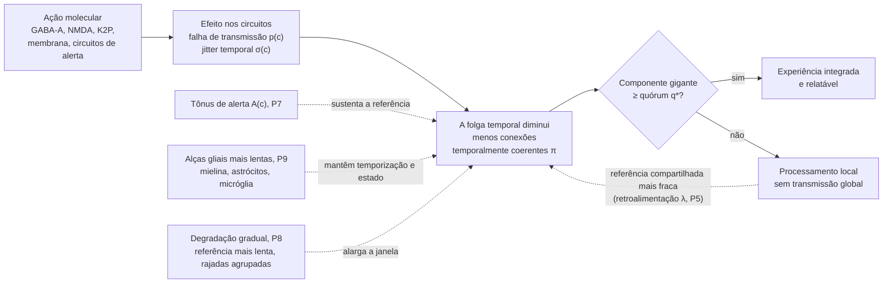
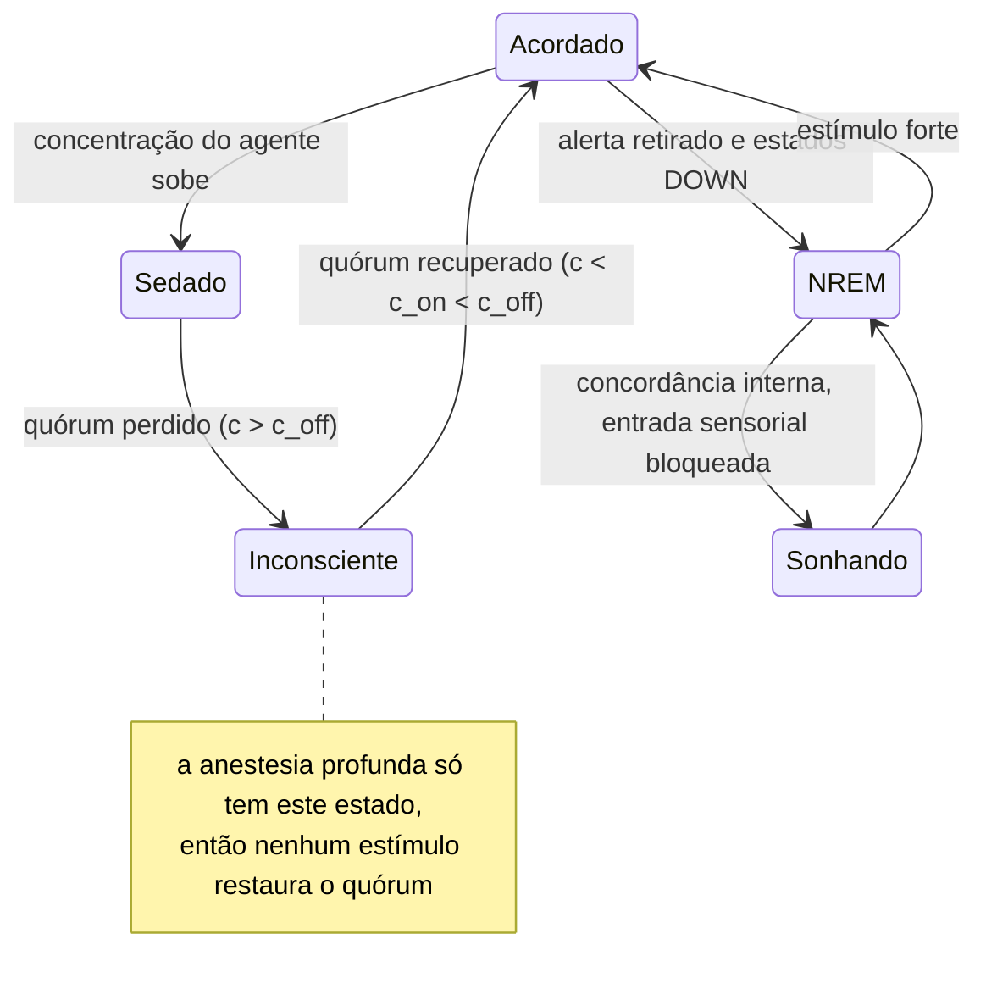

# A Hipótese do Consenso Perceptivo Distribuído na Anestesia Geral

**Um modelo de rede com restrição temporal para a inconsciência induzida por anestésicos**

> **Tradução para o português brasileiro, preparada para revisão.** A versão de referência é a em inglês ([`white_paper_anesthesia_consensus.md`](white_paper_anesthesia_consensus.md)); em caso de divergência, prevalece o texto em inglês. Os títulos das obras citadas permanecem no idioma original, como é praxe acadêmica. As seções de resultados e os apêndices B e C serão atualizados após a execução final das simulações.

| | |
|---|---|
| **Autores** | Gabriel Santos de Oliveira1 ([ORCID 0009-0003-9528-9731](https://orcid.org/0009-0003-9528-9731); [Currículo Lattes](https://lattes.cnpq.br/2102695116731989)); Callina Gertrudes Ferreira2 ([ORCID 0009-0002-8512-213X](https://orcid.org/0009-0002-8512-213X); [Currículo Lattes](https://lattes.cnpq.br/2112739936897542)) |
| **Afiliações** | 1 Pesquisador independente, Rio de Janeiro, Brasil. 2 Universidade Veiga de Almeida (UVA), Rio de Janeiro, Brasil |
| **Data** | 17 de outubro de 2026 |
| **Versão** | 1.0.0 |
| **Tipo de artigo** | Artigo de hipótese e teoria (sem revisão por pares) |
| **Licença** | Texto e figuras: [CC BY 4.0](LICENSE-CC-BY-4.0). Código: [Apache License 2.0](LICENSE) |
| **Palavras-chave** | anestesia geral; consciência; sistema talamocortical; percolação; consenso distribuído; sincronia neural; inércia neural; índice de complexidade perturbacional |

---

## Resumo

Os anestésicos gerais são quimicamente diversos, atuam sobre muitos alvos moleculares e, ainda assim, produzem de forma confiável um mesmo estado final: a perda reversível da consciência. Propomos a **hipótese do Consenso Perceptivo Distribuído (CPD)**, que trata a experiência consciente como resultado de um processo de concordância, repetido continuamente e sujeito a restrições temporais, entre populações corticais e talâmicas distribuídas. Motivados por resultados da computação distribuída, que mostram que a concordância determinística entre processos sujeitos a falhas exige limites para os atrasos de comunicação, argumentamos que essa concordância só é possível quando os sinais entre áreas chegam dentro de uma janela de integração em torno de um ritmo compartilhado. Os anestésicos, qualquer que seja a via molecular, degradam essa condição de duas maneiras: provocam falhas de transmissão em uma fração das conexões funcionais e aumentam a variabilidade (*jitter*) temporal dos sinais nas demais. Formalizamos o cérebro como um grafo cujo subgrafo *temporalmente coerente* sofre uma transição de percolação à medida que a concentração no sítio efetor aumenta. A perda da consciência corresponde à perda de um componente gigante capaz de atingir o quórum. Acrescentar um único pressuposto de retroalimentação, a de que a referência de fase global fornecida pelo núcleo talamocortical depende ela própria do tamanho desse componente, torna a transição biestável no modelo de percolação e, com sua intensidade calibrada por uma razão medida, produz histerese entre indução e despertar, um mecanismo candidato para a inércia neural que o modelo de osciladores de fase não reproduziu. A hipótese é agnóstica quanto ao mecanismo molecular e pretende complementar, e não substituir, a farmacologia de receptores e as teorias de rede existentes, como a da desvinculação cognitiva (*cognitive unbinding*) e a teoria da informação integrada. Delimitamos o escopo, distinguimos achados estabelecidos de hipóteses e de analogias, respondemos a oito objeções principais e listamos previsões falseáveis, juntamente com um protocolo de análise para testá-las.

---

## 1. Introdução e escopo

### 1.1 O problema

Mais de 170 anos após a primeira demonstração pública da anestesia com éter, não há consenso sobre como os anestésicos produzem a inconsciência (Franks, 2008; Alkire et al., 2008; Hemmings et al., 2019). A dificuldade está em que os agentes não têm relação estrutural entre si (do gás monoatômico xenônio ao alquilfenol propofol), atuam sobre muitos alvos moleculares diferentes e produzem assinaturas eletroencefalográficas (EEG) distintas, mas convergem para um desfecho comportamental semelhante. Uma explicação satisfatória precisa, portanto, mostrar como *causas moleculares heterogêneas* produzem um *efeito comum no nível do sistema*. A busca por um único mecanismo molecular, que dominou a era das teorias lipídicas, não teve êxito, porque os fatos moleculares são genuinamente diversos (Seção 2.1). Por isso, a CPD busca a unificação um nível acima: muitas vias moleculares convergindo para uma única forma de falha de rede, assim como muitas doenças diferentes convergem para a insuficiência cardíaca.

### 1.2 O que este artigo afirma e o que não afirma

Esta é uma **hipótese**, não um teorema. Ela não tem demonstração formal, e seu valor está em saber se suas previsões resistem ao teste experimental. Para evitar ambiguidades, classificamos cada afirmação em um de três tipos:

- **[E] Estabelecido:** apoiado por evidência experimental replicada, com citação.
- **[H] Hipótese:** uma afirmação nova ou controversa deste artigo, formulada de modo a poder ser falseada.
- **[A] Analogia:** um conceito da computação usado como metáfora explicativa. As analogias motivam hipóteses, mas não são, elas próprias, afirmações sobre a biologia.

**O que é novo e o que é aproveitado.** Vários ingredientes da CPD não são novos: a comunicação por coerência (Fries, 2005, 2015), o processamento recorrente (Lamme & Roelfsema, 2000; Lamme, 2006), a desconexão funcional como via final comum da anestesia (Hudetz & Mashour, 2016), os modelos de percolação da anestesia e da percepção consciente (Zhou et al., 2015; Arese Lucini et al., 2019) e a histerese produzida por retroalimentação (Kim et al., 2018); a Seção 2.3 dá o crédito a cada um. As contribuições deste artigo são:

1. Um único critério temporal em que a falha de transmissão e a variabilidade temporal entre áreas se combinam em uma única probabilidade de que uma conexão seja utilizável, de modo que agentes que atuam por vias moleculares diferentes entram em um mesmo modelo.
2. A proposta [H] de que uma das grandezas que os anestésicos degradam é a *variabilidade* da temporização dos sinais entre áreas em relação a um ritmo compartilhado, e não sua média ou a coerência dos ritmos em curso (P4b, Seção 6.8), com previsões que a testam diretamente (Seção 7, previsões 1, 3 e 8).
3. Um limiar de quórum calculado a partir da distribuição de graus de uma rede e comparado com a medição na conectividade de um nematoide, de um inseto e de um ser humano, incluindo a conectividade dirigida e um modelo nulo com conexões embaralhadas (Apêndices B e C).
4. Previsões falseáveis, um protocolo de análise e um simulador aberto e testado em que cada parâmetro é identificado como medido, calibrado ou livre.

### 1.3 Escopo e definições

A anestesia geral compreende vários componentes separáveis: inconsciência, amnésia, analgesia e imobilidade, com estabilidade dos sistemas autonômico, cardiovascular, respiratório e termorregulador (Brown et al., 2010). **Esta hipótese trata apenas da inconsciência.** A imobilidade, base do padrão de concentração alveolar mínima (CAM; Eger et al., 1965), não depende do prosencéfalo (Rampil et al., 1993), é mediada em grande parte pela medula espinal (Antognini & Schwartz, 1993; Rampil, 1994) e está fora do escopo. A memória e a responsividade podem ser prejudicadas separadamente (Veselis et al., 1997); a amnésia é discutida apenas quando diz respeito à hipótese.

Seguimos as distinções de Sanders et al. (2012):

- **Responsividade:** uma resposta comportamental a um comando ou estímulo. Em humanos, o desfecho operacional é a *perda de responsividade* (LOR, do inglês *loss of responsiveness*); em roedores, é a *perda do reflexo de endireitamento* (LORR).
- **Consciência conectada:** experiência que inclui a percepção do ambiente.
- **Consciência desconectada:** experiência sem percepção do ambiente, como no sonho.
- **Inconsciência:** ausência de qualquer experiência.

Portanto, irresponsividade não equivale a inconsciência, e a hipótese precisa dar conta de ambas.

Outras causas de inconsciência, incluindo o desmaio (síncope), as crises epilépticas, a concussão e o coma, estão fora do escopo deste artigo. Uma delas sugere uma extensão, formulada aqui como hipótese e não testada [H]. Na síncope, a perda global do fluxo sanguíneo cerebral pode abolir a consciência em apenas cerca de 7 s após uma parada circulatória súbita e completa (Wieling et al., 2009). Segundo a CPD, neurônios privados de oxigênio e glicose deixariam de transmitir, o que é a mesma falha por omissão de P4, um sinal que nunca chega, alcançada por outra via; a hipótese prevê, portanto, que qualquer causa que tire conexões suficientes da coerência temporal abole a integração no mesmo tipo de limiar: uma perda abrupta do componente gigante, e não um declínio gradual (Seção 7, previsão 1).

### 1.4 Terminologia

Cada termo abaixo é usado neste sentido em todo o texto. Palavras emprestadas da computação (por exemplo barramento, relógio, *round-robin*, quórum, serviço, disjuntor) aparecem apenas em trechos marcados com [A], como analogias; cada uma é associada a um destes termos definidos no Apêndice A e nunca é usada para formular uma afirmação. Há duas exceções, nomes dados a partes da hipótese e definidos aqui: *quórum* (P3) e *degradação gradual* (P8).

| Termo | Definição neste artigo |
|---|---|
| População neural | Um grupo de neurônios tratado como uma unidade: uma região cerebral no conectoma humano, um único neurônio nos conectomas de *C. elegans* e de *Drosophila*. É um nó da rede. A rede de *C. elegans* (448 nós, contagem nossa a partir da lista de arestas do OpenWorm) também contém os músculos e outras células com que seus 302 neurônios fazem sinapse, porque é o diagrama completo de conexões do hermafrodita (Cook et al., 2019). |
| Conexão funcional | Uma via dirigida pela qual uma população influencia outra: uma sinapse ou um conjunto de sinapses entre neurônios, ou um feixe de fibras de substância branca entre regiões. É uma aresta da rede. Um feixe de fibras não é uma única sinapse: a falha sináptica enfraquece o feixe em vez de removê-lo (Seção 9). |
| Falha de transmissão | Um sinal enviado por uma conexão que não produz seu efeito no alvo, por exemplo porque o neurotransmissor não é liberado. Sua probabilidade é $p$. |
| *Jitter* temporal | A variabilidade, de um ensaio para outro (*trial-to-trial*), do instante de chegada de um sinal, medida como desvio-padrão $\sigma$ em milissegundos. Um atraso constante não é *jitter*. |
| Referência de fase | Um ritmo compartilhado entre populações, em relação ao qual os instantes de chegada são avaliados; o postulado P5 o atribui ao sistema talamocortical. |
| Janela de integração | O intervalo $W$ em torno da referência de fase dentro do qual um sinal que chega pode contribuir para o ciclo de integração em curso. |
| Ciclo de integração | Uma repetição do processo pelo qual as populações convergem para um estado compartilhado (P1), ritmada pela referência. |
| Conexão ocupada | O termo padrão da teoria de percolação para uma conexão que permanece na rede. Aqui uma conexão está ocupada quando transmite e seu sinal chega dentro da janela de integração, o que o artigo também descreve como *temporalmente coerente*. A probabilidade disso é a probabilidade de ocupação $\pi$. Esse sentido temporal de "coerente" é diferente da *coerência espectral*, a semelhança entre dois sinais de EEG em uma dada frequência, que o artigo sempre nomeia por extenso. |
| Folga temporal | A margem que resta na janela de integração depois do erro temporal: positiva quando os sinais chegam dentro da janela, negativa quando caem fora dela. Propõe-se que a perda da consciência ocorra quando a folga se torna negativa em conexões demais. |
| Componente gigante | O maior conjunto de populações ligadas entre si por conexões temporalmente coerentes (o termo padrão da teoria de percolação, aqui aplicado à rede de conexões temporalmente coerentes). Sua fração em relação a todas as populações é $S$. |
| Quórum | A fração mínima $q^*$ de populações que o componente gigante precisa conter para que surja um conteúdo integrado e relatável (P3). |
| Concentração no sítio efetor | A concentração de um agente em seu local de ação; nos modelos, é expressa em relação ao valor de meio efeito do agente (CE50), de modo que 1 significa metade do efeito máximo sobre os circuitos. |
| Perda e recuperação da responsividade | Os desfechos comportamentais da indução e do despertar; nos modelos, a perda e a recuperação do quórum, nas concentrações $c_{\text{off}}$ e $c_{\text{on}}$. |
| Inércia neural | Recuperação em concentração menor do que a da perda, $c_{\text{on}} < c_{\text{off}}$, não explicada pela distribuição do fármaco no organismo. |
| Despertar | Neste texto, a recuperação da consciência ao fim da anestesia (*emergence*); para o sono, usa-se *acordar*. Em *limiar de despertar* e *microdespertar*, o termo se refere ao sono (*arousal*). |
| Tônus de alerta | A atividade de sistemas cerebrais promotores da vigília, como os núcleos orexinérgicos e do tronco encefálico, que sustenta a referência de fase independentemente da coerência cortical (P7). |
| Estado DOWN (*down-state*) | Um período de quase silêncio em uma população cortical durante a oscilação lenta do sono NREM. |
| Transmissão global (*broadcast*) | A propagação da atividade das populações que recebem uma entrada para o restante da rede. |
| Arrastamento (*entrainment*) | O travamento de fase de uma população a um ritmo externo, como um estímulo periódico. |
| Glia | Células não neuronais do sistema nervoso. Três tipos aparecem aqui: os oligodendrócitos, que formam a mielina; os astrócitos, que regulam o ambiente das sinapses; e a micróglia, as células imunes residentes do cérebro. |
| Controle em cascata | O termo da engenharia de controle para alças externas mais lentas que ajustam as condições em que uma alça interna mais rápida ocorre, cada uma em sua própria escala de tempo (P9). |
| Hub | Um nó com muito mais conexões do que o nó médio. |
| Parâmetro de ordem | Um único número que resume o estado coletivo de um sistema e muda abruptamente em uma transição; aqui, $S$. |
| Histerese | Dependência de um estado em relação ao sentido da mudança: aqui, o quórum é perdido em uma concentração maior do que aquela em que retorna. |
| Biestabilidade | A existência de dois estados estáveis nas mesmas condições; qual deles o sistema ocupa depende de onde ele começou. |
| Desaceleração crítica | À medida que um sistema se aproxima de uma transição, ele se recupera mais lentamente de pequenas perturbações, o que aparece como aumento da variância e da autocorrelação de suas flutuações. |
| Travamento de fase (*phase locking*) | Uma diferença constante, ao longo do tempo, entre as fases de dois ritmos; o atraso de fase é essa diferença. |
| Ritmos cerebrais | Oscilações nomeadas pela frequência: oscilação lenta (abaixo de 1 Hz), delta (1 a 4 Hz), alfa (8 a 12 Hz), beta (13 a 30 Hz) e gama (30 a 90 Hz). |
| Surto-supressão | Um padrão de EEG da anestesia profunda em que surtos de atividade se alternam com períodos de quase silêncio. |
| Estágios do sono | O sono sem movimentos oculares rápidos (NREM), dividido nos estágios N1 a N3, de profundidade crescente, sendo o N3 dominado por ondas lentas; e o sono com movimentos oculares rápidos (REM), no qual sonhos vívidos são relatados com mais frequência. |
| Complexo K | Uma onda lenta grande e isolada do sono NREM, que se mostrou um estado DOWN cortical isolado (Cash et al., 2009). |
| Limiar de despertar; microdespertar | O estímulo mais fraco que acorda quem dorme; um microdespertar é um despertar breve, de segundos. |
| Parâmetros calibrados e livres | Um parâmetro calibrado é ajustado a uma medição publicada e depois mantido fixo; um parâmetro livre não tem valor medido e é variado em uma faixa na análise de sensibilidade. |
| Teste e verificação de consistência | Um teste é uma previsão em que o modelo poderia falhar; uma verificação de consistência decorre das equações do modelo e só confirma que o código as implementa. |
| Semente; intervalo de confiança | Uma semente é o valor inicial do gerador de números aleatórios, de modo que sementes diferentes produzem realizações independentes de uma rede; cada contagem de sementes é relatada com seu intervalo de confiança de 95%, a faixa que provavelmente contém a fração verdadeira. |
| Modelo nulo | Uma cópia aleatorizada dos dados que mantém algumas de suas propriedades, aqui o número de conexões de cada nó, usada para testar se um resultado depende da conectividade real. |
| Componente fortemente conexo | Em uma rede cujas conexões são orientadas, um conjunto de nós em que cada um alcança todos os outros pelas conexões dirigidas. |

| Símbolo | Significado | Unidade |
|---|---|---|
| $c$ | Concentração no sítio efetor em relação à CE50 | adimensional |
| $p(c)$ | Probabilidade de falha de transmissão | adimensional |
| $\sigma_0(c)$, $\sigma_{\text{eff}}$ | *Jitter* temporal induzido pelo agente e *jitter* efetivo | ms |
| $W$ | Janela de integração | ms |
| $\pi$, $\pi_c$, $\pi_q$ | Probabilidade de ocupação; seus limiares de surgimento e de quórum | adimensional |
| $S$ | Fração de populações no componente gigante | adimensional |
| $q^*$ | Fração de quórum | adimensional |
| $\lambda$ | Intensidade da retroalimentação da referência | ms (modelo de percolação), adimensional (modelo de osciladores) |
| $\sigma_b$ | *Jitter* temporal basal, independente do agente | ms |
| $h(c)$ | Efeito fracionário do agente, uma função de Hill da concentração | adimensional |
| $a$ | Fração do efeito do agente que atua sobre os circuitos de alerta | adimensional |
| $A_0$, $A(c)$ | Fração da referência sustentada pelo alerta, na vigília e em função da concentração | adimensional |
| $d$ | Fração dos ciclos de integração em estados DOWN | adimensional |
| $f$ | Frequência do ritmo de referência | Hz |
| $\mu$ | Integridade da mielina (1 = intacta) | adimensional |
| $\gamma$ | Aumento do *jitter* basal quando a mielina é totalmente perdida | adimensional |
| $g$ | Intensidade da alça da micróglia (0 após a depleção da micróglia) | adimensional |
| $s_a$ | Fração dos estados DOWN que depende da sinalização dos astrócitos | adimensional |
| $\langle k \rangle$, $\langle k^2 \rangle$ | Grau médio e média do quadrado do grau da rede | conexões |

| Sigla | Significado |
|---|---|
| CPD | Consenso Perceptivo Distribuído |
| EEG, MEG, ECoG | Eletroencefalografia, magnetoencefalografia e eletrocorticografia: registros da atividade cerebral no couro cabeludo, por seu campo magnético e na superfície do córtex |
| RMf | Ressonância magnética funcional |
| EMT | Estimulação magnética transcraniana |
| PCI | Índice de complexidade perturbacional (Seção 8.1) |
| LOR, LORR | Perda de responsividade; perda do reflexo de endireitamento (Seção 1.3) |
| CAM | Concentração alveolar mínima, a concentração inalada que impede o movimento diante de um estímulo doloroso em metade dos indivíduos |
| GABA-A, NMDA | Receptores do transmissor inibitório GABA e do glutamato, o principal transmissor excitatório |
| P2Y12 | Um receptor da micróglia para o nucleotídeo ADP |
| VLPO; NRT | Núcleo pré-óptico ventrolateral, um núcleo do hipotálamo que promove o sono; núcleo reticular talâmico |

---

## 2. Fundamentação

### 2.1 Mecanismos moleculares [E]

A correlação de Meyer-Overton, que relaciona a potência anestésica à solubilidade em lipídios (Meyer, 1899; Overton, 1901), motivou um século de teorias lipídicas. Vários achados mostram que a solubilidade em lipídios, por si só, é insuficiente:

1. Os anestésicos inibem uma proteína sem lipídios, a luciferase de vaga-lume, com potências que coincidem com a reta de Meyer-Overton (Franks & Lieb, 1984).
2. Isômeros ópticos do isoflurano, que têm solubilidade lipídica idêntica, diferem em seus efeitos sobre canais iônicos neuronais (Franks & Lieb, 1991).
3. Alguns compostos halogenados lipofílicos violam a correlação (Koblin et al., 1994); compostos desse tipo foram depois chamados de *não imobilizadores*.
4. Uma única mutação pontual (N265M) na subunidade β3 do receptor GABA-A reduz fortemente os efeitos *in vivo* do propofol e do etomidato em camundongos (Jurd et al., 2003).
5. O xenônio atua principalmente como antagonista do receptor NMDA (Franks et al., 1998).

Mecanismos mediados pela membrana continuam biologicamente plausíveis como vias que *contribuem*. Entre eles estão as alterações no perfil de pressão lateral da bicamada lipídica, que modificam os equilíbrios conformacionais dos canais nela inseridos (Cantor, 1997), e a desorganização de domínios lipídicos ordenados, que ativa os canais de potássio TREK-1 por meio da fosfolipase D2 (Pavel et al., 2020). A visão atual é que os anestésicos atuam sobre múltiplos alvos, principalmente receptores GABA-A, receptores NMDA e canais de potássio com dois domínios de poro (K2P), com perfis específicos para cada agente (Rudolph & Antkowiak, 2004; Hemmings et al., 2019).

As vias conhecidas diferem quanto ao mecanismo. A maioria altera as correntes iônicas de modo a reduzir a transmissão excitatória ou a excitabilidade neuronal, embora a cetamina aumente a atividade gama cortical (Akeju et al., 2016). A coluna "Tipo de falha na CPD" é a hipótese de P4 [H], e não uma classificação estabelecida:

| Via molecular | Agentes com evidência | Efeito sobre o fluxo iônico | Tipo de falha na CPD (P4) [H] | Fontes |
|---|---|---|---|---|
| Potencialização do receptor GABA-A (prolongando a abertura do canal) | Propofol, etomidato, barbitúricos, isoflurano, sevoflurano | Mais corrente inibitória de Cl⁻ | Falha de transmissão | Mihic et al. (1997); Jurd et al. (2003) |
| Bloqueio do receptor NMDA: bloqueio do canal aberto (cetamina) ou competição no sítio do coagonista glicina (xenônio) | Cetamina, xenônio, óxido nitroso | Menos corrente excitatória de Na⁺ e Ca²⁺ | Variabilidade temporal e falha de transmissão | Franks et al. (1998); Jevtović-Todorović et al. (1998); Dickinson et al. (2007) |
| Ativação de canais de K⁺ com dois domínios de poro (TREK-1, TASK) | Agentes voláteis (isoflurano, halotano, clorofórmio, éter dietílico); xenônio, óxido nitroso, ciclopropano | Mais vazamento de K⁺, hiperpolarização | Falha de transmissão | Patel et al. (1999); Gruss et al. (2004); Heurteaux et al. (2004) |
| Inibição de canais HCN | Agentes voláteis (conforme a subunidade); propofol | Menos corrente catiônica de marca-passo | Ritmo e temporização alterados | Chen et al. (2005); Ying et al. (2006) |
| Inibição de canais de Na⁺ pré-sinápticos, reduzindo a entrada de Ca²⁺ e a liberação de vesículas | Isoflurano | Menos neurotransmissor liberado por potencial de ação | Falha de transmissão | Herold & Hemmings (2012), para os canais de Na⁺; Baumgart et al. (2015), para a redução da entrada de Ca²⁺ e da liberação |
| Agonismo dos receptores α2-adrenérgicos, atuando pela via endógena do sono | Dexmedetomidina | Indireto: inibição dos neurônios do *locus coeruleus* | Supressão do alerta (P7) | Nelson et al. (2003) |
| Desorganização de domínios lipídicos da membrana, liberando a PLD2, que ativa o TREK-1 | Clorofórmio, isoflurano | Indireto: mais corrente de K⁺ | Falha de transmissão | Pavel et al. (2020) |
| Complexo I mitocondrial (um fator de sensibilidade, e não um canal iônico) | Agentes voláteis | Não é um efeito sobre canais; a disfunção do complexo I aumenta a sensibilidade | Modula a suscetibilidade | Kayser et al. (1999); Morgan et al. (2002) |

Os receptores de glicina, abundantes na medula espinal, também são potencializados por agentes voláteis (Mihic et al., 1997) e considera-se que contribuem para a imobilidade, que está fora do escopo deste artigo (Seção 1.3).

Duas outras propostas não foram confirmadas e são mencionadas apenas a título de completude. Foram relatadas a ligação de anestésicos à tubulina e alterações na estabilidade dos microtúbulos (Emerson et al., 2013), e um fármaco estabilizador de microtúbulos retardou a perda do reflexo de endireitamento induzida por isoflurano em ratos (Khan et al., 2024), mas esses achados não foram replicados de forma independente. Um único estudo relatou que isótopos de xenônio com spin nuclear são menos potentes em camundongos do que isótopos sem spin (Li et al., 2018); não se encontrou replicação independente.

**Implicação para este artigo:** a hipótese CPD não depende de qual mecanismo molecular está em ação. Ela exige apenas que, no nível dos circuitos, os agentes aumentem a falha de transmissão, o *jitter* temporal ou ambos.

### 2.2 Achados no nível dos sistemas [E]

- **Envolvimento talamocortical.** Dois anestésicos voláteis suprimiram a atividade regional do tálamo e da formação reticular mesencefálica em voluntários humanos (Alkire et al., 2000). Nicotina microinjetada no tálamo medial central reverte a perda do reflexo de endireitamento induzida por sevoflurano em ratos (Alkire et al., 2007). A estimulação talâmica pode restaurar o alerta em macacos anestesiados (Redinbaugh et al., 2020).
- **Colapso da comunicação cortical.** Propofol, sevoflurano e cetamina perturbam a conectividade de retroalimentação frontoparietal (U. Lee et al., 2013). No início da inconsciência induzida por propofol, surge uma oscilação lenta, e os disparos neuronais ficam confinados a breves janelas de fase, assíncronas ao longo do córtex, fragmentando as redes corticais (Lewis et al., 2012). Revisões de estudos de redes em larga escala concluem que um correlato comum da irresponsividade induzida por anestésicos é a depressão ou a desconexão funcional das redes frontoparietais laterais (Hudetz & Mashour, 2016), junto com menor complexidade e um repertório menor de estados cerebrais (Mashour & Hudetz, 2018).
- **Assinaturas de EEG específicas de cada agente.** O propofol aumenta a potência beta durante a sedação e, na perda de responsividade, produz alfa frontal coerente (8 a 12 Hz) juntamente com oscilações lentas e delta (0,1 a 4 Hz) (Purdon et al., 2013, 2015; Ching et al., 2010). A cetamina aumenta a potência gama e não produz o padrão alfa característico do propofol (Akeju et al., 2016).
- **Desacoplamento celular.** Em camundongos, os anestésicos desacoplam os dendritos apicais dos neurônios piramidais da camada 5 de seus corpos celulares, o que interromperia a integração da retroalimentação entre áreas corticais se essa retroalimentação chegar principalmente aos dendritos apicais (Suzuki & Larkum, 2020).
- **Perda de coordenação, e não de atividade, em várias espécies.** Em *Caenorhabditis elegans*, o isoflurano mantém ativos os neurônios da cabeça, mas faz colapsar as correlações entre eles (Awal et al., 2020). Em *Drosophila*, o isoflurano reduz a potência e a coerência sincronizadas ao estímulo no cérebro central, enquanto as aumenta no dobro da frequência do estímulo nos lobos ópticos para alguns estímulos (Cohen et al., 2016), prejudica a retroalimentação de baixa frequência mantendo intacta a conectividade de alimentação direta (*feedforward*) de alta frequência (Cohen et al., 2018) e fragmenta a estrutura integrada da atividade cerebral em agrupamentos separados (Leung et al., 2021).
- **Perda da assinatura individual.** Sob sevoflurano e propofol, a conectividade funcional torna-se menos distintiva entre indivíduos, sobretudo no córtex de associação transmodal, e a conectividade de humanos anestesiados fica mais parecida com a do macaco (Luppi et al., 2025).
- **Complexidade.** O índice de complexidade perturbacional (PCI) é alto na vigília e baixo durante a inconsciência induzida por propofol e xenônio. Ele permanece alto sob cetamina, em consonância com os relatos de sonhos de voluntários saudáveis ao despertar (Casali et al., 2013; Sarasso et al., 2015).
- **Inércia neural.** Em animais geneticamente diversos, a concentração em que a consciência retorna é menor do que aquela em que é perdida, mesmo com os fatores farmacocinéticos controlados. Essa histerese é chamada de inércia neural; foi demonstrada em camundongos e em *Drosophila* (Friedman et al., 2010) e depende de genes de excitabilidade que atuam independentemente da sensibilidade à indução (Joiner et al., 2013; ver também Kelz et al., 2008). Seu tamanho medido varia conforme o agente: a razão entre as concentrações de indução e de despertar é de cerca de 1,08 para o isoflurano e 2,85 para o halotano em camundongos (Friedman et al., 2010), e, em humanos, de cerca de 1,07 para as concentrações de propofol no sítio efetor (1,5 e 1,4 µg/mL na perda e na recuperação da responsividade comportamental; Warnaby et al., 2017, que não encontraram histerese sistemática nesses valores e identificaram, em vez disso, a inércia na saturação das ondas lentas), 1,11 (Iwakiri et al., 2005, que descrevem as concentrações como semelhantes) e cerca de 1,63 para concentrações de propofol medidas (Sepúlveda et al., 2018, que observam que a diferença pode refletir um viés nas concentrações estimadas no sítio efetor, e não inércia neural). A recuperação passa por uma sequência de estados de atividade discretos e metaestáveis (Hudson et al., 2014).
- **Células gliais.** As células gliais respondem aos anestésicos, e manipulá-las altera a indução e o despertar em camundongos. Os anestésicos suprimem a sinalização de cálcio dos astrócitos no córtex de camundongos acordados em doses que não alteram as respostas neuronais à estimulação das vibrissas (Thrane et al., 2012), e os agentes inalatórios prejudicam de forma reversível os prolongamentos finos dos astrócitos do córtex somatossensorial (Zhou et al., 2025). Ativar astrócitos do prosencéfalo basal acelera a indução com isoflurano e retarda a recuperação (Lin et al., 2023), enquanto ativar astrócitos do núcleo parabraquial ou do tálamo paraventricular acelera o despertar (Liu et al., 2023; Zhao et al., 2024), de modo que o efeito depende da região. Depletar a micróglia com o fármaco PLX5622 reduz a sensibilidade a vários anestésicos e abrevia seu efeito (Cao et al., 2023; He et al., 2023), mas o mesmo grupo verificou depois que o PLX5622 também ativa um receptor hepático que acelera a depuração dos anestésicos e que depletar a micróglia geneticamente não antecipou o despertar (Cao et al., 2026). A evidência mais sólida é que a perda genética do receptor P2Y12 da micróglia acelera a recuperação (Cao et al., 2023). A mielina determina a temporização da condução: em circuitos do tronco encefálico auditivo, a geometria dos axônios mielinizados é ajustada para determinar o momento de chegada dos potenciais de ação (Ford et al., 2015), e em camundongos um déficit sutil de mielina dispersa os tempos de condução e reduz a sincronia da atividade do córtex motor (Kato et al., 2020). Não encontramos estudos sobre a necessidade de anestésico em doenças desmielinizantes humanas, apenas relatos de caso. Há dois estudos em animais: camundongos desmielinizados demoraram mais para se recuperar do isoflurano, com efeitos que dependiam da região desmielinizada (Wang et al., 2024), e camundongos desmielinizados mais velhos demoraram mais para ser induzidos em concentração fixa, em grupos pequenos (Tot et al., 2024).

### 2.3 Modelos anteriores e a posição da CPD

A CPD se apoia em dois grupos de trabalhos anteriores. O primeiro é conceitual:

| Referencial | Afirmação central | Relação com a CPD |
|---|---|---|
| Comunicação por coerência (Fries, 2005, 2015) | Grupos neuronais oscilantes só se comunicam de forma eficaz quando suas janelas de entrada e de saída estão abertas ao mesmo tempo | P2 é essa condição; a CPD acrescenta a afirmação de que os anestésicos atuam tornando variável a temporização entre áreas em relação ao ritmo compartilhado, e pergunta quantas conexões precisam cumprir a condição para que haja integração em toda a rede |
| Ciclos perceptivos (VanRullen & Koch, 2003; VanRullen, 2016) | A percepção ocorre em ciclos discretos ligados às oscilações cerebrais; as evidências atuais apontam para vários ritmos, e não um só | P1 adota ciclos discretos; a CPD acrescenta uma condição temporal a cada troca, um quórum no nível da rede e a proposta de que os anestésicos agem rompendo a temporização dos ciclos |
| Processamento recorrente (Lamme & Roelfsema, 2000; Lamme, 2006) | Uma varredura apenas *feedforward* provavelmente não basta para a percepção consciente; é necessário processamento recorrente entre áreas | P1 adota ciclos recorrentes; a CPD acrescenta uma condição temporal a cada troca e um quórum no nível da rede |
| Desvinculação cognitiva (*cognitive unbinding*; Mashour, 2013) | Os anestésicos perturbam a síntese de informação entre redes corticais | A CPD propõe um motivo específico para a falha da síntese: a violação de uma condição de atraso limitado |
| Teoria da informação integrada (Tononi et al., 2016) | A consciência corresponde à informação integrada (Φ) | O parâmetro de ordem da CPD mede a coerência temporal no nível da rede; não é Φ nem pretende aproximá-lo, e a CPD não faz afirmações sobre a natureza da experiência |
| Espaço de trabalho neuronal global (Dehaene & Changeux, 2011) | O acesso consciente exige uma "ignição" não linear e a transmissão global | O quórum da CPD é um critério estático e topológico que pode ser comparado com a ignição dinâmica do espaço de trabalho, mas não é equivalente a ela; a CPD acrescenta uma restrição temporal |
| Interruptor talamocortical (Alkire et al., 2000) | O tálamo controla o acesso ao estado consciente (*gating*) | A CPD atribui ao núcleo talamocortical o papel de fornecer uma referência de fase compartilhada, e não o de um interruptor liga-desliga |
| Transição de fase anestésica em campo médio (Steyn-Ross et al., 1999; Bojak & Liley, 2005) | A ação anestésica sobre a cinética sináptica inibitória leva um modelo de campo médio do córtex por regimes estacionários distintos, uma transição de fase, e explica as alterações anestésicas do EEG | A CPD também trata a perda da consciência como uma transição, mas em uma rede de conexões discretas cuja coerência temporal percola; ela não modela o espectro do EEG, o que esses modelos fazem |
| A oscilação lenta como estado cortical padrão (Sanchez-Vives et al., 2017) | As oscilações lentas são a atividade padrão, de baixa complexidade, da rede cortical, e sair delas é necessário para recuperar a complexidade dos estados conscientes | Compatível com P6 e P7: na CPD, a oscilação lenta é o que a rede faz depois que o quórum é perdido; a CPD acrescenta um critério para quando isso acontece |
| Teoria da integração dendrítica (Aru et al., 2020) | As células piramidais da camada 5 controlam, em seus dendritos, a integração dos sinais ascendentes (*bottom-up*) e descendentes (*top-down*); a anestesia impede essa integração | Compatível: uma via celular pela qual os sinais de retroalimentação poderiam deixar de contar, um mecanismo candidato para as falhas por omissão de P4 |

O segundo grupo é formado por modelos quantitativos, vários dos quais já contêm elementos da CPD. **Esses trabalhos precedem o presente e devem ser creditados:**

| Modelo anterior | O que estabeleceu | O que a CPD acrescenta |
|---|---|---|
| Breskin et al. (2006) | Em culturas de neurônios vivos, enfraquecer quimicamente as sinapses faz o componente conexo gigante se desintegrar em uma transição de percolação | A CPD aplica a percolação a conectomas inteiros e à temporização, além da transmissão |
| Arese Lucini et al. (2019) | A transição da percepção consciente para a subliminar em redes funcionais humanas é descrita como percolação de *k-core*: as camadas periféricas da rede consciente são inativadas enquanto o núcleo interno persiste | A CPD aplica a percolação à perda da consciência induzida por anestésicos e define a ocupação por um critério temporal, e não pela ativação funcional |
| Zhou et al. (2015) | Um modelo de percolação da transmissão talamocortical e corticocortical, com uma única probabilidade de transmissão *p*, reproduz características do EEG na anestesia; a transferência de informação muda bruscamente perto de um *p* crítico | A probabilidade de ocupação deriva de um critério temporal que combina falha de transmissão e *jitter* temporal, de modo que agentes que atuam por qualquer das duas vias entram no mesmo modelo |
| Su et al. (2020) | Mediu um ciclo de histerese entre indução e recuperação e o explicou por percolação em redes multicamadas autossimilares | A histerese produzida por retroalimentação foi mostrada por Kim et al. (2018); a CPD atribui a retroalimentação à referência de fase compartilhada e calibra sua intensidade quantitativamente pelas razões de inércia publicadas |
| Kim et al. (2016) | As condições para a sincronização explosiva são satisfeitas em redes de EEG humanas logo após a perda de consciência induzida por anestésicos | A CPD testa uma transição de percolação, e não a sincronização explosiva, em conectomas empíricos de três espécies, com um único conjunto de parâmetros |
| Kim et al. (2018) | Osciladores de Stuart-Landau com retroalimentação adaptativa em um conectoma de 78 regiões reproduzem a histerese da conectividade funcional observada no EEG sob cetamina e sevoflurano | O mecanismo de retroalimentação da CPD (P5) é muito próximo; a contribuição da CPD é sua interpretação como referência temporal e sua ligação com a teoria do consenso |
| Moon et al. (2015); H. Lee et al. (2013) | A topologia da rede determina o avanço e o atraso de fase entre os hubs e a periferia, e o sentido anteroposterior do fluxo de informação desaparece sob sevoflurano; a estrutura de hubs das redes de EEG se reconfigura após a inconsciência induzida por propofol | A perturbação dos hubs sob anestesia já foi relatada; a CPD deriva a vulnerabilidade dos hubs da percolação em redes de cauda pesada (Albert et al., 2000) e prevê um deslocamento maior da concentração de perda após lesões de hubs do que após lesões aleatórias (previsão 6) |
| Proekt & Hudson (2018); Hudson et al. (2014) | A recuperação da consciência passa por estados metaestáveis discretos (Hudson et al., 2014), e a inércia neural pode ser explicada por transições impulsionadas por ruído em uma paisagem de múltiplos poços (Proekt & Hudson, 2018) | A CPD oferece uma origem, no nível da rede, para essas barreiras; as duas explicações são compatíveis |

**As contribuições específicas apresentadas como novas [H]**, até onde os autores sabem, são, portanto, mais restritas do que um modelo de percolação ou de histerese em si:

1. A condição necessária para a integração consciente é formalizada como *erro temporal limitado entre áreas*, motivada pelos resultados de sincronia parcial da computação distribuída (Dwork et al., 1988), de modo que a falha de transmissão e o *jitter* temporal se combinam em uma única probabilidade de ocupação.
2. Agentes molecularmente distintos são colocados em um único espaço de parâmetros definido por essas duas grandezas de circuito, que correspondem às falhas por omissão e de temporização dos sistemas distribuídos (Cristian, 1991); comparar agentes nesse espaço exige medir as duas grandezas de forma independente para cada agente (Seção 9, item 13).
3. O mesmo modelo, com um único conjunto de parâmetros, é testado nos conectomas empíricos de um nematoide, de um inseto e de um ser humano, com tecido vegetal como controle celular, e calibrado pela inércia neural medida (Apêndices B e C).

---

## 3. A hipótese

### 3.1 Analogia motivadora [A]

Na computação distribuída, um conjunto de processos atinge o *consenso* quando concorda sobre um único valor, mesmo que alguns processos falhem. Fischer, Lynch e Paterson (1985) provaram que o consenso determinístico é impossível em um sistema totalmente assíncrono se um único processo puder parar. Dwork, Lynch e Stockmeyer (1988) mostraram que o consenso se torna possível sob *sincronia parcial*, isto é, quando os atrasos das mensagens e as velocidades relativas de processamento são limitados, ainda que esses limites não sejam conhecidos de antemão. Sistemas construídos sobre esses resultados costumam exigir um *quórum*, uma fração mínima de processos participantes, antes de confirmar um valor. As falhas são classificadas pela forma como um processo se desvia de sua especificação (Cristian, 1991): ele pode parar (*crash*), deixar de entregar uma mensagem (uma *omissão*), entregá-la fora do tempo combinado (uma falha de *temporização*) ou emitir mensagens arbitrárias ou enganosas (uma falha *bizantina*); as falhas bizantinas só são toleradas com uma fração maior de processos corretos, mais de dois terços quando as mensagens não são assinadas (Lamport et al., 1982). Os limites temporais não são o único caminho para a concordância: protocolos aleatorizados a alcançam sem nenhum limite para os atrasos (Ben-Or, 1983), assim como protocolos que usam detectores de falhas não confiáveis (Chandra & Toueg, 1996). A CPD adota como analogia o caminho dos limites temporais [A]; não se sabe se os circuitos neurais usam algo semelhante à concordância aleatorizada ou à detecção de falhas.

A analogia, que não afirma uma equivalência literal, é que o cérebro precisa chegar repetidamente a uma única interpretação coerente de sinais multissensoriais e internos que chegam a áreas diferentes em momentos diferentes. Lamport (1978) mostrou que a causalidade ordena apenas parcialmente os eventos de um sistema distribuído e que uma ordem total consistente exige relógios sincronizados, lógicos ou físicos. Propomos que o cérebro enfrenta uma restrição comparável.

### 3.2 Análogos da engenharia e seus limites [A]

Os termos usados neste artigo vêm de sistemas de engenharia que resolvem o mesmo problema que se propõe que o cérebro resolva: manter muitas unidades distribuídas em concordância apesar de atrasos, ruído e falhas. A tabela lista os sistemas que motivaram cada postulado, com referências às suas especificações, e indica onde cada analogia falha.

| Sistema de engenharia | Como funciona | Correspondente na CPD | Onde a analogia falha |
|---|---|---|---|
| Controle de voo *fly-by-wire*: o computador primário de voo com redundância tripla-tripla do Boeing 777 (Yeh, 1996) e os computadores de comando e monitoramento da família Airbus A320 (Briere & Traverse, 1993) | Canais redundantes calculam o mesmo comando; canais discordantes são vencidos na votação ou desligados, e a aeronave passa a uma lei de controle mais simples quando poucos concordam | Quórum (P3); passagem à dinâmica padrão quando o quórum é perdido (P6) | As populações neurais não calculam cópias idênticas de um mesmo valor, e não há um votador designado |
| Arquitetura acionada por tempo (Kopetz & Bauer, 2003), usada em veículos críticos para a segurança | Os nós transmitem em intervalos (*slots*) de tempo fixos que se repetem em ciclo (um *round-robin* de intervalos) em relação a um relógio global sincronizado; uma mensagem fora de seu intervalo é descartada, e um nó que perde a sincronia é excluído do grupo | Ciclos de integração (P1); a janela $W$ (P2); sinais atrasados não integrados | O cérebro não tem intervalos fixos nem relógio global; sua referência temporal emerge da oscilação |
| Barramento CAN (*Controller Area Network*; ISO 11898-1:2024; ISO, 2024) | Todos os nós precisam amostrar cada bit dentro do mesmo tempo de bit, de modo que o atraso de propagação limita o produto entre o comprimento do barramento e a taxa de bits | Uma condição de atraso limitado que restringe o tamanho e a velocidade da rede (P2) | Um barramento CAN é um único meio compartilhado; o cérebro é uma rede esparsa de conexões ponto a ponto |
| Protocolo de Tempo de Precisão (IEEE Std 1588-2019; IEEE, 2020) | Um relógio de referência é distribuído pela rede, com os atrasos de percurso medidos e compensados | A referência de fase talamocortical compartilhada (P5) | O PTP tem um mestre designado; a referência neural é emergente e depende ela própria da coerência |
| Redes elétricas síncronas (Filatrella et al., 2008; Rohden et al., 2012) | Os geradores precisam permanecer sincronizados em frequência; sua dinâmica é modelada com equações de osciladores do tipo Kuramoto, e a perda de sincronia pode se propagar em cascata até um apagão (U.S.-Canada Power System Outage Task Force, 2004) | A mesma matemática do modelo de osciladores do Apêndice C; o colapso da coerência global | A proteção da rede elétrica desliga equipamentos de forma intencional; a CPD não afirma que a transição neural seja projetada ou protetora |
| Padrão disjuntor (*circuit breaker*) em software distribuído (Fowler, 2014) | As chamadas a uma dependência com falha são interrompidas; após um intervalo, permite-se uma chamada de teste ("meio aberto") antes que o funcionamento normal seja retomado | Desligamento ativo por circuitos dedicados (Seção 5.2); o retorno retardado e condicional se assemelha à inércia neural | Um disjuntor de software existe para proteger o sistema; a CPD não afirma que a transição neural tenha finalidade protetora |
| Consenso distribuído (Lamport et al., 1982; Fischer et al., 1985; Dwork et al., 1988) | A concordância determinística é impossível sem limites temporais quando um processo pode parar (protocolos aleatorizados e detectores de falhas evitam isso), é possível sob sincronia parcial e tolera menos falhas bizantinas do que falhas por parada | Motivação para P2 e para os dois modos de falha de P4; nenhum resultado formal é transferido, pois a sincronia parcial diz respeito a limites de atraso desconhecidos que só valem a partir de algum momento, enquanto $W$ é uma janela fixa | O cérebro não executa um algoritmo de consenso; os resultados são usados como restrições, e não como descrição do mecanismo |

**O meio físico é diferente.** Os computadores sinalizam eletronicamente, por ondas eletromagnéticas em condutores. Os neurônios sinalizam eletroquimicamente: um potencial de ação é uma corrente iônica regenerada ao longo do axônio, e nas vias corticocorticais humanas a velocidade mediana de condução axonal é de cerca de 3,9 m/s, com atraso axonal mediano de cerca de 10 ms (Lemaréchal et al., 2022). O que se transfere da engenharia para a neurociência não é, portanto, a física, mas a razão entre o atraso e a duração do ciclo. A 40 Hz, um ciclo gama dura 25 ms, de modo que um atraso corticocortical típico corresponde a cerca de 40% de um ciclo. Nesse regime, a CPD propõe que a temporização seja uma restrição de primeira ordem para a comunicação [H], assim como em um barramento CAN cujo atraso de propagação se aproxima do tempo de bit. Um atraso constante pode ser absorvido por um deslocamento de fase correspondente (Fries, 2015); a proposta diz respeito à sua variabilidade.

**Os sinais chegam em muitas velocidades.** O cérebro recebe suas entradas com atrasos muito diferentes, determinados pela biologia e não pela física do estímulo. As respostas no córtex auditivo primário humano atingem o pico cerca de 15 ms após um som (Celesia, 1976), enquanto a resposta visual mais precoce registrada sobre o córtex occipital começa por volta de 56 ms (Foxe & Simpson, 2002), embora a luz viaje muito mais rápido que o som. O olfato é o único sentido cuja via principal chega ao seu córtex sem passar por uma estação talâmica, embora também exista uma via talâmica pelo núcleo mediodorsal (Kay & Sherman, 2007). As fibras nervosas periféricas abrangem cerca de duas ordens de grandeza em velocidade de condução, de cerca de 0,5 a 2 m/s nas fibras amielínicas a cerca de 80 a 120 m/s nas grandes fibras mielinizadas (valores tabulados por Yap et al., 2020, a partir de um livro-texto de referência) [A: enlaces de velocidades diferentes, como conexões 3G, 4G e 5G]. O cérebro compensa: após alguns minutos de exposição a um atraso constante entre som e imagem, o momento percebido de simultaneidade se desloca em direção a esse atraso (Fujisaki et al., 2004). Seus ritmos também são aninhados, com a fase dos ritmos mais lentos modulando a amplitude dos mais rápidos: o delta modula o teta, e o teta modula o gama (Lakatos et al., 2005; Canolty & Knight, 2010) [A: vários domínios de relógio, com comunicação entre eles]. A CPD propõe [H] que essas compensações só funcionem enquanto a folga temporal permanecer positiva; a previsão 8 (Seção 7) indica o que a falsearia.

### 3.3 Postulados [H]

**A afirmação central em linguagem simples.** A experiência integrada e relatável exige *folga temporal positiva*: os sinais que passam entre as populações de um sistema nervoso precisam chegar dentro da janela em que podem ser combinados, avaliados em relação a um ritmo compartilhado. Os anestésicos, qualquer que seja seu alvo molecular, corroem essa folga ao fazer a transmissão falhar ou os instantes de chegada variarem. Quando a folga se torna negativa em conexões suficientes, as populações já não conseguem chegar a uma concordância, e a experiência se perde. A afirmação diz respeito a margens temporais, e não a uma frequência em particular: cada sistema nervoso usa seus próprios ritmos, ajustados aos seus próprios atrasos de condução. Entre mamíferos cujos volumes cerebrais diferem milhares de vezes, a hierarquia dos ritmos cerebrais é amplamente preservada, o que, segundo Buzsáki, Logothetis e Singer (2013), pode ser obtido por axônios de longo alcance de maior diâmetro e condução mais rápida nos cérebros maiores. Se for assim, as margens temporais seriam preservadas entre cérebros de tamanhos diferentes [H], que é a condição exigida por esta hipótese.

Os postulados formulam a afirmação com precisão. A Figura A resume a cadeia causal que descrevem.

*Figura A. Cadeia causal da hipótese CPD. As setas tracejadas indicam influências de retroalimentação e de modulação.*

- **P1 (Ciclos de integração).** O conteúdo consciente é gerado em ciclos de integração repetidos, durante os quais populações distribuídas convergem para um estado compartilhado. Isso se apoia na proposta mais antiga de que a percepção ocorre em épocas discretas, e não de forma contínua, tendo as oscilações corticais e talamocorticais como possível base neuronal (VanRullen & Koch, 2003). Evidências posteriores apontam para vários ritmos perceptivos, que dependem da modalidade, da tarefa e da região, e não para um único ritmo de amostragem (VanRullen, 2016); a referência de fase única da CPD (P5) é, portanto, uma simplificação, discutida na Seção 9. Os ciclos são laços recorrentes, e não uma passagem única: uma varredura de atividade apenas *feedforward* provavelmente é insuficiente para a percepção consciente, enquanto o processamento recorrente entre áreas permite agrupar as características de modo que um estímulo possa entrar na consciência (Lamme & Roelfsema, 2000; Lamme, 2006). A sinalização recíproca entre áreas, chamada reentrada, foi proposta como mecanismo que acopla o funcionamento do córtex e do tálamo (Edelman & Gally, 2013); propõe-se que a integração em larga escala dependa de ligações dinâmicas mediadas pela sincronia em várias bandas de frequência (Varela et al., 2001); propõe-se que os laços talamocorticais integrem a atividade por coincidência temporal (Llinás et al., 1998); e, nas abordagens de codificação preditiva, cada troca compara predições de retroalimentação com sinais *feedforward* que carregam o erro residual (Rao & Ballard, 1999). Vários estudos relatam que a anestesia perturba esse componente recorrente mais do que o *feedforward*, embora não de modo uniforme: a conectividade dirigida de retroalimentação entre o córtex frontal e o parietal diminui na perda da consciência e retorna com a responsividade, enquanto o processamento *feedforward* pode persistir (Lee et al., 2009); em ratos, o halotano e o isoflurano reduziram a transferência de informação *feedforward* e de retroalimentação em 50 Hz, sobretudo a retroalimentação das regiões frontais para as posteriores, enquanto aumentaram ambas em 30 Hz (Imas et al., 2005); e a anestesia desacopla os dendritos apicais dos neurônios piramidais da camada 5, o provável alvo da entrada de retroalimentação, de seus corpos celulares em camundongos (Suzuki & Larkum, 2020). Nos termos da analogia [A], cada ciclo é um laço que verifica o que chegou, e quando chegou, em relação ao que era esperado. A CPD propõe [H] que um ciclo que perde o quórum no meio seja abandonado, e não concluído pela metade [A: uma saga desfeita quando uma de suas etapas falha].
- **P2 (Condição de atraso limitado).** Uma população contribui para um ciclo apenas se seus sinais chegarem dentro de uma janela de integração $W$ em relação a uma referência de fase compartilhada. Sinais fora da janela não são integrados. Essa é a condição proposta pela comunicação por coerência, na qual grupos neuronais oscilantes só interagem de forma eficaz quando suas janelas de entrada e de saída estão abertas ao mesmo tempo (Fries, 2005, 2015). A janela comportamental de integração temporal para eventos multissensoriais, da ordem de 100 ms ou mais (Wallace & Stevenson, 2014), é uma contrapartida psicofísica de $W$. Espera-se que a janela neural seja mais estreita e dependente da frequência.
- **P3 (Quórum).** Um ciclo produz conteúdo globalmente integrado e relatável apenas se as populações temporalmente coerentes formarem um componente conexo que inclua pelo menos uma fração crítica $q^*$ da rede.
- **P4 (Dois modos de falha).** Os anestésicos reduzem a fração de conexões funcionais temporalmente coerentes ao (a) aumentar a probabilidade de falha da transmissão (falhas por omissão, sinais que nunca chegam: por exemplo, aumento da inibição mediada por GABA-A e redução da liberação de glutamato; Baumgart et al., 2015) ou (b) aumentar a variabilidade, de um ensaio para outro, da temporização dos sinais (falhas de temporização, sinais que chegam fora de sua janela: proposto aqui para o antagonismo do receptor NMDA pela cetamina [H]). A hipótese é que a via molecular afeta a rede apenas por meio dessas duas grandezas [H]. Contar o aumento da inibição como falha por omissão é uma simplificação do modelo: um sinal inibitório chega, mas a transmissão excitatória que a conexão carregaria de outro modo não chega; redes com conexões inibitórias, com sinal, são testadas separadamente (Apêndice C, testes SG1 e SG2).
- **P4b (Temporização na rede, hipótese ainda não testada).** O cérebro integra as entradas em relação a expectativas aprendidas sobre quando elas chegarão. Propõe-se que o que falha sob anestesia é a temporização dos sinais *entre* áreas em relação ao ritmo compartilhado, que se torna mais variável à medida que esse ritmo enfraquece (P5), e não a precisão de neurônios isolados. Segundo esta hipótese, um atraso constante é inofensivo, pois pode ser antecipado; só a variabilidade importa. As poucas medições locais concordam que a temporização de neurônios isolados não fica mais ruidosa: aprofundar a anestesia com cetamina-xilazina alongou a latência do primeiro disparo no tronco encefálico auditivo do gerbil sem alterar o *jitter* dos disparos (Jing et al., 2021); o propofol tornou mais sincrônica a temporização dos disparos de neurônios piramidais do córtex insular de rato, ao fortalecer a inibição compartilhada (Koyanagi et al., 2021); e a regularidade temporal de neurônios em rajadas foi mantida sob pentobarbital (Kato et al., 2016). Não encontramos nenhum estudo sobre a variabilidade temporal, de um ensaio para outro, entre áreas corticais sob anestesia. A hipótese prevê que a variabilidade, de um ensaio para outro, da latência das respostas entre áreas aumente em concentrações logo abaixo da perda de responsividade, antes que sua latência média mude de forma apreciável (Seção 7, previsão 8).
- **P5 (Retroalimentação da referência).** Propõe-se que a referência de fase compartilhada seja gerada pelo próprio núcleo talamocortical coerente [A: um *gateway* ou orquestrador que mantém os serviços em sincronia, mas é ele próprio formado por esses serviços]. Um componente gigante menor produz, portanto, uma referência mais fraca e um erro temporal efetivo maior para todas as conexões restantes.
- **P6 (Dinâmica padrão).** Quando o quórum é perdido, o córtex não silencia. Ele passa à sua dinâmica intrínseca, gerada localmente (por exemplo, a oscilação lenta; Steriade et al., 1993a), cuja forma é específica de cada agente.
- **P7 (Alerta e estado cerebral).** Os sistemas de alerta promotores da vigília sustentam parte da referência compartilhada independentemente da coerência cortical. Os anestésicos suprimem esses sistemas, como mostram a inibição dos neurônios orexinérgicos pelos agentes voláteis (Kelz et al., 2008) e a excitação de neurônios promotores do sono (Moore et al., 2012), o que, no modelo, acelera a perda do quórum sem ser necessário para ela (Apêndice B, verificação de consistência C7). No sono natural, o tônus de alerta é retirado e os estados DOWN da oscilação lenta interrompem a transmissão cortical (Vyazovskiy et al., 2009).
- **P8 (Degradação gradual).** À medida que a folga temporal diminui, o sistema se degrada de duas maneiras interligadas antes que a concordância falhe. Primeiro, o ritmo de referência desacelera, o que aumenta o tempo disponível em cada ciclo: um erro temporal de σ milissegundos custa um erro de fase de 2π f σ, de modo que um ritmo quatro vezes mais lento converte o mesmo erro temporal em um erro de fase quatro vezes menor, ao custo de quatro vezes menos ciclos de integração por segundo [A: redução da velocidade do enlace, como quando uma conexão móvel cai de 5G para 4G e para 3G]. Segundo, a atividade contínua e assíncrona dá lugar a rajadas sincronizadas, mais fáceis de alinhar, mas que carregam menos informação [A: transmissão contínua substituída por consultas periódicas em lote]. A sequência observada durante a indução com propofol, de oscilações beta na sedação ao alfa frontal com oscilações lentas na perda da consciência (Purdon et al., 2013, 2015), e a surto-supressão da anestesia mais profunda, na qual os períodos de supressão se alongam à medida que a dose aumenta (Brown et al., 2010; Purdon et al., 2015) [A: recuo exponencial], são propostas como estágios sucessivos dessa degradação; a surto-supressão também foi modelada como consequência da redução do metabolismo cerebral (Ching et al., 2012), explicação que esta leitura não substitui. A interpretação dominante do alfa frontal é diferente: Purdon et al. (2015) propõem que as oscilações alfa altamente organizadas provavelmente impedem a comunicação normal entre o tálamo e o córtex, e modelos talamocorticais as atribuem a mecanismos talâmicos (Ching et al., 2010; Vijayan et al., 2013). As duas leituras são em parte compatíveis, já que um canal mais lento e mais estreito restringe a vazão enquanto melhora a confiabilidade temporal; elas diferem no que preveem (Seção 7, previsão 9). No modelo de osciladores, o ritmo mais lento elevou a concentração de perda do agente semelhante ao GABAérgico em todas as sementes de todos os organismos (teste F1), mas sua previsão distintiva falhou: ele não protegeu mais contra falhas de temporização do que contra falhas de transmissão em nenhuma semente (teste F3; Apêndice C.3). O modelo, portanto, não sustenta o mecanismo específico de P8.
- **P9 (Controle glial em cascata).** O ciclo de integração, que ocorre em milissegundos, é regulado por alças gliais mais lentas que mantêm as condições para a coerência temporal, cada uma em sua própria escala de tempo [A: alças de controle externas que ajustam uma alça interna]. A mielina determina a temporização da condução: a geometria dos axônios mielinizados é ajustada para determinar o momento dos potenciais de ação em circuitos do tronco encefálico auditivo (Ford et al., 2015), e no córtex motor de camundongos um déficit sutil de mielina dispersa os tempos de chegada talamocorticais (Kato et al., 2020); bloquear a formação de novos oligodendrócitos em camundongos adultos também impede o acoplamento, induzido pelo aprendizado, entre os ritmos do hipocampo e do córtex (Steadman et al., 2020). Que os oligodendrócitos ajustem os atrasos de condução ao longo do tempo, para que sinais de regiões distantes cheguem juntos, é proposto por modelos de mielinização adaptativa (Pajevic et al., 2014, 2023; Noori et al., 2020). Os astrócitos regulam o estado cortical ao longo de segundos a horas: sua atividade precede a oscilação lenta e pode desencadeá-la (Poskanzer & Yuste, 2016), o cálcio dos astrócitos acompanha a necessidade de sono (Ingiosi et al., 2020), e bloquear a liberação vesicular dos astrócitos reduz as oscilações gama (Lee et al., 2014). A micróglia participa de uma alça com a noradrenalina: um tônus noradrenérgico baixo, como sob anestesia, aumenta a vigilância da micróglia (Liu et al., 2019; Stowell et al., 2019), e a sinalização da micróglia reduz ainda mais a noradrenalina (Ma et al., 2024). P9 propõe que os anestésicos perturbem essas alças além do ciclo de integração, e que a alça da micróglia seja uma fonte biológica da retroalimentação da referência de P5, mantendo estável o estado inconsciente depois que ele é alcançado. A regulação da atividade neural rápida por processos mais lentos é um princípio estabelecido (Turrigiano, 2008); o que P9 acrescenta é que as alças gliais atuam sobre a coerência temporal. P1 a P8 não dependem de P9.

---

## 4. Modelo formal [H]

### 4.1 Rede e coerência

Seja o cérebro representado por um grafo $G = (V, E)$ de $N$ populações neurais, com distribuição de graus $P(k)$. Na concentração $c$ no sítio efetor, cada conexão funcional $e$ transmite com sucesso com probabilidade 1 − $p(c)$. Cada agente atua por uma curva dose-resposta de Hill, com a concentração expressa em relação ao valor de meio efeito e coeficiente de Hill $n$:

$$
h(c) = \frac{c^{n}}{1 + c^{n}}, \qquad p(c) = p_{\max}\,h(c), \qquad \sigma_0(c) = \sigma_{\max}\,h(c),
$$

em que $p_{\max}$ e $\sigma_{\max}$ são a falha de transmissão máxima e o *jitter* acrescentado máximo do agente (o Apêndice C lista os valores). O erro de instante de chegada $\delta_e$ das transmissões bem-sucedidas, em relação à referência de fase, é modelado como uma gaussiana de média zero e desvio-padrão $\sigma_{\text{eff}}$.

Uma conexão é **temporalmente coerente** se transmite com sucesso e |$\delta_e$| ≤ $W$/2. Sua probabilidade de ser coerente é

$$
\pi(c) = \bigl(1 - p(c)\bigr)\cdot \operatorname{erf}\!\left(\frac{W}{2\sqrt{2}\,\sigma_{\text{eff}}}\right)
$$

### 4.2 Limiar de percolação

Tratando a coerência como percolação de ligações em um grafo aleatório com a distribuição de graus dada, um componente gigante só existe se $\pi$ exceder o valor crítico (Callaway et al., 2000):

$$
\pi_c = \frac{\langle k \rangle}{\langle k^2 \rangle - \langle k \rangle}
$$

Seja $S(\pi)$ a fração de populações no componente gigante. O parâmetro de ordem do modelo é $S$, e P3 afirma que o conteúdo integrado exige $S$ ≥ $q^*$. Distribuições de graus de cauda pesada, como as de conectomas dominados por hubs, têm ⟨k²⟩ grande e, portanto, $\pi_c$ baixo. Isso prevê que a integração é robusta a falhas aleatórias, mas vulnerável a falhas concentradas nos hubs (Callaway et al., 2000; Albert et al., 2000). O tálamo e os hubs frontoparietais são locais candidatos.

### 4.3 Retroalimentação da referência e histerese

P5 é modelado fazendo o *jitter* efetivo crescer à medida que o componente gigante encolhe:

$$
\sigma_{\text{eff}} = \sqrt{\sigma_b^2 + \sigma_0(c)^2 + \sigma_{\text{ref}}^2}, \qquad \sigma_{\text{ref}} = \lambda\,\bigl(1 - S\bigr)\bigl(1 - A(c)\bigr), \qquad A(c) = A_0\,\bigl(1 - a\,h(c)\bigr)
$$

em que $\sigma_b$ é o *jitter* basal independente do agente, $\sigma_0(c)$ o *jitter* induzido pelo agente e $\sigma_{\text{ref}}$ o erro acrescentado por uma referência enfraquecida; os três são independentes, de modo que seus desvios-padrão se somam em quadratura. $\lambda \ge 0$ é a intensidade da retroalimentação da referência, $A(c)$ é a fração da referência sustentada pelo alerta (P7), $A_0$ seu valor na vigília, $h(c)$ o efeito fracionário do agente (uma função de Hill da concentração) e $a$ a fração desse efeito que atua sobre os circuitos de alerta. No sono natural, $A_0$ é fixado em 0, uma retirada completa do tônus de alerta, e os estados DOWN silenciam a cada momento uma fração $d$ de populações inteiras, removendo-as da rede junto com suas conexões; na explicação alternativa, cada conexão falha com probabilidade $d$ (Seção 5.6). O estado estacionário satisfaz então a condição de autoconsistência

$$
S = F\!\bigl(\pi(c, S)\bigr)
$$

em que $F$ é a função de componente gigante do grafo. Neste modelo de percolação, para $\lambda$ = 0, a transição é contínua e não apresenta histerese. Para $\lambda$ suficientemente grande, a equação tem duas soluções estáveis em uma faixa de concentrações, um ramo de $S$ alto (consciente) e um ramo de $S$ baixo (inconsciente). O sistema então perde a consciência em uma concentração $c_{\text{off}}$ e só a recupera em uma concentração menor $c_{\text{on}}$ < $c_{\text{off}}$. **A inércia neural surge do modelo quando $\lambda$ é grande o suficiente**, e sua magnitude ($c_{\text{off}}$ − $c_{\text{on}}$) aumenta com $\lambda$. Como $\lambda$ é então escolhido para reproduzir uma razão de inércia medida (Apêndice B), reproduzir essa razão é uma calibração, e não um teste; os testes são as previsões que decorrem do valor calibrado. O modelo de osciladores de fase não mostrou histerese robusta com nenhuma das intensidades de retroalimentação testadas (Apêndice C, calibração e testes H0, H1 e S3).

### 4.4 Profundidade graduada

Embora o *acesso* consciente seja modelado como um limiar sobre $S$, o próprio parâmetro de ordem é contínuo. Isso está em consonância com a sedação graduada, com as alterações progressivas do EEG observadas com o aumento da concentração e com a variabilidade individual dos limiares.

### 4.5 Taxa de referência adaptativa (P8)

**O que o modelo de fase representa.** Na implementação com osciladores de fase (Apêndice C), a fase $\theta_i$ da população $i$ evolui como

$$
\dot\theta_i = \omega_i + \frac{K}{s_i}\sum_j w_{ji}\,m_{ji}\,\sin\bigl(\theta_j - \theta_i - \alpha_{ji}\bigr) + \lambda_{\text{osc}}\bigl[R + A(c)(1 - R)\bigr]\sin(\psi - \theta_i) + \xi_i,
$$

em que $\omega_i$ é sua frequência natural, $K$ o acoplamento, $s_i$ a intensidade total de suas entradas, $w_{ji}$ o peso da conexão vinda de $j$, $m_{ji}$ igual a 0 se essa conexão falhou e a 1 caso contrário, $\alpha_{ji}$ seu erro de fase (atraso de condução mais *jitter* temporal), $R$ e $\psi$ a magnitude e a fase do ritmo médio da rede, $\lambda_{\text{osc}}$ a intensidade adimensional da referência neste modelo (diferente do $\lambda$ do modelo de percolação, que está em milissegundos) e $\xi_i$ o ruído; nas condições com estímulo, as populações sensoriais também recebem um estímulo periódico. No conectoma humano, cada nó é uma população neural, e sua fase é a fase do ritmo coletivo dessa população, a grandeza refletida nos potenciais de campo locais e no EEG, e não o estado de um neurônio isolado. Nos conectomas de *C. elegans* e de *Drosophila*, cada nó é um único neurônio, cuja fase representa a temporização de sua atividade; para eles, o modelo testa a fiação, e não a dinâmica celular (Seção 9, item 17). Reduzir um sistema neural oscilante a uma fase é o procedimento padrão para osciladores fracamente acoplados próximos de um regime periódico (Kuramoto, 1984; Brown et al., 2004), e redes de osciladores de fase sobre conectomas são uma descrição fenomenológica estabelecida da sincronia cerebral em larga escala (Cabral et al., 2011; Breakspear, 2017). O modelo é, portanto, fenomenológico: representa a temporização e o acoplamento entre populações e deixa de fora, deliberadamente, os disparos, a cinética sináptica, a geração do próprio ritmo (Seção 9, item 18) e a neuromodulação. Seus resultados dizem respeito às condições de rede para a concordância, e não aos mecanismos celulares de cada agente. O tempo no modelo é adimensional, com a escala fixada pelo acoplamento $K$. Os erros temporais e os atrasos de condução, dados em milissegundos, entram apenas como erros de fase, $2\pi f \sigma$ na frequência de referência $f$, de modo que a temporização afeta os resultados apenas por meio de sua razão com a duração do ciclo. A concentração é aumentada e reduzida em degraus, e a cada degrau a rede é integrada por um tempo fixo antes de ser medida. Se esse tempo fosse curto demais para a rede se acomodar, o atraso por si só poderia produzir uma histerese aparente; o estudo de convergência dobra o tempo simulado em cada degrau e reduz à metade o passo de integração para verificar isso, no conectoma humano e em duas sementes de *Drosophila* (Apêndice C.4). Para manter cada execução de *Drosophila* em cerca de 25 minutos, essas execuções se acomodam por 200 passos de integração em cada concentração, em vez de 400.

Na implementação com osciladores de fase (Apêndice C), um erro temporal de $\sigma$ milissegundos torna-se um erro de fase com desvio-padrão $2\pi f \sigma$, em que $f$ é a frequência do ritmo de referência. Segundo P8, a referência desacelera à medida que o agente faz efeito,

$$
f(c) = f_{\text{awake}} - \bigl(f_{\text{awake}} - f_{\text{fallback}}\bigr)\,h(c),
$$

de $f_{\text{awake}} = 40$ Hz, dentro da faixa gama de 30 a 90 Hz (Fries, 2015), em direção a $f_{\text{fallback}} = 10$ Hz, o centro do alfa frontal de 8 a 12 Hz observado na perda da consciência induzida por propofol (Purdon et al., 2013). Os atrasos de condução constantes são convertidos em fase à mesma taxa. Como o acoplamento efetivo de uma conexão com erro temporal gaussiano de desvio-padrão de fase $s$ é reduzido pelo fator $e^{-s^2/2}$, uma referência mais lenta preserva o acoplamento para o mesmo erro em milissegundos. A mesma taxa de *fallback* é usada para todos os agentes, embora a cetamina não produza alfa frontal (Akeju et al., 2016); trata-se de uma simplificação.

### 4.6 Regulação glial (P9)

Como as alças gliais mudam lentamente em comparação com o ciclo de integração, cada uma é representada por um parâmetro mantido fixo durante uma varredura de concentração, uma separação de escalas de tempo. A mielina danificada eleva o *jitter* basal $\sigma_b$, independente do agente (3 ms; Seção 4.7):

$$
\sigma_b(\mu) = \sigma_b\,\bigl(1 + \gamma\,(1 - \mu)\bigr)
$$

A alça da micróglia enfraquece o tônus de alerta à medida que o componente gigante colapsa:

$$
A(c, S) = A(c)\,\bigl(1 - g\,(1 - S)\bigr)
$$

de modo que ela fica silenciosa na vigília ($S$ = 1) e remove a fração $g$ do tônus de alerta no estado colapsado; $g$ = 0 representa a depleção da micróglia. Silenciar os astrócitos remove sua parcela dos estados DOWN do sono, $d \to d\,(1 - s_a)$. Nenhuma medição publicada fixa $\gamma$, $g$ ou $s_a$; são parâmetros livres, testados com $\gamma$ = 1, $\mu \in$ {1; 0,75; 0,5}, $g \in$ {0; 0,25; 0,5} e $s_a$ = 0,5. Como $\lambda$ foi calibrado sem a alça da micróglia, os testes dizem respeito à direção de cada efeito, e não à sua magnitude. Cinco verificações foram especificadas antes da execução com várias sementes (Apêndice B): quatro verificações de consistência, que decorrem das equações (M1, G1 a G3), e um teste, A1, em que o modelo poderia falhar. O A1 falhou em todas as sementes, em todos os tamanhos de rede: silenciar a parcela astrocitária dos estados DOWN globais não restaurou o quórum no sono (Apêndice B). Como a alça fica silenciosa na vigília, ela não consegue reduzir a sensibilidade na indução, como faz a depleção farmacológica da micróglia em camundongos (Cao et al., 2023), um resultado sujeito a fator de confusão, a depuração mais rápida do fármaco (Cao et al., 2026); a verificação G2 só pode mostrar, portanto, que a depleção não antecipa a indução, e o modelo não reproduz a redução da sensibilidade.

### 4.7 Situação do modelo

O modelo é deliberadamente mínimo. A janela de integração $W$ = 3 ms está dentro das janelas de integração medidas para entradas sinápticas coincidentes: de 1 a 10 ms para a entrada talâmica no córtex de barris de roedores (Gabernet et al., 2005), menos de 2 ms em células piramidais do hipocampo (Pouille & Scanziani, 2001) e vários milissegundos nos dendritos da camada 5 (Larkum et al., 1999). O *jitter* basal $\sigma_b$ = 3 ms é a precisão, de cerca de 3 ms, dos disparos de neurônios da área MT de macacos alertas respondendo a estímulos variáveis no tempo (Buracas et al., 1998); neurônios isolados *in vitro* chegam a menos de 1 ms (Mainen & Sejnowski, 1995). Não encontramos nenhum estudo que meça a variabilidade temporal, de um ensaio para outro, dos sinais entre áreas corticais, por isso os dois valores variam de 1 a 10 ms na análise de sensibilidade. Os resultados dependem deles: com $W$ = 1 ms, com $\sigma_b$ = 10 ms ou com grau médio 4, todas ou quase todas as afirmações do estudo de validação falham (Apêndice B, análise de sensibilidade). Nos valores de referência, apenas cerca de 38% das conexões são temporalmente coerentes na vigília ($\operatorname{erf}(W / (2\sqrt{2}\,\sigma_b)) \approx 0.38$). $\lambda$ é calibrado pela inércia neural medida; o quórum $q^*$, os efeitos máximos $p(c)$ e $\sigma_0(c)$ de cada classe de agente, o coeficiente de Hill e a concentração de meio efeito da curva dose-resposta e a fração $a$ do efeito do agente sobre o alerta são parâmetros livres, cuja influência é relatada pela análise de sensibilidade. A percolação em grafos aleatórios ignora a disposição espacial, a modularidade e a estrutura dirigida (*feedforward* e retroalimentação) dos conectomas reais; por isso, os limiares de quórum dos conectomas empíricos também são medidos na sua conectividade dirigida (Apêndice B). O propósito do modelo é gerar previsões qualitativas e falseáveis (Seção 7) e orientar simulações futuras em conectomas empíricos. Uma implementação de referência e um estudo de validação em diferentes tamanhos de rede são apresentados no Apêndice B.

---

## 5. Correspondência com observações clínicas e fisiológicas

### 5.1 Indução: excitação paradoxal [E] e uma explicação pela CPD [H]

Concentrações baixas de agentes GABAérgicos podem causar desinibição, agitação ou euforia, acompanhadas de aumento da potência beta e gama (Brown et al., 2010; Purdon et al., 2013). Uma explicação baseada em modelagem de redes propõe que o propofol em dose baixa, por meio de uma interação entre as correntes GABA-A e a corrente lenta de potássio M, faz os interneurônios passarem da sincronia à antissincronia e assim desinibe as células piramidais (McCarthy et al., 2008).

A CPD propõe uma contribuição **complementar**. À medida que $\pi$ cai em direção a $\pi_c$, os caminhos coerentes restantes carregam uma parcela maior do impulso recorrente, de modo que a atividade se torna mais intensa em menos rotas, uma forma de concentração de carga [A: congestionamento de rede]. Essa explicação faz uma previsão distintiva (Seção 7, previsão 4): a magnitude da excitação na fase de indução deve aumentar com a carga sensorial e recorrente no momento da indução, o que uma explicação baseada apenas em interneurônios não exige.

**O que as simulações mostraram.** No modelo excitatório-inibitório de Wilson-Cowan sobre o conectoma humano (Apêndice C.5), essa concentração de carga não apareceu. A atividade dos *hubs* subiu pelo menos 10% antes do colapso em no máximo 1 de 10 sementes em cada uma de nove configurações (três acoplamentos globais, três modos de compensação), tanto em uma execução exploratória quanto em uma execução confirmatória com sementes novas, e a subida não foi maior com carga sensorial alta. A execução exploratória mostrou, em análise *post hoc*, um pico de sincronia de pelo menos 1,5 vez o nível de vigília logo antes do colapso. A execução confirmatória o reproduziu no acoplamento intermediário dos três acoplamentos globais testados (C = 1, 7 a 9 de 10 sementes, conforme o modo de compensação), mas não de forma confiável no mais fraco ou no mais forte (1 a 5 de 10); os três acoplamentos são parâmetros livres, de modo que nenhum é privilegiado, e o pico não foi maior com carga sensorial alta (2 a 8 de 10 sementes, perto do acaso). A explicação por congestionamento, portanto, não é sustentada pelo modelo e depende apenas da previsão 4. O pico de sincronia antes do colapso é um comportamento do modelo a ser comparado com o aumento da potência beta e gama durante a indução, e não um indício a favor dele. Um comportamento relacionado do modelo, encontrado *post hoc*, em que as flutuações da coerência aumentam pelo menos dez vezes antes do colapso (P1b, Apêndice C.3), é testado novamente com sementes novas como P1c (Apêndice C.7).

### 5.2 Perda da consciência

Com $\pi$ < $\pi_c$, o componente gigante desaparece. O núcleo reticular talâmico (NRT), uma lâmina de neurônios GABAérgicos que regula a passagem da transmissão talamocortical, é proposto aqui como amplificador dessa transição [H], e modelos talamocorticais mostram como o propofol produz alfa frontal coerente por meio de circuitos talâmicos (Ching et al., 2010). Segundo a CPD, a atividade cortical resultante é a dinâmica padrão da rede (P6), e não um "modo de segurança" projetado. Com propofol, é a oscilação lenta com disparos fragmentados e limitados em fase (Lewis et al., 2012); com cetamina, é um padrão diferente, rico em gama (Akeju et al., 2016). A transição não é puramente passiva. Os anestésicos voláteis excitam diretamente neurônios promotores do sono do núcleo pré-óptico ventrolateral, e lesões agudas desses neurônios produzem resistência ao isoflurano (Moore et al., 2012); a sedação por vários agentes passa pela própria via do sono do cérebro (Nelson et al., 2002, 2003); e uma população hipotalâmica ativada por diversos anestésicos aprofunda a anestesia quando estimulada e a abrevia quando eliminada por ablação (Jiang-Xie et al., 2019). Os neurônios do VLPO, porém, não são necessários: ratos ainda ficam anestesiados com isoflurano após a ablação do VLPO, e a perda de sono resultante chega a aumentar sua sensibilidade (Eikermann et al., 2011). A CPD formula, portanto, a ideia do disjuntor [A] de forma testável, como o postulado P7: os anestésicos também atuam sobre circuitos dedicados à regulação do alerta, o que acelera a perda do quórum sem ser necessário para ela. No modelo, remover a ação do agente sobre o alerta eleva a concentração em que ocorre a perda, mas não impede a perda (Apêndice B, verificação C7); isso decorre das equações do modelo e é uma verificação de consistência, e não um teste. A CPD não afirma que esse desligamento tenha evoluído para proteger o tecido neural.

### 5.3 Anestesia leve e processamento local isolado

Sob sedação com propofol, as respostas do lobo temporal à fala persistem em todos os níveis de sedação, enquanto as respostas frontais e temporais posteriores adicionais a frases ambíguas se perdem já na sedação leve (Davis et al., 2007). Com a técnica do antebraço isolado, em que um manguito impede o bloqueador neuromuscular de chegar a um antebraço para que o paciente ainda consiga movê-lo, alguns pacientes respondem a comandos durante uma anestesia aparentemente adequada (Tunstall, 1977; Sanders et al., 2012). Registros intracranianos concordam: após a perda da consciência induzida por propofol, o córtex auditivo primário continua respondendo a sons, enquanto as respostas além do córtex primário são atenuadas (Krom et al., 2020). Neurônios hipocampais de pacientes anestesiados ainda codificam características gramaticais e semânticas da fala natural e predizem características das palavras seguintes (Katlowitz et al., 2026). A CPD interpreta esses achados como processamento local dentro de pequenos aglomerados de populações coerentes que ficam abaixo do quórum [A: um microsserviço rodando em um ambiente isolado (*sandbox*)]. Seu conteúdo é processado, e o estado local pode até mudar, mas a CPD propõe [H] que ele não seja transmitido globalmente nem fique disponível para relato posterior. Neurônios hipocampais de pacientes anestesiados mostraram plasticidade: sua discriminação de tons desviantes (*oddball*) cresceu ao longo de cerca de 10 minutos (Katlowitz et al., 2026); portanto, a afirmação não é que nada seja armazenado localmente, e sim que nada alcança um estado global e relatável [A: um serviço local atualiza seu próprio estado, mas não consegue confirmar a gravação no armazenamento compartilhado].

A mesma distinção separa dois tipos de memória. A memória implícita, como o *priming* (pré-ativação), depende da plasticidade nas populações que processaram a entrada e não exige consciência; a memória explícita (episódica) é a memória de eventos que foram experimentados conscientemente. Sob anestesia, pacientes podem mostrar memória implícita de palavras apresentadas durante a cirurgia sem nenhuma lembrança explícita, memória que diminuiu à medida que a hipnose se aprofundou e ainda estava presente com valores do índice bispectral de 40 a 60, uma escala de profundidade hipnótica derivada do EEG que vai de 100 (acordado) a 0 (Lubke et al., 1999); em uma metanálise de 44 estudos, informações apresentadas durante a anestesia foram lembradas quando o teste não foi adiado por mais de 36 horas (Merikle & Daneman, 1996), embora estudos individuais sejam conflitantes, e em um estudo a memória implícita apareceu apenas para palavras tocadas durante a estimulação cirúrgica, embora esse grupo não tenha diferido significativamente do grupo testado antes da estimulação (Deeprose et al., 2004). A CPD propõe uma explicação para esse padrão [H]: o aprendizado local continua enquanto as populações processam suas entradas, mas um episódio só pode ser gravado para um estado que alcançou o quórum, e sob anestesia esse estado não existe [A: os serviços continuam atualizando seu próprio estado, mas nenhuma transação é confirmada no registro compartilhado]. Ao despertar, os traços locais persistem, mas não existe episódio a ser lembrado. Em concentrações igualmente sedativas, o propofol e o midazolam prejudicam fortemente a memória, o tiopental levemente e o fentanil em nada (Veselis et al., 1997), de modo que a memória e a responsividade podem ser afetadas separadamente; não afirmamos que a perda do quórum seja a *única* causa da amnésia anestésica.

### 5.4 Despertar e inércia neural

À medida que a concentração cai, o sistema permanece no ramo de $S$ baixo até que $c_{\text{on}}$ seja alcançada (Seção 4.3), o que pode reproduzir a histerese observada por Friedman et al. (2010) depois que $\lambda$ é ajustado a ela (Seção 4.3); trata-se de uma calibração, e não de uma explicação independente. A "verificação de integridade" da analogia, uma reinicialização que espera até que a variância temporal tenha diminuído [A], corresponde no modelo à exigência de que $\sigma_{\text{eff}}$ caia abaixo do valor em que o ramo de $S$ alto se torna a única solução. O despertar é um processo ativo que envolve vias de alerta, incluindo a sinalização orexinérgica (Kelz et al., 2008): o metilfenidato induz ativamente o despertar da anestesia com isoflurano em ratos (Solt et al., 2011), a ativação optogenética de neurônios dopaminérgicos da área tegmental ventral restaura o reflexo de endireitamento durante isoflurano contínuo em camundongos (Taylor et al., 2016), e a estimulação colinérgica do córtex pré-frontal, mas não do parietal, restaura um comportamento semelhante à vigília apesar do sevoflurano contínuo em ratos (Pal et al., 2018). O despertar passa por estados metaestáveis discretos (Hudson et al., 2014), e o retorno precoce da consciência está associado à ativação subcortical e límbica antes da recuperação frontoparietal completa (Långsjö et al., 2012). A CPD propõe [H] que esses estados intermediários correspondam a componentes gigantes de tamanho intermediário.

A micróglia é uma possível contribuição biológica para a inércia neural (P9). A perda genética de seu receptor P2Y12 acelera a recuperação (Cao et al., 2023), o padrão esperado se ela ajuda a estabilizar o estado inconsciente; o despertar mais rápido após a depleção farmacológica da micróglia (He et al., 2023) apresenta um fator de confusão, porque o fármaco também acelera a depuração dos anestésicos (Cao et al., 2026). Não conhecemos nenhum estudo que mostre a micróglia sinalizando que a recuperação é segura; após o isoflurano, ela aumenta a atividade neuronal depois que o anestésico já foi eliminado, ao encobrir as sinapses inibitórias (Haruwaka et al., 2024). O Apêndice B testa se remover a alça da micróglia antecipa o despertar no modelo (teste G1).

### 5.5 *Delirium* do despertar [H]

O *delirium* do despertar (agitação e confusão no período imediato de recuperação) é classificado separadamente do *delirium* pós-operatório, definido como o *delirium* que ocorre no hospital até uma semana após o procedimento ou até a alta (Evered et al., 2018). A CPD propõe que o *delirium* do despertar reflita, em parte, uma **recuperação assíncrona** dos subsistemas: componentes límbicos e subcorticais recuperam a coerência antes dos componentes frontoparietais (o que é compatível com Långsjö et al., 2012), produzindo um estado transitório no qual o processamento afetivo está integrado, mas o processamento executivo e contextual não. Não adotamos a metáfora de "memória corrompida", porque não conhecemos nenhum dado que mostre que a anestesia corrompe informações armazenadas.

### 5.6 Sono e sonhos [H]

*Figura B. Estados distinguidos pela hipótese. A recuperação da anestesia ocorre em uma concentração menor que a da perda (inércia neural); o sono, ao contrário da anestesia profunda, mantém um estado consciente que um estímulo forte pode restaurar.*

O sono natural também abole a consciência, sem nenhum fármaco, e é neurofisiologicamente distinto da anestesia (Akeju & Brown, 2017). Segundo P7, o sono sem movimentos oculares rápidos (NREM) combina a retirada do tônus de alerta com os estados DOWN da oscilação lenta. Um estado DOWN é um período em que toda uma população local silencia ao mesmo tempo (Vyazovskiy et al., 2009), e as ondas lentas são muitas vezes regionais, sendo as amplas típicas do início do sono NREM (Nir et al., 2011). O modelo trata, portanto, um estado DOWN como o silêncio de populações inteiras e pergunta que fração das populações precisa estar em silêncio ao mesmo tempo para que a rede adormecida perca o quórum (Apêndice B). No modelo, essa fração é de cerca de 12% (0,117 nas maiores redes). A fração medida do tempo passado em estados DOWN dá uma escala de comparação: cerca de 0,10 no sono NREM de ratos (períodos silenciosos de pelo menos 50 ms, com média de 85,8 ms, entre períodos ativos com média de 815,5 ms; Vyazovskiy et al., 2009; silêncios mais curtos não são contados, de modo que esse valor subestima a fração) e uma estimativa superior (teto) de cerca de 0,25 para o sono NREM humano (estados DOWN de cerca de 400 ms, a duração que Cash et al., 2009, relatam tanto para os complexos K quanto para os estados DOWN da oscilação lenta, a 37,3 ondas lentas por minuto em cada local de registro, Nir et al., 2011). No sono humano, uma onda lenta envolve em média 27,1% das regiões monitoradas, e 85% das ondas lentas alcançam menos da metade dos locais de registro (Nir et al., 2011). Uma onda lenta detectada em mais da metade dos locais de registro é classificada como global (Nir et al., 2011), de modo que um estado DOWN global silencia uma fração maior que qualquer uma dessas médias. A fração do rato, portanto, não abole o quórum no modelo (o teste O3 se confirma em no máximo 1 de 20 sementes, em qualquer tamanho de rede), enquanto a estimativa humana superior o abole em todas as sementes (teste O4); o resultado do sono se apoia nessa estimativa superior. O Apêndice B também relata uma explicação alternativa, em que os estados DOWN fazem conexões individuais falharem. Ela é compatível com a observação de que, durante o sono NREM, a resposta à estimulação magnética transcraniana se extingue rapidamente e não se propaga além do local estimulado, enquanto na vigília ela se espalha para áreas conectadas a vários centímetros de distância (Massimini et al., 2005).

Por que o sono deveria pausar o processo de integração é uma hipótese adicional dos autores [H]. Propõe-se que a concordância global seja o processo mais custoso executado pelo cérebro, de modo que pausá-lo libera recursos para uma manutenção que não precisa de transmissão global [A: o serviço mais exigente é parado para que as tarefas de manutenção rodem sem disputar recursos]. Em um estudo pequeno, o consumo cerebral de glicose caiu cerca de 44% no sono de ondas lentas e voltou aos níveis da vigília no sono REM (Maquet et al., 1990), o estágio em que sonhos vívidos são relatados com mais frequência; e a hipótese da homeostase sináptica propõe que o cérebro se desconecta do ambiente durante o sono para que a atividade espontânea possa renormalizar a força sináptica e restaurar a homeostase celular (Tononi & Cirelli, 2014). A consolidação da memória durante o sono de ondas lentas coordena o hipocampo e o neocórtex (Diekelmann & Born, 2010). Nessa visão, acordar do sono retoma um processo cuja maquinaria permaneceu intacta [A: retomar do modo de suspensão, em vez de reiniciar o computador], enquanto a recuperação da anestesia em geral espera a depuração do agente, embora as vias de alerta possam induzir o despertar durante a administração contínua do anestésico (Seção 5.4), e mostra inércia neural [A: um desligamento forçado seguido de uma sequência de inicialização]. A retomada não é instantânea: após acordar abruptamente, sobretudo do sono de ondas lentas, o desempenho continua prejudicado por um tempo que, sem privação de sono prévia, raramente passa de 30 minutos (inércia do sono; Tassi & Muzet, 2000). A visão prevê que, com a mesma profundidade de atividade de ondas lentas, a responsividade volte mais rápido e com menos histerese ao acordar do sono do que no despertar da anestesia (Seção 7, previsão 14).

Os astrócitos são uma possível fonte dos estados DOWN (P9): sua atividade precede a oscilação lenta e pode desencadeá-la (Poskanzer & Yuste, 2016), o cálcio dos astrócitos cai durante o sono, e perturbar uma via de cálcio dos astrócitos aumenta os microdespertares (Bojarskaite et al., 2020). O Apêndice B testa se, com estados DOWN globais, remover a parcela deles que depende dos astrócitos restaura o quórum, isto é, acorda quem dorme (teste A1). O teste foi reespecificado quando o modelo de estados DOWN mudou, antes de sua execução com várias sementes, e falhou em todas as sementes, em todos os tamanhos de rede: remover a parcela astrocitária dos estados DOWN globais não restaurou o quórum. A via astrocitária para os estados DOWN não é, portanto, sustentada pelo modelo.

Os sonhos colocam a pergunta oposta: por que o sono, com alerta baixo, às vezes é acompanhado de experiências vívidas. Sonhos são relatados tanto no sono REM quanto no NREM e estão associados a reduções locais da atividade de baixa frequência no córtex posterior (Siclari et al., 2017). A CPD propõe que, durante o sonho, as populações chegam a uma concordância sobre atividade gerada internamente, como memórias reativadas, enquanto a entrada sensorial é bloqueada no tálamo (McCormick & Bal, 1994; Steriade et al., 1993b): o cérebro, desconectado do ambiente, gera a experiência por si mesmo (Nir & Tononi, 2010). Trata-se de consciência desconectada no sentido da Seção 1.3. O sono favorece a consolidação das memórias, que são reativadas e redistribuídas do hipocampo para o neocórtex durante o sono de ondas lentas (Diekelmann & Born, 2010; Rasch & Born, 2013); a CPD não explica essa função, mas situa a experiência do sonho na concordância interna que pode acompanhá-la. É controverso se o sono também aumenta a remoção de metabólitos do cérebro: um aumento foi relatado durante o sono e a anestesia com cetamina-xilazina (Xie et al., 2013), e uma redução durante o sono e a anestesia com outro método (Miao et al., 2024).

A mesma explicação se aplica à cetamina. Após a anestesia com cetamina, voluntários relataram sonhos longos e vívidos sem relação com o ambiente externo, e a complexidade cortical permaneceu semelhante à da vigília (Sarasso et al., 2015). A CPD propôs inicialmente que a cetamina perturba o acoplamento do córtex à sua entrada sensorial mais do que a concordância entre as atividades geradas internamente, de modo que a transmissão global sensorial falha enquanto a concordância interna sobrevive (a hipótese da via da cetamina, teste K1 no Apêndice C). No modelo de fase, isso falhou: com o erro temporal do agente restrito às conexões que saem das populações sensoriais, a concordância interna se manteve (em média, de 97% a 102% do valor na vigília na concentração mais alta, nos três conectomas), mas o estímulo continuou a se propagar. Mantemos esse resultado e revisamos a proposta. No V1 do macaco, bloqueadores do receptor NMDA reduziram uma medida de processamento recorrente que depende da retroalimentação de áreas superiores, enquanto um antagonista do receptor AMPA reduziu a atividade gerada pela entrada *feedforward* e não alterou essa medida (Self et al., 2012). Sob cetamina, a conectividade frontal-parietal (de retroalimentação) caiu após a perda da consciência, enquanto a conectividade parietal-frontal (*feedforward*) foi preservada, como ocorre sob propofol e sevoflurano (U. Lee et al., 2013). A proposta revisada é que as falhas de temporização da cetamina recaem principalmente sobre as conexões de retroalimentação, de modo que as alças não conseguem se fechar enquanto os sinais ainda avançam. Como o propofol e o sevoflurano também inibem a conectividade de retroalimentação, isso por si só não explica por que a complexidade e os sonhos são preservados sob cetamina; a questão continua em aberto (Seção 6.2). O Apêndice C.7 apresenta o teste (K2) e seu critério de aprovação, fixados antes de sua execução.

---

## 6. Principais objeções e respostas

### 6.1 Inibição na origem

**Objeção.** Os anestésicos potencializam principalmente a inibição GABAérgica. Por que deveria haver uma fase de aumento da atividade de alta frequência?

**Resposta.** A desinibição mediada por interneurônios (McCarthy et al., 2008) já explica grande parte disso e é compatível com a CPD. A CPD propôs uma contribuição adicional, a concentração de carga nos caminhos restantes (Seção 5.1), mas os testes pré-especificados dessa contribuição falharam no modelo, de modo que ela agora depende apenas da previsão 4. Um comportamento do modelo encontrado *post hoc*, um pico de sincronia logo antes do colapso, é relatado na Seção 5.1 como um comportamento a ser comparado com os dados, e não como uma explicação.

### 6.2 Heterogeneidade molecular

**Objeção.** O etomidato atua seletivamente sobre receptores GABA-A que contêm as subunidades β2 ou β3. O xenônio atua principalmente sobre receptores NMDA. A cetamina aumenta a atividade de alta frequência em vez de silenciar o córtex. Como um único arcabouço pode abranger todos eles?

**Resposta.** A CPD é explicitamente agnóstica quanto ao mecanismo no nível molecular (P4). A CPD propõe [H] que os agentes GABAérgicos atuem sobretudo aumentando a falha de transmissão $p(c)$, o que corresponde a falhas por omissão [A], e que a cetamina atue sobretudo aumentando o *jitter* temporal e a atividade espúria $\sigma_0(c)$, o que corresponde a falhas de temporização, com a atividade espúria se assemelhando a falhas bizantinas [A]. Ambos reduzem $\pi(c)$ e podem, portanto, abolir o componente gigante. O PCI preservado e os relatos de sonhos com cetamina (Sarasso et al., 2015) indicam consciência desconectada, e não inconsciência. A CPD propôs inicialmente que a cetamina perturba a coerência com a entrada sensorial externa mais do que a coerência entre as atividades geradas internamente; essa versão falhou no modelo (teste K1, Seção 5.6). A proposta revisada, falhas de temporização concentradas nas conexões de retroalimentação, é testada no Apêndice C.7. Como o propofol e o sevoflurano também reduzem a conectividade de retroalimentação (U. Lee et al., 2013), nenhuma das versões explica ainda por que a complexidade é preservada sob cetamina. Formulamos isso como um problema em aberto, e não como um caso resolvido.

### 6.3 Estereosseletividade e especificidade de receptores

**Objeção.** Efeitos específicos de enantiômeros e a resistência em animais *knock-in* refutam as teorias exclusivamente lipídicas.

**Resposta.** Concordamos: esses achados excluem a perturbação lipídica como mecanismo único (Seção 2.1). A CPD não exige nenhum mecanismo molecular em particular. Os achados específicos de receptores são plenamente compatíveis com ela, e os efeitos mediados pela membrana continuam sendo uma entre várias vias contribuintes propostas (Seção 2.1).

### 6.4 Consciência conectada e processamento local preservado

**Objeção.** Se a integração colapsa, por que o processamento auditivo complexo continua presente?

**Resposta.** A CPD prevê uma forma específica dessa dissociação: uma área sensorial estimulada pode continuar acompanhando sua entrada, enquanto a propagação dessa entrada para o restante da rede falha quando o quórum global é perdido (Seção 5.3). A previsão diz respeito à transmissão global, e não à coerência interna de cada módulo local, que nas simulações caiu junto com a coerência global (Seção 9, item 10). Ela corresponde a registros intracranianos nos quais o córtex auditivo primário continua respondendo após a perda da consciência, enquanto as respostas além dele são atenuadas (Krom et al., 2020). A hipótese seria enfraquecida por dados que mostrem conteúdo transmitido globalmente e relatável ao mesmo tempo que um componente gigante comprovadamente abaixo do quórum.

### 6.5 Organismos sem córtex

**Objeção.** *Caenorhabditis elegans* (302 neurônios; White et al., 1986) e *Drosophila* são anestesiados pelos mesmos agentes, apesar de não terem córtex nem tálamo.

**Resposta.** Os efeitos moleculares e sinápticos dos anestésicos são conservados ao longo da evolução: a sintaxina 1A pré-sináptica em moscas (Zalucki et al., 2015) e o complexo I mitocondrial em nematoides (Kayser et al., 1999) são exemplos. A conservação no nível molecular é esperada segundo P4. No nível de sistemas, o efeito observado nas duas espécies é uma perda de coordenação, e não de atividade: as correlações entre os neurônios da cabeça de *C. elegans* colapsam enquanto cada neurônio permanece ativo (Awal et al., 2020), e o isoflurano fragmenta a estrutura integrada da atividade cerebral da mosca (Leung et al., 2021). O Apêndice C testa o modelo nos conectomas das duas espécies, com 20 sementes para *C. elegans* e, como cada execução leva cerca de 25 minutos, apenas 2 para *Drosophila*, cujos resultados são, portanto, indicativos. O argumento da percolação se aplica a qualquer rede de unidades acopladas, mas o limiar depende da topologia, e os desfechos comportamentais diferem (a imobilidade em nematoides não indica inconsciência). A CPD faz, portanto, uma afirmação **restrita**: em qualquer sistema nervoso cujo comportamento coordenado dependa de comunicação temporalmente coerente entre unidades, os anestésicos devem abolir essa coordenação em um limiar semelhante ao da percolação. Não afirmamos que a arquitetura talamocortical humana seja invariante em escala, e não tiramos nenhuma conclusão sobre consciência em invertebrados.

### 6.6 Imobilidade

**Objeção.** Os anestésicos impedem o movimento pela medula espinal, e não pelo cérebro.

**Resposta.** Concordamos: a imobilidade anestésica não depende do prosencéfalo (Rampil et al., 1993) e é mediada em grande parte pela medula espinal (Antognini & Schwartz, 1993; Rampil, 1994). A imobilidade está fora do escopo da CPD (Seção 1.3).

### 6.7 Anestesia em plantas e em organismos unicelulares

**Objeção.** Os anestésicos interrompem o movimento de órgãos e bloqueiam potenciais de ação em plantas (Yokawa et al., 2018) e afetam organismos unicelulares (Kelz & Mashour, 2019), nos quais não existe rede relevante.

**Resposta.** Esses achados mostram que os anestésicos têm efeitos conservados sobre membranas excitáveis e sinalização. Eles estão em consonância com P4 como descrição do nível molecular a celular. Eles não testam os postulados de rede (P1 a P3, P5), que dizem respeito apenas a sistemas nos quais é necessária a integração entre muitas unidades.

### 6.8 Hipersincronia sob anestesia

**Objeção.** A anestesia muitas vezes aumenta a sincronia em larga escala, em vez de reduzi-la: o propofol produz um alfa frontal forte e espacialmente coordenado (Cimenser et al., 2011; Purdon et al., 2013), e a oscilação lenta é compartilhada pelo córtex. Uma hipótese em que a inconsciência decorre de uma perda de coerência parece prever o contrário.

**Resposta.** A CPD distingue o ritmo compartilhado da temporização do conteúdo transportado em relação a ele. O ritmo é a referência de fase de P5; a integração exige que os sinais entre populações cheguem dentro da janela em torno dele (P2). Os dois podem se mover em direções opostas [A: em um barramento de computador, o relógio e os dados trafegam em linhas separadas, e um relógio forte não salva dados que chegam fora da janela de amostragem; em um *cluster* de consenso, os sinais de pulsação (*heartbeats*) podem ser perfeitamente regulares enquanto nenhum registro é confirmado]. Registros durante a indução com propofol mostram essa dissociação. À medida que a consciência se perde, surge um estado alfa frontal hipersincrônico; a resposta inicial do córtex somatossensorial primário à estimulação do nervo mediano é mantida, enquanto as respostas tardias, que envolvem regiões temporais e parietais, desaparecem, e, em ensaios isolados, a resposta tardia é mais fraca quanto maiores a potência e a coerência de longo alcance do alfa frontal em curso (Supp et al., 2011). No início da inconsciência induzida por propofol, os disparos ficam confinados a breves janelas da oscilação lenta que não estão alinhadas entre locais corticais distantes (Lewis et al., 2012), e a coerência global não mostra atividade delta coordenada (Cimenser et al., 2011). Um ritmo coerente com conteúdo fragmentado é também o que P8 descreve: uma referência mais lenta, com a atividade agrupada em rajadas sincronizadas. A medida que a CPD exige é, portanto, a coerência temporal do conteúdo entre populações, como o travamento de fase entre áreas sincronizado ao estímulo, e não a coerência dos ritmos em curso (previsão 1). Os modelos deste artigo não geram os próprios ritmos (Seção 9, item 18).

---

## 7. Previsões falseáveis

| # | Previsão | Medição | Resultado que falsearia a CPD |
|---|---|---|---|
| 1 | A perda de responsividade (LOR) coincide com o colapso do componente gigante da rede funcional construída a partir do travamento de fase entre áreas sincronizado ao estímulo, isto é, da temporização do conteúdo, e não dos ritmos em curso, e o colapso é mais abrupto que a mudança na potência local; a coerência do alfa em curso pode aumentar ao mesmo tempo (Seção 6.8) | EEG de alta densidade, MEG ou registros intracranianos com estímulos repetidos durante aumentos lentos da concentração; rede de travamento de fase sincronizado ao estímulo com limiar aplicado a cada conexão, analisada separadamente da coerência em curso | Declínio gradual e linear do componente gigante, sem comportamento de limiar na LOR, ou um componente gigante que permanece intacto durante a LOR |
| 2 | Sinais de uma transição crítica aparecem logo antes da LOR: aumento da variância e da autocorrelação do parâmetro de ordem (desaceleração crítica) | Séries temporais de $S(t)$ durante a indução | Nenhum aumento da variância ou da autocorrelação antes da LOR sob indução lenta e cuidadosamente controlada. Os dados existentes são conflitantes: a dinâmica do ECoG humano tornou-se mais estável à medida que os pacientes eram anestesiados com propofol (Alonso et al., 2014), enquanto registros talamocorticais em camundongos sob cetamina-xilazina mostraram flutuações divergentes e um ciclo de histerese (Hwang et al., 2012) |
| 3 | A *variabilidade* do atraso entre áreas, e não o atraso médio, prediz a LOR em todos os agentes, no caso dos agentes GABAérgicos por meio da retroalimentação da referência de P5, que acrescenta erro temporal à medida que o componente gigante encolhe | Distribuição do atraso entre ensaios para conexões frontoparietais | A amplitude média ou a potência local predizem a LOR tão bem quanto, ou melhor que, a variabilidade do atraso com propofol, sevoflurano e cetamina |
| 4 | A excitação na fase de indução aumenta com a carga sensorial e recorrente | Comparar os aumentos de beta e gama na indução com e sem privação sensorial, com concentrações equiparadas | Nenhuma diferença na magnitude do aumento entre condições de carga alta e baixa. A versão desta explicação no modelo já falhou (Seção 5.1), e a privação sensorial também pode alterar o alerta, o que precisa ser controlado |
| 5 | A inércia neural ($c_{\text{off}}$ − $c_{\text{on}}$) se correlaciona com a intensidade do acoplamento talamocortical da referência ($\lambda$) | Travamento de fase talamocortical em modelos animais, com modulação optogenética ou farmacológica do impulso talâmico | Manipular o acoplamento talamocortical altera os limiares de LOR ou de despertar sem alterar a histerese. No modelo de percolação, $\lambda$ é calibrado, e não medido, e o modelo de osciladores não mostra histerese robusta (Seção 4.3) |
| 6 | A perturbação dirigida das conexões dos hubs reduz a concentração necessária para a LOR mais do que a perturbação aleatória do mesmo número de conexões | Modelos animais com inativação focal de regiões-hub versus regiões que não são hubs | Deslocamentos iguais do limiar para perturbação de hubs e de não hubs. Muitas explicações de rede fazem a mesma previsão, de modo que ela não distingue a CPD; no modelo, ela se confirma em todas as execuções apenas em redes de 100.000 nós ou mais (Apêndice B, teste C5) |
| 7 | A cetamina reduz a coerência com estímulos externos mais do que a coerência entre as atividades corticais geradas internamente | Travamento de fase entre áreas sincronizado ao estímulo versus espontâneo, sob cetamina | Perda igual ou maior da coerência interna espontânea, enquanto o PCI permanece alto. A versão desta proposta no modelo falhou (teste K1, Seção 5.6); a previsão é mantida como teste empírico |
| 8 | A variabilidade, de um ensaio para outro, da latência das respostas *entre* áreas aumenta em concentrações logo abaixo da perda de responsividade, antes que a latência média mude de forma apreciável, enquanto a temporização de neurônios isolados permanece precisa (P4b) | Registros intracranianos de respostas que se propagam entre áreas em concentrações no sítio efetor aumentadas em degraus, em voluntários ou pacientes | Variabilidade da latência entre áreas inalterada até a perda da responsividade, ou aumentando apenas depois da latência média. Sabe-se que a variabilidade das respostas evocadas no córtex auditivo de ratos depende da profundidade anestésica, sendo maior em profundidade média (Kisley & Gerstein, 1999), mas ela não foi medida entre áreas em relação à perda da responsividade |
| 9 | No início do alfa frontal induzido por propofol, o travamento de fase entre regiões distantes é mais preservado na banda alfa do que na atividade de banda larga, e o início do alfa segue um aumento da variabilidade temporal (P8) | EEG de alta densidade ou registros intracranianos durante indução lenta | Nenhuma preservação do travamento de fase de longo alcance na banda alfa em relação à banda larga, ou início do alfa sem relação com a variabilidade temporal |
| 10 | A intensidade do estímulo necessária para acordar quem dorme aumenta com a fração e com a extensão espacial dos estados DOWN, medidos diretamente, além do que a potência total de ondas lentas prevê (P7) | EEG intracraniano ou de alta densidade com estímulos de despertar graduados nos estágios N1 a N3, medindo os estados DOWN e sua extensão | Nenhuma relação entre a fração ou a extensão dos estados DOWN e o limiar de despertar depois de considerada a potência de ondas lentas. A relação com a própria potência de ondas lentas já foi relatada: potência delta alta eleva o limiar de despertar em ratos (Neckelmann & Ursin, 1993), e no sono N2 humano o despertar é mais provável em períodos de atividade de ondas lentas mais fraca e de coerência de fase entre áreas mais forte (Bastuji et al., 2021) |
| 11 | A mielina danificada reduz a concentração de anestésico necessária para a perda de responsividade (P9) | Curva dose-resposta da perda do reflexo de endireitamento em camundongos desmielinizados (por exemplo, após cuprizona) comparados a controles; na esclerose múltipla, integridade da substância branca por imagem de difusão comparada à concentração de propofol no sítio efetor na LOR, controlando a idade | Nenhuma diferença, ou sensibilidade reduzida. As evidências existentes não resolvem a questão: o tempo de indução em concentração fixa não mudou em um estudo com cuprizona, que encontrou despertar mais lento (Wang et al., 2024), e foi mais longo em camundongos mais velhos tratados com cuprizona em outro, com grupos pequenos (Tot et al., 2024) |
| 12 | A depleção da micróglia estreita a inércia neural, $c_{\text{off}}$ − $c_{\text{on}}$ (P9, P5) | Rampas lentas de concentração, subindo e descendo, em estado de equilíbrio, em camundongos com depleção da micróglia e em controles | Inércia inalterada após a depleção. Em um estudo, a depleção genética da micróglia não antecipou o despertar (Cao et al., 2026) |
| 13 | Ampliando o achado de que a perda de uma via de cálcio dos astrócitos reduz a potência delta do sono NREM e aumenta os microdespertares (Bojarskaite et al., 2020): suprimir a sinalização dos astrócitos corticais reduz o limiar de despertar em proporção à queda da fração de estados DOWN (P9, P7) | Supressão quimiogenética ou genética do cálcio dos astrócitos, com registro do sono e estímulos de despertar graduados | Menos estados DOWN sem mudança no limiar de despertar. A versão deste efeito no modelo (teste A1) falhou |
| 14 | Com a mesma profundidade de atividade de ondas lentas, a responsividade volta mais rápido e com menos histerese ao acordar do sono NREM do que no despertar da anestesia (P7) | Estímulos de despertar graduados no sono N3 comparados com a redução do propofol em degraus nos mesmos voluntários, com a mesma atividade de ondas lentas, medindo o tempo e a intensidade do estímulo em que a responsividade volta | Retorno da responsividade igual ou mais lento a partir do sono com profundidade equiparada. Um retorno mais rápido a partir do sono também é esperado porque nenhum fármaco precisa ser depurado, de modo que a parte distintiva é a histerese menor com profundidade equiparada |

Um resultado falseador que seja um resultado nulo (previsões 4, 6, 10, 11, 12 e 14) só será declarado por meio de um teste de equivalência contra um menor tamanho de efeito de interesse fixado antes da coleta dos dados (dois testes unilaterais; Lakens et al., 2018), de modo que a ausência de um efeito seja demonstrada, e não inferida de uma diferença não significativa. Para a previsão 1, "comportamento de limiar" significa que uma sigmoide se ajusta ao componente gigante em função da concentração melhor do que uma reta, pelo critério de informação bayesiano, com a razão mínima de inclinações fixada antes da análise.

---

## 8. Protocolo de análise proposto

### 8.1 Índice de complexidade perturbacional (medida existente)

O PCI (Casali et al., 2013) é um índice estabelecido, e não uma invenção deste artigo. O córtex é perturbado por estimulação magnética transcraniana (EMT). A atividade evocada significativa nas fontes é binarizada em uma matriz de $L$ elementos (fontes × amostras de tempo), e a complexidade de Lempel-Ziv $c_L$ dessa matriz (Lempel & Ziv, 1976) é normalizada por sua entropia de fonte:

$$
\mathrm{PCI} = \frac{c_L \cdot \log_2 L}{L \cdot H(L)}, \qquad H(L) = -p_1\log_2 p_1 - (1-p_1)\log_2(1-p_1)
$$

em que $p_1$ é a fração de elementos significativos (valor 1). O PCI é alto em estados conscientes e baixo na inconsciência induzida por propofol ou xenônio (Casali et al., 2013; Sarasso et al., 2015). A CPD prevê que o PCI caia junto com $S$ para os agentes GABAérgicos e permaneça relativamente preservado sob cetamina (Seção 6.2). O PCI é um dado de apoio; ele não testa a CPD especificamente.

### 8.2 Medidas específicas da CPD

1. Estimar a sincronia de fase entre pares com uma medida robusta à condução de volume, como o índice ponderado de atraso de fase (*weighted phase lag index*), em bandas de frequência definidas de antemão.
2. Construir uma rede funcional por janela de tempo e por conexão, usando limiares de significância baseados em dados substitutos (*surrogates*).
3. Calcular o parâmetro de ordem $S(t)$ (fração de nós no componente gigante), sua variância e sua autocorrelação de defasagem 1, além da distribuição da variabilidade do atraso entre áreas.
4. Ajustar o modelo da Seção 4 a $S$ em função da concentração no sítio efetor, separadamente para a indução e o despertar, e estimar $\pi_c$, $q^*$ e $\lambda$. Esses parâmetros podem não ser identificáveis separadamente apenas a partir de $S$, de modo que o ajuste relatará sua incerteza conjunta (uma verossimilhança de perfil ou uma distribuição a posteriori), e não apenas valores pontuais.
5. Comparar agentes (propofol, sevoflurano, cetamina e dexmedetomidina como sedativo não GABAérgico) e comparar com o sono natural, que difere neurofisiologicamente da anestesia (Akeju & Brown, 2017).
6. Pré-registrar as hipóteses, as bandas de frequência e os limiares antes da análise.

---

## 9. Limitações

1. **Risco da analogia.** Conceitos da computação (consenso, quórum, defasagem de relógio) não implicam que o cérebro execute um algoritmo. As previsões da Seção 7 são formuladas em termos neurofisiológicos para que possam ser testadas sem a analogia.
2. **Parâmetros medidos, calibrados e livres.** $W$ e o *jitter* basal são medidos dentro de neurônios ou de circuitos locais, e não entre áreas corticais (Seção 4.7), e $\lambda$ é calibrado por uma razão de inércia medida (Apêndice B): 1,11, de Iwakiri et al. (2005), cujos autores descrevem as duas concentrações como semelhantes. Outras razões medidas dão outros valores de $\lambda$, que o Apêndice B relata. O quórum $q^*$, o acoplamento dos osciladores e os efeitos máximos de cada classe de agente são parâmetros livres; a análise de sensibilidade (Apêndice C) relata como os resultados dependem deles.
3. **Topologia simplificada.** A percolação em grafos aleatórios ignora a disposição espacial, a modularidade, a direcionalidade e a dinâmica sináptica. Ela também trata cada conexão como coerente ou não, embora um feixe de fibras entre regiões contenha muitas sinapses, de modo que a falha sináptica enfraquece o feixe em vez de removê-lo.
4. **Fatores de confusão na medição.** A sincronia de fase no EEG é afetada pela condução de volume, pela escolha da referência e por mudanças na relação sinal-ruído. Esses fatores precisam ser controlados antes que mudanças de conectividade sejam interpretadas.
5. **Cetamina.** A explicação da CPD para a consciência desconectada sob cetamina é provisória: sua primeira versão falhou no modelo (teste K1), a versão revisada é testada no Apêndice C.7, e nenhuma das duas explica por que a complexidade é preservada sob cetamina (Seção 6.2).
6. **Criticalidade.** As afirmações de que as redes corticais operam perto da criticalidade, feitas primeiro a partir de avalanches neuronais em fatias e culturas de córtex de rato (Beggs & Plenz, 2003), continuam sendo uma questão em aberto; uma análise de RMf da inconsciência induzida por propofol relatou um afastamento da dinâmica crítica (Tagliazucchi et al., 2016) e uma dinâmica cortical lenta próxima da criticalidade durante a consciência (Toker et al., 2022). A CPD não exige criticalidade auto-organizada; exige apenas um limiar semelhante ao da percolação no subgrafo coerente.
7. **Experiência.** A CPD trata das condições para um conteúdo integrado e relatável, e não de por que essa integração é acompanhada de experiência.
8. **O alerta é modelado apenas como uma fração da referência.** Sem um termo de alerta, o simulador de referência pode permanecer inconsciente mesmo com concentração zero após uma retroalimentação forte da referência ou a perda de nós-hub, o que não acontece com pacientes. P7 acrescenta um tônus de alerta que sustenta parte da referência e é suprimido pelo agente. Com ele, a maioria das execuções se recupera, mas não todas: algumas permanecem aprisionadas no estado inconsciente com concentração zero (teste O1: 4 de 20 sementes com 302 nós e 2 de 20 com 1.000, nenhuma nas redes maiores), e mais delas após uma lesão de hub (teste O2: 1 a 10 de 20 sementes, conforme o tamanho da rede; Apêndice B). O próprio nível de alerta é um parâmetro livre, porque as razões de inércia medidas são reproduzidas em todos os níveis testados, e os sistemas de alerta são representados por um único número, e não por sua própria dinâmica (Kelz et al., 2008).
9. **A inércia neural depende da classe de modelo.** O modelo de percolação reproduz a razão medida entre perda e recuperação quando $\lambda$ é calibrado, mas, no modelo de osciladores de fase sobre o conectoma humano, a retroalimentação da referência produziu ou nenhuma histerese distinguível da variação entre execuções ou, quando mais forte, um estado inconsciente aprisionado (Apêndice C). A histerese não é, portanto, uma consequência robusta de P5 entre classes de modelo, e outros mecanismos, incluindo a retroalimentação adaptativa (Kim et al., 2018) e a alternância induzida por ruído entre estados metaestáveis (Proekt & Hudson, 2018), continuam sendo candidatos.
10. **O processamento local é mais restrito que a integridade dos módulos locais.** Nas simulações, a coerência espontânea dentro dos módulos anatômicos em geral caiu junto com a coerência global; ela não persistiu dentro de cada módulo. O que persistiu foi o arrastamento da área sensorial estimulada pelo estímulo, enquanto a propagação para o restante da rede falhava. A Seção 6.4 é formulada nessa forma mais restrita, que é também o que mostram os registros intracranianos (Krom et al., 2020).
11. **Excitação paradoxal.** No modelo de osciladores, as flutuações da coerência global atingem o pico na perda do quórum ou depois dela, e não claramente antes. O modelo dá, portanto, apenas um apoio fraco à explicação da excitação na fase de indução da Seção 5.1, e a desinibição mediada por interneurônios (McCarthy et al., 2008) continua sendo a explicação mais desenvolvida.
12. **Sono natural.** O modelo representa o sono NREM apenas pela retirada do alerta e por estados DOWN que silenciam populações inteiras ou conexões individuais. As duas explicações dão resultados diferentes (Apêndice B), e não se sabe qual predomina no cérebro. As frações do tempo passado em estados DOWN vêm de registros em ratos e de uma estimativa humana que combina dois estudos; a fração de populações em silêncio em um dado momento, de que a explicação por populações precisa, nunca foi medida diretamente. O sono REM não é modelado, e a explicação do sono como uma pausa que libera recursos para manutenção (Seção 5.6) é uma hipótese que as simulações não testam.
13. **Restringir cada agente de forma independente.** Se a probabilidade de falha $p(c)$ e o *jitter* $\sigma_0(c)$ de cada agente pudessem ser escolhidos livremente, a CPD poderia se ajustar a qualquer resultado. A hipótese só é falseável se esses valores forem medidos de forma independente para cada agente, por exemplo como taxas de falha sináptica e variabilidade da temporização dos disparos em registros em fatias ou *in vivo* com concentrações conhecidas, antes que as previsões no nível da rede sejam comparadas com os dados.
14. **Atrasos fixos e *jitter*.** O modelo trata os atrasos de condução constantes como absorvidos nas relações de fase das oscilações em curso, de modo que apenas a variabilidade da temporização importa. Essa suposição é plausível para regimes oscilatórios estáveis, mas não foi testada aqui.
15. **Uma mosca, um sexo, duas sementes.** Os resultados em *Drosophila* se baseiam em um único cérebro de fêmea adulta (Dorkenwald et al., 2024) e, como cada execução leva cerca de 25 minutos, em 2 sementes por condição, de modo que seus intervalos de confiança são amplos. Um conectoma completo do sistema nervoso central do macho, incluindo o cordão nervoso ventral, foi publicado desde então (Berg et al., 2026); repetir o estudo entre espécies sobre ele, depois que seus termos de uso forem confirmados, testaria se os resultados se generalizam entre indivíduos e sexos.
16. **A regulação glial é representada apenas por parâmetros.** As alças gliais de P9 têm dinâmica própria, mas o modelo mantém cada uma fixa durante uma varredura, e suas intensidades ($\gamma$, $g$, $s_a$) são parâmetros livres; $\lambda$ não foi recalibrado com a alça da micróglia. Os dados vêm de camundongos. Os efeitos dos astrócitos sobre a anestesia têm sinais opostos em regiões diferentes (Lin et al., 2023; Liu et al., 2023; Zhao et al., 2024); vários estudos anteriores com astrócitos usaram uma linhagem de camundongos cujo transgene também é expresso em neurônios (Fujita et al., 2014); e, em um estudo, a sinalização de cálcio dos astrócitos não modulou a plasticidade hipocampal (Agulhon et al., 2010). Os achados de depleção da micróglia (Cao et al., 2023; He et al., 2023) usaram o fármaco PLX5622, que também acelera a depuração dos anestésicos, e a depleção genética não reproduziu o despertar mais rápido (Cao et al., 2026); o apoio que resta é a perda genética do receptor P2Y12 (Cao et al., 2023), e nenhum estudo mediu a inércia neural com a micróglia manipulada. Os dados sobre envelhecimento são apenas sugestivos: a concentração de propofol na qual metade dos voluntários perde a consciência cai com a idade, de 2,35 µg/mL aos 25 anos para 1,25 µg/mL aos 75 (Schnider et al., 1999), mas a perda de neurônios e mudanças nos receptores são causas igualmente possíveis.
17. **Temporização de mamíferos em todas as espécies.** Os dois modelos usam os mesmos valores de temporização de mamíferos para os três conectomas: uma referência de 40 Hz, uma janela de integração de 3 ms e um *jitter* basal de 3 ms. Os sistemas nervosos de invertebrados não compartilham essa escala de tempo. Um neurônio sensorial identificado de *C. elegans*, registrado *in situ*, não tem potenciais de ação clássicos de Na⁺, e os demais neurônios registrados compartilham suas propriedades de membrana (Goodman et al., 1998), embora alguns disparem potenciais de ação de cálcio do tipo tudo ou nada (Liu et al., 2018). Os resultados entre espécies testam, portanto, a parte de rede da hipótese, isto é, se cada diagrama de conexões tem um limiar de quórum abrupto e onde ele está, o que depende apenas da topologia e do erro temporal em relação à janela. Eles não mostram que vermes ou moscas integram em uma escala de milissegundos. Assim, o *jitter* crítico do Apêndice B deve ser lido como um múltiplo da janela de integração (para *C. elegans*, cerca de seis janelas), e não como um valor em milissegundos. Um teste direto em *C. elegans* usaria imagem de cálcio do cérebro inteiro sob isoflurano aumentado lentamente em degraus, construindo a rede funcional a partir da atividade correlacionada ao longo de segundos e medindo se seu componente gigante colapsa em um limiar e se recupera em uma concentração menor; Awal et al. (2020) mostraram que as correlações colapsam, mas não se isso ocorre em um limiar ou com inércia.
18. **Os modelos não geram os ritmos que pressupõem.** Nenhum dos modelos produz o alfa, a oscilação lenta ou a surto-supressão a partir de sua própria dinâmica: o modelo de percolação não tem ritmo, e o modelo de fase impõe uma única frequência de referência. O parâmetro de ordem global do modelo de fase mede juntas a coerência do ritmo de referência e a do conteúdo, de modo que não consegue mostrar a dissociação entre um ritmo hipersincrônico e um conteúdo fragmentado descrita na Seção 6.8. Separar as duas exige medir no modelo a coerência sincronizada ao estímulo separadamente da coerência em curso, como a previsão 1 exige nos dados.
19. **Uma referência de fase onde o cérebro tem vários ritmos.** P5 pressupõe uma única referência compartilhada, mas a percepção parece ser amostrada por vários ritmos que dependem da modalidade, da tarefa e da região (VanRullen, 2016). Várias referências fariam do quórum uma condição sobre mais de um domínio temporal ao mesmo tempo, e o modo como eles interagem sob anestesia não é modelado aqui.
20. **Sem tálamo no conectoma humano.** A rede estrutural de 998 regiões (Hagmann et al., 2008) é cortical, de modo que a referência de fase talamocortical de P5 entra nos modelos como um parâmetro, e não por meio da anatomia talâmica.
21. **Muitos testes, alguns acrescentados depois.** Muitos testes foram executados em diferentes organismos, tamanhos de rede e configurações de parâmetros sem correção para comparações múltiplas. Várias análises foram acrescentadas depois de resultados anteriores (P1b, X1, X2 e o A1 reespecificado); elas estão identificadas como *post hoc* ou reespecificadas, e o histórico de revisões do modelo no Apêndice D registra cada mudança.
22. **Verificações de consistência não são apoio.** Verificações como C7, M1 e G1 a G3 decorrem das equações do modelo. Elas confirmam que o código implementa o modelo e não são contadas como evidência a favor da hipótese.
23. **A concentração é relativa.** As concentrações são expressas em relação à concentração de meio efeito de cada agente; nenhum modelo farmacocinético as relaciona a doses clínicas ou a concentrações no sítio efetor.
24. **Nenhuma comparação quantitativa com explicações rivais.** O artigo não ajusta a CPD e as explicações da Seção 2.3 aos mesmos dados; a previsão 3 e o protocolo da Seção 8 são onde elas seriam comparadas.

---

## 10. Conclusão

A hipótese CPD propõe que a inconsciência induzida por anestésicos ocorre quando o subgrafo temporalmente coerente da rede talamocortical cai abaixo de um limiar de percolação, impedindo que populações distribuídas alcancem o quórum sobre um estado compartilhado. Ela situa agentes molecularmente distintos em um único espaço de parâmetros de duas grandezas no nível dos circuitos, a probabilidade de falha e o *jitter* temporal, e, no modelo de percolação, reproduz a inércia neural por meio da retroalimentação entre o componente gigante e a referência de fase que ele fornece, depois que essa retroalimentação é calibrada. Várias partes não resistiram às simulações: o congestionamento como fonte da excitação na fase de indução, a primeira explicação para a cetamina, a via astrocitária para os estados DOWN do sono, o mecanismo específico de P8 e a histerese robusta no modelo de osciladores; cada uma é relatada onde é proposta. A hipótese está em consonância com achados estabelecidos sobre a regulação talamocortical da passagem de informação (*gating*), a fragmentação cortical e a complexidade. Suas previsões mais específicas são a primazia da variabilidade do atraso entre áreas sobre a potência (previsão 3), o aumento da variabilidade, de um ensaio para outro, da latência entre áreas antes da perda da responsividade (previsão 8) e a dependência da histerese em relação ao acoplamento talamocortical (previsão 5).

---

## Apêndice A. Glossário das analogias

Cada termo da computação é usado apenas como analogia [A]. A coluna do meio explica o que o termo significa na computação; a coluna da direita traz o termo definido (Seção 1.4) que carrega a afirmação científica.

| Termo da computação (analogia) | O que significa na computação | Termo definido usado na afirmação |
|---|---|---|
| *Cluster* distribuído | Um grupo de computadores que trabalham juntos em uma tarefa, trocando mensagens por uma rede | Rede de populações neurais unidas por conexões funcionais |
| Microsserviço | Um programa pequeno e independente que faz uma única tarefa e se comunica com outros programas apenas por mensagens | Uma população neural, ou um grupo de populações, processando suas próprias entradas |
| Ambiente isolado (*sandbox*) | Um ambiente isolado em que um programa roda sem conseguir afetar o restante do sistema | Uma população ou um grupo que processa sua entrada enquanto a transmissão global para o restante da rede falha |
| Barramento, enlace | Um canal pelo qual componentes enviam sinais: um barramento é compartilhado por muitos componentes, um enlace liga dois | Conexão funcional |
| Enlaces 3G/4G/5G de velocidades diferentes | Gerações sucessivas de redes móveis, cada uma mais rápida e com atrasos menores que a anterior | Conexões com velocidades de condução e atrasos diferentes |
| Congestionamento de rede | Atrasos e perdas que surgem quando se envia por um enlace mais tráfego do que ele comporta | Carga concentrada nas conexões coerentes restantes à medida que outras falham (Seção 5.1) |
| *Gateway*, orquestrador | Um componente que encaminha requisições entre serviços e coordena sua temporização | Núcleo talamocortical que fornece a referência de fase (P5) |
| Relógio | Um sinal regular que dá o ritmo das operações de um circuito ou sistema | Ritmo de referência de frequência $f$ |
| Linha de relógio versus linhas de dados | Fios separados para o sinal de temporização e para os dados; um relógio forte não salva dados que chegam fora da janela de amostragem | Um ritmo compartilhado coerente enquanto a temporização do conteúdo entre populações falha (Seção 6.8) |
| Pulsação (*heartbeat*) | Uma mensagem periódica que um serviço envia para mostrar que continua funcionando, sem transportar dados | O ritmo compartilhado quando não transporta conteúdo (Seção 6.8) |
| Defasagem de relógio (*clock skew*) | Uma diferença constante entre os horários que dois componentes leem em seus relógios | Desvio temporal constante de uma conexão (atraso fixo) |
| Variância da latência | Variação, de uma mensagem para outra, no tempo que uma mensagem leva para chegar | *Jitter* temporal $\sigma$ |
| Folga temporal (*timing slack*) | No projeto de circuitos, a margem com que um sinal chega antes do momento em que precisa ser amostrado | Margem que resta na janela de integração depois do erro temporal (Seção 1.4) |
| Vários domínios de relógio; cruzamento de domínios | Partes de um circuito movidas por relógios diferentes, e a passagem de sinais entre elas, que exige sincronização especial | Populações cujos ritmos diferem, e a comunicação entre elas |
| Rodada de consenso; *round-robin* de intervalos de tempo | Uma repetição de um protocolo em que processos trocam valores para chegar a um consenso; o *round-robin* dá a cada participante sua vez em um ciclo fixo de intervalos de tempo | Ciclo de integração (P1) |
| Quórum | O número mínimo de participantes cuja concordância é necessária para que uma decisão valha | Fração mínima $q^*$ de populações no componente gigante (P3) |
| Confirmação no registro compartilhado (*commit*) | Tornar uma mudança permanente em um registro compartilhado por todos os participantes | Formação de uma memória explícita (episódica) de um estado que alcançou o quórum |
| Saga | Uma operação longa escrita como uma sequência de etapas; ou todas as etapas se completam, ou etapas compensatórias desfazem a execução parcial (Garcia-Molina & Salem, 1987) | Uma concordância em várias etapas entre populações, abandonada quando o quórum falha no meio de um ciclo |
| Falha por omissão; parada (*crash*) | Uma mensagem que nunca é entregue; uma parada é um processo que deixa de funcionar e, assim, omite todas as mensagens (Cristian, 1991) | Falha de transmissão, probabilidade $p$ |
| Falha de temporização; falha bizantina | Uma mensagem entregue fora de sua janela de tempo combinada (Cristian, 1991); uma falha bizantina é um processo que continua funcionando, mas envia mensagens arbitrárias ou contraditórias (Lamport et al., 1982) | *Jitter* temporal, $\sigma_0(c)$; a atividade espúria se assemelha a uma falha bizantina |
| Redução da velocidade do enlace | Uma conexão que passa para uma taxa mais lenta, porém mais confiável, quando os erros aumentam | Desaceleração do ritmo de referência segundo P8 |
| Transmissão contínua substituída por consultas periódicas em lote | Enviar dados continuamente, substituído por acumulá-los e enviá-los em pacotes periódicos | Atividade assíncrona dando lugar a rajadas sincronizadas segundo P8 |
| Recuo exponencial (*exponential backoff*) | Após cada tentativa malsucedida, esperar um intervalo maior, muitas vezes o dobro do anterior, antes de tentar de novo | Alongamento dos períodos de supressão na surto-supressão |
| Disjuntor (*circuit breaker*) | Um componente que interrompe por um tempo as chamadas a um serviço com falha e depois deixa passar uma chamada de teste antes de retomar | Circuitos reguladores do alerta recrutados pelos anestésicos, que aceleram a perda do quórum sem serem necessários para ela (P7); nenhuma função protetora é afirmada |
| Modo de segurança | Um modo reduzido ao qual um sistema recorre quando sua operação normal falha | Dinâmica padrão específica de cada agente depois que o quórum é perdido (P6) |
| Verificação de integridade antes da reinicialização | Uma verificação de que o sistema está em um estado válido antes de retomar a operação normal | Inércia neural: recuperação apenas depois que o erro temporal caiu o suficiente (Seção 4.3) |
| Modo de suspensão versus reinicialização | Suspender um computador mantém seu estado de trabalho na memória, de modo que ele retoma em segundos; reiniciar parte do zero | Acordar do sono, em que a maquinaria da concordância permaneceu intacta, comparado com a recuperação da anestesia (Seção 5.6) |
| Desligamento forçado seguido de uma sequência de inicialização | Desligar um sistema sem uma suspensão ordenada e depois iniciá-lo de novo por etapas | O despertar da anestesia, por estados intermediários discretos e com inércia neural (Seções 5.4 e 5.6) |
| Parar o serviço mais exigente para que tarefas de manutenção rodem | Pausar a carga mais pesada para que tarefas de fundo, como limpeza ou reorganização, recebam os recursos | A proposta de que o sono pausa a concordância global para liberar recursos para a manutenção (Seção 5.6) |
| Alça de controle externa que ajusta uma alça interna | Na engenharia de controle, uma alça mais lenta que ajusta os parâmetros de uma alça interna mais rápida (controle em cascata) | Regulação glial da coerência temporal (P9) |

## Declarações

- **Informações sobre os autores:** G.S.O. é engenheiro de software de nível staff, bacharel em Ciência da Computação pela Universidade Federal Rural do Rio de Janeiro (UFRRJ), Brasil (2015–2021). C.G.F. é estudante de graduação em Psicologia na Universidade Veiga de Almeida (UVA), Brasil, desde fevereiro de 2025. O trabalho foi realizado de forma independente, sem vínculo institucional nem endosso institucional. Nenhum dos autores tem formação em anestesiologia clínica ou em neurociência experimental; por isso, o artigo se apoia em trabalhos experimentais publicados para cada afirmação empírica, e a revisão crítica por especialistas dessas áreas é bem-vinda.
- **Contribuições dos autores** (CRediT): G.S.O.: conceituação, metodologia, software, análise formal, investigação, curadoria de dados, redação (rascunho original, revisão e edição), visualização. C.G.F.: conceituação (desenvolvimento da hipótese por meio de discussão), redação (revisão e edição). Ambos os autores leram e aprovaram a versão final e concordam em responder por todos os aspectos do trabalho.
- **Ética:** nenhum experimento com seres humanos ou animais foi realizado neste trabalho, e nenhum dado empírico novo foi coletado; as simulações produzem resultados computacionais novos. Todos os dados são conjuntos de dados públicos já publicados, usados conforme suas licenças (listadas em `NOTICE.md`). O conectoma humano é uma rede estrutural com média de grupo derivada de dados de imagem já publicados e anonimizados (Hagmann et al., 2008); nenhum indivíduo pode ser identificado a partir dele.
- **Uso de ferramentas de IA:** G.S.O. usou duas ferramentas de IA generativa. O Modo IA da Pesquisa Google (Google; a versão do modelo Gemini subjacente não foi registrada) foi usado durante a exploração inicial da ideia e da literatura. O Claude (Anthropic; modelo Claude Opus 5.5, usado pelo Claude Code), um grande modelo de linguagem, foi usado sob a direção de G.S.O. para redigir e editar o texto, buscar e verificar referências, escrever, testar e executar o código de simulação e produzir as figuras, e preparar a tradução para o português brasileiro. A hipótese e seus postulados são dos próprios autores; toda adição à teoria foi decidida pelos autores. A existência e os dados bibliográficos de cada referência foram conferidos no Crossref ou no PubMed, e cada atribuição foi conferida no resumo da fonte ou, quando necessário, em seu texto completo; referências sugeridas por ferramentas de IA que não puderam ser verificadas, ou cujos dados estavam incorretos, foram removidas ou corrigidas. O código de simulação foi verificado por testes automatizados, por comparação com resultados exatos quando existem (os limiares de percolação de grafos aleatórios e o limiar de percolação de ligações da rede quadrada) e por uma implementação independente do modelo de percolação em navegador, que reproduz os valores do Python com diferença de até 10⁻⁶. Os autores revisaram todo o resultado e assumem total responsabilidade pelo conteúdo deste artigo. Nenhuma das ferramentas de IA é autora.
- **Conflitos de interesse:** nenhum declarado.
- **Financiamento:** nenhum.
- **Disponibilidade dos dados e do código:** o simulador (Apache License 2.0), todos os relatórios de estudo com as medições por semente e os metadados de execução (`simulator/results/`, incluindo as execuções substituídas em `simulator/results/archive/`) e o material explicativo interativo estão no repositório arquivado com este artigo no Zenodo (DOI a ser adicionado no depósito). Cada relatório registra o *commit* do Git e o hash SHA-256 de cada módulo que o produziu. Os dados e softwares de terceiros estão listados com suas licenças em `NOTICE.md`.
- **Pré-especificação:** nenhum estudo foi registrado em um registro público. Os testes identificados como pré-especificados foram escritos neste artigo ou no simulador antes das execuções que os avaliam, e o histórico de versões do repositório registra quando; as análises *post hoc* estão identificadas como tais.
- **Aviso:** este artigo apresenta uma hipótese teórica e simulações computacionais. Não constitui aconselhamento médico e não deve ser usado para orientar a prática clínica.

---

## Referências

Abeysuriya, R. G., Hadida, J., Sotiropoulos, S. N., et al. (2018). A biophysical model of dynamic balancing of excitation and inhibition in fast oscillatory large-scale networks. *PLOS Computational Biology*, 14(2), e1006007. https://doi.org/10.1371/journal.pcbi.1006007

Agulhon, C., Fiacco, T. A., & McCarthy, K. D. (2010). Hippocampal short- and long-term plasticity are not modulated by astrocyte Ca2+ signaling. *Science*, 327(5970), 1250–1254. https://doi.org/10.1126/science.1184821

Akeju, O., & Brown, E. N. (2017). Neural oscillations demonstrate that general anesthesia and sedative states are neurophysiologically distinct from sleep. *Current Opinion in Neurobiology*, 44, 178–185. https://doi.org/10.1016/j.conb.2017.04.011

Akeju, O., Song, A. H., Hamilos, A. E., et al. (2016). Electroencephalogram signatures of ketamine anesthesia-induced unconsciousness. *Clinical Neurophysiology*, 127(6), 2414–2422. https://doi.org/10.1016/j.clinph.2016.03.005

Albert, R., Jeong, H., & Barabási, A.-L. (2000). Error and attack tolerance of complex networks. *Nature*, 406(6794), 378–382. https://doi.org/10.1038/35019019

Alkire, M. T., Haier, R. J., & Fallon, J. H. (2000). Toward a unified theory of narcosis: brain imaging evidence for a thalamocortical switch as the neurophysiologic basis of anesthetic-induced unconsciousness. *Consciousness and Cognition*, 9(3), 370–386. https://doi.org/10.1006/ccog.1999.0423

Alkire, M. T., Hudetz, A. G., & Tononi, G. (2008). Consciousness and anesthesia. *Science*, 322(5903), 876–880. https://doi.org/10.1126/science.1149213

Alkire, M. T., McReynolds, J. R., Hahn, E. L., & Trivedi, A. N. (2007). Thalamic microinjection of nicotine reverses sevoflurane-induced loss of righting reflex in the rat. *Anesthesiology*, 107(2), 264–272. https://doi.org/10.1097/01.anes.0000270741.33766.24

Alonso, L. M., Proekt, A., Schwartz, T. H., et al. (2014). Dynamical criticality during induction of anesthesia in human ECoG recordings. *Frontiers in Neural Circuits*, 8, 20. https://doi.org/10.3389/fncir.2014.00020

Antognini, J. F., & Schwartz, K. (1993). Exaggerated anesthetic requirements in the preferentially anesthetized brain. *Anesthesiology*, 79(6), 1244–1249. https://doi.org/10.1097/00000542-199312000-00015

Arese Lucini, F., Del Ferraro, G., Sigman, M., et al. (2019). How the Brain Transitions from Conscious to Subliminal Perception. *Neuroscience*, 411, 280–290. https://doi.org/10.1016/j.neuroscience.2019.03.047

Aru, J., Suzuki, M., & Larkum, M. E. (2020). Cellular mechanisms of conscious processing. *Trends in Cognitive Sciences*, 24(10), 814–825. https://doi.org/10.1016/j.tics.2020.07.006

Awal, M. R., Wirak, G. S., Gabel, C. V., & Connor, C. W. (2020). Collapse of global neuronal states in *Caenorhabditis elegans* under isoflurane anesthesia. *Anesthesiology*, 133(1), 133–144. https://doi.org/10.1097/ALN.0000000000003304

Barabási, A.-L., & Albert, R. (1999). Emergence of scaling in random networks. *Science*, 286(5439), 509–512. https://doi.org/10.1126/science.286.5439.509

Bastuji, H., Cadic-Melchior, A., Magnin, M., et al. (2021). Intracortical Functional Connectivity Predicts Arousal to Noxious Stimuli during Sleep in Humans. *The Journal of Neuroscience*, 41(23), 5115–5123. https://doi.org/10.1523/jneurosci.2935-20.2021

Baumgart, J. P., Zhou, Z.-Y., Hara, M., et al. (2015). Isoflurane inhibits synaptic vesicle exocytosis through reduced Ca2+ influx, not Ca2+-exocytosis coupling. *Proceedings of the National Academy of Sciences*, 112(38), 11959–11964. https://doi.org/10.1073/pnas.1500525112

Beggs, J. M., & Plenz, D. (2003). Neuronal avalanches in neocortical circuits. *Journal of Neuroscience*, 23(35), 11167–11177. https://doi.org/10.1523/JNEUROSCI.23-35-11167.2003

Ben-Or, M. (1983). Another advantage of free choice (extended abstract): Completely asynchronous agreement protocols. In *Proceedings of the Second Annual ACM Symposium on Principles of Distributed Computing* (pp. 27–30). https://doi.org/10.1145/800221.806707

Berg, S., Beckett, I. R., Costa, M., et al. (2026). Sexual dimorphism in the complete *Drosophila* male central nervous system connectome. *Cell*, 189(18), 5504–5526.e15. https://doi.org/10.1016/j.cell.2026.08.015

Bojak, I., & Liley, D. T. J. (2005). Modeling the effects of anesthesia on the electroencephalogram. *Physical Review E*, 71(4), 041902. https://doi.org/10.1103/PhysRevE.71.041902

Bojarskaite, L., Bjørnstad, D. M., Pettersen, K. H., et al. (2020). Astrocytic Ca2+ signaling is reduced during sleep and is involved in the regulation of slow wave sleep. *Nature Communications*, 11(1), 3240. https://doi.org/10.1038/s41467-020-17062-2

Breakspear, M. (2017). Dynamic models of large-scale brain activity. *Nature Neuroscience*, 20(3), 340–352. https://doi.org/10.1038/nn.4497

Breskin, I., Soriano, J., Moses, E., & Tlusty, T. (2006). Percolation in living neural networks. *Physical Review Letters*, 97(18), 188102. https://doi.org/10.1103/PhysRevLett.97.188102

Briere, D., & Traverse, P. (1993). AIRBUS A320/A330/A340 electrical flight controls: a family of fault-tolerant systems. In *Proceedings of the 23rd International Symposium on Fault-Tolerant Computing (FTCS-23)* (pp. 616–623). IEEE. https://doi.org/10.1109/FTCS.1993.627364

Brown, E. N., Lydic, R., & Schiff, N. D. (2010). General anesthesia, sleep, and coma. *New England Journal of Medicine*, 363(27), 2638–2650. https://doi.org/10.1056/NEJMra0808281

Brown, E., Moehlis, J., & Holmes, P. (2004). On the phase reduction and response dynamics of neural oscillator populations. *Neural Computation*, 16(4), 673–715. https://doi.org/10.1162/089976604322860668

Buhmann, J., Sheridan, A., Malin-Mayor, C., et al. (2021). Automatic detection of synaptic partners in a whole-brain Drosophila electron microscopy data set. *Nature Methods*, 18(7), 771–774. https://doi.org/10.1038/s41592-021-01183-7

Buracas, G. T., Zador, A. M., DeWeese, M. R., & Albright, T. D. (1998). Efficient discrimination of temporal patterns by motion-sensitive neurons in primate visual cortex. *Neuron*, 20(5), 959–969. https://doi.org/10.1016/s0896-6273(00)80477-8

Buzsáki, G., Logothetis, N., & Singer, W. (2013). Scaling Brain Size, Keeping Timing: Evolutionary Preservation of Brain Rhythms. *Neuron*, 80(3), 751–764. https://doi.org/10.1016/j.neuron.2013.10.002

Cabral, J., Hugues, E., Sporns, O., & Deco, G. (2011). Role of local network oscillations in resting-state functional connectivity. *NeuroImage*, 57(1), 130–139. https://doi.org/10.1016/j.neuroimage.2011.04.010

Callaway, D. S., Newman, M. E. J., Strogatz, S. H., & Watts, D. J. (2000). Network robustness and fragility: percolation on random graphs. *Physical Review Letters*, 85(25), 5468–5471. https://doi.org/10.1103/PhysRevLett.85.5468

Canolty, R. T., & Knight, R. T. (2010). The functional role of cross-frequency coupling. *Trends in Cognitive Sciences*, 14(11), 506–515. https://doi.org/10.1016/j.tics.2010.09.001

Cantor, R. S. (1997). The lateral pressure profile in membranes: a physical mechanism of general anesthesia. *Biochemistry*, 36(9), 2339–2344. https://doi.org/10.1021/bi9627323

Cao, K., Cheng, W., Qiu, L., et al. (2026). More than microglial depletion: PLX5622 activates the hepatic constitutive androstane receptor to alter anesthesia and addiction. *Neuron*, 114(8), 1419–1432.e7. https://doi.org/10.1016/j.neuron.2025.12.044

Cao, K., Qiu, L., Lu, X., et al. (2023). Microglia modulate general anesthesia through P2Y12 receptor. *Current Biology*, 33(11), 2187–2200.e6. https://doi.org/10.1016/j.cub.2023.04.047

Casali, A. G., Gosseries, O., Rosanova, M., et al. (2013). A theoretically based index of consciousness independent of sensory processing and behavior. *Science Translational Medicine*, 5(198), 198ra105. https://doi.org/10.1126/scitranslmed.3006294

Cash, S. S., Halgren, E., Dehghani, N., et al. (2009). The Human K-Complex Represents an Isolated Cortical Down-State. *Science*, 324(5930), 1084–1087. https://doi.org/10.1126/science.1169626

Celesia, G. G. (1976). Organization of auditory cortical areas in man. *Brain*, 99(3), 403–414. https://doi.org/10.1093/brain/99.3.403

Chandra, T. D., & Toueg, S. (1996). Unreliable failure detectors for reliable distributed systems. *Journal of the ACM*, 43(2), 225–267. https://doi.org/10.1145/226643.226647

Chen, X., Sirois, J. E., Lei, Q., et al. (2005). HCN subunit-specific and cAMP-modulated effects of anesthetics on neuronal pacemaker currents. *Journal of Neuroscience*, 25(24), 5803–5814. https://doi.org/10.1523/JNEUROSCI.1153-05.2005

Ching, S., Cimenser, A., Purdon, P. L., Brown, E. N., & Kopell, N. J. (2010). Thalamocortical model for a propofol-induced α-rhythm associated with loss of consciousness. *Proceedings of the National Academy of Sciences USA*, 107(52), 22665–22670. https://doi.org/10.1073/pnas.1017069108

Ching, S., Purdon, P. L., Vijayan, S., et al. (2012). A neurophysiological–metabolic model for burst suppression. *Proceedings of the National Academy of Sciences*, 109(8), 3095–3100. https://doi.org/10.1073/pnas.1121461109

Cimenser, A., Purdon, P. L., Pierce, E. T., et al. (2011). Tracking brain states under general anesthesia by using global coherence analysis. *Proceedings of the National Academy of Sciences*, 108(21), 8832–8837. https://doi.org/10.1073/pnas.1017041108

Cohen, D., van Swinderen, B., & Tsuchiya, N. (2018). Isoflurane impairs low-frequency feedback but leaves high-frequency feedforward connectivity intact in the fly brain. *eNeuro*, 5(1), ENEURO.0329-17.2018. https://doi.org/10.1523/ENEURO.0329-17.2018

Cohen, D., Zalucki, O. H., van Swinderen, B., & Tsuchiya, N. (2016). Local versus global effects of isoflurane anesthesia on visual processing in the fly brain. *eNeuro*, 3(4), ENEURO.0116-16.2016. https://doi.org/10.1523/ENEURO.0116-16.2016

Cook, S. J., Jarrell, T. A., Brittin, C. A., et al. (2019). Whole-animal connectomes of both *Caenorhabditis elegans* sexes. *Nature*, 571, 63–71. https://doi.org/10.1038/s41586-019-1352-7

Cristian, F. (1991). Understanding fault-tolerant distributed systems. *Communications of the ACM*, 34(2), 56–78. https://doi.org/10.1145/102792.102801

Davis, M. H., Coleman, M. R., Absalom, A. R., et al. (2007). Dissociating speech perception and comprehension at reduced levels of awareness. *Proceedings of the National Academy of Sciences USA*, 104(41), 16032–16037. https://doi.org/10.1073/pnas.0701309104

Deeprose, C., Andrade, J., Varma, S., et al. (2004). Unconscious learning during surgery with propofol anaesthesia. *British Journal of Anaesthesia*, 92(2), 171–177. https://doi.org/10.1093/bja/aeh054

Dehaene, S., & Changeux, J.-P. (2011). Experimental and theoretical approaches to conscious processing. *Neuron*, 70(2), 200–227. https://doi.org/10.1016/j.neuron.2011.03.018

Dickinson, R., Peterson, B. K., Banks, P., et al. (2007). Competitive inhibition at the glycine site of the *N*-methyl-D-aspartate receptor by the anesthetics xenon and isoflurane: evidence from molecular modeling and electrophysiology. *Anesthesiology*, 107(5), 756–767. https://doi.org/10.1097/01.anes.0000287061.77674.71

Diekelmann, S., & Born, J. (2010). The memory function of sleep. *Nature Reviews Neuroscience*, 11(2), 114–126. https://doi.org/10.1038/nrn2762

Dorkenwald, S., Matsliah, A., Sterling, A. R., et al. (2024). Neuronal wiring diagram of an adult brain. *Nature*, 634, 124–138. https://doi.org/10.1038/s41586-024-07558-y

Dwork, C., Lynch, N., & Stockmeyer, L. (1988). Consensus in the presence of partial synchrony. *Journal of the ACM*, 35(2), 288–323. https://doi.org/10.1145/42282.42283

Eckstein, N., Bates, A. S., Champion, A., et al. (2024). Neurotransmitter classification from electron microscopy images at synaptic sites in *Drosophila melanogaster*. *Cell*, 187(10), 2574–2594.e23. https://doi.org/10.1016/j.cell.2024.03.016

Edelman, G. M., & Gally, J. A. (2013). Reentry: a key mechanism for integration of brain function. *Frontiers in Integrative Neuroscience*, 7, 63. https://doi.org/10.3389/fnint.2013.00063

Eger, E. I., Saidman, L. J., & Brandstater, B. (1965). Minimum alveolar anesthetic concentration: a standard of anesthetic potency. *Anesthesiology*, 26(6), 756–763. https://doi.org/10.1097/00000542-196511000-00010

Eikermann, M., Vetrivelan, R., Grosse-Sundrup, M., et al. (2011). The ventrolateral preoptic nucleus is not required for isoflurane general anesthesia. *Brain Research*, 1426, 30–37. https://doi.org/10.1016/j.brainres.2011.10.018

Emerson, D. J., Weiser, B. P., Psonis, J., et al. (2013). Direct Modulation of Microtubule Stability Contributes to Anthracene General Anesthesia. *Journal of the American Chemical Society*, 135(14), 5389–5398. https://doi.org/10.1021/ja311171u

Erdős, P., & Rényi, A. (1959). On random graphs I. *Publicationes Mathematicae Debrecen*, 6, 290–297.

Evered, L., Silbert, B., Knopman, D. S., et al. (2018). Recommendations for the nomenclature of cognitive change associated with anaesthesia and surgery, 2018. *British Journal of Anaesthesia*, 121(5), 1005–1012. https://doi.org/10.1016/j.bja.2017.11.087

Filatrella, G., Nielsen, A. H., & Pedersen, N. F. (2008). Analysis of a power grid using a Kuramoto-like model. *European Physical Journal B*, 61(4), 485–491. https://doi.org/10.1140/epjb/e2008-00098-8

Fischer, M. J., Lynch, N. A., & Paterson, M. S. (1985). Impossibility of distributed consensus with one faulty process. *Journal of the ACM*, 32(2), 374–382. https://doi.org/10.1145/3149.214121

FitzHugh, R. (1961). Impulses and physiological states in theoretical models of nerve membrane. *Biophysical Journal*, 1(6), 445–466. https://doi.org/10.1016/S0006-3495(61)86902-6

Ford, M. C., Alexandrova, O., Cossell, L., et al. (2015). Tuning of Ranvier node and internode properties in myelinated axons to adjust action potential timing. *Nature Communications*, 6(1), 8073. https://doi.org/10.1038/ncomms9073

Fowler, M. (2014, March 6). CircuitBreaker. *martinfowler.com*. https://martinfowler.com/bliki/CircuitBreaker.html

Foxe, J. J., & Simpson, G. V. (2002). Flow of activation from V1 to frontal cortex in humans: a framework for defining "early" visual processing. *Experimental Brain Research*, 142(1), 139–150. https://doi.org/10.1007/s00221-001-0906-7

Franks, N. P. (2008). General anaesthesia: from molecular targets to neuronal pathways of sleep and arousal. *Nature Reviews Neuroscience*, 9(5), 370–386. https://doi.org/10.1038/nrn2372

Franks, N. P., & Lieb, W. R. (1984). Do general anaesthetics act by competitive binding to specific receptors? *Nature*, 310(5978), 599–601. https://doi.org/10.1038/310599a0

Franks, N. P., & Lieb, W. R. (1991). Stereospecific effects of inhalational general anesthetic optical isomers on nerve ion channels. *Science*, 254(5030), 427–430. https://doi.org/10.1126/science.1925602

Franks, N. P., Dickinson, R., de Sousa, S. L. M., Hall, A. C., & Lieb, W. R. (1998). How does xenon produce anaesthesia? *Nature*, 396(6709), 324. https://doi.org/10.1038/24525

Friedman, E. B., Sun, Y., Moore, J. T., et al. (2010). A conserved behavioral state barrier impedes transitions between anesthetic-induced unconsciousness and wakefulness: evidence for neural inertia. *PLoS ONE*, 5(7), e11903. https://doi.org/10.1371/journal.pone.0011903

Fries, P. (2005). A mechanism for cognitive dynamics: neuronal communication through neuronal coherence. *Trends in Cognitive Sciences*, 9(10), 474–480. https://doi.org/10.1016/j.tics.2005.08.011

Fries, P. (2015). Rhythms for cognition: communication through coherence. *Neuron*, 88(1), 220–235. https://doi.org/10.1016/j.neuron.2015.09.034

Fujisaki, W., Shimojo, S., Kashino, M., et al. (2004). Recalibration of audiovisual simultaneity. *Nature Neuroscience*, 7(7), 773–778. https://doi.org/10.1038/nn1268

Fujita, T., Chen, M. J., Li, B., et al. (2014). Neuronal Transgene Expression in Dominant-Negative SNARE Mice. *The Journal of Neuroscience*, 34(50), 16594–16604. https://doi.org/10.1523/jneurosci.2585-14.2014

Gabernet, L., Jadhav, S. P., Feldman, D. E., Carandini, M., & Scanziani, M. (2005). Somatosensory integration controlled by dynamic thalamocortical feed-forward inhibition. *Neuron*, 48(2), 315–327. https://doi.org/10.1016/j.neuron.2005.09.022

Garcia-Molina, H., & Salem, K. (1987). Sagas. In *Proceedings of the 1987 ACM SIGMOD International Conference on Management of Data*, 249–259. https://doi.org/10.1145/38713.38742

Golomb, D., & Rinzel, J. (1993). Dynamics of globally coupled inhibitory neurons with heterogeneity. *Physical Review E*, 48(6), 4810–4814. https://doi.org/10.1103/physreve.48.4810

Goodman, M. B., Hall, D. H., Avery, L., & Lockery, S. R. (1998). Active currents regulate sensitivity and dynamic range in *C. elegans* neurons. *Neuron*, 20(4), 763–772. https://doi.org/10.1016/s0896-6273(00)81014-4

Gruss, M., Bushell, T. J., Bright, D. P., et al. (2004). Two-Pore-Domain K+ Channels Are a Novel Target for the Anesthetic Gases Xenon, Nitrous Oxide, and Cyclopropane. *Molecular Pharmacology*, 65(2), 443–452. https://doi.org/10.1124/mol.65.2.443

Hagmann, P., Cammoun, L., Gigandet, X., et al. (2008). Mapping the structural core of human cerebral cortex. *PLoS Biology*, 6(7), e159. https://doi.org/10.1371/journal.pbio.0060159

Haruwaka, K., Ying, Y., Liang, Y., et al. (2024). Microglia enhance post-anesthesia neuronal activity by shielding inhibitory synapses. *Nature Neuroscience*, 27(3), 449–461. https://doi.org/10.1038/s41593-023-01537-8

He, Y., Liu, T., He, Q., et al. (2023). Microglia facilitate and stabilize the response to general anesthesia via modulating the neuronal network in a brain region-specific manner. *eLife*, 12, RP92252. https://doi.org/10.7554/elife.92252

Heinrich, L., Funke, J., Pape, C., Nunez-Iglesias, J., & Saalfeld, S. (2018). Synaptic cleft segmentation in non-isotropic volume electron microscopy of the complete *Drosophila* brain. In *Medical Image Computing and Computer Assisted Intervention (MICCAI 2018)*, Lecture Notes in Computer Science, vol. 11071, 317–325. https://doi.org/10.1007/978-3-030-00934-2_36

Hemmings, H. C., Riegelhaupt, P. M., Kelz, M. B., et al. (2019). Towards a comprehensive understanding of anesthetic mechanisms of action: a decade of discovery. *Trends in Pharmacological Sciences*, 40(7), 464–481. https://doi.org/10.1016/j.tips.2019.05.001

Herold, K. F., & Hemmings Jr., H. C. (2012). Sodium Channels as Targets for Volatile Anesthetics. *Frontiers in Pharmacology*, 3, 50. https://doi.org/10.3389/fphar.2012.00050

Heurteaux, C., Guy, N., Laigle, C., et al. (2004). TREK‐1, a K+ channel involved in neuroprotection and general anesthesia. *The EMBO Journal*, 23(13), 2684–2695. https://doi.org/10.1038/sj.emboj.7600234

Hill, A. V. (1910). The possible effects of the aggregation of the molecules of haemoglobin on its dissociation curves. *Journal of Physiology*, 40(Suppl.), iv–vii. https://doi.org/10.1113/jphysiol.1910.sp001386

Hudetz, A. G., & Mashour, G. A. (2016). Disconnecting consciousness: is there a common anesthetic end point? *Anesthesia & Analgesia*, 123(5), 1228–1240. https://doi.org/10.1213/ANE.0000000000001353

Hudson, A. E., Calderon, D. P., Pfaff, D. W., & Proekt, A. (2014). Recovery of consciousness is mediated by a network of discrete metastable activity states. *Proceedings of the National Academy of Sciences USA*, 111(25), 9283–9288. https://doi.org/10.1073/pnas.1408296111

Hwang, E., Kim, S., Han, K., et al. (2012). Characterization of Phase Transition in the Thalamocortical System during Anesthesia-Induced Loss of Consciousness. *PLoS ONE*, 7(12), e50580. https://doi.org/10.1371/journal.pone.0050580

IEEE. (2020). *IEEE Standard for a Precision Clock Synchronization Protocol for Networked Measurement and Control Systems* (IEEE Std 1588-2019). https://doi.org/10.1109/IEEESTD.2020.9120376

Imas, O. A., Ropella, K. M., Ward, B. D., et al. (2005). Volatile anesthetics disrupt frontal-posterior recurrent information transfer at gamma frequencies in rat. *Neuroscience Letters*, 387(3), 145–150. https://doi.org/10.1016/j.neulet.2005.06.018

Ingiosi, A. M., Hayworth, C. R., Harvey, D. O., et al. (2020). A Role for Astroglial Calcium in Mammalian Sleep and Sleep Regulation. *Current Biology*, 30(22), 4373–4383.e7. https://doi.org/10.1016/j.cub.2020.08.052

ISO. (2024). *Road vehicles – Controller area network (CAN) – Part 1: Data link layer and physical coding sublayer* (ISO 11898-1:2024). International Organization for Standardization.

Iwakiri, H., Nishihara, N., Nagata, O., Matsukawa, T., Ozaki, M., & Sessler, D. I. (2005). Individual effect-site concentrations of propofol are similar at loss of consciousness and at awakening. *Anesthesia & Analgesia*, 100(1), 107–110. https://doi.org/10.1213/01.ANE.0000139358.15909.EA

Jevtović-Todorović, V., Todorović, S. M., Mennerick, S., et al. (1998). Nitrous oxide (laughing gas) is an NMDA antagonist, neuroprotectant and neurotoxin. *Nature Medicine*, 4(4), 460–463. https://doi.org/10.1038/nm0498-460

Jiang-Xie, L., Yin, L., Zhao, S., et al. (2019). A Common Neuroendocrine Substrate for Diverse General Anesthetics and Sleep. *Neuron*, 102(5), 1053-1065.e4. https://doi.org/10.1016/j.neuron.2019.03.033

Jing, Z., Pecka, M., & Grothe, B. (2021). Ketamine-xylazine anesthesia depth affects auditory neuronal responses in the lateral superior olive complex of the gerbil. *Journal of Neurophysiology*, 126(5), 1660–1669. https://doi.org/10.1152/jn.00217.2021

Joiner, W. J., Friedman, E. B., Hung, H.-T., et al. (2013). Genetic and anatomical basis of the barrier separating wakefulness and anesthetic-induced unresponsiveness. *PLoS Genetics*, 9(9), e1003605. https://doi.org/10.1371/journal.pgen.1003605

Jurd, R., Arras, M., Lambert, S., et al. (2003). General anesthetic actions in vivo strongly attenuated by a point mutation in the GABA_A receptor β3 subunit. *FASEB Journal*, 17(2), 250–252. https://doi.org/10.1096/fj.02-0611fje

Katlowitz, K. A., Cole, E. R., Mickiewicz, E. A., et al. (2026). Plasticity and language in the anaesthetized human hippocampus. *Nature*, 654(8119), 714–723. https://doi.org/10.1038/s41586-026-10448-0 (see also the Author Corrections, *Nature* 655, E1, and 657, E15–E16).

Kato, D., Wake, H., Lee, P. R., et al. (2020). Motor learning requires myelination to reduce asynchrony and spontaneity in neural activity. *Glia*, 68(1), 193–210. https://doi.org/10.1002/glia.23713

Kato, R., Yamanaka, M., Yokota, E., et al. (2016). Spike Timing Rigidity Is Maintained in Bursting Neurons under Pentobarbital-Induced Anesthetic Conditions. *Frontiers in Neural Circuits*, 10, 86. https://doi.org/10.3389/fncir.2016.00086

Kay, L. M., & Sherman, S. M. (2007). An argument for an olfactory thalamus. *Trends in Neurosciences*, 30(2), 47–53. https://doi.org/10.1016/j.tins.2006.11.007

Kayser, E. B., Morgan, P. G., & Sedensky, M. M. (1999). GAS-1: a mitochondrial protein controls sensitivity to volatile anesthetics in the nematode *Caenorhabditis elegans*. *Anesthesiology*, 90(2), 545–554. https://doi.org/10.1097/00000542-199902000-00031

Kelz, M. B., & Mashour, G. A. (2019). The biology of general anesthesia from paramecium to primate. *Current Biology*, 29(22), R1199–R1210. https://doi.org/10.1016/j.cub.2019.09.071

Kelz, M. B., Sun, Y., Chen, J., et al. (2008). An essential role for orexins in emergence from general anesthesia. *Proceedings of the National Academy of Sciences USA*, 105(4), 1309–1314. https://doi.org/10.1073/pnas.0707146105

Kesten, H. (1980). The critical probability of bond percolation on the square lattice equals 1/2. *Communications in Mathematical Physics*, 74(1), 41–59. https://doi.org/10.1007/BF01197577

Khan, S., Huang, Y., Timuçin, D., et al. (2024). Microtubule-Stabilizer Epothilone B Delays Anesthetic-Induced Unconsciousness in Rats. *eNeuro*, 11(8), ENEURO.0291-24.2024. https://doi.org/10.1523/eneuro.0291-24.2024

Kim, H., Moon, J.-Y., Mashour, G. A., & Lee, U. (2018). Mechanisms of hysteresis in human brain networks during transitions of consciousness and unconsciousness: theoretical principles and empirical evidence. *PLoS Computational Biology*, 14(8), e1006424. https://doi.org/10.1371/journal.pcbi.1006424

Kim, M., Mashour, G. A., Moraes, S.-B., et al. (2016). Functional and topological conditions for explosive synchronization develop in human brain networks with the onset of anesthetic-induced unconsciousness. *Frontiers in Computational Neuroscience*, 10, 1. https://doi.org/10.3389/fncom.2016.00001

Kisley, M. A., & Gerstein, G. L. (1999). Trial-to-Trial Variability and State-Dependent Modulation of Auditory-Evoked Responses in Cortex. *The Journal of Neuroscience*, 19(23), 10451–10460. https://doi.org/10.1523/jneurosci.19-23-10451.1999

Koblin, D. D., Chortkoff, B. S., Laster, M. J., et al. (1994). Polyhalogenated and perfluorinated compounds that disobey the Meyer-Overton hypothesis. *Anesthesia & Analgesia*, 79(6), 1043–1048. https://doi.org/10.1213/00000539-199412000-00004

Kopetz, H., & Bauer, G. (2003). The time-triggered architecture. *Proceedings of the IEEE*, 91(1), 112–126. https://doi.org/10.1109/JPROC.2002.805821

Koyanagi, Y., Oi, Y., & Kobayashi, M. (2021). Fast-spiking Interneurons Contribute to Propofol-induced Facilitation of Firing Synchrony in Pyramidal Neurons of the Rat Insular Cortex. *Anesthesiology*, 134(2), 219–233. https://doi.org/10.1097/aln.0000000000003653

Krom, A. J., Marmelshtein, A., Gelbard-Sagiv, H., et al. (2020). Anesthesia-induced loss of consciousness disrupts auditory responses beyond primary cortex. *Proceedings of the National Academy of Sciences USA*, 117(21), 11770–11780. https://doi.org/10.1073/pnas.1917251117

Kuramoto, Y. (1984). *Chemical Oscillations, Waves, and Turbulence*. Springer Series in Synergetics, vol. 19. Berlin: Springer.

Lakatos, P., Shah, A. S., Knuth, K. H., et al. (2005). An Oscillatory Hierarchy Controlling Neuronal Excitability and Stimulus Processing in the Auditory Cortex. *Journal of Neurophysiology*, 94(3), 1904–1911. https://doi.org/10.1152/jn.00263.2005

Lakens, D., Scheel, A. M., & Isager, P. M. (2018). Equivalence testing for psychological research: A tutorial. *Advances in Methods and Practices in Psychological Science*, 1(2), 259–269. https://doi.org/10.1177/2515245918770963

Lamme, V. A. F. (2006). Towards a true neural stance on consciousness. *Trends in Cognitive Sciences*, 10(11), 494–501. https://doi.org/10.1016/j.tics.2006.09.001

Lamme, V. A. F., & Roelfsema, P. R. (2000). The distinct modes of vision offered by feedforward and recurrent processing. *Trends in Neurosciences*, 23(11), 571–579. https://doi.org/10.1016/s0166-2236(00)01657-x

Lamport, L. (1978). Time, clocks, and the ordering of events in a distributed system. *Communications of the ACM*, 21(7), 558–565. https://doi.org/10.1145/359545.359563

Lamport, L., Shostak, R., & Pease, M. (1982). The Byzantine generals problem. *ACM Transactions on Programming Languages and Systems*, 4(3), 382–401. https://doi.org/10.1145/357172.357176

Långsjö, J. W., Alkire, M. T., Kaskinoro, K., et al. (2012). Returning from oblivion: imaging the neural core of consciousness. *Journal of Neuroscience*, 32(14), 4935–4943. https://doi.org/10.1523/JNEUROSCI.4962-11.2012

Larkum, M. E., Zhu, J. J., & Sakmann, B. (1999). A new cellular mechanism for coupling inputs arriving at different cortical layers. *Nature*, 398(6725), 338–341. https://doi.org/10.1038/18686

Lee, H. S., Ghetti, A., Pinto-Duarte, A., et al. (2014). Astrocytes contribute to gamma oscillations and recognition memory. *Proceedings of the National Academy of Sciences*, 111(32), E3343–E3352. https://doi.org/10.1073/pnas.1410893111

Lee, H., Mashour, G. A., Noh, G.-J., et al. (2013). Reconfiguration of Network Hub Structure after Propofol-induced Unconsciousness. *Anesthesiology*, 119(6), 1347–1359. https://doi.org/10.1097/aln.0b013e3182a8ec8c

Lee, U., Kim, S., Noh, G., et al. (2009). The directionality and functional organization of frontoparietal connectivity during consciousness and anesthesia in humans. *Consciousness and Cognition*, 18(4), 1069–1078. https://doi.org/10.1016/j.concog.2009.04.004

Lee, U., Ku, S., Noh, G., et al. (2013). Disruption of frontal–parietal communication by ketamine, propofol, and sevoflurane. *Anesthesiology*, 118(6), 1264–1275. https://doi.org/10.1097/ALN.0b013e31829103f5

Lemaréchal, J.-D., Jedynak, M., Trebaul, L., et al. (2022). A brain atlas of axonal and synaptic delays based on modelling of cortico-cortical evoked potentials. *Brain*, 145(5), 1653–1667. https://doi.org/10.1093/brain/awab362

Lempel, A., & Ziv, J. (1976). On the complexity of finite sequences. *IEEE Transactions on Information Theory*, 22(1), 75–81. https://doi.org/10.1109/TIT.1976.1055501

Leung, A., Cohen, D., van Swinderen, B., & Tsuchiya, N. (2021). Integrated information structure collapses with anesthetic loss of conscious arousal in *Drosophila melanogaster*. *PLoS Computational Biology*, 17(2), e1008722. https://doi.org/10.1371/journal.pcbi.1008722

Lewis, L. D., Weiner, V. S., Mukamel, E. A., et al. (2012). Rapid fragmentation of neuronal networks at the onset of propofol-induced unconsciousness. *Proceedings of the National Academy of Sciences USA*, 109(49), E3377–E3386. https://doi.org/10.1073/pnas.1210907109

Li, N., Lu, D., Yang, L., et al. (2018). Nuclear spin attenuates the anesthetic potency of xenon isotopes in mice: implications for the mechanisms of anesthesia and consciousness. *Anesthesiology*, 129(2), 271–277. https://doi.org/10.1097/aln.0000000000002226

Lin, J., Cheng, X., Wang, H., et al. (2023). Activation of astrocytes in the basal forebrain in mice facilitates isoflurane-induced loss of consciousness and prolongs recovery. *BMC Anesthesiology*, 23(1), 213. https://doi.org/10.1186/s12871-023-02166-1

Liu, P.-C., Yao, W., Chen, X.-Y., et al. (2023). Parabrachial nucleus astrocytes regulate wakefulness and isoflurane anesthesia in mice. *Frontiers in Pharmacology*, 13, 991238. https://doi.org/10.3389/fphar.2022.991238

Liu, Q., Kidd, P. B., Dobosiewicz, M., & Bargmann, C. I. (2018). *C. elegans* AWA olfactory neurons fire calcium-mediated all-or-none action potentials. *Cell*, 175(1), 57–70.e17. https://doi.org/10.1016/j.cell.2018.08.018

Liu, Y. U., Ying, Y., Li, Y., et al. (2019). Neuronal network activity controls microglial process surveillance in awake mice via norepinephrine signaling. *Nature Neuroscience*, 22(11), 1771–1781. https://doi.org/10.1038/s41593-019-0511-3

Llinás, R., & Ribary, U. (1993). Coherent 40-Hz oscillation characterizes dream state in humans. *Proceedings of the National Academy of Sciences USA*, 90(5), 2078–2081. https://doi.org/10.1073/pnas.90.5.2078

Llinás, R., Ribary, U., Contreras, D., et al. (1998). The neuronal basis for consciousness. *Philosophical Transactions of the Royal Society of London. Series B: Biological Sciences*, 353(1377), 1841–1849. https://doi.org/10.1098/rstb.1998.0336

Lubke, G. H., Kerssens, C., Phaf, H., et al. (1999). Dependence of Explicit and Implicit Memory on Hypnotic State in Trauma Patients. *Anesthesiology*, 90(3), 670–680. https://doi.org/10.1097/00000542-199903000-00007

Luppi, A. I., Golkowski, D., Ranft, A., et al. (2025). General anaesthesia decreases the uniqueness of brain functional connectivity across individuals and species. *Nature Human Behaviour*, 9(5), 987–1004. https://doi.org/10.1038/s41562-025-02121-9

Ma, C., Li, B., Silverman, D., et al. (2024). Microglia regulate sleep through calcium-dependent modulation of norepinephrine transmission. *Nature Neuroscience*, 27(2), 249–258. https://doi.org/10.1038/s41593-023-01548-5

Mainen, Z. F., & Sejnowski, T. J. (1995). Reliability of spike timing in neocortical neurons. *Science*, 268(5216), 1503–1506. https://doi.org/10.1126/science.7770778

Maquet, P., Dive, D., Salmon, E., et al. (1990). Cerebral glucose utilization during sleep-wake cycle in man determined by positron emission tomography and [18F]2-fluoro-2-deoxy-D-glucose method. *Brain Research*, 513(1), 136–143. https://doi.org/10.1016/0006-8993(90)91099-3

Mashour, G. A. (2013). Cognitive unbinding: a neuroscientific paradigm of general anesthesia and related states of unconsciousness. *Neuroscience & Biobehavioral Reviews*, 37(10 Pt 2), 2751–2759. https://doi.org/10.1016/j.neubiorev.2013.09.009

Mashour, G. A., & Hudetz, A. G. (2018). Neural correlates of unconsciousness in large-scale brain networks. *Trends in Neurosciences*, 41(3), 150–160. https://doi.org/10.1016/j.tins.2018.01.003

Massimini, M., Ferrarelli, F., Huber, R., et al. (2005). Breakdown of cortical effective connectivity during sleep. *Science*, 309(5744), 2228–2232. https://doi.org/10.1126/science.1117256

McCarthy, M. M., Brown, E. N., & Kopell, N. (2008). Potential network mechanisms mediating electroencephalographic beta rhythm changes during propofol-induced paradoxical excitation. *Journal of Neuroscience*, 28(50), 13488–13504. https://doi.org/10.1523/JNEUROSCI.3536-08.2008

McCormick, D. A., & Bal, T. (1994). Sensory gating mechanisms of the thalamus. *Current Opinion in Neurobiology*, 4(4), 550–556. https://doi.org/10.1016/0959-4388(94)90056-6

Merikle, P. M., & Daneman, M. (1996). Memory for Unconsciously Perceived Events: Evidence from Anesthetized Patients. *Consciousness and Cognition*, 5(4), 525–541. https://doi.org/10.1006/ccog.1996.0031

Meyer, H. (1899). Zur Theorie der Alkoholnarkose. *Archiv für experimentelle Pathologie und Pharmakologie*, 42(2–4), 109–118. https://doi.org/10.1007/BF01834479

Miao, A., Luo, T., Hsieh, B., et al. (2024). Brain clearance is reduced during sleep and anesthesia. *Nature Neuroscience*, 27(6), 1046–1050. https://doi.org/10.1038/s41593-024-01638-y

Mihic, S. J., Ye, Q., Wick, M. J., et al. (1997). Sites of alcohol and volatile anaesthetic action on GABAA and glycine receptors. *Nature*, 389(6649), 385–389. https://doi.org/10.1038/38738

Moon, J.-Y., Lee, U., Blain-Moraes, S., & Mashour, G. A. (2015). General relationship of global topology, local dynamics, and directionality in large-scale brain networks. *PLoS Computational Biology*, 11(4), e1004225. https://doi.org/10.1371/journal.pcbi.1004225

Moore, J. T., Chen, J., Han, B., et al. (2012). Direct Activation of Sleep-Promoting VLPO Neurons by Volatile Anesthetics Contributes to Anesthetic Hypnosis. *Current Biology*, 22(21), 2008–2016. https://doi.org/10.1016/j.cub.2012.08.042

Morgan, P. G., Hoppel, C. L., & Sedensky, M. M. (2002). Mitochondrial Defects and Anesthetic Sensitivity. *Anesthesiology*, 96(5), 1268–1270. https://doi.org/10.1097/00000542-200205000-00036

Nagumo, J., Arimoto, S., & Yoshizawa, S. (1962). An active pulse transmission line simulating nerve axon. *Proceedings of the IRE*, 50(10), 2061–2070. https://doi.org/10.1109/JRPROC.1962.288235

Neckelmann, D., & Ursin, R. (1993). Sleep stages and EEG power spectrum in relation to acoustical stimulus arousal threshold in the rat. *Sleep*, 16(5), 467–477. https://doi.org/10.1093/sleep/16.5.467

Nelson, L. E., Guo, T. Z., Lu, J., et al. (2002). The sedative component of anesthesia is mediated by GABAA receptors in an endogenous sleep pathway. *Nature Neuroscience*, 5(10), 979–984. https://doi.org/10.1038/nn913

Nelson, L. E., Lu, J., Guo, T., et al. (2003). The α2-Adrenoceptor Agonist Dexmedetomidine Converges on an Endogenous Sleep-promoting Pathway to Exert Its Sedative Effects. *Anesthesiology*, 98(2), 428–436. https://doi.org/10.1097/00000542-200302000-00024

Newman, M. E. J., & Ziff, R. M. (2000). Efficient Monte Carlo algorithm and high-precision results for percolation. *Physical Review Letters*, 85(19), 4104–4107. https://doi.org/10.1103/PhysRevLett.85.4104

Nir, Y., & Tononi, G. (2010). Dreaming and the brain: from phenomenology to neurophysiology. *Trends in Cognitive Sciences*, 14(2), 88–100. https://doi.org/10.1016/j.tics.2009.12.001

Nir, Y., Staba, R. J., Andrillon, T., et al. (2011). Regional Slow Waves and Spindles in Human Sleep. *Neuron*, 70(1), 153–169. https://doi.org/10.1016/j.neuron.2011.02.043

Noori, R., Park, D., Griffiths, J. D., et al. (2020). Activity-dependent myelination: A glial mechanism of oscillatory self-organization in large-scale brain networks. *Proceedings of the National Academy of Sciences*, 117(24), 13227–13237. https://doi.org/10.1073/pnas.1916646117

Overton, C. E. (1901). *Studien über die Narkose*. Jena: Gustav Fischer.

Pajevic, S., Basser, P. J., & Fields, R. D. (2014). Role of myelin plasticity in oscillations and synchrony of neuronal activity. *Neuroscience*, 276, 135–147. https://doi.org/10.1016/j.neuroscience.2013.11.007

Pajevic, S., Plenz, D., Basser, P. J., et al. (2023). Oligodendrocyte-mediated myelin plasticity and its role in neural synchronization. *eLife*, 12, e81982. https://doi.org/10.7554/elife.81982

Pal, D., Dean, J. G., Liu, T., et al. (2018). Differential role of prefrontal and parietal cortices in controlling level of consciousness. *Current Biology*, 28(13), 2145–2152.e5. https://doi.org/10.1016/j.cub.2018.05.025

Patel, A. J., Honoré, E., Lesage, F., et al. (1999). Inhalational anesthetics activate two-pore-domain background K+ channels. *Nature Neuroscience*, 2(5), 422–426. https://doi.org/10.1038/8084

Pavel, M. A., Petersen, E. N., Wang, H., Lerner, R. A., & Hansen, S. B. (2020). Studies on the mechanism of general anesthesia. *Proceedings of the National Academy of Sciences USA*, 117(24), 13757–13766. https://doi.org/10.1073/pnas.2004259117

Poskanzer, K. E., & Yuste, R. (2016). Astrocytes regulate cortical state switching in vivo. *Proceedings of the National Academy of Sciences*, 113(19), E2675–E2684. https://doi.org/10.1073/pnas.1520759113

Pouille, F., & Scanziani, M. (2001). Enforcement of temporal fidelity in pyramidal cells by somatic feed-forward inhibition. *Science*, 293(5532), 1159–1163. https://doi.org/10.1126/science.1060342

Proekt, A., & Hudson, A. E. (2018). A stochastic basis for neural inertia in emergence from general anaesthesia. *British Journal of Anaesthesia*, 121(1), 86–94. https://doi.org/10.1016/j.bja.2018.02.035

Purdon, P. L., Pierce, E. T., Mukamel, E. A., et al. (2013). Electroencephalogram signatures of loss and recovery of consciousness from propofol. *Proceedings of the National Academy of Sciences USA*, 110(12), E1142–E1151. https://doi.org/10.1073/pnas.1221180110

Purdon, P. L., Sampson, A., Pavone, K. J., et al. (2015). Clinical electroencephalography for anesthesiologists: Part I: Background and basic signatures. *Anesthesiology*, 123(4), 937–960. https://doi.org/10.1097/aln.0000000000000841

Rampil, I. J. (1994). Anesthetic potency is not altered after hypothermic spinal cord transection in rats. *Anesthesiology*, 80(3), 606–610. https://doi.org/10.1097/00000542-199403000-00017

Rampil, I. J., Mason, P., & Singh, H. (1993). Anesthetic potency (MAC) is independent of forebrain structures in the rat. *Anesthesiology*, 78(4), 707–712. https://doi.org/10.1097/00000542-199304000-00014

Rao, R. P. N., & Ballard, D. H. (1999). Predictive coding in the visual cortex: a functional interpretation of some extra-classical receptive-field effects. *Nature Neuroscience*, 2(1), 79–87. https://doi.org/10.1038/4580

Rasch, B., & Born, J. (2013). About Sleep's Role in Memory. *Physiological Reviews*, 93(2), 681–766. https://doi.org/10.1152/physrev.00032.2012

Redinbaugh, M. J., Phillips, J. M., Kambi, N. A., et al. (2020). Thalamus modulates consciousness via layer-specific control of cortex. *Neuron*, 106(1), 66–75.e12. https://doi.org/10.1016/j.neuron.2020.01.005

Rohden, M., Sorge, A., Timme, M., & Witthaut, D. (2012). Self-organized synchronization in decentralized power grids. *Physical Review Letters*, 109(6), 064101. https://doi.org/10.1103/PhysRevLett.109.064101

Rudolph, U., & Antkowiak, B. (2004). Molecular and neuronal substrates for general anaesthetics. *Nature Reviews Neuroscience*, 5(9), 709–720. https://doi.org/10.1038/nrn1496

Sakaguchi, H., & Kuramoto, Y. (1986). A soluble active rotator model showing phase transitions via mutual entrainment. *Progress of Theoretical Physics*, 76(3), 576–581. https://doi.org/10.1143/PTP.76.576

Sanchez-Vives, M. V., Massimini, M., & Mattia, M. (2017). Shaping the default activity pattern of the cortical network. *Neuron*, 94(5), 993–1001. https://doi.org/10.1016/j.neuron.2017.05.015

Sanders, R. D., Tononi, G., Laureys, S., & Sleigh, J. W. (2012). Unresponsiveness ≠ unconsciousness. *Anesthesiology*, 116(4), 946–959. https://doi.org/10.1097/ALN.0b013e318249d0a7

Sanz Leon, P., Knock, S. A., Woodman, M. M., et al. (2013). The Virtual Brain: a simulator of primate brain network dynamics. *Frontiers in Neuroinformatics*, 7, 10. https://doi.org/10.3389/fninf.2013.00010

Sarasso, S., Boly, M., Napolitani, M., et al. (2015). Consciousness and complexity during unresponsiveness induced by propofol, xenon, and ketamine. *Current Biology*, 25(23), 3099–3105. https://doi.org/10.1016/j.cub.2015.10.014

Schaefer, A., Kong, R., Gordon, E. M., et al. (2018). Local-global parcellation of the human cerebral cortex from intrinsic functional connectivity MRI. *Cerebral Cortex*, 28(9), 3095–3114. https://doi.org/10.1093/cercor/bhx179

Schnider, T. W., Minto, C. F., Shafer, S. L., et al. (1999). The influence of age on propofol pharmacodynamics. *Anesthesiology*, 90(6), 1502–1516. https://doi.org/10.1097/00000542-199906000-00003

Self, M. W., Kooijmans, R. N., Supèr, H., Lamme, V. A., & Roelfsema, P. R. (2012). Different glutamate receptors convey feedforward and recurrent processing in macaque V1. *Proceedings of the National Academy of Sciences USA*, 109(27), 11031–11036. https://doi.org/10.1073/pnas.1119527109

Sepúlveda, P. O., Carrasco, E., Tapia, L. F., Ramos, M., et al. (2018). Evidence of hysteresis in propofol pharmacodynamics. *Anaesthesia*, 73(1), 40–48. https://doi.org/10.1111/anae.14009

Siclari, F., Baird, B., Perogamvros, L., et al. (2017). The neural correlates of dreaming. *Nature Neuroscience*, 20(6), 872–878. https://doi.org/10.1038/nn.4545

Solt, K., Cotten, J. F., Cimenser, A., et al. (2011). Methylphenidate actively induces emergence from general anesthesia. *Anesthesiology*, 115(4), 791–803. https://doi.org/10.1097/ALN.0b013e31822e92e5

Steadman, P. E., Xia, F., Ahmed, M., et al. (2020). Disruption of Oligodendrogenesis Impairs Memory Consolidation in Adult Mice. *Neuron*, 105(1), 150–164.e6. https://doi.org/10.1016/j.neuron.2019.10.013

Steriade, M., McCormick, D. A., & Sejnowski, T. J. (1993b). Thalamocortical Oscillations in the Sleeping and Aroused Brain. *Science*, 262(5134), 679–685. https://doi.org/10.1126/science.8235588

Steriade, M., Nuñez, A., & Amzica, F. (1993a). A novel slow (< 1 Hz) oscillation of neocortical neurons in vivo: depolarizing and hyperpolarizing components. *Journal of Neuroscience*, 13(8), 3252–3265. https://doi.org/10.1523/JNEUROSCI.13-08-03252.1993

Steyn-Ross, M. L., Steyn-Ross, D. A., Sleigh, J. W., & Liley, D. T. J. (1999). Theoretical electroencephalogram stationary spectrum for a white-noise-driven cortex: Evidence for a general anesthetic-induced phase transition. *Physical Review E*, 60(6), 7299–7311. https://doi.org/10.1103/PhysRevE.60.7299

Stowell, R. D., Sipe, G. O., Dawes, R. P., et al. (2019). Noradrenergic signaling in the wakeful state inhibits microglial surveillance and synaptic plasticity in the mouse visual cortex. *Nature Neuroscience*, 22(11), 1782–1792. https://doi.org/10.1038/s41593-019-0514-0

Su, C.-W., Zheng, L., Li, Y.-J., Zhou, H.-J., Wang, J., Huang, Z.-G., & Lai, Y.-C. (2020). Hysteresis in anesthesia and recovery: experimental observation and dynamical mechanism. *Physical Review Research*, 2(2), 023289. https://doi.org/10.1103/PhysRevResearch.2.023289

Supp, G. G., Siegel, M., Hipp, J. F., & Engel, A. K. (2011). Cortical hypersynchrony predicts breakdown of sensory processing during loss of consciousness. *Current Biology*, 21(23), 1988–1993. https://doi.org/10.1016/j.cub.2011.10.017

Suzuki, M., & Larkum, M. E. (2020). General anesthesia decouples cortical pyramidal neurons. *Cell*, 180(4), 666–676.e13. https://doi.org/10.1016/j.cell.2020.01.024

Tagliazucchi, E., Chialvo, D. R., Siniatchkin, M., et al. (2016). Large-scale signatures of unconsciousness are consistent with a departure from critical dynamics. *Journal of the Royal Society Interface*, 13(114), 20151027. https://doi.org/10.1098/rsif.2015.1027

Tarjan, R. E. (1975). Efficiency of a good but not linear set union algorithm. *Journal of the ACM*, 22(2), 215–225. https://doi.org/10.1145/321879.321884

Tassi, P., & Muzet, A. (2000). Sleep inertia. *Sleep Medicine Reviews*, 4(4), 341–353. https://doi.org/10.1053/smrv.2000.0098

Taylor, N. E., Van Dort, C. J., Kenny, J. D., et al. (2016). Optogenetic activation of dopamine neurons in the ventral tegmental area induces reanimation from general anesthesia. *Proceedings of the National Academy of Sciences USA*, 113(45), 12826–12831. https://doi.org/10.1073/pnas.1614340113

Thrane, A. S., Rangroo Thrane, V., Zeppenfeld, D., et al. (2012). General anesthesia selectively disrupts astrocyte calcium signaling in the awake mouse cortex. *Proceedings of the National Academy of Sciences*, 109(46), 18974–18979. https://doi.org/10.1073/pnas.1209448109

Toker, D., Pappas, I., Lendner, J. D., et al. (2022). Consciousness is supported by near-critical slow cortical electrodynamics. *Proceedings of the National Academy of Sciences USA*, 119(7), e2024455119. https://doi.org/10.1073/pnas.2024455119

Tononi, G., & Cirelli, C. (2014). Sleep and the price of plasticity: from synaptic and cellular homeostasis to memory consolidation and integration. *Neuron*, 81(1), 12–34. https://doi.org/10.1016/j.neuron.2013.12.025

Tononi, G., Boly, M., Massimini, M., & Koch, C. (2016). Integrated information theory: from consciousness to its physical substrate. *Nature Reviews Neuroscience*, 17(7), 450–461. https://doi.org/10.1038/nrn.2016.44

Tot, O. K., Mrđenović, S., Ivić, V., et al. (2024). Age-Related Effects of Inhalational Anesthetics in B4galnt1-Null and Cuprizone-Treated Mice: Clinically Relevant Insights into Demyelinating Diseases. *Current Issues in Molecular Biology*, 46(8), 8376–8394. https://doi.org/10.3390/cimb46080494

Tunstall, M. E. (1977). Detecting wakefulness during general anaesthesia for caesarean section. *British Medical Journal*, 1(6072), 1321. https://doi.org/10.1136/bmj.1.6072.1321-a

Turrigiano, G. G. (2008). The self-tuning neuron: synaptic scaling of excitatory synapses. *Cell*, 135(3), 422–435. https://doi.org/10.1016/j.cell.2008.10.008

U.S.-Canada Power System Outage Task Force. (2004). *Final Report on the August 14, 2003 Blackout in the United States and Canada: Causes and Recommendations*. U.S. Department of Energy and Natural Resources Canada.

VanRullen, R. (2016). Perceptual cycles. *Trends in Cognitive Sciences*, 20(10), 723–735. https://doi.org/10.1016/j.tics.2016.07.006

VanRullen, R., & Koch, C. (2003). Is perception discrete or continuous? *Trends in Cognitive Sciences*, 7(5), 207–213. https://doi.org/10.1016/S1364-6613(03)00095-0

Varela, F., Lachaux, J.-P., Rodriguez, E., & Martinerie, J. (2001). The brainweb: phase synchronization and large-scale integration. *Nature Reviews Neuroscience*, 2(4), 229–239. https://doi.org/10.1038/35067550

Veselis, R. A., Reinsel, R. A., Feshchenko, V. A., & Wroński, M. (1997). The comparative amnestic effects of midazolam, propofol, thiopental, and fentanyl at equisedative concentrations. *Anesthesiology*, 87(4), 749–764. https://doi.org/10.1097/00000542-199710000-00007

Vijayan, S., Ching, S., Purdon, P. L., et al. (2013). Thalamocortical Mechanisms for the Anteriorization of Alpha Rhythms during Propofol-Induced Unconsciousness. *Journal of Neuroscience*, 33(27), 11070–11075. https://doi.org/10.1523/jneurosci.5670-12.2013

Vogels, T. P., Sprekeler, H., Zenke, F., et al. (2011). Inhibitory Plasticity Balances Excitation and Inhibition in Sensory Pathways and Memory Networks. *Science*, 334(6062), 1569–1573. https://doi.org/10.1126/science.1211095

Vyazovskiy, V. V., Olcese, U., Lazimy, Y. M., et al. (2009). Cortical Firing and Sleep Homeostasis. *Neuron*, 63(6), 865–878. https://doi.org/10.1016/j.neuron.2009.08.024

Wallace, M. T., & Stevenson, R. A. (2014). The construct of the multisensory temporal binding window and its dysregulation in developmental disabilities. *Neuropsychologia*, 64, 105–123. https://doi.org/10.1016/j.neuropsychologia.2014.08.005

Wang, X., Yi, R., Liang, X., et al. (2024). Myelin modulates the process of isoflurane anesthesia through the regulation of neural activity. *CNS Neuroscience & Therapeutics*, 30(8), e14922. https://doi.org/10.1111/cns.14922

Warnaby, C. E., Sleigh, J. W., Hight, D., Jbabdi, S., & Tracey, I. (2017). Investigation of slow-wave activity saturation during surgical anesthesia reveals a signature of neural inertia in humans. *Anesthesiology*, 127(4), 645–657. https://doi.org/10.1097/ALN.0000000000001759

White, J. G., Southgate, E., Thomson, J. N., & Brenner, S. (1986). The structure of the nervous system of the nematode *Caenorhabditis elegans*. *Philosophical Transactions of the Royal Society B*, 314(1165), 1–340. https://doi.org/10.1098/rstb.1986.0056

Wieling, W., Thijs, R. D., van Dijk, N., Wilde, A. A. M., Benditt, D. G., & van Dijk, J. G. (2009). Symptoms and signs of syncope: a review of the link between physiology and clinical clues. *Brain*, 132(10), 2630–2642. https://doi.org/10.1093/brain/awp179

Wilson, E. B. (1927). Probable inference, the law of succession, and statistical inference. *Journal of the American Statistical Association*, 22(158), 209–212. https://doi.org/10.1080/01621459.1927.10502953

Wilson, H. R., & Cowan, J. D. (1972). Excitatory and Inhibitory Interactions in Localized Populations of Model Neurons. *Biophysical Journal*, 12(1), 1–24. https://doi.org/10.1016/s0006-3495(72)86068-5

Xie, L., Kang, H., Xu, Q., et al. (2013). Sleep Drives Metabolite Clearance from the Adult Brain. *Science*, 342(6156), 373–377. https://doi.org/10.1126/science.1241224

Yap, J. Y. Y., Keatch, C., Lambert, E., et al. (2020). Critical Review of Transcutaneous Vagus Nerve Stimulation: Challenges for Translation to Clinical Practice. *Frontiers in Neuroscience*, 14, 284. https://doi.org/10.3389/fnins.2020.00284

Yeh, Y. C. (1996). Triple-triple redundant 777 primary flight computer. In *1996 IEEE Aerospace Applications Conference Proceedings* (Vol. 1, pp. 293–307). https://doi.org/10.1109/AERO.1996.495891

Ying, S.-W., Abbas, S. Y., Harrison, N. L., et al. (2006). Propofol block of I_h contributes to the suppression of neuronal excitability and rhythmic burst firing in thalamocortical neurons. *European Journal of Neuroscience*, 23(2), 465–480. https://doi.org/10.1111/j.1460-9568.2005.04587.x

Yokawa, K., Kagenishi, T., Pavlovič, A., et al. (2018). Anaesthetics stop diverse plant organ movements, affect endocytic vesicle recycling and ROS homeostasis, and block action potentials in Venus flytraps. *Annals of Botany*, 122(5), 747–756. https://doi.org/10.1093/aob/mcx155

Zalucki, O. H., Menon, H., Kottler, B., et al. (2015). Syntaxin1A-mediated resistance and hypersensitivity to isoflurane in *Drosophila melanogaster*. *Anesthesiology*, 122(5), 1060–1074. https://doi.org/10.1097/ALN.0000000000000629

Zhao, Y., Ou, M., Liu, J., et al. (2024). Astrocytes Modulate a Specific Paraventricular Thalamus→Prefrontal Cortex Projection to Enhance Consciousness Recovery from Anesthesia. *The Journal of Neuroscience*, 44(34), e1808232024. https://doi.org/10.1523/jneurosci.1808-23.2024

Zhou, B., Li, Q., Su, M., et al. (2025). Astrocyte morphological remodeling regulates consciousness state transitions induced by inhaled general anesthesia. *Molecular Psychiatry*, 30(9), 4006–4022. https://doi.org/10.1038/s41380-025-02978-2

Zhou, D. W., Mowrey, D. D., Tang, P., & Xu, Y. (2015). Percolation model of sensory transmission and loss of consciousness under general anesthesia. *Physical Review Letters*, 115(10), 108103. https://doi.org/10.1103/PhysRevLett.115.108103
